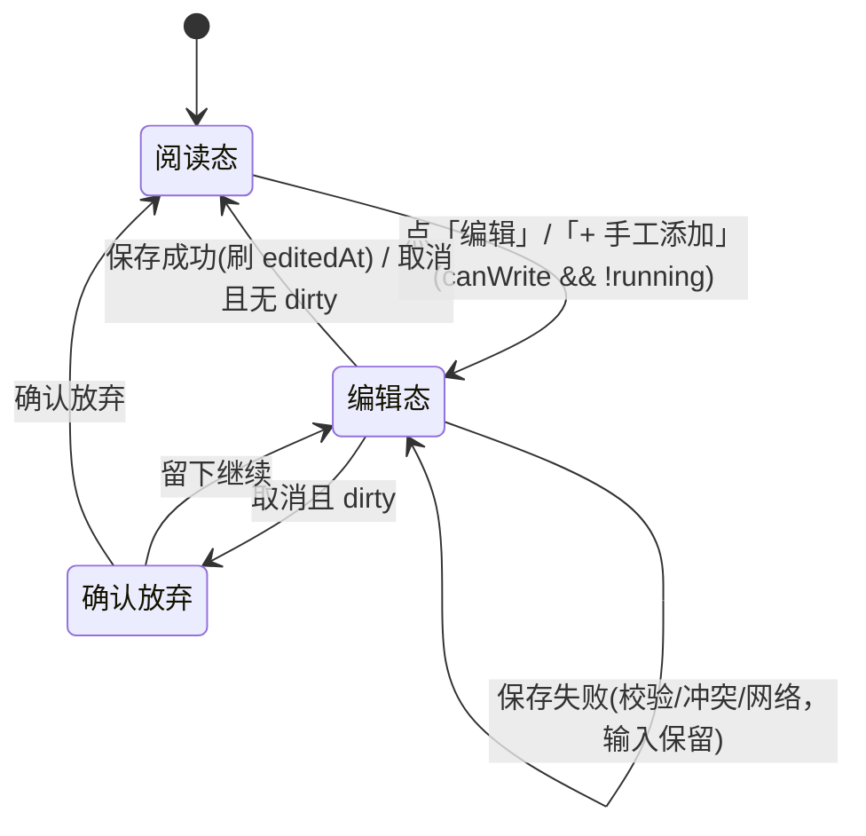
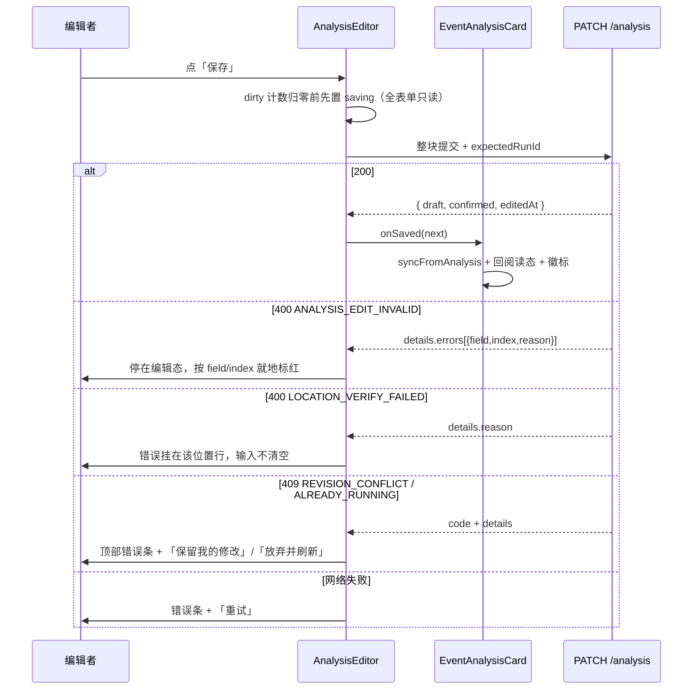

# S02 编辑态与修订标识

- 父文档：`DESIGN.md` ｜ 需求：`REQ-20261123-001` v3（R-01a/R-02/R-03/R-04/R-05/R-08/R-11/R-12/R-14/R-16/R-17）
- **依赖 S01**：写入口 `PATCH /analysis` 的字段、错误码、`editedAt` 均以 `S01_保存内核与契约_DESIGN.md` 为准，本文档不重复定义
- 修订：**r2（2026-11-23）** —— 按 `design-review.md` 修订：补组件 props 接口签名（🟡）、补编辑态节点标签按视角取词（🟡 R-16）、补重跑拦截的前端提示（🔴1 配套）、补保存时序图（🟡 触发章节）、补"重跑后徽标消失"验收（🟡）
- 修订：**r3（2026-11-23，需求 v5）** —— **结论改为不可人工编辑**（H12）：编辑态移除 summary 与因果链两块，结论区改只读 + 引导语；`AnalysisEditor` 只管未确认点与已确认位置。范围收窄见 §3.10。`design-review.md` 是 v3 期的评审报告，本轮收窄**未重新评审**
- 交互：`design/interaction-design.md`（S-01~S-10 已确认）｜界面：`requirement.md` §6 已确认

---

## 1. 术语

| 术语 | 含义 |
|---|---|
| 阅读态 / 编辑态 | 同一张 AI 分析卡的两种模式，切换不跳页、不遮罩 |
| 已人工清空 | `draft` 存在、三块皆空、`editedAt` 存在 |
| 已人工定稿 | `status ∈ {failed, partial}` 且有 `editedAt`——AI 没给出可用结论，但人补了 |
| dirty | 编辑态内存在未保存改动 |

## 2. 现状分析（AS-IS）

| 事实 | 位置 |
|---|---|
| 卡片只读：结论走 `ConclusionChain` / 纯文本 / 空态文案三分支；未确认点与已确认位置各自独立区块 | `web/src/components/governance/event-detail/EventAnalysisCard.tsx` |
| 卡头已有「重置分析」危险按钮 + 状态 chip，**编辑入口要挤进来** | 同上（2026-11-23 新增的重置段） |
| `chipOf()` 只看 `status / candidates / errorCode`，不认人工修订 | 同上 |
| 整卡早退：`!draft && confirmed.length === 0 && startSignal === 0` → 不渲染（D-02） | 同上 |
| 位置胶囊来自正文反引号（`matchConfirmedLocation`），`node.ref` 只兜底 | `ConclusionChain.tsx`、`web/src/lib/codeRef.ts` |
| 节点标签与骨架按视角取词（`kindLabel` / `viewRender`），与后端 `analysis-view.ts` 逐字比对 | `web/src/lib/analysisView.ts` |
| 只读账号已有 `canWrite` / `readOnlyHint` 传入卡片 | `EventAnalysisCard` props、`EventsPage` |
| 勾选确认已传 `discardDraft: false`，不会吞掉改过的结论 | `AiAnalyzePanel.tsx` |

## 3. 方案设计（TO-BE）

### 3.1 界面（已确认，原图内嵌）

```
阅读态
┌ ✦ AI 分析 ───────── [①编辑] [②已人工修订] [草稿 3 处] [⋯] ┐
│ 分析结论：本次定位是两个前端可独立修复的缺陷…               │
│ ├─ 现象      空链接恒回归，前端零门禁                       │
│ ├─ 根本原因  `bkm…:41-45` 回落到 BK_COMPONENT_API_URL…     │
│ └─ 建议      补路由注册 + 补网关 url 配置                   │
│ 未确认点 · 4 项                                             │
│ 已确认的相关位置 · 8 处                       [+ 手工添加]  │
└─────────────────────────────────────────────────────────────┘

编辑态
┌ ✦ AI 分析 ────────────────────────────[取消] [保存 改3处] ┐
│ ③ 一句话总结 ┌────────────────────────────────────────┐    │
│              │ 本次定位是前端空链接回归…               │    │
│              └────────────────────────────────────────┘    │
│                                            86/120 字       │
│ 因果链                                       [+ 添加节点]  │
│ ④ ┌ 现象     [____________] [↑][↓][×]                     │
│   ├ 根本原因 [____________] [↑][↓][×]                      │
│   ├ 影响面   [____________] [↑][↓][×]                      │
│   └ 建议     [____________] [↑][↓][×]                      │
│ ⑤ 未确认点 · 4 项                            [+ 添加一条]   │
│ · [全仓 grep 零命中…____________________] [×]              │
│ ⑥ 已确认位置 · 8 处（此处加/改理由，删除沿用阅读态行内 ×）  │
│ › [路径________:行号] [理由__________] [×]                 │
│ ⑧ 重置本次分析（与编辑分开：编辑是修补，重置是丢弃）        │
└─────────────────────────────────────────────────────────────┘
```

### 3.2 编辑态状态机



### 3.3 组件结构与 props 契约

| 组件 | 变动 | 职责 |
|---|---|---|
| `EventAnalysisCard.tsx` | 修改 | 模式切换、卡头动作编排（编辑 / 徽标 / chip / `⋯`）、三态文案、dirty 上抛 |
| `AnalysisEditor.tsx` | **新增** | **v5：只管两块** —— 未确认点（增删改）+ 已确认位置（新增 / 改理由）+ 保存栏；结论不在此编辑 |
| `ConclusionChain.tsx` | 只读 | 阅读态渲染不变 |
| `CodeLocRow.tsx` | 修改 | `confidence === 0` 时打「人工」标记；`editableWhy` 时可改理由 |
| `EventsPage.tsx` | 修改 | 接 `onDirtyChange`，切事件前拦一次 |

```ts
// EventAnalysisCard（在既有 props 上追加）
interface EventAnalysisCardProps {
  // …既有 scope/event/analysis/canWrite/canAsk/busy/readOnlyHint/startSignal/onUpdated/onOpenSettings/onRemoveLocation/onReset
  /** dirty 变化通知（切事件拦截用）；只在 dirty 翻转时调用，避免每键一抛 */
  onDirtyChange?: (dirty: boolean) => void;
}

// AnalysisEditor（新增；v5 起只管两块）
interface AnalysisEditorProps {
  /** 只读：用于取并发基准 `runId`，以及渲染结论只读展示 */
  draft: AnalysisDraft | null;
  confirmed: ConfirmedCodeLocation[];
  saving: boolean;
  onCancel: () => void;
  /** 成功后由卡片 syncFromAnalysis 消费，与 confirm / reset 同一出口 */
  onSaved: (next: { draft: AnalysisDraft | null; confirmed: ConfirmedCodeLocation[]; editedAt?: number }) => void;
  /** dirty 上抛（切事件拦截用）；v5 起不含结论改动 */
  onDirtyChange?: (dirty: boolean) => void;
}

// EventsPage（内部状态）
dirtyRef: MutableRefObject<boolean>;   // 切事件 / 关闭详情前检查
```

**字数上限口径（H10，2026-11-23 拍板）**：`conclusion` 计数与 `maxLength` 用 **4000**（不再 120、无软限制提示）；节点仍 ≤200 字、未确认点单条 ≤300。追问补丁的弹框不属本子需求，见 `S03_追问补丁与覆盖_DESIGN.md`。

### 3.4 卡头规则

| 元素 | 规则 |
|---|---|
| `[编辑]` | `canWrite && !running && !busy` 可点；否则禁用并 `title` 说明原因（不隐藏——隐藏会让人以为功能没了） |
| `[已人工修订]` | `draft.editedAt` 存在即显示；所有人（含 viewer）可见 |
| chip | 判定顺序：① `running` → 「分析中」（此时无 `editedAt`，因新一轮已重建 draft）；② `editedAt && status ∈ {failed,partial}` → 「已人工定稿」（`tone=ok`）；③ 其余沿用现有 `chipOf` |
| `[⋯]` | 收「重置分析」（原卡头按钮）与二期入口；菜单项沿用现有危险态样式 |

**编辑态节点标签**（R-16）：标签用 `kindLabel(view, kind)`；「+ 添加节点」按 `viewProfile(view).skeleton` 取**第一个未被占用的槽位**作为新节点默认 kind，全部占满（5 个）时菜单只列出已用槽位供增删，不提供第 6 个。

### 3.5 三态文案

| 态 | 判定 | 结论区文案 |
|---|---|---|
| 从未分析 | 无 `draft`、无 `confirmed`、`startSignal===0` | 整卡不渲染（**保持 D-02 不变**） |
| AI 没找到 | `draft` 存在、`conclusion===null`、`chain.length===0` | 「未定位到可证实的代码位置。已排查的方向与缺的证据记在下方「未确认点」里。」（现有文案） |
| ~~已人工清空结论~~ | —— | **v5 取消**：人不能改结论，补丁也不允许把结论清空（见 §3.10），这一态不再出现 |

未确认点区块：有 `editedAt` 且数组为空 → 渲染「未确认点已清空」占位；无 `editedAt` 且为空 → 沿用现有"整块不渲染"。

### 3.6 保存与失败



**dirty 判定**：与基线逐块比较（三块 + 位置增改），全等则保存按钮禁用、点取消直接回阅读态——**不发请求**（与 S01「空 patch 不写盘」对齐）。

### 3.7 重跑 / 续跑遇修订的前端提示（R-08 配套）

后端闸门见 S01 §3.5（命中 `REVISION_CONFLICT`）。前端收到后给三个选项（内联确认条，不弹窗）：

```text
「这次修改会被覆盖：结论 N 个节点 / 未确认点 M 项。已确认的代码位置不受影响。」
[ 先保存我的修改 ]  [ 仍要覆盖 ]  [ 取消 ]
```

- 「仍要覆盖」→ 带 `forceOverwrite: true` 重发 `POST /analyze`（或 `resume: true` 重发续跑）；
- 「先保存我的修改」→ 进编辑态（dirty 已被后端拒绝，草稿内容仍是最新，无需额外拉取）。

### 3.8 提交内容

前端始终**整块提交**三块 + `expectedRunId = draft?.runId ?? null`（无草稿时传 `null`，对应 S01「期望无草稿」）；`confirmed.add` 只带本次新增、`confirmed.update` 只带改过理由的项。

### 3.10 结论只读（v5 拍板 H12）

| 项 | 规则 |
|---|---|
| 编辑态组成 | **只两块**：未确认点、已确认位置；结论不出现任何输入框 |
| 编辑态结论区 | 渲染**只读**结论 + 引导语：「结论由 AI 生成；如需修改请追问，AI 会给出新结论由你确认」 |
| 阅读态 | 与现状一致（`ConclusionChain` 只读渲染） |
| 结论的写路径 | 仅 `S03` 的补丁覆盖（用户确认后走 `PATCH /analysis` 的 `conclusion` + `chain`） |
| 补丁约束 | 补丁**不允许**把 `conclusion` 设为 `null`（那是"清空结论"，不是"给新结论"）；校验规则见 S03 |
| 前端不再发送 | 人工保存只发 `unconfirmed` + `confirmed`，永不发 `conclusion` / `chain` |

**配套改动**（需求 §10 第 5~7 项）：`AnalysisEditor` 删掉 summary textarea 与因果链列表（含节点增删调序、计数、`kindLabel`/`skeletonFor` 相关逻辑），`EventAnalysisCard` 在编辑态改为渲染只读结论块；`AnalysisView` 仍用于阅读态渲染，不再传给编辑器。

## 4. 关键决策点

| # | 决策 | 选定 | 被否决方案 | 否决理由 | 重新评估触发条件 |
|---|---|---|---|---|---|
| D1 | 编辑态形态 | **卡内内联** | ①抽屉 ②独立编辑页 | ①要重排信息架构且看不到上下文（追问区）②跳出事件详情，回来还要再定位 | 单卡内容超过 2 屏，内联滚动过长 |
| D2 | 阅读态「+ 手工添加」 | **进入编辑态并聚焦位置行** | 阅读态就地弹一行独立表单 | 会多出第二条提交路径（绕过整块提交），与 H1 冲突，且冲突检测要写两遍 | 出现"只想加一个位置、不改结论"的高频诉求 |
| D3 | 修订标识 | 徽标独立 + chip 仅在 failed/partial 时接管 | 只用徽标（不接管 chip） | 不接管则"AI 失败"永远压过"人已补齐"，R-17 等于没做 | 无 |
| D4 | 编辑与重置的编排 | 编辑常驻卡头，重置收进 `⋯` | 两者并列卡头 | 4 个元素挤爆卡头，且"修补"与"丢弃"相邻易误点 | 卡头改成两行布局 |
| D5 | 未保存拦截 | 编辑态内 dirty 才拦，跨卡片由父级拦一次 | 全程 `beforeunload` 硬拦 | 硬拦会误伤"保存成功后关页"；刷新拦截只在编辑态有意义 | 出现大量"切事件后回来继续编"（需草稿暂存） |
| D6 | 重跑拦截的提示形态 | 内联确认条 + 三选项 | `window.confirm` 二选一 | 二选一表达不了"先保存再覆盖"，且项目现有确认均为内联/内联条，弹窗风格不一致 | 无 |

## 5. 异常与边界

| 场景 | 用户感知 | 恢复路径 | 阻断 |
|---|---|---|---|
| 只读账号 | 无编辑入口，徽标可见 | — | — |
| 分析运行中 | 编辑禁用 + 悬停原因 | 停止或等待 | 是 |
| 节点超 5 个 | 「已达上限」+ 添加入口禁用 | 删一个 | 是（加节点） |
| 节点文本超 200 字 | 计数变红 + 保存被拒并定位 | 缩短 | 是（该节点） |
| 未确认点超 20 条 / 超 300 字 | 同上 | 删/缩 | 是 |
| 既有结论 150 字（超模板） | 计数显示 `150/120` 但**保存按钮可用** | 可原样保存或缩短 | 否 |
| 位置路径填错 | 行内报错带真实原因 | 改填 | 是（该行） |
| 未改任何内容点保存 | 按钮禁用（dirty=false） | — | 否 |

## 6. 影响范围

```text
web/src/components/governance/event-detail/
├── EventAnalysisCard.tsx     [修改] 模式切换 / 卡头 / 三态 / ⋯ 菜单 / onDirtyChange
├── AnalysisEditor.tsx        [新增] 三块编辑器
├── CodeLocRow.tsx            [修改] 「人工」标记 + 可编辑理由
├── ConclusionChain.tsx       [只读]
web/src/api/governanceApi.ts  [修改] + saveEventAnalysisEdits(scope, eventId, patch)
web/src/pages/EventsPage.tsx  [修改] dirtyRef + 切事件拦截 + onSaved 回填
web/src/styles/governance.css [修改] .gov-dedit* 编辑态样式（视觉细节另定）
web/test/event-source-analysis.test.mjs [修改] 编辑态 / 三态 / 冲突 / 重跑提示用例
```

**验收断言**：改结论保存后刷新为新值；清空后卡片仍在且文案为"已人工清空"；`failed` 草稿补齐后 chip 变"已人工定稿"；**重跑成功后徽标与定稿标记消失**（draft 重建）；冲突后输入仍在；重跑遇修订出现三选项且"仍要覆盖"能跑通；viewer 无入口。

## 7. 待定问题

| 编号 | 事项 | 归属 |
|---|---|---|
| Q-A | 编辑态样式细节（间距 / 控件选型 / 窄屏折行） | 交 UI 设计阶段，不阻塞本文档 |
| Q-B | 「已人工定稿」是否也影响事件列表行的分析徽标（`/events/running` 的 `finished`） | 本期不做，列二期观察 |

## 8. 与设计的偏差（2026-11-23 真机走查后拍板：维持现状）

真机走查（`../../.debug/analysis-manual-edit-walkthrough-20261123/`）暴露两处与本文档 §3.1 图、§4 D4 不一致的实现，经用户拍板**不修**：

| 偏差 | 设计（§3.1 / D4） | 实际实现 | 维持理由 |
|---|---|---|---|
| 卡头收纳 | 重置收进 `⋯`，卡头 3 个元素 | 阅读态 4 个元素并列：`[编辑] [重置分析] [已人工修订] [chip]` | 1440 宽下可用；做 `⋯` 需 fixed 定位浮层（`.gov-dcard` 是 `overflow: hidden`，绝对定位会被裁），成本大于收益 |
| 保存位置 | 取消/保存在图示的卡头行 | `.gov-dedit__foot` 在卡体末尾，内容长时需滚动才见 | 同上：上移需把 `save()` 与 dirty 计数经 ref 提升到卡片，改动大于收益 |

**后续若要修，别当 bug 处理**：这两条是已知取舍，动之前先确认上面两条成本结论是否仍成立。
另有一条**既有**文案矛盾未纳入本需求：保存后卡面写「已确认 N 处」，下方 `AiAnalyzePanel` 仍写「分析完成 · 未定位到候选位置」（面板只认 `candidates`，不认人工位置）。
