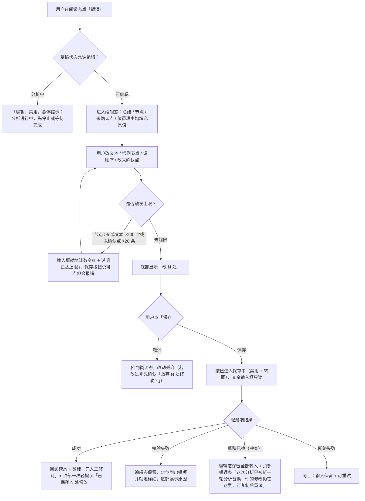
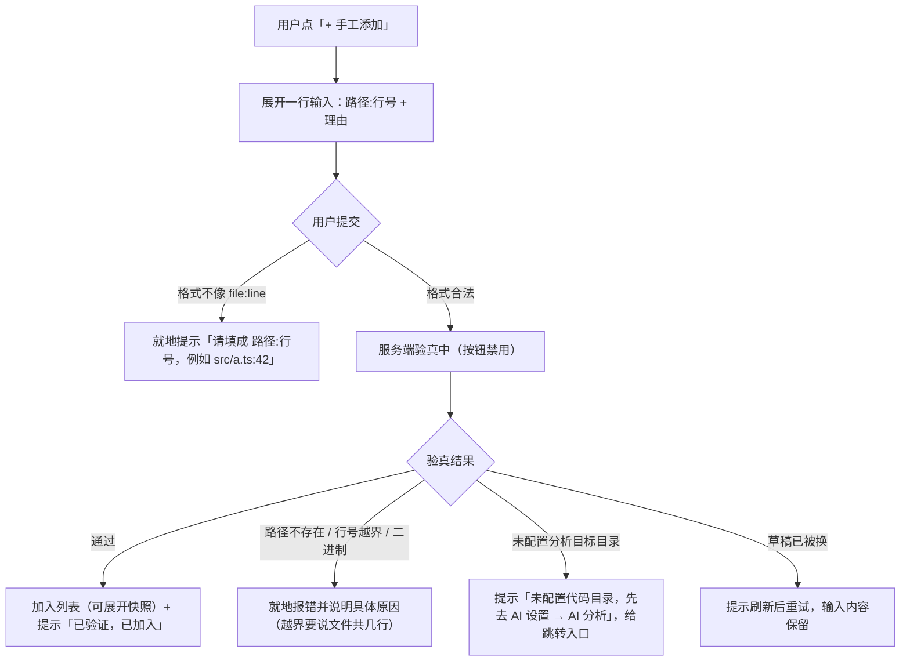
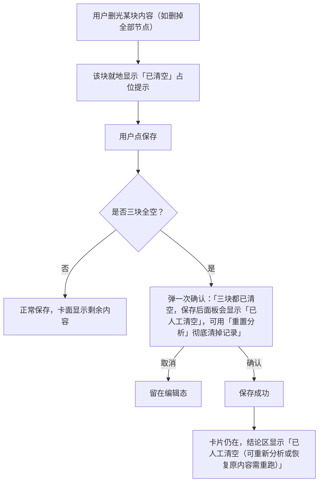
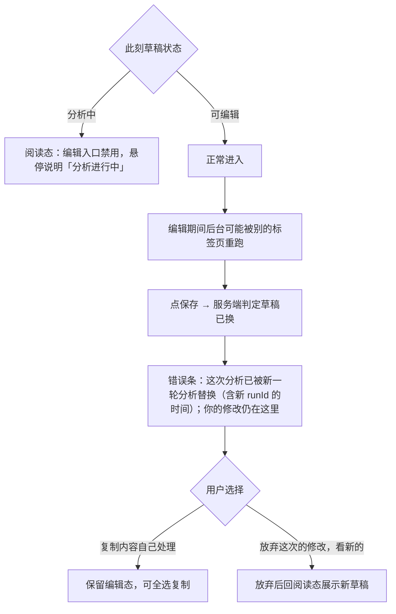
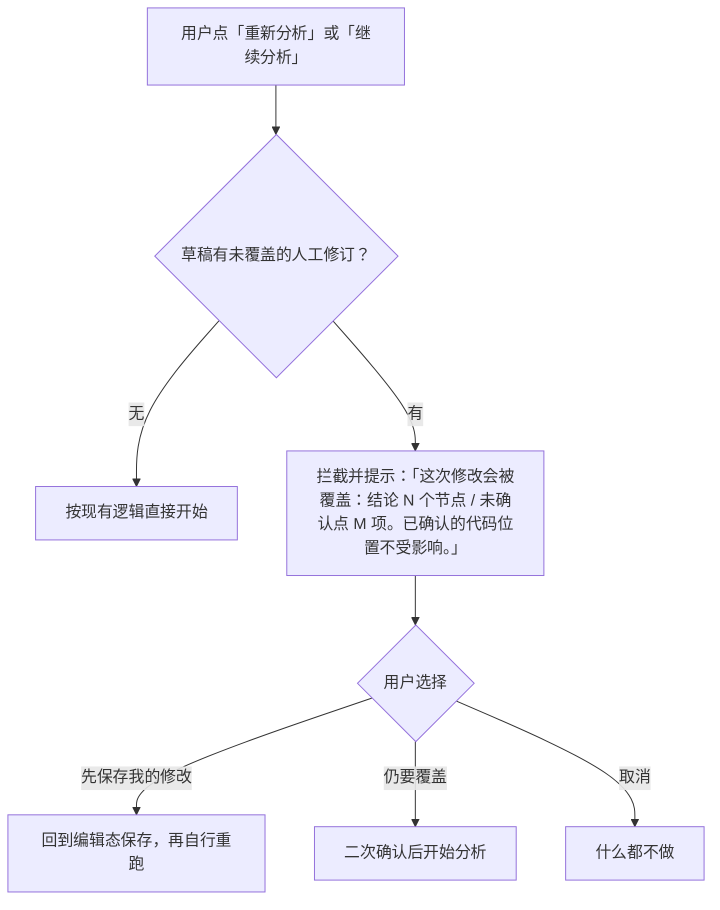

# 交互设计：AI 分析产物人工校正

> 场景类型：Web 系统（主）；MCP 读出口为次要类型（只读，无交互流程）
> 需求：`REQ-20261123-001` v3（已确认）
> 状态：草案（阶段 1-2 沿用已确认需求，视同已确认；阶段 3-6 待走查确认）

## 1. 角色与意图

| 角色 | 核心目标 | 技术熟悉度 | 交互频率 |
|---|---|---|---|
| 事件负责人（`knowledge.write`） | 把 AI 草稿修成"敢拿去交付"的结论 | 高 | 低-中（一次分析改 1~3 处） |
| 只读同事（`knowledge.ask`） | 读懂结论、继续追问 | 中 | 中 |
| AI Agent（MCP 客户端） | 读事件结论当上下文 | — | 高（无人参与） |

三条角色要点决定了设计口径：

- 编辑者是低频、目的明确的专家操作 → 不追求"编辑效率"，追求**"别改错、别丢"**；
- 只读同事看的是同一张卡 → **修订标识必须对读的人也可见**，否则他会把人工结论当成 AI 结论；
- Agent 无人参与 → 修订标识必须进机器可读字段，不能只做 UI 徽标。

## 2. 交互场景清单

| 编号 | 场景名称 | 触发条件 | 目标角色 | 优先级 | 成功标志 |
|---|---|---|---|---|---|
| S-01 | 进入编辑态并改结论 | 卡片有 `ready` / `partial` 草稿 | 编辑者 | P0 | 编辑态展开，原值已填充，光标在总结框 |
| S-02 | 节点增删 / 调序 / 改文本 | 编辑态内 | 编辑者 | P0 | 列表即时反映，计数同步 |
| S-03 | 未确认点增删改 | 编辑态内 | 编辑者 | P0 | 同上，超限即时提示 |
| S-04 | 手工新增已确认位置 | 阅读态或编辑态（草稿可空） | 编辑者 | P0 | 该位置出现在列表且可展开快照 |
| S-05 | 编辑位置理由 | 编辑态内 | 编辑者 | P1 | 刷新后理由为新值 |
| S-06 | 保存 | 有未保存改动 | 编辑者 | P0 | 卡回到阅读态，显示「已人工修订」 |
| S-07 | 保存冲突 / 运行中禁改 | 草稿已被新一轮分析替换；或分析正在跑 | 编辑者 | P0 | 明确告知原因，输入不丢 |
| S-08 | 清空内容 | 编辑态内删光某块或三块 | 编辑者 | P0 | 卡片仍在，显示"已人工清空"而非"未定位到" |
| S-09 | 只读角色查看 | `canWrite=false` | 只读同事 | P0 | 无编辑入口，无失败提示 |
| S-10 | 重跑 / 续跑遇修订 | 已有修订时点「重新分析」「继续分析」 | 编辑者 | P0 | 先提示、确认后才覆盖 |

**关联性**：S-06 依赖 S-01~S-05 的任一改动；S-08 是 S-06 的特例（清空也要保存）；S-10 前置依赖"存在修订"这一判定（S-06 的结果）。

## 3. 交互流程

### 3.1 S-01~S-03 + S-06：编辑与保存（主流程）

关键节点说明：

| 节点 | 用户感知 | 备注 |
|---|---|---|
| 进入编辑态 | 原值已填好，不是空白表单 | 空态与"AI 没给"要能区分 |
| 上限判定 | 边打边看到 `186/200 字`，红了才拦 | 不在提交时才发现 |
| 保存中 | 全表单只读，防半保存 | 三块一次提交 |
| 冲突 | **输入不丢**是硬要求 | 见 N3 / N12 |
| 成功 | 徽标 + 轻提示，不弹窗 | 与现有"分析完成"提示同风格 |

### 3.2 S-04：手工新增已确认位置

关键点：**这一条不依赖草稿**——清空分析后仍要能加（需求 R-03）。所以入口在阅读态也必须在。

### 3.3 S-08：清空

关键点：**卡片不能消失**（现在无草稿且无位置时整卡不渲染）；「已清空」与「未定位到」必须是两种文案。

### 3.4 S-07：运行中与冲突

### 3.5 S-10：重跑 / 续跑遇修订

## 4. 反馈与状态矩阵

| 节点 | 成功 | 失败 | 等待 | 空 |
|---|---|---|---|---|
| 进入编辑态 | 原值填充 + 计数 | 无草稿 → 入口不出现 | — | 三块都空时表单空白但可输入 |
| 节点编辑 | 列表即时更新、计数同步 | 超限就近标红 + 说明 | — | 节点删光 → 「已清空，可添加节点」 |
| 未确认点编辑 | 同上 | 超 300 字 / 超 20 条就近提示 | — | 「暂无未确认点」+ 添加入口 |
| 手工新增位置 | 加入列表 + 可展开快照 | 具体原因（不存在 / 越界 / 二进制 / 未配目录） | 按钮禁用 + 转圈 | 输入行空着 + 示例占位 |
| 保存 | 回阅读态 + 徽标 + 轻提示 | 校验失败（定位到项）/ 冲突（输入保留）/ 网络失败（可重试） | 全表单只读 + 按钮转圈 | — |
| 清空保存 | 「已人工清空」文案 | 同上 | 同上 | — |
| 只读角色 | 正常读，徽标可见 | 直调接口被拒 → 「只读账号无法修改」 | — | — |
| 重跑遇修订 | 覆盖后新结论 | 拦截提示 + 三选项 | 分析中进度（现有） | — |

## 5. 异常与边界处理

| 异常场景 | 触发条件 | 用户感知 | 恢复路径 | 阻断主流程 |
|---|---|---|---|---|
| 分析运行中点编辑 | 草稿 `running` | 入口禁用 + 悬停原因 | 点「停止」或等完成 | 是 |
| 保存时草稿已被替换 | 另开一轮分析 | 顶部错误条 + 输入保留 | 复制内容 / 放弃看新的 | 是（需用户选） |
| 保存时草稿已被重置 | 另开标签页点重置 | 「这次分析已被清空」+ 输入保留 | 可重新保存为一份新结论* | 否 |
| 手工位置验真失败 | 路径不存在 / 越界 / 二进制 | 具体原因 | 改填 / 放弃 | 是（该条） |
| 未配置分析目标目录 | 配置缺失 | 引导到 AI 设置 | 配完回来重试 | 是（该条） |
| 网络中断 | 请求失败 | 输入保留 + 重试按钮 | 重试 | 是 |
| 既有值超模板上限 | 旧结论 150 字 | 只能缩短，不能继续增长 | 缩短或原样保存 | 否 |
| 只读账号 | `canWrite=false` | 无入口；直调被拒 | — | — |

\* 已确认（2026-11-23）：草稿被重置后，"没有草稿"的情况下保存**允许新建草稿**（否则用户刚写的内容无处可放）。服务端行为见 `S01_保存内核与契约_DESIGN.md`。

## 6. 交互约束

| 约束类型 | 涉及操作 | 约束内容 | 用户感知 |
|---|---|---|---|
| 不可逆操作 | 重置分析 | 清空三块 + 已确认位置，不可恢复 | 二次确认，列出会失去的条目与数量 |
| 不可逆操作 | 三块全清空后保存 | 原内容被"空"覆盖 | 一次确认 + 说明可重跑恢复 |
| 前置条件 | 编辑 | 需要写权限；草稿非运行中 | 入口禁用 + 悬停说明，不隐藏（隐藏会以为功能没了） |
| 前置条件 | 手工新增位置 | 需要已配置目标代码目录 | 缺配置时给跳转入口，不只报错 |
| 确认点 | 覆盖式重跑 | 有修订时必须拦 | 提示列出"将覆盖什么、保留什么" |
| 确认点 | 放弃编辑 | 已有改动时选取消 | 「放弃 N 处修改？」 |
| 依赖顺序 | 编辑 → 追问 | 追问读的是已保存值 | 未保存时追问区提示「有未保存修改，保存后再问才能基于新结论」 |
| 频率限制 | 保存 | 保存中禁用，防重复提交 | 按钮转圈 + 全表单只读 |
| 一致性 | 全流程 | 「已人工修订」对编辑者与只读同事都可见 | 徽标在卡头 |

## 7. 待确认事项

| 编号 | 事项 | 影响范围 | 状态 |
|---|---|---|---|
| Q1 | 草稿被重置后保存，是否允许"无草稿新建"（§5 星号） | 保存语义 | **已确认（2026-11-23）：允许**，服务端新建 `manual_…` 草稿 |
| Q2 | 未保存改动时切事件 / 刷新，是否拦截 | 数据不丢 | **已确认：拦截**（编辑态 dirty 时拦一次；跨卡片由父级拦，刷新用页面离开提示） |
| Q3 | 删除单个未确认点是否需要二次确认 | 误删成本 | **已确认：不需要**（保存前可撤销） |
| Q4 | 「已人工清空」状态下是否允许直接追问 | 追问上下文为空块 | **已确认：允许 + 提示**「当前无结论，追问将不带结论」 |

---

## 质量自检

- ☑ 每个角色都有明确核心目标
- ☑ 每个场景都有成功标志
- ☑ P0 场景均有流程图（S-04/S-07/S-08/S-10 单独成图；S-01~03、S-06 合图）
- ☑ 流程图无死路（每个分支都落到"用户看到什么"）
- ☑ 关键节点具备成功 / 失败 / 等待 / 空四态
- ☑ 异常覆盖：并发、权限、配置缺失、数据过期、网络
- ☑ 不可逆操作（重置、全清空）都有确认机制
- ☑ 术语与 Web 场景一致（页面 / 卡面 / 入口 / 按钮）
- ☑ 未写接口形状与字段名（留给 `design-craft`）；未写视觉样式（留给 UI 阶段）
