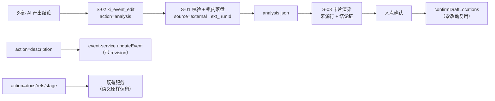
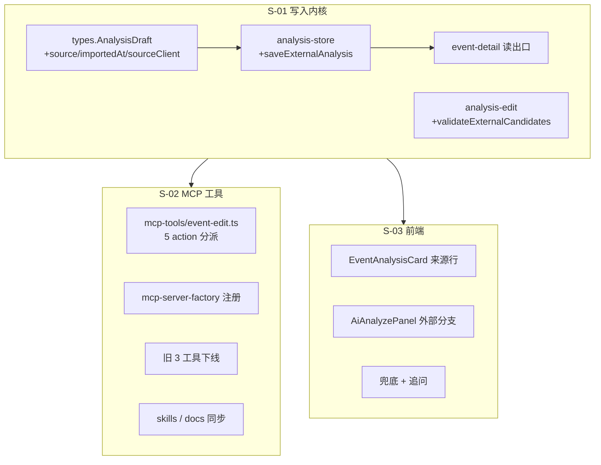

# 设计：MCP 上传事件结论 + 事件编辑工具合并

- 需求：`../requirement.md`
- 子文档：`S01_外部结论写入内核_DESIGN.md` / `S02_MCP合并编辑工具_DESIGN.md` / `S03_前端来源展示与确认_DESIGN.md`

## 1. 需求背景 & 目标

事件结论目前只由站内 AI 跑批产生，外部 AI 无法写回。本设计新增一条 MCP 写入通道，让外部结论复用同一份存储、同一套校验、同一个确认流程，仅以 `source` 区分来源；同时把 3 个事件写工具合并为 `ki_event_edit`（单值 `action`），把调用面从 4 收敛到 1。

目标：外部结论进得来、看得清来源、确认得了、不覆盖掉站内结论。

⛔ 不在范围：不开 HTTP / open-api 通道；不做撤销上传；不做结论人工编辑；不做多来源细分；不改分析 runner 生成逻辑；不做版本历史。

## 2. 关键环节一览图

## 3. 总体方案设计

**共享术语速查**

| 术语 | 定义 | 归属 |
|---|---|---|
| 外部结论 | `draft.source === 'external'`，由 MCP 上传、无分析过程 | S-01 |
| 来源标识 | 卡头的「来源 + 时间」一行，二元（AI / MCP） | S-03 |
| 覆盖闸门 | 覆盖已有 AI 结论必须带 `overwrite` | S-01（校验）/ S-02（参数） |
| ext_ runId | 外部产物标识前缀，与 `run_` / `manual_` 并列 | S-01 |
| 单值 action | 一次调用只做一类事，禁止混做 | S-02 |

**非功能性默认假设（全局）**：单机部署；同一事件的写入串行（既有写锁 + `operation-coordinator`）；单次上传载荷 ≤ 50 KB；结论链 ≤ 5 节点、候选 ≤ 20 条；不新增网络请求（来源随详情接口返回）。超出上述量级需另行确认。

**子需求间接口引用**：S-02 调用 S-01 的 `saveExternalAnalysis`（服务层内部函数，非 HTTP 契约）；S-03 消费 S-01 透出的 `source` / `importedAt` / `sourceClient`。父文档不重复声明函数签名，以子文档为唯一真源。

## 4. 全局风险 & 跨子需求依赖

| 风险 | 说明 | 处理 |
|---|---|---|
| 跨文件无事务 | 描述写 `{eventId}.json`、结论写 `{eventId}.analysis.json`，两锁两版本 | 单值 action 从根上禁止混做 |
| 契约三处漂移 | 后端类型 / 后端契约 / 前端契约 | 契约测试逐字段比对兜底 |
| 前端白屏 | 外部产物 `stats`/`candidates`/`unconfirmed` 可能缺 | S-03 全部兜底 + 服务端补默认值（双保险） |
| 旧工具名残留 | skills 提示词写死旧名，失效是静默的 | S-02 交付项含 grep 校验 |
| 覆盖丢数据 | 外部覆盖会替换 AI 结论 | 必须显式 `overwrite`；`confirmed[]` 不清空 |

**依赖 DAG**：S-01 → S-02（接口级：`saveExternalAnalysis` 签名）｜S-01 → S-03（数据级：`source`/`importedAt` 字段）。S-02 ∥ S-03（目录互斥）。
