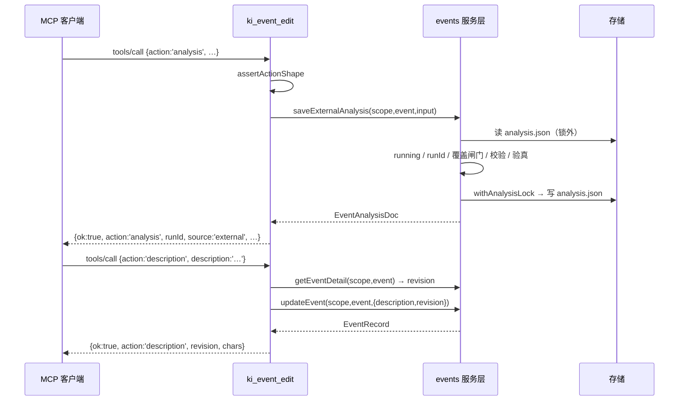

# S-02 MCP 合并编辑工具

承接：R1 R9（参数侧）R10 R11 R13｜依赖：S-01（`saveExternalAnalysis`）｜被依赖：无

## 1. 术语

| 术语 | 定义 |
|---|---|
| 单值 action | `action` 只接受一个枚举值，一次调用只做一类事 |
| 覆盖参数 | `overwrite: true`，覆盖已有非外部结论的必要条件 |
| 资产同步 | 仓库外 skills 提示词里的工具名更新（`~/.codebuddy/skills/` 为副本非软链） |

**非功能性默认假设**：单次调用 payload ≤ 50 KB；写操作由 `operation-coordinator` 串行调度（不在读表即 write）；工具超时 60s（`TOOL_TIMEOUT.WRITE`）。

## 2. 现状（AS-IS）

| 工具 | 位置 | 语义要点 |
|---|---|---|
| `ki_event_docs` | `src/lib/mcp-tools/event-docs.ts` | `add` 绑定（分类变 event、可见性随阶段）；`remove` **解绑不删除** |
| `ki_event_refs` | `src/lib/mcp-tools/event-refs.ts` | 只建引用；`add` 逐条调用（整批会一条冲突带走全部） |
| `ki_event_set_stage` | `src/lib/mcp-tools/event-set-stage.ts` | 终态按 `terminalAction` 处理成员文档（`trash` = 进回收站）；必须回显 `visibility` |
| 注册 | `src/lib/mcp-server-factory.ts:83-104` | 写工具块；只读会话不注册 |
| 白名单 | `src/lib/mcp-tools/tool-access.ts:37-49` | 读工具白名单（写工具 fail-safe 不登记） |
| 调度 | `src/lib/operation-coordinator.ts:152-162` | 不在读表内即按 write 串行 |
| 描述更新 | `src/lib/events/event-service.ts:406-431` + `event-detail.ts:280` | `updateEvent` 需 `revision`；detail 已透出 `revision` |
| 外部引用 | `~/.codebuddy/skills/event-report`（16 处）、`agents-md-init`（3 处 + 模板 1 处） | 写死旧工具名，改名即静默失效 |

## 3. 方案（TO-BE）

### 3.1 工具契约

`src/lib/mcp-tools/event-edit.ts`（新增）

```ts
server.tool(
  'ki_event_edit',
  '编辑事件：description=改描述 / analysis=上传结论 / members=挂或解绑关联文档 / references=增删参考文档 / stage=流转阶段。一次只做一类，按 action 传对应字段；analysis 必须带 candidates。注意：members 的 remove 只是解绑（文档仍可检索、不删除）；stage 到终态会按类型设定处理关联文档，trash 类型会把文档移入回收站（不可自动撤销）。',
  {
    scope: z.string().optional().default('default'),
    event: z.string(),                                     // evt_… 或 #N
    action: z.enum(['description', 'analysis', 'members', 'references', 'stage']),

    // ── description ──
    description: z.string().optional(),                    // ≤4000（服务层校验）

    // ── analysis ──
    conclusion: z.string().optional(),                     // ≤4000
    chain: z.array(ChainNodeInput).optional(),             // ≤5 节点
    candidates: z.array(CandidateInput).optional(),        // ★ 必填，≥1；允许剔除时至少 1 条有效
    unconfirmed: z.array(z.string()).optional(),           // ≤20 × ≤300
    targetDir: z.string().optional(),                      // 必须等于配置根
    overwrite: z.boolean().optional(),                     // 覆盖非外部结论必须 true
    skipInvalidCandidates: z.boolean().optional(),         // 默认 false = 整批失败
    expectedRunId: z.string().nullable().optional(),

    // ── members / references ──
    docRefs: z.array(DocRef).min(1).max(50).optional(),    // ★ 不叫 docs：避免与 action 值同名
    docAction: z.enum(['add', 'remove']).optional(),

    // ── stage ──
    stage: z.string().optional(),
    note: z.string().optional(),
  },
  handler,
);
```

子 schema：

```ts
const ChainNodeInput = z.object({
  kind: z.enum(['symptom', 'cause', 'root', 'impact', 'fix']),
  text: z.string(),
  ref: z.string().optional(),               // 必须能在 candidates 内命中
  branches: z.array(z.string()).optional(), // 仅 root，≤3
});
const CandidateInput = z.object({
  file: z.string(),
  line: z.number().int().min(1),
  endLine: z.number().int().optional(),
  why: z.string(),
  confidence: z.number().min(0).max(1).optional(),
});
const DocRef = z.object({ group: z.string(), name: z.string() });
```

> action 值用 `members` / `references` 而非 `docs` / `refs`：`docs` 若同时是参数名与枚举值，模型极易把「action 值」和「文档清单」混为一谈（旧工具里 `action:'add'` + `docs:[]` 已经踩过一次命名歧义）。

### 3.2 action 与字段的互斥（工具层 fail-loud）

| action | 必填 | 允许 | 禁止（传了即报错） |
|---|---|---|---|
| `description` | `description` | — | chain / candidates / unconfirmed / docRefs / docAction / stage |
| `analysis` | `candidates`（≥1）+ 至少一个结论块 | conclusion / chain / unconfirmed / targetDir / overwrite / skipInvalidCandidates / expectedRunId | docRefs / docAction / stage / description |
| `members` | `docRefs` + `docAction` | — | description / chain / stage |
| `references` | `docRefs` + `docAction` | — | description / chain / stage |
| `stage` | `stage` | note | description / chain / candidates / docRefs |

校验函数 `assertActionShape(args)`，失败抛 `INVALID_ARGS`（由 `toolError` 包装成 `{ok:false, code, error}`），错误信息点名「action=analysis 需要 candidates 且至少 1 条」。

### 3.3 分派



各 action 复用的既有服务（**工具层不重写业务**）：

| action | 服务 | 说明 |
|---|---|---|
| `description` | `getEventDetail` + `updateEvent`（`event-service.ts:406`） | 工具内先取 `revision`（`event-detail.ts:280`）；冲突返回可重试提示，**工具内自动重试 1 次**（重读 revision 后再写），仍冲突才报错 |
| `analysis` | `saveExternalAnalysis`（S-01） | 覆盖闸门、验真、锁全在服务层 |
| `members` | `bindMembers` / `unbindMember`（`events/members.ts:125`） | 原 `ki_event_docs` 逻辑原样迁入 |
| `references` | `addRefs`（逐条）/ `removeRef`（`events/refs-service.ts`） | 保留逐条语义 |
| `stage` | `transitionEvent`（`event-service.ts`） | 保留 `terminalAction` / `visibility` 回显 |

### 3.4 返回结构

统一外壳：`{ ok, scope, event: { id, shortId, title? }, action, hint, ...分类负载 }`；错误统一 `{ ok:false, code, error, details? }`。

```json
// action=description
{ "ok": true, "scope": "default", "event": { "id": "evt_01J8X2", "shortId": "#82" },
  "action": "description", "revision": 8, "chars": 1268, "retried": false,
  "hint": "描述已更新（1268 字）" }

// action=analysis
{ "ok": true, "scope": "default", "event": { "id": "evt_01J8X2", "shortId": "#82" },
  "action": "analysis", "runId": "ext_m3k9x1_a1b2c3", "source": "external",
  "importedAt": 1795500000000, "overwritten": true,
  "nodes": 5, "candidates": 4, "dropped": [], "unconfirmed": 7, "confirmedKept": 8,
  "hint": "结论已上传（5 节点 / 4 处位置）；已确认位置保留 8 处，可在页面确认新候选" }

// action=members（add）
{ "ok": true, "action": "members", "bound": 2, "skipped": [], "failed": [],
  "visibility": { "mode": "hidden" },
  "hint": "已挂上 2 篇；当前阶段不可检索：语义与全文都搜不到，这是阶段设计的预期行为（不是写入失败）" }

// action=stage
{ "ok": true, "action": "stage", "from": "排查中", "to": "已修复", "closed": true,
  "terminalAction": "keep", "affected": { "docs": 3, "failed": 0 }, "visibility": { "mode": "full" },
  "hint": "已流转到「已修复」；3 篇关联文档按类型设定处理（keep=回长期保留）" }
```

### 3.5 旧工具下线与资产同步

| 步骤 | 动作 |
|---|---|
| 1 | 删除 `src/lib/mcp-tools/event-docs.ts`、`event-refs.ts`、`event-set-stage.ts` |
| 2 | `src/lib/mcp-server-factory.ts:84-89` 三处注册替换为 `registerEventEditTool(server)` |
| 3 | `docs/mcp-tools.md` 中三个工具条目合并为一条 `ki_event_edit`（含 5 action 用法与参数名） |
| 4 | `~/.codebuddy/skills/event-report/{SKILL.md,reference.md}`、`~/.codebuddy/skills/agents-md-init/{SKILL.md,AGENTS-template.md}` 内旧工具名改为 `ki_event_edit` + 对应 action |
| 5 | 重装 skills（副本非软链），并 `grep -r "ki_event_set_stage\|ki_event_docs\|ki_event_refs" ~/.codebuddy/skills` 应为 0 |
| 6 | `AGENTS.md` 若引用旧工具名同步（当前 0 命中，仅记录） |

> `tool-access.ts` 与 `operation-coordinator.ts` **无需改动**：写工具不在读白名单（fail-safe），非读表默认按 write 串行。

## 4. 影响范围

| 文件 | 改动 |
|---|---|
| `src/lib/mcp-tools/event-edit.ts` | 新增（5 action + 互斥校验 + 返回组装 + 描述重试） |
| `src/lib/mcp-server-factory.ts` | 注册替换（3 → 1） |
| 三个旧工具文件 | 删除 |
| `src/lib/mcp-tools/util.ts` | 不改（复用 `withTimeout` / `TOOL_TIMEOUT.WRITE`） |
| `docs/mcp-tools.md` | 工具清单一节改写 |
| 用户级 skills 4 个文件 | 工具名同步 |
| `test/mcp-event-edit.test.ts`（新增） | 5 action 正例 + 6 类互斥反例 + 旧工具不存在 |

## 5. 关键决策点

| # | 决策 | 被否决方案 | 否决理由 | 重新评估触发条件 |
|---|---|---|---|---|
| D-06 | 单值 `action`，禁止一次混做 | 一次调用同时改描述 + 传结论 | 描述写 `{eventId}.json`、结论写 `analysis.json`，两文件两锁无事务；混做只能「部分成功不回滚」，AI 无法判断该重试还是该放弃 | 若引入跨文件编排层并支持补偿，可放宽 |
| D-07 | 工具名 `ki_event_edit` | `ki_event_update` / 保留 4 工具 / 拆成 2 个（字段类 + 关系类） | 4 工具调用面过碎（用户明确要求合并）；拆 2 个仍需模型先选工具再选 action，收益减半；`edit` 与本仓 `ki_edit_relation` 命名一致 | 若 action 增至 8 类以上，重新评估拆分 |
| D-08 | `description` 由工具内部取 `revision` | 要求调用方先 `ki_event_get` 再传 `expectedRevision` | 多一步且 AI 极易漏传；内部取一次即可覆盖绝大多数场景，真冲突时自动重试 1 次 | 出现高频并发编辑同一事件 |
| D-09 | 旧 3 工具**直接删除** | 保留旧名做别名转发 | 双份维护；且模型会在旧名与新名间随机选，反而更难排查 | 若存在无法升级的外部客户端（需先盘点） |
| D-10 | 工具层只做分派与翻译，业务全在服务层 | 在工具层拼装校验与写盘 | 两套校验必然漂移（`scope-policy` 单测、契约测试都只覆盖服务层） | 无 |
| D-17 | action 值用 `members` / `references`，清单参数名 `docRefs` | action 用 `docs` / `refs` + 参数 `docs` | 枚举值与参数名同名，模型容易把 `docs:[]` 当成 action 宾语；旧工具 `action:'add'` + `docs:[]` 已有一次歧义 | 若外部客户端已按旧名对接（本期无） |

## 6. 异常处理

| 场景 | 行为 | 是否对外暴露 |
|---|---|---|
| `action` 与字段不匹配 | `ok:false` + `INVALID_ARGS`，指出缺哪个字段 / 多了哪个字段 | 是 |
| 事件不存在 / 已删除 | `EVENT_NOT_FOUND` | 是 |
| 描述超 4000 字 | `EVENT_DESCRIPTION_TOO_LONG`（服务层抛，工具透传） | 是 |
| 描述并发冲突 | 自动重读 revision 重试 1 次；仍冲突 → `REVISION_CONFLICT` + hint「事件刚被改过，重试即可」 | 是 |
| 分析进行中 | `ANALYSIS_ALREADY_RUNNING` + hint「先停止或等结束」 | 是 |
| 覆盖未带参数 | `ANALYSIS_DRAFT_EXISTS` + hint「如需覆盖请传 overwrite=true」 | 是 |
| 候选位置验真失败 | `ANALYSIS_LOCATION_VERIFY_FAILED` + details（第几条、原因） | 是 |
| 候选全部被剔除 | `ANALYSIS_CANDIDATE_ALL_DROPPED` | 是 |
| `targetDir` 不在配置根内 | `ANALYSIS_TARGET_OUT_OF_ROOT` | 是 |
| scope 传视图名 | 写操作被拒（`assertNotScopeView`），返回对应错误码 | 是 |
| 文档单条绑定失败 | `failed[]` 逐条返回，其余继续（不整批失败） | 是 |
| 参考文档与关联文档冲突 | `skipped[{reason:'already-associated'}]`，不报错 | 是 |
| 阶段到终态且 `terminalAction=trash` | 正常流转，返回 `terminalAction` + `affected`，hint 明确「文档已进回收站」 | 是 |
| 工具超时 | `withTimeout` 抛超时，`ok:false` + `TIMEOUT` | 是 |

## 7. 待定问题

| # | 问题 | 处理 |
|---|---|---|
| Q-1 | MCP 客户端可能缓存 `tools/list`，下线后仍尝试旧名 → 404 | 在 `docs/mcp-tools.md` 与迁移说明中提示「升级后重启客户端」；工具不存在时 SDK 自身报 Unknown tool，无额外处理 |
| Q-2 | 工具描述同时承载 5 个 action 的必填说明，长度会挤压模型注意力 | 描述只留一句总述 + 各 action 关键必填（`analysis` 必须 `candidates`），细节放 `docs/mcp-tools.md` |
| Q-5 | 单次 50 条 `docRefs` + 逐条 `withTimeout(WRITE)` + 索引摘除调度，是否逼近 60s 上限未实测 | 实施期用 50 条实测一次；若超时，把 `docRefs` 上限降到 20 或 `members.add` 改走服务层批量（`bindMembers` 本身支持批量） |
