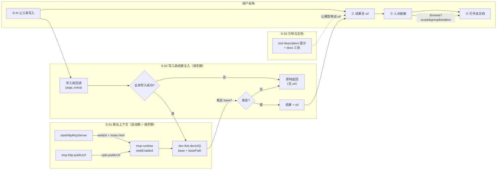
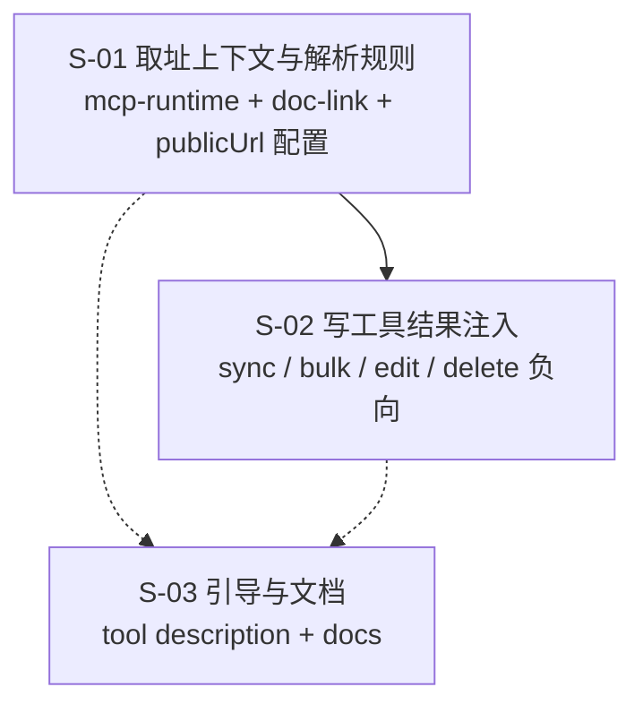

# DESIGN：MCP 写工具返回文档访问链接

> v2（2026-11-23）：按设计评审修订——一览图补子需求编号与用户视角、补非功能性假设、`url` 归属统一到工具层、`publicUrl` 与 `basePath` 契约更新。

## 1. 需求背景 & 目标

**背景**：AI 通过 MCP 写工具改完文档后，人要「打开浏览器 → 切到对应库 → 展开目录 → 找到文档」才能复核，4~6 步。daemon 已能同时提供 Web 页面（`--web`），但没有一条直达地址回到具体文档。

**目标**：写工具**成功**时在结果里加 `url` 字段，值形如 `http://<host>:<port>/browse?scope=..&group=..&relation=..`，点开直达正文。

**已拍板**：U1 取址「Host 为默认、`publicUrl` 为显式覆盖」（评审后修订）｜U2 无前端则**省略字段**｜U3 `url` 绝对地址、批量逐条｜**U4 不加开关，默认开启**（要关就 `--no-web`）｜U5 删除不给链接｜U6 不含读工具｜U7 根目录 `group=__root__`｜U8 一律给。

**非功能性假设（默认值，超出需重评）**：单机单 daemon、写工具调用频次与现状一致（≤ 数十次/分钟）；链接生成是**纯内存字符串操作**，无 IO、无锁、不吃 embedding；不引入新持久化；daemon 为明文 HTTP，TLS 由反代终止。

**不在范围内**：前端任何改动；`ki_search`/`ki_get_module_info`/`ki_recall` 等读工具；`ki_store`/`ki_bulk_store`（向量层无浏览落点）；事件工具链接（另立 R8）；永久短链 / docId 路由；CLI 写命令输出。

## 2. 关键环节一览图

用户视角 4 步：**① AI 写入 → ② 结果里拿到链接 → ③ 点击 → ④ 浏览器打开该文档**。



## 3. 总体方案设计



**共享术语速查**（定义归子文档，此处只列归属）

| 术语 | 一句话 | 定义处 |
|------|--------|--------|
| 文档链接 `url` | 指向 `/browse?scope&group&relation` 的绝对地址 | S-01 |
| 取址 `base` | `协议://主机[:端口]`，**恒无路径** | S-01 |
| `basePath` | 站点子路径（`/ki` 或 `''`），承载 `publicUrl` 的子路径与 `x-forwarded-prefix` | S-01 |
| web 可用 | 进程启动时判定的布尔快照（含 `index.html` 存在性） | S-01 |
| 显式覆盖 | 配了 `publicUrl` 就整段以它为准，不看请求头 | S-01 |
| canonical group | 实际落盘用的 group 路径（根为 `__root__`） | S-02 |
| 注入点 | 工具层组装返回体的位置，不在业务层 | S-02 |

## 4. 全局风险 & 跨子需求依赖

| 风险 | 影响 | 证据 / 处置 |
|------|------|------------|
| ~~U1 字面顺序不可实现~~ | — | **已拍板**：采用「配置 = 显式覆盖」（S-01 D-02），需求 §5 U1 已同步改写 |
| **`webDir` 非空 ≠ 前端可用**：产物缺失时仍赋值（`mcp-http.ts:1354-1363`） | 生成必然 404 的链接 | `webEnabled` 判据必须含 `index.html` 存在性（S-01 D-03） |
| **`publicUrl` 带子路径会被 `pathname` 覆盖**（评审 B1） | 反代子路径场景链接必坏 | `base` 恒无路径 + `basePath` 单独承接（S-01 D-04，§3.6 有验收样本） |
| **`group` 未回显**：`SyncRelationResult` 无 group 字段（`sync-relation.ts:1626-1651`） | 只能拿入参猜，与落盘值可能不一致 | S-02 在业务层补加性字段 `group`（唯一允许碰业务层的一处） |
| **`edit` 链路缺 group**：`ki_edit_relation` 后续轮次只传 `edit_id` | finish/view 拼不出链接 | S-02 要求各分支回显 `group`/`relation`（`view` 已有，`edit-relation.ts:94-95`） |
| **三处装配触碰**（传输层置位 / 业务层回显 / 工具层注入） | 遗漏则静默无链接（不报错） | 每子文档独立验收；S-02 测试覆盖「未置位时不出现字段」 |
| **链接失效后用户看到什么未定义**（评审 W6） | 文档改名后旧链接的效果未知，用户可能卡住 | S-03 增一条实测验收：打开旧链接，把浏览页实际提示记录并确认可读 |
| 客户端不转述 `url` | 功能白做 | S-03 只改 tool description；客户端采纳度不可控（关键假设 A3） |

### 4.1 接口契约速查（签名唯一权威在此，子文档引用不自造）

```ts
// S-01：src/lib/mcp-tools/doc-link.ts
export interface DocTarget { scope: string; group: string; relation: string }
export interface DocLinkContext { requestInfo?: { headers: Record<string, string | string[] | undefined> } }
export interface WebRuntime { webEnabled: boolean; publicUrl: string | null }

export function docUrl(target: DocTarget, ctx: DocLinkContext, runtime?: WebRuntime): string | undefined;
export function withUrl<T extends object>(result: T, url: string | undefined): T & { url?: string };
/** **仅供单测**（生产无调用方） */
export function resolveBase(ctx: DocLinkContext, runtime?: WebRuntime): { base: string; basePath: string } | null;

// S-01：src/lib/mcp-runtime.ts
export function setWebRuntime(next: WebRuntime): void;
export function getWebRuntime(): WebRuntime;
export function resetWebRuntime(): void;   // 仅测试

// S-02：业务层只加「事实字段」，不加 url
// SyncRelationResult 成功分支：+ group: string        ← 落盘事实，永远返回
// ki_edit_relation 各 action：+ group / + relation     ← 落盘事实
// 工具层返回体：+ url?: string                          ← 由 withUrl() 附加，取不到时字段不存在
```

**契约变化**：`url` **只由工具层附加**（`withUrl`），业务层类型不出现 `url`；业务层只新增 `group`（`SyncRelationResult`）与 `group`/`relation`（`ki_edit_relation`）。均为加性，MCP 客户端与既有直调单测不受影响。

**daemon 透传已核实**：`daemon-rpc.ts:571` 对同步类操作原样 `send({ result: outcome.result })`，无字段白名单 ⇒ stdio 桥接会话也能拿到新增字段。
