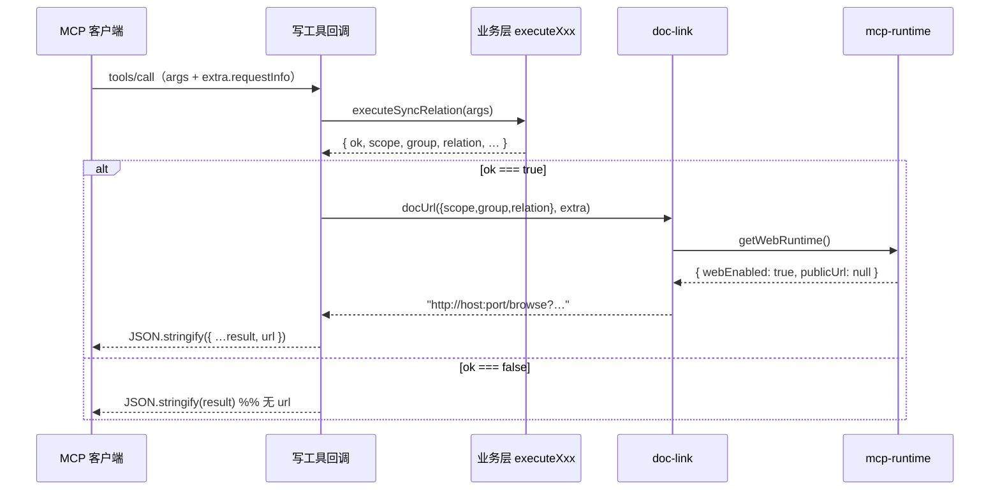

# S-02 写工具结果注入

> v2（2026-11-23）：按设计评审 B2 / G2 / W6 修订——`url` 归属统一到工具层、补 `lifecycle=event` 口径、补链接失效的可见行为验收。
> 依赖 S-01：`docUrl()` / `withUrl()` / `webEnabled` 快照。S-01 未落地时本子需求无法验证。

## 1. 术语

| 术语 | 定义 |
|------|------|
| **注入点** | 工具回调组装返回体的最后一步（`src/lib/mcp-tools/*.ts`），**不在** `executeXxx` 业务函数里 |
| **canonical group** | 实际落盘用的 group 路径：入参归一化后的值；留空时是保留键 `__root__`（`import-path.ts:35`） |
| **成功条目** | 批量中既非 `skipped` 也没有 `skipReason` 的 item |
| **负向不注入** | 删除类操作永不产出 `url`（U5）：链接必然 404 |

## 2. 现状（AS-IS）

### 2.1 六个写工具的返回构造（**无统一包装函数**）

| 工具 | 位置 | 现返回 |
|------|------|--------|
| `ki_sync_relation` | `mcp-tools/sync-relation.ts:38-40` | `JSON.stringify(result)`；`result` 成功分支**无 `group`**（`sync-relation.ts:1626-1651`） |
| `ki_bulk_sync_relation` | `mcp-tools/bulk-sync-relation.ts:34-36` | `BulkSyncRelationResult`；**每 item 已有 `group`+`relation`**（`sync-relation.ts:466-494`） |
| `ki_edit_relation` | `mcp-tools/edit-relation.ts:43` | 按 action 分支：`view` 已含 `group`+`relation`（`edit-relation.ts:94-95`）；**`edit`/`finish`/`cancel` 都不含**（`:55-57`/`:133-136`/`:158`/`:126`） |
| `ki_delete_relation` | `mcp-tools/delete-relation.ts:26-28` | 删除结果 |
| `ki_store` / `ki_bulk_store` | — | **不在本需求范围**：只写向量索引，无 KB 落点 |

### 2.2 回调签名

```
async (args) => ...            ← 当前全部 6 个工具（例：sync-relation.ts:21）
                               ⇒ 丢弃了 SDK 的第二参数 extra
```

`extra.requestInfo` 的结构与可用性见 S-01 §2；本子需求只负责**把它接住并传下去**。

## 3. 方案（TO-BE）

### 3.1 注入矩阵（唯一真相表）

| 工具 | 注入条件 | `target` 取值 | 备注 |
|------|---------|--------------|------|
| `ki_sync_relation` | `result.ok === true` | `{ scope: result.scope, group: result.group, relation: result.relation }` | 依赖 §3.2 补 `group` |
| `ki_bulk_sync_relation` | 顶层 `ok === true` | 逐条：`{ scope: 顶层 scope, group: item.group, relation: item.relation }` | item 带 `skipped`/`skipReason` 时**不注入** |
| `ki_edit_relation` | `action ∈ {edit, view, finish}` 且结果 `ok === true` | `{ scope, group: result.group, relation: result.relation }` | `cancel` 不注入；依赖 §3.3 补字段 |
| `ki_delete_relation` | **永不注入** | — | 代码里留一行注释说明原因（U5），防止后人"顺手补齐" |
| `ki_store` / `ki_bulk_store` | **不改** | — | 无落点（`store.ts:43-49`） |

> 顶层 `ok === false` 但 `results[]` 有部分成功时：**对成功条目照常注入**（用户已能点进去看），失败条目不注入。

> **`lifecycle=event` 时只给文档链接**（评审 G2）：一条结果里同时出现「文档链接」与「事件页链接」会让模型两处都贴、用户不知点哪个；事件页链接见 R8，另期实现。

### 3.2 `ki_sync_relation` 补 `group`

`src/sync-relation.ts`：

```ts
// 类型（1233-1238 成功分支）
| { ok: true; scope: string; group: string; relation: string; ... }

// 返回（1626-1631）
return {
  ok: true,
  scope,
  group,          // ← 新增：canonical 值（留空落根时即 '__root__'）
  ...result,
  ...
};
```

`group` 变量在 `:1361` 已归一（`normalizeGroupKeyForWrite(...)`，留空 → `ROOT_GROUP_KEY`），正是落盘值；**不要**用 `resolveGroupPath` 的 `resolvedPath`（那只是提示，不改落点，`:1403-1410`）。

### 3.3 `ki_edit_relation` 补 `group`/`relation`

`src/edit-relation.ts` 四个分支中 `draft.group` / `draft.relation` 一直在手边，只在 `view` 分支被回显（`:94-95`）。为 `edit`（`:55-57`、`:66-68`）、`finish`（`:133-136`、`:140`、`:158`）、`cancel`（`:126`）各补：

```ts
group: draft.group, relation: draft.relation,
```

### 3.4 工具层改动模式（4 个文件同一形态）

```ts
// 例：mcp-tools/sync-relation.ts
async (args, extra) => {
  try {
    const result = await withTimeout(executeSyncRelation({...}), TOOL_TIMEOUT.WRITE, 'ki_sync_relation');
    if (!result.ok) return { content: [{ type: 'text', text: JSON.stringify(result, null, 2) }] };
    const url = docUrl({ scope: result.scope, group: result.group, relation: result.relation }, extra);
    return { content: [{ type: 'text', text: JSON.stringify(withUrl(result, url), null, 2) }] };
  } catch (err) { /* 原样 */ }
}
```

- `docUrl` / `withUrl` 内部**吞掉所有异常**：链接失败不得影响写入结果的返回。
- 批量：`results.map((item) => (isSkipped(item) ? item : withUrl(item, docUrl(targetOf(item), extra))))`。

## 4. 接口设计

```ts
// doc-link.ts（S-01 提供）
export function docUrl(target: DocTarget, ctx: DocLinkContext): string | undefined;
export function withUrl<T extends object>(result: T, url: string | undefined): T & { url?: string };
```

**契约变化（加性，全部可选）**

| 类型 | 变化 | 持有方 |
|------|------|--------|
| `SyncRelationResult` 成功分支 | `+ group: string`（落盘事实，永远返回） | **业务层**（`sync-relation.ts`） |
| `ki_edit_relation` 各 action 结果 | `+ group: string`、`+ relation: string` | **业务层**（`edit-relation.ts`） |
| 工具层返回体（4 个写工具） | `+ url?: string` | **仅工具层**，由 `withUrl()` 附加 |

> **`url` 不进业务层类型**：`SyncRelationResult` / `BulkSyncResultItem` 都**不**声明 `url`；工具层用泛型 `withUrl<T>(result, url): T & { url?: string }` 附加。这样 CLI 输出与既有直调单测完全不变（评审 B2 已按此统一）。

**Demo 返回示例（仅示意）**

```json
// ki_sync_relation
{ "ok": true, "scope": "monitor-memory", "group": "项目踩坑点",
  "relation": "APIResource把ReadTimeout转成BKAPIError导致超时判定失效",
  "vectorStored": true, "url": "http://127.0.0.1:7433/browse?scope=monitor-memory&group=%E9%A1%B9%E7%9B%AE%E8%B8%A9%E5%9D%91%E7%82%B9&relation=APIResource%E6%8A%8AReadTimeout%E8%BD%AC%E6%88%90BKAPIError%E5%AF%BC%E8%87%B4%E8%B6%85%E6%97%B6%E5%88%A4%E5%AE%9A%E5%A4%B1%E6%95%88" }

// ki_bulk_sync_relation（片段）
{ "ok": true, "scope": "s1", "succeeded": 2, "failed": 1,
  "results": [
    { "group": "a", "relation": "x", "vectorStored": true, "url": "http://h:7433/browse?scope=s1&group=a&relation=x" },
    { "group": "a", "relation": "y", "skipped": true, "skipReason": "内容未变" },
    { "group": "a", "relation": "z", "vectorStored": false, "vectorReason": "…" }
  ] }
```

### 4.1 时序图



批量时序的差异只有一处：`docUrl` 在 `results[]` 上**逐条调用**，一次请求内 `getWebRuntime()` 结果相同（纯读，无状态）。

## 5. 异常处理

| 场景 | 行为 | 是否对外暴露 |
|------|------|------------|
| `ok:false` / 抛异常 | 不注入；异常仍按现有 `isError` 分支返回 | 是（原有错误文案） |
| `webEnabled=false` | 不注入（字段不出现，**不返回空串**） | 否 |
| `extra.requestInfo` 缺失（stdio） | 不注入 | 否 |
| 批量中 `skipped:true` / 有 `skipReason` | 该条不注入，其余照常 | 否 |
| 批量顶层 `ok:false` 但 `results[]` 有成功条 | 成功条照常注入 | 否 |
| `group` 为 `__root__` | 正常注入（浏览页认这个键） | 否 |
| `docUrl` 抛错 | 内部捕获 → `undefined` → 不注入 | 否 |
| 同一文档被反复写入 | 每次返回同一条链接（幂等，无状态） | 否 |
| 链接生成后文档被改名/移动/删除 | 链接照常返回（快照语义，N7）；打开后由浏览页给出「未找到」提示并可继续浏览（评审 W6 要求实测确认该提示可读） | 是（浏览页提示） |

## 6. 影响范围

| 文件 | 改动 |
|------|------|
| `src/sync-relation.ts` | 成功分支补 `group`；`SyncRelationResult` 类型补 `group` |
| `src/edit-relation.ts` | `edit`/`finish`/`cancel` 分支补 `group`/`relation` |
| `src/lib/mcp-tools/sync-relation.ts` | 接 `extra`；注入 `url` |
| `src/lib/mcp-tools/bulk-sync-relation.ts` | 接 `extra`；逐条注入 |
| `src/lib/mcp-tools/edit-relation.ts` | 接 `extra`；按 action 注入 |
| `src/lib/mcp-tools/delete-relation.ts` | **不改行为**，只加一行「永不注入」注释 |
| `test/mcp-doc-url.test.ts` | 新增：单条/批量/删除/无 web/stdio 五组 |
| （人工验收，无代码） | 实测「文档改名后打开旧链接」：记录浏览页实际提示，若不可读则回写 S-03 改文案（评审 W6） |

**测试构造方式**：沿用既有手法——直接调 `_registeredTools[name].handler(args, extra)`（见 `test/mcp-event-tools.test.ts` 文件头说明），`extra` 造 `{ requestInfo: { headers: { host: '127.0.0.1:7433' } } }`；`webEnabled` 用 `setWebRuntime()` 置位、`resetWebRuntime()` 清理。

## 7. 关键决策点

| # | 决策 | 被否决方案 | 否决理由 | 重新评估触发条件 |
|---|------|-----------|---------|----------------|
| D-01 | 注入在**工具层** | 在 `executeSyncRelation` 等业务函数里拼 | 会污染 `ki sync-relation` CLI 输出；业务函数将依赖 HTTP 请求上下文；200+ 直调单测要改 | 出现非 MCP 的调用方也需要链接（如 `/open/v1` 写接口）时重议 |
| D-02 | 结构化字段 `url` | 把地址塞进既有 `hint` 文本 | 模型可能改写成别的措辞、用户要从长句里抠、结构化客户端无法直接取 | 无 |
| D-03 | 批量**逐条** `url` | 顶层 `urls: string[]` | 客户端要做下标映射，且与 item 脱钩后无法表达"这条被跳过了"（用户已选 U3-A） | 批量条目数常态 > 20、token 成本成为问题时 |
| D-04 | 删除类**永不注入** | 也返回 `url`（文档已删，点了 404） | 死链比没链接更糟；且会诱导模型说「已删除，去看看」 | 无 |
| D-05 | `group` 由业务层回显而非工具层用入参 | 工具层直接用 `args.group` | 入参可能留空/带首尾斜杠，落盘是 `__root__`/归一值；用入参会生成打不开的链接 | 无 |

## 8. 待定问题

| # | 问题 | 影响 | 处置 |
|---|------|------|------|
| Q1 | `ki_edit_relation` 的 `edit` 首轮与 `finish` 是否都该给 `url` | 无（给了更好：多轮编辑时用户随时想回看） | 按 §3.1 全给；若嫌噪音，只保留 `finish` |
| Q2 | `url` 字段名是否用 `browseUrl` 更明确 | 客户端兼容（无契约校验，改名零成本） | 本期用 `url`（U3 已定） |
| Q3 | 批量 20 条的 token 膨胀是否需要"只给前 N 条" | 输出体积 | 不做，先按 U3-A 实测（关键假设 A5） |
