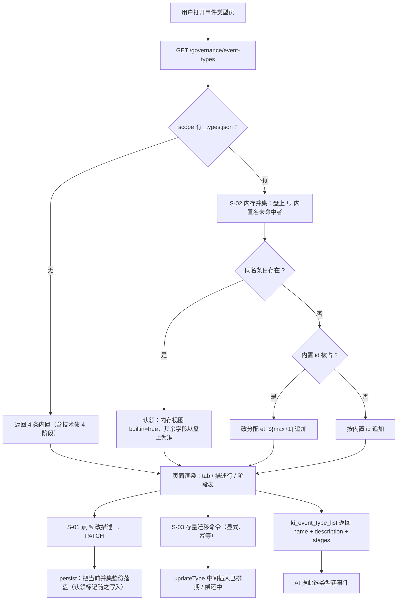
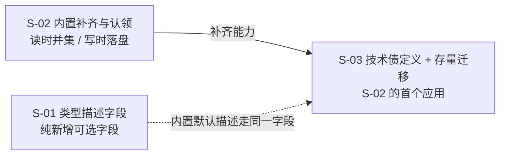

# 设计文档：事件类型内置化与类型描述

需求：REQ-20261123-007 ｜ 需求文档：[../requirement.md](../requirement.md)
状态：设计中 ｜ 作者：AI ｜ 日期：2026-11-23

---

## 1. 需求背景 & 目标

事件类型目前只有三条内置（bug 排查 / 性能优化 / 需求实现），「技术债」只能由用户在页面上自建，导致 AI 上报时被硬塞进「需求实现」并用一句 `分类：技术债` 兜着。同时类型没有描述字段，人看不出「这个类型装什么」，AI 只能靠名字猜。

**目标**：① 技术债转为内置；② 类型可描述并贯通到 MCP；③ 技术债阶段补齐中间态；④ 已有库（含 `kisearch-memory`）平滑获得上述能力。

**不在范围内**：AI 分析视角表（`et_4` 落 `generic` 符合预期）；`fallbackDays` 兜底清理实现（事件 #76）；`updateType` 的 builtin 守卫与重名校验（事件 #77）；「认账不修」独立终态；`event-report` skill 文案同步。

---

## 2. 关键环节一览图

---

## 3. 总体方案设计

三个子需求的改动面互不重叠：S-01 加字段与 UI；S-02 只动 `type-service.listTypes` 与 `deleteType` 守卫、`refs-service` 一处替换；S-03 只动 `builtin-types` 常量 + 新增迁移命令。共享术语见 §4.3。

**非功能性默认假设**（本次未做专项设计，超出以下量级需重新评估）：单机单进程部署；单库事件类型数量 ≤ 50（`listTypes` 每次读做一次并集，复杂度 O(内置数 × 盘上数)，内置数为个位数）；类型描述 ≤ 200 字；存量迁移按库串行执行，不做批量编排。

---

## 4. 全局风险 & 跨子需求依赖

| 风险 | 说明 | 缓解 |
|---|---|---|
| 读路径写盘 | 补齐若在 `listTypes` 内落盘，会把「读」变成「写」，且任何只读 token 都会触发磁盘写入 | S-02 强制「读时并集不落盘，写时随 `persist` 落盘」 |
| 内置定义升级不生效 | 已认领条目的 `name/stages/description` 以盘上为准，改代码常量对老 scope 无效 | 显式迁移命令（S-03），不做隐式覆盖 |
| 可见性判定被牵连 | `visibility-index` 消费 `listTypes`；返回集合变化等于改档位判定 | 已有测试 `visibility-batch` / `visibility-sr03` 覆盖，S-02 必须回归 |
| 契约双源 | `src/lib/governance-contract.ts` 与 `web/src/api/{governanceApi,governanceContract}.ts` 三处镜像 | 同步改并由 `governance-contract.test.ts` 对账 |
| 子需求依赖 | S-03 依赖 S-02 的补齐能力（否则新库拿不到技术债）；S-01 独立 | 实施顺序 S-01 → S-02 → S-03 |

### 4.3 共享术语速查

| 术语 | 定义 | 归属 |
|---|---|---|
| **内置类型** | 代码常量 `buildBuiltinTypes` 定义的类型，带 `builtin: true`，不可删除 | S-02 |
| **认领（claim）** | 盘上已有与内置同名条目时，把该条目的 `builtin` 视为 `true`，id 与其余字段保持盘上值 | S-02 |
| **补齐（merge）** | `listTypes` 返回「盘上 ∪ 内置名未命中者」，纯内存、不写盘 | S-02 |
| **转正** | 认领结果随下一次任意写操作经 `persist` 落盘，`builtin: true` 进入 `_types.json` | S-02 |
| **中间插入** | 在已有两阶段之间插入新阶段；现有 `updateType` 允许（长度只增、已有 key 不消失） | S-03 |
| **类型描述** | `EventTypeRecord.description`，≤200 字，供人阅读与 AI 选型 | S-01 |
| **内置默认描述** | `builtin-types.ts` 中每条内置自带的描述文案；已被用户改过的以盘上为准 | S-01 / S-03 |

### 4.4 契约变更汇总

| 变更 | 位置 | 内容 | 子需求 |
|---|---|---|---|
| 新增字段 | `EventTypeRecord` | `description?: string` | S-01 |
| 新增常量 | `types.ts` | `EVENT_TYPE_DESCRIPTION_MAX_CHARS = 200` | S-01 |
| 新增字段 | `EventTypeDto` / `EventTypeView` / web 契约镜像 | `description?: string` | S-01 |
| 新增入参 | `POST` / `PATCH /governance/event-types` | `description?: string` | S-01 |
| 新增出参 | `ki_event_type_list` | `types[].description?` | S-01 |
| 行为变更 | `listTypes` | 返回盘上 ∪ 内置补齐结果（仍不写盘） | S-02 |
| 行为变更 | `deleteType` 守卫 | 删除判定只认 `builtin` 字段，去掉 `BUILTIN_EVENT_TYPE_IDS` 兜底 | S-02 |
| 行为变更 | `refs-service.lookupType` | 由 `readEventTypes` 改为 `listTypes`（消除双源） | S-02 |
| 新增命令 | CLI | `ki events migrate-types --scope <s> [--dry-run] [--yes]` | S-03 |
| 数据变更 | `builtin-types.ts` | 新增 `et_4` 技术债（4 阶段 + 默认描述）；三条内置补默认描述 | S-03 |

### 4.5 待定问题汇总

| 编号 | 问题 | 影响 | 决策时间 | 负责人 |
|---|---|---|---|---|
| T-01 | 迁移命令是否需要在 Web 设置页给入口 | S-03 | 实施前 | 用户 |
| T-02 | 描述编辑是否支持 Markdown | S-01 | 实施前 | 用户 |
