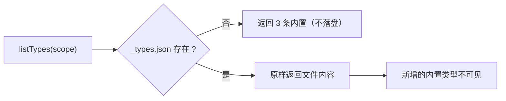
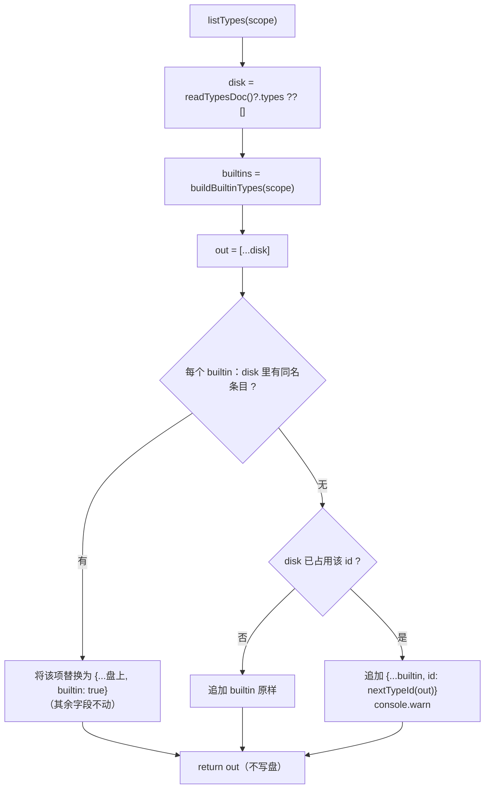
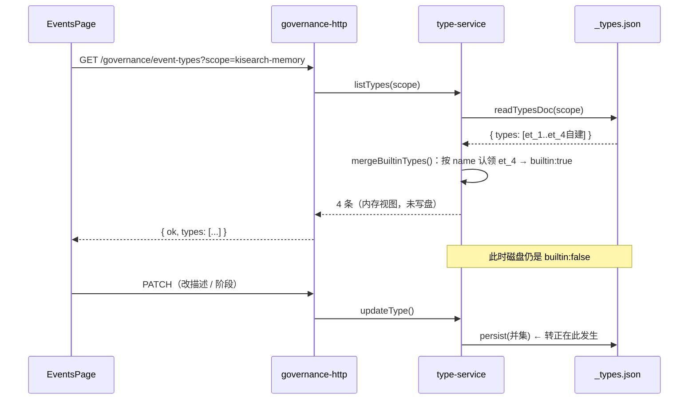

# S-02 内置类型补齐与认领

父文档：[DESIGN.md](DESIGN.md) ｜ 需求：[../requirement.md](../requirement.md)

一句话：让「内置类型」不再只在 `_types.json` 缺失时生效 —— 读时把内置补进内存视图（按 name 认领同名条目），写时随 `persist` 一起落盘。

---

## 1. 术语

| 术语 | 含义 | 引用 |
|---|---|---|
| 补齐（merge） | `listTypes` 返回「盘上 ∪ 内置名未命中者」，纯内存、不写盘 | 父文档 §4.3 |
| 认领（claim） | 盘上已有与内置同名条目时，该条目在内置视图中视为 `builtin: true`，id 与其余字段保持盘上值 | 父文档 §4.3 |
| 转正 | 认领结果随下一次任意写操作经 `persist` 落盘 | 父文档 §4.3 |
| 内置清单 | `buildBuiltinTypes()` 返回的内置记录（S-02 单独落地时为 3 条；S-03 加入技术债后为 4 条） | — |
| 盘上视图 | `readTypesDoc(scope)?.types ?? []`，原样从 `_types.json` 读出的数组 | — |

---

## 2. 现状（AS-IS）

### 2.1 现状描述

```typescript
// src/lib/events/type-service.ts:30-35
export function listTypes(scope: string): EventTypeRecord[] {
  const doc = readTypesDoc(scope);
  if (doc && Array.isArray(doc.types) && doc.types.length > 0) return doc.types;
  return buildBuiltinTypes(scope, nowMs());   // 不落盘
}
```

- 内置只是**缺省值**：文件一旦存在，内置定义对该 scope 永久失效。
- `persist`（`type-service.ts:51-56`）在首次写操作时把**当前视图**整体落盘，因此 `createType` / `updateType` / `deleteType` 都会顺手把内置快照写进文件（携带当时的 `createdAt`）。
- 删除守卫（`type-service.ts:234-236`）同时看 `target.builtin` 与固定 id 列表 `BUILTIN_EVENT_TYPE_IDS`。

### 2.2 痛点

- **新内置永远到不了已有库**：本次新增 `et_4` 技术债，`kisearch-memory` 的 `_types.json` 已存在且无该条目 → 改 `builtin-types.ts` 对它零效果。🟢 实测该 scope 只有 4 条（3 内置 + 1 自建技术债）。
- **固定 id 守卫会误伤**：`BUILTIN_EVENT_TYPE_IDS` 一旦加入 `et_4`，任何 scope 里恰好占用 `et_4` 的自定义类型都会变成「不可删除」，而它其实与内置无关。
- **双源判定**：`visibility-index.ts:234` 走 `listTypes`（含内置），`refs-service.ts:739` 走 `readEventTypes`（只有盘上）→ 新 scope 在两条路径上得到不同的阶段可见性。该不一致是既有缺陷，本次补齐会把差异放大。
- **读路径不能写盘**：`type-service.ts:14` 明确「读路径不建目录」，直接调用方包含只读 token 的 MCP 工具。

### 2.3 AS-IS 流程图



---

## 3. 方案（TO-BE）

### 3.1 方案概述

`listTypes` 改为返回**内存并集**：以盘上视图为基准，按 `name` 认领同名内置（只补 `builtin: true`），未命中的内置按 id 追加（id 被占则改分配）。全程不写盘；`persist` 因为收到的就是并集，三处调用点无需改动即可完成转正。

### 3.2 关键决策点

| 决策 | 选择 | 理由 | 备选方案 | 否决原因 | 重新评估触发条件 |
|---|---|---|---|---|---|
| 补齐时机 | 读时内存并集 + 写时落盘 | 读路径零写入，只读 token 安全；转正随下一次写自然完成 | 读时直接写盘 | 违反「读路径不建目录」，且 GET 会变成写操作，只读 token 会 403 或产生非预期写入 | 无 |
| 补齐时机（备选二） | 同上 | — | 启动时一次性迁移 | 启动迁移无法覆盖运行中新增的 scope，且失败时无人察觉；服务启动路径不应承载数据修复 | 无 |
| 认领判据 | 按 `name` 精确匹配（trim 后） | 名称是用户唯一感知的标识；`et_4` 是分配出来的，跨库语义不稳定 | 按 `id` 认领 | `et_N` 是 `nextTypeId` 顺序分配，不同库的 `et_4` 可能是完全不同的类型，按 id 认领会张冠李戴 | 引入稳定 `key` 字段后可改按 key |
| 已认领条目的字段权威 | 以盘上为准（name / stages / description / terminalAction 全用盘上值，只补 `builtin`） | 用户对内置做过的阶段与可见性调整必须保留；否则每次读都会打回代码常量，等同「改了立刻失效」 | 以代码为准覆盖盘上 | 会静默回滚用户的全部自定义，包括本次要让来的 4 阶段迁移 | 需要对内置做强制升级时（走显式迁移命令） |
| id 冲突处理 | 不认领，改分配 `et_${max+1}` 追加 | 不同名的 `et_4` 与内置技术债无关，不能顶替；追加能保证两者都在 | 顶替盘上条目 | 会让「线上事故」变名成「技术债」，事件绑定全部错乱 | 无 |
| 删除守卫 | 只认 `builtin` 字段 | `builtin` 在认领后由视图正确给出，固定 id 列表反而是误伤源 | 保留双条件并加入 `et_4` | 见 §2.2 误伤；且 `et_4` 在别的库可能是别的类型 | 无 |
| `refs-service` 是否同步改 | 改为 `listTypes` | 消除双源：引用文档可见性应与索引判定同口径（`visibility-index` 已用 `listTypes`） | 保持 `readEventTypes` | 新 scope 下两条路径给出不同档位，属静默不一致（`visibility-index.ts:227` 有同类事故记录） | 无 |

### 3.3 TO-BE 流程图



### 3.4 行为差异对照表

| 场景 | AS-IS | TO-BE | 影响 |
|---|---|---|---|
| 新 scope（无 `_types.json`） | 返回 3 条内置 | 返回 4 条内置（含技术债） | 预期内 |
| 有文件但缺某内置 | 该内置不可见 | 补齐可见，`builtin: true` | 本次要解决的核心 |
| 有文件且有同名条目 | 该条目 `builtin: false`，可删 | 视图中 `builtin: true`，不可删；其余字段不变 | 用户库的技术债「转正」 |
| 有文件且 id 被不同名条目占用 | 无冲突（内置本来就不出现） | 内置改分配新 id 追加 | 两类型并存，需文案提示 |
| `deleteType` 删 `et_4`（非内置库） | 若 id 在 `BUILTIN_EVENT_TYPE_IDS` 则拒绝 | 只看 `builtin` → 该条目 `builtin: false`，正常删除 | 修复误伤 |
| 引用文档可见性（新 scope） | `readEventTypes` 空 → 一律 full | `listTypes` → 按内置阶段档位 | 修复静默不一致 |
| `visibility-index` 档位判定 | 已用 `listTypes` | 不变（返回集合可能变大） | 需回归 |

---

## 4b. 数据模型

不新增持久化字段。`_types.json` 结构不变（`EventTypesDoc { version, revision, types }`）。

补齐结果落盘的唯一路径是现有 `persist`（`type-service.ts:51-56`），它收到的 `types` 已是并集，因此 `createType:138` / `updateType:223` / `deleteType:247` **三处调用点无需修改**。

---

## 4a. 接口设计

```typescript
// src/lib/events/type-service.ts

/** 当前类型视图：盘上 ∪ 内置补齐（按 name 认领）；不写盘 */
export function listTypes(scope: string): EventTypeRecord[];

/** 内部：把内置合入盘上视图 */
function mergeBuiltinTypes(scope: string, disk: EventTypeRecord[]): EventTypeRecord[];
```

| 接口 | 输入 | 输出 | 异常 |
|---|---|---|---|
| `listTypes` | `scope: string` | `EventTypeRecord[]`（盘上 ∪ 补齐） | `readTypesDoc` 损坏时抛错（沿用现状） |
| `mergeBuiltinTypes` | `scope`, `disk` | 新数组 | 无（id 冲突只 warn） |

```typescript
// src/lib/events/refs-service.ts:739  改动
// 改前
const typesById = new Map(readEventTypes(scope).map((t) => [t.id, t]));
// 改后
const typesById = new Map(listTypes(scope).map((t) => [t.id, t]));
```

### 5. 时序图（GET 事件类型）



---

## 6. 异常处理

| 场景 | 行为 | 是否对外暴露 |
|---|---|---|
| `_types.json` 损坏 | `readTypesDoc` 抛错（现状），整条链路 500 | 是（沿用） |
| 内置 id 被不同名条目占用 | 改分配 `et_${max+1}`，`console.warn` 一条 | 否（日志） |
| 盘上存在两条同名条目（历史脏数据） | 认领第一条，第二条保持原样；不合并、不删除 | 否 |
| 认领后用户改名 | 下次读时不再命中 name → 该条目退回 `builtin: false`，同时补齐一条新内置 | 否（属用户主动行为） |
| 并集导致类型数增长 | 视图模式下 `buckets[].total` 随之变化 | 是（预期） |

---

## 7. 迁移策略

**无需数据迁移。** 补齐是读时行为，存量库在下一次任意写操作（改描述、改阶段、建删类型）时自动转正。若希望立即落盘而不改任何业务字段，可发一次 `PATCH { revision }`（空 patch，仅推进 revision）。

### 回滚方案

删除 `/root/knowledge-indexer/src/lib/events/type-service.ts` 中的 `mergeBuiltinTypes` 调用、恢复 `listTypes` 原实现即可回到旧行为。**已落盘的 `builtin: true` 不会回滚**（它们是历史事实）；若需撤销，需手工把对应条目的 `builtin` 置回 `false`。

---

## 8. 影响范围

| 影响对象 | 影响类型 | 影响描述 | 破坏性 |
|---|---|---|:--:|
| `src/lib/events/type-service.ts` | 行为变更 | `listTypes` 返回并集；`deleteType` 守卫去掉固定 id 条件 | 否 |
| `src/lib/events/builtin-types.ts` | 无改动 | 认领比较内联在 `mergeBuiltinTypes`，不新增导出（`BUILTIN_EVENT_TYPE_IDS` 的删除属 S-03） | 否 |
| `src/lib/events/refs-service.ts` | 行为变更 | `lookupType` 改走 `listTypes`，新 scope 也拿到内置档位 | 否（修复） |
| `src/lib/visibility-index.ts` | 行为变更（被动） | 消费 `listTypes`，返回集合可能变大 | 否 |
| `src/lib/governance-http.ts` | 行为变更（被动） | 视图模式逐库 `listTypes`、文档列表阶段名索引 | 否 |
| `src/lib/mcp-tools/event-type-list.ts` / `event-create.ts` | 行为变更（被动） | AI 可见类型变多 | 否 |
| `test/events-sr02.test.ts` | 测试 | 需补「新内置在已有文件 scope 可见」「认领后不可删」「id 冲突改分配」 | — |
| `test/visibility-batch.test.ts` / `visibility-sr03.test.ts` | 回归 | 档位判定依赖 `listTypes` | — |

---

## 9. 测试方案

| 类型 | 范围 |
|---|---|
| 单元 | ① 无文件 → 4 条内置；② 有文件且缺技术债 → 补齐；③ 同名 → 认领（`builtin: true` 且 stages 保持盘上 2 段）；④ id 被不同名占用 → 新分配 id；⑤ 补齐不写盘（断言文件 mtime 不变） |
| 集成 | 视图模式逐库补齐后的 `typeKey` 与 `buckets.total`；`refs-service` 双源消除后引用文档档位与 `visibility-index` 一致 |
| 回归 | `events-sr02` / `visibility-batch` / `visibility-sr03` / `mcp-event-tools` / `governance-view-events` |

不在测试范围：多进程并发写（已有 `withScopeWriteLock` 保证）。

---

## 10. 待定问题

无。
