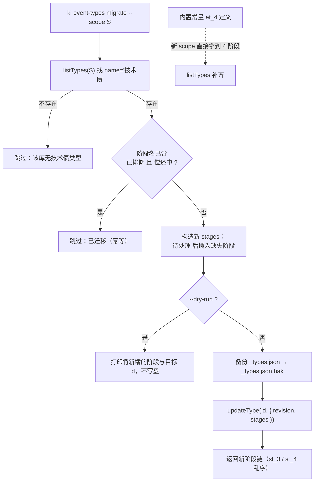
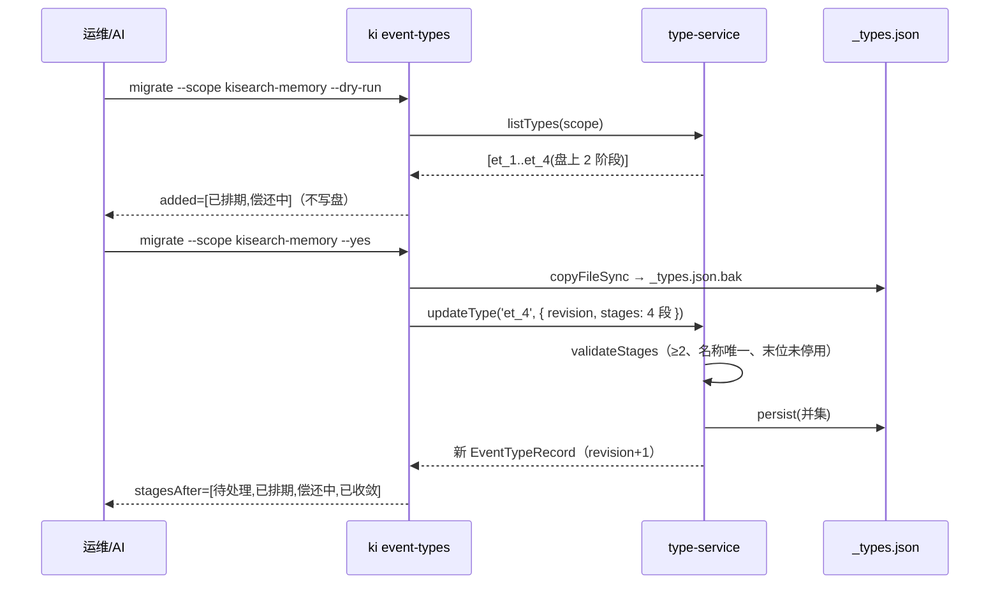

# S-03 技术债内置定义与存量迁移

父文档：[DESIGN.md](DESIGN.md) ｜ 需求：[../requirement.md](../requirement.md)

一句话：把「技术债」写进 `builtin-types.ts`（4 阶段 + 默认描述），并提供一个显式、幂等、可 dry-run 的命令，把存量 scope 的两阶段版本中间插入成四阶段。

---

## 1. 术语

| 术语 | 含义 | 引用 |
|---|---|---|
| 技术债类型 | `name = '技术债'` 的事件类型；用户库里是自建（`builtin: false`），本次转为内置 | 父文档 §4.3 |
| 中间插入 | 在已有阶段之间插入新阶段；`updateType` 允许（长度只增、已有 key 不消失） | 父文档 §4.3 |
| 迁移 | 把存量两阶段技术债插成四阶段的一次性动作 | — |
| stageKey 乱序 | 迁移后新阶段拿到 `st_3` / `st_4`，位置却在 `st_2` 之前 | — |

---

## 2. 现状（AS-IS）

### 2.1 现状描述

- `src/lib/events/builtin-types.ts:16` 定义 `BUILTIN_EVENT_TYPE_IDS = ['et_1', 'et_2', 'et_3']`；`buildBuiltinTypes`（`:22-75`）返回三条内置，均 `fallbackDays: 90`、阶段可见性按 `hidden → fts-only → full` 递进。
- 技术债在 `kisearch-memory` 是用户自建：`et_4`、`builtin: false`、阶段 `[待处理(hidden), 已收敛(full)]`、`terminalAction: keep`（MCP 实测）。
- `BUILTIN_EVENT_TYPE_IDS` 的唯一消费点是 `type-service.ts:234` 的删除守卫；S-02 已把该守卫改为只认 `builtin` 字段，因此该常量在 S-02 之后成为死代码。

### 2.2 痛点

- **技术债只能自建**：`event-report/reference.md:105` 把「技术债、重构、依赖升级」塞进「需求实现」+ `分类：技术债`，AI 上报口径与真实语义错配。
- **两阶段无法表达「在还」**：`待处理 → 已收敛` 之间是黑箱，看板回答不了「下个迭代还哪几笔」。
- **页面无法插入中间阶段**：`EventsPage.tsx:1193-1201` 只有「＋追加阶段」（加在末尾）；`updateType` 本身支持中间插入，但缺少入口。

---

## 3. 方案（TO-BE）

### 3.1 方案概述

① 在 `builtin-types.ts` 增加 `et_4` 技术债（4 阶段 + 默认描述），删除已成死代码的 `BUILTIN_EVENT_TYPE_IDS`；② 新增 `ki event-types migrate --scope <s>`，按阶段名做幂等检测，在「待处理」之后插入「已排期」「偿还中」。

### 3.2 关键决策点

| 决策 | 选择 | 理由 | 备选方案 | 否决原因 | 重新评估触发条件 |
|---|---|---|---|---|---|
| 阶段数量 | 4 段：待处理 → 已排期 → 偿还中 → 已收敛 | 技术债生命周期是「登记 → 排期 → 偿还 → 收敛」，`已排期` 与 `偿还中` 是它区别于 bug/需求的核心；与三条内置的阶段数（4/4/3）同量级 | 3 段（去掉已排期） | 少了排期，看板上全部堆在「待处理」，无法回答「下个迭代还哪几笔」 | 实际使用中「已排期」阶段事件数长期为 0（≥30 天） |
| 终态可见性 | `已收敛 = full` | 与三条内置一致：收口后复盘文档应长期可检索 | 保持 fts-only | 已收口的技术债复盘价值最高，藏起来等于白写 | 无 |
| 首阶段可见性 | `待处理 = hidden` | 与三条内置同构；债未认领时不应被语义召回污染上下文 | full | 会让「刚登记、没人管」的文档占据检索结果 | 无 |
| 迁移入口 | 新增 CLI `ki event-types migrate` | 一次性运维动作，不该藏在 UI；CLI 已有同类模式（`tag.ts` / `group.ts`），`bin/ki.mjs` 的 `COMMANDS` 映射加一行即可 | 启动时自动迁移 | 服务启动路径承载数据修复，失败无人察觉，且新 scope 无意义 | 无 |
| 迁移入口（备选二） | 同上 | — | 页面加「插入阶段」按钮 | 属新交互需求，超出本需求范围；且只服务一次性动作 | 用户提出日常需要插入中间阶段时 |
| 迁移幂等键 | 阶段名是否已存在 | 名称是用户可见的判据，重复执行零副作用 | `revision` / 文件 hash | revision 每次写都变，无法判定「是否已迁过」 | 阶段允许改名后可加 `st_N` 判据 |
| 写入方式 | 走 `updateType` | 复用校验（名称唯一、末位不可停用、乐观锁）与原子写 | 直接改 `_types.json` | 绕过校验，且要自行维护 `revision` / `updatedAt` | 无 |
| `BUILTIN_EVENT_TYPE_IDS` | 删除 | S-02 后无消费点；保留会诱发「再按 id 判内置」的回归 | 保留并加入 `et_4` | 会造成 §2.2 的误伤（任意库的 `et_4` 被当成内置不可删） | 无 |

### 3.3 TO-BE 流程图



### 3.4 行为差异对照表

| 场景 | AS-IS | TO-BE | 影响 |
|---|---|---|---|
| 新 scope 首次读类型 | 3 条内置 | 4 条（含技术债 4 阶段） | 预期内 |
| `kisearch-memory` 读类型 | `et_4` 自建、2 阶段、`builtin:false` | 认领为 `builtin:true`，阶段仍 2 段（迁前） | 转正 |
| 迁移后阶段链 | `待处理 → 已收敛` | `待处理 → 已排期 → 偿还中 → 已收敛` | 预期内 |
| 迁移后 stageKey | `st_1, st_2` | `st_1, st_3, st_4, st_2` | 见 §7 |
| 已收口事件的阶段归属 | 停在 `st_2`（已收敛） | 仍 `st_2`，`stageIndex` 由 1 变 3 | 位置正确，无需改事件 |
| 删除守卫 | 按 id 兜底，`et_4` 不可删 | 认领后 `builtin:true` → 不可删；非技术债的 `et_4` 可删 | 修复 |

---

## 4b. 数据模型

```typescript
// src/lib/events/builtin-types.ts
export function buildBuiltinTypes(scope: string, now = 0): EventTypeRecord[] {
  return [
    // et_1 / et_2 / et_3 不变（仅补 description，见 S-01）
    {
      id: 'et_4',
      scope,
      name: '技术债',
      // description：文案权威在 S-01 §6「内置默认描述文案」，此处不复述以免两处漂移
      builtin: true,
      stages: stages([
        { name: '待处理', visibility: 'hidden' },      // 登记，未认领
        { name: '已排期', visibility: 'fts-only' },    // 决定要还、进了计划
        { name: '偿还中', visibility: 'fts-only' },    // 正在动
        { name: '已收敛', visibility: 'full' },        // 债已消，复盘留存
      ]),
      terminalAction: 'keep',
      fallbackDays: 90,
      revision: 1,
      createdAt: now,
      updatedAt: now,
    },
  ];
}
```

`stages()` 助手（`builtin-types.ts:18-20`）按序号生成 `st_1..st_4`；新 scope 拿到的 key 是顺序的。

```
// 删除
export const BUILTIN_EVENT_TYPE_IDS = ['et_1', 'et_2', 'et_3'] as const;   // ← 移除（含 type-service 的 import）
```

---

## 4a. 接口设计

新增 CLI（`src/event-types.ts` + `bin/ki.mjs` 的 `COMMANDS` 映射加 `'event-types': 'src/event-types.ts'`）：

```bash
ki event-types migrate --scope kisearch-memory [--dry-run] [--yes]
```

| 参数 | 必填 | 说明 |
|---|---|---|
| `--scope <s>` | 是（strict 模式）/ 否（default 模式） | 目标知识库 |
| `--dry-run` | 否 | 只打印将做的变更，不写盘 |
| `--yes` | 否 | 跳过确认交互；缺省时打印变更并要求确认 |

```typescript
// 内部
export interface MigrateResult {
  ok: boolean;
  scope: string;
  typeId?: string;
  added?: string[];          // 本次新增的阶段名
  skipped?: string;          // '类型不存在' | '已迁移'
  stagesBefore?: string[];
  stagesAfter?: string[];
  dryRun?: boolean;
}

export async function migrateTechDebtStages(
  scope: string,
  opts?: { dryRun?: boolean },
): Promise<MigrateResult>;
```

**并发保护**：「读 `listTypes` → 判断是否已迁移 → `updateType`」之间存在窗口，整个函数需包在 `withScopeWriteLock(scope, 'event-type-write', ...)` 内。该锁**可重入**（`scope-write-lock.ts:145-146` 用 `AsyncLocalStorage` 记录已持有的 key，同 scope 再次进入直接执行），因此与 `updateType` 内部同名锁不会死锁。

```jsonc
// 输出 Demo（--dry-run）
{
  "ok": true,
  "scope": "kisearch-memory",
  "typeId": "et_4",
  "added": ["已排期", "偿还中"],
  "stagesBefore": ["待处理", "已收敛"],
  "stagesAfter": ["待处理", "已排期", "偿还中", "已收敛"],
  "dryRun": true
}

// 输出 Demo（重复执行）
{ "ok": true, "scope": "kisearch-memory", "skipped": "已迁移" }
```

### 5. 时序图



---

## 6. 异常处理

| 场景 | 行为 | 是否对外暴露 |
|---|---|---|
| 该库无「技术债」类型 | `skipped: '类型不存在'`，退出码 0 | 是 |
| 已含目标阶段 | `skipped: '已迁移'`，退出码 0 | 是 |
| 同一阶段名已存在一条（只缺另一条） | 只插缺失的那条，`added` 反映实际 | 是 |
| `updateType` 撞 revision | `REVISION_CONFLICT`，退出码 1，提示重跑 | 是 |
| 目标类型末位被停用（异常数据） | `TERMINAL_STAGE_CANNOT_DISABLE`，退出码 1，不写盘 | 是 |
| 备份失败 | 中止，不调用 `updateType` | 是 |
| `_types.json` 不存在（新 scope） | 跳过备份直接继续；此类库走「已迁移」分支，正常到不了这里 | 否 |
| `--dry-run` 下任何写操作 | 一律不执行 | — |

---

## 7. 迁移策略

### 存量数据处理

- 判定对象：`listTypes(scope)` 中 `name === '技术债'` 的**第一条**（同名多条时只处理第一条并 warn）。
- 插入位置：`待处理` 之后；若找不到 `待处理`，插到数组首位。
- 保留原有阶段的 `visibility` / `disabled` 不变：按 `UpdateTypePatch.stages` 的 `{ key, name, visibility, disabled? }` 回传。**该类型没有 `originalName` 字段**，改名历史由 `updateType` 内部自行保留（`type-service.ts:189-197`），迁移不要试图回传它。
- **stageKey 变为 `st_1, st_3, st_4, st_2`**：`updateType` 的新阶段统一走 `maxStageNo + 1` 分配（`type-service.ts:186-205`），无法指定中间 key。`key` 仅作稳定标识，**不要求与位置同序**；后续追加阶段会是 `st_5`。事件位置存 `stageKey`，因此已收口事件仍正确停在 `已收敛`。
- **若该库历史阶段已用到 `st_4`**（用户在页面追加过阶段），新阶段会分配 `st_5` / `st_6`，机制同上，无需特殊处理；判定与插入只依赖阶段名，不依赖编号。
- 若要顺序 key，只能直接改 `_types.json` 绕过校验 —— 不采用（见 §3.2）。

### 旧接口/命令废弃

| 旧接口/命令 | 处理方式 | 废弃时间线 |
|---|---|---|
| `BUILTIN_EVENT_TYPE_IDS` | 直接移除（无外部导出消费方） | 随 S-02 合入 |

### 回滚方案

- 迁移写盘前备份 `{kbDir}/{scope}/.events/_types.json.bak`；回滚即用备份覆盖回去。
- 代码回滚：移除 `et_4` 常量后，已转正的条目（`builtin: true`）不会自动退回，但其阶段与描述不受影响，功能可用。

---

## 8. 影响范围

| 影响对象 | 影响类型 | 影响描述 | 破坏性 |
|---|---|---|:--:|
| `src/lib/events/builtin-types.ts` | 数据变更 | 新增 `et_4`；三条内置补 `description`；移除 `BUILTIN_EVENT_TYPE_IDS` | 否 |
| `src/lib/events/type-service.ts` | 接口变更 | 移除对 `BUILTIN_EVENT_TYPE_IDS` 的 import 与使用 | 否 |
| `src/event-types.ts` | 新增 | 迁移命令实现 | 否 |
| `bin/ki.mjs` | 配置变更 | `COMMANDS` 加 `'event-types'`；帮助文案加一行 | 否 |
| `kisearch-memory` 数据 | 数据变更 | 执行迁移后阶段由 2 段变 4 段 | 是（需 `--yes`） |
| `event-report` skill | 文档 | `reference.md:105` 的类型选择表应改为指向「技术债」 | 否（另行同步） |

---

## 9. 测试方案

| 类型 | 范围 |
|---|---|
| 单元 | ① 无技术债类型 → `skipped`；② 两阶段 → 插入两条，顺序正确；③ 四阶段 → `skipped: 已迁移`；④ 已含「已排期」只缺「偿还中」→ 只插一条；⑤ `--dry-run` 不写盘（断言文件 mtime + 内容不变） |
| 集成 | 迁移后 `event-detail` 的阶段链与 `closedAt` 不变；`visibility-index` 对新阶段的档位解析正确（`fts-only`） |
| 回归 | `events-sr02`（内置数量断言需从 3 改 4）、`mcp-event-tools`（`type` 传「技术债」可解析）、`governance-view-events` |

不在测试范围：多库并行迁移（逐库串行执行）。

---

## 10. 待定问题

| 编号 | 问题 | 影响 | 决策时间 | 负责人 |
|---|---|---|---|---|
| T-01 | 迁移命令是否需要在 Web 设置页给入口（当前只有 CLI） | 非 CLI 用户（纯 Web）无法自助迁移 | 实施前 | 用户 |
