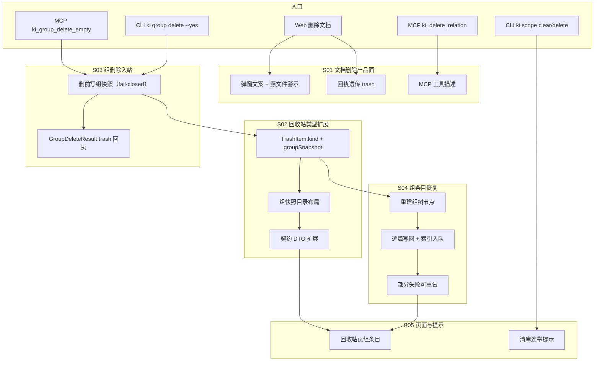
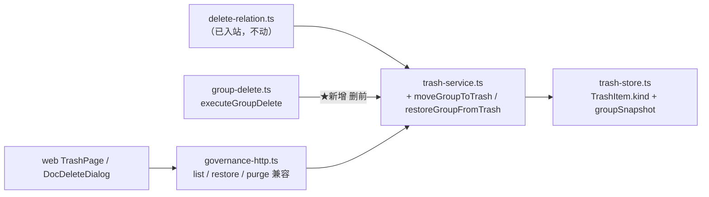

# 删除落回收站 · 父设计

需求：REQ-20261123-005 ｜ 状态：设计中 ｜ 证据基线：代码直读（commit 未冻结）

## 1. 需求背景 & 目标

删除应当可逆。现状是**文档级已可逆、组级不可逆、产品面还宣称"不可恢复"**：Web 删文档与 MCP `ki_delete_relation` 都已在删前把快照写进 `{kbDir}/.trash/`，但删除弹窗写着「删除后无法恢复」（`web/src/components/DocDeleteDialog.tsx:153`），资源页写着「删除不可恢复，也没有回收站」（`web/src/pages/ResourcesPage.tsx:130-134`），`DeleteDocumentResponse` 把后端已返回的 `trash` 回执丢在 `doc-delete.ts:60-71`。组删除（`executeGroupDelete`）则全程 `fs.rmSync`，删完只剩备份可救。

**目标**：① 把已存在的文档级可恢复性在三个入口（Web 弹窗 / 删除回执 / MCP 工具描述）说清楚；② 让组删除也入回收站——MCP 仍只删空组，CLI 非空组删除也入站，两者共用 `executeGroupDelete` 一处改造；③ 组条目可整组恢复（含组树节点重建）。

**不在范围内**：清库 / 删 scope 入站（保持物理删除，仅补提示）；回收站「清空」按钮；wiki 源文件回滚；MCP 侧回收站读 / 恢复工具（后续需求）；回收站条目的跨库迁移。

**非功能性假设（默认值，与现状一致，未在本设计中改动）**：单机单进程部署、低并发——回收站的写操作串行在 scope 写锁内；组快照按「典型组 ≤ 100 篇 / 附件 ≤ 数十 MB」设计，**未设容量硬上限**；删除与恢复的时延容忍为秒级（组快照是 N 篇顺序拷贝，暂无进度条，见 S03/S04 待定）；不涉及跨进程事务与分布式一致性；权限沿用 `knowledge.read` / `knowledge.write` 两级。若真实组规模或并发量超出该量级，实施前需重估 S02 容量上限与 S03 的耗时提示。

## 2. 关键环节一览图

## 3. 总体方案设计

一句话：**类型扩展（S02）是地基，组入站（S03）与组恢复（S04）是同一套快照的两端，页面与提示（S05）是它的出口，文档级曝光（S01）与之并行。**

### 共享术语速查

| 术语 | 定义 | 权威定义处 |
|---|---|---|
| `kind` | 回收站条目类型，`'doc' \| 'group'`；存量条目缺省即 `doc` | S02 |
| 组快照 | 一次组删除产生的完整目录：组树 + N 篇文档原文与元数据 + 附件 | S02 |
| 组条目 | 回收站里 `kind='group'` 的一条记录，坐标为 `(group=被删组路径, dirName=__group__… )` | S02 |
| 入站 | 把待删数据写成快照并落盘，成功后才允许真正删除 | S03 |
| 不可回滚区 | relations 分片删除成功之后的阶段；此刻列表已不可见，快照只增不删 | S03 |
| 出站恢复 | 从组条目重建树节点 + 写回 N 篇文档 + 登记索引重建 | S04 |
| 收缩 | 部分恢复后把已恢复的篇从快照 `docs/` 移除，使条目自然变小 | S04 |
| 空组合并 | 目标组路径存在但无子组 / 无文档时，允许把快照内容写回该组 | S04 |
| 快照来源 | `GroupSnapshotDoc.source`：`both`（分片+KB 都有）/ `shard-only`（只有元数据）/ `kb-only`（只有正文），决定该篇能恢复到什么程度 | S02 |
| 物理删除 | 不入站、直接 `rmSync`；本次仅限 scope 清空 / 删除 | S05 |

## 4. 全局风险 & 跨子需求依赖

| 风险 | 说明 | 处置 |
|---|---|---|
| **快照体积失控** | 组快照 = 整组文档 + 附件，7 天 × N 组可能远超单篇量级 | S02 记 `sizeBytes` 并在回收站页暴露；保留天数沿用全局设置；实施后实测最大组 |
| **恢复顺序错位** | 恢复必须「先树节点 → 再 KB → 再索引」，任一逆序都会产生孤儿文档或树里空组 | S04 固定时序（§时序图），失败项留在回收站 |
| **清库连带** | `clearKbDir` 会删掉 `.trash`，用户以为"清库不动回收站" | S05 在清库前输出条数提示（不阻断） |
| **契约破坏** | `TrashItemDto` 加字段、`RestoreResult` 形状变化会影响前端与视图聚合 | S02 声明向后兼容：新增字段可选，存量条目按 `doc` 解释；`RestoreResult` 对 doc 分支保持原样 |
| **写入锁缺失** | 现有 `POST /api/governance/trash/restore` 未持 scope 写锁（`governance-http.ts:1880-1897`）；组恢复是大批量写 | S04 要求 restore 分支纳入 `withScopeWriteLock` |
| **依赖关系** | S01 独立；S02 → S03 → S04 → S05 | 见一览图；S02 未定稿前不得实现 S03/S04 |

### 接口契约变化速查（全量）

| 契约 | 变化 | 归属 |
|---|---|---|
| `POST /api/doc/delete` 响应 | 新增可选 `trash{dirName,reason,expiresAt,ttlDays}` | S01 |
| `DocDeleteResult`（`src/lib/doc-delete.ts`） | 新增可选 `trash` | S01 |
| `DeleteDocumentResponse`（`web/src/api/httpApi.ts`） | 新增可选 `trash`（与 `DocDeleteResult` 同形状） | S01 |
| `TrashKind` / `TrashKindDto` | 新增类型 `'doc' \| 'group'` | S02 |
| `TrashItem` / `TrashItemDto` | 新增 `kind`；DTO 另加 `docCount?` / `groupCount?` | S02 |
| `GroupSnapshot` / `GroupSnapshotDoc` | 新增 | S02 |
| `writeGroupTrashItem` / `readGroupSnapshotDocs` / `readGroupSnapshotAssets` | 新增函数 | S02 |
| `GroupSnapshotDoc.source` | 新增 `'both' \| 'shard-only' \| 'kb-only'`（快照来源） | S02 |
| `PurgeOutcome`（`src/lib/trash-service.ts`） | brief 加 `kind` / `docCount` | S02 |
| `GroupDeleteOptions` | 新增 `trashEnabled?` | S03 |
| `GroupDeleteResult` | 新增可选 `trash{dirName,reason,expiresAt,ttlDays,docs,groups}` | S03 |
| `GroupDeleteErrorCode` | 新增 `TRASH_WRITE_FAILED` | S03 |
| `POST /api/governance/trash/restore` | 请求不变；按 `kind` 内部分派，group 分支响应形状新增 | S04 |
| `RestoreGroupResult` | 新增 | S04 |
| `RestoreResult`（文档分支） | **不变** | S04 |
| 恢复失败码 `TRASH_CORRUPTED` | 新增（meta 损坏 / docs 全 broken，HTTP 422） | S04 |
| `TrashItemView`（`web/src/api/governanceApi.ts`） | 新增 `kind` / `docCount?` / `groupCount?` | S05 |
| CLI `ki scope clear` / `delete` 输出 | 执行前新增回收站条数与体积提示 | S05 |
