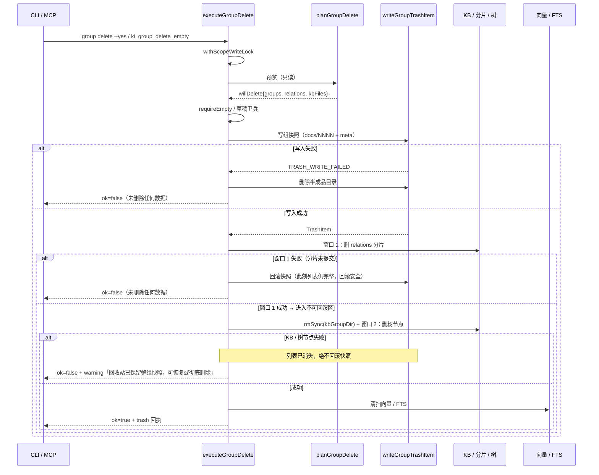

# S03 组删除入站

## 术语

| 术语 | 定义 |
|---|---|
| 入站闸门 | 在删除任何数据之前写快照的那段代码；失败即整体中止 |
| 元数据提交窗口 | `withMetadataCommitSync` 包住的两次小 JSON 写（分片 + group-index + KB），窗口内不夹引擎 IO（`group-delete.ts:1-12` 头注释） |
| 半成品快照 | 写快照过程中失败留下的不完整目录，必须回滚 |
| 空组 | 无子组、无 relation、无 KB 文件（`requireEmpty` 的判据，`group-delete.ts:557-565`） |

## 现状（AS-IS）

`executeGroupDelete`（`src/lib/group-delete.ts:497-529`）是所有组删除的唯一入口：MCP `ki_group_delete_empty`（`src/lib/mcp-tools/group.ts:40-65`，`requireEmpty: true`）与 CLI `ki group delete`（`src/group.ts:136`，`requireEmpty: false`）都调它；走 daemon 时同构（`daemon-dispatch.ts:49-50`）。执行体 `executeLocal`（`group-delete.ts:531`）顺序：

```text
① assertNoPendingVectorMigration
② readGroupIndex（legacy 迁移）
③ planGroupDelete（只读预览）
④ requireEmpty 校验 ── 非空 → GROUP_NOT_EMPTY
⑤ 草稿卫兵（activeDrafts）── 有草稿 → DRAFT_IN_PROGRESS
⑥ loadRelations → relationIds / ftsIds
⑦ 辅助向量枚举（ki-relation / ki-path，只读）
⑧ 元数据提交窗口：relations 分片 → group-index → KB index.json
⑨ fs.rmSync(kbGroupDir, {recursive})  ← 物理删，无快照
⑩ 向量 / FTS 清扫（失败只 degraded）
```

**没有入站动作**，全程无 `moveToTrash` 调用。`GroupDeleteResult`（`:95-122`）也没有任何回执字段。

**为什么不能直接复用 `moveToTrash`**：它要求单篇正文非空（`trash-service.ts:73-79`，`TRASH_CONTENT_MISSING`），且入参是 `(group, relation)` 单篇粒度；空组没有正文，接进去必然 100% 失败。

## 方案（TO-BE）

### 1. 选项扩展

```ts
export interface GroupDeleteOptions {
  scope?: string;
  path: string;
  requireEmpty?: boolean;
  /** 是否入站（默认 true）。应急回滚：KI_TRASH_DISABLED=1 或显式 false 时走旧行为（物理删） */
  trashEnabled?: boolean;
}
```

### 2. 执行顺序（⑨ 之前插入入站，⑧ 失败则回滚）

```text
① assertNoPendingVectorMigration
② readGroupIndex
③ planGroupDelete
④ requireEmpty 校验
⑤ 草稿卫兵
⑥ loadRelations
⑦ 辅助向量枚举（只读，提前无副作用）
★⑧ 入站闸门：writeGroupTrashItem（失败 → 中止，回滚半成品）
⑨ 窗口 1：删 relations 分片 ── 失败 → 回滚快照并返回（此刻列表仍完整，回滚安全）
⑩ KB 目录删除 + 窗口 2 树节点 ── 失败 → **保留快照**，返回 ok=false
⑪ 向量 / FTS 清扫（失败只 degraded）
```

入站点必须**在草稿卫兵之后**（有草稿本来就不许删，写快照是浪费且会留下垃圾条目）、**在任何写之前**（否则出现"删了但没备份"的不可逆窗口，与文档级同一纪律）。

### 3. 快照内容来源

| 内容 | 来源 |
|---|---|
| 组树（自身 + 子组，含空组） | `plan.willDelete.groups`（`GroupDeleteTargets.groups`） |
| 篇目集合（**关键**） | **relations 分片键 ∪ KB `index.json` 键的并集**，不是只看分片 |
| N 篇元数据 | `loadRelations(scope, plan.willDelete.groups)`（`:581`）的 `Relation`；分片里没有的篇此字段缺失 |
| N 篇正文 | 按 group 分组，每个 group 读一次 `getLocalKbDir(scope, group)` 的 `index.json`；分片里没有的键也要收 |
| 附件 | `getAssetsDir(scope, group)`，**按 group 一份**（不是按文档） |

**为什么必须取并集**：真正删数据的是 `fs.rmSync(kbGroupDir, {recursive})`（`group-delete.ts:700`），它删的是磁盘上**所有**文件。若快照只按 `loadRelations` 的分片键取（`group-delete.ts:283-291`），「KB 里有正文、分片里没有对应 relation」的文档会随组删除永久消失，且回收站里连条目都没有——用户完全不知道自己丢了东西。`planGroupDelete` 把 `relations` 与 `kbFiles` 分成两个字段统计（`:55-64`），本身就说明二者数量可以不等。

按来源分三档（对应 `GroupSnapshotDoc.source`）：

| source | 条件 | 快照内容 | 恢复行为 |
|---|---|---|---|
| `both` | 分片有 + KB 有 | doc.json + content.md + relationSnapshot | 完整恢复 |
| `shard-only` | 分片有 + KB 无正文 | doc.json（无 content.md） | 恢复元数据，正文为空（提示原文缺失） |
| `kb-only` | KB 有 + 分片无 | doc.json + content.md（无 snapshot） | 用正文重建**最小元数据**（`text` + 默认分类），`warnings` 提示"N 篇元数据缺失" |

### 4. 回执

```ts
export interface GroupDeleteResult {
  // …既有字段
  /** 入站回执：进站成功才有；trashEnabled=false 或 KI_TRASH_DISABLED=1 时不出现 */
  trash?: {
    dirName: string;
    reason: TrashReason;   // 恒为 'manual'
    expiresAt: number;
    ttlDays: number;       // 沿用该库 keepDays
    docs: number;
    groups: number;
  };
}
```

`GroupDeleteErrorCode` 新增 `'TRASH_WRITE_FAILED'`（`group-delete.ts:76-83`）。

### 5. 时序图



### 6. CLI 预览与提示

`planGroupDelete` 的 `hint`（`group-delete.ts:443-446`）追加一句：**「执行时会把整组（N 篇 / M 个子组）先移入回收站，可在 Web 回收站恢复」**。预览阶段不读正文、不写盘（保持 `planGroupDelete` 零写入）。

## 接口设计

### MCP `ki_group_delete_empty` 结果（新增字段）

```json
{
  "ok": true,
  "scope": "default",
  "path": "临时草稿",
  "deleted": { "groups": ["临时草稿"], "relations": 0, "kbDir": true, "tree": true },
  "vectors": { "deleted": 0, "failed": 0, "skipped": 0, "orphanIds": [] },
  "fts": { "deleted": 0, "failed": 0, "orphanIds": [] },
  "trash": {
    "dirName": "__group__20261123153000",
    "reason": "manual",
    "expiresAt": 1765180800000,
    "ttlDays": 7,
    "docs": 0,
    "groups": 1
  },
  "degraded": false,
  "warnings": []
}
```

### CLI `ki group delete`（非空组）

```json
{
  "ok": true, "path": "部署运维",
  "deleted": { "groups": ["部署运维", "部署运维/网络"], "relations": 8, "kbDir": true, "tree": true },
  "trash": { "dirName": "__group__20261123153000", "docs": 8, "groups": 2, "ttlDays": 7, "expiresAt": 1765180800000, "reason": "manual" },
  "degraded": false, "warnings": []
}
```

## 关键决策点

| 决策 | 采纳 | 被否决方案 | 否决理由 |
|---|---|---|---|
| 快照失败语义 | fail-closed：中止整组删除 | 尽力而为（失败的文档照删） | 「删了但没备份」不可逆；用户可重试删除，不可重试"找回" |
| 正文缺失的文档（只剩分片的残壳，`shard-only`） | 记入 `doc.json` 但**不写 content.md**，删除继续；恢复时该篇计入 `failed` 并提示原文缺失 | 任一正文缺失即中止整组 | 会死锁：残壳文档连单篇删除都过不去（`moveToTrash` 同样 fail-closed），用户将永远清理不掉脏数据 |
| **元数据缺失的文档（KB 有正文、分片无 relation，`kb-only`）** | 以 KB 键补进快照、只留正文；`warnings` 提示「M 篇元数据缺失，恢复后为最小记录」 | 只按分片键取快照 | 分片键是快照的**唯一**来源时会漏掉这类文档，而 `fs.rmSync` 照样把它删掉 —— 正文随组删除永久消失且回收站无痕迹（challenger 意见 1） |
| 入站点位置 | 草稿卫兵之后、元数据窗口之前 | 放进元数据提交窗口内 | 窗口内只做小 JSON 写、不夹大 IO（`group-delete.ts:1-12` 的既有约束）；拷贝 N 篇正文会显著拉长窗口 |
| 快照写失败后的半成品 | 立即 `rmSync` 回滚 | 留着等 TTL 到期清理 | 恢复时会"恢复一个残组"，且残组与真实删除难以区分 |
| 窗口 1（relations 分片）失败后快照怎么办 | 回滚快照（此刻文档列表仍完整，回滚安全） | 一律保留 | 文档没删成，快照留着只会堆垃圾条目（与 `wikiDelete=false` 的 prune 同理，`delete-relation.ts:226-236`） |
| 窗口 1 成功之后的失败（KB 删除 / 窗口 2） | **绝不回滚快照**，保留 + 返回 ok=false + warning | 同样回滚 | 此刻 relations 分片已删、列表里已看不到文档（`group-delete.ts:673-690`），回滚快照会让用户既看不到也找不回 —— 比"留着垃圾条目"严重得多 |

## 异常处理

| 场景 | 行为 | 对外暴露 |
|---|---|---|
| 快照目录创建 / meta 写入失败 | 回滚半成品 → `TRASH_WRITE_FAILED`，未删除任何数据 | 是（MCP isError / CLI 非零退出） |
| 分片有、KB 无正文（`shard-only`） | 该篇只记 `doc.json`；删除继续；`warnings` 记「N 篇原文缺失，恢复后不可读」 | 是 |
| KB 有、分片无 relation（`kb-only`） | 以 KB 键补进快照、只留正文；`warnings` 记「M 篇元数据缺失，恢复后为最小记录」 | 是 |
| 附件复制失败 | 中止并回滚（附件属内容，不能丢） | 是 |
| 窗口 1（relations 分片）失败 | 回滚快照 → 返回 `ok=false` + 原 `reason` | 是 |
| 快照回滚失败 | 保留快照，`warnings` 记「回收站残留条目 `<dirName>`，请手动彻底删除」 | 是 |
| 窗口 1 成功后 KB 删除失败 | **保留快照**；`ok=false` + warning「删除未完成，回收站已保留整组快照」 | 是 |
| 窗口 1 成功后窗口 2（树节点）失败 | **保留快照**；`ok=false` + 同上 warning；树里可能残留空组，可重跑删除 | 是 |
| 向量 / FTS 清扫失败 | 沿用现有 `degraded` + `orphanIds`（快照已在，不影响可恢复性） | 是 |
| `KI_TRASH_DISABLED=1` | 跳过入站，走旧物理删行为（观测期应急回滚） | 否（仅环境变量） |
| 组路径含 `.trash` 段 | 由 `planGroupDelete` 提前拒绝（见 S02 异常处理），入站逻辑不会执行到 | 是 |

## 影响范围

| 文件 | 改动 |
|---|---|
| `src/lib/group-delete.ts` | `GroupDeleteOptions.trashEnabled`；`GroupDeleteErrorCode` 加 `TRASH_WRITE_FAILED`；`GroupDeleteResult.trash`；`executeLocal` 插入入站与回滚；`planGroupDelete` 的 `hint` |
| `src/lib/mcp-tools/group.ts` | 工具描述补「删除前移入回收站，可在 Web 恢复」 |
| `src/group.ts` | CLI 输出 `trash` 回执字段 |
| `src/lib/daemon-dispatch.ts` | 无改动（参数透传，`trashEnabled` 自动带上） |
| `docs/group.md` / `docs/mcp-tools.md` | 删组语义与回执字段 |

## 待定问题

| # | 问题 | 状态 |
|---|---|---|
| 1 | **既有缺陷**：只剩分片、KB 无正文的"残壳文档"，单篇删除会被 `moveToTrash` 的 fail-closed 卡住，用户无法清理 | 需上报为独立事件（不属本需求范围） |
| 2 | 组快照是否需要上限（如单组 > 500 MB 时二次确认） | 待实测后定（S02 待定 1） |
| 3 | CLI 是否需要 `--no-trash` 让运维显式跳过入站 | 待确认：默认不给，避免误用；应急用环境变量 |
