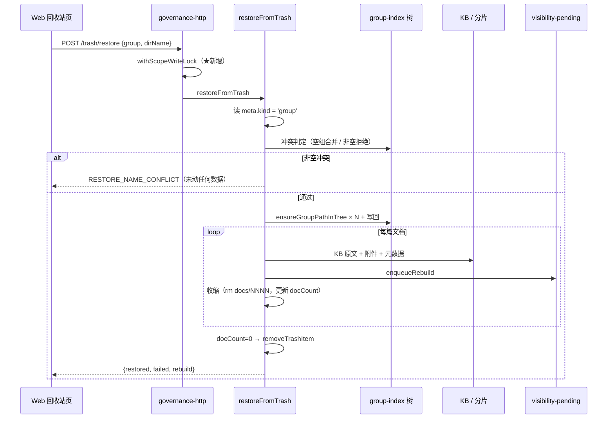

# S04 组条目恢复

## 术语

| 术语 | 定义 |
|---|---|
| 出站 | 条目从回收站移出（恢复成功后删除快照目录） |
| 收缩 | 部分恢复时，把已恢复的篇从快照 `docs/` 移除，使条目自然变小 |
| 空组合并 | 目标组路径在树中已存在但没有任何子组 / 文档时，允许把快照内容写回该组 |
| 重建入队 | 把恢复的文档登记到 `.visibility-pending.json`，由后台重建四类索引 |

## 现状（AS-IS）

`restoreFromTrash`（`src/lib/trash-service.ts:144-248`）只处理单篇文档：

```text
① 同名冲突检查（loadGroupCache → hot_relations 里有同名即拒）
② 写 KB 原文（mkdir 父目录 + kb[name] = content）+ 复制附件
③ 还原元数据（保持原 id，冲突则换新 id）
④ 期限重算 recomputeLifecycle（wiki / temp / event 三分支）
⑤ 出站（updateTrashItemMeta + removeTrashItem）
⑥ enqueueRebuild → .visibility-pending.json
```

| 事实 | 证据 |
|---|---|
| 不重建 group 树节点：只 `fs.mkdirSync(path.dirname(kbPath))` | `trash-service.ts:171-175` |
| HTTP 恢复入口**没有持 scope 写锁** | `governance-http.ts:1880-1897`（对比 `/doc/delete` 有 `withScopeWriteLock`，`mcp-http-api.ts:1686`） |
| 树节点写入原语已存在 | `ensureGroupPathInTree`（`src/lib/scope.ts:205`），`import.ts` 在用 |
| 索引重建只登记不阻塞 | `trash-service.ts:290-310` |

## 方案（TO-BE）

### 1. 分派而非新增端点

`restoreFromTrash` 读条目 `meta.json` 后按 `kind` 分派：`doc` 走既有逻辑（行为零变化），`group` 走新增 `restoreGroupFromTrash`。HTTP 端点、前端调用方式、`(group, dirName)` 坐标全部不变。

### 2. 恢复时序（顺序不可调换）

```text
① 读组条目 meta + 遍历 docs/*/doc.json（broken 篇记 failed）
② 冲突判定：目标组路径在树中已存在？
     ├─ 不存在 → 继续
     ├─ 存在且为空节点（无子组、无 relation、无 KB 文件） → 允许（空组合并）
     └─ 存在且非空 → RESTORE_NAME_CONFLICT（整组拒绝，不动任何数据）
③ 建树节点：readGroupIndex → 对 snapshot.groups 逐个 ensureGroupPathInTree → 写回
④ 逐篇恢复（按 group 分组，每组读一次 / 写一次 index.json）
     ├─ 同名 relation 已存在 → 该篇计入 failed（RESTORE_NAME_CONFLICT），不覆盖
     ├─ 写 KB 原文（`shard-only` 篇无正文，跳过正文只回元数据）
     ├─ 还原元数据：有 snapshot 用它；`kb-only` 篇重建**最小元数据**（text + 默认 wiki 分类）
     ├─ event 类文档：校验 `eventId` 对应事件是否仍存在，不存在则降级为 wiki
     ├─ 期限重算（复用 recomputeLifecycle，按各篇原分类）
     └─ enqueueRebuild（★整组一次读改写，不逐篇 —— 逐篇会导致 O(N²) 次 `.visibility-pending.json` 读写）
⑤ 附件：按 `assets.json` 逐 group 一次性 `cpSync` 回 `getAssetsDir(scope, group)`（★整组一份，不按篇）
⑥ 收缩：每成功一篇即 rm docs/NNNN/ 并更新 meta.docCount / sizeBytes
⑦ 出站：docCount 归 0 → removeTrashItem；否则保留条目供重试
```

**为什么树节点必须先于文档**：逆序时中途失败会产生"KB 里有文档、树里没这个组"——浏览页看不到、索引还在，正是现状单篇恢复的缺陷（`trash-service.ts:171-175`）。

### 3. 时序图



### 4. 接口设计

`POST /api/governance/trash/restore`（请求形状不变）

```json
{ "scope": "default", "group": "部署运维", "dirName": "__group__20261123153000" }
```

组条目响应：

```json
{
  "ok": true,
  "scope": "default",
  "kind": "group",
  "restored": { "group": "部署运维", "groups": ["部署运维", "部署运维/网络"], "docs": 7 },
  "failed": [
    { "group": "部署运维", "name": "旧 FAQ", "code": "RESTORE_NAME_CONFLICT",
      "error": "该组已存在同名文档「旧 FAQ」，改名后可重试" }
  ],
  "rebuild": "pending",
  "restoreCount": 1,
  "hint": "1 篇未恢复（同名冲突），已保留在回收站"
}
```

文档条目响应**保持原样**（`RestoreResult`，`governance-contract.ts:227-237`），前端按 `kind` 分支渲染。

失败码：

| code | 触发 | HTTP |
|---|---|---|
| `RESTORE_NAME_CONFLICT` | 目标组非空 / 篇级同名 | 409 |
| `TRASH_NOT_FOUND` | 条目不存在 | 404 |
| `TRASH_CORRUPTED` | meta 损坏或 docs 全 broken | 422 |

## 关键决策点

| 决策 | 采纳 | 被否决方案 | 否决理由 |
|---|---|---|---|
| 分派方式 | `restoreFromTrash` 内部按 `kind` 分派 | 新增 `/trash/restore-group` 端点 | 前端要按 kind 选端点、两套契约、两套权限点；且 `(group, dirName)` 坐标本来就够用 |
| 目标组已存在 | 空节点允许合并；非空拒绝整组 | 一律拒绝 | 用户重建空组极常见；拒绝后无法先删该组再恢复——删组会产生**又一个组快照**，越删越多 |
| 目标组已存在且非空 | 一律拒绝整组（不动任何数据） | 一律合并 | 会把新建组里的文档卷进同名冲突，产生半合并状态 |
| 部分失败 | 逐篇推进 + 成功即收缩 + 保留条目可重试 | 全有或全无（事务回滚） | N 篇回滚本身可能失败；且回滚会删掉用户刚恢复成功的内容 |
| 恢复是否加写锁 | 纳入 `withScopeWriteLock` | 沿用现状（doc 恢复也不加锁） | 组恢复要写树 + N 篇 KB + N 份分片 + N 条 pending，与并发写入强冲突 |
| 恢复期限 | 按各篇原 `relationSnapshot` 分类逐篇重算 | 整组统一改为 wiki | 组内可能混有 temp / event 文档，统一改会改变用户原有的分类决策 |
| **附件恢复粒度** | 按 `assets.json` 逐 group 一次性复制 | 按篇复制（`docs/NNNN/assets/`） | 附件是 group 级共享目录（`scope.ts:128-131`），按篇复制既 N 倍膨胀，恢复时还会互相覆盖 |
| **event 类文档的悬空引用** | 恢复时校验事件是否仍存在，不存在则**降级为 wiki** 并在 `hint` 说明「K 篇的原事件已删除」 | 原样保留 `eventId`（现状行为） | 组删除期间事件很可能被一并删掉，原样保留会一次性制造 N 条悬空引用；现状不校验是已知缺口（`trash-service.ts:203-206` 注释自认），但单篇恢复只影响 1 篇，组恢复是 N 篇，量级不同 |

## 异常处理

| 场景 | 行为 | 对外暴露 |
|---|---|---|
| 组条目 meta 损坏 | `TRASH_CORRUPTED`，不动数据 | 是 |
| `docs/NNNN/doc.json` 缺失 | 该篇记 `failed`（`TRASH_CORRUPTED`），其余继续 | 是 |
| 某篇 content.md 缺失（删除时正文就缺，`shard-only`） | 该篇记 `failed`（原文缺失，恢复会得到空文档），不写空串 | 是 |
| `kb-only` 篇（有正文无 snapshot） | 用正文重建最小元数据（`text` + 默认 wiki 分类），`hint` 记「M 篇元数据缺失，已按最小记录恢复」 | 是 |
| 附件复制失败 | 该 group 的附件跳过，文档仍恢复；`failed` 里记附件项，提示「附件未恢复，请检查磁盘空间后重试」 | 是 |
| 篇级同名冲突 | 该篇记 `failed`，其余继续，条目不删除 | 是 |
| 树写回失败 | 整组中止，已收缩的篇保留（KB 已写），返回 500 + 原因；条目仍在 | 是 |
| pending 登记失败 | 该篇 `rebuild:'failed'`，不影响恢复本身（现状行为，`trash-service.ts:306-309`） | 是（`rebuild` 字段） |
| 并发两次恢复同一组条目 | 写锁串行化；第二次读不到条目 → `TRASH_NOT_FOUND` | 是 |

## 影响范围

| 文件 | 改动 |
|---|---|
| `src/lib/trash-service.ts` | `restoreFromTrash` 按 `kind` 分派；新增 `restoreGroupFromTrash`；`RestoreOutcome` 加 group 分支 |
| `src/lib/governance-http.ts` | restore 分支纳入 `withScopeWriteLock`；错误码映射补 `TRASH_CORRUPTED` |
| `src/lib/governance-contract.ts` | 新增 `RestoreGroupResult`；`RestoreResult` 保持不动 |
| `web/src/api/governanceApi.ts` | `restoreTrash` 返回类型按 `kind` 联合 |

## 待定问题

| # | 问题 | 状态 |
|---|---|---|
| 1 | 组恢复是否支持 `targetLifecycle`（把整组改成 wiki） | 已定：不支持，保持各篇原分类（见决策点） |
| 2 | 恢复大组（数百篇）的耗时是否可接受 | 待实测；若过慢再考虑分批 + 进度 |
| 3 | 大组恢复若超过 HTTP 超时，前端等多久、是否转异步任务 | 待定：先实测 N=200 篇的耗时，再决定是否任务化（当前设计是同步长事务） |
