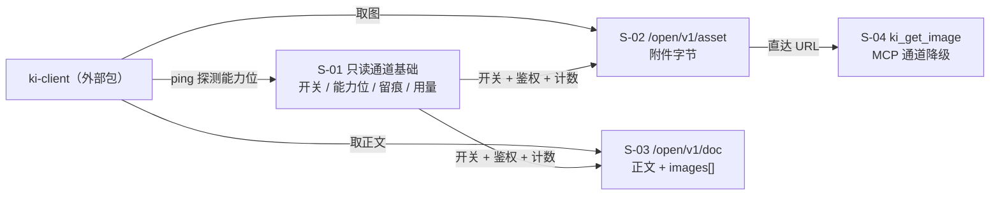

# 设计：ki 只读取件契约（`/open/v1`）

**子文档**：`S01_只读通道基础_DESIGN.md`、`S02_附件字节端点_DESIGN.md`、`S03_文档正文端点_DESIGN.md`、`S04_MCP取图降级_DESIGN.md`
**需求**：[requirement.md](../requirement.md)

## 1. 需求背景 & 目标

AI 侧取不到文档附图（IDE 的 MCP 客户端不解码 image content，事件 #90），而 `/open/v1` 只有 4 个诊断/写端点，外部程序无任何读通道；`/api/*` 属浏览器语义、无对外契约承诺，不能当公开依赖面。目标：在 `/open/v1` 下暴露两个稳定只读端点（附件字节、正文与附图清单）＋能力位＋独立读出口开关，供独立分发的 `ki-client` 使用。**不在范围内**：客户端实现与配置、客户端 CI 载体、`/api/*` 任何改动、chat 读图链路、权限模型变更。

**非功能默认假设**：单机低并发、单用户低频（不按公网多租户设计）；单篇正文 ≤ 数 MB（实测最大约 29 万字符）、附件单文件 ≤ `scopes.<库>.import.maxAssetSize`（默认 5MB）；延迟容忍秒级；允许最终一致（下载读到的是「某一时刻已落盘」的内容，不保证与正在进行的导入强一致）。

## 2. 关键环节一览图

## 3. 总体方案设计

四个子需求沿「基础设施 → 两个数据端点 → 旧工具迁移」推进：S-01 定义开关、能力位、留痕与用量口径，是 S-02/S-03 的共同前置；S-02 与 S-03 互不碰同一文件，可并行；S-04 依赖 S-02 的 URL 形态。所有只读逻辑复用既有解析（`resolveAssetPath`、`executeGetModuleInfoLocal`），**不新增鉴权分支**、**不调用 `/api/*`**。

**共享术语速查**（子文档不再重复定义）：

| 术语 | 定义 | 权威位置 |
|---|---|---|
| `downloadApi` | 读出口独立开关，`false` 时两个读端点均 404 | S-01 §4 |
| `contractVersion` | 契约版本整数，破坏性变更才 +1，初值 `1` | S-01 §4 |
| `capabilities` | 能力位对象 `{download:{asset,doc}, maxAssetSize}` | S-01 §4 |
| 双锚点校验 | ① assetsDir 在 KB 根内 ② 解析结果在 assetsDir 内 | `src/lib/asset-image.ts::resolveAssetPath` |
| `displayedContent` 同源 | 端点正文与 Web「复制 / 下载」取同一份 `content` | S-03 §4 |
| 留痕 | 每次成功下载写一行结构化日志，含 token 前 8 位 | S-01 §5 |

## 4. 全局风险 & 跨子需求依赖

| # | 风险 | 影响 | 对策 |
|---|---|---|---|
| 1 | 客户端与服务端发布节奏不同 | 客户端按高版本契约调用失败 | `ping` 能力位 + 客户端探测降级；服务端只做向后兼容追加 |
| 2 | 模块边界：`open-api` 注释声明与 `/api/*` 互不调用 | 复用不当会形成隐式耦合 | 只允许 import `src/lib/` 下的纯函数（`asset-image` / `get-module-info`），禁止 import `mcp-http-api` |
| 3 | `ASSET_MIME` 已存在两份（`asset-image.ts:36`、`mcp-http-api.ts:2144`） | 白名单漂移，端点间行为不一致 | S-02 收敛到 `asset-image.ts` 单一来源，另一处改为 import |
| 4 | 读出口 = 新的数据外流面 | token 泄露即全库可拉走 | 独立开关 + 留痕 + 文档标注「生产建议关」 |
| 5 | 下载计入用量会污染冷热判定 | 冷库被下载刷热，评分衰减误判 | 新增 `download` 计量维度，不参与 heat 计算（S-01 §5） |

**跨子需求依赖**：S-02/S-03 共用 S-01 的开关判定与留痕函数；S-03 的 `images[]` 形状必须与 S-02 的 `path` 入参对齐（`ref` 即 `path`），否则客户端要多一层映射。
