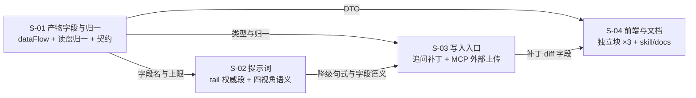

# 事件分析数据链路 · 技术设计（父文档）

需求：`REQ-20261124-001` ｜ 状态：设计完成 ｜ 形态基线：`demo/ui/data-flow-tree/index.html`（已确认）
拆分方式：父文档 + 4 子需求文档 ｜ 交付方式：**单窗口串行**（子需求共享文件，见第 4 章）

## 1. 需求背景 & 目标

事件详情页 AI 分析结论只有「一句话 + ≤5 个因果节点」，缺「坏在哪条执行路径上」这一层。本设计让**所有事件分类**（`fault / perf / change / generic`）的分析结论固定带一段「数据链路」文字树，与「未确认点」同级独立成块。

**目标**：① 产物新增 `dataFlow` 多行文本字段；② 提示词固定要求并在证据不足时按降级句式写；③ 三个写入口（AI / 外部上传 / 追问补丁）全覆盖；④ 前端三处渲染一致。

**不在范围内**：结构化链路节点与可点代码位置（U5）、链路的局部更新（U9）、链路进全文索引、历史数据分析的块渲染（不渲染）。

## 2. 关键环节一览图



## 3. 总体方案设计

产物侧只加一个可选字段，不改既有结构与状态机：

```
.analysis.json → draft
├── conclusion: string | null        （不变）
├── chain: ConclusionNode[]          （不变）
├── dataFlow?: string                （新增，多行文本树，≤30 行 / ≤2000 字）
└── …
```

**非功能性默认假设**（未特别说明即按此，若与实际不符需在设计评审前提出）：单机单用户场景，链路一次分析只产生一段（≤3000 字），不构成 IO / 内存压力；归一只在既有读路径内做，不新增磁盘访问；链路不参与全文索引与检索；不涉及权限模型（沿用事件页既有 scope 权限）。

**共享术语速查**（各子文档不自重复定义）：

| 术语 | 定义 | 权威定义处 |
|---|---|---|
| 数据链路（`dataFlow`） | 一段多行文本，用 `▼` 表流向、`├─/└─` 表分叉、空格缩进；前端等宽原样渲染 | S-01 |
| 降级态 | `dataFlow` 内写「未取到数据链路：已检查 A、B；缺 C」，**块仍渲染**，不编造 | S-02 |
| 归一（normalize） | 读盘/解析时的字段清洗：非字符串丢弃、超限截断、空行压缩 | S-01 |
| 缺省不改 | 追问补丁不带 `dataFlow` 时保留旧值（区别于外部上传的整篇覆盖） | S-03 |

## 4. 全局风险 & 跨子需求依赖

| # | 风险 | 说明 | 归属 |
|---|---|---|---|
| R1 | **读侧归一漏字段** | `normalizeAnalysisDocForRead` 逐字段构造且带「无变化保原引用」早退，漏加则写进去也读不出 | S-01 |
| R2 | **两条提示词互斥** | `buildOutputTail` 要求必出链路，与既有「candidates 可空 / 没找到就跳过」冲突，必须同段化解 | S-02 |
| R3 | **外部上传致链路丢失** | 整篇覆盖语义，`overwrite=true` 不传 = 明确无链路（清空），需在文档与 UI 说明 | S-03 |
| R4 | **补丁后结论与链路脱节** | 补丁不带链路时保留旧值 → 新结论配旧路径，需在补丁提示词里要求「结论变则必须给新链路」 | S-03 |
| R5 | **三处渲染不一致** | 卡片 / 编辑态只读 / 分析面板，漏一处即视觉割裂 | S-04 |
| R6 | **契约双份漂移** | `governance-contract.ts` 与 `web/src/api/governanceContract.ts` 逐字比对，改一侧必红 | S-01 / S-04 |

**交付方式判定**：4 个子需求中 S-01/S-02 同改 `analysis-runner.ts`、S-01/S-03 同改 `analysis-store.ts`、S-02/S-03 同改 `analysis-ask-runner.ts` —— 按「同一文件被两片碰即不同批」的铁律，**不走多窗口并行**，单窗口按 `S-01 → S-02 → S-03 → S-04` 串行实施。
