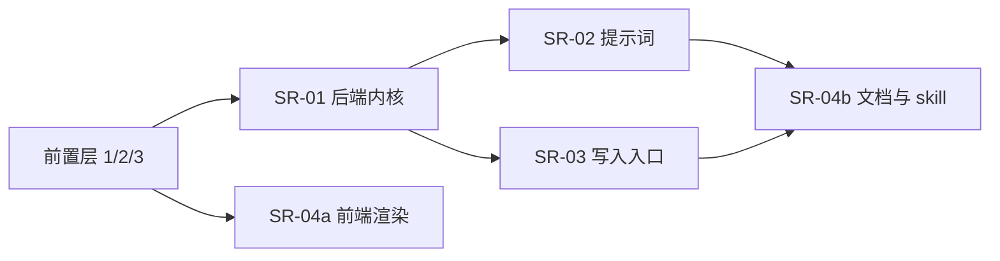

# 实施计划：事件分析数据链路

设计基线：`design/DESIGN.md` + `S01~S04`（评审 2 轮通过）｜ 骨架冻结 commit：—（不走并行链，无骨架）
执行方式：**单窗口串行（3 批）**，批内可并行

> 砖头划分口径与批次判定以本文档为准；无 `sub-requirements/INDEX.md`（未走 `delivery-slicing`）。

## 1. 前置层（不进批次，先于全部砖头，完成即冻结）

| # | 前置项 | 内容摘要 | 完成判据 | 状态 |
|---|---|---|---|---|
| 1 | **字段与归一契约** | `AnalysisDraft.dataFlow?: string`；`normalizeDataFlow(raw): string \| undefined`；`DATA_FLOW_MAX_LINES=40` / `MAX_CHARS=3000` / `TRUNCATED_MARK` | 类型与签名定稿 + 单测绿 | ✅ **完成**（2026-11-24：`src/lib/events/data-flow.ts` 落地，单测 15/15 绿，已跑满而非仅红骨架） |
| 2 | **契约双份（4 个位置）** | `governance-contract.ts` 与 `web/src/api/governanceContract.ts` 各加三处、同一相对位置与可选性：① `AnalysisDraftDto`（完整通道）② `AnalysisDraftSummaryDto`（精简通道 / MCP `ki_event_get`）③ `askTurn.proposal`（补丁建议） | 契约测试绿 | ✅ **完成**（28/28 绿；两端 `tsc` 无新增错误）。注：②③ 是前置层实施中 auto-review 抓出的遗漏，见 S-01 §3.3a |
| 3 | **口径与文案冻结** | ① 上限：模型侧 30 行/2000 字、归一 40 行/3000 字 ② **降级句式逐字文案**（S-02 §3.3）③ 提示词四处槽位：JSON 示例 / 第 8 条 / `flowGuide` / 自检一句 | 写进 S-02 与 S-03 并被引用，之后**只读**（改动即契约变更） | ✅ **完成**（S-02 §3.3/§3.4 定稿；此后改文案属契约变更，须同步 `demo-verify` 断言） |

**前置层验证记录**

| 检查 | 结果 |
|---|---|
| `npx jiti test/events/data-flow.test.ts` | 17 tests / 17 pass（含幂等 4 例、全角空格缩进 1 例、单行超长 1 例） |
| `npx jiti test/governance-contract.test.ts` | 28 tests / 28 pass（前后端 DTO 字段与顺序一致） |
| 后端 `tsc -p tsconfig.json --noEmit` | 9 条**既有**错误（type-service 1 / import-budget 1 / mcp-http-api 3 / mcp-http 1 / open-api-multipart 2 / trash-service 1），分布与改动前一致；本次改动文件 0 错 |
| 前端 `tsc -p web/tsconfig.json --noEmit` | exit 0 |

> 前置 1、2 的代码由第 1 批的 SR-01 执行，但**形状在批次开工前定稿**——否则 SR-04a 的前端类型、SR-02 的提示词示例、SR-03 的校验上限会各自猜一套。

## 1.5 前端视觉基线（壳）

**无（本次不铺新页面）**。链路块是既有卡片内的新增组件，形态基线 `demo/ui/data-flow-tree/index.html` 已确认，直接按 S-04 §3.3 的 CSS 规则实现即可，不另出壳轨。

## 2. 砖头清单（代码视角，非 1:1 映射子需求）

| 砖头 | 类型 | 来源 | 承接的验收项 | 独占写 | 只读 / 禁碰 |
|---|---|---|---|---|---|
| **SR-01** 后端内核 | 修改型 | S-01 | REQ-01「四类事件跑一次都能出链路；老文件读取不崩」 | `src/lib/events/data-flow.ts`（新）、`types.ts`、`analysis-store.ts::normalizeAnalysisDocForRead`、`analysis-runner.ts::parseJsonSummary`/`initialDraft`/收尾写盘、**`event-detail.ts::精简 draft 构造`**（透出 `dataFlow`，见 S-01 §3.3a）、`test/events/data-flow.test.ts`（新） | 只读：`conclusion-chain.ts`（不改 `oneLine`）、契约两份（前置层已定稿）／禁碰：`mcp-tools/**`、`prompt-config.ts`、`web/src/components/**` |
| **SR-04a** 前端渲染 | 新增型 | S-04 | REQ-04「三处显示一致」、REQ-07「复制/横滑/不裁最后一步」 | `web/src/components/governance/event-detail/DataFlowBlock.tsx`（新）、`EventAnalysisCard.tsx`、`AiAnalyzePanel.tsx`、`governance.css`（仅追加 `.gov-datalink` 段） | 只读：`governanceContract.ts`、`ConclusionChain.tsx`／禁碰：`AskBlock.tsx`（SR-03）、`src/**` |
| **SR-02** 提示词 | 修改型 | S-02 | REQ-02「证据不足出降级而非假链路」、REQ-03「四视角语义」、REQ-08 | `analysis-view.ts`、`analysis-runner.ts::buildOutputTail`、`prompt-config.ts`（仅自检段）、`test/events/analysis-view.test.ts` | 只读：`data-flow.ts`／禁碰：`analysis-ask-runner.ts`（SR-03） |
| **SR-03** 写入入口 | 修改型 | S-03 | REQ-05「MCP 带/不带/未登记」、REQ-06「补丁不传即保留」 | `analysis-ask-patch.ts`、`analysis-ask-runner.ts`、`types.ts::AskProposal`、`governance-http.ts`（PATCH 一行）、`analysis-edit.ts`、`analysis-store.ts::saveExternalAnalysis`、`mcp-tools/event-edit.ts`、`AskBlock.tsx`、`docs/mcp-tools.md` | 只读：`data-flow.ts`／禁碰：`prompt-config.ts` |
| **SR-04b** 文档与 skill | 修改型 | S-04 §5 | REQ-09「三份副本逐字一致」 | `skills/event-report/SKILL.md`、`reference.md`、`.codebuddy/skills/event-report/**`、`~/.codebuddy/skills/event-report/**` | 只读：其余／禁碰：`src/**`、`web/**` |

**跨批的同文件**（不违反「同文件不同批」铁律，因不在同一批）：`types.ts` = SR-01（第 1 批）→ SR-03（第 2 批）；`analysis-store.ts` 同上；`analysis-runner.ts` = SR-01（第 1 批）→ SR-02（第 2 批）。

**依赖 DAG**



## 3. 批次表

| 批 | 砖头 | 层级 | 承接验收项 | 并行 | 串行原因 | 基线 |
|---|---|---|---|---|---|---|
| **第 1 批** | SR-01 后端内核 | 根 | REQ-01 | ∥ | — | 当前主干 |
| **第 1 批** | SR-04a 前端渲染 | 业务 | REQ-04 / REQ-07 | ∥ | —（独占写与 SR-01 无交集：`web/src/components/**` + css vs `src/lib/**`） | 当前主干 |
| **第 2 批** | SR-02 提示词 | 业务 | REQ-02 / REQ-03 / REQ-08 | ∥ | 实现级依赖 SR-01（字段与解析未落地时改 tail 无意义） | 第 1 批合入后 |
| **第 2 批** | SR-03 写入入口 | 业务 | REQ-05 / REQ-06 | ∥ | 实现级依赖 SR-01（校验要复用 `normalizeDataFlow`） | 第 1 批合入后 |
| **第 3 批** | SR-04b 文档与 skill | 业务 | REQ-09 | → | 实现级依赖 SR-03（文档要写实际参数名与缺省语义，提前写必失真） | 第 2 批合入后 |

> 第 2 批两个砖头独占写**无交集**（SR-02 在 `analysis-view.ts` / `analysis-runner.ts` / `prompt-config.ts`；SR-03 在 ask 系列 / `governance-http.ts` / `analysis-edit.ts` / `analysis-store.ts` / `mcp-tools` / `AskBlock.tsx` / `docs/`），可并行；但同一时刻只改一处（单窗口）。

## 4. 每批检查点（批次边界）

| 批 | 完成判据 | 检查点 |
|---|---|---|
| 第 1 批 | ① `data-flow.ts` 单测绿 ② 契约测试绿 ③ 两端 `tsc` 0 ④ 老 `.analysis.json`（无字段）读取不崩 ⑤ 前端能用静态假数据渲染出与 demo 一致的三块形态 | 上批无（首批）→ 契约是否需修订（**只在此处可改**）→ 主干可编译 |
| 第 2 批 | ① 四类事件（bug / 性能 / 需求 / 技术债）各跑一次分析，链路块必现且视角词正确 ② 证据不足事件出降级文案而非假链路 ③ MCP：带 `dataFlow` 落盘 / 不带清空 / 未登记字段报错 ④ 补丁：不带链路时采纳后旧链路**保留** ⑤ 两端 `tsc` 0、web `build` ✓ | 同上 + **契约冻结**（此后不允许再改字段形状） |
| 第 3 批 | ① 三份 skill 副本 `diff` 无差异 ② `docs/mcp-tools.md` 参数与实现逐项一致 ③ 端到端真机走查（含窄栏横滑、复制、外部上传缺链路提示） | 上批全绿 → 交付 |

### 第 1 批完成记录（2026-11-24）

| 砖头 | 状态 | 验证 |
|---|---|---|
| SR-01 后端内核 | ✅ 完成 | 解析 / 收尾写盘 / 读盘归一三处接线 + `event-detail` 透出；`data-flow.test.ts` 17/17、`analysis-store.test.ts` 7/7（新增 ③c 覆盖旧文件无键、脏值清理、原引用早退、超限截断）、契约 28/28；后端 `tsc` 9 条既有、0 新增 |
| SR-04a 前端渲染 | ✅ 完成 | 新增 `DataFlowBlock.tsx` + 三处挂载 + `governance.css` 62 行；`web/test/data-flow-block.test.mjs` 11/11、`tsc` 0、`vite build` ✓ |

**实施中被修掉的三处问题**（子 agent 产出 + 复核）：
1. `steps` 按"非空行数"算会把 `▼` / `│` 行一起计入 → 8 步树显示成 22 步；改为排除纯树形符号行（`RAIL_ONLY`）；
2. 正文用 `trim()` 会吃掉**首行的行首缩进**（树的结构）→ 改为只去首尾空行，判空仍用 `trim`；
3. 分析面板里出现**两层纵向滚动**（外层 `gov-ai-embed__scroll` 240~360px + 块内 520px 上限）→ 组件加 `nested` prop，面板传入后内层 `overflow-y: visible; max-height: none`，交给外层统一滚动。

### 第 2 批记录（2026-11-24）

| 砖头 | 状态 | 验证 |
|---|---|---|
| SR-02 提示词 | ✅ 完成 | `ViewProfile.flowGuide`（四档语义）+ `buildOutputTail` 第 5 条 JSON 示例加 `dataFlow`、新增第 8 条（写法 / 转义 / 降级句式 / 视角语义）；`DEFAULT_ANALYSIS_PROMPT` 自检段只加一句降级纪律（不复述格式）；`analysis-view.test.ts` 22/22（新增 4 例：四档互不相同、按视角注入且不混用、字段与降级句式、多行要求） |
| SR-03 写入入口 | ✅ 完成 | 补丁（解析 / diff 一块 / 提示词 / 追问上下文喂当前链路）+ PATCH 白名单 + MCP 三表与严格校验 + 前端采纳透传 + 弹框标签 + docs；新增 21 例，6 个测试文件 34/22/26/33/9/16 全绿；两端 tsc 无新增、web build ✓ |

**SR-03 的两处偏离设计（复核后接受）**：

1. 追问上下文新增 `<data_flow>` 块（设计只写了 diff 上下文）——**必须加**：不把当前链路喂给模型，「链路没变就不要写」这条指令它根本执行不了。且 `diffProposal` 会判「值相同 → 不推块」，模型照抄也不会弹框。
2. diff 块的渲染容器实际在 `AnalysisProposalModal.tsx` 而非 `AskBlock.tsx`（设计写错），标签因此改在 Modal；`AskBlock` 只负责把 `patch.dataFlow` 带进 PATCH body。

**验收时额外核的一端（子 agent 未提及）**：turn 落盘与 SSE 推送都是 `{ ...patch, at }` 整体展开（`analysis-ask-runner.ts:730`），所以 `dataFlow` 会自动透传到前端，不需要单独改序列化 —— 这条已确认，不是漏改。

**SR-02 已验证的输出**（`buildOutputTail('perf')` 实打印）：
```
  "dataFlow": "第一跳 → 第二跳\n    ▼\n第三跳（能指认就写 src/a.ts:128）\n    ▼\n用户看到的现象",
8. **dataFlow（数据链路）**：…
   - 本视角的链路语义：耗时 / 排队链路 —— 入口 → 各跳（能量化就写耗时占比或数据量）→ 出口，并标出瓶颈那一跳。
   - 它是 JSON 字符串：**所有换行必须写成 \n 转义**，不要写成裸换行，也不要加 ``` 围栏。
   - **取不到就降级，不要编造**：… `未取到数据链路：已检查 <方向1>、<方向2>；缺 <关键证据>。可追问「…」`
```

### 第 2 批 · 真机验证（2026-11-24，daemon 重启后）

前置：`ki mcp restart`（新 pid）+ 新建验证事件 #11（et_1 / fault 视角）→ `POST /api/governance/events/{id}/analyze`。

| # | 验证项 | 结果 |
|---|---|---|
| 1 | 模型是否按第 8 条产出链路 | ✅ 504 字 / **7 步树**，含 `▼`、`file:line` 纯文本、`【根因】` 标记；结论定位到 `conclusion-chain.ts:80`（真实行号）、3 条候选 |
| 2 | 前端渲染 | ✅ 块位于 `gov-conclusion` 与 `gov-unconfirmed` 之间；标题「数据链路 · 7 步 · 504 字 · 复制」；`white-space: pre` |
| 3 | 步数口径（RAIL_ONLY） | ✅ 物理 13 行 → 显示 **7 步**（6 行箭头未计入） |
| 4 | 窄屏横滑 | ✅ 620px：`data-overflow=1`、scrollW 717 > clientW 467、`::after` = 「· ↔ 可横滑」；640px 以上不触发 |
| 5 | 复制 | ✅ 点击后按钮变「已复制」 |
| 6 | MCP 带 `dataFlow` | ✅ 落盘 `'A 入口 → B 中间\n    ▼\nC 出口'`（换行原样保留） |
| 7 | MCP 不带 + `overwrite` | ✅ 落盘 `None`（清空） |
| 8 | MCP 超 40 行 | ✅ 拒绝：「数据链路共 50 行，超过上限 40 行」，落盘未被写坏 |
| 9 | MCP schema 暴露 | ✅ 新 daemon 的 HTTP `tools/list` 已含 `dataFlow`；**IDE 侧仍显示旧 schema = 客户端缓存**（需重连，非代码问题） |

**副作用（需知会用户）**：验证 MCP 写入时用了事件 #5（原「MCP上传结论-真机验证」），`overwrite=true` 覆盖了它原有的外部结论 —— 原内容无备份。事件 #11 为本轮新建的验证事件，可留可删。

### 第 3 批记录（2026-11-24）

| 砖头 | 状态 | 内容 |
|---|---|---|
| SR-04b 文档与 skill | ✅ 完成 | `skills/event-report/SKILL.md` 新增 §4.1「上传/更新分析结论」（字段表 + 四条易踩：不传=无链路 / 超限整批拒绝 / overwrite 不可恢复 / 读回来先看链路）、§7 收口补「顺带核对链路是否与阶段一致」；`reference.md` 工具表增 `ki_event_edit(action=analysis)` 一行 |

**副本同步实测（修正一项旧认知）**：

| 位置 | 形态 | 处理 |
|---|---|---|
| `skills/event-report/` | 仓内源 | 改这里 |
| `.codebuddy/skills/event-report` | **软链** → `../../skills/event-report` | 无需复制（对目标 `cp` 会报 "same file"） |
| `~/.codebuddy/skills/event-report/` | 真实副本（且已漂移过：`EVENT_FORCE_NOT_EMPTY` 那行文案旧一版） | 已手工 cp，`diff` 校验一致 |

`docs/mcp-tools.md` 两处已由 SR-03 改完并复核（`ki_event_get` 加「+ 数据链路」、`ki_event_edit` 参数表含 `dataFlow` 与缺省语义）。

## 5. 执行方式

**单窗口串行**：按 `第 1 批 → 第 2 批 → 第 3 批` 连做，批内两个砖头可交错编辑（独占写不重叠），但**不要开第二个窗口**——五片中有四片碰 `src/lib/events/**`，并行收益低于契约反复冻结的代价。

**本可并行但本次串行**：SR-04b 与 SR-02 不同文件、无实现级依赖，理论上可在第 2 批一并做；因文档需要 SR-03 的最终参数口径，故放第 3 批（若想提前，可先写"字段语义"段落，参数表留到第 3 批补）。

## 6. 三问自查

| 问 | 答 |
|---|---|
| ① 谁必须先行 | 前置层 3 项（字段与归一契约 / 契约双份 / 口径与文案冻结）；根砖头 = SR-01（被 SR-02、SR-03 实现级依赖） |
| ② 哪些能同批，不能的为什么 | 第 1 批 SR-01 ∥ SR-04a（独占写无交集）；第 2 批 SR-02 ∥ SR-03（独占写无交集）；第 3 批单砖头（实现级依赖 SR-03） |
| ③ 本次如何执行 | 单窗口串行 3 批；批内交错编辑、批间走检查点 |

## 7. 覆盖反向检查（9 条需求 → 砖头）

| 需求 | 归属 | 状态 |
|---|---|---|
| REQ-01 产物字段 + 归一 + 契约 | SR-01 | ✅ |
| REQ-02 提示词 + 降级句式 | SR-02 | ✅ |
| REQ-03 四视角语义 | SR-02 | ✅ |
| REQ-04 前端三处渲染 | SR-04a | ✅ |
| REQ-05 MCP 支持 | SR-03 | ✅ |
| REQ-06 补丁支持 | SR-03 | ✅ |
| REQ-07 可用性细节 | SR-04a | ✅ |
| REQ-08 提示词三处调整 | SR-02（可编辑提示词 / 补丁提示词在 SR-03 落地，文案由前置 3 提供） | ✅ |
| REQ-09 skill 与文档同步 | SR-04b（`docs/mcp-tools.md` 归 SR-03） | ✅ |

孤儿 0 条 / 重叠 0 处（`AskBlock.tsx` 与 `docs/mcp-tools.md` 的归属冲突已在 S-04 §5/§6 修正为归 SR-03）。

## 8. 验收效力边界

本计划的验收效力 = 「在 `requirement.md` 已确认的 REQ-01~09 范围内达成」。**若需求侧漏了一条（例如"链路需要能导出"），本计划与验收测试都不会报警**。冻结点那次确认请重点看：这份需求清单是否覆盖了真正想要的东西。
