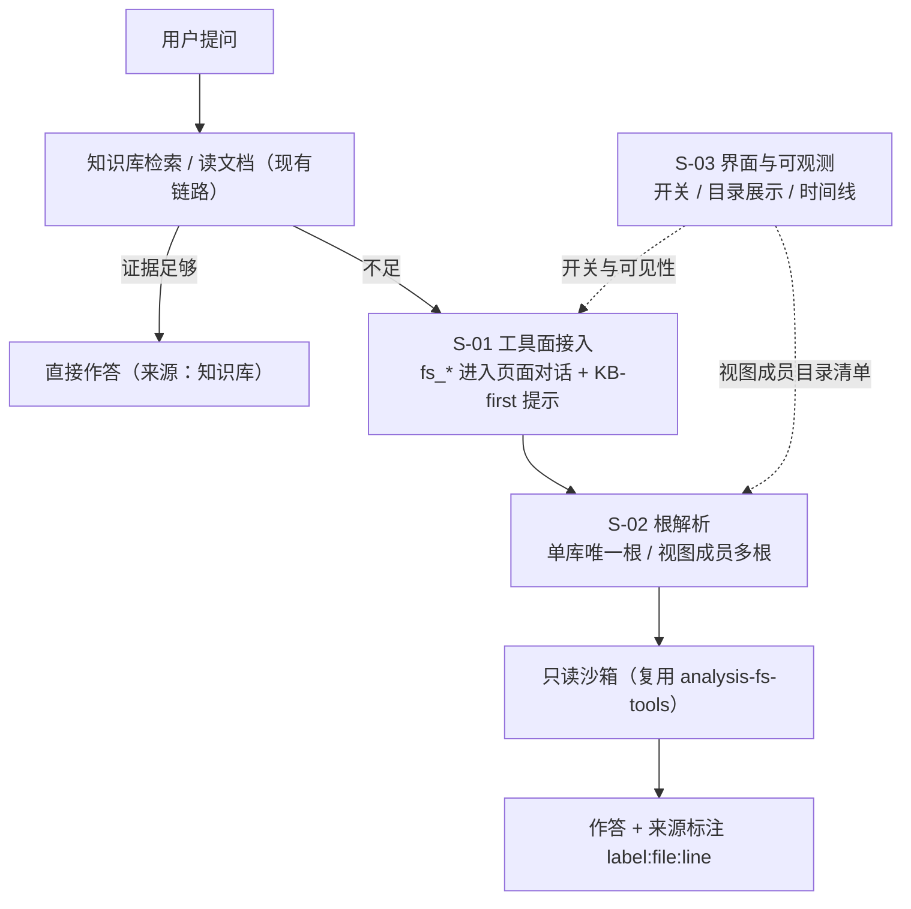
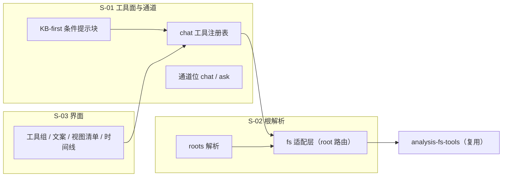

# 设计：AI 对话源码只读查看（知识库优先）

**子文档**：[S01_工具面与通道隔离_DESIGN.md](S01_工具面与通道隔离_DESIGN.md)、[S02_多根目录与视图选根_DESIGN.md](S02_多根目录与视图选根_DESIGN.md)、[S03_界面与可观测_DESIGN.md](S03_界面与可观测_DESIGN.md)
**需求**：[requirement.md](../requirement.md)

## 1. 需求背景 & 目标

事件 AI 分析已有 4 个只读源码工具（`fs_*`），但对话里模型只能看知识库。知识库常只写结论、不写实现，用户拿不到可核验的代码依据；而对话的硬性规则又要求「检索无命中即回答未找到」，与下探代码直接冲突。目标：把 `fs_*` 接入页面对话，同时保住「知识库为主事实源」——证据够直接答，不够才按目录下探，来源分标注，冲突以代码为准。视图会话不配视图目录，按成员库映射由模型自选根。

**不在范围内**：通用代码问答（不改变知识库主事实源定位）、代码写入 / 编辑、代码语义索引与向量化、跨轮代码缓存、事件分析链路改动、`/mcp` 对外工具面。

**非功能默认假设**：单机低并发、单用户低频；代码目录 ≤ 数万文件；单次读取 ≤ 200 行 / 64KB；对话工具响应窗口默认 1 万字符（可配）；全程只读。

## 2. 关键环节一览图

## 3. 总体方案设计

三个子需求沿「能力 → 选根 → 可见性」推进：S-01 定义工具面、通道位与提示策略，是 S-02/S-03 的共同前置；S-02 在其适配层上加根维度；S-03 只消费前两者产出的配置数据与根清单。唯一注入口是 `ChatMcpToolEntry.run(scope, args)`，`analysis-fs-tools.ts` 零改动。

## 4. 全局风险 & 跨子需求依赖

| # | 风险 | 影响 | 对策 |
|---|---|---|---|
| 1 | `ki_ask` 与页面共用 `runToolLoop` 与 `CHAT_MCP_TOOLS` | 源码被外部 MCP 客户端读走 | 显式通道位 + 契约测试断言 `ki_ask` 工具面无 `fs_*` |
| 2 | KB-first 是软约束 | 模型提前读代码，token / 时延上升 | 条件提示块 + 根清单前置 + 三组问题集抽样验证 |
| 3 | 视图多根可能选错仓库 | 结论指向错误代码 | 根清单写入上下文 + 强制 `root` 参数 + 引用带根标签 + 对照问题验证 |
| 4 | 64KB 读结果超对话窗口 | 序列化层二次截断，模型只看到前段 | 对话侧 `fs_read` 预算与响应窗口同源（S-01 §4.4） |
| 5 | 四处文案与契约断言同时过期 | 界面自相矛盾 / 测试红 | 一次改完并纳入同批验收（S-03 §3） |

**跨子需求接口一览**

| 符号 | 签名 | 定义位置 | 消费方 |
|---|---|---|---|
| `ChatCodeRoot` / `ChatCodeRootsResult` / `CodeRootSkipReason` | 类型定义（`aliases` 仅展示） | S-01 §4.3 | S-01 工具条目、S-02 根解析、S-03 清单 |
| `resolveChatCodeRoots` | `(scope, cfg, targetDirs) => { roots, skipped }` | S-02 §4.1 | S-01 装配、S-03 读取 |
| `createChatCodeToolEntries` | `(roots) => readonly ChatMcpToolEntry[]` | S-01 §4.3 | S-01 装配 |
| `pickCodeRoot` | `(roots, rawRoot) => RootPick` | S-02 §4.2 | S-01 执行路由 |
| `describeChatCodeRoots` | `(scope, cfg, targetDirs) => ChatCodeRootsResult` | S-02 §4.1 | S-03 设置接口 |

**共享术语速查**（子文档不再重复定义）：

| 术语 | 定义 | 权威位置 |
|---|---|---|
| 可读根（root） | 一次对话可读的代码目录，标签 = 库名；单库会话默认唯一根 | S-02 §2 |
| 根标签 | 工具返回与答案引用前缀 `{label}:{path}:{line}` | S-02 §3 |
| 通道位 | `chat` / `ask`，决定 `fs_*` 是否进入工具面 | S-01 §3 |
| KB-first 块 | 有 `fs_*` 时追加在硬性规则之后的条件提示 | S-01 §3 |
| 代码目录 | `analysis.targetDirs`（`byScope` + `defaultDir`），分析与对话共用 | S-02 §2 |
| 视图会话 | scope 为视图，根 = 成员库映射的并集（视图本身不配目录） | S-02 §2 |

**跨子需求依赖**：S-02 复用 S-01 的适配层接口与工具 schema 生成；S-03 的视图清单消费 S-02 的 `roots` 数据；S-01 的条件提示块需要 S-02 的根清单（单根时只有一条）。
