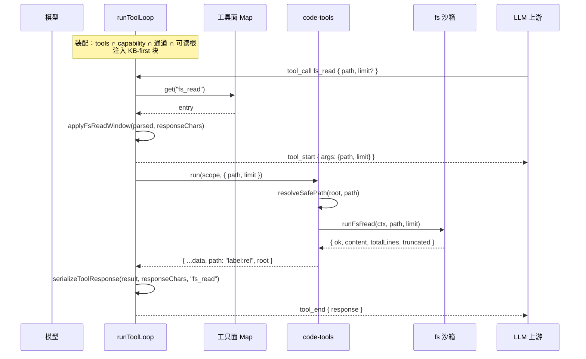

# S-01 工具面与通道隔离

**父文档**：[DESIGN.md](DESIGN.md) ｜ **需求**：[requirement.md](../requirement.md) R1 / R2 / R4 / R5

## 1. 术语

| 术语 | 定义 |
|---|---|
| 通道位 | `ToolLoopInput.toolFace: 'chat' \| 'ask'`。`chat` = 页面对话；`ask` = `ki_ask` / 外部 MCP。`fs_*` 只进 `chat` |
| 工具面 | 一次生成实际暴露给模型的工具集合：`PromptConfig.tools` ∩ capability ∩ 通道 ∩ 可读根 |
| 构造式调用 | 模型在 `tool_calls` 里给出未暴露的工具名。**不经过工具面广告**，但会走执行查表 |
| 源码只读组 | `MCP_TOOL_GROUPS` 新增分组，含 `fs_read` / `fs_grep` / `fs_find` / `fs_ls`，默认开 |
| KB-first 块 | 有 `fs_*` 时按轮注入的条件提示，位置在硬性规则之后 |
| 可读根 | 见父文档术语表；S-01 只实现单根解析，S-02 扩展多根 |

## 2. 现状（AS-IS）

| 位置 | 现状 |
|---|---|
| `src/lib/chat/mcp-tool-registry.ts:368` | `CHAT_MCP_TOOLS` 14 个工具，全部为 `ki_*`；`enabledChatToolEntries` 只按 `tools` 过滤 |
| `src/lib/chat/prompt-config.ts:134-174` | `MCP_TOOL_GROUPS` 三组（只读 6 / 写 6 / 删 2），`key` 联合类型只有 `read \| write \| delete` |
| `src/lib/chat/prompt-config.ts:198-202` | 注释明确禁止 `fs_*` 进入 `MCP_TOOL_GROUPS` / `CHAT_MCP_TOOLS`（2026-11-13 Q2 拍板） |
| `src/lib/chat/retrieval/tool-loop.ts:200` | 工具面 = `enabledChatToolEntries(promptConfig.tools)`，不区分通道 |
| `src/lib/chat/retrieval/tool-loop.ts:757-760` | 先按 capability 过滤得 `toolEntries`，但只用它生成 `toolDefs`（广告） |
| `src/lib/chat/retrieval/tool-loop.ts:942` | 执行查表用全局 `getChatTool(call.name)` —— **构造式调用可绕过工具面** |
| `src/lib/chat/retrieval/tool-loop.ts:985` | `applyReadWindowDefault` 只处理 `ki_get_module_info` |
| `src/lib/chat/retrieval/tool-loop.ts:1059` | `serializeToolResponse` 按 `responseChars` 结构化截断 |
| `src/lib/chat/retrieval/tool-loop.ts:496` | system 块来自 `conv.injected?.blocks`（会话创建时冻结） |
| `src/lib/auth/tool-permissions.ts:11-63` | 默认拒绝白名单，无 `fs_*` |
| `src/lib/mcp-tools/tool-access.ts:44` | `INTERNAL_ONLY_TOOL_NAMES` 目前仅 `ki_get_image` |
| `src/lib/operation-coordinator.ts:82-148` | 未登记 `READ_MCP_TOOLS` 的工具默认落 write 车道 |
| `src/lib/events/analysis-fs-tools.ts:578` | `createFsToolEntries(ctx)` 已实现 4 个工具，ctx 绑定单一 `realRoot`，可复用 |
| `test/capability-coverage.test.ts:92-115` | 断言 `CHAT_MCP_TOOLS` 14 个、`ALL_TOOL_NAMES === /mcp 注册 ∪ INTERNAL_ONLY` |
| `test/chat/mcp-tool-registry.test.ts:28` | 断言注册表 14 个、与 `MCP_TOOL_NAMES` 一致 |

## 3. 方案（TO-BE）

1. **登记**：`TOOL_CAPABILITIES` 4 行 `knowledge.read`；`INTERNAL_ONLY_TOOL_NAMES` +4；`CHAT_MCP_TOOLS` +4；`MCP_TOOL_GROUPS` 新增 `key:'code'` 组；`READ_MCP_TOOLS` +4。
2. **适配层**：新增 `src/lib/chat/code-tools.ts`，负责根解析、工具条目构造、`fs_read` 预算与 KB-first 块渲染；复用 `createFsToolEntries`，不复制沙箱。
3. **通道位**：`ToolLoopInput` 增 `toolFace?: 'chat' \| 'ask'`（缺省 `chat`）；`ask-runner` 传 `'ask'`。装配工具面时 `ask` 直接排除 `fs_*`。
4. **执行查表收敛**：把 `toolEntries` 建成 `Map<name, entry>`，执行改用该 Map。未暴露 / 被通道排除的工具一律走「未知工具」分支，堵构造式调用。
5. **按轮注入提示**：不改 `promptSnapshotBlocks`（会话快照冻结，存量会话拿不到且根清单会变）；把 `renderCodeReadBlock(roots)` **追加到 `injectionBlocks()` 返回值末尾**再交给 `buildSystemMessages` —— 实际顺序为「skill 目录 → 基础提示词 → 硬性规则 → KB-first 块 → 用户自定义 prompt」，既在硬性规则之后，又不被自定义 prompt 压后。仅当本次工具面含 `fs_*`。
6. **预算**：`fs_read` 未显式给 `limit` 时，在 `tool-loop:985` 执行必经点按 `responseChars` 补全（同 `applyReadWindowDefault` 的位置与理由）。
7. **配置默认**：`normalizePromptConfig` 的 `tools` 以 `defaultTools()` 为基底，新增组自动置 `true`，存量配置零迁移。

> **升级行为**（需在发布说明中写清）：已有配置的部署升级后，若某 scope 已配置代码目录，对话**默认获得** `fs_*`；未配置目录则不暴露。管理员应复核 `analysis.targetDirs` 映射，避免把不该开放的仓库带进对话。

```
src/lib/chat/
├── code-tools.ts               # [新增] 根解析（单根）/ 工具条目 / schema / 预算 / 提示块
├── mcp-tool-registry.ts        # [修改] 并入 4 条 fs entry
├── prompt-config.ts            # [修改] MCP_TOOL_GROUPS 新组 + key 联合类型
├── retrieval/tool-loop.ts      # [修改] toolFace / Map 查表 / 按轮注入 / fs_read 预算
├── retrieval/retrieval-skill.ts# [修改] 导出 CODE_READ 块常量（供 code-tools 使用）
└── ask/ask-runner.ts           # [修改] toolFace: 'ask'
src/lib/auth/tool-permissions.ts        # [修改] 4 行 capability
src/lib/mcp-tools/tool-access.ts        # [修改] INTERNAL_ONLY_TOOL_NAMES +4
src/lib/operation-coordinator.ts        # [修改] READ_MCP_TOOLS +4
```

**关键决策点**

| # | 决策 | 被否决方案 | 否决理由 | 重新评估触发条件 |
|---|---|---|---|---|
| 1 | 通道隔离 = 显式通道位 + 执行查表限定 | 只靠「不登记进工具面」 | `getChatTool` 查全局注册表，构造式调用照样执行；能力位同为 `knowledge.read` 拦不住 | 无 |
| 2 | KB-first 块按轮注入 | 改写 `promptSnapshotBlocks` | 快照在会话创建时冻结；存量会话拿不到，根清单变化也不会更新 | 若前端需要展示该块的"已注入"状态 |
| 3 | 复用 `analysis-fs-tools` | 复制一份 chat 专用沙箱 | 两份路径防护与限额必然漂移，越界漏洞只会在其中一份被修 | 沙箱需要事件上下文时 |
| 4 | 预算补全放 `tool-loop` 执行必经点 | 包装 registry 的 `run` | `enabledChatToolEntries` 返回的包装 `run` 不会被调用（2026-11-11 已踩坑） | 无 |
| 5 | 默认开 + 无根不装配 | 默认关，用户手动开 | 装了没感知；无根时装配只会让模型反复失败并浪费轮次 | 若代码读取被认定高危 |

## 4. 接口设计

### 4.1 工具 schema（对话侧）

| 工具 | 描述（给模型） | 参数 |
|---|---|---|
| `fs_read` | 读取代码文件片段（只读；≤200 行 / 64KB；返回带行号） | `path` 必填；`root?`；`offset?` ≥1；`limit?` 1–200 |
| `fs_grep` | 按正则或字面关键词检索源码行（只读；跳过二进制与依赖目录；≤60 条 `file:line`） | `pattern` 必填；`root?`；`path?`；`glob?` |
| `fs_find` | 按文件名或路径模式查找文件（只读；≤80 条） | `name` 必填；`root?`；`path?` |
| `fs_ls` | 列出目录下一层（只读；≤200 项） | `path?`（默认 `.`）；`root?` |

```json
// fs_read 的 parameters（其余三个同构，省略）
{
  "type": "object",
  "properties": {
    "root": { "type": "string", "description": "可读根标签；单根时可省略" },
    "path": { "type": "string", "description": "相对所选根的文件路径，如 src/auth/guard.ts" },
    "offset": { "type": "integer", "minimum": 1, "description": "起始行号（1-based），默认 1" },
    "limit": { "type": "integer", "minimum": 1, "maximum": 200, "description": "读取行数；缺省由服务端按响应窗口推导" }
  },
  "required": ["path"]
}
```

**返回形状**（与 `analysis-fs-tools` 对齐，仅 `path` 加根前缀；`fs_grep.hits[].file` 与 `fs_find.paths[]` 同样加前缀，避免多根串台）：

```json
// Demo 返回示例（仅示意格式）
{
  "ok": true,
  "path": "kisearch-memory:src/lib/chat/tool-loop.ts",
  "root": "kisearch-memory",
  "startLine": 940,
  "endLine": 1000,
  "totalLines": 1272,
  "truncated": true,
  "content": "940|      const entry = getChatTool(call.name);\n..."
}
```

### 4.2 通道位（`ToolLoopInput`）

```ts
export interface ToolLoopInput {
  // ...既有字段不变
  /**
   * 工具面通道：chat = 页面对话（含重新生成 / 编辑重发）；ask = ki_ask / MCP。
   * 缺省 chat（存量测试零改动）。ask 一律不装配 fs_*。
   */
  toolFace?: 'chat' | 'ask';
}
```

### 4.3 工具面装配

```ts
// src/lib/chat/code-tools.ts
export interface ChatCodeRoot {
  label: string;
  realRoot: string;
  /** 同目录的其它库名：**仅展示**，不作为 `root` 入参（见 S-02 §4.2） */
  aliases: readonly string[];
}

export type CodeRootSkipReason =
  | 'unmapped' | 'unreadable' | 'strict-skipped' | 'view-empty' | 'view-error' | 'forbidden';

export interface ChatCodeRootsResult {
  readonly roots: readonly ChatCodeRoot[];
  readonly skipped: ReadonlyArray<{ label: string; reason: CodeRootSkipReason }>;
}

/** 单库 + 视图多根解析（视图分支见 S-02） */
export function resolveChatCodeRoots(scope: string, cfg: KiConfig, targetDirs?: AnalysisTargetConfig): ChatCodeRootsResult

/** 视图成员的精确映射（不回落 defaultDir） */
export function resolveByScopeOnly(targetDirs: AnalysisTargetConfig | undefined, scope: string): string | null

/** 4 条静态定义；根在运行时由 tool-loop 经 ctx 注入 */
export function createChatCodeToolEntries(): readonly ChatMcpToolEntry[]
```

`runToolLoop` 装配顺序：`enabledChatToolEntries(tools)`（18 个）→ `selectToolEntries(entries, { capabilities, toolFace, codeRoots })` → 建 `Map` 供执行查表。

> `root` 解析必须发生在 `runToolLoop`（能拿到 `input.scope`），**不能放在 `resolveRuntime`**：后者没有 scope，无法区分单库 / 视图。`LoopRuntime.toolEntries` 是**配置级** 18 个；通道 / capability / 有根三项过滤在 `selectToolEntries`，执行只认过滤后的 `Map`。
>
> **入参归一化**：模型可能把工具返回的 `{label}:{rel}` 原样传回；`normalizePathArg` 会剥掉前缀并推断 `root`，避免「返回路径再传回去找不到文件」。

### 4.4 响应预算

```ts
/** fs_read 未给 limit 时按本轮响应窗口推导；返回带 limit 的新参数对象 */
export function applyFsReadWindow(
  name: string,
  args: ChatToolArgs,
  responseChars: number,
): ChatToolArgs
```

公式：`limit = clamp(floor(responseChars * 0.7 / 72), 1, 200)`；默认 1 万字符 ≈ 97 行。下界取 **1** 而不是 40 —— 小窗口（如 2000 字符）下 40 行必然溢出，宁可少读。工具返回前按 64KB 字节上限自截断并标注 `truncated`；`serializeToolResponse` 只作最后兜底。

### 4.5 KB-first 块

```ts
export function renderCodeReadBlock(roots: readonly ChatCodeRoot[]): string
```

> 注入条件（缺一不注入）：`toolFace === 'chat'`、模型支持工具、capability 含 `knowledge.read`、用户至少开了一个 `fs_*`、本轮有可读根。
> 注入点：`buildSystemMessages(input.convSystemPrompt, [...injectionBlocks(conv, runtime), codeBlock])`。
> **不要**在 `buildSystemMessages` 之后 `msgs.push(codeBlock)` —— 那会排到用户自定义 prompt 之后。

```
【源码只读（本次可用）】
· 先答知识库：本问题涉及的事实、结论、参数，先用 ki_* 检索 / 读文档；知识库能回答就直接回答，不要为了"更确定"去读代码。
· 仅在以下情况读代码：知识库无相关文档；文档只有结论、没有实现细节；需要核对调用链、默认值、分支条件或行号。
· 读法：先 fs_grep / fs_find 定位，再 fs_read 精读上下文；不要扫全仓。
· 来源标注：知识库来源写文档名；代码来源写 {label}:{path}:{line}。不得把代码结论说成"知识库记载"。
· 冲突：知识库与代码不一致时以代码为准，并明确指出冲突点。
· 读不到 / 目录未配置：如实说明，退回知识库口径，不猜。
· 本节是硬性规则第 1 条的补充：知识库无命中时，若源码工具可用，应继续下探而不是直接收口。
【可读代码目录】
- kisearch-memory → /root/knowledge-indexer
```

## 5. 时序图



## 6. 性能 & 安全

| 项 | 设计 |
|---|---|
| 单次工具超时 | 每次 `fs_*` 调用 10s（`CHAT_FS_TOOL_TIMEOUT_MS`）；超时 abort 并返回 `{ok:false, code:'TIMEOUT', error:'读取超时（10s）：请缩小 path/glob 或换关键词'}` |
| 中止联动 | 超时 signal 与会话 `input.signal` **手动合并**（监听 `abort` 后 abort 本地 controller），不依赖 `AbortSignal.any`（`engines` 为 Node ≥18.0，`any` 需 18.17+）；用户停止优先 |
| 读取上限 | 单次 ≤200 行 / 64KB；grep ≤60 条；find ≤80 条；ls ≤200 项（复用现有常量） |
| 文件大小上限 | 对话侧 `maxFileBytes = 8MB`（`FS_READ_MAX_FILE_BYTES`）；超限 `INVALID_ARG` 并提示先 `fs_grep` 定位。分析侧不传，行为不变 |
| 敏感路径 | 对话侧 `denyPath` 拒绝 `.env*`、私钥（`id_rsa*` / `*.pem/key`）、`.ssh/.aws/.gnupg/.kube/.docker`；`.env.example` 与 `.pub` 放行。分析侧不传，行为不变 |
| 遍历让出 | 复用 `YIELD_EVERY_FILES`，不阻塞事件循环 |
| 只读与越界 | 无写入口；绝对路径 / `..` / 根外软链一律 `OUT_OF_ROOT`，不回传存在性 |
| 目录暴露 | 模型只看到根标签与相对路径；绝对路径仅进 KB-first 块的「可读目录」清单，供选根 |

> 超时是**新增**的对话侧约束：页面对话没有 `budgetMs`（那是 `ki_ask` 的），大仓库 `fs_grep` 可能长时间占用请求；10s 与「用户可随时停止」共同兜底。分析侧不受影响（它有自己的 90s 总超时）。

## 7. 影响范围

| 文件 | 改动 | 风险 |
|---|---|---|
| `src/lib/chat/code-tools.ts` | 新增适配层（约 200 行） | 中：根解析与预算公式是新增逻辑 |
| `src/lib/chat/mcp-tool-registry.ts` | 并入 4 条 entry | 低：只增不改 |
| `src/lib/chat/prompt-config.ts` | `MCP_TOOL_GROUPS` 新组、`key` 加 `'code'` | 低：数据驱动，前端无需改 |
| `src/lib/chat/retrieval/tool-loop.ts` | `toolFace`、`Map` 查表、按轮注入、预算调用 | **高**：查表改动影响所有工具 |
| `src/lib/chat/retrieval/retrieval-skill.ts` | 导出块常量 | 低 |
| `src/lib/chat/ask/ask-runner.ts` | 传 `toolFace:'ask'` | 低 |
| `src/lib/auth/tool-permissions.ts` | 4 行 capability | 低 |
| `src/lib/mcp-tools/tool-access.ts` | `INTERNAL_ONLY_TOOL_NAMES` +4 | 低 |
| `src/lib/operation-coordinator.ts` | `READ_MCP_TOOLS` +4 | 低 |
| 测试 | 见 §8 | 中：3 处数量断言 |

## 8. 测试与验收

| 用例 | 断言 |
|---|---|
| 工具面（chat） | 有根时 18 个工具含 4 个 `fs_*`；无根时不含 |
| 工具面（ask） | `toolFace:'ask'` 时 14 个，无 `fs_*` |
| 构造式调用 | 工具面隐藏 `fs_read` 时，构造调用返回「未知工具」，沙箱零调用 |
| capability | 无 `knowledge.read` 时 `fs_*` 不在工具面，构造调用被拒 |
| 预算 | `responseChars=10000` 且未传 `limit` → `limit≈97`；`responseChars=2000` → `limit≈19`（不再被抬到 40）；显式 `limit=200` 不被覆盖 |
| 超时 | 模拟慢 `fs_grep`，10s 后返回 `TIMEOUT`，且不残留读取 |
| 提示块 | 工具面含 `fs_*` 才注入；`ask` 不注入；位置在硬性规则之后、用户自定义 prompt 之前 |
| 契约测试 | `capability-coverage` 与 `mcp-tool-registry` 的 14→18 同步通过 |
| 既有基线 | `test/chat/prompt-config-routes.test.ts` 的 3 例既有失败用基线对照，不计回归 |

## 9. 异常处理

| 场景 | 行为 | 对外暴露 |
|---|---|---|
| 目录未配置 / 视图无根 | 不装配 `fs_*`、不注入块 | 否（模型看不到） |
| 目录不可读 | 装配时跳过该根；全部不可读 → 同上 | 配置页提示（S-03） |
| 路径越界 / 软链逃逸 | 返回 `{ok:false, code:'OUT_OF_ROOT'}` | 是（不回传越界路径是否存在） |
| 二进制 / 超大文件 | 跳过并说明 | 是 |
| 参数非法（空 path、limit 越界） | `INVALID_ARG`，不 500 | 是 |
| 单次调用超时（10s） | `TIMEOUT`，提示缩小 path/glob 或换关键词 | 是（模型可自行修正） |
| 用户停止 / 切会话 | `AbortSignal` → 「已停止」，不残留读取 | 是 |
| 构造式调用隐藏工具 | 走「未知工具」分支 | 是 |
| 工具内部抛错 | `tool_end.error` + 原始结果，不中断生成 | 是 |

## 10. 待定问题

| # | 问题 | 处理 |
|---|---|---|
| 1 | `fs_grep` 命中 60 条时的展示与截断文案 | 复用现有 `hint` 字段，S-03 确认观感 |
| 2 | 预算公式的 72 字符/行是否贴合真实代码 | 实施后用三组问题集实测，允许调参（常量集中在 `code-tools.ts`） |
