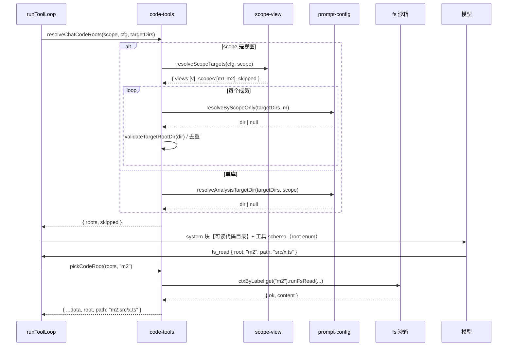

# S-02 多根目录与视图选根

**父文档**：[DESIGN.md](DESIGN.md) ｜ **需求**：[requirement.md](../requirement.md) R3

## 1. 术语

| 术语 | 定义 |
|---|---|
| 可读根 | 一次对话可读的代码目录，`{ label, realRoot, aliases }`。`label` 默认取库名；`aliases` 仅展示，不作 `root` 入参 |
| 单库会话 | `scope` 是一个具体知识库；根 = `byScope[scope]` ?? `defaultDir`，至多 1 个 |
| 视图会话 | `scope` 是一个视图；根 = 成员库各自的 `byScope[member]` 去重，`defaultDir` **不参与** |
| 根标签 | 工具返回与答案引用的前缀 `{label}:{relPath}:{line}` |
| 未映射成员 | 视图成员库在 `byScope` 中没有目录；不参与读取，只在 UI 展示 |
| `skipped` 成员 | `resolveScopeTargets` 在 strict 模式下跳过的未注册成员；同样不参与读取 |

## 2. 现状（AS-IS）

| 位置 | 现状 |
|---|---|
| `src/lib/chat/prompt-config.ts:456-459` | `AnalysisTargetConfig = { defaultDir?, byScope }`，只按单一 scope 取值 |
| `src/lib/chat/prompt-config.ts:868-876` | `resolveAnalysisTargetDir(targetDirs, scope)` = `byScope[scope]` 优先，**其次回落到 `defaultDir`** |
| `src/lib/scope-view.ts:844-871` | `resolveScopeTargets(config, scope)` 展开视图为成员库，返回 `{ views, scopes, skipped }`；空视图抛 `VIEW_EMPTY` |
| `src/lib/events/analysis-fs-tools.ts:45-51` | `FsSandboxContext` 只有单个 `realRoot`；`validateTargetRootDir` 返回单个 `realRoot` |
| `src/lib/events/analysis-fs-tools.ts:124-191` | `resolveSafePath(realRoot, rel)` 的越界防护以单根为前提 |
| `src/lib/chat/retrieval/tool-loop.ts:1027` | `entry.run(input.scope, parsed)` —— 适配层能拿到会话 scope（可能是视图名） |
| `src/lib/chat/chat-store.ts:97` | `chatDirFor(scope)` 只做字符集校验；视图名与库名同处一个命名空间 |
| `src/lib/events/analysis-runner.ts:1496` | 分析侧只按事件所在库取单一目录，不受本子需求影响 |

## 3. 方案（TO-BE）

1. **根解析**：新增 `resolveChatCodeRoots(scope, cfg, targetDirs)`。单库走 `byScope → defaultDir`；视图走 `resolveScopeTargets` 展开成员，逐个取 `byScope[member]`（**精确映射，不回落 `defaultDir`**）。
2. **精确映射**：新增 `resolveByScopeOnly(targetDirs, scope)`，只读 `byScope`，避免 `resolveAnalysisTargetDir` 的 `defaultDir` 回落把视图所有成员映射到同一仓库。
3. **校验与去重**：每个目录过 `validateTargetRootDir`；不可读 / 非法 → 记入 `skipped` 并从根集合剔除；同一 `realRoot` 只保留一个根，其余库名进 `aliases`。
4. **根参数**：单根时 `root` 可省略（默认唯一根）；多根时 `root` 为必填枚举；缺省 / 未知 → 可行动错误并列出可用标签。
5. **结果加标签**：工具返回的 `path` 统一改为 `{label}:{relPath}`，并附 `root` 字段；越界错误只报相对路径，不回传根外信息。
6. **视图只读描述**：新增 `describeChatCodeRoots(scope, cfg, targetDirs)`，返回 `ChatCodeRootsResult`（`roots` + `skipped`），供 S-03 的只读清单使用。

**关键决策点**

| # | 决策 | 被否决方案 | 否决理由 | 重新评估触发条件 |
|---|---|---|---|---|
| 1 | 视图成员只认 `byScope`，不回落 `defaultDir` | 复用 `resolveAnalysisTargetDir`（含回落） | 回落后所有成员指向同一默认仓库，等于读错 | 若产品要求"视图统一用默认目录" |
| 2 | 多根时 `root` 必填 | 省略时默认取第一个根 | 静默读错仓库，且答案里的行号不可复核 | 单根占绝对多数时可放宽 |
| 3 | 同一 `realRoot` 去重、保留首个标签 | 每个成员各建一个根 | 同一目录出现多个标签，模型选根被无意义地放大 | 若需要按库区分同一仓库的可见性 |
| 4 | 成员枚举复用 `resolveScopeTargets` | 直接读 `views.json` | 重复实现 strict / skipped / 空视图语义，必然漂移 | 无 |

## 4. 接口设计

### 4.1 根解析

> `ChatCodeRoot` / `ChatCodeRootsResult` / `CodeRootSkipReason` 的**类型定义在 S-01 的 `code-tools.ts`**（S-01 先用，S-02 只扩展视图分支），此处只列 S-02 新增的函数与语义。

```ts
export function resolveChatCodeRoots(
  scope: string,
  cfg: KiConfig,
  targetDirs: AnalysisTargetConfig | undefined,
): ChatCodeRootsResult;
export function resolveByScopeOnly(targetDirs: AnalysisTargetConfig | undefined, scope: string): string | null;
export function describeChatCodeRoots(
  scope: string,
  cfg: KiConfig,
  targetDirs: AnalysisTargetConfig | undefined,
): ChatCodeRootsResult;
```

> `targetDirs` 来自 `readPromptConfig(cfg).config.analysis.targetDirs`；`cfg` 只用于 `resolveScopeTargets` 展开视图成员。两者分开传，避免把「配置文件」与「提示词配置」混成一个入参。

**解析顺序**

| 场景 | 根集合 |
|---|---|
| 单库，`byScope[scope]` 有值 | 该目录，1 个根 |
| 单库，无映射，`defaultDir` 有值 | `defaultDir`，1 个根 |
| 单库，都无 | 空 → 不装配 `fs_*` |
| 视图，成员有映射 | 成员映射去重后的根集合 |
| 视图，成员全无映射 | 空 → 不装配 `fs_*`（`skipped` 列出成员，供 UI） |
| 视图为空 | 捕获 `VIEW_EMPTY` → 空根 + `skipped` 一条 |

**未参与读取的原因码**（`skipped[].reason` 为枚举，S-03 按码映射文案）：

| code | 含义 |
|---|---|
| `unmapped` | 成员库在 `byScope` 中没有目录 |
| `unreadable` | 目录不存在 / 无权限 / 非法路径 |
| `strict-skipped` | strict 模式下未注册的成员 |
| `view-empty` | 视图没有成员（`VIEW_EMPTY`） |
| `view-error` | 视图文件损坏 / 读取失败（**不静默当空视图**，同时写一行 stderr） |
| `forbidden` | 当前 principal 无权访问该 scope |

### 4.2 选根

```ts
export type RootPick =
  | { ok: true; root: ChatCodeRoot }
  | { ok: false; code: 'ROOT_REQUIRED' | 'UNKNOWN_ROOT'; error: string; available: string[] };

export function pickCodeRoot(roots: readonly ChatCodeRoot[], rawRoot: unknown): RootPick;
```

- `roots.length === 1`：`rawRoot` 省略或等于该标签 → 该根；否则 `UNKNOWN_ROOT`。
- `roots.length > 1`：`rawRoot` 必填；**只命中 `label`** → 该根；否则 `ROOT_REQUIRED` / `UNKNOWN_ROOT`。
- `aliases` **不参与匹配**：它只是同一目录的其它库名，用于 UI 展示（「与 X 同目录」）；若接受别名，提示块里的根清单会出现多个等价标签，反而增加选根歧义。可读根清单只列 `label`。

### 4.3 工具 schema 的 `root` 参数

```json
{
  "root": {
    "type": "string",
    "description": "可读根标签（多根必填、单根可省略）；见【可读代码目录】"
  }
}
```

> **不做 per-request enum**：工具条目在 `CHAT_MCP_TOOLS` 静态定义，可读根随会话变化，schema 无法静态枚举。
> 多根必填由 `pickCodeRoot` 在运行时强制（缺省 → `ROOT_REQUIRED`），可读根清单由 KB-first 块的
> 【可读代码目录】给出；两者共同保证模型知道该传什么。

### 4.4 返回形状

```json
// 视图会话，Demo 返回（仅示意格式）
{
  "ok": true,
  "root": "xpert-server",
  "path": "xpert-server:src/modules/user/service.ts",
  "startLine": 120,
  "endLine": 180,
  "totalLines": 640,
  "truncated": true,
  "content": "120|  async createUser(...) { ... }"
}
```

```json
// 选根失败（仅示意格式）
{
  "ok": false,
  "code": "ROOT_REQUIRED",
  "error": "本次有 2 个可读根，请指定 root：kisearch-memory | xpert-server",
  "available": ["kisearch-memory", "xpert-server"]
}
```

### 4.5 多根沙箱

`createFsToolEntries(ctx)` 不变；对话侧为每个根建一个 `FsSandboxContext`，按 `pickCodeRoot` 的结果路由：

```ts
const ctxByLabel = new Map(roots.map((r) => [r.label, { rawRoot: r.realRoot, realRoot: r.realRoot, filesRead: new Set() }]));
```

## 5. 时序图



## 6. 影响范围

| 文件 | 改动 | 风险 |
|---|---|---|
| `src/lib/chat/code-tools.ts` | 在 S-01 的适配层上扩展根解析 / 去重 / 选根 / 多 ctx 路由（约 120 行） | 中：视图语义与去重是新增逻辑 |
| `src/lib/chat/retrieval/tool-loop.ts` | `LoopRuntime` 保留 `config`（供 `resolveScopeTargets`）；装配时解析根 | 低：只读字段 |
| `src/lib/chat/prompt-config.ts` | 新增 `resolveByScopeOnly`（纯函数） | 低 |
| `web/src/chat/PromptConfigLayer.tsx` | 消费 `describeChatCodeRoots`（S-03） | 低 |
| 测试 | 新增根解析 / 选根 / 去重 / 视图用例 | 中 |

## 7. 测试与验收

| 用例 | 断言 |
|---|---|
| 单库显式映射 | 根 = `byScope[scope]`，标签 = 库名 |
| 单库仅默认目录 | 根 = `defaultDir` |
| 单库都无 | `roots.length === 0`，工具面不含 `fs_*` |
| 视图两成员两目录 | 2 个根，标签为成员库名；`fs_read` 按 `root` 命中各自路径 |
| 视图成员未映射 | 该成员进 `skipped`（`unmapped`），根集合只剩已映射成员 |
| 视图全未映射 | `roots.length === 0` |
| 空视图 / 视图文件损坏 | `skipped` 分别为 `view-empty` / `view-error`；后者写 stderr |
| strict 模式未注册成员 | 该成员进 `skipped`（`strict-skipped`），不参与读取 |
| 同一仓库映射给两成员 | 1 个根；`aliases` 含第二个库名（仅展示）；`root` 传别名 → `UNKNOWN_ROOT` |
| 根参数 | 多根缺省 → `ROOT_REQUIRED`；未知 → `UNKNOWN_ROOT`；单根缺省 → 唯一根 |
| 目录不可读 | 进 `skipped`（`unreadable`），不装配该根 |
| 越界 | `OUT_OF_ROOT`，错误文本不含根外路径 |

## 8. 异常处理

| 场景 | 行为 | 对外暴露 |
|---|---|---|
| 视图为空（`VIEW_EMPTY`） | 空根 + `skipped: view-empty`，不装配 `fs_*` | UI 显示「视图无成员」（S-03） |
| 视图文件损坏 / 读取失败 | 空根 + `skipped: view-error`，并写一行 stderr；不静默当空视图 | UI 显示「视图定义读取失败」 |
| strict 模式未注册成员 | 不参与；`skipped: strict-skipped` | UI 可见 |
| 目录不可读 / 非法 | 跳过该根（`unreadable`）；全部跳过 → 不装配 | UI 可见原因 |
| 多根缺 `root` / 未知 `root` | `ROOT_REQUIRED` / `UNKNOWN_ROOT` + 可用标签 | 是（模型可自行修正） |
| 同一路径多标签 | 去重；别名仅展示，不可作 `root` | 是（`UNKNOWN_ROOT`） |
| 单根传了别的标签 | `UNKNOWN_ROOT` | 是 |

## 9. 待定问题

| # | 问题 | 处理 |
|---|---|---|
| 1 | 根解析是否每轮生成都做（含 fs stat） | 每轮一次可接受；若视图成员很多，可按 `scope + targetDirs 版本` 缓存，暂不做 |
