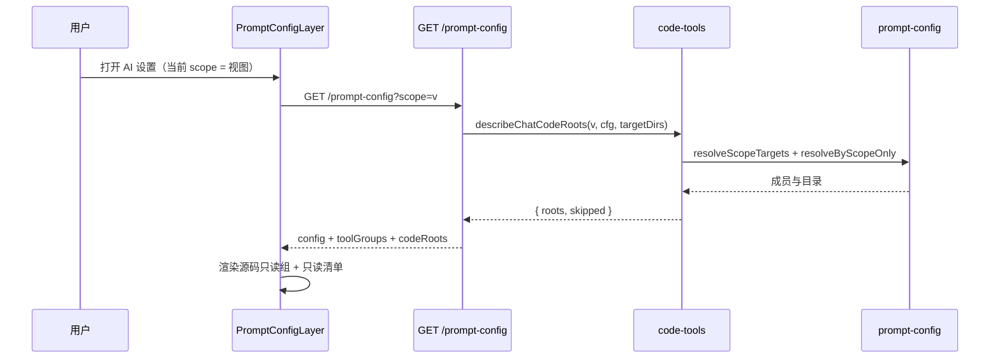

# S-03 界面与可观测

**父文档**：[DESIGN.md](DESIGN.md) ｜ **需求**：[requirement.md](../requirement.md) R6 / R7

## 1. 术语

| 术语 | 定义 |
|---|---|
| 源码只读组 | 对话「工具与权限」下新增的分组，4 个 `fs_*` 开关，默认开 |
| 视图只读清单 | 当前 scope 是视图时，展示成员库 → 映射目录的只读列表；**不可编辑** |
| 动作标签 | 时间线工具行左侧的动词（现恒为「检索知识库」），`fs_*` 需显示各自动作 |
| 代码目录卡片 | 原「分析目标目录」，改名后由分析与对话共用 |

## 2. 现状（AS-IS）

| 位置 | 现状 |
|---|---|
| `web/src/chat/PromptConfigLayer.tsx:1527-1560` | 对话工具组按 `data.toolGroups` 数据驱动渲染；新增组无需改结构 |
| `web/src/chat/PromptConfigLayer.tsx:1523` | 对话工具 hint 只讲「只读默认开 / 写入危险」 |
| `web/src/chat/PromptConfigLayer.tsx:1881-1953` | 分析工具组；`:1887` 写死「源码只读工具（fs_*）仅限事件「AI 分析」使用，其他场景不可见」 |
| `web/src/chat/PromptConfigLayer.tsx:2179` | 查找面板写死「文件工具（fs_*）属「AI 分析」专属，不在此提供」 |
| `web/src/chat/PromptConfigLayer.tsx:1603-1620` | 目录卡片标题「分析目标目录」，hint 只提「AI 分析」 |
| `src/lib/chat/prompt-config.ts:214` | 分析组 label「源码只读（AI 分析专属）」 |
| `web/src/chat/ChatPanel.tsx:3267` | 时间线工具行动作**恒为「检索知识库」** |
| `src/lib/chat/chat-routes.ts:670` | `handlePromptConfigGet(res, ctx)` 不接收 `url`，无法按 scope 下发目录 |
| `web/src/api/chatApi.ts:98` | `getPromptConfig()` 不带 scope |
| `web/src/api/chatContract.ts` ↔ `src/lib/chat/chat-contract.ts` | 跨端契约双副本，`contract-parity` 测试机械对齐 |

## 3. 方案（TO-BE）

1. **新组自动渲染**：S-01 已把 `MCP_TOOL_GROUPS` 加一组，对话面板无需改结构；只补一句 hint。
2. **文案统一**：5 处改为「分析与对话各自独立」口径，目录卡片改名「代码目录（分析 / 对话共用）」。
3. **视图只读清单**：`GET /prompt-config?scope=` 增加 `codeRoots`，面板在源码只读组下渲染；未映射 / 不可读成员标原因。
4. **空态**：无任何可读根 → 该组置灰 + 一行「请先在「AI 分析 → 代码目录」配置」；不移除分组（避免用户以为功能不存在）。
5. **动作标签**：`ChatPanel` 内加 4 项 `fs_*` → 动词映射；其余工具保持「检索知识库」，旧记录零影响。

**关键决策点**

| # | 决策 | 被否决方案 | 否决理由 | 重新评估触发条件 |
|---|---|---|---|---|
| 1 | 动作标签走前端 4 项映射 | 后端 `ChatToolDescribe.label` + 双端契约同步 | 纯展示；改契约要同步前端副本与 parity 测试，落盘兼容也要动 | 若动作标签需要按配置变化 |
| 2 | 视图清单由服务端 `codeRoots` 下发 | 前端用 `views` + `byScope` 自算 | 去重 / 严格模式 / 不可读状态只在服务端，前端自算会出现两套口径 | 若接口不想扩字段 |
| 3 | 目录卡片改名、仍在「AI 分析」页 | 在「AI 对话」页再复制一份目录配置 | 同一 scope 两份路径必然漂移 | 若产品要求对话独立目录 |
| 4 | 无根时置灰不隐藏 | 直接隐藏分组 | 隐藏后用户以为功能不存在，无法发现"差一个目录" | 无 |

## 4. 界面设计

引用阶段 2.4 已确认的布局，不重画；新增两处已确认区块的落点如下。

```
AI 设置 → AI 对话 → 工具与权限
┌────────────────────────────────────────────────────────────┐
│ 只读工具默认全开；写入为危险工具，默认关闭…                  │
│ 源码只读工具（fs_*）在「AI 分析」「AI 对话」各自独立开关。 ①  │
│                                                            │
│ ● 只读                            6 个 · 默认开            │
│    ki_search          混合 / 字面检索知识库             ●  │
│                                                            │
│ ● 源码只读（需已配代码目录）        4 个 · 默认开    ②      │
│    fs_read   读取代码片段（≤200 行 / 64 KB）           ●  │
│    fs_grep   按关键词检索源码（≤60 条）                ●  │
│    fs_find   按文件名查找（≤80 条）                    ●  │
│    fs_ls     列出目录结构（≤200 项）                   ●  │
│                                                            │
│ ● 写入（危险 · 默认关）            6 个 · 危险 · 默认关     │
└────────────────────────────────────────────────────────────┘
```

```
视图会话（同一位置，只读清单）
│ ● 源码只读（需已配代码目录）        4 个 · 默认开    ②      │
│    视图「kisearch-docs」= kisearch-memory + xpert-server     │
│    + xpert-cloud。源码目录取成员库各自的映射，只读；         │
│    要修改请切到具体知识库。                                 │
│      kisearch-memory   /root/knowledge-indexer         ✓  │
│      xpert-server      /root/xpert                     ✓  │
│      xpert-cloud       未配置（不参与）                 —  │
│    fs_read …                                          ●  │
```

> 视图 banner 文案对齐 `demo/scope-rules/index.html` 的既有模式（「视图『X』= A + B。规则取成员并集，只读；要编辑请切到具体知识库」），只把「规则」换成「源码目录」，不另造一套措辞。

**变更点表**

| # | 变更点 | 现状 | 预期 | 类型 |
|---|---|---|---|---|
| ① | 对话面板 hint | 只讲只读 / 危险 | 增加「分析与对话各自独立开关」 | 修改（文案） |
| ② | 源码只读组 | 无 | 4 行开关，默认开 | 新增（数据驱动） |
| ③ | 视图只读清单 | 无 | 成员库 → 目录，不可编辑 | 新增 |
| ④ | 分析面板组标题 | 源码只读（AI 分析专属） | 源码只读（分析） | 修改（文案） |
| ⑤ | 分析面板 hint | 「仅限事件 AI 分析使用，其他场景不可见」 | 「与分析 / 对话各自独立，互不影响」 | 修改（文案） |
| ⑥ | 目录卡片 | 「分析目标目录」 | 「代码目录（分析 / 对话共用）」 | 修改（文案） |
| ⑦ | 查找面板 hint | 「属 AI 分析专属，不在此提供」 | 「仅在分析 / 对话提供，查找不提供」 | 修改（文案） |
| ⑧ | 时间线动作 | 恒为「检索知识库」 | `fs_*` 显示「读取文件 / 检索源码 / 查找文件 / 浏览目录」 | 修改（前端映射） |

## 5. 接口设计

### `GET /api/chat/prompt-config?scope=<name>`（扩展现有）

| 项 | 内容 |
|---|---|
| 方法 / 路径 | `GET /api/chat/prompt-config`（不变） |
| 入参 | `scope?`（可选；缺省 = 当前授权范围内的默认库）。只用于计算 `codeRoots`，不影响 `config` 返回 |
| 鉴权 | 复用本路由既有鉴权。单库 scope 必须在 `authScopes` 内；视图**显式授权视图名，或成员全部在 `authScopes` 内**才返回目录，否则 `codeRoots.roots = []` + `skipped` 记 `forbidden`。视图名通常不在按库授权的白名单里，故「成员全部可访问」是主判据 |
| 返回 | 原字段不变，追加 `codeRoots` |
| 异常 | scope 非法 → 400（`INVALID_SCOPE`）；无此参数 → `codeRoots.scope = null`、`roots = []` |

```ts
export type CodeRootSkipReason =
  | 'unmapped' | 'unreadable' | 'strict-skipped' | 'view-empty' | 'view-error' | 'forbidden';

export interface CodeRootsDto {
  scope: string | null;
  isView: boolean;
  roots: Array<{ label: string; dir: string; aliases: string[] }>;
  skipped: Array<{ label: string; reason: CodeRootSkipReason }>;
}
```

> `dir` 即 `ChatCodeRoot.realRoot`；DTO 只暴露展示所需字段，不返回 `filesRead` 等运行期状态。
> 实现说明：设置接口先用 `resolveChatCodeRoots` 的返回值映射 DTO（与执行侧同源）；S-02 若落地 `describeChatCodeRoots`，替换为它即可。

**reason 文案映射**（前端 SSOT，不在服务端拼中文）：

| code | 面板文案 |
|---|---|
| `unmapped` | 未配置（不参与） |
| `unreadable` | 目录不可读 |
| `strict-skipped` | 未注册（strict 模式） |
| `view-empty` | 视图无成员 |
| `view-error` | 视图定义读取失败 |
| `forbidden` | 无权限查看目录 |

```json
// Demo 返回示例（仅示意格式）
{
  "ok": true,
  "codeRoots": {
    "scope": "kisearch-docs",
    "isView": true,
    "roots": [
      { "label": "kisearch-memory", "dir": "/root/knowledge-indexer", "aliases": [] },
      { "label": "xpert-server", "dir": "/root/xpert", "aliases": [] }
    ],
    "skipped": [{ "label": "xpert-cloud", "reason": "unmapped" }]
  }
}
```

**改动点**：`chat-routes.ts` 的调用改为 `handlePromptConfigGet(res, url, ctx)`；`web/src/api/chatApi.ts::getPromptConfig(scope?)` 拼 query；`web/src/api/chatContract.ts` 的 `PromptConfigOk` 加 `codeRoots`（**只增字段，parity 测试不破坏**）。

## 6. 时序图



## 7. 影响范围

| 文件 | 改动 | 风险 |
|---|---|---|
| `web/src/chat/PromptConfigLayer.tsx` | 对话 hint、分析 hint/标题、目录卡片标题、视图清单渲染 | 低：均为文案 + 新增只读块 |
| `web/src/chat/ChatPanel.tsx` | `fs_*` 动作标签映射 | 低：只影响 4 个新工具 |
| `src/lib/chat/prompt-config.ts` | 分析组 label 文案 | 低 |
| `src/lib/chat/chat-routes.ts` | GET 签名接 `url` + `codeRoots` | 低：单一调用点 |
| `web/src/api/chatApi.ts` / `chatContract.ts` | query 参数 + 响应字段 | 低：只增字段，parity 测试需复跑 |
| 测试 | 面板文案断言、`codeRoots` 形状、动作标签 | 中 |

## 8. 测试与验收

| 用例 | 断言 |
|---|---|
| 对话面板 | 出现「源码只读」组 4 行；hint 含「各自独立」；关闭开关后 `tools` 落盘为 false |
| 分析 / 查找面板 | 不再出现「仅限 AI 分析」「不在此提供」字样；目录卡片标题为新名 |
| 视图清单 | 视图会话显示成员 → 目录；未映射成员显示「未配置」；库会话不显示清单 |
| 空根 | 组置灰 + 配置引导；工具面不含 `fs_*` |
| `codeRoots` | 视图 / 单库 / 空 / 非授权 scope 四种形状正确；无 `scope` 参数时不报错 |
| 动作标签 | `fs_read` 行显示「读取文件」；旧记录（无 `fs_*`）仍「检索知识库」 |
| 契约 | `contract-parity` 复跑通过；`toolGroups` 18 个工具 |

## 9. 异常处理

| 场景 | 行为 | 对外暴露 |
|---|---|---|
| 无 `scope` 参数（旧前端） | `codeRoots.scope=null`、`roots=[]`；面板不显示清单 | 否（向后兼容） |
| scope 非法 | 400 `INVALID_SCOPE` | 是 |
| scope 无权限 | `roots=[]` + `skipped: forbidden` | 面板「无权限查看目录」 |
| 视图为空 | `roots=[]` + `skipped: view-empty` | 面板「视图无成员」 |
| 视图定义读取失败 | `roots=[]` + `skipped: view-error` | 面板「视图定义读取失败」 |
| 成员未映射 | `skipped: unmapped` | 面板「未配置（不参与）」 |
| 目录不可读 | `skipped: unreadable` | 面板「目录不可读」 |
| 配置保存失败 | 沿用现有 `saveError` + 重试 | 是 |

## 10. 待定问题

| # | 问题 | 处理 |
|---|---|---|
| 1 | 视图清单是否显示「同目录别名」 | 首版不显示；`aliases` 仅保留在 DTO，后续需要时再加一行「与 X 同目录」（它已不参与 `root` 匹配） |
| 2 | 动作标签是否需要「已读 N 行」的统计 | 首版只给动词；统计走展开卡片的响应文本 |
