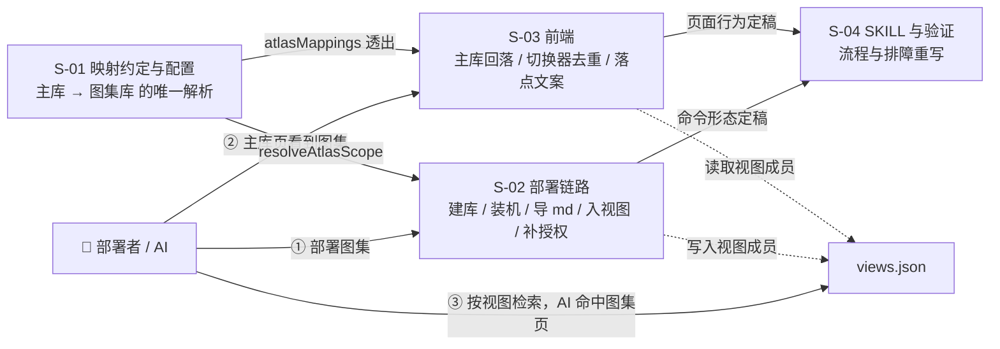
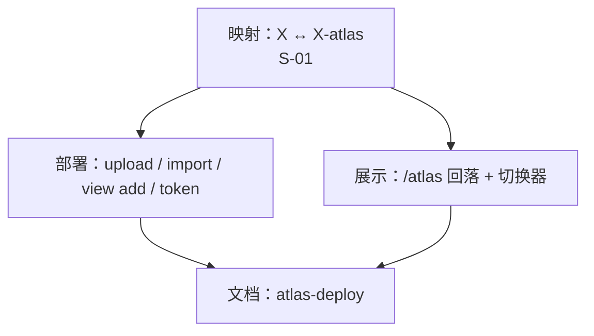

# 图集库一一对应 · 设计（父文档）

> 需求来源：2026-11-27 用户提出「导出的知识地图改为上传到指定的 scope，主库与图集库一一对应」
> 设计基线：`skills/atlas-deploy/SKILL.md`（2026-11-26 版）、`views.json` v2、图集 14xx 错误码段

## 1. 需求背景 & 目标

现状：图集的 AI 可读 md 被导入「图集所在库」的固定 group `知识地图`，实际全挤在 `default`；图集与该图集所描述的项目主库没有任何关联，AI 的检索视图（如 `kisearch-docs`）不包含 `default`，必须手动叠加 scope 才能命中。

目标：主库 `X` 与图集库 `X-atlas` 一一对应；图集包（`.atlas/`）与 md 副本（`知识地图/`）同落 `X-atlas`；主库页 `/atlas` 自动回落到 `X-atlas`；`X-atlas` 自动加入 `X` 所在视图并同步补 token 授权。

不在范围内：`default/知识地图` 存量迁移（用户 2026-11-27 明确暂不动）、图集内容生成（`project-atlas`）、页面上传图集（二期）。

## 2. 关键环节一览图

子文档索引：

- [S-01 映射约定与配置](./图集库一一对应_S01_映射约定与配置_DESIGN.md)
- [S-02 部署链路](./图集库一一对应_S02_部署链路_DESIGN.md)
- [S-03 前端回落与切换器](./图集库一一对应_S03_前端回落与切换器_DESIGN.md)
- [S-04 SKILL 与验证](./图集库一一对应_S04_SKILL与验证_DESIGN.md)

## 3. 总体方案设计

四条链路各自由一个子需求承接，映射规则是唯一的跨模块共享面：

共享术语速查（详见各子文档定义，此处只做索引）：

| 术语 | 定义 | 归属 |
|---|---|---|
| 主库 | 承载业务知识的 scope（如 `kisearch`） | S-01 |
| 图集库 | 承载某主库图集的 scope（如 `kisearch-atlas`） | S-01 |
| 映射规则 | 主库 → 图集库的解析：配置优先、后缀兜底 | S-01 |
| 落点 | 图集包与 md 副本实际写入的库 | S-02 |
| 回落 | 主库无图集时，前端改取图集库的图集 | S-03 |

## 4. 全局风险 & 跨子需求依赖

| 风险 | 说明 | 缓解 |
|---|---|---|
| 视图消失 | 加入视图成员后未补授权，`filterAuthorizedViews` 使整个视图不可见 | S-02 的 `atlas link` 默认补授权（`--no-grant` 可关）；`ki view add` 原有行为不变 |
| 语义破坏 | `--scope` 从「落点库」改为「主库」，现有 `--scope default` 会改写到 `default-atlas` | S-02 提供 `--atlas-scope` 覆盖，并在上传前检测「主库自身已有图集」时拒绝并提示；SKILL 写明变更 |
| 同一图集两份 | 存量 `default` 未迁，与 `kisearch-atlas` 并存 | 已知并接受（用户决定）；S-03 按主库优先取图集库，避免页面出现两份 |
| 映射漂移 | CLI、前端、AI 三处各推导一次 | S-01 只定义一次，`ki_scope_list` 透出 `atlas` 字段 |
| 图集库未授权 | 用户看不到图集库，页面 403 | S-03 对追加目标 403 静默忽略；S-02 补授权为主路径 |

接口契约变化：`ki_scope_list` 新增 `atlas` 字段（向后兼容，旧前端忽略）；`ki atlas upload --scope` 语义改为「主库」（**破坏性**，已提供 `--atlas-scope` 与 `--legacy-scope` 两个出口）。

默认假设：单机部署、scope 总数 ≤ 200、视图成员 ≤ 20、映射表 ≤ 50 条；不引入服务端聚合，前端并发上限沿用现有口径（见 S-03 §9）。

跨子需求依赖：S-01 是 S-02 / S-03 的硬前置；S-04 必须等 S-02 / S-03 定稿后重写，否则文档与实现再次分叉。
