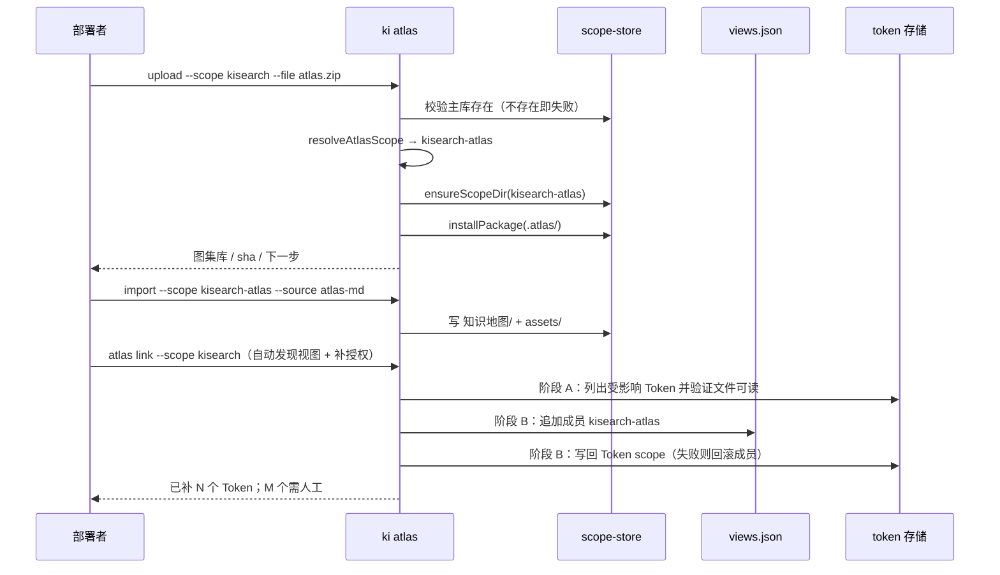

# S-02 部署链路 · 设计

## 1. 术语

| 术语 | 定义 |
|---|---|
| 图集库 | 本次部署的落点库，由 S-01 的 `atlasScopeFor` 解析得出 |
| 关联视图 | 主库已加入的知识视图，图集库需追加为其成员 |
| 补授权 | 对已授权该视图的 Token，追加图集库到 `scopes`，否则视图整体不可见 |

## 2. 现状（AS-IS）

- `ki atlas upload --scope <库> --file <zip>`：只装到 `--scope` 指定库；库不存在直接退出码 2（`src/atlas.ts:50`）。
- `ki import --scope <库> --source <dir> --group 知识地图`：按需建库，**不校验库是否存在**（`src/lib/config.ts:1044 resolveScope` 只 trim + default），库名写错会静默建库。
- `ki view add <视图> <库>`：成员追加幂等；会调用 `warnTokensMissingMembers` **检测并打印**缺授权的 Token 与修复命令，但**不自动补**（`src/view.ts:423`）。
- `ki view audit-grants`：全量检查「授权了视图但缺成员授权」的 Token（`src/view.ts:202`）。
- 无任何「主库 → 图集库」串联命令。

## 3. 方案（TO-BE）

### 3.1 命令形态（三条，职责单一）

```bash
# ① 装图集包：--scope 是主库，自动落到图集库
ki atlas upload --scope kisearch --file dist/atlas.zip [--atlas-scope <图集库>] [--json]

# ② 导 AI 可读层：落到图集库
ki import --scope kisearch-atlas --source dist/atlas-md --group 知识地图 [--prune]

# ③ 关联视图 + 补授权（默认自动发现主库所在的所有视图）
ki atlas link --scope kisearch [--views <限定视图,...>] [--no-grant] [--json]
```

`--scope` 语义变更：**主库**（默认推导图集库）。兼容规则：

| 传入值 | 行为 |
|---|---|
| `kisearch` | 图集库 = `kisearch-atlas` |
| `kisearch-atlas` | 自指（S-01 规则），装到自身 |
| 任意 + `--atlas-scope X` | 显式覆盖，跳过推导 |
| 任意 + `--legacy-scope` | 旧行为：`--scope` 即落点库（过渡期保留一个版本） |

### 3.2 `atlas upload` 改造

```
解析主库 scope = resolveScope(config, opts.scope)
① 主库必须已存在（scopeDirExists）；不存在 → 退出码 2，提示 ki scope list
   （typo 不允许静默建库，否则会生出 <错名>-atlas 孤儿）
图集库 atlasScope = opts.atlasScope ?? atlasScopeFor(scope, resolveAtlasMap(config))
② 图集库非只读；图集库不存在则 ensureScopeDir(atlasScope) 建目录（新增）
③ 旧库检测：scope 自身已有 .atlas 且有图集 → 提示「旧部署在 <scope>，本次写到 <atlasScope>」，
   未加 --legacy-scope 时拒绝继续（防用户误以为在更新旧图集）
installPackage(atlasScope, zip)
输出：主库 / 图集库 / 基线 / 体积 / sha / 下一步两条命令
```

只读判定与包校验逻辑不变，只把落点从 `scope` 换成 `atlasScope`。

### 3.3 `atlas link` 新增

```
前置：① 主库必须已存在；② 解析目标视图
目标视图 = 未给 --views 时取含主库的全部视图；给了则取交集，
          并显式拒绝「指定了但不含主库」的视图（列出名字，退出码 1，不静默忽略）
两阶段提交：
  阶段 A（只读）：逐视图列出受影响 Token，并验证 token 文件可读；
                 任一不可读 → 整体中止，不写任何成员
  阶段 B（写）：  先 updateView 追加成员（幂等），再写回 Token 授权；
                 某视图任一步失败 → 回滚该视图的成员追加并报错（退出码 1）
  --no-grant：只做阶段 A 的打印，不写 Token
输出：视图清单 / 每视图成员数 / 已补授权 Token 数 / 仍需人工处理 / 被拒绝的视图
      / 主库不在任何视图时的明确提示（不是静默 0）
```

默认补授权（`--no-grant` 关闭）：`link` 的语义就是「关联并保证可见」，默认不补时用户极易出现「刚加成员视图就消失」。既有决策「视图新增成员不**自动**补授权」约束的是其它入口（`ki view add` 行为不变）；`link` 是部署者主动执行的显式命令，且逐条打印补了哪些 Token，不构成静默扩大。

自动发现命中成员数 **> 5** 的视图时**默认跳过**，要求 `--views` 显式指定 —— 避免把图集库授权扩散到 `just-test`（13 成员）这类大杂烩视图。注意：这是**自动关联的准入阈值**，不是视图成员上限；超阈值视图仍可手动 `--views` 关联。

### 3.4 时序



## 4. 数据模型

无新增持久化模型；复用：

| 存储 | 字段 | 变化 |
|---|---|---|
| `views.json` | `members[]` | 追加图集库名 |
| token 存储 | `scopes[]` | 默认补授权时追加图集库名 |
| `<图集库>/.atlas/meta.json` | 既有 | 新增 `mainScope` 字段（记录归属主库，供反查） |

`meta.json.mainScope` 是**可选**增量字段：旧包没有不影响安装。**显示名一律以 S-01 映射解析为准**，该字段只用于排障（图集库被改名后反查归属），不参与前端显示名计算。

## 5. 接口设计

```ts
// 复用（已存在，无需新增）：src/lib/store.ts
export function ensureScopeDir(scope: string): void;

// 复用（已存在，无需新增）：src/lib/mcp-token.ts
export function listTokensGrantingView(view: string, filePath?: string): TokenRecord[];
export function updateTokenScopes(id: string, scopes: string[], filePath?: string): TokenRecord;
// 调用侧按 token id 去重；ALL_SCOPES 全量授权的 Token 计入 skipped，不写回

// 扩展：src/atlas.ts
// .option('--atlas-scope <scope>', '显式指定图集库（缺省按映射推导）')
// .option('--legacy-scope', '旧行为：--scope 即落点库', false)
```

`ki atlas link --json` 输出示例（仅示意）：

```json
{
  "ok": true,
  "scope": "kisearch",
  "atlasScope": "kisearch-atlas",
  "views": [
    { "view": "kisearch-docs", "changed": true, "members": 3 }
  ],
  "tokens": {
    "updated": ["tok_ab12"],
    "skipped": ["tok_cd34（全量授权，无需补）"]
  }
}
```

## 6. 关键决策点

| 决策 | 选项 | 结论与理由 | 重新评估触发条件 |
|---|---|---|---|
| `--scope` 语义 | ① 保持落点库 + 新增 `--for` ② 改为主库 + `--atlas-scope` 覆盖 | **②**。命令只写一次主库，agent 不会两条命令填两个库名导致分居 | 同一主库需要多个并行图集时 |
| 库不存在 | ① 报错让用户先建 ② 自动建目录 | **②**。图集库是部署产物，不该要求用户手工 `mkdir`；退出码 2 仅保留给「只读库」 | 图集库开始承载人工维护内容时（那时不应自动建） |
| 补授权 | ① 默认补 ② 显式 `--grant` | **①**。`link` 的语义是「关联并保证可见」，默认不补会直接导致视图消失；用 `--no-grant` 保留收紧能力 | 出现无法验证 token 文件的部署形态时 |
| 视图发现 | ① 显式列视图 ② 自动发现主库所在视图 | **②**。用户明确要求「自动加入视图」；成员 > 5 的视图默认跳过 | 阈值 5 被证实不合适时 |
| md 导入 | ① 新增 `atlas sync-md` ② 复用 `ki import` | **②**。`ki import` 已支持 `--scope/--group/--prune`，再加一层包装只会多一份口径 | `ki import` 不再支持 `--prune` 或 group 语义变更时 |
| 兼容旧部署 | ① 直接改语义 ② 保留 `--legacy-scope` 一版 | **②**。`default` 现有图集不迁（用户决定），过渡期需要能继续按旧方式重传 | 下一大版本移除 `--legacy-scope` 时 |
| 被否决：一体化 `atlas deploy` | 一条命令做完 upload+import+link | 否决。md 目录来自生成侧，部署机可能只有 zip；一体化会强迫两条产物同时就位，反而限制远端场景 | 生成侧与部署侧合并为单机流程时 |

## 7. 异常处理

| 场景 | 行为 | 退出码 / 对外暴露 |
|---|---|---|
| 主库不存在 | 拒绝，提示 `ki scope list` 核对；不建库 | 2 / 是 |
| 图集库只读 | 拒绝，提示换库或解除只读 | 2 / 是 |
| 图集库名非法 | `validateScope` 拒绝 | 2 / 是 |
| zip 不合法 | 既有 14xx 校验链 | 1 / 是 |
| `--views` 中视图不存在 | 列出不存在的视图名，其余视图照常处理 | 1（有失败即非 0）/ 是 |
| `--views` 指定了不含主库的视图 | 显式拒绝并列出，不静默忽略 | 1 / 是 |
| 主库不在任何视图 | 不静默成功：提示「未发现包含 kisearch 的视图，AI 检索不会命中」，附 `ki view create` 示例 | 1 / 是 |
| `--no-grant` 且存在受影响 Token | 只加成员，打印受影响 Token 与修复命令 | 0 / 是 |
| token 文件不可读（阶段 A） | 整体中止，不写任何成员；提示 `ki mcp token list` | 1 / 是 |
| 阶段 B 写授权失败 | 回滚该视图的成员追加，报错并说明已回滚 | 1 / 是 |
| 图集库已存在但只读 | 同第一行 | 2 / 是 |
| `--scope` 与 `--atlas-scope` 相同 | 视为自指，正常安装 | 0 / 是 |

## 8. 影响范围

| 文件 | 改动 |
|---|---|
| `src/atlas.ts` | `upload` 加 `--atlas-scope` / `--legacy-scope`；新增 `link` 子命令 |
| `src/lib/store.ts` | 复用既有 `ensureScopeDir`（已存在，无需新增） |
| `src/lib/mcp-token.ts` | 复用 `listTokensGrantingView` + `updateTokenScopes`（已存在） |
| `src/lib/atlas/package.ts` | `meta.json` 写入可选 `mainScope` |
| `src/lib/atlas/types.ts` | `AtlasMeta.mainScope?: string` |
| `src/view.ts` | 无（复用 `updateView` / `warnTokensMissingMembers`，需导出给 atlas.ts） |
| `test/atlas-upload.test.ts` | 覆盖推导、自指、覆盖、只读、legacy |
| `test/view-grant.test.ts` | 覆盖默认补授权、`--no-grant`、跳过全量 Token |

## 9. 待定问题

| # | 问题 | 处理 |
|---|---|---|
| 1 | `atlas link` 是否应支持一次关联多个主库（批量迁移用） | 本次不做；批量由 SKILL 循环调用 |
| 2 | `--legacy-scope` 保留几个版本 | 建议保留到下一次大版本，SKILL 标为「过渡」 |
| 3 | 图集库创建后是否要写入 `config.yaml` 的 mappings | 不自动写。约定后缀已可解析；显式映射由用户按需登记 |
| 4 | 「大杂烩视图」的成员数阈值定多少 | **已定稿 5**（用户 2026-11-27）：成员 > 5 默认跳过并要求 `--views` 显式指定；这是自动关联准入阈值，不是视图成员上限 |
| 5 | `atlasPolicy.strict` 白名单开启时，自动创建的图集库是否会被拒 | **已确认不适用**（用户 2026-11-27：当前部署未开 strict）。若将来开启，需在 `ensureScopeDir` 后把图集库注册进白名单 |

## 10. 本子需求不在范围内

- 映射规则的解析实现（S-01）
- 页面回落、切换器与文案（S-03）
- md 内容生成与打包（`project-atlas`）
- `default/知识地图` 存量迁移（用户决定暂不做）
