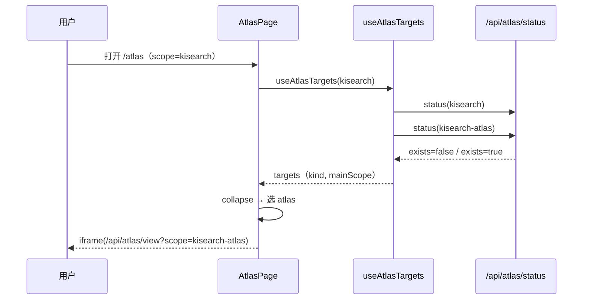

# S-03 前端回落与切换器 · 设计

## 1. 术语

| 术语 | 定义 |
|---|---|
| 回落 | 主库无图集、其图集库有图集时，页面改取图集库的图集 |
| 折叠 | 视图里同一主库与其图集库只占一个切换项，优先取图集库 |
| 展示名 | 切换器里显示的名字：图集库显示其主库名 |
| 追加目标 | 由映射推导、原视图成员之外额外探测的图集库 |

## 2. 现状（AS-IS）

- `useAtlasTargets(scope)`（`web/src/lib/hooks.ts:258`）：单库 `targets = [scope]`；视图 `targets = view.members`（去重、排除 missing）。不感知图集库。
- `resolveAtlasView(probes, remembered)`（`web/src/lib/atlasTargets.ts:66`）：`members` = 所有 `exists` 的成员；≥2 就摆切换器；选中优先级 `?member=` > 最近上传 > 成员顺序首个。
- `AtlasPage`（`web/src/pages/AtlasPage.tsx:183`）：单库分支在 `!status.exists` 时显示「这个库还没有知识地图」空态。
- `AtlasHeaderActions`（`web/src/components/AtlasHeaderActions.tsx:274`）：视图分支 ≥2 成员装图集才摆切换器；单库分支上传/卸载直接写当前 `scope`，文案固定「上传图集包」。

## 3. 方案（TO-BE）

### 3.1 取数层（唯一改动点）

`useAtlasTargets` 负责把「映射」变成探测目标，页面与顶栏不改取数逻辑（两者共用，避免分叉）。

```ts
// 单库
names = [scope, atlasScopeFor(scope, atlas)]

// 视图
names = [...view.members, ...view.members.map(m => atlasScopeFor(m, atlas))]
// 去重；atlasScopeFor 返回自身（已是图集库）时不重复追加
// 上限：追加数 ≤ view.members.length；useQueries 并发沿用现有口径（建议 ≤ 10，
//       超出分批），避免 13 成员视图一次性变成 26 个并发 status 请求
```

`AtlasTarget` 增加两个字段：

| 字段 | 类型 | 含义 |
|---|---|---|
| `kind` | `'main' \| 'atlas'` | 该目标是主库还是图集库 |
| `mainScope` | `string` | 归一后的主库名（图集库取其主库；主库取自身） |

### 3.2 折叠与选中

新增纯函数 `collapseAtlasTargets(targets: AtlasProbe[]): AtlasProbe[]`（`atlasTargets.ts`）：

```
按 mainScope 分组
每个组内：有 exists 的 atlas → 只留 atlas；否则留 exists 的 main；都无 → 留 main（用于空态）
组成员顺序按主库在视图中的原顺序
```

`resolveAtlasView` 改为接收折叠后的 probes，逻辑不变（≥2 摆切换器、`?member=` 优先）。这样：

- 同一主库只出一项
- 存量 `default` 未迁时，若主库与图集库都有图集，页面只显示图集库那份（避免两份）

### 3.3 单库三态

| 条件 | 表现 |
|---|---|
| 图集库 `exists` | 直出图集库的 iframe（`?member` 无意义） |
| 主库 `exists`（旧部署） | 直出主库的 iframe（兼容） |
| 都没有 | 空态：「这个库及其图集库都还没有知识地图」，命令示例用图集库名 |
| 图集库查询 403 | 静默忽略该目标；若主库也无图集 → 空态文案改为「图集库无访问权限，请联系管理员补授权」，不写成「还没有」 |
| 主库查询 403 且图集库有图集 | 正常出图（主库不可读不影响图集库） |

### 3.4 切换器与文案

- 项名用 `mainScope`，不显示 `-atlas` 后缀
- `note` 行不变（未配置 / 读取失败）
- 单库上传/卸载按钮：写 `selected.scope`（图集库），`title` 与 `aria-label` 显示「上传到 kisearch-atlas」「卸载 kisearch-atlas 的图集」
- 视图分支不渲染上传/卸载（现状保持）

### 3.5 时序



## 4. 数据模型

`AtlasProbe` 增量字段（纯前端内存结构，不落盘）：

| 字段 | 类型 | 说明 |
|---|---|---|
| `scope` | `string` | 真实探测库名 |
| `kind` | `'main' \| 'atlas'` | 目标类型 |
| `mainScope` | `string` | 归一主库名 |
| `failed` / `exists` / `uploadedAt` | 既有 | 不变 |

## 5. 接口设计

前端不发新请求，只扩大探测集合。`atlasStatusOptions(scope)` 的 queryKey 不变（`['atlasStatus', scope]`），缓存天然按库隔离。

新增/修改的纯函数（`web/src/lib/atlasTargets.ts`，可被 `web/test` 直接单测）：

```ts
export function toAtlasProbes(targets: AtlasTargetLike[], map: AtlasScopeMap): AtlasProbe[];
export function collapseAtlasTargets(probes: AtlasProbe[]): AtlasProbe[];
export function displayNameOf(probe: AtlasProbe): string;   // 取 probe.mainScope（映射解析，见 S-01）
export function pickSingleTarget(probes: AtlasProbe[]): AtlasProbe | null; // 单库回落
```

Demo（折叠结果，仅示意）：

```json
[
  { "scope": "kisearch-atlas", "kind": "atlas", "mainScope": "kisearch", "exists": true },
  { "scope": "kisearch-xperts", "kind": "main", "mainScope": "kisearch-xperts", "exists": false }
]
```

## 6. 关键决策点

| 决策 | 选项 | 结论与理由 | 重新评估触发条件 |
|---|---|---|---|
| 回落放哪一层 | ① 页面里拼 ② `useAtlasTargets` 统一装配 | **②**。页面与顶栏共用取数，页面各写一份必然分叉（`resolveAtlasView` 已有同类教训） | 页面与顶栏不再共用取数时 |
| 切换器显示名 | ① 显示真实库名 ② 显示主库名 | **②**。用户认知是「kisearch 的图集」，不是 `kisearch-atlas`；真实库名放在 title | 用户开始按图集库名区分同一主库的多份图集时 |
| 显示名数据来源 | ① `meta.mainScope` ② S-01 映射解析 | **②**。映射是唯一来源，meta 只作排障；两处并用必漂移 | 图集库被手工改名且映射未同步时 |
| 双份取舍 | ① 全部列出 ② 按主库折叠、图集库优先 | **②**。否则存量未迁期间切换器出现同一图集两项 | 存量 `default` 完成迁移后 |
| 追加目标 403 | ① 计入 failed ② 静默忽略 | **②**。图集库未授权是预期状态（补授权是 S-02 的职责），不能让整个页面变错误卡 | 图集库授权成为强制前置时 |
| 视图分支上传按钮 | ① 显示并写入某成员 ② 继续隐藏 | **②**。视图下「传给哪个库」无法自然表达，保持现状 | 视图下「指定写哪个库」的交互定稿后 |
| 被否决：前端自己推导 `-atlas` | 不依赖 `ki_scope_list.atlas` | 否决。与 S-01 单一来源冲突，配置覆盖失效 | 后端不再透出 `atlas` 字段时 |

## 7. 异常处理

| 场景 | 行为 | 是否对外暴露 |
|---|---|---|
| 图集库不存在 | 目标 `exists:false`，不报错 | 否 |
| 图集库 403 | 静默剔除该目标；不并入 `failed` | 否（避免误导为故障） |
| 主库 403、图集库可读 | 正常出图集 | 否 |
| 两库都 403 | 显示「无法读取图集状态」并给出切库提示（沿用现有文案） | 是 |
| `atlas.mappings` 缺失（旧 daemon） | 前端按 `-atlas` 兜底推导，不阻塞 | 否 |
| 视图成员全是图集库 | 折叠后按主库显示，不出现「kisearch-atlas」字样 | 否 |
| 主库与图集库都有图集 | 折叠后只取图集库 | 否 |
| 旧深链 `?member=<主库>` | 折叠后该名不在 members 中 → 按 `resolveAtlasView` 回落，并以 `replace` 归一 URL | 否 |

## 8. 影响范围

| 文件 | 改动 |
|---|---|
| `web/src/lib/hooks.ts` | `useAtlasTargets` 追加映射目标；`AtlasTarget` 加 `kind` / `mainScope` |
| `web/src/lib/atlasTargets.ts` | 新增 `collapseAtlasTargets` / `displayNameOf` / `pickSingleTarget` |
| `web/src/pages/AtlasPage.tsx` | 单库三态改用 `pickSingleTarget`；空态文案 |
| `web/src/components/AtlasHeaderActions.tsx` | 切换器项名、上传/卸载文案与 title |
| `web/src/api/mcpClient.ts` | `ScopeInfo` 响应类型加 `atlas` |
| `web/test/atlas-view.test.mjs` | 折叠、回落、显示名、双份取舍 |
| `web/test/atlas-view-render.test.mjs` | 单库回落后 iframe src 指向图集库 |

## 9. 待定问题

| # | 问题 | 处理 |
|---|---|---|
| 1 | 视图下是否提供「上传到主库的图集库」入口 | 本次不做，避免在视图分支引入「选哪个成员」的二次选择 |
| 2 | 是否在空态里直接给「创建图集库并上传」引导 | 文案给命令，不做一键创建 |

默认假设：视图成员数 ≤ 20、单用户低频访问。若成员数或并发显著增大，追加探测需改分批或改服务端聚合。

## 10. 本子需求不在范围内

- CLI 参数、装机与补授权（S-02）
- 映射规则的定义与后端透出（S-01）
- 视图成员写入（S-02）
- 图集内容与渲染（图集包内）
