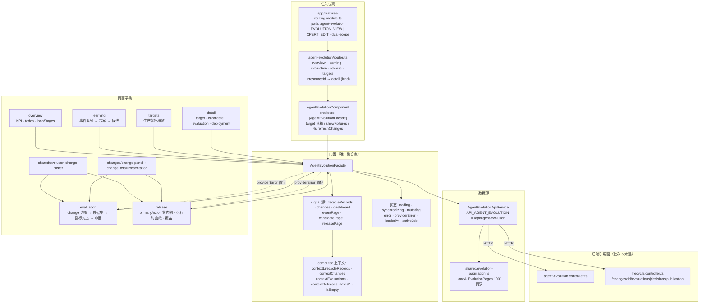

# 01 架构：Agent 演进专家（Xpert 前端 · 演进工作台域）

> 模块根：`apps/cloud/src/app/features/agent-evolution`（**18 非 spec `.ts` / 9 spec**，另 8 个组件模板 `.html`）；与 ki 路标口径一致，本仓文件清单实测吻合（基线 commit `c07bb83d` / 2026-10-15）
> 入口路由：平台内 `/agent-evolution/*`——`features-routing.module.ts` 以 `canActivate: [authGuard, NgxPermissionsGuard]` 挂载，`permissions.only: [EVOLUTION_VIEW, XPERT_EDIT]`，`title: 'Agent Evolution'`，`scopeContext: 'dual-scope'`
> 技术底座：Angular standalone + signal/computed（无 NgRx）＋ `@xpert-ai/contracts`（`Evolution*` 契约与类型）＋ `@xpert-ai/headless-ui`（`Zard*`）＋ ECharts（`@shared/charts/echarts.directive`）＋ `@ngx-translate/core`（i18n 双写 key + Default）
> 覆盖范围：仅前端演进工作台域。后端 `packages/server-ai/src/agent-evolution`（ki 口径 **45 非 spec / 19 表**；本仓实测该目录 63 个 `.ts`，含 19 个 `*.spec.ts`，差额 1 待后端侧复核）**只作引用面**——「后端 Agent 演进专家」属**批次 5 未建**，本文不展开其实体与调度实现

**本文引用的文件**

- [features-routing.module.ts](file://apps/cloud/src/app/features/features-routing.module.ts)
- [routes.ts](file://apps/cloud/src/app/features/agent-evolution/routes.ts)
- [agent-evolution.component.ts](file://apps/cloud/src/app/features/agent-evolution/agent-evolution.component.ts)
- [agent-evolution.facade.ts](file://apps/cloud/src/app/features/agent-evolution/agent-evolution.facade.ts)
- [agent-evolution-api.service.ts](file://apps/cloud/src/app/features/agent-evolution/agent-evolution-api.service.ts)
- [agent-evolution.types.ts](file://apps/cloud/src/app/features/agent-evolution/agent-evolution.types.ts)
- [agent-evolution-chart-theme.ts](file://apps/cloud/src/app/features/agent-evolution/agent-evolution-chart-theme.ts)
- [app.constants.ts](file://apps/cloud/src/app/@core/constants/app.constants.ts)
- [overview.component.ts](file://apps/cloud/src/app/features/agent-evolution/overview/overview.component.ts)
- [change-panel.component.ts](file://apps/cloud/src/app/features/agent-evolution/changes/change-panel.component.ts)
- [change-detail-presentation.ts](file://apps/cloud/src/app/features/agent-evolution/changes/change-detail-presentation.ts)
- [evolution-change-presentation.ts](file://apps/cloud/src/app/features/agent-evolution/shared/evolution-change-presentation.ts)
- [evolution-change-picker.component.ts](file://apps/cloud/src/app/features/agent-evolution/shared/evolution-change-picker.component.ts)
- [evolution-pagination.ts](file://apps/cloud/src/app/features/agent-evolution/shared/evolution-pagination.ts)
- [agent-evolution-detail.component.ts](file://apps/cloud/src/app/features/agent-evolution/detail/agent-evolution-detail.component.ts)
- [evolution-baseline-panel.component.ts](file://apps/cloud/src/app/features/agent-evolution/detail/evolution-baseline-panel.component.ts)
- [evaluation.component.ts](file://apps/cloud/src/app/features/agent-evolution/evaluation/evaluation.component.ts)
- [learning.component.ts](file://apps/cloud/src/app/features/agent-evolution/learning/learning.component.ts)
- [release.component.ts](file://apps/cloud/src/app/features/agent-evolution/release/release.component.ts)
- [targets.component.ts](file://apps/cloud/src/app/features/agent-evolution/targets/targets.component.ts)
- [agent-evolution.controller.ts](file://packages/server-ai/src/agent-evolution/controllers/agent-evolution.controller.ts)
- [lifecycle.controller.ts](file://packages/server-ai/src/agent-evolution/changes/lifecycle.controller.ts)
- [演进 API.md](file://CodeWikiHub/xpert/memory/接口信息/Agent 演进/演进 API.md)
- [Agent 演进专家.md](file://CodeWikiHub/xpert/memory/专题记忆/前端专题/Agent 演进专家.md)

## 目录

- [职责与边界](#职责与边界)
- [目录结构与分层](#目录结构与分层)
- [依赖关系](#依赖关系)
- [关键设计约束与不变量](#关键设计约束与不变量)
- [架构总览图](#架构总览图)
- [组件详细分析](#组件详细分析)
- [测试状态](#测试状态)
- [结论](#结论)

## 职责与边界

**做什么（四块职责）**

1. **演进工作台壳**：`/agent-evolution/*` 路由树（5 个 tab：overview / targets / learning / evaluation / release）＋ 顶栏「目标（target）选择 + 测试夹具开关」＋ 4 个子资源详情页（`targets|candidates|evaluations|deployments/:resourceId`）。
2. **演进数据门面与数据源**：`AgentEvolutionFacade` 一次性聚合 17 路数据（`load()` 的 `Promise.all`）＋ 4 秒轮询 `refreshChanges()`；`AgentEvolutionApiService` 是 `API_AGENT_EVOLUTION` 的唯一 HTTP 出口。
3. **变更全生命周期视图**：`changes/` 提供「一个变更的阶段步进/结论/失败原因/操作入口」呈现层（`changeDetailPresentation`），被评估页与发布页共用；`shared/` 提供变更筛选-选择器与版本上下文解析（`evolutionEntries` / `selectedEvolutionEntry`）。
4. **治理动作的前端编排**：证据→提案（`createProposalForEvent`）、提案→候选（`buildCandidate`）、候选→评估（`evaluateCandidate`）、评估→审批（`approveCandidate` / `rejectCandidate` / `approveAndPublishChange`）、发布→灰度的阶段推进（`runReleaseAction`）、回滚与暂停（`rollbackRelease` / `pauseRelease`）、金丝雀手工测试覆盖（`createCanaryTestOverride`）。

**不做什么（逐条给出「谁家」）**

| 不在范围内 | 谁家（交叉引用） |
| --- | --- |
| 演进的实体、表结构、状态机与作业调度实现 | 后端 Agent 演进专家（**批次 5 未建**）：[agent-evolution.service.ts](file://packages/server-ai/src/agent-evolution/application/agent-evolution.service.ts)、[evolution.entities.ts](file://packages/server-ai/src/agent-evolution/entities/evolution.entities.ts) |
| 生命周期记录投影与发布执行器 | [lifecycle.projection.ts](file://packages/server-ai/src/agent-evolution/changes/lifecycle.projection.ts)、[publication-executor.service.ts](file://packages/server-ai/src/agent-evolution/changes/publication-executor.service.ts)（本域只消费其 HTTP 投影） |
| 组织/项目作用域解析、权限位定义 | `@core`：[app.constants.ts](file://apps/cloud/src/app/@core/constants/app.constants.ts)、[role-permissions.ts](file://packages/contracts/src/ai/role-permissions.ts) |
| Change 内部阶段步进的视觉语汇（步骤条、卡片、时间线） | 本域持有「呈现模型」，样式与基础件归 `@xpert-ai/headless-ui` |
| 聊天工作台跳转目标（`/chat/x/:xpertId/c`） | 对话前端专家：[routes.ts](file://apps/cloud/src/app/features/chat/routes.ts)（本域只产出 `commands + queryParams`） |
| 图表渲染原语 | 共享层：[echarts.directive.ts](file://apps/cloud/src/app/@shared/charts/echarts.directive.ts)（本域只提供 `EChartsOption` 与主题色） |

章节来源：[routes.ts](file://apps/cloud/src/app/features/agent-evolution/routes.ts)（关键符号：`routes`、`loadComponent`、`data: { kind: 'target' | 'candidate' | 'evaluation' | 'deployment' }`）、[agent-evolution.facade.ts](file://apps/cloud/src/app/features/agent-evolution/agent-evolution.facade.ts)（关键符号：`AgentEvolutionFacade.load`、`runReleaseAction`、`approveAndPublishChange`）、[agent-evolution-api.service.ts](file://apps/cloud/src/app/features/agent-evolution/agent-evolution-api.service.ts)（关键符号：`API_AGENT_EVOLUTION`）

## 目录结构与分层

| 目录 / 文件 | 层 | 职责 |
| --- | --- | --- |
| `agent-evolution/routes.ts`、`features-routing.module.ts` | **路由与准入层** | `/agent-evolution` 懒加载子树、权限位 `EVOLUTION_VIEW` / `XPERT_EDIT`、`dual-scope` 作用域上下文 |
| `agent-evolution.component.ts` + `.html` | **壳层** | tab 导航（overview/targets/learning/evaluation/release）、副标题随 URL 切换、目标选择器、夹具开关、作用域 effect（`resetScopeContext` + `load`）、4s 轮询；**同时以 `providers: [AgentEvolutionFacade]` 把门面收敛到壳** |
| `agent-evolution.facade.ts` | **门面层** | 全量聚合（17 路）、作用域上下文 computed 族、资源选择 signal、17 个治理动作方法、`providerError` / `error` / `loading` / `mutating` / `synchronizing` 状态 |
| `agent-evolution-api.service.ts` | **数据源层** | `API_AGENT_EVOLUTION` 全端点封装（`encodeURIComponent(id)`、`queryParams()` 过滤空值） |
| `agent-evolution.types.ts` | **展示与域模型层** | `AgentEvolutionDashboard`（17 字段聚合体）、`EMPTY_EVOLUTION_DASHBOARD`、审批门派生、结构化摘要适配器、`scope` 比较与格式化、`shortId` / `percent` |
| `agent-evolution-chart-theme.ts` | **图表主题层** | 从 CSS 变量读 `production` / `candidate` / `label` / `muted` / `divider` 五色（含 fallback token 与探针 span） |
| `overview/` | **页面子集（总览）** | KPI（通过率、严重错误、活跃发布）、待办流（proposal + 未闭环 change）、五段闭环 stage 计数 |
| `learning/` | **页面子集（学习信号）** | 事件队列（pending/grouped/ignored）、事件详情与结构化摘要、候选字段草稿、派发提案、构建候选 |
| `evaluation/` | **页面子集（评估）** | 变更选择器 + 变更面板、数据集（golden）选择/构建、评估指标对比图、审批门、派发发布包 |
| `release/` | **页面子集（发布）** | 发布包选择、`primaryAction` 阶段状态机、运行时折线图、时间线、灰度手工测试覆盖、审计摘要、回滚/暂停 |
| `targets/` | **页面子集（目标）** | 目标清单（搜索/状态/排序）、生产指针（`channel === 'production'`）版本与作用域计数、跳转详情 |
| `edit → `changes/` + `detail/` + `shared/` | **域内共享层** | `changes/`：`ChangePanelComponent`（共用变更卡片与审批/发布动作）＋ `changeDetailPresentation`（阶段步进纯函数）；`detail/`：4 类资源详情壳 + 规则基线只读面板；`shared/`：分页泵、变更呈现与选择器 |
| `packages/server-ai/src/agent-evolution/` | **后端引用面（非本域）** | 控制器与生命周期/发布执行器；**仅作调用面引用** |

**分层与依赖方向（单向）**：页面子集（`overview` / `learning` / `evaluation` / `release` / `targets` / `detail`）→ 域内共享层（`changes` / `shared`）→ 门面（`AgentEvolutionFacade`）→ 数据源（`AgentEvolutionApiService`）→ `API_AGENT_EVOLUTION` 后端；**没有任何组件绕过门面直连 API**（唯一例外是 `EvolutionBaselinePanelComponent`，它按 `targetId` 直取 `getRuleBaseline`）。

章节来源：[agent-evolution.component.ts](file://apps/cloud/src/app/features/agent-evolution/agent-evolution.component.ts)（关键符号：`AgentEvolutionComponent.tabs`、`providers`、`changeNavigationQuery`）、[agent-evolution.types.ts](file://apps/cloud/src/app/features/agent-evolution/agent-evolution.types.ts)（关键符号：`AgentEvolutionDashboard`、`EMPTY_EVOLUTION_DASHBOARD`）、[evolution-baseline-panel.component.ts](file://apps/cloud/src/app/features/agent-evolution/detail/evolution-baseline-panel.component.ts)（关键符号：`EvolutionBaselinePanelComponent.getRuleBaseline`、`#request`）

## 依赖关系

**出向依赖（本域 → 外部）**

| 依赖面 | 具体符号（file://） | 用途 |
| --- | --- | --- |
| 契约包 | `@xpert-ai/contracts`：`EvolutionChange`、`EvolutionLifecycleRecord`、`EvolutionCandidate`、`ReleasePackage`、`LearningEvent`、`EvolutionPage`、`EvolutionPageQuery`、`EvolutionJob`、`EvolutionTargetDescriptor`、`EvolutionScope`、`GoldenCaseRevision`、`ReplayCaseResult`、`AIPermissionsEnum`、`RolesEnum`、`resolveI18nText` | 全部数据形状与枚举；**类型不落地在云应用** |
| `@core` | `getErrorMessage`、`injectToastr`、`Store`（`user$` / `hasPermission` / `userRolePermissions$`）、`ScopeService` / `injectActiveScope`、`injectTheme`、`AIPermissionsEnum` | 错误文案、提示、权限位、作用域、主题修订 |
| 常量基址 | [app.constants.ts](file://apps/cloud/src/app/@core/constants/app.constants.ts)（`API_AGENT_EVOLUTION = API_PREFIX + '/agent-evolution'`，`API_PREFIX = '/api'`） | 所有 HTTP 前缀 |
| UI 与图表 | `@xpert-ai/headless-ui`（`ZardButtonComponent`、`ZardBadgeComponent`、`ZardCardImports`、`ZardComboboxComponent`、`ZardSearchInputComponent`、`ZardAlertDialogService`、`ZardTabsImports`、`ZardSelectImports`、`XpI18nPipe`）、[echarts.directive.ts](file://apps/cloud/src/app/@shared/charts/echarts.directive.ts)、`echarts`（`EChartsOption`） | 表单/卡片/对话框/图表 |
| i18n | `@ngx-translate/core`（`TranslateService`、`TranslateModule`） | 文案 key 全量走 `XP.AgentEvolution.*` |

**入向依赖（谁复用本域）**：实测**无域外消费点**——`features/agent-evolution` 内部符号（`AgentEvolutionFacade`、`AgentEvolutionApiService`、`EMPTY_EVOLUTION_DASHBOARD`）仅在自身 spec 与自身组件中被引用；`API_AGENT_EVOLUTION` 常量也只被本域 `AgentEvolutionApiService` 使用。因此该域是**叶子域**：可整体替换/下线而不影响其他前端域。

**与后端（批次 5 未建）的接触面**：只有 HTTP。前端调用的服务端入口为 [agent-evolution.controller.ts](file://packages/server-ai/src/agent-evolution/controllers/agent-evolution.controller.ts) 与 [lifecycle.controller.ts](file://packages/server-ai/src/agent-evolution/changes/lifecycle.controller.ts)（`/changes/:id/evaluations|decisions|publication` 与 `/changes` 生命周期投影）；实体的 19 张表归 [evolution.entities.ts](file://packages/server-ai/src/agent-evolution/entities/evolution.entities.ts)，本域不感知。

章节来源：[agent-evolution-api.service.ts](file://apps/cloud/src/app/features/agent-evolution/agent-evolution-api.service.ts)（关键符号：`AgentEvolutionApiService.#http`、`queryParams`）、[app.constants.ts](file://apps/cloud/src/app/@core/constants/app.constants.ts)（关键符号：`API_AGENT_EVOLUTION`、`API_PREFIX`）、[agent-evolution.component.ts](file://apps/cloud/src/app/features/agent-evolution/agent-evolution.component.ts)（关键符号：`injectActiveScope`、`injectToastr`）

## 关键设计约束与不变量

1. **`contextLifecycleRecords` 的 computed 依赖链决定「刷新感」**：`contextLifecycleRecords = lifecycleRecords().filter(matchesContext)`，而 `matchesContext` 同时读 `selectedTargetId()`、`showFixtures()` 与 `dashboard().targets`。三者中任一 signal 被替换（`set` / `update` 产生新引用）才会重算；**只改对象内部字段（原地 mutate）不会触发刷新**，且 `dashboard` 未落库时 `test_fixture` 判定会失真（找不到 targetType ⇒ 视为非夹具）。
2. **分页三兄弟必须一致推进**：`eventPage` / `candidatePage` / `releasePage` 在 `load()` 中与 `dashboard` 同一批 `Promise.all` 赋值（同一次快照）；`loadLearningEvents()` 是唯一允许单独推进的路径，但它**同时** `eventPage.set(result)` 与 `dashboard.update(current => ({ ...current, events: result.items }))` 两处一起写。只改一处 ⇒ 「列表与图表/统计不同源」。
3. **`providerError` = 数据源不可用，而非空数据**：只有 `listChanges()` / `listLifecycleRecords()` 这条「变更-生命周期源」失败才置位（`load()` 里 `listChanges` 用 `.catch(...)` 收成 `{ value, error }`；`refreshChanges()` 里 `Promise.all` 半失败即整体不落库，保留上一快照并把 `getErrorMessage(error)` 写入）。**恢复的唯一入口**是页面 `Retry` 按钮 → `facade.load()`；`refreshChanges()` 成功会 `providerError.set(null)`。
4. **`error` 与 `providerError` 是两条不同语义的失败面**：其余 15 路端点失败走 `reportError`（写 `error` signal + toastr，命中 `EVOLUTION_ERROR_I18N_KEYS` 时替换为 i18n 文案）；`providerError` 静默存原文（不 toastr），由 evaluation / release 页面以 `role="alert"` 横幅消费。排障时先问「是 `error` 还是 `providerError`」。
5. **`EMPTY_*` 空态与真实空数据必须区分**：`EMPTY_EVOLUTION_DASHBOARD`（17 个空数组，导出）与模块私有 `EMPTY_PAGE = { items: [], total: 0, page: 1, pageSize: 20 }` 表达的是「**未加载 / 已重置**」，被 `resetScopeContext()` 全量回填；「已加载但确实没有数据」由 `loadedAt() !== null` + `isEmpty()` 表达。**判据不是长度**：`pageSize` 初始为 20 而 `load()` 实际用 50/100，任何依赖 `pageSize` 反推「是否已加载」的代码都是错的。
6. **变更/发布版本上下文是理解数据的钥匙**：`evaluation` / `release` 两页的选择链是 `queryParams(changeId, changeStatus)` → `selection()`（`selectedEvolutionEntry(evolutionEntries(contextLifecycleRecords(), visibleTargets(), page), changeType(), changeId)`）→ `resource()`（`contextChanges().find(changeId)`）→ 版本三件套 `resource.strategy.definition` / `resource.candidate` / `resource.evaluation`。发布页再往下走一层：`release = contextReleases().find(releasePackageId === selection().releasePackageId)` → `gatePolicy` / `canaryPercent` / `targetVersionId`。**同一条记录在评估页看的是「候选与评估」，在发布页看的是「灰度与指针」——图表口径不同但共用同一个 id。**
7. **作用域切换靠双修订号丢弃陈旧响应**：`#scopeRevision`（作用域代）与 `#loadRevision`（加载代）在每个异步方法入口取样、落库前比对；`resetScopeContext()` 同时自增两者并清空所有选择（`clearResourceSelections` + `selectedTargetId='all'`）。这保证「组织/项目切换期间返回的旧响应」被静默丢弃，而非覆盖新作用域。
8. **门面的状态闸门集中在布尔 signal**：`loading`（全量加载中）、`synchronizing`（目标同步中）、`mutating`（任一治理动作中，`withMutation` 包裹）、`error`、`providerError`；所有写操作都经 `withMutation`，失败返回 `null` 而非抛错，调用方以「返回值真假」判定是否提示成功。
9. **审批门是「前端呈现 + 服务端裁决」的组合**：`evolutionApprovalGatePresentation` 只做展示（R3/R4 需 3 人、其余 2 人、管理员路径 1 人；`passed` 需去重后的审批人数与角色数双达标），`approveAndPublishChange` 的注释明示「The server decides whether all required human approvals are present.」——前端在 `status === 'pending_approval'` 时不得自行放行发布。
10. **轮询是幂等收敛通道，不是状态源**：壳层每 4s 调 `refreshChanges()`，跳过 `document.hidden` 与 `facade.loading()`；`waitForJob` 轮询 `getJob` 60 次 × 1s，**超时窗口不等于作业超时**（注释明示，进度靠后台轮询继续推进）。因此「页面不动」可能是作业仍在跑，而非失败。

章节来源：[agent-evolution.facade.ts](file://apps/cloud/src/app/features/agent-evolution/agent-evolution.facade.ts)（关键符号：`contextLifecycleRecords`、`#scopeRevision`、`#loadRevision`、`refreshChanges`、`matchesContext`、`EMPTY_PAGE`、`withMutation`、`waitForJob`）、[evolution-change-presentation.ts](file://apps/cloud/src/app/features/agent-evolution/shared/evolution-change-presentation.ts)（关键符号：`evolutionEntries`、`selectedEvolutionEntry`、`changeFilter`）、[agent-evolution.types.ts](file://apps/cloud/src/app/features/agent-evolution/agent-evolution.types.ts)（关键符号：`evolutionApprovalGatePresentation`、`EMPTY_EVOLUTION_DASHBOARD`）、[evaluation.component.html](file://apps/cloud/src/app/features/agent-evolution/evaluation/evaluation.component.html)（关键符号：`facade.providerError()`、`facade.load()`）

## 架构总览图

图表来源：[agent-evolution.component.ts](file://apps/cloud/src/app/features/agent-evolution/agent-evolution.component.ts)（关键符号：`providers: [AgentEvolutionFacade]`、`tabs`、`resetScopeContext`、`refreshChanges`）· [agent-evolution.facade.ts](file://apps/cloud/src/app/features/agent-evolution/agent-evolution.facade.ts)（关键符号：`load`、`contextLifecycleRecords`、`providerError`、`EMPTY_PAGE`）· [agent-evolution-api.service.ts](file://apps/cloud/src/app/features/agent-evolution/agent-evolution-api.service.ts)（关键符号：`API_AGENT_EVOLUTION`、`evaluateChange`、`decideChange`、`publishChange`）· [routes.ts](file://apps/cloud/src/app/features/agent-evolution/routes.ts)（关键符号：`routes`、`data: { kind }`）

章节来源：[agent-evolution.component.ts](file://apps/cloud/src/app/features/agent-evolution/agent-evolution.component.ts)（关键符号：`AgentEvolutionComponent.tabs`、`targetOptions`、`setShowFixtures`）、[features-routing.module.ts](file://apps/cloud/src/app/features/features-routing.module.ts)（关键符号：`path: 'agent-evolution'`、`permissions.only`、`scopeContext: 'dual-scope'`）

## 组件详细分析

### 概览与工作台外壳（overview + 壳）

壳组件 `AgentEvolutionComponent` 的 `constructor` 是全域的**生命周期中枢**：`effect` 读 `#activeScope()` 后 `untracked` 执行 `resetScopeContext()` + `load()`，并起 4s `setInterval` 调 `refreshChanges()`（`refreshing` 互斥 + `document.hidden` 跳过）；`activeSubtitleKey` 按 URL 片段在四个副标题 key 间切换；`changeNavigationQuery` 把 `changeStatus` / `changeId` 归一化供子页读取。概览页是「读数 + 待办 + 闭环」三段：`passedEvaluations` / `passRate` / `severeErrors` / `activeReleases` 四个 KPI 取自生命周期记录与评估指标；`todos` 把 draft/ready 提案（最多 2 条）与未闭环变更（最多 4 条，`phase === 'publication'` 路由到 release，否则 evaluation，并带 `queryParams: { changeId }`）合成待办流；`loopStages` 输出「学习信号 → 改进提案 → 候选版本 → 发布轮次 → 生产指针」五段计数。

章节来源：[agent-evolution.component.ts](file://apps/cloud/src/app/features/agent-evolution/agent-evolution.component.ts)（关键符号：`effect`、`activeSubtitleKey`、`changeNavigationQuery`、`setShowFixtures`）、[overview.component.ts](file://apps/cloud/src/app/features/agent-evolution/overview/overview.component.ts)（关键符号：`AgentEvolutionOverviewComponent.passRate`、`todos`、`loopStages`）

### 变更面板与详情（changes + detail）

`changes/` 是「一份呈现模型 + 一个共用面板」。`changeDetailPresentation(change, lifecycle)` 是纯函数：它从 6 个阶段 key（`learning`/`candidate`/`evaluation`/`approval`/`publication`/`effect`）推导步骤状态（`strategy.learning.mode === 'none'` 时隐藏 learning；候选存在即 `passed`；评估 `not_applicable` 特判；显式采纳模式改走 `business.adoption` 计数），再做 **blockedBy 传播**（首个 failed 之后的非 passed 步骤降为 `pending` 并标 `blockedBy`），最后给出 `result`（`Published` / `Adopted` / `PartlyAdopted` / `AwaitingReview` / `ChecksFailed` / `StagedRelease` …）、`reasons`（去重合并 `failureReasons` + 拒绝理由 + 失败阶段理由 + 阻断检查项）与 `action`。`ChangePanelComponent` 是唯一写动作入口的 UI：`canManage` 由 `Store.hasPermission(AIPermissionsEnum.EVOLUTION_MANAGE)` 得出，`canReview` / `canPublish` 叠加「评估通过 + 状态 + `publication.mode === 'version_write'`」，`review('approved')` 在合并发布模式下走 `approveAndPublishChange`，否则走 `approveCandidate` / `rejectCandidate`；`publish()` 同理分流到 `publishApprovedChange` 或 `packageRelease`。`detail/` 用一个壳按 `route.snapshot.data.kind` 分发四类资源：`candidate` 命中即重定向到 `/agent-evolution/evaluation?changeId=…`（`replaceUrl: true`），`target` 页内嵌 `EvolutionBaselinePanelComponent`（scope 敏感的 `getRuleBaseline(targetId)`，带 `#request` 序号防错序）。

章节来源：[change-detail-presentation.ts](file://apps/cloud/src/app/features/agent-evolution/changes/change-detail-presentation.ts)（关键符号：`changeDetailPresentation`、`ChangeDetailStep.blockedBy`、`result`、`guidanceKey`）、[change-panel.component.ts](file://apps/cloud/src/app/features/agent-evolution/changes/change-panel.component.ts)（关键符号：`EvolutionChangePanelComponent.canReview`、`canPublish`、`review`、`publish`）、[agent-evolution-detail.component.ts](file://apps/cloud/src/app/features/agent-evolution/detail/agent-evolution-detail.component.ts)（关键符号：`AgentEvolutionDetailComponent.kind`、`resourceId`、`router.navigate`）

### 评估与学习（evaluation + learning）

评估页是「选择器 → 版本上下文 → 证据 → 决策」的串联：`entries` / `selection` / `resource` 三层 computed 由 query param 驱动；`candidate` / `evaluation` / `compatibleDatasets`（`targetId` 相同 + `sameScope` 自实现比较）挑出可比数据；`approvalGate` 调 `evolutionApprovalGatePresentation(riskLevel, approvals, currentUser.role.name)` 决定「还差几个人」，`canPackage` 要求「候选已批准 + `evaluation.gate.passed` + 目标具备 `capabilities.install` + 审批门通过」；`comparisonOptions` 生成双序列条形图（生产 = 未映射率/字段准确率基线，候选 = 同两维），配色来自 `readAgentEvolutionChartTheme`。数据集构建走 `parseGoldenCases` 严格校验（数组非空、`caseId`+`revision`、`input`/`expected` 必须标量、`risk` 三值），失败把错误写进 `facade.error`。学习页是「事件 → 提案 → 候选」的入口：`queueTab` 三态过滤（`ignored` / `grouped`（须存在 cluster）/ `pending`）、`selectedEvent` 缺省取首条、`selectedProposal` 按证据事件反查或退化到同目标；`candidateFields` 取自 `target.candidateForm.fields` 并用 `effect` 重置草稿默认值，`canBuildCandidate` 要求「提案 ready + `capabilities.candidateBuild` + 有字段」，`generateProposal` / `buildCandidate` 都先经 `ZardAlertDialogService.confirm` 明确「不改生产」。

章节来源：[evaluation.component.ts](file://apps/cloud/src/app/features/agent-evolution/evaluation/evaluation.component.ts)（关键符号：`selection`、`compatibleDatasets`、`approvalGate`、`canPackage`、`comparisonOptions`、`parseGoldenCases`）、[learning.component.ts](file://apps/cloud/src/app/features/agent-evolution/learning/learning.component.ts)（关键符号：`filteredEvents`、`selectedProposal`、`candidateDraft`、`canBuildCandidate`、`generateProposal`、`buildCandidate`）、[agent-evolution-chart-theme.ts](file://apps/cloud/src/app/features/agent-evolution/agent-evolution-chart-theme.ts)（关键符号：`readAgentEvolutionChartTheme`、`readThemeColor`）

### 发布与目标（release + targets）

发布页把「发布包状态」编译成**单向推进的动作状态机**：`primaryAction` 依次判定 `approved → InstallImmutableVersion`、`installed → StartShadow`、`shadow → StartCanary5`、`canary(<50) → ExpandCanary(25/50)`、`canary(≥50) → ActivateProduction`、`active 且无经验记录 → CreateStableExperience`；每步的 `enabled` 由 `deploymentGatePassed(最近部署, channel, 最小样本, 最短时长[, canaryPercent])` 把关（要求 `completedAt` 存在、`severeErrors === 0`、样本与时长达标）。同页还有：`timeline`（审批人数 → 各渠道部署 → 生产指针是否切换）、`runtimeOptions` 双折线（基线 vs 候选准确率）、`releaseDecision`（`active` + 评估通过 + 非生产部署全绿 + 指针版本一致才 `KeepActive`）、`manualTestOverrides` 与 `createManualTestOverride`（仅管理员 **且** `gatePolicy.profile === 'manual_test'` **且** 状态为 `canary`，`expiresInMinutes` 限 1–120）、`auditSummary` 对 `canary.manual_test_override_created|consumed` 做结构化改写、以及 `pause` / `rollback`（确认框展示 `targetVersionId → rollbackVersionId`）。目标页是生产态快照：`rows` 以 `contextTargets()` 为基准，`pointers.filter(p => p.channel === 'production')` 聚出版本集合 `versions` 与 `scopeCount`，支持名称/ID/`providerKey` 搜索、`status`（`active|disabled|provider_unavailable`）过滤与 `displayName|targetId` 排序，`resetFilters` 会同时把门面目标重置为 `all`。

章节来源：[release.component.ts](file://apps/cloud/src/app/features/agent-evolution/release/release.component.ts)（关键符号：`primaryAction`、`deploymentGatePassed`、`timeline`、`runtimeOptions`、`createManualTestOverride`、`auditSummary`）、[targets.component.ts](file://apps/cloud/src/app/features/agent-evolution/targets/targets.component.ts)（关键符号：`AgentEvolutionTargetsComponent.rows`、`statuses`、`resetFilters`）、[shared/evolution-change-picker.component.ts](file://apps/cloud/src/app/features/agent-evolution/shared/evolution-change-picker.component.ts)（关键符号：`types`、`options`、`statusLabel`、`count`）

## 测试状态

> 口径来源：ki 路标与对话前端专家同结构的归档基线（2026-10-15，commit `c07bb83d`）；**本次重建未复跑**，仅转录并给出复跑指引。

| 项 | 值 |
| --- | --- |
| spec 文件数 | **9**（门面 1、API 1、types 1、changes 2、shared 2、detail 1、targets 1） |
| 结果 | **8 PASS / 1 FAIL** |
| 失败性质 | **环境级**：`@xpert-ai/store` 缺依赖（工作区未 `corepack pnpm install` 或依赖未构建，模块解析失败导致的整文件级失败，非断言失败） |
| 非 spec 规模 | 18 个 `.ts`（与 ki 口径一致）；模板 8 个 `.html` |
| 复跑指引 | 先 `corepack pnpm install`（必要时构建 `packages/contracts`），再跑 `apps/cloud/src/app/features/agent-evolution` 全量 spec；若失败集仍只有 1 例且指向依赖解析，可判定为环境级 |

9 个 spec 逐一列出（用于对照失败点）：[agent-evolution.facade.spec.ts](file://apps/cloud/src/app/features/agent-evolution/agent-evolution.facade.spec.ts)、[agent-evolution-api.service.spec.ts](file://apps/cloud/src/app/features/agent-evolution/agent-evolution-api.service.spec.ts)、[agent-evolution.types.spec.ts](file://apps/cloud/src/app/features/agent-evolution/agent-evolution.types.spec.ts)、[change-panel.component.spec.ts](file://apps/cloud/src/app/features/agent-evolution/changes/change-panel.component.spec.ts)、[change-detail-presentation.spec.ts](file://apps/cloud/src/app/features/agent-evolution/changes/change-detail-presentation.spec.ts)、[evolution-change-presentation.spec.ts](file://apps/cloud/src/app/features/agent-evolution/shared/evolution-change-presentation.spec.ts)、[evolution-pagination.spec.ts](file://apps/cloud/src/app/features/agent-evolution/shared/evolution-pagination.spec.ts)、[evolution-baseline-panel.component.spec.ts](file://apps/cloud/src/app/features/agent-evolution/detail/evolution-baseline-panel.component.spec.ts)、[targets.component.spec.ts](file://apps/cloud/src/app/features/agent-evolution/targets/targets.component.spec.ts)。

已可在门面 spec 中读到的**行为断言**（复跑时的对照锚点）：`refreshChanges` 在 `listLifecycleRecords` 抛错时保留旧 `changes` / `lifecycleRecords` 快照并把原文写入 `providerError`；组织切换后两个响应都被丢弃（与 `#scopeRevision` / `#loadRevision` 不变量一致）。

章节来源：[agent-evolution.facade.spec.ts](file://apps/cloud/src/app/features/agent-evolution/agent-evolution.facade.spec.ts)（关键符号：`providerError`、`refreshChanges`、`discards both refresh responses when the organization changes`）、[Agent 演进专家.md](file://CodeWikiHub/xpert/memory/专题记忆/前端专题/Agent 演进专家.md)（关键符号：`测试状态`、`9 spec = 8 PASS / 1 FAIL`、`资产基线`）

## 结论

- **边界清晰且可整体下线**：该域是前端叶子域，域外无引用；与后端只有 HTTP 一层接触面，后端实现归**未建**的「后端 Agent 演进专家（批次 5）」。
- **架构重心在门面而非组件**：所有聚合、作用域过滤、修订号防竞态、写操作闸门与作业轮询都在 `AgentEvolutionFacade`；页面子集基本是「选择 query param → 调 computed → 渲染」的薄壳，唯一例外是 `EvolutionBaselinePanelComponent` 直连 API。
- **「版本上下文」是本域第一性概念**：`changeId`（query param）→ 生命周期记录 → `strategy.definition` / `candidate` / `evaluation` / `releasePackageId` 的链是读一切图表的钥匙；评估页与发布页共用同一条链，只是选取的投影不同。
- **三个分页对象必须同批推进**，`providerError` 与 `error` 必须分开看待，`EMPTY_*` 必须与「真实空数据」区分——这三条是本域排障时最容易踩的架构性坑（详见 C0 已知坑）。
- 深入实现细节（数据流转、接口逐端点、类型与呈现模型、测试与运维）见同目录 `implementation/0x-*.md` 与 [C0-使用总览.md](file://.module-experts/前端专题/Agent 演进专家/C0-使用总览.md)、[C1-能力契约.md](file://.module-experts/前端专题/Agent 演进专家/C1-能力契约.md)。

章节来源：[agent-evolution.facade.ts](file://apps/cloud/src/app/features/agent-evolution/agent-evolution.facade.ts)（关键符号：`AgentEvolutionFacade`、`load`、`providerError`）、[routes.ts](file://apps/cloud/src/app/features/agent-evolution/routes.ts)（关键符号：`routes`、`data: { kind }`）
