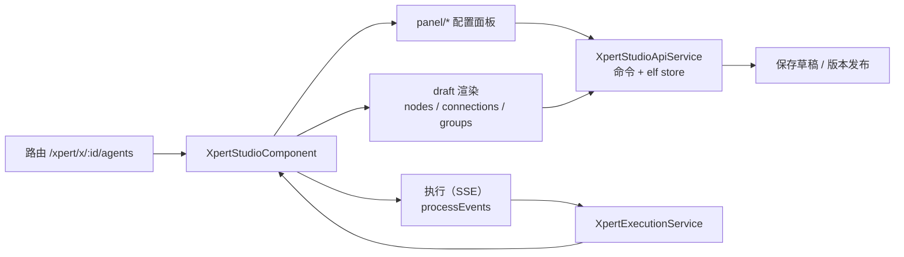

# C0 使用总览：Agent 编排 Studio 专家

**本文引用的文件**
- [studio.component.ts](file://apps/cloud/src/app/features/xpert/studio/studio.component.ts)
- [xpert-api.service.ts](file://apps/cloud/src/app/features/xpert/studio/domain/xpert-api.service.ts)
- [execution.service.ts](file://apps/cloud/src/app/features/xpert/studio/services/execution.service.ts)
- [execution.component.ts](file://apps/cloud/src/app/features/xpert/studio/panel/agent-execution/execution.component.ts)
- [state-inspector.component.ts](file://apps/cloud/src/app/features/xpert/studio/components/state-inspector/state-inspector.component.ts)
- [publish.component.ts](file://apps/cloud/src/app/features/xpert/studio/header/publish/publish.component.ts)
- [context-menu.component.ts](file://apps/cloud/src/app/features/xpert/studio/components/context-menu/context-menu.component.ts)
- [xpert-studio-copilot-server.service.ts](file://apps/cloud/src/app/features/xpert/studio/xpert-studio-copilot-server.service.ts)
- [commands.component.spec.ts](file://apps/cloud/src/app/features/xpert/studio/panel/commands/commands.component.spec.ts)
- [pipeline.component.ts](file://apps/cloud/src/app/features/xpert/knowledge/knowledgebase/pipeline/pipeline.component.ts)
- [routes.ts](file://apps/cloud/src/app/features/xpert/xpert/routes.ts)
- [fetch-event-source.ts](file://apps/cloud/src/app/@core/services/fetch-event-source.ts)
- file://.module-experts/前端专题/Agent 编排 Studio 专家/implementation/02-实现.md
- file://.module-experts/前端专题/Agent 编排 Studio 专家/implementation/05-接口.md
- file://.module-experts/前端专题/Agent 编排 Studio 专家/implementation/06-测试.md
- file://.module-experts/前端专题/Agent 编排 Studio 专家/test/known-failures.md
- file://CodeWikiHub/xpert/memory/专题记忆/前端专题/Agent 编排 Studio 专家.md

## 目录
1. [定位与何时找](#定位与何时找)
2. [契约自足声明与资产基线](#契约自足声明与资产基线)
3. [能力清单](#能力清单)
4. [边界](#边界)
5. [已知问题与常见坑](#已知问题与常见坑)

## 1. 定位与何时找

### 1.1 定位

Xpert Studio（模块根 `apps/cloud/src/app/features/xpert/studio`，168 个非 spec `.ts`）是 Xpert 平台的 **Agent / Workflow 可视化编排画布**：以 `@foblex/flow`（`FFlowComponent` + `FCanvasComponent`）为渲染内核，把一份「草稿（draft）」渲染为可拖拽节点图，支持连线、分组、自动布局、撤销/重做、右侧配置面板联动与运行期执行状态可视化；同时它还是**知识库流水线的复用宿主**——画布组件被直接 `imports` 到其他页面。

章节来源：[Studio 宿主组件](file://apps/cloud/src/app/features/xpert/studio/studio.component.ts)（关键符号：`XpertStudioComponent`、`nodes`、`connections`）· [Studio 领域服务](file://apps/cloud/src/app/features/xpert/studio/domain/xpert-api.service.ts)（关键符号：`XpertStudioApiService.store`、`saveDraft`）

### 1.2 何时找

1. **改画布交互**（拖拽、连线、分组拖放、快捷键、剪贴板）→ `XpertStudioComponent` 的事件处理与 `studio.component.html` 模板。
2. **改节点渲染或节点集合**（34 类节点）→ `components/workflow/*` 的分发器与具体节点组件；新增类型需同步分发与配置面板。
3. **改配置面板**（Agent / 工具集 / 知识库 / 工作流节点）→ `panel/*`，写回统一走 `XpertStudioApiService` 的命令方法。
4. **查草稿与版本机制**（为什么没保存、草稿为何被丢弃）→ `saveDraftSub` / `saveDraft()` / `pristineDraft` / `unsaved` / `versions` / `resume()`。
5. **排查执行可视化**（节点不亮、状态错、重跑失败）→ `processEvents` → `XpertExecutionService` → `XpertStudioStateInspectorComponent`。
6. **复用画布嵌入到其他页面** → 参照 `KnowledgebasePipelineComponent`，明确「必须提供 `XpertService` + xpertId 来源」的输入契约。
7. **查前端接口与调用面** → `XpertStudioApiService`、`@core` 服务，以及 `implementation/05-接口.md` 的域级索引。
8. **做 Copilot 辅助编排**（模型候选上下文化）→ `XpertStudioCopilotServerService`（以 DI 覆盖 `CopilotServerService`）。
9. **改撤销/重做与历史跳转** → `undo()` / `redo()` / `gotoHistoryIndex()` 与工具栏 `historyHasPast` / `historyHasFuture`。
10. **查资源位**（workspace / 知识库 / 工具集 / 环境 / 业务域 / 协作者）→ `knowledgebases$`、`toolsets$`、`environments$`、`collaborators$` 与对应详情接口。

图表来源：[Studio 宿主组件](file://apps/cloud/src/app/features/xpert/studio/studio.component.ts)（关键符号：`nodes`、`connections`、`executions`）· [Studio 领域服务](file://apps/cloud/src/app/features/xpert/studio/domain/xpert-api.service.ts)（关键符号：`store`、`saveDraft`）· [执行服务](file://apps/cloud/src/app/features/xpert/studio/services/execution.service.ts)（关键符号：`XpertExecutionService.executions`）

章节来源：[路由定义](file://apps/cloud/src/app/features/xpert/xpert/routes.ts)（关键符号：`path: 'agents'`、`XpertStudioComponent`）· [Studio 宿主组件](file://apps/cloud/src/app/features/xpert/studio/studio.component.ts)（关键符号：`fFlowComponent`、`fCanvasComponent`、`executions`）

## 2. 契约自足声明与资产基线

### 2.1 契约自足声明

本组契约层（`C0-使用总览.md`、`C1-能力契约.md`）**自足可用**：读这两篇即可完成「找到入口、判断边界、按契约调用组件 / 接口 / store、识别已知坑」。所有口径与已恢复的实现层 `implementation/{02,03,04,05,06,07}` 及 `test/known-failures.md` 对齐；文中每个符号都已在源码核实存在，未引入实现层之外的新结论（后端 `packages/server-ai/src/{xpert-agent,xpert-agent-execution}` 仅作跨端引用）。

章节来源：[实现层 · 实现](file://.module-experts/前端专题/Agent 编排 Studio 专家/implementation/02-实现.md)（关键符号：`XpertStudioComponent`、`XpertStudioApiService`）· [实现层 · 接口](file://.module-experts/前端专题/Agent 编排 Studio 专家/implementation/05-接口.md)（关键符号：`XpertStudioApiService`、`XpertExecutionService`）

### 2.2 资产基线

| 项 | 值 |
|---|---|
| 资产版本 | **2026-10-16 重建版**（契约层重建；实现层与已知失败已恢复落盘） |
| 原基线 | **commit `c07bb83d`（2026-10-14）** |
| 源码核对 | 仓库 `/root/xpert`，commit `80f5676fd`；`apps/cloud/src/app/features/xpert/studio/**`（168 非 spec `.ts`，约 16.8k 行） |
| 已恢复资产 | `implementation/02-实现.md` … `implementation/07-运维.md`、`test/known-failures.md` |
| 测试状态 | 9 spec / 23 用例；1 例环境级失败（缺 `@milkdown/crepe`），同根因另波及 17 个 apps/cloud spec |
| 后端引用面 | `packages/server-ai/src/{xpert-agent,xpert-agent-execution}`（仅接口与语义，不展开） |

章节来源：[已知失败归档](file://.module-experts/前端专题/Agent 编排 Studio 专家/test/known-failures.md)（关键符号：`jest.mock('@milkdown/crepe', ...)`）· [实现层 · 测试](file://.module-experts/前端专题/Agent 编排 Studio 专家/implementation/06-测试.md)（关键符号：`XpertStudioComponent template`、`createStudioSettingsSource`）

## 3. 能力清单

| 能力 | 入口（组件 / 路由 / store 方法 / 接口） | 一句话 |
|---|---|---|
| 可视化编排画布 | `XpertStudioComponent`（`xp-xpert-studio`）/ `/xpert/x/:id/agents` | `f-flow` + `f-canvas` 渲染 draft 的节点与连线 |
| 节点与连线编辑 | `createAgent` / `createToolset` / `createKnowledge` / `createConnection` / `removeConnection` / `moveNode` | 组件事件 → Handler → store，每次写后 `#reload` |
| 工作流节点配置 | `panel/workflow/workflow.component.ts`（`wfNode`）→ `updateWorkflowNode` | `linkedModel` 双向写回节点 `entity` |
| Agent 节点配置 | `panel/xpert-agent/agent.component.ts`（`agentConfig`）→ `updateXpertAgent` | 模型 / 提示词 / 变量 / 工具集 / 知识 / 中间件全量配置 |
| 右键建节点与中间件 | `XpertStudioContextMenuComponent`（`addWorkflowXxx` 工厂群） | 画布空白或连线落点建节点并自动重连 |
| 草稿自动保存 | `saveDraftSub`、`SaveDraftDebounceTime`、`saveDraft()` → `POST /api/xpert/:id/draft` | 1s 去抖 + `DraftSaveQueue` 串行提交 |
| 未保存态判定 | `pristineDraft`、`unsaved`、`draftSaving`、`draftSaveError` | 哈希比对 + 保存快照 diff |
| 撤销 / 重做 | `undo()`、`redo()`、`gotoHistoryIndex()`、`clearHistory()` | elf 状态历史 + 语义步骤双轨 |
| 自动布局 | `autoLayout()` → `LayoutHandler`（elkjs） | 只回写 `position`，其余字段不变 |
| 版本与发布 | `versions`、`XpertPublishVersionComponent.publish()`、`resume()` | 发布前先落盘草稿；`resume()` 丢弃草稿 |
| 预览执行可视化 | `XpertStudioPreviewComponent.onChatEvent` → `processEvents` | SSE 事件归约进 `XpertExecutionService` |
| 单 Agent 调试 | `startRunAgent()` + `POST /api/xpert-agent/chat`（SSE） | `action: 'run' \| 'resume'` 支持中断恢复 |
| 检查点重跑 | `XpertStudioStateInspectorComponent.rerunFromCheckpoint()` | `requestPreviewRetry` 交回预览面板重跑 |
| Copilot 辅助编排 | `XpertStudioCopilotServerService.getCopilotModels()` | 模型候选收敛到当前 xpert 的 Copilot 配置 |
| 画布复用 | `KnowledgebasePipelineComponent` imports `XpertStudioComponent` | 知识库流水线直接嵌画布并监听 `published$` |
| 资源位 | `knowledgebases$`、`toolsets$`、`environments$`、`collaborators$` | 知识库 / 工具集 / 环境 / 业务域 / 协作者候选与详情 |

章节来源：[Studio 宿主组件](file://apps/cloud/src/app/features/xpert/studio/studio.component.ts)（关键符号：`providers`、`executions`、`sidePanel`）· [Studio 领域服务](file://apps/cloud/src/app/features/xpert/studio/domain/xpert-api.service.ts)（关键符号：`saveDraft`、`autoLayout`、`updateWorkflowNode`、`getVariables`）· [右键菜单组件](file://apps/cloud/src/app/features/xpert/studio/components/context-menu/context-menu.component.ts)（关键符号：`XpertStudioContextMenuComponent`）

## 4. 边界

1. **不含 `features/chat`**：对话域（会话列表、消息渲染）不在本专家范围；Studio 只通过 `ChatConversationPreviewComponent` 的事件回调与其对接。
2. **不含 `features/assistant`**：助手 shell 与本模块是协作关系——`XpertAssistantFacade` 仅以 `{ optional: true }` 注入，用于上下文同步与 `studioRefresh`。
3. **不含 `features/xpert` 的非 studio 部分**：`draft/editable-draft.util.ts`、`features/xpert/utils.ts`、`knowledge/*`、`xpert/xpert.service.ts` 只作为上游依赖被引用，不展开其内部实现。
4. **不含后端图编译与执行账本**：`packages/server-ai/src/{xpert-agent,xpert-agent-execution}` 只作跨端引用（路径与语义），不覆盖图编译、执行调度与检查点落库。
5. **不含 `@shared` / `@core`**：`DraftSaveQueue`、`fetch-event-source`、`XpertAPIService` 等按「被调用面」引用，不作为本专家的实现范围。

章节来源：[路由定义](file://apps/cloud/src/app/features/xpert/xpert/routes.ts)（关键符号：`path: 'agents'`）· [知识库流水线（复用方）](file://apps/cloud/src/app/features/xpert/knowledge/knowledgebase/pipeline/pipeline.component.ts)（关键符号：`XpertStudioComponent`、`published$`）· [Studio 宿主组件](file://apps/cloud/src/app/features/xpert/studio/studio.component.ts)（关键符号：`XpertAssistantFacade`、`providers`）

## 5. 已知问题与常见坑

1. **① 草稿是「仅草稿保存」**：所有编辑只进 `POST /api/xpert/:id/draft` 的 draft 字段，**不会**顺带改动已发布版本；`SaveDraftDebounceTime = 1` 意味着连续编辑只在停顿 1s 后落最后一次快照。（来源：[xpert-api.service.ts](file://apps/cloud/src/app/features/xpert/studio/domain/xpert-api.service.ts)（关键符号：`SaveDraftDebounceTime`、`saveDraftSub`））
2. **① 并发保存**：`saveDraft()` 用 `DraftSaveQueue` 串行 + 相邻同请求去重；保存期间又编辑时 `unsaved` 按 `isEqual(storage, snapshot)` 重算，不会误报「已保存」。（来源：[xpert-api.service.ts](file://apps/cloud/src/app/features/xpert/studio/domain/xpert-api.service.ts)（关键符号：`saveDraft`、`draftSaving`、`pendingDraftSaves`））
3. **② 撤销/重做是双轨**：`elf-state-history` 存快照栈，`stateHistories` 存语义步骤（`TStateHistory`）；两轨游标不一致时（`#reload` 被 `debounceUntilChanged(2000)` 合并、`MOVED` 被过滤）会出现「按钮可点但一步跳转不明显」。（来源：[xpert-api.service.ts](file://apps/cloud/src/app/features/xpert/studio/domain/xpert-api.service.ts)（关键符号：`stateHistories`、`undo`、`gotoHistoryIndex`））
4. **③ 执行可视化是 SSE，不是轮询**：两个入口 `POST /api/xpert/:id/chat`、`POST /api/xpert-agent/chat` 都走 `injectFetchEventSource`；401 自动刷新令牌重试一次，服务端下发 `RUNTIME_STREAM_INTERRUPTED_EVENT` 时前端**主动 error 且不重试 POST**（避免重复执行）。（来源：[fetch-event-source.ts](file://apps/cloud/src/app/@core/services/fetch-event-source.ts)（关键符号：`injectFetchEventSource`、`RuntimeStreamInterruptedError`））
5. **④ 新增节点类型要改多处**：节点渲染 `@switch (node.type)`、工作流分发 `@switch (type())`、配置面板 `@switch (type())` 三处分发，加右键菜单工厂群，再加连线 ID 字符串协议（`key + '/' + type`、`/edge` 后缀）。（来源：[节点分发模板](file://apps/cloud/src/app/features/xpert/studio/components/workflow/workflow.component.html)（关键符号：`@switch (type())`）· [面板容器模板](file://apps/cloud/src/app/features/xpert/studio/panel/panel.component.html)（关键符号：`@switch (node.type)`））
6. **⑤ 执行态唯一入口是 `XpertExecutionService`**：绕过它直接改节点状态会造成「画布亮、检查器不亮」；状态只由 `setAgentExecution` / `setConversation` / `setContextUsage` / `markError` 写入。（来源：[执行服务](file://apps/cloud/src/app/features/xpert/studio/services/execution.service.ts)（关键符号：`setAgentExecution`、`markError`、`clear`））
7. **⑥ 画布复用的输入契约**：复用方必须提供 `XpertService` 并让 `paramId` 有值（路由参数 `id` 或 `xpertService.paramId.set(id)`），否则画布停在空 draft；知识库流水线即按此模式复用。（来源：[知识库流水线（复用方）](file://apps/cloud/src/app/features/xpert/knowledge/knowledgebase/pipeline/pipeline.component.ts)（关键符号：`providers: [XpertService]`）· [Studio 宿主组件](file://apps/cloud/src/app/features/xpert/studio/studio.component.ts)（关键符号：`injectParams('id')`、`paramId`））
8. **⑦ `@milkdown/crepe` 依赖缺失**：`panel/commands/commands.component.spec.ts` 的 `jest.mock('@milkdown/crepe', ...)` 未带 `{ virtual: true }`，依赖未落盘时**整文件加载失败、用例体不执行**；同根因另有 17 个 apps/cloud spec。（来源：[commands.component.spec.ts](file://apps/cloud/src/app/features/xpert/studio/panel/commands/commands.component.spec.ts)（关键符号：`jest.mock('@milkdown/crepe', ...)`）· [known-failures.md](file://.module-experts/前端专题/Agent 编排 Studio 专家/test/known-failures.md)（关键符号：`Cannot find module '@milkdown/crepe'`））
9. **⑧ 路由链与参数注入**：完整路径是 `/xpert/x/:id/agents`（features-routing → xpert shell → `:id` → `agents`），不是 `/x/agents`；参数由 `injectParams('id')` 取出后写入 `XpertService.paramId`。（来源：[路由定义](file://apps/cloud/src/app/features/xpert/xpert/routes.ts)（关键符号：`path: 'agents'`）· [Studio 宿主组件](file://apps/cloud/src/app/features/xpert/studio/studio.component.ts)（关键符号：`injectParams('id')`、`xpertService.paramId.set`））
10. **⑨ 资源位失败是「静默空列表」**：`knowledgebases$` / `toolsets$` / `environments$` / `collaborators$` 均以 `workspaceId` 为门槛（`filter(nonBlank)` / `filter(nonNullable)`），team 未就绪时流不产出——下拉为空而非报错；检查点与发布侧则 `catchError → toastr.error(getErrorMessage(error))`。（来源：[xpert-api.service.ts](file://apps/cloud/src/app/features/xpert/studio/domain/xpert-api.service.ts)（关键符号：`knowledgebases$`、`toolsets$`、`environments$`、`collaborators$`））
11. **⑩ 版本发布与草稿的关系**：发布前若 `unsaved()` 为真会先 `saveDraft()`，发布成功后草稿被**固化**为新版本并 `refresh()`；`resume()` 走 `PUT /api/xpert/:id {draft:null}` **丢弃草稿**回到已发布版本；切换版本是路由跳到另一条 Xpert 记录。（来源：[发布对话框](file://apps/cloud/src/app/features/xpert/studio/header/publish/publish.component.ts)（关键符号：`publish`、`setAsLatest`、`deleteVer`）· [xpert-api.service.ts](file://apps/cloud/src/app/features/xpert/studio/domain/xpert-api.service.ts)（关键符号：`resume`、`versions`））
12. **⑪ 工具/检索级执行事件当前无消费**：`processEvents` 的 `ON_TOOL_*` / `ON_RETRIEVER_*` 分支为注释态，未处理事件落入 `console.log('Unprocessed chat events:', event)`；工具「运行中」只能靠 `toolMessages` 反推。（来源：[执行面板](file://apps/cloud/src/app/features/xpert/studio/panel/agent-execution/execution.component.ts)（关键符号：`processEvents`））
13. **⑫ 大图写路径是 O(N)**：每次写 store 都 `structuredClone(state.draft)` 并重算 `calculateHash(JSON.stringify(...))`；画布缩放也经 `updateCanvas` 写入 draft（1s 节流）从而进入自动保存链。（来源：[xpert-api.service.ts](file://apps/cloud/src/app/features/xpert/studio/domain/xpert-api.service.ts)（关键符号：`#updateNode`、`updateCanvas`）· [Studio 宿主组件](file://apps/cloud/src/app/features/xpert/studio/studio.component.ts)（关键符号：`onCanvasChange`））
14. **⑬ 测试覆盖缺口**：`domain/`（44 文件）与 `components/workflow/`（36 文件）几乎零覆盖，画布编辑语义无回归保护；跑测前先 `corepack pnpm install` 以免命中已知失败。（来源：[实现层 · 测试](file://.module-experts/前端专题/Agent 编排 Studio 专家/implementation/06-测试.md)（关键符号：`XpertStudioComponent template`））

章节来源：[Studio 领域服务](file://apps/cloud/src/app/features/xpert/studio/domain/xpert-api.service.ts)（关键符号：`saveDraftSub`、`unsaved`、`#updateNode`）· [执行面板](file://apps/cloud/src/app/features/xpert/studio/panel/agent-execution/execution.component.ts)（关键符号：`processEvents`、`startRunAgent`）· [执行服务](file://apps/cloud/src/app/features/xpert/studio/services/execution.service.ts)（关键符号：`markError`、`contextUsageByAgentKey`）
