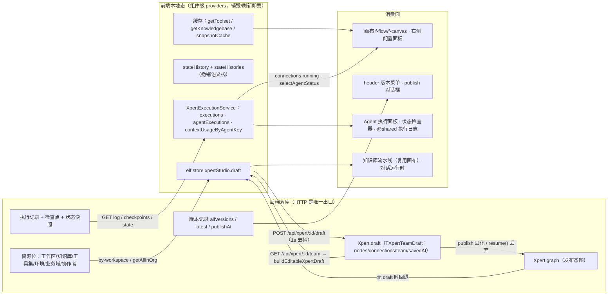

# C4 数据流向与消费：Agent 编排 Studio 专家

> 模块根：`apps/cloud/src/app/features/xpert/studio`｜前端唯一持久化出口是 HTTP（无本地库、无 ORM）；执行真相在后端，前端只做投影。

**本文引用的文件**
- [xpert-api.service.ts](file://apps/cloud/src/app/features/xpert/studio/domain/xpert-api.service.ts)
- [domain/types.ts](file://apps/cloud/src/app/features/xpert/studio/domain/types.ts)
- [studio.component.ts](file://apps/cloud/src/app/features/xpert/studio/studio.component.ts)
- [execution.service.ts](file://apps/cloud/src/app/features/xpert/studio/services/execution.service.ts)
- [editable-draft.util.ts](file://apps/cloud/src/app/features/xpert/draft/editable-draft.util.ts)
- [xpert.model.ts](file://packages/contracts/src/ai/xpert.model.ts)
- [xpert-agent-execution.model.ts](file://packages/contracts/src/ai/xpert-agent-execution.model.ts)
- [xpert.controller.ts](file://packages/server-ai/src/xpert/xpert.controller.ts)
- [header.component.ts](file://apps/cloud/src/app/features/xpert/studio/header/header.component.ts)
- [publish.component.ts](file://apps/cloud/src/app/features/xpert/studio/header/publish/publish.component.ts)
- [preview.component.ts](file://apps/cloud/src/app/features/xpert/studio/panel/preview/preview.component.ts)
- [state-inspector.component.ts](file://apps/cloud/src/app/features/xpert/studio/components/state-inspector/state-inspector.component.ts)
- [knowledge-menu.component.ts](file://apps/cloud/src/app/features/xpert/studio/components/knowledge-menu/knowledge.component.ts)
- [toolset-menu.component.ts](file://apps/cloud/src/app/features/xpert/studio/components/toolset-menu/toolset.component.ts)
- [context-menu.component.ts](file://apps/cloud/src/app/features/xpert/studio/components/context-menu/context-menu.component.ts)
- [pipeline.component.ts](file://apps/cloud/src/app/features/xpert/knowledge/knowledgebase/pipeline/pipeline.component.ts)
- [execution-log.component.ts（@shared）](file://apps/cloud/src/app/@shared/xpert/execution-log/execution.component.ts)

## 目录
1. [数据总览（Mermaid）](#数据总览mermaid)
2. [实体 A：`Xpert.draft`（`TXpertTeamDraft`）](#实体-axpertdrafttxpertteamdraft)
3. [实体 B：`Xpert.graph`（发布态图）](#实体-bxpertgraph发布态图)
4. [实体 C：版本记录（`allVersions` / `latest` / `publishAt`）](#实体-c版本记录allversions--latest--publishat)
5. [实体 D：执行记录与上下文用量（`XpertAgentExecution` 消费面）](#实体-d执行记录与上下文用量xpertagentexecution-消费面)
6. [实体 E：资源位数据（工作区 / 知识库 / 工具集 / 环境 / 业务域 / 协作者）](#实体-e资源位数据工作区--知识库--工具集--环境--业务域--协作者)
7. [本地态 vs 后端落库：边界清单](#本地态-vs-后端落库边界清单)

## 数据总览（Mermaid）

图表来源：[xpert-api.service.ts](file://apps/cloud/src/app/features/xpert/studio/domain/xpert-api.service.ts)（关键符号：`store`、`saveDraft`、`resume`、`versions`、`getToolset`、`knowledgebases$`）、[xpert.model.ts](file://packages/contracts/src/ai/xpert.model.ts)（关键符号：`TXpertTeamDraft`、`TXpertGraph`）、[execution.service.ts](file://apps/cloud/src/app/features/xpert/studio/services/execution.service.ts)（关键符号：`executions`、`agentExecutions`、`contextUsageByAgentKey`）、[xpert.controller.ts](file://packages/server-ai/src/xpert/xpert.controller.ts)（关键符号：`getTeam`、`saveDraft`、`allVersions`、`publish`）

## 实体 A：`Xpert.draft`（`TXpertTeamDraft`）
- **实体类型**：契约 DTO（可编辑草稿），服务端字段 `Xpert.draft`（契约注释「Draft on current version」）+ 前端内存镜像。
- **结构**：`TXpertTeamDraft = TXpertGraph & { template?; team: Partial<IXpert>; savedAt?: Date; checklist?: ChecklistItem[] }`（`nodes: TXpertTeamNode[]` / `connections: TXpertTeamConnection[]` 来自 `TXpertGraph`）；位置：契约 [`xpert.model.ts`](file://packages/contracts/src/ai/xpert.model.ts)，前端切片 `IStudioStore.draft`（[`domain/types.ts`](file://apps/cloud/src/app/features/xpert/studio/domain/types.ts)）。
- **生产方**：`GET /api/xpert/:id/team`（`injectGetXpertTeam`）→ `initRole` 内 `buildEditableXpertDraft(xpert)`（无 draft 时回退 `xpert.graph`）+ `deriveChatTriggerInputParametersFromDraft`；编辑期由命令 Handler 生产新版本（`CreateNodeHandler`/`CreateConnectionHandler`/`UpdateWorkflowNodeHandler`…）。
- **主要消费方**：画布（`nodes`/`connections`/`groups` computed → `f-flow/f-canvas`）、右侧面板（`linkedModel.compute/update`）、header（`pristineDraft` → `draftSavedDate`、`unsaved`）、publish 对话框（`deriveXpertMarketplaceTechnicalProfile(xpert.draft)`）、知识库流水线（同一画布读写）。
- **业务用途**：编排是产品核心资产——设计智能体并发布为可对话/可调用的 Xpert；草稿是编辑态与运行态的隔离层。
- **详细流向（同文件，见本节链）**：画布/面板编辑 → `store.update(structuredClone(state.draft))` → `#reload.next(reason)` → `calculateHash(JSON.stringify(storage))|distinctUntilChanged` → `unsaved.set(true)` → `debounceTime(1000)` → `saveDraft()`（`structuredClone` 快照 + `DraftSaveQueue` 串行）→ `POST /api/xpert/:id/draft` → 服务端回填 `savedAt` → `pristineDraft.set(saved)`。
章节来源：[xpert-api.service.ts](file://apps/cloud/src/app/features/xpert/studio/domain/xpert-api.service.ts)（关键符号：`saveDraftSub`、`initRole`、`saveDraft`、`unsaved`、`pristineDraft`）、[xpert.model.ts](file://packages/contracts/src/ai/xpert.model.ts)（关键符号：`TXpertTeamDraft`、`TXpertGraph`）、[editable-draft.util.ts](file://apps/cloud/src/app/features/xpert/draft/editable-draft.util.ts)（关键符号：`buildEditableXpertDraft`）

## 实体 B：`Xpert.graph`（发布态图）
- **实体类型**：契约字段（发布态图，注释「Published graph」），只读于前端。
- **结构**：`TXpertGraph = { nodes: TXpertTeamNode[]; connections: TXpertTeamConnection[] }`；位置 [`xpert.model.ts`](file://packages/contracts/src/ai/xpert.model.ts)。
- **生产方**：服务端发布流程（`POST /api/xpert/:id/publish?newVersion=` 把草稿固化为版本本体）；前端不写该字段。
- **主要消费方**：`buildEditableXpertDraft`（`xpert.draft` 缺失时以 `graph` 回退构建可编辑草稿）、publish 对话框 `technicalPreview`（`deriveXpertMarketplaceTechnicalProfile({ ...xpert.graph, team: xpert })`）、对话/调用运行时（按版本运行，服务端侧）。
- **业务用途**：发布态是运行对象——半成品编辑不得进入；`resume()` 后画布显示的就是这份图。
- **详细流向（同文件，见本节链）**：`publish()`（先 `saveDraft()`）→ 服务端固化 `graph` → `refresh()` 重取 `GET team` → 前端 `buildEditableXpertDraft` 以 `draft ?? graph` 生成可编辑草稿 → 若调 `resume()`（`PUT /api/xpert/:id { draft: null }`）则草稿被清、画布回到该图。
章节来源：[editable-draft.util.ts](file://apps/cloud/src/app/features/xpert/draft/editable-draft.util.ts)（关键符号：`buildEditableXpertDraft`）、[publish.component.ts](file://apps/cloud/src/app/features/xpert/studio/header/publish/publish.component.ts)（关键符号：`technicalPreview`、`publish`）、[xpert-api.service.ts](file://apps/cloud/src/app/features/xpert/studio/domain/xpert-api.service.ts)（关键符号：`resume`、`refresh`）

## 实体 C：版本记录（`allVersions` / `latest` / `publishAt`）
- **实体类型**：服务端查询结果（版本元信息列表）+ 当前记录上的 `version`/`latest`/`publishAt` 字段。
- **结构**：`{ id, version, latest, publishAt, releaseNotes }[]`；来源端点 `GET /api/xpert/:id/version`（后端 `XpertController.allVersions`）；前端信号 `XpertStudioApiService.versions`（`toSignal`）。
- **生产方**：服务端 `POST /:id/publish?newVersion=true|false`（新版本行 / 覆盖当前版本）、`POST /:id/latest`（改 `latest`）、`DELETE /api/xpert/:id`（删该版本记录）；每次成功后前端 `refresh()` 重取。
- **主要消费方**：header（倒序版本菜单、`latestPublishDate` ← `team()?.publishAt`、`version()` 徽标）、publish 对话框（版本列表 + `setAsLatest` / `deleteVer`）、模板与市场（`GET /:id/export`、`POST /:id/export/template`）、对话运行时（按版本运行）。
- **业务用途**：发布历史——回切旧版本、标注最新、对外分发。
- **详细流向（同文件，见本节链）**：`#refresh$ → paramId$ → xpertAPI.getVersions(id)` → `versions` signal → header 渲染菜单 → `selectVersion(id)` → `router.navigate(['../../', id, 'agents'])`（**切换版本 = 跳到另一条 Xpert 记录**，本页 draft 不参与）→ 新记录重新走实体 A 的加载链。
章节来源：[xpert-api.service.ts](file://apps/cloud/src/app/features/xpert/studio/domain/xpert-api.service.ts)（关键符号：`versions`、`#refresh$`）、[header.component.ts](file://apps/cloud/src/app/features/xpert/studio/header/header.component.ts)（关键符号：`versions`、`latest`、`latestPublishDate`、`selectVersion`）、[xpert.controller.ts](file://packages/server-ai/src/xpert/xpert.controller.ts)（关键符号：`allVersions`、`setAsLatest`、`publish`）

## 实体 D：执行记录与上下文用量（`XpertAgentExecution` 消费面）
- **实体类型**：执行记录实体 + 状态枚举 + 线程上下文用量事件（前端为投影态）。
- **结构**：`IXpertAgentExecution`（继承 `IBasePerTenantAndOrganizationEntityModel`，含 `agentKey`、`status`、`subExecutions?`，位置 [`xpert-agent-execution.model.ts`](file://packages/contracts/src/ai/xpert-agent-execution.model.ts)）；状态取值 `XpertAgentExecutionStatusEnum = running|success|error|pending|timeout|interrupted`；前端投影为 `executions` / `agentExecutions`（按 `agentKey` 递归归并）、`messages`、`toolMessages`/`knowledgeMessages`、`contextUsageByAgentKey`（[`execution.service.ts`](file://apps/cloud/src/app/features/xpert/studio/services/execution.service.ts)）。
- **生产方**：① 实时 SSE——`POST /api/xpert/:id/chat`（预览，`isDraft: true`）与 `POST /api/xpert-agent/chat`（单 Agent `run|resume`）；② `GET /api/xpert-agent-execution/:id/log|checkpoints|state?checkpointId=`（历史回查）；③ 会话骨架 `GET /api/chat-conversation/:id (relations: messages)` 与 `conversation().executions` 的 effect 预灌。
- **主要消费方**：画布（`selectAgentStatus`、`connections.running`、`runningToolsets`、悬浮执行卡片）、Agent 执行面板（`contextUsageByAgentKey`、历史执行列表）、状态检查器（日志 / 检查点 / 变量快照与重跑）、跨域共享组件 [`execution-log.component.ts（@shared）`](file://apps/cloud/src/app/@shared/xpert/execution-log/execution.component.ts)。
- **业务用途**：让编排可观察——看清每个节点在跑什么、卡在哪、从哪个检查点重跑。
- **详细流向（同文件，见本节链）**：SSE 事件 → `processEvents(event, executionService)` → `setAgentExecution(agentKey, data)` / `setContextUsage(...)` / `conversation.update(...)` → `executions` computed（`expandExecutions` 递归摊平 `subExecutions`）→ 画布染色 + 面板/检查器；检查器另走 `getOneLog + getCheckpoints`（`forkJoin`）与 `effect` 拉 `getOneState` 写 `snapshotCache`；失败时 `markError` 把 RUNNING 批量置 ERROR。
章节来源：[execution.service.ts](file://apps/cloud/src/app/features/xpert/studio/services/execution.service.ts)（关键符号：`setAgentExecution`、`setContextUsage`、`expandExecutions`、`executions`、`contextUsageByAgentKey`、`markError`）、[preview.component.ts](file://apps/cloud/src/app/features/xpert/studio/panel/preview/preview.component.ts)（关键符号：`onChatEvent`、`completePreviewRetrySelection`）、[state-inspector.component.ts](file://apps/cloud/src/app/features/xpert/studio/components/state-inspector/state-inspector.component.ts)（关键符号：`snapshotCache`、`rerunFromCheckpoint`、`buildGroups`）、[xpert-agent-execution.model.ts](file://packages/contracts/src/ai/xpert-agent-execution.model.ts)（关键符号：`IXpertAgentExecution`、`XpertAgentExecutionStatusEnum`）

## 实体 E：资源位数据（工作区 / 知识库 / 工具集 / 环境 / 业务域 / 协作者）
- **实体类型**：六类候选/详情数据（跨模块服务返回），前端只做按需加载与缓存。
- **结构**：工作区——`team()?.workspace` / `workspaceId` computed；知识库——`IKnowledgebase[]`（`knowledgebases$`）；工具集——`IXpertToolset[]`（`toolsets$`）+ `builtinToolProviders`（provider 元数据）；环境——`IEnvironment[]`（`environments$`）+ `environmentId`/`environment` linkedModel；业务域——`IBusinessArea` 分页（发布对话框内局部状态）；协作者——`IXpert[]`（`collaborators$`，过滤自身）+ `collaboratorDetails`。
- **生产方**：`GET /api/knowledgebase/by-workspace/:id`、`GET /api/xpert-toolset/by-workspace/:id`、`GET /api/xpert-toolset/providers`、`GET /api/environment?data=…`、`GET /api/business-area?data=…`、`GET /api/xpert/by-workspace/:id?published=true`（协作者）、工作区接口（`workspaceService`）；写入侧仅 `PUT /api/environment/:id`（`saveEnvironment`，1s 去抖）。
- **主要消费方**：知识/工具集节点选择菜单与配置面板（`knowledge-menu`、`toolset-menu`、`panel/workflow/knowledge|tool`）、节点详情缓存（`getToolset`/`getKnowledgebase`）、环境面板与发布对话框、外部专家展开（`context-menu` 的 `collaborators$`）。
- **业务用途**：把「本工作区可挂载的资源」变成画布可选项；按需加载避免打开画布即打满请求。
- **详细流向（同文件，见本节链）**：`team` → `workspaceId` computed → `toObservable(workspaceId)|filter(nonBlank)|distinctUntilChanged` → 各 `$` 流 `switchMap(getAllByWorkspace|getAllInOrg)` → `shareReplay(1)`；详情走 `getToolset(id)`/`getKnowledgebase(id)` 的 Map 缓存（刷新用 `refresh$`/`refreshToolsets$`）；列表失败无 `catchError`，详情失败由消费方的 `catchError(() => of(null))` 降级为骨架态。
章节来源：[xpert-api.service.ts](file://apps/cloud/src/app/features/xpert/studio/domain/xpert-api.service.ts)（关键符号：`workspaceId`、`knowledgebases$`、`toolsets$`、`builtinToolProviders`、`environments$`、`collaborators$`、`getToolset`、`getKnowledgebase`、`saveEnvironment`）、[knowledge-menu.component.ts](file://apps/cloud/src/app/features/xpert/studio/components/knowledge-menu/knowledge.component.ts)（关键符号：`knowledges`）、[toolset-menu.component.ts](file://apps/cloud/src/app/features/xpert/studio/components/toolset-menu/toolset.component.ts)（关键符号：`#toolsets`、`toolProviders`）、[context-menu.component.ts](file://apps/cloud/src/app/features/xpert/studio/components/context-menu/context-menu.component.ts)（关键符号：`collaborators$`）、[publish.component.ts](file://apps/cloud/src/app/features/xpert/studio/header/publish/publish.component.ts)（关键符号：`businessAreaPage`、`businessAreaLoadFailed`）

## 本地态 vs 后端落库：边界清单
| 数据 | 前端本地态（位置 / 载体） | 后端落库 | 丢失时机与含义 |
| --- | --- | --- | --- |
| 编排草稿 | ✅ 真源：elf store `xpertStudio` 的 `draft`（组件级 provider） | ✅ `POST /api/xpert/:id/draft`（服务端写 `savedAt`） | 组件销毁/刷新即丢内存态，重新 `GET team` 恢复 |
| 撤销历史 | ✅ `stateHistory`（past/future 快照）+ `stateHistories`（语义标签） | ❌ 不落库 | 刷新后历史清空；`initRole` 时 `#stateHistory.clear()` |
| 版本记录 | ❌ 仅信号投影 `versions` | ✅ `GET /version`、`POST publish/latest`、`DELETE :id` | 刷新即重取，无本地写入 |
| 执行记录 / 检查点 / 快照 | ✅ 纯投影：`executions`、`agentExecutions`、`contextUsageByAgentKey`、`snapshotCache` | ✅ 后端为真源（SSE 增量 + log/checkpoints/state 回查） | `clear()` 即清空；刷新后需 `getOneLog` 等重读——避免双源漂移 |
| 资源位数据 | ✅ 流 + `shareReplay(1)` + 按 id 的 Map 缓存 | ✅ 各资源位服务端点 | 缓存随实例销毁；`refresh$` 系列可主动失效 |
| 选中态 / 面板宽度 / 侧栏 | ✅ `SelectionService`、`panelWidth`、`sidePanel` | ❌ | 纯 UI 态，不进草稿（但画布 `position/scale` 会写进 draft 并触发自动保存） |

结论：**编辑态只有一份真源（内存 draft → `:id/draft`）**；版本、执行、资源位三类都是「后端真源 + 前端投影/缓存」，前端不做任何本地持久化。
章节来源：[xpert-api.service.ts](file://apps/cloud/src/app/features/xpert/studio/domain/xpert-api.service.ts)（关键符号：`store`、`#stateHistory`、`stateHistories`、`pristineDraft`、`saveDraft`）、[execution.service.ts](file://apps/cloud/src/app/features/xpert/studio/services/execution.service.ts)（关键符号：`#agentExecutions`、`clear`、`setAgentExecution`）、[studio.component.ts](file://apps/cloud/src/app/features/xpert/studio/studio.component.ts)（关键符号：`viewModel`、`selectedNodeKey`、`onCanvasChange`）、[pipeline.component.ts](file://apps/cloud/src/app/features/xpert/knowledge/knowledgebase/pipeline/pipeline.component.ts)（关键符号：`published$` 订阅）
