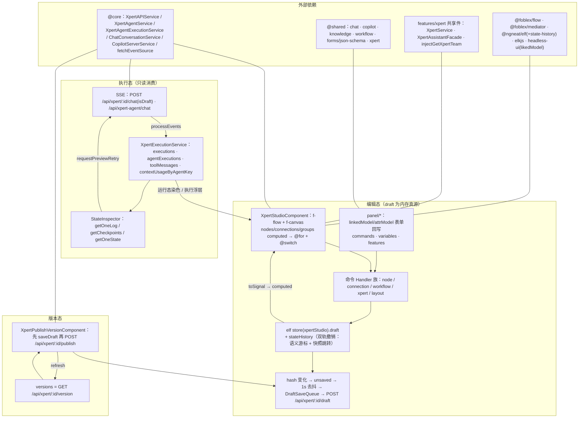

# 01 架构：Agent 编排 Studio 专家（Xpert Studio）

> 模块根：`apps/cloud/src/app/features/xpert/studio`（168 个非 spec `.ts` / 16850 行｜Angular 17 standalone + signal + elf store + `@foblex/flow`）
> 入口路由：`/xpert/x/:id/agents`｜本文只覆盖**前端 Studio 模块**；服务端图编译与执行账本不在本文范围（见背景说明中的 `packages/server-ai/src/xpert-agent*`）

**本文引用的文件**

- [studio.component.ts](file://apps/cloud/src/app/features/xpert/studio/studio.component.ts)
- [studio.component.html](file://apps/cloud/src/app/features/xpert/studio/studio.component.html)
- [types.ts](file://apps/cloud/src/app/features/xpert/studio/types.ts)
- [xpert-studio-copilot-server.service.ts](file://apps/cloud/src/app/features/xpert/studio/xpert-studio-copilot-server.service.ts)
- [xpert-api.service.ts](file://apps/cloud/src/app/features/xpert/studio/domain/xpert-api.service.ts)
- [types.ts](file://apps/cloud/src/app/features/xpert/studio/domain/types.ts)
- [selection.service.ts](file://apps/cloud/src/app/features/xpert/studio/domain/selection.service.ts)
- [create.handler.ts](file://apps/cloud/src/app/features/xpert/studio/domain/connection/create/create.handler.ts)
- [create.handler.ts](file://apps/cloud/src/app/features/xpert/studio/domain/node/create/create.handler.ts)
- [expand.handler.ts](file://apps/cloud/src/app/features/xpert/studio/domain/xpert/expand/expand.handler.ts)
- [layout.ts](file://apps/cloud/src/app/features/xpert/studio/domain/layout/layout.ts)
- [execution.service.ts](file://apps/cloud/src/app/features/xpert/studio/services/execution.service.ts)
- [workflow.component.ts](file://apps/cloud/src/app/features/xpert/studio/components/workflow/workflow.component.ts)
- [workflow-base.component.ts](file://apps/cloud/src/app/features/xpert/studio/components/workflow/workflow-base.component.ts)
- [context-menu.component.ts](file://apps/cloud/src/app/features/xpert/studio/components/context-menu/context-menu.component.ts)
- [state-inspector.component.ts](file://apps/cloud/src/app/features/xpert/studio/components/state-inspector/state-inspector.component.ts)
- [panel.component.ts](file://apps/cloud/src/app/features/xpert/studio/panel/panel.component.ts)
- [execution.component.ts](file://apps/cloud/src/app/features/xpert/studio/panel/agent-execution/execution.component.ts)
- [preview.component.ts](file://apps/cloud/src/app/features/xpert/studio/panel/preview/preview.component.ts)
- [agent.component.ts](file://apps/cloud/src/app/features/xpert/studio/panel/xpert-agent/agent.component.ts)
- [commands.component.ts](file://apps/cloud/src/app/features/xpert/studio/panel/commands/commands.component.ts)
- [features.component.ts](file://apps/cloud/src/app/features/xpert/studio/features/features.component.ts)
- [header.component.ts](file://apps/cloud/src/app/features/xpert/studio/header/header.component.ts)
- [publish.component.ts](file://apps/cloud/src/app/features/xpert/studio/header/publish/publish.component.ts)
- [studio-settings-source.ts](file://apps/cloud/src/app/features/xpert/studio/header/studio-settings-source.ts)
- [toolbar.component.ts](file://apps/cloud/src/app/features/xpert/studio/toolbar/toolbar.component.ts)
- [routes.ts](file://apps/cloud/src/app/features/xpert/xpert/routes.ts)
- [xpert.service.ts](file://apps/cloud/src/app/features/xpert/xpert/xpert.service.ts)
- [assistant.facade.ts](file://apps/cloud/src/app/features/xpert/assistant-shell/assistant.facade.ts)
- [editable-draft.util.ts](file://apps/cloud/src/app/features/xpert/draft/editable-draft.util.ts)
- [pipeline.component.ts](file://apps/cloud/src/app/features/xpert/knowledge/knowledgebase/pipeline/pipeline.component.ts)
- [xpert.service.ts](file://apps/cloud/src/app/@core/services/xpert.service.ts)
- [xpert-agent.service.ts](file://apps/cloud/src/app/@core/services/xpert-agent.service.ts)
- [xpert-agent-execution.service.ts](file://apps/cloud/src/app/@core/services/xpert-agent-execution.service.ts)
- [copilot-server.service.ts](file://apps/cloud/src/app/@core/services/copilot-server.service.ts)
- [fetch-event-source.ts](file://apps/cloud/src/app/@core/services/fetch-event-source.ts)
- [draft-save-queue.ts](file://apps/cloud/src/app/@shared/xpert/assistant-settings/draft-save-queue.ts)
- [xpert.model.ts](file://packages/contracts/src/ai/xpert.model.ts)

## 目录

- [模块职责与边界](#模块职责与边界)
- [目录结构与分层](#目录结构与分层)
- [依赖关系](#依赖关系)
- [关键设计约束与不变量](#关键设计约束与不变量)
- [架构总览图](#架构总览图)
- [组件详细分析](#组件详细分析)
- [结论](#结论)

## 模块职责与边界

**做什么（Studio 承担的六件事）**

1. **可视化编排画布**：把草稿文档 `TXpertTeamDraft` 渲染成可拖拽节点图（`@foblex/flow` 的 `FFlowComponent` + `FCanvasComponent` + `FZoomDirective`），支持连线、分组、自动布局、复制粘贴、右键建节点；节点面 = 4 类宿主节点（agent / knowledge / toolset / xpert）+ **34 类 workflow 节点**（`components/workflow/` 下 34 个节点编辑器组件，加 1 个分发器 `XpertStudioNodeWorkflowComponent` 与 1 个基类 `WorkflowBaseNodeComponent` 共 36 个 `.component.ts`）。
2. **草稿与版本**：编辑写入草稿并自动保存（draft-only），发布时生成版本记录；支持丢弃草稿回到已发布版本。
3. **执行可视化调试**：预览面板跑整图、单 Agent 面板跑单个 Agent、执行状态检查器看日志/检查点/变量快照并可从检查点重跑。
4. **Copilot 辅助**：编排过程中调用后端 Copilot 能力（模型候选、提示词编辑）。
5. **画布复用**：以 `XpertStudioComponent` 为可嵌入组件（自定义元素 `xp-xpert-studio`），已被知识库流水线页面复用。
6. **ChatKit 特性配置**：`features/` 子目录承载会话侧特性开关（attachment / memory / memory-reply / stt / tts / suggestion / summary / title / opener / sandbox）。

**不做什么（逐条给出「谁家」）**

| 不在范围内 | 谁家（交叉引用） |
| --- | --- |
| 对话消息 UI、会话列表组件 | Chat 模块：[features/chat](file://apps/cloud/src/app/features/chat) |
| 通用助手（Assistant）配置页 | Assistant 模块：[features/assistant](file://apps/cloud/src/app/features/assistant) |
| `:id` 详情 shell 与其子页（auth / logs / monitor 等） | Xpert 详情模块：[features/xpert/xpert](file://apps/cloud/src/app/features/xpert/xpert)（Studio 只依赖其 `XpertService`） |
| 助手 shell（`XpertAssistantShellComponent`）路由 | [features/xpert/routes.ts](file://apps/cloud/src/app/features/xpert/routes.ts) 与 [assistant-shell](file://apps/cloud/src/app/features/xpert/assistant-shell) |
| 知识库本体（文档/检索/配置页） | [features/xpert/knowledge](file://apps/cloud/src/app/features/xpert/knowledge)｜**例外：其 `pipeline` 页复用 Studio** |
| 模板 / 工具 / 工作区页面 | [features/xpert/templates](file://apps/cloud/src/app/features/xpert/templates)、[tools](file://apps/cloud/src/app/features/xpert/tools)、[workspace](file://apps/cloud/src/app/features/xpert/workspace) |
| Agent 图编译、执行账本、检查点存储 | 后端 `packages/server-ai/src/xpert-agent` 与 `xpert-agent-execution`（**不在本文范围**） |
| HTTP 客户端、鉴权、SSE 封装、i18n、日志、通用表单 | 公共层 `@core` / `@shared`（本文只作为**出向依赖**列出，见「依赖关系」） |

章节来源：[studio.component.ts](file://apps/cloud/src/app/features/xpert/studio/studio.component.ts)（关键符号：`XpertStudioComponent.providers`、`XpertStudioComponent.nodes`）、[workflow.component.ts](file://apps/cloud/src/app/features/xpert/studio/components/workflow/workflow.component.ts)（关键符号：`XpertStudioNodeWorkflowComponent`）、[features.component.ts](file://apps/cloud/src/app/features/xpert/studio/features/features.component.ts)（关键符号：`XpertStudioFeaturesMemoryComponent`、`linkedXpertFeaturesModel`）

## 目录结构与分层

实测目录（模块根一层 + 关键子层；括号内为实测口径）：

| 目录 / 文件 | 层 | 职责 |
| --- | --- | --- |
| `studio.component.ts` / `.html` / `.scss` / `types.ts` / `xpert-studio-copilot-server.service.ts` / `components/index.ts` | **宿主层（模块根，4 个非 spec `.ts`）** | 画布装配、事件入口、快捷键、助手上下文同步、Copilot 适配器、节点类型分组常量（`GROUP_NODE_TYPES`）与剪贴板工具（`readClipboardNode`） |
| `domain/`（44 个非 spec `.ts`） | **领域层** | `xpert-api.service.ts`（单 store + 全部编辑命令 + 保存 + 历史）、`selection.service.ts`、`types.ts`、`index.ts`，以及 `node/{create,remove,move,update,update-agent,replace,map}`、`connection/{create,remove,map}`、`workflow/{create,update}`、`xpert/{create,expand,update,update-team}`、`layout/` 的请求对象与 Handler |
| `services/`（1 个） | **应用服务层** | `execution.service.ts`：执行态聚合（消息 / 执行记录 / 上下文用量 / 面板与检查器选择） |
| `components/`（12 个非 spec + `workflow/` 36 个 `.component.ts`） | **画布内视图层** | 四类宿主节点（`components/{agent,knowledge,toolset}`）、浮层与菜单（context-menu / connection-menu / connection-center / knowledge-menu / toolset-menu）、`state-inspector`、`error-handling`；`components/workflow/` 为 34 个节点编辑器 + 分发器 + 基类 |
| `panel/`（`panel.component.ts` + 12 个子目录） | **右侧面板层** | `panel.component.ts` 按选中节点类型分发；`xpert-agent`、`xpert`、`toolset`、`knowledge`、`variables`、`environment`、`commands`、`preview`、`execution`、`agent-execution`，以及 `workflow/`（与 34 类节点一一对应的配置面板 + `middleware` / `code-test` / `trigger-test` / `knowledge-test` 等专属面板） |
| `features/`（12 个非 spec `.ts`） | **会话特性配置层** | 10 个 ChatKit 特性子组件 + `features.component.ts` 开关表 + `types.ts` 纯函数 |
| `header/`（5 个非 spec `.ts`，含 `publish/`） | **宿主集成层** | 保存/发布/版本菜单/导出/会话历史、`createStudioSettingsSource`（实时草稿源）、工作台初始布局设置 |
| `toolbar/`（1 个） | **宿主集成层** | 缩放 / fitToScreen / 撤销重做 / 历史跳转 / 自动布局 |

**分层与依赖方向（单向）**

1. 视图层（`components/`、`panel/`、`header/`、`toolbar/`、`features/`）→ 只依赖 `domain/` 与 `services/`，禁止直接改 draft：所有写入都经 `XpertStudioApiService` 的命令方法或 `@foblex/mediator` 的 Handler 进 store。
2. 领域层 `XpertStudioApiService` → 唯一写端点（elf store），并通过 `#reload` 广播「需重绘」原因（`EReloadReason`）。
3. **响应式链固定为 `store → toSignal/computed → 模板`**：`toSignal(store.pipe(map(s => s.draft)))` 得 `viewModel`，再派生 `nodes` / `groups` / `connections` / `startNodes` / `runningToolsets` 等 computed；模板只读这些信号（`@for` + `@switch(node.type)` / `@switch(type())`）。
4. 反向回写唯一通道是 `@xpert-ai/headless-ui` 的 `linkedModel` / `attrModel`（`update` 回调里调服务命令），避免面板直接持有可变 draft 引用。
5. **实例隔离**：`XpertStudioApiService`、`SelectionService`、`XpertExecutionService`、`JsonSchemaWidgetStrategyRegistry` 与 `provideJsonSchemaWidgets()` 全部声明在 `XpertStudioComponent.providers`（组件级），使每个 Studio 实例拥有独立 store / 选中态 / 执行态。

章节来源：[studio.component.ts](file://apps/cloud/src/app/features/xpert/studio/studio.component.ts)（关键符号：`XpertStudioComponent.providers`、`XpertStudioComponent.viewModel`、`XpertStudioComponent.nodes`）、[xpert-api.service.ts](file://apps/cloud/src/app/features/xpert/studio/domain/xpert-api.service.ts)（关键符号：`XpertStudioApiService.store`、`reload$`、`linkedModel`）、[panel.component.ts](file://apps/cloud/src/app/features/xpert/studio/panel/panel.component.ts)（关键符号：`XpertStudioPanelComponent.selectedNodes`）

## 依赖关系

**出向依赖（Studio → 外部）**

| 依赖面 | 具体符号（file://） | 用途 |
| --- | --- | --- |
| `@core` 服务 | [xpert.service.ts](file://apps/cloud/src/app/@core/services/xpert.service.ts)（`XpertAPIService.getTeam/saveDraft/publish/getVersions/chat/getVariables`）、[xpert-agent.service.ts](file://apps/cloud/src/app/@core/services/xpert-agent.service.ts)（`XpertAgentService.chatAgent/test`）、[xpert-agent-execution.service.ts](file://apps/cloud/src/app/@core/services/xpert-agent-execution.service.ts)（`getOneLog/getCheckpoints/getOneState/findAllByXpertAgent`）、[copilot-server.service.ts](file://apps/cloud/src/app/@core/services/copilot-server.service.ts)（`CopilotServerService`）、[fetch-event-source.ts](file://apps/cloud/src/app/@core/services/fetch-event-source.ts)（`injectFetchEventSource`） | 编排读写、执行调试、Copilot 能力、SSE 通道 |
| `features/xpert` 共享服务 | [xpert.service.ts](file://apps/cloud/src/app/features/xpert/xpert/xpert.service.ts)（`XpertService.paramId/paramId$/published$/onRefresh`）、[assistant.facade.ts](file://apps/cloud/src/app/features/xpert/assistant-shell/assistant.facade.ts)（`XpertAssistantFacade`）、[editable-draft.util.ts](file://apps/cloud/src/app/features/xpert/draft/editable-draft.util.ts)（`buildEditableXpertDraft`）、`features/xpert/utils.ts`（`injectGetXpertTeam`） | 宿主参数与草稿构造（跨模块共享，非 Studio 私有） |
| `@shared` 复用件 | `@shared/xpert`（`XpertExportDslComponent`、`XpertPublishComponent`、`XpertVariableFormComponent`、执行记录组件）、`@shared/chat`（`ChatConversationPreviewComponent`）、`@shared/copilot`、`@shared/knowledge`、`@shared/workflow`、`@shared/avatar`、`@shared/common`、`@shared/forms/json-schema-*`、`@shared/xpert/assistant-settings/draft-save-queue.ts`（`DraftSaveQueue`） | 面板与对话框复用；表单引擎；草稿写队列 |
| 第三方库 | `@foblex/flow`（`FFlowComponent`/`FCanvasComponent`/`FZoomDirective`/`FConnectionContent`）、`@foblex/mediator`（Handler 模式）、`@ngneat/elf` + `@ngneat/elf-state-history`（store 与快照历史）、`elkjs`（`layoutGraphWithMixedDirection`）、`@xpert-ai/headless-ui`（`linkedModel`/`attrModel`/`ZardTooltipImports`）、`ngxtension/inject-params`、`@ngx-translate/core`、`@angular/cdk`、`lodash-es` | 画布内核、状态与历史、布局算法、双向模型与 UI 原子件 |
| 间接依赖 | `@milkdown/crepe`：Studio **自身不直接 import**，经 `@shared/files/markdown-editor`（`Crepe`）与全局样式表引入；Studio 内仅 `panel/commands/commands.component.spec.ts` 出现 `jest.mock('@milkdown/crepe')` | 富文本/Markdown 编辑（提示词、命令） |

**入向依赖（谁复用 Studio）**——全仓库引用 `XpertStudioComponent` 的文件共 46 个，**studio 之外只有 2 个**，均已核实：

1. **路由注册**：[routes.ts](file://apps/cloud/src/app/features/xpert/xpert/routes.ts)（关键符号：`path: 'agents'` → `XpertStudioComponent`；`:id` 默认重定向到 `agents`，历史路径 `copilot` 也重定向到 `agents`）。链条：`features-routing.module.ts`（`/xpert`）→ `features/xpert/routes.ts`（`XpertAssistantShellComponent` 下的 `x`）→ `features/xpert/xpert/routes.ts`（`:id/agents`）。
2. **知识库流水线复用**：[pipeline.component.ts](file://apps/cloud/src/app/features/xpert/knowledge/knowledgebase/pipeline/pipeline.component.ts)（关键符号：`KnowledgebasePipelineComponent`）——`imports: [RouterModule, XpertStudioComponent]` + `providers: [XpertService]`，并订阅 `xpertService.published$` 在发布后刷新知识库。这就是「画布复用」的落地方式：复用方**只需提供 `XpertService`**（Studio 自己从 `injectParams('id')` 取 id 并写入 `XpertService.paramId`），`XpertAssistantFacade` 为 `@optional`。

**依赖方向规则**：Studio 只向下依赖 `@core` / `@shared` / `features/xpert` 共享件，`@core` 与 `@shared` 不反向依赖 Studio（实测无引用）；studio 之外对 Studio 的依赖仅有上述 2 处。

章节来源：[routes.ts](file://apps/cloud/src/app/features/xpert/xpert/routes.ts)（关键符号：`path: 'agents'`、`XpertStudioComponent`）、[pipeline.component.ts](file://apps/cloud/src/app/features/xpert/knowledge/knowledgebase/pipeline/pipeline.component.ts)（关键符号：`KnowledgebasePipelineComponent`、`XpertService`）、[studio.component.ts](file://apps/cloud/src/app/features/xpert/studio/studio.component.ts)（关键符号：`XpertStudioComponent.imports`、`XpertStudioComponent.inject`）

## 关键设计约束与不变量

1. **草稿仅草稿保存（draft-only）+ 1s 去抖**：编辑不直接写实体，只把 `POST /api/xpert/:id/draft` 作为持久化出口；触发条件是「draft 哈希变化 → `unsaved.set(true)` → `debounceTime(SaveDraftDebounceTime * 1000)`」，且被 `settingsEditing$` 门控；请求经 `DraftSaveQueue` 串行化。常量 `SaveDraftDebounceTime = 1`（单位秒）。发布动作也必须先保存草稿（`publish()` 内 `unsaved() ? saveDraft() : of(true)`）。
2. **`TXpertTeamDraft` 落在 `Xpert.draft`**：草稿契约 `TXpertTeamDraft`（含 `nodes` / `connections` / `team` / `savedAt`）挂在 `IXpert.draft` 上；前端加载时由 `buildEditableXpertDraft(xpert)` 组装，若 `xpert.draft` 存在则优先，否则回退 `xpert.graph`。「丢弃草稿」= `resume()` 把 `{ draft: null }` 写回实体再 `refresh()`。
3. **撤销重做双轨**：底层是 `elf-state-history` 的 `stateHistory(store, { comparatorFn: negate(isEqual) })`（提供 `jumpToPast/jumpToFuture`），上层是语义历史 `stateHistories: { past, future }`，元素为 `TStateHistory = { reason: EReloadReason, cursor, createdAt }`；两者经 `undo()` / `redo()` / `gotoHistoryIndex()` / `clearHistory()` 对齐，UI 门控来自 `historyHasPast` / `historyHasFuture`（工具栏消费）。
4. **执行可视化是只读消费，不是轮询**：执行事件由服务端推送（`injectFetchEventSource` 的 SSE 流，上游 `XpertAgentService.chatAgent` 与 `XpertAPIService.chat`），经导出函数 `processEvents(event, executionService)` 归约进执行服务；历史数据用一次性 HTTP 读（`getOneLog` / `getCheckpoints` / `getOneState`）。画布与检查器**只读**执行态，不把执行数据写回 draft；唯一「反向」动作是预览重试请求 `requestPreviewRetry`。
5. **`XpertExecutionService` 是执行态唯一入口**：画布（节点/连线运行态染色）、Agent 执行面板、预览面板、状态检查器全部通过该服务读写执行态（`executions` / `agentExecutions` / `toolMessages` / `contextUsageByAgentKey` / `inspectorExecutionId`），组件之间不互相传执行数据。
6. **Copilot 走后端能力，不在前端直连模型**：`XpertStudioCopilotServerService extends CopilotServerService`（后者 `extends OrganizationBaseCrudService<ICopilot>`，模型候选来自后端接口），只覆写 `getCopilotModels(type)` 把候选集按当前 xpert 收敛（`getXpertCopilotModels(xpertId, type)`）；通过组件级 DI 覆盖 `CopilotServerService` 生效，面板注入到的都是上下文化实现。
7. **编辑期不打断渲染**：`reload$` 过滤 `EReloadReason.MOVED`（拖拽不触发重绘），重绘统一走 `subscribeOnReloadData()` 的 `#cdr.detectChanges()`；节点写入时重算 `hash`（`calculateHash`），使自动保存判定与节点级 diff 保持稳定；画布平移缩放写回 draft 前有 1s 节流（`onCanvasChange`）。

章节来源：[xpert-api.service.ts](file://apps/cloud/src/app/features/xpert/studio/domain/xpert-api.service.ts)（关键符号：`XpertStudioApiService.saveDraft`、`unsaved`、`pristineDraft`、`undo`、`redo`、`gotoHistoryIndex`、`stateHistories`）、[domain/types.ts](file://apps/cloud/src/app/features/xpert/studio/domain/types.ts)（关键符号：`IStudioStore`、`TStateHistory`、`EReloadReason`）、[execution.service.ts](file://apps/cloud/src/app/features/xpert/studio/services/execution.service.ts)（关键符号：`XpertExecutionService.agentExecutions`、`setAgentExecution`、`requestPreviewRetry`）、[execution.component.ts](file://apps/cloud/src/app/features/xpert/studio/panel/agent-execution/execution.component.ts)（关键符号：`processEvents`、`startRunAgent`）、[xpert-studio-copilot-server.service.ts](file://apps/cloud/src/app/features/xpert/studio/xpert-studio-copilot-server.service.ts)（关键符号：`XpertStudioCopilotServerService.getCopilotModels`）

## 架构总览图

图表来源：[studio.component.ts](file://apps/cloud/src/app/features/xpert/studio/studio.component.ts)（关键符号：`XpertStudioComponent.nodes`、`connections`、`onCanvasChange`、`providers`）· [xpert-api.service.ts](file://apps/cloud/src/app/features/xpert/studio/domain/xpert-api.service.ts)（关键符号：`store`、`saveDraft`、`historyHasPast`、`versions`）· [execution.service.ts](file://apps/cloud/src/app/features/xpert/studio/services/execution.service.ts)（关键符号：`setAgentExecution`、`requestPreviewRetry`）· [publish.component.ts](file://apps/cloud/src/app/features/xpert/studio/header/publish/publish.component.ts)（关键符号：`XpertPublishVersionComponent.publish`）

章节来源：[studio.component.ts](file://apps/cloud/src/app/features/xpert/studio/studio.component.ts)（关键符号：`XpertStudioComponent`)与 [studio.component.html](file://apps/cloud/src/app/features/xpert/studio/studio.component.html)（关键符号：`f-flow`、`f-canvas`、`f-connection`）

## 组件详细分析

### 画布层

`XpertStudioComponent` 是唯一的画布宿主，无 `@Input`/`@Output`：入场契约 =「注入 `XpertService` + 提供组件级 providers + 从 `injectParams('id')` 取 id」。职责包括 `f-flow`/`f-canvas` 装配、`@for (node of nodes())` + `@switch (node.type)` 渲染四类宿主节点（`XpertStudioNodeAgentComponent` / `-Knowledge` / `-Toolset` / `-Workflow`）、连线 ID 的字符串协议（`from + '/' + type`，`/edge` 后缀）、`FCreateConnectionEvent` → `addConnection`、`FDropToGroupEvent` → `onDropToGroup`、`FSelectionChangeEvent` → `SelectionService.setNodes`、快捷键（Delete / Ctrl+C/V/D/Z/Y）、以及把 `pristineDraft`/`unsaved` 同步给助手上下文。`components/workflow/workflow.component.ts` 再按 `type()` 二次分发到 34 个节点编辑器，全部继承 `WorkflowBaseNodeComponent`（统一注入 `XpertStudioApiService`、暴露 `node/entity`、`canBeConnectedInputs`），形成「一层画布 + 两级 `@switch`」的分发结构。

章节来源：[studio.component.ts](file://apps/cloud/src/app/features/xpert/studio/studio.component.ts)（关键符号：`XpertStudioComponent.addConnection`、`onDropToGroup`、`selectionChanged`、`onKeyDown`）、[workflow-base.component.ts](file://apps/cloud/src/app/features/xpert/studio/components/workflow/workflow-base.component.ts)（关键符号：`WorkflowBaseNodeComponent`）

### 面板与命令配置

`XpertStudioPanelComponent` 从 `SelectionService.selectedNode` 派生 `selectedNodes`，用 `@switch (node.type)` 分发到 xpert-agent / xpert / toolset / knowledge / workflow 五类面板；面板内部统一用 `linkedModel`（对象级）+ `attrModel`（字段级）实现「读 draft、写命令」的双向模型，写回落到 `updateWorkflowNode` / `updateXpertAgent` 等命令。命令配置（`panel/commands`）与变量（`panel/variables`）、环境（`panel/environment`）、ChatKit 特性（`features/`）是画布之外的三类横向配置面，经 `sidePanel` 模型与 header 联动。工具栏 `XpertStudioToolbarComponent` 消费 `historyHasPast/historyHasFuture` 提供撤销重做与自动布局入口。**这就是「34 类节点的编排」在 UI 上的体现：画布侧 34 个节点编辑器与面板侧一一对应的配置表单，两套 `@switch` 互补。**

章节来源：[panel.component.ts](file://apps/cloud/src/app/features/xpert/studio/panel/panel.component.ts)（关键符号：`XpertStudioPanelComponent`）、[agent.component.ts](file://apps/cloud/src/app/features/xpert/studio/panel/xpert-agent/agent.component.ts)（关键符号：`XpertStudioPanelAgentComponent.agentConfig`）、[commands.component.ts](file://apps/cloud/src/app/features/xpert/studio/panel/commands/commands.component.ts)（关键符号：`XpertStudioPanelCommandsComponent`）、[toolbar.component.ts](file://apps/cloud/src/app/features/xpert/studio/toolbar/toolbar.component.ts)（关键符号：`XpertStudioToolbarComponent.historyHasPast`）

### 执行可视化

三条消费路径同源（SSE / 执行记录 / 检查点）：① 预览面板 `XpertStudioPreviewComponent.onChatEvent` 与 ② 单 Agent 面板 `XpertStudioPanelAgentExecutionComponent.startRunAgent()` 都调用导出函数 `processEvents` 把事件写进 `XpertExecutionService`；③ 状态检查器 `XpertStudioStateInspectorComponent` 监听 `inspectorExecutionId`，并行拉日志与检查点，按 `${executionId}:${checkpointId}` 缓存变量快照（`snapshotCache`），并把「从检查点重跑」交回预览面板（`rerunFromCheckpoint` → `requestPreviewRetry`）。画布侧只做展示：节点状态与连线 `running` 染色、执行浮层；`contextUsageByAgentKey` 的消费方是 Agent 执行面板而非检查器。

章节来源：[preview.component.ts](file://apps/cloud/src/app/features/xpert/studio/panel/preview/preview.component.ts)（关键符号：`XpertStudioPreviewComponent.onChatEvent`）、[execution.component.ts](file://apps/cloud/src/app/features/xpert/studio/panel/agent-execution/execution.component.ts)（关键符号：`XpertStudioPanelAgentExecutionComponent.startRunAgent`、`processEvents`）、[state-inspector.component.ts](file://apps/cloud/src/app/features/xpert/studio/components/state-inspector/state-inspector.component.ts)（关键符号：`XpertStudioStateInspectorComponent.snapshotCache`、`rerunFromCheckpoint`）

### 版本与发布

版本态由 header 与发布对话框承担：`XpertStudioHeaderComponent` 管保存（Ctrl+S）、导出 DSL/模板、会话历史、版本菜单（切换版本 = 跳到同家族的另一个 `:id` 路由）与设置对话框（`createStudioSettingsSource` 提供「共享草稿引用 + 局部回滚」的实时设置源）；`XpertPublishVersionComponent` 负责发布（先 `saveDraft` 再 `publish(id, newVersion, {...})`，成功后 `refresh()` 并广播 `published$`，知识库流水线据此刷新）、设最新版本、删除版本记录、市场区（受特性开关门控）。版本列表来自 `versions = GET /api/xpert/:id/version`。

章节来源：[header.component.ts](file://apps/cloud/src/app/features/xpert/studio/header/header.component.ts)（关键符号：`XpertStudioHeaderComponent.selectVersion`、`export`、`handleCtrlS`）、[publish.component.ts](file://apps/cloud/src/app/features/xpert/studio/header/publish/publish.component.ts)（关键符号：`XpertPublishVersionComponent.publish`、`setAsLatest`、`deleteVer`）、[studio-settings-source.ts](file://apps/cloud/src/app/features/xpert/studio/header/studio-settings-source.ts)（关键符号：`createStudioSettingsSource`）

### Copilot

Copilot 在 Studio 内是一个**薄适配器 + DI 覆盖**：`XpertStudioCopilotServerService` 只覆写 `getCopilotModels(type)`，把「当前 xpert id」转成流并在后端模型候选（`CopilotServerService` 的 `getXpertCopilotModels`）上做收敛；生效方式是在画布 providers 中 `{ provide: CopilotServerService, useClass: XpertStudioCopilotServerService }`，因此 Agent 配置面板注入 `copilotServer` 即拿到上下文化实现——**模型调用与候选获取全部留在后端能力内，前端不做直连模型**。面板侧的使用点是模型选择（`CopilotModelSelectComponent`）与提示词编辑（`CopilotPromptEditorComponent`）。

章节来源：[xpert-studio-copilot-server.service.ts](file://apps/cloud/src/app/features/xpert/studio/xpert-studio-copilot-server.service.ts)（关键符号：`XpertStudioCopilotServerService.getCopilotModels`）、[copilot-server.service.ts](file://apps/cloud/src/app/@core/services/copilot-server.service.ts)（关键符号：`CopilotServerService`）、[agent.component.ts](file://apps/cloud/src/app/features/xpert/studio/panel/xpert-agent/agent.component.ts)（关键符号：`XpertStudioPanelAgentComponent.copilotServer`）

## 结论

- **边界清晰**：Studio = 一个可嵌入的画布宿主 + 领域服务 + 两类视图（画布内 / 右侧面板）+ 宿主集成件；studio 之外对它的依赖只有 2 处（路由与知识库流水线），复用契约就是「提供 `XpertService`」。
- **分层单向**：视图 → 命令/Handler → elf store → computed → 模板；回写只经 `linkedModel`，执行态只经 `XpertExecutionService`，因此编辑态与执行态互不污染。
- **三条状态线口径需分开记**：编辑态是 draft-only + 1s 去抖 + `DraftSaveQueue`；版本态是「先保存再发布」并广播 `published$`；执行态是 SSE 推送 + 一次性 HTTP 读，画布只做只读展示。
- **不变量即回归清单**：双轨撤销、`TXpertTeamDraft` 落在 `Xpert.draft`、`reload$` 过滤 `MOVED`、`CopilotServerService` 的 DI 覆盖——任一处被改都会破坏既有行为；对应测试覆盖很薄（`domain/` 与 34 个节点组件零 spec），改动需以本文档条款复核。
- 深入实现细节、数据流、模型、接口、测试与运维口径见同目录 `implementation/02-实现.md` ~ `07-运维.md`。

章节来源：[studio.component.ts](file://apps/cloud/src/app/features/xpert/studio/studio.component.ts)（关键符号：`XpertStudioComponent.providers`）、[xpert-api.service.ts](file://apps/cloud/src/app/features/xpert/studio/domain/xpert-api.service.ts)（关键符号：`XpertStudioApiService.store`、`saveDraft`、`undo`）、[pipeline.component.ts](file://apps/cloud/src/app/features/xpert/knowledge/knowledgebase/pipeline/pipeline.component.ts)（关键符号：`KnowledgebasePipelineComponent`）
