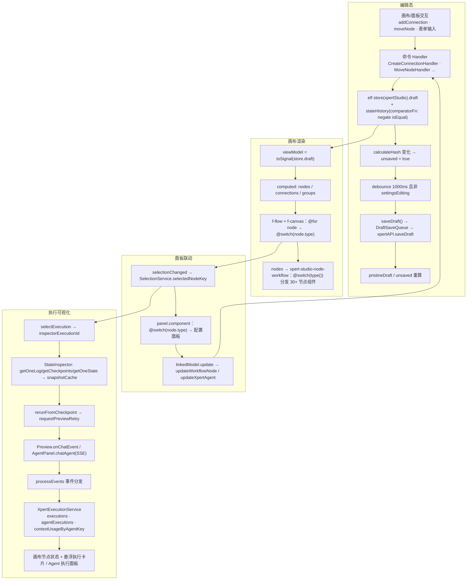

# Xpert Studio（Agent 可视化编排画布）实现

**本文引用的文件**
- `apps/cloud/src/app/features/xpert/studio/studio.component.ts`
- `apps/cloud/src/app/features/xpert/studio/studio.component.html`
- `apps/cloud/src/app/features/xpert/studio/domain/xpert-api.service.ts`
- `apps/cloud/src/app/features/xpert/studio/domain/types.ts`
- `apps/cloud/src/app/features/xpert/studio/domain/selection.service.ts`
- `apps/cloud/src/app/features/xpert/studio/domain/connection/create/create.handler.ts`
- `apps/cloud/src/app/features/xpert/studio/domain/node/create/create.handler.ts`
- `apps/cloud/src/app/features/xpert/studio/domain/xpert/expand/expand.handler.ts`
- `apps/cloud/src/app/features/xpert/studio/services/execution.service.ts`
- `apps/cloud/src/app/features/xpert/studio/components/workflow/workflow.component.ts`
- `apps/cloud/src/app/features/xpert/studio/components/workflow/workflow.component.html`
- `apps/cloud/src/app/features/xpert/studio/components/workflow/workflow-base.component.ts`
- `apps/cloud/src/app/features/xpert/studio/components/context-menu/context-menu.component.ts`
- `apps/cloud/src/app/features/xpert/studio/components/state-inspector/state-inspector.component.ts`
- `apps/cloud/src/app/features/xpert/studio/panel/panel.component.ts`
- `apps/cloud/src/app/features/xpert/studio/panel/panel.component.html`
- `apps/cloud/src/app/features/xpert/studio/panel/workflow/workflow.component.ts`
- `apps/cloud/src/app/features/xpert/studio/panel/workflow/workflow.component.html`
- `apps/cloud/src/app/features/xpert/studio/panel/workflow/workflow-base.component.ts`
- `apps/cloud/src/app/features/xpert/studio/panel/xpert-agent/agent.component.ts`
- `apps/cloud/src/app/features/xpert/studio/panel/agent-execution/execution.component.ts`
- `apps/cloud/src/app/features/xpert/studio/panel/preview/preview.component.ts`
- `apps/cloud/src/app/features/xpert/studio/header/header.component.ts`
- `apps/cloud/src/app/features/xpert/studio/header/studio-settings-source.ts`
- `apps/cloud/src/app/features/xpert/studio/toolbar/toolbar.component.ts`
- `apps/cloud/src/app/features/xpert/studio/xpert-studio-copilot-server.service.ts`
- `apps/cloud/src/app/features/xpert/studio/types.ts`
- `apps/cloud/src/app/@shared/forms/json-schema-property/json-schema-widget-registry.service.ts`

## 目录

1. [简介](#简介)
2. [核心流程](#核心流程)
3. [设计模式](#设计模式)
4. [关键类与函数](#关键类与函数)
5. [热点路径](#热点路径)
6. [技术债](#技术债)
7. [结论](#结论)

## 简介

Xpert Studio 是 Xpert 平台的 **Agent / Workflow 可视化编排画布**：以 `@foblex/flow` 的 `FFlowComponent` + `FCanvasComponent` + `FZoomDirective` 为渲染内核，把一份「草稿（draft）」文档渲染为可拖拽的节点图，并支持连线、分组、自动布局、撤销/重做、右侧配置面板联动、以及运行期执行状态可视化。

模块根为 `apps/cloud/src/app/features/xpert/studio`，共 168 个非 spec TypeScript 文件（约 16.8k 行）。本次为抽样精读，重点覆盖按行数排序的热点文件与核心服务。

结构与职责分层：

- 画布宿主：`studio.component.ts`（781 行）+ `studio.component.html`，负责 `<f-flow>/<f-canvas>` 装配、节点/连接渲染、快捷键、分组拖放。
- 领域层（domain）：`XpertStudioApiService`（845 行）持有 `elf` store 与全部编辑命令，`SelectionService` 负责选中态桥接，`domain/{connection,node,layout,xpert,workflow}/*.handler.ts` 为命令处理器。
- 视图层（components / panel）：`components/*` 为画布内节点与浮层，`panel/*` 为右侧配置面板与执行面板。
- 执行态：`services/execution.service.ts` 聚合消息、Agent 执行记录与上下文用量。
- 宿主集成：`header/*`（保存、发布、设置、会话）、`toolbar/*`（缩放、撤销/重做、自动布局）、`xpert-studio-copilot-server.service.ts`（Copilot 模型上下文化）。

画布库与依赖：`@foblex/flow`（`FFlowModule` / `FConnectionComponent` / `FCreateConnectionEvent` / `FSelectionChangeEvent` / `FDropToGroupEvent`）、`@ngneat/elf` + `@ngneat/elf-state-history`、`@foblex/mediator`（Handler 模式）、`@xpert-ai/headless-ui`（`linkedModel` / `attrModel` / `effectAction` / `myRxResource`）。

章节来源：[Xpert Studio 宿主组件](file://apps/cloud/src/app/features/xpert/studio/studio.component.ts)（关键符号：`XpertStudioComponent`、`FFlowComponent`、`FCanvasComponent`、`FZoomDirective`）

## 核心流程

### 编辑态：draft store + stateHistory + unsaved

`XpertStudioApiService` 在构造时创建**组件级私有 store**，并用 `elf-state-history` 包裹：

- `readonly store = createStore({ name: 'xpertStudio' }, withProps<IStudioStore>({ draft: null }))`（`domain/xpert-api.service.ts:111`），`IStudioStore` 只有 `draft: TXpertTeamDraft` 一个字段（`domain/types.ts:3`）。
- `#stateHistory = stateHistory<Store, IStudioStore>(this.store, { comparatorFn: negate(isEqual) })`（`:112`），对外暴露 `historyHasPast = toSignal(this.#stateHistory.hasPast$)` 与 `historyHasFuture`（`:115`–`116`），由工具栏 `XpertStudioToolbarComponent.historyHasPast/historyHasFuture` 消费（`toolbar/toolbar.component.ts:28`–`29`）。
- 所有编辑都必须经命令方法进入 store（`createConnection` / `removeConnection` / `moveNode` / `updateWorkflowNode` / `updateXpertAgent` …），每次操作后 `#reload.next(EReloadReason.XXX)`；`reload$` **过滤掉 `EReloadReason.MOVED`**（`:148`），避免拖拽过程中反复重载视图。
- `#updateNode` 在写入时重算节点哈希：`draft.nodes[index].hash = calculateHash(JSON.stringify(omit(node, 'hash')))`（`:667`–`684`），另 `updateWorkflowNode`（`:733`）直接改 `node.entity`。
- **自动保存判定（`saveDraftSub`，`:261`–`334`）**：`#refresh$ → xpertService.onRefresh() → combineLatest([paramId$ … getXpertTeam → initRole + pristineDraft.set + stateHistory.clear, #reload（debounceUntilChanged(2000) 记录 stateHistories 游标）]) → map(calculateHash(JSON.stringify(storage))) → distinctUntilChanged() → unsaved.set(true) → debounceTime(1000) → 等待 !settingsEditing → unsaved() ? saveDraft() : EMPTY`。
- `saveDraft()`（`:375`）对 draft 做 `structuredClone` 快照，经 `DraftSaveQueue` 串行提交 `xpertAPI.saveDraft(teamId, draft)`，成功后重算 `unsaved` 与 `pristineDraft`；失败写 `draftSaveError`。
- `pristineDraft`（`:170`）与 `unsaved`（`:171`）是「未保存判定」的两个锚点，且被同步到 AI 助手上下文：`studio.component.ts:330`–`335` 用 `calculateHash(JSON.stringify(pristineDraft))` 作为 `baseDraftHash` 调 `assistantFacade.setStudioContext({ targetXpertId, baseDraftHash, unsaved })`。
- 撤销/重做与跳转：`undo()`（`:462`）、`redo()`（`:474`）、`gotoHistoryIndex()`（`:430`）、`clearHistory()`（`:491`），逻辑是**双游标**——`stateHistories`（`signal<{past,future:TStateHistory[]}>`，含 `reason/cursor/createdAt`）记录语义步骤，`#stateHistory.jumpToPast/jumpToFuture` 执行真实状态回滚。

### 画布：节点/连接注册与渲染

- 模板入口 `studio.component.html:1`–`31`：`<f-flow fDraggable (fCreateConnection)(fReassignConnection)(fSelectionChange)(fDropToGroup)>` 内含 `<f-canvas fZoom [scale]="scale()" [position]="position()" (fCanvasChange)>`。
- **节点渲染是「一条 `@for` + 一个 `@switch`」**：`@for (node of nodes(); track node.key)` 输出 `fNode / fDragHandle / fNodeParentId / fNodePosition` 容器，再 `@switch (node.type)` 分派到 4 个宿主节点组件（`xpert-studio-node-agent` / `-knowledge` / `-toolset` / `-workflow`）（`studio.component.html:113`–`162`）。
- 视图模型由 computed 派生：`nodes` 会把嵌套 xpert 的节点摊平（`extractXpertNodes`，`studio.component.ts:202`、`:760`），`xperts` 用 `extractXpertGroup` 收集分组（`:214`、`:770`），`groups` 取 `GROUP_NODE_TYPES`（= `[WorkflowNodeTypeEnum.ITERATOR]`，`types.ts:11`）的工作流节点（`:261`–`265`）。
- 连接渲染：`@for (connection of connections(); track connection.key)`，ID 采用字符串拼接协议 —— `[fOutputId]="connection.from + '/' + connection.type"`，`[fInputId]="connection.to + (connection.type === 'edge' ? '/edge' : '')"`（`studio.component.html:32`–`57`）；`connections` computed 额外计算 `running` 并叠加模板类名（`autonomous` / `optional-sub-agent` / `fail-branch` / `connecting`）。
- **连线合法性规则**：`CreateConnectionHandler`（`domain/connection/create/create.handler.ts`）先用 `removeConnSuffix` 归一 ID，目标节点不存在则直接 `return`（静默失败）；key = `outputId + '/' + inputId`；连接 `type` 由目标节点类型与来源后缀共同决定：`(targetNode.type === 'agent' || targetNode.type === 'workflow') && sourceId.endsWith('/edge') ? 'edge' : targetNode.type`。画布层另有两条业务规则：`isOptionalSubAgentConnection(connection)` = `(type === 'agent' || type === 'xpert') && !connection.required`（`studio.component.ts:257`），以及 context menu 侧的「一个 xpert 只允许一个 chat trigger」（`context-menu.component.ts:746`–`761`）。
- 手工连线事件：`addConnection(FCreateConnectionEvent)`（`:426`），若 `fInputId` 为空则改为在落点打开上下文菜单建节点；`reassignConnection`（`:442`）实现「删旧连新建」。

### 面板联动：选中 → 配置 → 回写

数据流是单向的 signal 链 + `linkedModel` 回写：

1. `selectionChanged(FSelectionChangeEvent)` → `selectionService.setNodes(fNodeIds)`（`studio.component.ts:469`）；单击节点用 5px 位移阈值区分拖拽与点击（`onSelectNode`，`:488`）。
2. `SelectionService` 持有 `#selectedNodeKey` signal，派生 `selectedNode`（`getNode(key)`）与 `selectedNodeKey`（`domain/selection.service.ts:12`–`19`），并以 `Subject` 广播 `selection$`（`:21`–`36`）。
3. `XpertStudioPanelComponent.selectedNodes = computed(() => node ? [node] : [])`（`panel/panel.component.ts:50`–`53`），模板 `@switch (node.type)` 分派到 5 个面板组件（agent / xpert / toolset / knowledge / workflow）（`panel/panel.component.html:6`–`32`）。
4. 面板内用 `linkedModel` 建双向模型：`compute` 读 draft，`update` 写回 —— 例 `panel/workflow/workflow.component.ts:129`–`135` 的 `wfNode = linkedModel({ compute: () => this.node().entity, update: (value) => this.studioService.updateWorkflowNode(this.key(), () => value) })`，字段级用 `attrModel(wfNode, 'title')`（`:143`–`144`）。
5. 写回统一落到 `XpertStudioApiService`，再经 `#reload` 回流到画布（形成闭环）。

`panel/workflow/workflow.component.html:75`–`173` 是面板侧的巨型 `@switch (type())`，覆盖 TRIGGER / IF_ELSE / ITERATOR / CODE / HTTP / TOOL / AGENT_TOOL / MIDDLEWARE / SKILL / DB_* 等 30+ 分支。

### 执行可视化：事件 → XpertExecutionService → 节点/检查器

- **事件分发函数**：`processEvents(event, executionService)`（`panel/agent-execution/execution.component.ts:470`–`558`）。`ON_CONVERSATION_START/END` 写 `conversation`；`ON_AGENT_START/END` → `executionService.setAgentExecution(agentKey, data)`；`ON_CHAT_EVENT` 且 `isThreadContextUsageEvent(event.data)` → `setContextUsage`；其余（`ON_TOOL_*`、`ON_RETRIEVER_*`）**被整段注释**，落入 `default` 分支 `console.log('Unprocessed chat events:', event)`。
- **两个事件源**：(a) Agent 面板 `XpertStudioPanelAgentExecutionComponent.startRunAgent()`（`:302`–`375`）直接订阅 `xpertAgentService.chatAgent(request)` 的 SSE；(b) 预览面板 `XpertStudioPreviewComponent.onChatEvent`（`panel/preview/preview.component.ts:113`–`133`）被 `ChatConversationPreviewComponent` 回调，同时负责 preview-retry 的完成判定（`completePreviewRetrySelection`）。
- **聚合服务**：`XpertExecutionService` 维护 `#messages`（+`messages` computed 与 `conversation.messages` 合并，`:40`–`46`）、`#agentExecutions`（+`executions` / `agentExecutions` computed，递归 `expandExecutions` 展开 `subExecutions` 并按 `agentKey` 归并去重，`:52`–`79`、`:243`）、`toolMessages` / `knowledgeMessages`（从 AI 消息的 `component` 内容里筛 `data.tool`，`:81`–`109`）、`contextUsageByAgentKey`（`:49`，由 `setContextUsage` 经 `upsertThreadContextUsage` 更新，`:216`）。另有 `effect` 把 `conversation().executions` 预灌入执行表（`:133`–`151`），以及 `markError` 把 RUNNING 执行批量置为 ERROR（`:220`）。
- **画布消费**：`studio.component.ts:279`–`280` 取 `executions` / `toolMessages`；节点状态类名 `selectAgentStatus(node.key)`（`:523`）与 `runningToolsets`（`:283`）驱动 `<xp-spin>` 与执行浮层（`studio.component.html:188`–`213`）。注意：`contextUsageByAgentKey` 的消费方是 **Agent 执行面板**（`panel/agent-execution/execution.component.ts:222`–`225`），不是检查器。
- **检查器（State Inspector）**：`selectedExecutionId = executionService.inspectorExecutionId`（`state-inspector.component.ts:110`）；`selectionSub` 在 id 变化时并行拉 `getOneLog` + `getCheckpoints`（`:231`–`279`）；构造器内 `effect` 以 `${executionId}:${checkpointId}` 为 key 把 `getOneState` 结果写入 `snapshotCache`（`:282`–`325`）；`buildGroups` 将服务端变量 schema（`studioApi.getVariables({ xpertId, type: 'output' })`）与快照动态变量合成为 5 类分组（global / human / system / node_channels / dynamic，`classifyScope`，`:621`）。`rerunFromCheckpoint()` 通过 `executionService.requestPreviewRetry(messageId, checkpointId)` 交回预览面板重跑（`:467`–`478`）。

图表来源：[Studio 宿主组件](file://apps/cloud/src/app/features/xpert/studio/studio.component.ts)（关键符号：`onCanvasChange`、`addConnection`、`nodes`）· [Studio 领域服务](file://apps/cloud/src/app/features/xpert/studio/domain/xpert-api.service.ts)（关键符号：`XpertStudioApiService.store`、`historyHasPast`、`unsaved`、`saveDraft`）· [执行服务](file://apps/cloud/src/app/features/xpert/studio/services/execution.service.ts)（关键符号：`XpertExecutionService.agentExecutions`、`setAgentExecution`、`contextUsageByAgentKey`）· [事件分发](file://apps/cloud/src/app/features/xpert/studio/panel/agent-execution/execution.component.ts)（关键符号：`processEvents`）

### Copilot 辅助

`XpertStudioCopilotServerService extends CopilotServerService`（`xpert-studio-copilot-server.service.ts:9`）只覆写 `getCopilotModels(type)`：把 `XpertStudioApiService.xpert()?.id` 转成 observable，`distinctUntilChanged + switchMap` 后调用基类 `getXpertCopilotModels(xpertId, type)`——即**把模型候选集从全局收敛到当前 xpert 的 Copilot 配置**。它通过宿主组件的 providers 以 DI 覆盖方式生效：`{ provide: CopilotServerService, useClass: XpertStudioCopilotServerService }`（`studio.component.ts:137`–`140`），因此面板中注入 `CopilotServerService` 的组件（如 `panel/xpert-agent/agent.component.ts:133` 的 `copilotServer`）拿到的都是上下文化实现。该文件仅 19 行，属「薄适配器」。

章节来源：[Studio 领域服务](file://apps/cloud/src/app/features/xpert/studio/domain/xpert-api.service.ts)（关键符号：`store`、`#stateHistory`、`historyHasPast`、`unsaved`、`pristineDraft`、`saveDraftSub`、`saveDraft`、`undo`、`redo`、`#updateNode`）· [画布模板](file://apps/cloud/src/app/features/xpert/studio/studio.component.html)（关键符号：`f-flow`、`f-canvas`、`f-connection`、`fNode`、`fGroup`）· [连线处理器](file://apps/cloud/src/app/features/xpert/studio/domain/connection/create/create.handler.ts)（关键符号：`CreateConnectionHandler.handle`、`removeConnSuffix`）· [执行服务](file://apps/cloud/src/app/features/xpert/studio/services/execution.service.ts)（关键符号：`expandExecutions`、`setAgentExecution`、`setContextUsage`）· [状态检查器](file://apps/cloud/src/app/features/xpert/studio/components/state-inspector/state-inspector.component.ts)（关键符号：`snapshotCache`、`buildGroups`、`rerunFromCheckpoint`）· [Copilot 适配器](file://apps/cloud/src/app/features/xpert/studio/xpert-studio-copilot-server.service.ts)（关键符号：`XpertStudioCopilotServerService.getCopilotModels`）

## 设计模式

| 维度 | 模式 | 位置（关键符号） | 说明 |
| --- | --- | --- | --- |
| 状态与数据 | 单 store + 快照历史（Memento / Time-Travel） | `domain/xpert-api.service.ts` — `store`、`#stateHistory`、`stateHistories`、`undo/redo/gotoHistoryIndex` | `createStore('xpertStudio')` 单一 draft 源；`elf-state-history` 提供 past/future，叠加语义游标 `TStateHistory` |
| 状态与数据 | 派生响应式（Signal + computed + effect） | `studio.component.ts` — `nodes`、`connections`、`runningToolsets`、`viewModel`；`state-inspector.component.ts` — `categories`、`currentSnapshot` | 模板只读 computed；`toSignal/store.pipe(map(state => state.draft))` 把 elf store 桥接为 signal |
| 状态与数据 | 双向模型适配器（Adapter / Two-way Model） | `@xpert-ai/headless-ui` 的 `linkedModel` / `attrModel`，使用处：`xpert-api.service.ts:122`（`_draft`）、`panel/workflow/workflow.component.ts:129`（`wfNode`）、`panel/xpert-agent/agent.component.ts:167`（`agentConfig`）、`:178`（`disableOutput`） | 用 `{ initialValue, compute, update }` 把「深层对象字段」包装成可读写 model，屏蔽不可变更新细节 |
| 结构与分发 | 命令 + 请求对象（Command / Handler，中介者调度） | `@foblex/mediator` 的 `IHandler`；`domain/connection/create/create.handler.ts`、`domain/node/create/create.handler.ts`、`domain/xpert/expand/expand.handler.ts` | 每个 Request 一个 Handler，`new XxxHandler(this.store).handle(new XxxRequest(...))`；store 作为唯一写端点 |
| 结构与分发 | 巨型分发器（Big Switch）——节点与面板渲染 | `components/workflow/workflow.component.html:48`、`panel/workflow/workflow.component.html:75`、`panel/panel.component.html:6`、`studio.component.html:144` | 节点类型枚举 `WorkflowNodeTypeEnum` 全量 `@switch`；`@default` 输出 `Unimplement type` / `Not supported yet` |
| 结构与分发 | 基类复用（Template Method 的模板继承替代） | `components/workflow/workflow-base.component.ts` — `WorkflowBaseNodeComponent`；`panel/workflow/workflow-base.component.ts` — `XpertWorkflowBaseComponent` | 节点组件普遍 `extends WorkflowBaseNodeComponent`（如 `start/start.component.ts:21`），统一注入服务、`node/entity` input、`canBeConnectedInputs` |
| 结构与分发 | 全局注册表 + 策略（Registry / Strategy，惰性加载） | `types.ts:55` 重导出 `provideJsonSchemaWidgets`；`@shared/forms/json-schema-property/json-schema-widget-registry.service.ts:38`（`JsonSchemaWidgetStrategyRegistry`）、`:89`（`provideJsonSchemaWidgetStrategy`） | `{ name, load }` 策略按名注册为 multi-provider，组件按需 `import()`；在 studio providers 中装配（`studio.component.ts:143`–`144`） |
| 协作与集成 | 事件总线 / 中介者 | `SelectionService.selection$`、`XpertStudioApiService.reload$`、`savedEvent$`；消费方 `toolbar.component.ts`、`panel/*` | 选中与「需重绘/需刷新」通过 Subject 广播，避免组件间直接引用 |
| 协作与集成 | 门面（Facade）+ 组件级 DI 覆盖 | `XpertStudioApiService`（聚合 5 个后端服务与工具集缓存）、`XpertExecutionService`；`studio.component.ts:135`–`145` providers、`:137` 覆盖 `CopilotServerService` | 组件级 providers 保证每个 Studio 实例独立 store/选中态/执行态 |
| 协作与集成 | 观察者 + 流事件解析（SSE） | `panel/agent-execution/execution.component.ts` — `startRunAgent`、`processEvents`；`panel/preview/preview.component.ts` — `onChatEvent` | 服务端 `chatAgent` 流事件按 `ChatMessageEventTypeEnum` 单点分发到执行服务 |
| 网络与缓存 | 记忆化 + 缓存（Memoization / Cache-Aside） | `xpert-api.service.ts:798`–`828`（`toolsets` Map、`knowledgebases` Map + `shareReplay(1)`）；`state-inspector.component.ts:122`（`snapshotCache`） | 工具集/知识库详情按 id 缓存 + `refresh$` 主动失效；检查器按 `executionId:checkpointId` 缓存状态快照 |

章节来源：[Studio 领域服务](file://apps/cloud/src/app/features/xpert/studio/domain/xpert-api.service.ts)（关键符号：`linkedModel` 使用点 `_draft`、`getToolset`、`getKnowledgebase`）· [节点分发模板](file://apps/cloud/src/app/features/xpert/studio/components/workflow/workflow.component.html)（关键符号：`@switch (type())`、`WorkflowNodeTypeEnum`）· [JSON-Schema Widget 注册表](file://apps/cloud/src/app/@shared/forms/json-schema-property/json-schema-widget-registry.service.ts)（关键符号：`JsonSchemaWidgetStrategyRegistry`、`provideJsonSchemaWidgetStrategy`）· [节点基类](file://apps/cloud/src/app/features/xpert/studio/components/workflow/workflow-base.component.ts)（关键符号：`WorkflowBaseNodeComponent`）

## 关键类与函数

| 名称 | 路径 | 职责 |
| --- | --- | --- |
| `XpertStudioComponent` | `apps/cloud/src/app/features/xpert/studio/studio.component.ts` | 画布宿主：装配 `f-flow/f-canvas`、派生 `nodes/connections/groups/startNodes`、连线与拖放事件、快捷键（Delete/Ctrl+C/V/D/Z/Y）、上下文菜单位置、节点复制与双击防误触；effect 同步助手上下文 |
| `XpertStudioApiService` | `.../domain/xpert-api.service.ts` | 领域门面：`createStore('xpertStudio')` + `stateHistory`、draft 读写命令（节点/连线/工作流/团队）、历史前进后退、自动保存与 `unsaved/pristineDraft` 判定、工具集与知识库缓存、`autoLayout` |
| `XpertExecutionService` | `.../services/execution.service.ts` | 执行态聚合：`messages/executions/agentExecutions/toolMessages/contextUsageByAgentKey`、`setAgentExecution`、`markError`、预览重试请求（`requestPreviewRetry` / `completePreviewRetrySelection`）、面板与检查器执行选择 |
| `SelectionService` | `.../domain/selection.service.ts` | 选中态桥接：`selectedNodeKey` / `selectedNode` computed + `selection$` Subject，联通画布 `fFlowComponent.getSelection()` 与右侧面板 |
| `XpertStudioStateInspectorComponent` | `.../components/state-inspector/state-inspector.component.ts` | 执行状态检查器：日志/检查点/状态快照三路加载，`snapshotCache` 缓存，变量分组与树展开（`buildGroups` / `shouldShowVariable`），`rerunFromCheckpoint` |
| `XpertStudioContextMenuComponent` | `.../components/context-menu/context-menu.component.ts` | 右键「添加节点」总入口：约 30 个 `addWorkflowXxx()` 工厂（含 key 生成、默认 entity、标题编号）、`reconnectAfterInsert`（连线中插节点）、中间件搜索/分组、外部专家去重 |
| `XpertStudioNodeWorkflowComponent` | `.../components/workflow/workflow.component.ts` | 工作流节点分发器：`entity/type/title/description/isStart` computed，`NoInputs` / `fullCustomNodeTypes` 白名单，模板按类型分发 30+ 具体节点组件 |
| `WorkflowBaseNodeComponent` | `.../components/workflow/workflow-base.component.ts` | 画布节点基类：注入 `XpertStudioApiService`，暴露 `node/entity` input、`xpertCopilotModel/nodes/connections/nodeParentId`、`canBeConnectedInputs` |
| `XpertWorkflowBaseComponent` | `.../panel/workflow/workflow-base.component.ts` | 配置面板基类：`key/xpert/xpertId/workspaceId`、`connections`（依赖 `savedEvent$`）、`variablesRevision`、`myRxResource` 拉取节点可用变量 |
| `XpertStudioPanelComponent` | `.../panel/panel.component.ts` | 面板容器：`selectedNodes`、`sidePanel` model、宽度拖拽（420–720px）、执行面板开关 |
| `XpertStudioPanelWorkflowComponent` | `.../panel/workflow/workflow.component.ts` | 工作流节点配置面板：`wfNode` linkedModel 回写 `updateWorkflowNode`、`title/description` attrModel、`openTest/moveToNode/remove` |
| `XpertStudioPanelAgentComponent` | `.../panel/xpert-agent/agent.component.ts` | Agent 节点配置面板：`agentConfig/agentOptions/disableOutput/attachment` 等多个 linkedModel、模型选择（`copilotWithModels`）、变量（`myRxResource`）、执行历史（`findAllByXpertAgent`） |
| `processEvents` | `.../panel/agent-execution/execution.component.ts` | 执行事件分发（导出函数）：会话、Agent 起止、上下文用量；并作为预览面板复用的唯一入口 |
| `CreateConnectionHandler` / `CreateNodeHandler` / `MoveNodeHandler` / `UpdateWorkflowNodeHandler` / `ExpandTeamHandler` | `.../domain/{connection,node,workflow,xpert}/**/*.handler.ts` | 领域命令处理器：连线合法性（`/edge` 后缀与 type 推导）、节点创建（key 生成、`agentConfig.mute` 初始化）、移动、工作流节点更新、外部专家展开为 `createXpertGraph` |
| `XpertStudioCopilotServerService` | `.../xpert-studio-copilot-server.service.ts` | Copilot 模型上下文化：`getCopilotModels(type)` 按当前 xpert 过滤（`getXpertCopilotModels`） |
| `XpertStudioHeaderComponent` / `XpertStudioToolbarComponent` | `.../header/header.component.ts`、`.../toolbar/toolbar.component.ts` | 头部（保存/Ctrl+S、发布、设置对话框 `createStudioSettingsSource`、版本、会话列表、导出）与工具栏（缩放、fitToScreen、撤销/重做、历史跳转、自动布局） |

章节来源：[Studio 宿主组件](file://apps/cloud/src/app/features/xpert/studio/studio.component.ts)（关键符号：`XpertStudioComponent.onKeyDown`、`addConnection`、`onDropToGroup`）· [Studio 领域服务](file://apps/cloud/src/app/features/xpert/studio/domain/xpert-api.service.ts)（关键符号：`XpertStudioApiService.autoLayout`、`updateWorkflowNode`、`updateXpertAgent`）· [文本编辑器组件与面板](file://apps/cloud/src/app/features/xpert/studio/panel/panel.component.ts)（关键符号：`XpertStudioPanelComponent.selectedNodes`）· [工具栏](file://apps/cloud/src/app/features/xpert/studio/toolbar/toolbar.component.ts)（关键符号：`historyHasPast`、`historyHasFuture`、`onGoToHistory`、`autoLayout`）· [头部](file://apps/cloud/src/app/features/xpert/studio/header/header.component.ts)（关键符号：`saveDraft`、`openSettings`、`handleCtrlS`）

## 热点路径

按「高频 / 性能敏感」从代码中可读出以下几处：

1. **画布平移缩放写入 draft 的节流**：`onCanvasChange = effectAction((origin$: Observable<FCanvasChangeEvent>) => origin$.pipe(debounceTime(1000), tap(event => this.apiService.updateCanvas(event))))`（`studio.component.ts:503`–`510`）。`updateCanvas` → `updateXpertOptions({ position, scale }, EReloadReason.CANVAS_CHANGED)`，仍会改变 draft 哈希，从而进入自动保存链路——因此 1s 节流同时是「写库频率」保护。
2. **拖拽节点刻意不触发视图重载**：`reload$` 过滤 `EReloadReason.MOVED`（`xpert-api.service.ts:148`），`moveNode` 只写 store + `#reload.next(MOVED)`，避免拖动过程中不断 `#cdr.detectChanges()`。
3. **每次写 store 都整图 `structuredClone`**：`#updateNode`、`resizeNode`、`updateXpertTeam`、`updateWorkflowNode`、`create/remove` 各 Handler 均 `structuredClone(state.draft)`，大图（数百节点）下是 O(N) 复制 + 全量哈希（`calculateHash(JSON.stringify(...))`）成本，属最明显的热点。
4. **`connections` computed 的每次重算**：遍历全部连接，并在其中对每条连接做 `runningToolsets().some(...)` / `connections.filter(...)` / `agentExecutions[to]?.some(...)`（`studio.component.ts:232`–`255`），复杂度近似 O(E×T)。模板里 `selectAgentStatus(node.key)`（`:523`）在节点循环中被多次调用（每次 CD 都会执行）。
5. **`runningToolsets` 用深比较抑制重算**：`computed(..., { equal: isEqual })`（`studio.component.ts:283`–`304`）——用 lodash `isEqual` 深比较换取更少的模板失效，但同时是 O(N) 深比较。
6. **执行面板参数派生**：`parameters` computed 每次重算都会拼接 `prompt + promptTemplates.text` 并做正则 `/{{\s*([^{}]+?)\s*}}/g` 扫描与层级组织（`panel/agent-execution/execution.component.ts:107`–`193`）。
7. **检查器快照缓存**：以 `executionId:checkpointId` 为 key 的 `snapshotCache` + 失败可重试（`selectCheckpoint` 会删除 error 条目），避免切换检查点时重复请求（`state-inspector.component.ts:282`–`325`、`:362`–`379`）。
8. **手动画布视图重绘收敛**：`subscribeOnReloadData()` 中 `delay(100)` 后 `#cdr.detectChanges()`（`studio.component.ts:354`–`360`、`:374`），`afterNextRender` 挂载订阅——用时间常量换取「等子组件渲染完再刷新」。
9. **`myRxResource` + `savedEvent$` 控制的变量拉取**：节点/Agent 面板只在保存事件后重算 `connections` 与 `variablesRevision` 再请求可用变量（`panel/workflow/workflow-base.component.ts:50`–`98`、`panel/xpert-agent/agent.component.ts:352`–`386`），显式抑制编辑过程中的高频请求。
10. **未处理事件直接打日志**：`processEvents` 的 `default` 分支 `console.log('Unprocessed chat events:', event)`（`panel/agent-execution/execution.component.ts:554`–`556`），流式长回复时是潜在日志热点。

章节来源：[Studio 宿主组件](file://apps/cloud/src/app/features/xpert/studio/studio.component.ts)（关键符号：`onCanvasChange`、`runningToolsets`、`connections`、`selectAgentStatus`）· [Studio 领域服务](file://apps/cloud/src/app/features/xpert/studio/domain/xpert-api.service.ts)（关键符号：`reload$`、`updateCanvas`、`#updateNode`）· [状态检查器](file://apps/cloud/src/app/features/xpert/studio/components/state-inspector/state-inspector.component.ts)（关键符号：`snapshotCache`、`selectCheckpoint`）· [节点面板基类](file://apps/cloud/src/app/features/xpert/studio/panel/workflow/workflow-base.component.ts)（关键符号：`variablesRevision`、`myRxResource`）

## 技术债

**1）超长文件（本身就是债，如实记录）**

| 文件 | 行数（量级） | 备注 |
| --- | --- | --- |
| `components/context-menu/context-menu.component.ts` | 913 | 约 30 个 `addWorkflowXxx()` 几乎同构；每个方法内 `nodes().filter(...).length` 重复全量扫描求编号 |
| `domain/xpert-api.service.ts` | 845 | store + 历史 + 保存 + 6 类命令 + 3 组缓存混在一个门面类 |
| `studio.component.ts` | 781 | 事件处理、快捷键、剪贴板、分组、助手上下文、模板辅助函数（`extractXpertNodes/extractXpertGroup/isWorkflowKey`）混装 |
| `components/state-inspector/state-inspector.component.ts` | 725 | 组件内实现变量树构造、类型推断、路径解析等纯函数（含 5 个模块级 helper） |
| `panel/xpert-agent/agent.component.ts` | 658 | 单面板承载模型/提示词/变量/工具集/知识/中间件/错误处理全部配置 |
| `panel/agent-execution/execution.component.ts` | 558 | 面板 + 事件分发导出函数 + 参数层级组织混装 |

**2）显式 `@deprecated` 与「新旧双轨」**

- `team`（`studio.component.ts:188`–`191`，注释 `use xpert`）、`updateXpertAgentConfig`（`:512`，`use agentConfig model signal`）。
- `updateBlock`（`xpert-api.service.ts:725`–`731`，`Use updateWorkflowNode`）。
- `VISION_DEFAULT_VARIABLE`（`types.ts:6`–`9`，保留为 `ATTACHMENT_DEFAULT_VARIABLE` 的别名）。
- `onReject`（`panel/agent-execution/execution.component.ts:454`–`460`，`use onConfirm with command resume instead`）。
- `ISelectionEvent.tables/column`（`domain/selection.service.ts:46`–`53`）。

**3）被注释掉的执行事件处理（功能缺口）**

`panel/agent-execution/execution.component.ts:489`–`537` 中，`ON_TOOL_START/END/ERROR`、`ON_RETRIEVER_START/END/ERROR` 的处理代码被整段注释，函数签名里依赖的 `updateToolExecution` / `setKnowledgeExecution` 调用点已不存在；结论是**工具级/检索级事件当前无消费**，只能靠 `toolMessages` 从消息内容反推（`services/execution.service.ts:81`–`109`）。

**4）竞态与时间常量 hack**

- `addCollaborator` 用 `setTimeout(..., 100)` 等待节点创建完成后重连（`context-menu.component.ts:318`–`324`），注释自陈「Delay reconnect to allow node creation to complete」。
- `subscribeOnReloadData` 用 `pollable delay(100)` 等待渲染后再 `detectChanges`（`studio.component.ts:354`–`360`）；`header.component.ts:245`–`251` 的 `onMenuOpened` 连续用 `queueMicrotask + requestAnimationFrame + setTimeout(220)` 三次强制更新菜单位置——典型的浮层定位 hack。
- 保存链路上叠加了两层节流：`debounceUntilChanged(2000)`（历史游标记账）与 `debounceTime(SaveDraftDebounceTime * 1000)`（保存），常量 `SaveDraftDebounceTime = 1` 定义在服务顶部（`xpert-api.service.ts:96`）。

**5）隐式字符串协议**

连线 ID 由 `node.key + '/' + type`（`/edge` 后缀）拼接，协议散落在 `studio.component.html:40`–`41`、`studio.component.ts:688`–`689`（`deleteSelection`）、`context-menu.component.ts:213`–`228`（`reconnectAfterInsert`）、`xpert-api.service.ts:718`（`addBlock` 用 `fromNode.key + '/edge'`）四处，各自手工拼接，缺少统一构造函数；`type` 取值 `'edge' | 'agent' | 'toolset' | 'knowledge' | 'xpert'` 也靠约定。

**6）防御性循环上限（数据结构未保证无环）**

`state-inspector.component.ts` 的 `shouldShowVariable` 用 `guard < 50` 防止 parent 链成环（`:440`），`applyVariableLevels` 同样 `guard < 50`（`:693`）——说明变量父子关系的不变量未被强制。

**7）可变共享状态与跨组件直写**

`XpertStudioComponent.insertConnection` 与 `contextMenuPosition` 是 public 可变字段，context menu 直接读写宿主字段（`context-menu.component.ts:208`–`233`、`:315`–`324`：`this.root.insertConnection = null`）；剪贴板复制同时有 `#copiedNode` 私有字段与系统剪贴板两条路径（`studio.component.ts:581`、`:645`–`669`）——状态归属不清。

**8）订阅生命周期依赖实例生命周期**

`saveDraftSub`（`xpert-api.service.ts:261`）与 `conversationSub`（`services/execution.service.ts:112`）在服务构造期订阅且不带 `takeUntilDestroyed`；当前依赖「服务为组件级 provider，随宿主销毁」这一隐含前提（`studio.component.ts:135`–`145`）。

**9）空实现 / 弱实现**

`XpertStudioPanelComponent.onResized() {}` 为空（`panel/panel.component.ts:71`）；`XpertStudioPanelAgentComponent.addOutputVar() { // }` 为空（`panel/xpert-agent/agent.component.ts:551`–`553`）；节点分发模板的 `@default` 输出 `Unimplement type (...)`（`components/workflow/workflow.component.html:148`–`150`），`panel/workflow/workflow.component.html:224`–`228` 的测试面板对未支持类型显示 `Not supported yet!`。

**10）重复的双基类/双方法名**

画布侧 `WorkflowBaseNodeComponent` 与面板侧 `XpertWorkflowBaseComponent` 职责相似但各写一遍；`updateToolset`/`updateNode`（`xpert-api.service.ts:686`–`694`）与 `updateBlock`/`updateWorkflowNode` 属同一语义的两代 API。

章节来源：[右键菜单组件](file://apps/cloud/src/app/features/xpert/studio/components/context-menu/context-menu.component.ts)（关键符号：`reconnectAfterInsert`、`addWorkflowTrigger`、`setTimeout` 重连）· [Studio 领域服务](file://apps/cloud/src/app/features/xpert/studio/domain/xpert-api.service.ts)（关键符号：`SaveDraftDebounceTime`、`saveDraftSub`、`updateBlock`）· [执行面板](file://apps/cloud/src/app/features/xpert/studio/panel/agent-execution/execution.component.ts)（关键符号：`processEvents`、注释掉的 `ON_TOOL_*` 分支）· [状态检查器](file://apps/cloud/src/app/features/xpert/studio/components/state-inspector/state-inspector.component.ts)（关键符号：`shouldShowVariable`、`applyVariableLevels`）· [类型定义](file://apps/cloud/src/app/features/xpert/studio/types.ts)（关键符号：`VISION_DEFAULT_VARIABLE`、`GROUP_NODE_TYPES`）

## 结论

Xpert Studio 的实现骨架可以概括为 **「一个 draft store + 一个命令门面 + 三条渲染分发链 + 一条事件回流」**：

- **数据**：`XpertStudioApiService.store`（elf `xpertStudio`）是唯一写端点，`stateHistory` 提供时间旅行，`calculateHash` 变化驱动 `unsaved` 与 1s 去抖自动保存；所有编辑面（画布、面板、设置对话框 `createStudioSettingsSource`、助手 Copilot）都回写到同一个 draft，未出现「第二份草稿」。
- **渲染**：`viewModel/goal computed → f-flow/f-canvas` 模板 `@for + @switch` 分发到 4 类宿主节点组件与 30+ 工作流节点组件；面板侧对应 5 个 `panel/*` 配置面板，均由 `SelectionService.selectedNodeKey` 单点驱动。
- **执行**：`chatAgent` SSE / 预览回调 → `processEvents` → `XpertExecutionService`（`executions`、`agentExecutions`、`contextUsageByAgentKey`）→ 画布节点状态与悬浮卡片；检查器独立按 `inspectorExecutionId` 拉日志、检查点与状态快照，并可通过 `requestPreviewRetry` 从检查点重跑。
- **模式密度**：命令/Handler、门面、注册表（JSON-Schema widget）、基类复用、linkedModel 双向适配器、事件总线、记忆化缓存共 11 处可辨识模式，响应式 signal 与 `toSignal(store.pipe(...))` 是贯穿全模块的主线。

**主要风险集中在三点**：四个 700+ 行的「上帝文件」（context-menu / xpert-api.service / studio.component / state-inspector），`structuredClone + 全量 hash` 的写路径在大图下的 O(N) 成本，以及工具/检索级执行事件被注释后留下的可观测性缺口。若做增量治理，建议优先级为：抽离连线 ID 协议与 handler 工厂 → 收敛 context-menu 的 30 个同构工厂 → 让 `#updateNode` 走结构化路径（patch/immer 或按节点局部更新）→ 补齐 `ON_TOOL_*` 事件消费。

章节来源：[Studio 领域服务](file://apps/cloud/src/app/features/xpert/studio/domain/xpert-api.service.ts)（关键符号：`XpertStudioApiService.store`、`pristineDraft`、`unsaved`）· [Studio 宿主组件](file://apps/cloud/src/app/features/xpert/studio/studio.component.ts)（关键符号：`nodes`、`connections`、`selectionChanged`）· [执行服务](file://apps/cloud/src/app/features/xpert/studio/services/execution.service.ts)（关键符号：`XpertExecutionService.executions`、`contextUsageByAgentKey`）· [设置桥接](file://apps/cloud/src/app/features/xpert/studio/header/studio-settings-source.ts)（关键符号：`createStudioSettingsSource`）
