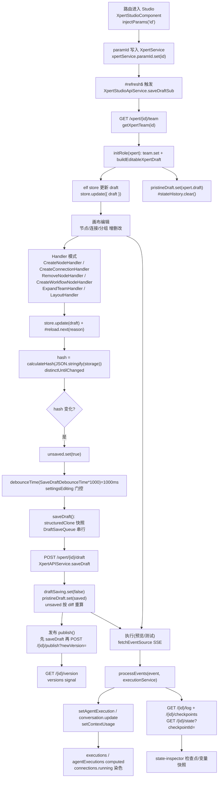
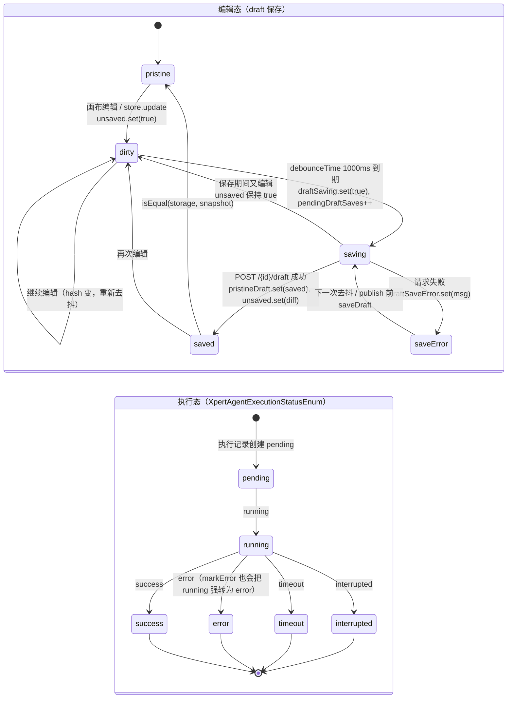

# 03 数据流转：Agent 编排 Studio 专家

**本文引用的文件**

- [studio.component.ts](file://apps/cloud/src/app/features/xpert/studio/studio.component.ts)
- [xpert-api.service.ts](file://apps/cloud/src/app/features/xpert/studio/domain/xpert-api.service.ts)
- [types.ts](file://apps/cloud/src/app/features/xpert/studio/domain/types.ts)
- [index.ts](file://apps/cloud/src/app/features/xpert/studio/domain/index.ts)
- [types.ts](file://apps/cloud/src/app/features/xpert/studio/types.ts)
- [execution.service.ts](file://apps/cloud/src/app/features/xpert/studio/services/execution.service.ts)
- [create.handler.ts](file://apps/cloud/src/app/features/xpert/studio/domain/node/create/create.handler.ts)
- [remove.handler.ts](file://apps/cloud/src/app/features/xpert/studio/domain/node/remove/remove.handler.ts)
- [move.handler.ts](file://apps/cloud/src/app/features/xpert/studio/domain/node/move/move.handler.ts)
- [update-agent.handler.ts](file://apps/cloud/src/app/features/xpert/studio/domain/node/update-agent/update-agent.handler.ts)
- [create.handler.ts](file://apps/cloud/src/app/features/xpert/studio/domain/connection/create/create.handler.ts)
- [remove.handler.ts](file://apps/cloud/src/app/features/xpert/studio/domain/connection/remove/remove.handler.ts)
- [expand.handler.ts](file://apps/cloud/src/app/features/xpert/studio/domain/xpert/expand/expand.handler.ts)
- [create.handler.ts](file://apps/cloud/src/app/features/xpert/studio/domain/workflow/create/create.handler.ts)
- [layout.handler.ts](file://apps/cloud/src/app/features/xpert/studio/domain/layout/layout.handler.ts)
- [layout.ts](file://apps/cloud/src/app/features/xpert/studio/domain/layout/layout.ts)
- [editable-draft.util.ts](file://apps/cloud/src/app/features/xpert/draft/editable-draft.util.ts)
- [utils.ts](file://apps/cloud/src/app/features/xpert/utils.ts)
- [draft-save-queue.ts](file://apps/cloud/src/app/@shared/xpert/assistant-settings/draft-save-queue.ts)
- [xpert.service.ts](file://apps/cloud/src/app/@core/services/xpert.service.ts)
- [xpert-agent.service.ts](file://apps/cloud/src/app/@core/services/xpert-agent.service.ts)
- [xpert-agent-execution.service.ts](file://apps/cloud/src/app/@core/services/xpert-agent-execution.service.ts)
- [execution.component.ts](file://apps/cloud/src/app/features/xpert/studio/panel/agent-execution/execution.component.ts)
- [preview.component.ts](file://apps/cloud/src/app/features/xpert/studio/panel/preview/preview.component.ts)
- [preview.component.ts](file://apps/cloud/src/app/@shared/chat/preview/preview.component.ts)
- [state-inspector.component.ts](file://apps/cloud/src/app/features/xpert/studio/components/state-inspector/state-inspector.component.ts)
- [publish.component.ts](file://apps/cloud/src/app/features/xpert/studio/header/publish/publish.component.ts)
- [xpert-agent-execution.model.ts](file://packages/contracts/src/ai/xpert-agent-execution.model.ts)

## 目录

1. 编排数据生命周期总览
2. 状态流转：编辑态与执行态
3. 异步流：响应式链、执行事件来源与撤销重做
4. 数据变换关键节点
5. 数据边界与持久化时序

## 1. 编排数据生命周期总览

Studio 的数据只有一条主干：**一次 HTTP 拉取得到 `IXpert`（服务端为真源）→ 前端构造可编辑 draft（内存真源）→ 画布编辑改写 draft → 去抖自动保存回服务端 → 发布版本 → 执行时以 SSE 事件流回灌执行态 → state-inspector 回读检查点快照**。

关键落点（全部已核实）：

- **加载入口**：`XpertStudioComponent` 通过 `injectParams('id')` 取路由参数并写入 `xpertService.paramId`（`studio.component.ts:172`、`studio.component.ts:312-316`）。
- **拉取 + 初始化**：`XpertStudioApiService.saveDraftSub`（`domain/xpert-api.service.ts:261-334`）由 `#refresh$ → xpertService.onRefresh() → paramId$` 驱动，`getXpertTeam(id)`（`apps/cloud/src/app/features/xpert/utils.ts:75` 的 `injectGetXpertTeam`，调用 `XpertAPIService.getTeam`，`@core/services/xpert.service.ts:178` GET `/{id}/team`），并在 `tap` 中执行 `#stateHistory.clear()`、`pristineDraft.set(xpert.draft)`、`initRole(xpert)`。
- **draft 构造**：`initRole`（`xpert-api.service.ts:348-363`）内 `team.set(xpert)` 后调用 `buildEditableXpertDraft(xpert)`（`apps/cloud/src/app/features/xpert/draft/editable-draft.util.ts:7`）+ `deriveChatTriggerInputParametersFromDraft(draft)`，最终 `store.update(() => ({ draft }))` 并 `#reload.next(EReloadReason.INIT)`。
- **画布编辑（Handler 模式）**：组件事件 → 服务方法 → `new XxxHandler(this.store).handle(new XxxRequest(...))` → `#reload.next(reason)`。已核实的 Handler：
  - 节点：`CreateNodeHandler`（`domain/node/create/create.handler.ts:8`）、`RemoveNodeHandler`（`domain/node/remove/remove.handler.ts:7`，返回 `EReloadReason`）、`MoveNodeHandler`、`UpdateAgentHandler`、`ReplaceNodeHandler`、`UpdateNodeHandler`（见 `domain/node/index.ts` 全量导出）。
  - 连接：`CreateConnectionHandler`（`domain/connection/create/create.handler.ts:7`）、`RemoveConnectionHandler`（`domain/connection/remove/remove.handler.ts:7`）。
  - 工作流：`CreateWorkflowNodeHandler`（`domain/workflow/create/create.handler.ts:7`）、`UpdateWorkflowNodeHandler`。
  - 外部专家：`ExpandTeamHandler`（`domain/xpert/expand/expand.handler.ts:18`）、`CreateTeamHandler`、`UpdateXpertHandler`。
  - 布局：`LayoutHandler`（`domain/layout/layout.handler.ts:8`）。
- **去抖自动保存**：常量 `SaveDraftDebounceTime = 1 // s`（`xpert-api.service.ts:96`），用在 `...map(() => calculateHash(JSON.stringify(this.storage))), distinctUntilChanged(), tap(() => this.unsaved.set(true)), debounceTime(SaveDraftDebounceTime * 1000), switchMap(() => this.settingsEditing$.pipe(filter(() => !this.settingsEditing()), take(1), switchMap(() => (this.unsaved() ? this.saveDraft() : EMPTY))))`（`xpert-api.service.ts:314-330`）。保存后 `savedEvent$.next(true)` 与 `#cdr.detectChanges()`（`:331-334`）。
- **保存实现**：`saveDraft()`（`xpert-api.service.ts:375-398`）对 `this.storage` 做 `structuredClone` 快照，累加 `pendingDraftSaves`、`draftSaving.set(true)`，经 `DraftSaveQueue.save`（`@shared/xpert/assistant-settings/draft-save-queue.ts:2`，串行队列 + 相邻同请求去重）调用 `xpertAPI.saveDraft(draft.team.id, draft)`（POST `/{id}/draft`，`@core/services/xpert.service.ts:192`），成功后 `unsaved.set(!isEqual(this.storage, snapshot))` 且 `pristineDraft.set(saved)`。
- **发布**：`publish.component.ts:232-246` 中 `this.studioService.unsaved() ? this.studioService.saveDraft() : of(true)` 先落盘，再 `xpertAPI.publish(id, newVersion, { environmentId, releaseNotes, businessAreaId, marketplace })`（`@core/services/xpert.service.ts:281`，POST `/{id}/publish?newVersion=`，成功后 `refresh()` + `publications.changes$.next(...)`）。
- **版本列表**：`readonly versions = toSignal(this.#refresh$.pipe(switchMap(() => this.paramId$...), switchMap((id) => this.xpertAPI.getVersions(id))))`（`xpert-api.service.ts:159-164`），`getVersions` = GET `/{id}/version`（`@core/services/xpert.service.ts:182-186`）。
- **执行 → 事件回灌**：见第 3.2 节。
- **可视化（state-inspector）**：`XpertStudioStateInspectorComponent` 监听 `executionService.inspectorExecutionId`，并行拉取 `executionApi.getOneLog(executionId)` 与 `executionApi.getCheckpoints(executionId)`（`components/state-inspector/state-inspector.component.ts:250-279`），再用 `executionApi.getOneState(executionId, checkpointId)` 取变量快照并按 `${executionId}:${checkpointId}` 缓存到 `snapshotCache`（同文件 `:282-325`）；`categories` 由 `schemaGroups()`（`studioApi.getVariables({ xpertId, type: 'output' })`）与 `currentSnapshot()` 合并生成（同文件 `:165-166`）。

图表来源：[XpertStudioApiService](file://apps/cloud/src/app/features/xpert/studio/domain/xpert-api.service.ts)（关键符号：`saveDraftSub`、`SaveDraftDebounceTime`、`saveDraft`、`initRole`、`versions`）、[XpertStudioComponent](file://apps/cloud/src/app/features/xpert/studio/studio.component.ts)（关键符号：`paramId`、`nodes`、`connections`）、[XpertExecutionService](file://apps/cloud/src/app/features/xpert/studio/services/execution.service.ts)（关键符号：`setAgentExecution`、`setContextUsage`）

章节来源：[XpertStudioApiService](file://apps/cloud/src/app/features/xpert/studio/domain/xpert-api.service.ts)（关键符号：`saveDraftSub`、`initRole`、`saveDraft`、`versions`、`SaveDraftDebounceTime`）

## 2. 状态流转：编辑态与执行态

### 2.1 编辑态（draft 保存状态机）

驱动信号全部来自 `XpertStudioApiService`：`unsaved`（`:171`）、`draftSaving`（`:174`）、`draftSaveError`（`:175`）、`pristineDraft`（`:170`）、`savedEvent$`（`:153`）、`pendingDraftSaves`（`:177`）。

- **pristine**：初始与保存成功后的稳态；`pristineDraft.set(saved)`（`:387`）表示服务端已确认的快照。
- **dirty**：`tap(() => this.unsaved.set(true))`（`:316`）。
- **saving**：`this.draftSaving.set(true)` 且 `pendingDraftSaves++`（`:378-379`）；并发时 `finally` 中 `this.draftSaving.set(this.pendingDraftSaves > 0)`（`:394-395`），即「最后一个请求返回才置 false」。
- **saved**：`this.unsaved.set(!isEqual(this.storage, snapshot))`（`:386`）——保存期间又发生编辑则继续保持 dirty。
- **save-error**：`this.draftSaveError.set(getErrorMessage(error))`（`:391`），并在订阅侧 `#toastr.error(...)`（`:324-327`）。
- **门控特例**：设置弹窗打开时 `settingsEditing$` 阻塞自动保存队列（`:319-323`），`refreshSettingsView()` 用 `#reload.next(EReloadReason.INIT)` 只重绘不排产自动保存（`:400-403`）。

### 2.2 执行态（`XpertAgentExecutionStatusEnum` 真实枚举值）

任务描述要求从 `apps/cloud/src/app/@core` grep 该枚举定义，实际 grep 结果为：`apps/cloud/src/app/@core` 下 **0 命中定义**；真实定义位于 `packages/contracts/src/ai/xpert-agent-execution.model.ts:112`（由 `@core` 再导出给 Studio 使用，Studio 侧一律写成 `import { XpertAgentExecutionStatusEnum } from 'apps/cloud/src/app/@core'`，见 `services/execution.service.ts:13`、`studio.component.ts:148`）：

| 枚举成员 | 字面值 |
| --- | --- |
| `RUNNING` | `running` |
| `SUCCESS` | `success` |
| `ERROR` | `error` |
| `PENDING` | `pending` |
| `TIMEOUT` | `timeout` |
| `INTERRUPTED` | `interrupted` |

Studio 内实际消费点：`markError` 将 `RUNNING` 强制改为 `ERROR` 并写 `error`（`services/execution.service.ts:220-235`）；`connections.running` 用 `_.status === XpertAgentExecutionStatusEnum.RUNNING` 判定（`studio.component.ts:243-247`）；`runningToolsets` 用消息组件 `data.status === RUNNING`（`studio.component.ts:291`）；state-inspector 用 `status !== RUNNING` 判定是否可 retry（`state-inspector.component.ts:159`）。

图表来源：[xpert-agent-execution.model.ts](file://packages/contracts/src/ai/xpert-agent-execution.model.ts)（关键符号：`XpertAgentExecutionStatusEnum`，成员 RUNNING / SUCCESS / ERROR / PENDING / TIMEOUT / INTERRUPTED）、[XpertStudioApiService](file://apps/cloud/src/app/features/xpert/studio/domain/xpert-api.service.ts)（关键符号：`unsaved`、`draftSaving`、`draftSaveError`、`pendingDraftSaves`）

章节来源：[XpertStudioApiService](file://apps/cloud/src/app/features/xpert/studio/domain/xpert-api.service.ts)（关键符号：`unsaved`、`draftSaving`、`draftSaveError`、`pristineDraft`、`savedEvent$`）、[XpertExecutionService](file://apps/cloud/src/app/features/xpert/studio/services/execution.service.ts)（关键符号：`markError`）、[XpertStudioComponent](file://apps/cloud/src/app/features/xpert/studio/studio.component.ts)（关键符号：`connections`、`runningToolsets`）

## 3. 异步流：响应式链、执行事件来源与撤销重做

### 3.1 RxJS 响应式链：store → toSignal/computed → 模板

1. **elf store 是唯一数据源**：`createStore({ name: 'xpertStudio' }, withProps<IStudioStore>({ draft: null }))`（`xpert-api.service.ts:111`），`get storage()` 读取 `store.getValue().draft`（`:118-120`）。
2. **store → signal**：服务侧 `readonly viewModel = toSignal(this.store.pipe(map((state) => state.draft)))`（`:185`）；组件侧再次 `readonly viewModel = toSignal(this.apiService.store.pipe(map((state) => state.draft)))`（`studio.component.ts:269`）。
3. **signal → computed 派生链**（`studio.component.ts`）：`team`(`:191`) → `id`(`:192`) / `rootAgent`(`:193`) → `startNodes`(`:195`)；`viewModel` → `nodes`(`:202`) / `xperts`(`:214`) / `#connections`(`:219`) → `connections`(`:232`)；`executionService.executions` → 连接高亮与 `runningToolsets`(`:283`)。
4. **store → 历史信号**：`#stateHistory = stateHistory(...)`，`historyHasPast = toSignal(this.#stateHistory.hasPast$)`、`historyHasFuture = toSignal(...hasFuture$)`（`:112-116`）。
5. **重绘总线**：`#reload: Subject<EReloadReason|null>` → `reload$`（过滤 `MOVED`，`:147-149`）；组件 `subscribeOnReloadData()` 用 `delay(100)` 订阅（`studio.component.ts:359-376`），执行 `releaseInvalidParentNodes()` 与 `#cdr.detectChanges()`；`MOVED` 被过滤是为了避免拖拽产生高频刷新。
6. **撤销/重做的 UI 门控**：`gotoHistoryIndex` / `undo` / `redo` 结束后统一 `this.#reload.next(null)`（`:459`、`:471`、`:484`）。

### 3.2 执行事件来源：SSE（fetchEventSource），不是轮询

两条独立的上游，均为 **HTTP SSE 流**（`injectFetchEventSource`）：

| 场景 | 调用方 | 上游方法 | 端点 |
| --- | --- | --- | --- |
| Studio 预览面板（整团队执行） | `@shared/chat/preview/preview.component.ts` 的 `chat()` → `xpertService.chat(this.xpert().id, request, { isDraft: true })` | `XpertAPIService.chat`（`@core/services/xpert.service.ts:342-344`） | `baseUrl + /xpert/{id}/chat`，`fetchEventSource` |
| 单 Agent 调试/工作流触发测试 | `panel/agent-execution/execution.component.ts` 的 `startRunAgent()`（`:302-375`） | `XpertAgentService.chatAgent`（`@core/services/xpert-agent.service.ts:27-34`） | `baseUrl + apiBaseUrl + /xpert-agent/chat`，`fetchEventSource` |

事件到状态的落点：`preview.component.ts:113-114` 的 `onChatEvent(event)` → `processEvents(event, this.executionService)`；`trigger.component.ts` 同样 `onChatEvent(event) { processEvents(event, this.executionService) }`。`processEvents` 是纯函数式事件归约器（`panel/agent-execution/execution.component.ts:470-558`），已核实的 case：

- `ON_CONVERSATION_START` / `ON_CONVERSATION_END` → `executionService.conversation.update(...)`。
- `ON_AGENT_START` / `ON_AGENT_END` → `executionService.setAgentExecution(event.data.agentKey, event.data)`。
- `ON_CHAT_EVENT` → 若 `isThreadContextUsageEvent(event.data)` 则 `executionService.setContextUsage(...)`。
- `ON_MESSAGE_START` / `ON_INTERRUPT` / `ON_TOOL_MESSAGE` 显式空实现；`ON_TOOL_*`、`ON_RETRIEVER_*` 分支为注释态（工具/知识执行态改由消息组件 + `runningToolsets` 推导）。
- `default` → `console.log('Unprocessed chat events:', event)`。

`XpertExecutionService` 自身还有一条独立的 HTTP 订阅链：`toObservable(this.conversationId)` → `combineLatest([conversationService.getById(id, { relations: ['messages'] }), feedbackService.getAll({ where: { conversationId: id } })])`（`services/execution.service.ts:112-131`），即「会话骨架与反馈用 HTTP，运行期增量用 SSE」。此外 `execution.component.ts:236-246` 用 `agentExecutionService.getOneLog(id)` 拉历史执行记录并 `markError` 对照组。

### 3.3 撤销重做（dual-track：elf-state-history + 语义历史）

- **底层**：`stateHistory<Store, IStudioStore>(this.store, { comparatorFn: negate(isEqual) })`（`:112-114`）；跳转用 `#stateHistory.jumpToPast(cursor)` / `jumpToFuture(n)`（`:451-456`、`:470`、`:483`）。
- **上层语义层**：`stateHistories` signal 保存 `{ past: TStateHistory[]; future: TStateHistory[] }`（`:181-184`），`TStateHistory = { reason: EReloadReason; cursor: number; createdAt: Date }`（`domain/types.ts:27-31`）。历史节点由 `#reload` 流写入，且用 `debounceUntilChanged(2000)` 合并高频同类原因；仅当 `this.#stateHistory.getPast().length !== last.cursor` 才追加（`:286-311`）。
- **一次初始化**：`initRole` 时写入 `EReloadReason.INIT` 作为第 0 步（`:274-283`）；`clearHistory()` 保留 present 作为唯一历史（`:491-509`）。
- **键盘入口**：`@HostListener('document:keydown')` 的 `onKeyDown`（`studio.component.ts:583-643`），`Ctrl+Z` → `apiService.undo()`，`Ctrl+Y` / `Ctrl+Shift+Z` → `apiService.redo()`，`Ctrl+D` → 复制节点。

章节来源：[XpertStudioApiService](file://apps/cloud/src/app/features/xpert/studio/domain/xpert-api.service.ts)（关键符号：`store`、`viewModel`、`#stateHistory`、`undo`、`redo`、`gotoHistoryIndex`）、[XpertStudioComponent](file://apps/cloud/src/app/features/xpert/studio/studio.component.ts)（关键符号：`onKeyDown`、`subscribeOnReloadData`）、[processEvents](file://apps/cloud/src/app/features/xpert/studio/panel/agent-execution/execution.component.ts)（关键符号：`processEvents`、`startRunAgent`）

## 4. 数据变换关键节点

### 4.1 `nodes`：从 draft 平铺为画布节点

`studio.component.ts:202-213`：先取 `viewModel().nodes`，过滤掉 `type === 'xpert'` 的容器节点，以及 `entity.type` 命中 `GROUP_NODE_TYPES` 的 workflow 节点（分组节点单独由 `groups` 渲染）；随后对每个 `type === 'xpert'` 节点调用 `extractXpertNodes(nodes, node)`，把外部专家的内部节点**追加为 `readonly: true` 且 `parentId = xpertNode.key`** 的普通节点（`studio.component.ts:760-768`，同样是递归的）。

`groups`：`draft.nodes.filter(isXpertNodeType('workflow')).filter(n => GROUP_NODE_TYPES.includes(n.entity.type))`（`:261-265`），`GROUP_NODE_TYPES = [WorkflowNodeTypeEnum.ITERATOR]`（`studio/types.ts:11`）。`GROUP_NODE_TYPES` 与 `ATTACHMENT_DEFAULT_VARIABLE`、`readClipboardNode` 等同文件导出。

### 4.2 `connections`：外部连接合并 + 运行态染色

`#connections`（`studio.component.ts:219-230`）：`viewModel().connections` 浅拷贝后，追加所有 xpert 容器节点的 `node.connections` 并标记 `readonly: true`。`connections`（`:232-255`）再叠加 `running`：toolset 连接依据 `runningToolsets`；workflow key（`isWorkflowKey`，`:779-781`）依据其下辖连接的 `agentExecutions[...].status === RUNNING`；普通连接依据 `agentExecutions[conn.to]` 中 `status === RUNNING && predecessor === conn.from`。

### 4.3 `executions` / `agentExecutions`：`expandExecutions` 摊平执行记录

`services/execution.service.ts:243-251` 的 `expandExecutions(executions, expanded)` 是递归函数：对每条执行记录，若存在 `execution.agentKey` 则按 `id` 去重后追加到 `expanded[agentKey]`，随后递归 `expandExecutions(execution.subExecutions, expanded)`——即把**任意深度的子执行摊平为按 agentKey 分组的一维列表**。

- `executions = computed(...)`：对 `#agentExecutions()` 的每个分组调用 `expandExecutions`（`:52-58`）。
- `agentExecutions = computed(...)`：只取两层（`execution.subExecutions` + `execution` 自身），同样按 `id` 去重（`:60-79`）。
- 数据入口：`setAgentExecution`（`:157-165`，`filter(_ => _.id !== execution.id).concat(execution)` 做 upsert）、`setConversation`（`:167-174`，先 `clear()` 再切 `conversationId`）、以及 `constructor` 中 `effect` 把 `conversation()?.executions` 按 `agentKey` 归组回灌 `#agentExecutions`（`:133-151`）。

### 4.4 保存变换与结构变换

- 保存前 `structuredClone(this.storage)`（`xpert-api.service.ts:377`），`DraftSaveQueue` 内部再 `structuredClone(value)` 并 `JSON.stringify` 做请求去重 key（`@shared/xpert/assistant-settings/draft-save-queue.ts:7-13`）。
- 自动保存触发条件是 `calculateHash(JSON.stringify(this.storage))`（`:314`），节点级 hash 在 `#updateNode` 内重算：`draft.nodes[index].hash = calculateHash(JSON.stringify(omit(draft.nodes[index], 'hash')))`（`:678`）。
- 连接 key 归一化：`removeConnSuffix`（`domain/connection/types.ts:1-12`）剥离 `/agent`、`/knowledge`、`/toolset`、`/xpert`、`/workflow`、`/edge` 后缀，保证 `fOutputId/fInputId`（如 `key/edge`）能解析为节点 key。
- 展开/收起外部专家：`ExpandTeamHandler` 未展开且未加载详情时先 `firstValueFrom(this.apiService.getXpertTeam(request.key))`，展开时写 `node.nodes / node.connections / node.size / node.hash`，收起时 `assign(node, createXpertNode(node.entity, node.position))` 并把 `node.connections = null`（`domain/xpert/expand/expand.handler.ts:24-55`）。
- 自动布局：`LayoutHandler.handle` 调 `layoutGraphWithMixedDirection`（elkjs，`domain/layout/layout.ts:11-53`，垂直子树 `elk.direction = 'DOWN'`，水平主链按 `type === 'edge'` 抽取），随后只把 `position` 回写到原节点，其余字段保持不变（`domain/layout/layout.handler.ts:12-23`）。

章节来源：[XpertStudioComponent](file://apps/cloud/src/app/features/xpert/studio/studio.component.ts)（关键符号：`nodes`、`groups`、`connections`、`extractXpertNodes`、`isWorkflowKey`）、[XpertExecutionService](file://apps/cloud/src/app/features/xpert/studio/services/execution.service.ts)（关键符号：`executions`、`agentExecutions`、`expandExecutions`、`setAgentExecution`）、[ExpandTeamHandler](file://apps/cloud/src/app/features/xpert/studio/domain/xpert/expand/expand.handler.ts)（关键符号：`handle`）、[layout.ts](file://apps/cloud/src/app/features/xpert/studio/domain/layout/layout.ts)（关键符号：`layoutGraphWithMixedDirection`）

## 5. 数据边界与持久化时序

- **前端唯一持久化出口**是 HTTP：`POST /{id}/draft`（`saveDraft`，`@core/services/xpert.service.ts:192`）、`PUT /{id}/draft`（`upadteDraft`，同文件 `:277-279`，注意源码拼写为 `upadteDraft`）、`POST /{id}/publish?newVersion=`（`:281-302`）、`GET /{id}/version`（`:182-186`）、`GET /{id}/team`（`:178-180`）。前端不持有任何数据库连接、实体元数据或 ORM 映射。
- **放弃草稿**：`resume()` 调 `xpertAPI.update(this.team().id, { draft: null })` 后 `refresh()`（`xpert-api.service.ts:365-369`）——即把服务端 draft 置空并重新加载，使内存态回到「已发布版本」。
- **执行态数据的三个来源**必须区分：① SSE 事件流（实时增量，`processEvents`）；② `ChatConversationService.getById(id, { relations: ['messages'] })`（会话与消息骨架）；③ `XpertAgentExecutionService.getOneLog / getCheckpoints / getOneState`（历史执行、检查点列表、指定检查点变量快照，`@core/services/xpert-agent-execution.service.ts:22-41`）。节点/连线的「运行中」染色来自 ①，检查点面板内容来自 ③。
- **草稿与执行的关系**：预览执行显式带 `isDraft: true`（`@shared/chat/preview/preview.component.ts:832-837`），因此画布上的未发布 draft 也能直接运行——这也是 `publish()` 之前必须先 `saveDraft()` 的原因（`publish.component.ts:235`）。
- **跨模块通知**：发布成功会 `this.publications.changes$.next({ assistantId: id, organizationId })`（`@core/services/xpert.service.ts:297-300`），由 `XpertPublicationService` 广播（`@core/services/xpert-publication.service.ts`）。

章节来源：[XpertAPIService](file://apps/cloud/src/app/@core/services/xpert.service.ts)（关键符号：`getTeam`、`saveDraft`、`upadteDraft`、`publish`、`getVersions`、`chat`）、[XpertStudioApiService](file://apps/cloud/src/app/features/xpert/studio/domain/xpert-api.service.ts)（关键符号：`resume`、`refresh`）、[XpertAgentExecutionService](file://apps/cloud/src/app/@core/services/xpert-agent-execution.service.ts)（关键符号：`getOneLog`、`getCheckpoints`、`getOneState`）
