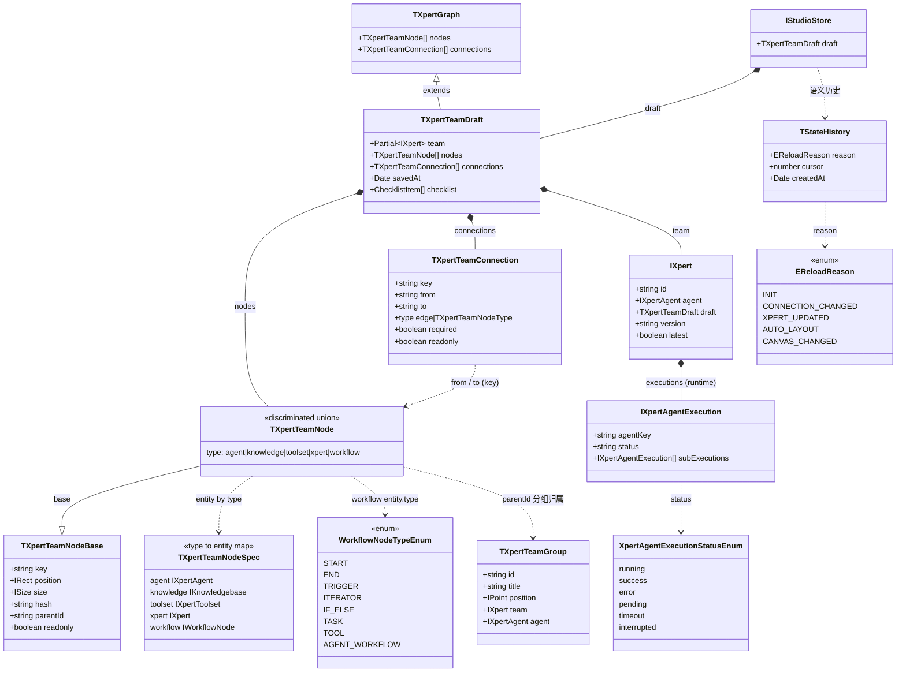

# 04 模型：Agent 编排 Studio 专家

**本文引用的文件**

- [types.ts](file://apps/cloud/src/app/features/xpert/studio/domain/types.ts)
- [index.ts](file://apps/cloud/src/app/features/xpert/studio/domain/index.ts)
- [xpert-api.service.ts](file://apps/cloud/src/app/features/xpert/studio/domain/xpert-api.service.ts)
- [types.ts](file://apps/cloud/src/app/features/xpert/studio/domain/xpert/types.ts)
- [types.ts](file://apps/cloud/src/app/features/xpert/studio/domain/connection/types.ts)
- [layout.ts](file://apps/cloud/src/app/features/xpert/studio/domain/layout/layout.ts)
- [layout.request.ts](file://apps/cloud/src/app/features/xpert/studio/domain/layout/layout.request.ts)
- [create.handler.ts](file://apps/cloud/src/app/features/xpert/studio/domain/node/create/create.handler.ts)
- [create.request.ts](file://apps/cloud/src/app/features/xpert/studio/domain/node/create/create.request.ts)
- [remove.handler.ts](file://apps/cloud/src/app/features/xpert/studio/domain/node/remove/remove.handler.ts)
- [create.handler.ts](file://apps/cloud/src/app/features/xpert/studio/domain/workflow/create/create.handler.ts)
- [create.handler.ts](file://apps/cloud/src/app/features/xpert/studio/domain/connection/create/create.handler.ts)
- [expand.handler.ts](file://apps/cloud/src/app/features/xpert/studio/domain/xpert/expand/expand.handler.ts)
- [selection.service.ts](file://apps/cloud/src/app/features/xpert/studio/domain/selection.service.ts)
- [types.ts](file://apps/cloud/src/app/features/xpert/studio/types.ts)
- [studio.component.ts](file://apps/cloud/src/app/features/xpert/studio/studio.component.ts)
- [execution.service.ts](file://apps/cloud/src/app/features/xpert/studio/services/execution.service.ts)
- [editable-draft.util.ts](file://apps/cloud/src/app/features/xpert/draft/editable-draft.util.ts)
- [utils.ts](file://apps/cloud/src/app/features/xpert/utils.ts)
- [xpert.service.ts](file://apps/cloud/src/app/@core/services/xpert.service.ts)
- [form.component.ts](file://apps/cloud/src/app/@shared/forms/json-schema-form/form.component.ts)
- [property.component.ts](file://apps/cloud/src/app/@shared/forms/json-schema-property/property.component.ts)
- [draft-save-queue.ts](file://apps/cloud/src/app/@shared/xpert/assistant-settings/draft-save-queue.ts)
- [xpert.model.ts](file://packages/contracts/src/ai/xpert.model.ts)
- [xpert-workflow.model.ts](file://packages/contracts/src/ai/xpert-workflow.model.ts)
- [xpert-agent-execution.model.ts](file://packages/contracts/src/ai/xpert-agent-execution.model.ts)

## 目录

1. 领域模型清单
2. 模型关系图
3. 校验规则
4. 前后端映射：draft ↔ 服务端 IXpert/team
5. 持久化说明：前端无 DB / ORM
6. 建模边界与未确认项

## 1. 领域模型清单

Studio 的模型分三层：**契约层类型（`packages/contracts`，被 `@core` 再导出）→ Studio 私有类型（`domain/types.ts`、`domain/*/types.ts`、`studio/types.ts`）→ 请求对象（Handler 的 `*.request.ts`）**。前端**没有**实体类、仓储接口或表结构描述，因此下表只列内存模型与契约 DTO。

| 类型名 | 定义位置（file://） | 字段要点 | 用途 |
| --- | --- | --- | --- |
| `IStudioStore` | file://apps/cloud/src/app/features/xpert/studio/domain/types.ts（:3-5） | `draft: TXpertTeamDraft` | elf store 的唯一切片，Studio 全局内存真源 |
| `EReloadReason` | file://apps/cloud/src/app/features/xpert/studio/domain/types.ts（:7-25） | 17 个成员：`INIT`、`JUST_RELOAD`、`CONNECTION_CHANGED`、`MOVED`、`XPERT_ADDED`、`XPERT_UPDATED`、`XPERT_REMOVED`、`AGENT_CREATED`、`AGENT_REMOVED`、`KNOWLEDGE_CREATED`、`KNOWLEDGE_REMOVED`、`TOOLSET_CREATED`、`TOOLSET_REMOVED`、`WORKFLOW_REMOVED`、`AUTO_LAYOUT`、`RESIZE`、`CANVAS_CHANGED` | 每次 store 变更的语义标签，驱动重绘与 undo 步骤命名 |
| `TStateHistory` | file://apps/cloud/src/app/features/xpert/studio/domain/types.ts（:27-31） | `reason`、`cursor`、`createdAt` | 语义化 undo/redo 时间线项 |
| `TXpertGraph` | file://packages/contracts/src/ai/xpert.model.ts（:653-656） | `nodes`、`connections` | 图的纯结构契约 |
| `TXpertTeamDraft` | file://packages/contracts/src/ai/xpert.model.ts（:658-662） | `TXpertGraph` + `team: Partial<IXpert>` + `savedAt?` + `checklist?` | 前端可编辑草稿，自动保存的载体 |
| `TXpertTeamNodeType` | file://packages/contracts/src/ai/xpert.model.ts（:664） | `'agent' \| 'knowledge' \| 'toolset' \| 'xpert' \| 'workflow'` | 节点判别式 |
| `TXpertTeamNodeBase` | file://packages/contracts/src/ai/xpert.model.ts（:666-673） | `key`、`position: IRect`、`size?`、`hash?`、`parentId?`、`readonly?` | 节点公共字段（`hash` 用于自动保存 diff，`parentId` 用于分组归属） |
| `TXpertTeamNodeSpec` | file://packages/contracts/src/ai/xpert.model.ts（:676-695） | `agent → IXpertAgent`、`knowledge → IKnowledgebase`、`toolset → IXpertToolset`、`xpert → IXpert (+ nodes/connections/expanded)`、`workflow → IWorkflowNode` | 「类型 → 实体」映射表，是节点 union 的骨架 |
| `TXpertTeamNode<T>` | file://packages/contracts/src/ai/xpert.model.ts（:700-702） | `TXpertTeamNodeBase & { type: T } & TXpertTeamNodeSpec[T]` | 判别联合节点；`NodeOf<T>`、`NodeEntity<T>`、`AnyNodeEntity` 为其派生别名（:704-708） |
| `IRect` | file://packages/contracts/src/ai/xpert.model.ts（:710-712） | `IPoint` + `Partial<ISize>` + `gravityCenter?` | 位置/尺寸 |
| `TXpertTeamGroup` | file://packages/contracts/src/ai/xpert.model.ts（:714-722） | `id`、`title`、`position`、`size?`、`parentId?`、`team`、`agent?` | 团队分组（画布分组视图） |
| `TXpertTeamConnection` | file://packages/contracts/src/ai/xpert.model.ts（:724-741） | `key`、`from`、`to`、`type: 'edge' \| TXpertTeamNodeType`、`required?`（子代理连线省略即必需）、`readonly?` | 连线契约；`type==='edge'` 为水平流程，其余为垂直主从 |
| `IXpertAgentExecution` | file://packages/contracts/src/ai/xpert-agent-execution.model.ts（:102-107） | 继承 `IBasePerTenantAndOrganizationEntityModel` + `TXpertAgentExecution`；含 `subExecutions?`、临时属性 `runningExecution?` | 执行记录；`subExecutions` 是 `expandExecutions` 的递归来源 |
| `XpertAgentExecutionStatusEnum` | file://packages/contracts/src/ai/xpert-agent-execution.model.ts（:112-119） | `running` / `success` / `error` / `pending` / `timeout` / `interrupted` | 执行状态机取值（Studio 经 `@core` 导入） |
| `WorkflowNodeTypeEnum` | file://packages/contracts/src/ai/xpert-workflow.model.ts（:32-） | 已核实成员：`START`、`END`、`TRIGGER`、`ASSIGNER`、`IF_ELSE`、`LIST_OPERATOR`、`VARIABLE_AGGREGATOR`、`ITERATING`(deprecated)、`ITERATOR`、`HTTP`、`SUBFLOW`、`TOOL`、`AGENT_WORKFLOW`、`AGENT_TOOL`(deprecated)、`NOTE`、`TASK`，以及知识流水线 `SOURCE/PROCESSOR/CHUNKER/UNDERSTANDING/KNOWLEDGE_BASE`、变换节点 `CLASSIFIER/KNOWLEDGE/CODE/TEMPLATE/ANSWER/JSON_STRINGIFY/JSON_PARSE` 等 | workflow 节点实体类型 |
| `GROUP_NODE_TYPES` | file://apps/cloud/src/app/features/xpert/studio/types.ts（:11） | `[WorkflowNodeTypeEnum.ITERATOR]` | 判定「画布分组节点」；`groups` computed 与 `isCanvasGroupTarget` 依赖它 |
| `XpertStudioNodeStatus` | file://apps/cloud/src/app/features/xpert/studio/types.ts（:3） | `'success' \| 'error' \| 'template'` | Studio 节点展示状态 |
| `ClipboardNodeReadResult` | file://apps/cloud/src/app/features/xpert/studio/types.ts（:13-17） | `node: TXpertTeamNode \| null`、`hasText`、`error?` | `readClipboardNode()` 返回类型（:19-39，校验 `type/position.x/position.y`，见 `isPasteableNode` :41-53） |
| `ATTACHMENT_DEFAULT_VARIABLE` / `VISION_DEFAULT_VARIABLE` | file://apps/cloud/src/app/features/xpert/studio/types.ts（:5-9） | 常量 `human.files`；后者已 deprecated 为别名 | 默认变量路径 |
| `createXpertNode()` | file://apps/cloud/src/app/features/xpert/studio/domain/xpert/types.ts（:4-34） | 入参 `(xpert: IXpert, position: IPoint)`，输出 `type: 'xpert'` 节点：优先主 agent 节点，`agent.options?.hidden` 时改取 `WorkflowNodeTypeEnum.TRIGGER` 且 `from === 'chat'` 的节点；写入 `nodes/size/hash` | 把外部专家压缩成画布上的一个容器节点 |
| `removeConnSuffix()` | file://apps/cloud/src/app/features/xpert/studio/domain/connection/types.ts（:1-12） | 剥离 `/agent`、`/knowledge`、`/toolset`、`/xpert`、`/workflow`、`/edge` 后缀 | 连接 ID 归一化 |
| `layoutGraphWithMixedDirection()` | file://apps/cloud/src/app/features/xpert/studio/domain/layout/layout.ts（:11-53） | 入参 `TXpertGraph`，返回 `Promise<TXpertGraph>`；`NODE_WIDTH = 240`；垂直子树用 elkjs `layered` + `DOWN`，水平主链按 `type === 'edge'` 抽取 | 自动布局 |
| `LayoutRequest` | file://apps/cloud/src/app/features/xpert/studio/domain/layout/layout.request.ts | 入参为方向（`LayoutHandler` 被调用时传 `'TB'`，见 `xpert-api.service.ts:778`） | 布局指令对象 |
| `CreateNodeRequest` | file://apps/cloud/src/app/features/xpert/studio/domain/node/create/create.request.ts | `(type, position, node?, entity?)` 形态（构造点见 `create.handler.ts` 调用与 `xpert-api.service.ts:534/575/600/701`） | Handler 入参 |
| `SelectionService` | file://apps/cloud/src/app/features/xpert/studio/domain/selection.service.ts | 选中节点 key 等信号；组件用 `selectionService.selectedNodeKey` / `setNodes()` | 画布选中态，与 store 解耦 |
| `TPreviewRetryRequest` | file://apps/cloud/src/app/features/xpert/studio/services/execution.service.ts（:18-22） | `nonce`、`messageId?`、`checkpointId?` | 预览面板「重试」请求模型 |
| `DraftSaveQueue<T>` | file://apps/cloud/src/app/@shared/xpert/assistant-settings/draft-save-queue.ts（:2-23） | `tail` 串行链 + `lastKey`/`lastRequest` 相邻同请求共享 | 草稿写队列（非领域模型，但约束 draft 写语义） |

> 枚举完整性说明：`WorkflowNodeTypeEnum` 文件在已读区间之后仍有后续成员（源码注释显示还有「Database Operation Nodes」段，见 `xpert-workflow.model.ts:85-89`），本次仅列出已逐行核实的成员，未读取部分不臆测。

章节来源：[domain/types.ts](file://apps/cloud/src/app/features/xpert/studio/domain/types.ts)（关键符号：`IStudioStore`、`EReloadReason`、`TStateHistory`）、[xpert.model.ts](file://packages/contracts/src/ai/xpert.model.ts)（关键符号：`TXpertTeamDraft`、`TXpertTeamNode`、`TXpertTeamNodeSpec`、`TXpertTeamConnection`、`TXpertGraph`）、[studio/types.ts](file://apps/cloud/src/app/features/xpert/studio/types.ts)（关键符号：`GROUP_NODE_TYPES`、`ClipboardNodeReadResult`）

## 2. 模型关系图

图表来源：[xpert.model.ts](file://packages/contracts/src/ai/xpert.model.ts)（关键符号：`TXpertGraph`、`TXpertTeamDraft`、`TXpertTeamNode`、`TXpertTeamConnection`、`TXpertTeamGroup`）、[domain/types.ts](file://apps/cloud/src/app/features/xpert/studio/domain/types.ts)（关键符号：`IStudioStore`、`TStateHistory`、`EReloadReason`）、[xpert-workflow.model.ts](file://packages/contracts/src/ai/xpert-workflow.model.ts)（关键符号：`WorkflowNodeTypeEnum`）、[xpert-agent-execution.model.ts](file://packages/contracts/src/ai/xpert-agent-execution.model.ts)（关键符号：`XpertAgentExecutionStatusEnum`）

## 3. 校验规则

Studio 的校验是「编译期类型约束 + 运行时 Handler 守卫 + UI 层连线语义 + JSON-Schema 表单」四道闸，**没有集中式 schema validator（如 zod/ajv）用于 draft 整体**。

### 3.1 类型约束（编译期）

- `TXpertTeamNodeSpec` 用映射类型把 `type` 与 `entity` 强绑定（`xpert.model.ts:676-702`）：`TXpertTeamNode<'agent'>` 的 `entity` 必为 `IXpertAgent`，写错类型编译即失败。
- `TXpertTeamConnection.type` 被限定为 `'edge' | TXpertTeamNodeType`（`:732`），`required` 的语义在注释中明确：**子代理连省略 `required` 即视为必需**（`:734-738`）。

### 3.2 Handler 运行时守卫（唯一会抛错的地方）

| 守卫 | 位置 | 行为 |
| --- | --- | --- |
| 同实体重复添加 | `domain/node/create/create.handler.ts:15-19` | `request.entity?.id` 已存在于 `draft.nodes` 时抛 `Node with id ${request.entity.id} already added!` |
| workflow 同 key 重复 | `domain/workflow/create/create.handler.ts:14-18` | 抛 `Node with key ${request.entity.key} already added!` |
| 节点不存在 | `domain/xpert-api.service.ts:667-684`（`#updateNode`） | 抛 `Node with key ${key} not found!`，并顺带重算 `hash` |
| workflow 节点不存在 | `domain/xpert-api.service.ts:733-747` | 抛 `Workflow node with key ${key} not found` |
| 连接目标不存在 | `domain/connection/create/create.handler.ts:16-23` | **不抛错，直接 return**（静默丢弃非法连接） |
| 连接重复 | `domain/connection/create/create.handler.ts:31-33` | `key = from + '/' + to`，已存在则跳过 |
| agent 静音配置 | `domain/node/create/create.handler.ts:31-34` | 新建 agent 节点时向 `draft.team.agentConfig.mute` 追加 `[key]`，保证新 agent 默认不打断主链路输出 |

### 3.3 连线合法性（UI 语义）

- `isOptionalSubAgentConnection(connection)`：`(connection.type === 'agent' || connection.type === 'xpert') && !connection.required`（`studio.component.ts:257-259`），在模板中映射为 `optional-sub-agent` 样式类（`studio.component.html:48`）。
- 连接类型推导：若目标为 `agent`/`workflow` 且源以 `/edge` 结尾 → `type: 'edge'`，否则 `type = targetNode.type`（`domain/connection/create/create.handler.ts:34-38`）。配合 `removeConnSuffix` 完成 `${key}/edge` → `key` 的归一化。
- `releaseInvalidParentNodes()`（`studio.component.ts:740-757`）：遍历 `viewModel().nodes`，凡是 `parentId` 存在于但父节点不再满足 `isCanvasGroupTarget`（`:734-738`：`type === 'xpert'` 或 workflow 且 `entity.type ∈ GROUP_NODE_TYPES`）的节点，调用 `apiService.updateNode(node.key, state => ({ ...state, parentId: null }))` 释放其归属；在 `subscribeOnReloadData` 中每次重载后执行（`:373`）。
- `isCanvasGroupTarget` 与 `GROUP_NODE_TYPES = [WorkflowNodeTypeEnum.ITERATOR]` 共同界定「哪些节点能当容器」。

### 3.4 JSON-Schema 驱动的配置表单

- 入口组件 `JSONSchemaFormComponent`（`@shared/forms/json-schema-form/form.component.ts:29`）：输入 `schema: JsonSchemaObjectType`、`variables: TWorkflowVarGroup[]`、`readonly`、`context`、`controlDefaults`；`properties` computed 直接 `Object.entries(this.schema()?.properties)` 摊平成 `{...value, name}` 列表（`:55-62`），`xUi`/`xUiSpan` 读取 `schema['x-ui']` 的 `cols`（`:64-65`）。文件头「Invariants」声明：子属性需通过 `context.model` 解析同级的 `x-ui.depends`，注入的 model 必须是当前正在编辑的对象值。
- 字段组件 `JSONSchemaPropertyComponent`（`@shared/forms/json-schema-property/property.component.ts:72`，选择器 `json-schema-property`）：输入 `name`、`schema: JsonSchema7TypeUnion`、`variables`、`readonly`、`required`、`context: JsonSchemaPropertyContext`、`arrayItem`（`:79-90`）；可选注入 `JsonSchemaWidgetStrategyRegistry` 与 `JsonSchemaFormOptions`（`:75-76`），并通过 `JsonSchemaWidgetOutletComponent` 做 widget 插件分发；`hostDirectives: [NgxControlValueAccessor]` 使其可作为表单控件（`:66`）。
- Studio 侧注册：`provideJsonSchemaWidgets` 从 `@cloud/app/@shared/xpert/json-schema-widgets` 再导出（`studio/types.ts:55`），并在 `XpertStudioComponent` 的 providers 中与 `JsonSchemaWidgetStrategyRegistry` 一起提供（`studio.component.ts:143-144`）；`GROUP_NODE_TYPES, provideJsonSchemaWidgets, readClipboardNode` 从 `./types` 导入（`studio.component.ts:92`）。
- 参数级校验的另一处落点：执行前 `validateParameterValues(this.parameters(), this.parameterValue() ?? {})`（`panel/agent-execution/execution.component.ts:305`），用于在发请求前拦截越界/超长参数（同文件注释 `:303-304`）。

章节来源：[studio.component.ts](file://apps/cloud/src/app/features/xpert/studio/studio.component.ts)（关键符号：`isOptionalSubAgentConnection`、`releaseInvalidParentNodes`、`isCanvasGroupTarget`、`provideJsonSchemaWidgets`）、[create.handler.ts](file://apps/cloud/src/app/features/xpert/studio/domain/node/create/create.handler.ts)（关键符号：`CreateNodeHandler.handle`）、[CreateConnectionHandler](file://apps/cloud/src/app/features/xpert/studio/domain/connection/create/create.handler.ts)（关键符号：`handle`）、[form.component.ts](file://apps/cloud/src/app/@shared/forms/json-schema-form/form.component.ts)（关键符号：`JSONSchemaFormComponent`、`schema`、`properties`）、[property.component.ts](file://apps/cloud/src/app/@shared/forms/json-schema-property/property.component.ts)（关键符号：`JSONSchemaPropertyComponent`、`JsonSchemaWidgetStrategyRegistry`）

## 4. 前后端映射：draft ↔ 服务端 IXpert/team

**方向 A：服务端 → 前端（反序列化）**

1. `GET /xpert/{id}/team`（`@core/services/xpert.service.ts:178-180`）返回 `IXpert`，其中可携带 `draft: TXpertTeamDraft` 与 `graph`。请求参数 relations 由 `injectGetXpertTeam()` 统一拼装（`features/xpert/utils.ts:75-83`，至少含 `agent`）。
2. `buildEditableXpertDraft(xpert: IXpert): TXpertTeamDraft`（`features/xpert/draft/editable-draft.util.ts:7-`）完成实际解包：`baseTeam = { ...omit(xpert, 'agents'), id: xpert.id }`；**若 `xpert.draft` 存在**则优先使用其 `nodes`/`connections` 并与 `baseTeam`、`xpert.draft.team` 合并（`id: xpert.draft.team?.id ?? xpert.id`），**否则回退到 `xpert.graph`**；最后 `applyChatTriggerInputParametersToDraft(...)` 把聊天触发器参数回写进 draft。节点/连线在构造过程中经 `ToNodeViewModelHandler` / `ToConnectionViewModelHandler`（`domain/node/map/to-view-model.handler.ts`、`domain/connection/map/to-connection-view-model.handler.ts`）转换。
3. `initRole(xpert)` 落库到内存：`team.set(xpert)` + `store.update({ draft })` + 历史重置（`domain/xpert-api.service.ts:348-363`）。
4. `#reload$` 每次重载都会重跑步骤 1–3（`xpert-api.service.ts:261-285`）。

**方向 B：前端 → 服务端（序列化）**

| 动作 | 序列化落点 | 端点 |
| --- | --- | --- |
| 自动/手动保存草稿 | `saveDraft()` → `DraftSaveQueue.save(structuredClone(storage), draft => xpertAPI.saveDraft(draft.team.id, draft))`（`domain/xpert-api.service.ts:375-398`） | `POST /xpert/{id}/draft`（`@core/services/xpert.service.ts:192-194`） |
| 草稿全量覆盖 | `XpertAPIService.upadteDraft(id, draft)`（源码拼写如此，`:277-279`） | `PUT /xpert/{id}/draft` |
| 放弃草稿 | `resume()` → `xpertAPI.update(this.team().id, { draft: null })` 后 `refresh()`（`domain/xpert-api.service.ts:365-373`） | `PATCH/PUT /xpert/{id}`（由 CRUD 基类 `update` 决定，未能确认具体动词） |
| 发布 | `publish()` 先 `saveDraft()`，再 `xpertAPI.publish(id, newVersion, { environmentId, releaseNotes, businessAreaId, marketplace })`（`header/publish/publish.component.ts:232-246`） | `POST /xpert/{id}/publish?newVersion=`（`:281-302`） |
| 版本读取 | `versions = toSignal(#refresh$ → paramId$ → xpertAPI.getVersions(id))`（`domain/xpert-api.service.ts:159-164`） | `GET /xpert/{id}/version`（返回 `{ id, version, latest, publishAt, releaseNotes }[]`，`:182-186`） |
| 运行（draft 模式） | `xpertService.chat(id, request, { isDraft: true })`（`@shared/chat/preview/preview.component.ts:832-837`） | `POST /xpert/{id}/chat`（SSE，`:342-344`） |

**draft.team 与 IXpert 的关系**：`draft.team` 是 `Partial<IXpert>`（`xpert.model.ts:658-662`），因此前端 `updateXpertTeam(fn)` / `updatePrimaryAgent(fn)` / `updateXpertOptions(...)` / `updateXpertAgentConfig(...)`（`domain/xpert-api.service.ts:623-665`）都是对同一个 `IXpert` 子集做浅合并后再发 `#reload`；服务端保存草稿即接收这份 `Partial<IXpert>` + 图结构。

章节来源：[editable-draft.util.ts](file://apps/cloud/src/app/features/xpert/draft/editable-draft.util.ts)（关键符号：`buildEditableXpertDraft`、`applyChatTriggerInputParametersToDraft`）、[XpertStudioApiService](file://apps/cloud/src/app/features/xpert/studio/domain/xpert-api.service.ts)（关键符号：`initRole`、`saveDraft`、`resume`、`versions`、`updateXpertTeam`）、[XpertAPIService](file://apps/cloud/src/app/@core/services/xpert.service.ts)（关键符号：`getTeam`、`saveDraft`、`publish`、`getVersions`、`chat`）、[xpert.model.ts](file://packages/contracts/src/ai/xpert.model.ts)（关键符号：`TXpertTeamDraft`）

## 5. 持久化说明：前端无 DB / ORM

必须如实说明：**Studio 前端不存在数据库、ORM 实体、Repository、迁移或表结构定义**。本模块全部 `.ts` 源码中没有任何持久层导入；模型的实际存续形态是：

1. **内存态（唯一真源）**：`createStore({ name: 'xpertStudio' }, withProps<IStudioStore>({ draft: null }))`（`domain/xpert-api.service.ts:111`）。所有编辑通过 `structuredClone(state.draft)` → 改写 → `store.update(...)` 完成（如 `#updateNode` `:667-684`、`updateXpertTeam` `:623-632`、`resizeNode` `:544-554`），**不做任何对象引用共享**。
2. **短暂的历史态**：`stateHistory`（`:112-114`）保存历史快照栈，`stateHistories` signal 保存语义标签（`:181-184`）。
3. **服务端持久化**：draft / 团队 / 版本 / 执行 / 检查点全部落在服务端，由 HTTP 端点承载（第 4 节表格）。前端只发送 `TXpertTeamDraft` 的 JSON，不感知服务端如何存储（服务端实体与表结构不在本次调研范围，未核实）。
4. **命名一致性陷阱**：`XpertAPIService` 中同时存在 `saveDraft`（POST）与 `upadteDraft`（PUT，拼写错误但为真实符号，`@core/services/xpert.service.ts:277`），引用时不要「顺手改正」。
5. **执行态数据也不进前端存储**：`XpertExecutionService` 全部用 Angular signal/computed（`#agentExecutions`、`contextUsageByAgentKey`），`clear()` 即清空（`services/execution.service.ts:237-240`），刷新即丢，重新从 `getOneLog`/`getCheckpoints`/`getOneState` 回读。

章节来源：[XpertStudioApiService](file://apps/cloud/src/app/features/xpert/studio/domain/xpert-api.service.ts)（关键符号：`store`、`#stateHistory`、`saveDraft`）、[XpertAPIService](file://apps/cloud/src/app/@core/services/xpert.service.ts)（关键符号：`saveDraft`、`upadteDraft`、`publish`）、[XpertExecutionService](file://apps/cloud/src/app/features/xpert/studio/services/execution.service.ts)（关键符号：`#agentExecutions`、`clear`）

## 6. 建模边界与未确认项

- **未确认**：`WorkflowNodeTypeEnum` 的完整取值集合（已读区间之后仍有「Database Operation Nodes」等成员未展开，`xpert-workflow.model.ts:85-89`）。
- **未确认**：`XpertAPIService.update(...)` 的具体 HTTP 动词（`resume()` 依赖它把 `draft` 置 null，方法体在 CRUD 基类中，本次未展开）。
- **未确认**：服务端 `IXpert` / draft 的持久化实现（表结构、实体、迁移）——本任务只覆盖前端模型，故不作推断。
- **未确认**：`domain/node/create/create.request.ts`、`layout.request.ts` 等 request 类的完整字段列表（仅从调用点推断构造形态）。
- **范围内但未逐行核对**：`ReplaceNodeHandler`、`UpdateNodeHandler`、`MoveNodeHandler`、`UpdateWorkflowNodeHandler`、`CreateTeamHandler`、`UpdateXpertHandler` 的内部实现（文件存在且被 `xpert-api.service.ts` 导入调用，行为按 create/remove 的同类模式推断，未逐行验证）。
