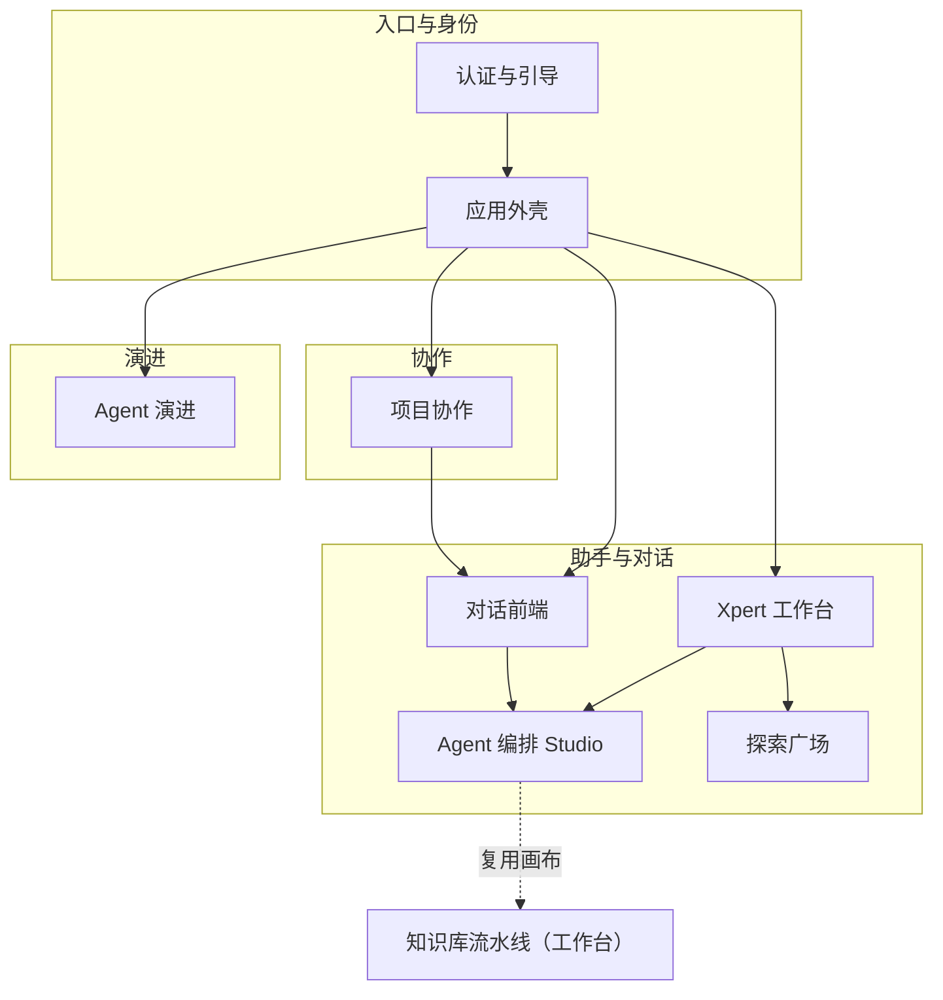

# 前端专题总览（T0）

> ⚠️ **重建版**（原版随 2026-10-16 工作区事故丢失）。当前只有 Studio 专家**部分恢复**；其余 6 个专家为待建，其能力/边界条目依据 ki 路标与源码实测（非 spec 文件计数按 `apps/cloud` 实测）填写，**建站时需重新扫描核实**。

## 1. 能力清单

| 业务域 | 专家 | 一句话能力 | 主要路由 / 目录 |
|---|---|---|---|
| Agent 可视化编排 | Agent 编排 Studio 专家 ⚠️ | 34 类节点的编排画布、草稿（1s 去抖）与撤销重做、版本发布、执行可视化（SSE）、检查点重跑、Copilot 辅助、画布复用 | `/xpert/x/:id/agents` · `features/xpert/studio` |
| 对话与助手 | 对话前端专家 ❌ | 会话与消息交互、流式渲染、会话工作台、ClawXpert 客户端 | `features/chat` `features/assistant` |
| 助手工作台 | Xpert 工作台专家 ❌ | 助手列表/详情/设置、知识库挂载、工作区与文件、Prompt 工作流作者态 | `features/xpert`（扣 studio） |
| 认证与引导 | 认证与引导专家 ❌ | 登录/注册/找回、onboarding 向导、准入边界 | `auth` `onboarding` `@core/auth` |
| 项目协作 | 项目协作专家 ❌ | 项目列表/详情、成员与任务面、与对话域的项目选择门面 | `features/project` |
| Agent 演进 | Agent 演进专家 ❌ | Agent 演进视图与配置 | `features/agent-evolution` |
| 探索广场 | 探索广场专家 ❌ | 模板/助手探索与作用域回落 | `features/explore` |

## 2. 边界

- **不含** `@shared`（公共 UI 组件库）与 `@core`（基础设施）→ 归「项目记忆」
- **不含** `features/setting`（设置页薄壳）
- **后端契约不在本专题**：前端调用的接口口径以后端专题对应专家的 `C1-能力契约.md` 为准（跨端对应关系：Studio ↔ `xpert-agent`/`xpert-agent-execution`；对话前端 ↔ `chat-conversation`/`chat`/`handoff`；工作台 ↔ `xpert`/`xpert-workspace`/`assistant-binding`）
- **状态管理约定**：elf store + signal（`toSignal`/`computed`）→ 模板；跨页面共享状态走 `@core/state`

## 3. 跨专家架构图（前端骨干）

图表来源：ki 路标 `专题记忆/前端专题/*`（`file://CodeWikiHub/xpert/memory/专题记忆/前端专题/`）与 `关联关系/前端专题/*`；**待建专家建站时须回源码核实**

## 4. 待建顺序与前置

| 顺序 | 专家 | 前置 | 备注 |
|---|---|---|---|
| 1 | 对话前端专家（P0） | 后端「对话与会话专家」+「Assistant 定义与运行时专家」资产 | 与 Studio 共享聊天组件层（见 `关联关系/前端专题/chat-共享-聊天组件层`） |
| 2 | Xpert 工作台专家（P1，含 2 子专家） | Studio 专家 + 后端 xpert/xpert-workspace | 知识库子域（87）与工作区子域（32）可拆子专家 |
| 3 | 认证与引导专家（P1） | 后端「身份与权限专家」 | 准入边界见 `关联关系/前端专题/auth-准入边界-全站` |
| 4 | 项目协作专家（P2） | 后端 `xpert-project`（批次 5） | 项目选择与对话门面关联 |
| 5 | Agent 演进专家（P2） | 后端 `agent-evolution`（批次 5） | — |
| 6 | 探索广场专家（P3 可选） | — | 回落与作用域关联 |

## 5. 专家导航

| 专家 | 状态 | 契约入口 | 实现入口 |
|---|---|---|---|
| Agent 编排 Studio 专家 | ⚠️ 部分恢复 | [C0](file://.module-experts/前端专题/Agent 编排 Studio 专家/C0-使用总览.md) · [C1](file://.module-experts/前端专题/Agent 编排 Studio 专家/C1-能力契约.md) | [01-架构](file://.module-experts/前端专题/Agent 编排 Studio 专家/implementation/01-架构.md) |
| 对话前端专家 | ❌ 待建 | — | — |
| Xpert 工作台专家 | ❌ 待建 | — | — |
| 认证与引导专家 | ❌ 待建 | — | — |
| 项目协作专家 | ❌ 待建 | — | — |
| Agent 演进专家 | ❌ 待建 | — | — |
| 探索广场专家 | ❌ 待建 | — | — |

## 6. 与 ki / 索引的关系

- 前端记忆已在 ki：`专题记忆/前端专题/*`（7 路标）、`接口信息|数据流|决策记录/{Xpert Studio, Xpert 工作台, 对话域, 认证与引导, 项目协作, Agent 演进}`、`关联关系/前端专题/*`（10 条）→ **建站时优先复用，不必重复调研**
- 前端索引 `.fe-index/xpert-cloud/` **待建**（用 `frontend-index` skill；可先建 Studio 与对话两域）
- 索引与专题层的关系：`INDEX.md` 记录专家级进度；本 T0 记录专题级能力与建站顺序

## 重建完成记录（2026-10-16）

7 个专家全部就位（1 个部分恢复自原产出 + 6 个本次重建）：

| 专家 | 状态 | 篇数 / 行数 | 子专家 |
|---|---|---|---|
| Agent 编排 Studio 专家 | ✅ 已建（`02~07`+失败清单为原产出提取；`01`+契约层为重建） | 14 / 2606 | 0 |
| 对话前端专家 | ✅ 已建（2026-10-16 重建，含 2 子专家） | 30 / 5088 | 2 |
| Xpert 工作台专家 | ✅ 已建（2026-10-16 重建，含 2 子专家） | 30 / 4577 | 2 |
| 认证与引导专家 | ✅ 已建（2026-10-16 重建） | 14 / 2795 | 0 |
| 项目协作专家 | ✅ 已建（2026-10-16 重建） | 5 / 588 | 0 |
| Agent 演进专家 | ✅ 已建（2026-10-16 重建） | 5 / 648 | 0 |
| 探索广场专家 | ✅ 已建（2026-10-16 重建） | 5 / 608 | 0 |

### ki 条目补写（2026-10-16）

6 个新专家的记忆条目已写入 `xpert-memory`（共 **27 条**，全部 `vectorStored + wikiSynced`）：

| 域（Group 子组） | 接口信息 | 数据流 | 决策记录 |
|---|---|---|---|
| 对话域（对话前端专家） | 3 | 4 | 4 |
| Xpert 工作台（含 2 子专家） | 2 | 3 | 5 |
| 认证与引导 | 2 | 3 | 3 |
| 项目协作 | 2 | 1 | 2 |
| Agent 演进 | 2 | 1 | 1 |
| 探索广场 | 1 | 1 | 2 |

scope 计数 298 → **325**；镜像 `CodeWikiHub/xpert/memory/` 同步（可用 `ki export` 重导）。
写入方式：`node /root/knowledge-indexer/bin/ki.mjs sync-relation -s xpert-memory -i <batch.json>`（批量）。
