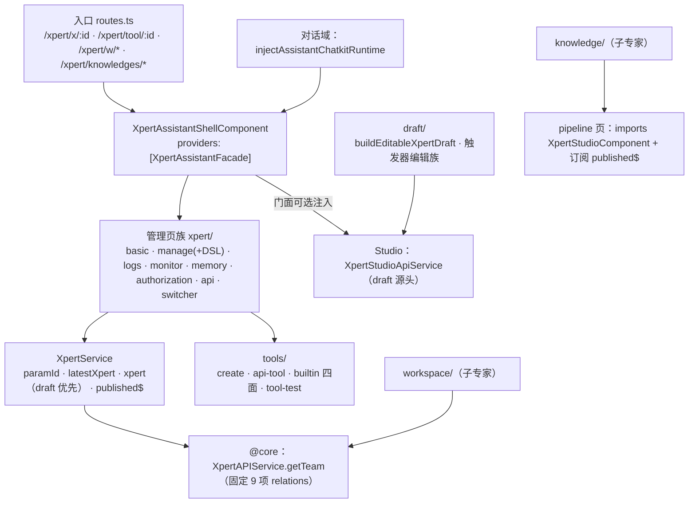

# C0 使用总览：Xpert 工作台专家

> 一句话定位：Xpert 前端的**助手管理与配套资产域**——`/xpert/**`（不含 `studio/`）的助手管理页族、创建向导、工具集配置面、共享助手壳、草稿装配层，以及知识库/工作区两个子域的路由出口；本域是 **Studio 与对话域的供给方**（draft 源头 / 助手门面 / 画布复用）。
> 范围：`apps/cloud/src/app/features/xpert/**`（**不含 `studio/`**）＝ 六个子目录合计 **192 非 spec / 93 spec**（实测口径 @ commit `80f5676fd`；ki 归档记 194 / 92）；入口路由 `/xpert/x/:id/**`、`/xpert/tool/:id`、`/xpert/w/*`、`/xpert/knowledges/*`。

**本文引用的文件**
- [routes.ts](file://apps/cloud/src/app/features/xpert/routes.ts)
- [xpert.service.ts](file://apps/cloud/src/app/features/xpert/xpert/xpert.service.ts)
- [xpert.component.ts](file://apps/cloud/src/app/features/xpert/xpert/xpert.component.ts)
- [basic.component.ts](file://apps/cloud/src/app/features/xpert/xpert/basic/basic.component.ts)
- [manage.component.ts](file://apps/cloud/src/app/features/xpert/xpert/manage/manage.component.ts)
- [switcher.component.ts](file://apps/cloud/src/app/features/xpert/xpert/switcher/switcher.component.ts)
- [utils.ts](file://apps/cloud/src/app/features/xpert/utils.ts)
- [editable-draft.util.ts](file://apps/cloud/src/app/features/xpert/draft/editable-draft.util.ts)
- [xpert-draft-trigger.util.ts](file://apps/cloud/src/app/features/xpert/draft/xpert-draft-trigger.util.ts)
- [assistant.facade.ts](file://apps/cloud/src/app/features/xpert/assistant-shell/assistant.facade.ts)
- [shell.component.ts](file://apps/cloud/src/app/features/xpert/assistant-shell/shell.component.ts)
- [api-tool.component.ts](file://apps/cloud/src/app/features/xpert/tools/api-tool/api-tool.component.ts)
- [tool.component.ts（工具测试）](file://apps/cloud/src/app/features/xpert/tools/tool-test/test/tool.component.ts)
- [pipeline.component.ts](file://apps/cloud/src/app/features/xpert/knowledge/knowledgebase/pipeline/pipeline.component.ts)
- [routes.ts（工作区）](file://apps/cloud/src/app/features/xpert/workspace/routes.ts)
- [routing.ts（知识库）](file://apps/cloud/src/app/features/xpert/knowledge/routing.ts)
- [xpert.service.ts（@core）](file://apps/cloud/src/app/@core/services/xpert.service.ts)
- [implementation/05-接口.md](file://.module-experts/前端专题/Xpert 工作台专家/implementation/05-接口.md)
- [implementation/06-测试.md](file://.module-experts/前端专题/Xpert 工作台专家/implementation/06-测试.md)
- [C1-能力契约.md](file://.module-experts/前端专题/Xpert 工作台专家/C1-能力契约.md)

## 目录
1. [定位与何时找](#定位与何时找)
2. [契约自足声明与资产基线](#契约自足声明与资产基线)
3. [能力清单](#能力清单)
4. [边界](#边界)
5. [已知问题与常见坑](#已知问题与常见坑)

## 1. 定位与何时找

### 1.1 定位

本域是「**一个宿主壳 + 一层投影服务 + 一层纯函数草稿层**」的三段结构：`XpertAssistantShellComponent` 常驻全 `/xpert/**`，提供助手门面并渲染共享助手（ChatKit pet）；`XpertComponent` 是 `/xpert/x/:id` 的详情宿主，用组件级 `providers: [XpertService]` 把「路由参数 / 服务端原文 / 草稿优先投影」三信号暴露给各子页面；全部跨域复用收敛到三件套——`XpertService`（投影与发布广播）、`utils.ts`（注入工厂 + key 生成器族）、`draft/`（`buildEditableXpertDraft` 等纯函数）。管理页只做「读侧 + 动作触发侧」，真正的写侧（保存草稿 / 发布 / 版本）归 Studio。

图表来源：[routes.ts](file://apps/cloud/src/app/features/xpert/routes.ts)（关键符号：`routes`、`XpertAssistantShellComponent`）· [xpert.service.ts](file://apps/cloud/src/app/features/xpert/xpert/xpert.service.ts)（关键符号：`XpertService.published$`）· [editable-draft.util.ts](file://apps/cloud/src/app/features/xpert/draft/editable-draft.util.ts)（关键符号：`buildEditableXpertDraft`）· [pipeline.component.ts](file://apps/cloud/src/app/features/xpert/knowledge/knowledgebase/pipeline/pipeline.component.ts)（关键符号：`KnowledgebasePipelineComponent.publishedSub`）

### 1.2 何时找

1. **改助手管理页骨架/页头**（`:id` 宿主、侧栏标题、页签）→ `XpertComponent`、`xpert/routes.ts`。
2. **改基础信息编辑**（名称/标题/头像/tags/copilotModel）→ `XpertBasicComponent`（`implements IsDirty`，读草稿优先投影）。
3. **改管理动作**（删除/复制/导出 DSL/导入 DSL/同步模板）→ `XpertBasicManageComponent` + `import-dsl.util.ts`。
4. **改助手切换器与创建向导入口**（同工作区候选、按 type 分流）→ `XpertHeaderSwitcherComponent` + `blank/`（`XpertNewBlankComponent`）。
5. **配工具集**（openapi/odata/mcp 创建、内置工具参数、授权与凭据、工具测试）→ `tools/`（`XpertStudioCreateToolComponent`、`XpertStudioAPIToolComponent`、`XpertToolsetToolTestComponent`）。
6. **改草稿装配 / 节点与连线默认结构 / 触发器节点**→ `draft/editable-draft.util.ts`、`draft/xpert-draft-trigger.util.ts`。
7. **处理与 Studio 的跨域契约**（draft 供给 / 门面可选注入 / 画布复用）→ 见 §5 第②条「三条桥」。
8. **让某页感知「发布完成」**（不轮询、即时刷新）→ `XpertService.published$` 的生产方（Studio 发布组件）与消费方（知识库流水线）。
9. **查 xpert 接口的真实路径与参数形态** → `@core/services/xpert*.service.ts` 与 `implementation/05-接口.md`。
10. **改日志/监控/记忆/授权/API 与嵌入面板** → `logs`、`monitor`、`memory`（store/files/bulk-import）、`authorization`、`api`。
11. **改共享助手的路由态、请求上下文与 ChatKit effect 分发** → `assistant-shell/assistant.facade.ts`。
12. **跑本域测试或排 `Cannot find module`** → `implementation/06-测试.md`（依赖落盘是唯一前置）。

章节来源：[xpert.component.ts](file://apps/cloud/src/app/features/xpert/xpert/xpert.component.ts)（关键符号：`XpertComponent.providers`、`XpertComponent.latestXpert`）· [switcher.component.ts](file://apps/cloud/src/app/features/xpert/xpert/switcher/switcher.component.ts)（关键符号：`XpertHeaderSwitcherComponent.createXpert`、`switchableXperts`）· [manage.component.ts](file://apps/cloud/src/app/features/xpert/xpert/manage/manage.component.ts)（关键符号：`XpertBasicManageComponent.importDsl`、`syncFromTemplate`）· [assistant.facade.ts](file://apps/cloud/src/app/features/xpert/assistant-shell/assistant.facade.ts)（关键符号：`XpertAssistantFacade.handleEffect`）

## 2. 契约自足声明与资产基线

### 2.1 契约自足声明

`C0-使用总览.md` 与 [C1-能力契约.md](file://.module-experts/前端专题/Xpert 工作台专家/C1-能力契约.md) 两篇**自足可用**：读完即可完成「判断是否本域、按契约注入/调用、识别跨域风险与已知坑」。所有口径与同目录 `implementation/{01..07}` 对齐；与 ki 归档的差异只有一处并已显式标注——**实测口径 192 非 spec / 93 spec**（ki 记 194 / 92），[推测] 差异来自 `index.ts` 与模块根空壳文件是否计入。文中每个符号均已在源码核实存在；后端 `packages/server-ai` 的 xpert 面只作跨端引用，不展开。

章节来源：[xpert.service.ts](file://apps/cloud/src/app/features/xpert/xpert/xpert.service.ts)（关键符号：`XpertService`）· [utils.ts](file://apps/cloud/src/app/features/xpert/utils.ts)（关键符号：`injectGetXpertTeam`）· [implementation/05-接口.md](file://.module-experts/前端专题/Xpert 工作台专家/implementation/05-接口.md)（关键符号：`API_XPERT_ROLE`、`toHttpParams`）

### 2.2 资产基线

| 项 | 值 |
|---|---|
| 资产版本 | **2026-10-16 重建**（ki 基线 `c07bb83d` / 2026-10-15；实测口径 **192 非 spec / 93 spec @ commit `80f5676fd`**） |
| 源码范围 | `apps/cloud/src/app/features/xpert/**`（除 `studio/`）：`xpert/` 39、`knowledge/` 87、`workspace/` 33、`tools/` 26、`draft/` 4、`assistant-shell/` 3（非 spec） |
| 入口路由 | `/xpert/x/:id/**`（管理页 + Studio 链）、`/xpert/tool/:id`、`/xpert/w/*`、`/xpert/knowledges/*` |
| 技术底座 | Angular standalone + signal + `linkedModel`/`rxResource`（`@xpert-ai/headless-ui`）+ RxJS（`#refresh$` 为 `BehaviorSubject`） |
| 核心契约 | `XpertService`（`paramId`/`latestXpert`/`xpert`/`published$`）、`injectGetXpertTeam`（9 项 relations）、`buildEditableXpertDraft`、`XpertAssistantFacade` |
| 测试状态 | 93 spec（knowledge 62 / workspace 14 / xpert 13 / tools 2 / draft 1 / assistant-shell 1）；归档 2026-10-15 实测 92 = 36 PASS / 55 FAIL（53 环境级缺依赖 + 2 真实断言） |
| 后端引用面 | `/api/xpert*`、`/api/xpert-toolset*`、`/api/xpert-tool*`、`/api/xpert-workspace*`、`/api/knowledgebase*`（服务端归属见 C1 §2） |

章节来源：[implementation/06-测试.md](file://.module-experts/前端专题/Xpert 工作台专家/implementation/06-测试.md)（关键符号：`moduleNameMapper`、`@milkdown/crepe` 失败清单）· [implementation/05-接口.md](file://.module-experts/前端专题/Xpert 工作台专家/implementation/05-接口.md)（关键符号：`API_PREFIX`、`XpertAPIService.getTeam`）

## 3. 能力清单

| 能力 | 入口（组件 / 服务 / 路由） | 一句话 |
|---|---|---|
| 助手详情宿主 + 投影 | `XpertComponent` + `XpertService` / `/xpert/x/:id` | 组件级 provider，把路由参数与草稿优先投影暴露给子页面 |
| 助手切换与创建入口 | `XpertHeaderSwitcherComponent` | `rxResource` 懒加载同工作区助手，按 `type` 三分流导航 |
| 管理动作总线 | `XpertBasicManageComponent` | 删除/复制/导出 DSL/导入 DSL/同步模板，统一「对话框 → 请求 → toast → refresh」 |
| 基础信息编辑 | `XpertBasicComponent` | `IsDirty` 表单；Agent 类型编辑草稿层、其它类型编辑已发布层 |
| 会话日志 | `XpertLogsComponent`（经 `ChatConversationService`） | 时间/状态/来源过滤 + 分页 + 取消会话 |
| 监控统计 | `XpertMonitorComponent` + `XpertMonitorStatisticsComponent` | usage-overview / daily-messages / tokens-per-second / 满意度四指标 |
| 长期记忆 | `XpertMemoryComponent`（store / files / bulk-import 子路由） | 记忆读增清、CSV 批量导入、语义搜索、文件记忆 |
| 授权面板 | `XpertAuthorizationComponent` | 组织与用户组授权矩阵（`isTenantXpert` 派生） |
| API 与嵌入面板 | `XpertApiComponent` / `XpertAppComponent` | 对外 API、应用配置与嵌入信息 |
| 创建向导 | `XpertNewBlankComponent`（`blank/`）+ `buildBlankXpertDraft` 族 | 资源/模板/触发器选择 → 草稿 → 可选发布（`completionMode`） |
| 工具集配置面 | `XpertStudioCreateToolComponent` / `XpertStudioAPIToolComponent` / builtin 四面 / `XpertToolsetToolTestComponent` | 创建、详情、参数/授权/凭据、工具测试 |
| 草稿装配层 | `buildEditableXpertDraft` + `readTriggerEditorItemsFromDraft` / `upsertTriggerEditorItemsIntoDraft` | Studio draft 的唯一源头；触发器节点读写与 chat 参数投影 |
| 共享助手壳 | `XpertAssistantShellComponent` + `XpertAssistantFacade` | 全 `/xpert/**` 一个门面实例：路由态、请求上下文、刷新事件 |
| 注入工厂与 key 生成器 | `injectGetXpertTeam` / `injectGetXpertsByWorkspace` / `genAgentKey` / `genWorkflowKey` | 本域与 Studio 共用的取数与建 key 口径 |
| 发布广播契约 | `XpertService.published$` | emit 在 Studio 发布组件，subscribe 在知识库流水线 |
| 知识库子域入口 | `/xpert/knowledges/*`（`knowledge/routing.ts`） | 列表 + 详情 + 流水线（复用 Studio 画布）→ 知识库子专家 |
| 工作区子域入口 | `/xpert/w/:id/*`（`workspace/routes.ts`） | `redirectToSelectedWorkspace` 分流 14 个子路由 → 工作区子专家 |

章节来源：[xpert.service.ts](file://apps/cloud/src/app/features/xpert/xpert/xpert.service.ts)（关键符号：`XpertService.latestXpert`、`XpertService.xpert`）· [editable-draft.util.ts](file://apps/cloud/src/app/features/xpert/draft/editable-draft.util.ts)（关键符号：`buildEditableXpertDraft`）· [shell.component.ts](file://apps/cloud/src/app/features/xpert/assistant-shell/shell.component.ts)（关键符号：`XpertAssistantShellComponent.providers`）· [utils.ts](file://apps/cloud/src/app/features/xpert/utils.ts)（关键符号：`genAgentKey`、`genWorkflowKey`）

## 4. 边界

1. **不含 `studio/`**：画布、面板、版本发布与执行可视化归同专题「**Agent 编排 Studio 专家**」；本域只提供 draft 源头、门面与画布复用宿主。
2. **不含对话域**：会话 UI、会话列表、ChatKit 运行时实现归「**对话前端专家**」（`features/chat`、`features/assistant`）；本域只消费 `injectAssistantChatkitRuntime`。
3. **不含 auth**：登录与令牌链归「**认证与引导专家**」；本域只声明 `/xpert/**` 挂 `authGuard`（在 `features-routing.module.ts`）这一事实，不实现准入。
4. **后端契约归「Assistant 定义与运行时专家」**：`/api/xpert/*` 的服务端签名、守卫与错误码；`/api/xpert-workspace/*` 归其**工作区与文件授权子专家**；`/api/knowledgebase/*` 归**知识库专家**。本域只记录前端调用点。
5. **知识库 / 工作区页面细节归两个子专家**（`xpert/knowledge` 87、`xpert/workspace` 33）：本域只保留路由、共享出口与 `utils.ts` 注入工厂。
6. **不含 `@core` 服务与 `@shared` 组件层实现**：`XpertAPIService`、`@shared/xpert`、`view-extension` 等按「被消费面」引用；本域自带类型仅限本地草稿工具类型（如 `TImportedXpertDsl`、`BlankWizardSelections`）。

章节来源：[routes.ts](file://apps/cloud/src/app/features/xpert/routes.ts)（关键符号：`loadChildren`、`scopeContext: 'dual-scope'`）· [implementation/05-接口.md](file://.module-experts/前端专题/Xpert 工作台专家/implementation/05-接口.md)（关键符号：`WorkspaceAuthoringGuard`、`XpertGuard`）· [implementation/04-模型.md](file://.module-experts/前端专题/Xpert 工作台专家/implementation/04-模型.md)（关键符号：`无自有 HTTP DTO`）

## 5. 已知问题与常见坑

1. **① 草稿优先投影是双信号口径，读错信号=读错形态**：`latestXpert` = 服务端原文（含 `draft`/`graph`/`version`），`xpert` = `value.draft?.team ?? value`（**存在草稿时就是草稿形态**）。管理页口径并不统一：manage / monitor / logs / api 读 `latestXpert`，basic / switcher / authorization 读 `xpert`，memory 只用 `paramId`——改投影等式会同时改变管理页与 Studio。
2. **② 与 Studio 三条桥（改任一条都要双侧回归）**：桥 1 `buildEditableXpertDraft` 是 Studio draft 的工具源头；桥 2 `XpertAssistantFacade` 被 Studio `inject(..., { optional: true })`，方法删除/改签名只会**静默降级**；桥 3 知识库流水线 `imports: [XpertStudioComponent]` + `providers: [XpertService]` 复用画布（改画布构造契约会连带影响该页）。
3. **③ `injectGetXpertTeam` 的 9 项 relations 是硬契约**：`agent`、`agent.copilotModel`、`agents`、`agents.copilotModel`、`executors`、`executors.agent`、`executors.copilotModel`、`copilotModel`、`knowledgebase`（**单数**）。增删任一项都会改变下游画布/面板拿到的聚合形态；注意**不含** `toolsets`/`userGroups`/`knowledgebases`，工具集与授权组由各页面另行补拉。
4. **④ `published$` 是内存广播，漏订阅=列表不刷新**：`Subject<IXpert>`，生产方只有 Studio 发布组件，消费方只有知识库流水线；**不跨标签页、无重放**（晚订阅收不到历史），且 `XpertService` 是组件级 provider，跨作用域订阅会静默失效。要刷新只能重进路由或调 `refresh()`。
5. **⑤ `genAgentKey` 的生成规则与去重**：`genAgentKey() = letterStartSUID('Agent_')`（`Agent_` + 随机 id）；同族生成器覆盖 `Router_`/`Iterating_`/`Answer_`/`Classifier_`/`Knowledge_`/`Code_`/`Template_`/`Assigner_`/`Http_`/`Subflow_`/`Tool_`/`AgentWorkflow_`/`Task_`/`Note_` 等；`genWorkflowKey(type)` 对 `IF_ELSE` 特判为 `Router_`，其余 `upperFirst(type) + '_'`；**前端不查重**，唯一性由调用方保证；`genXpertAgentToolKey` 已 `@deprecated`。
6. **⑥ 工具集凭据与 api-tool 的配置陷阱**：`/xpert/tool/:id` 的 `saveToolset()` 仅在 `toolsDirty()` 时回写 `tools`（否则 `omit(value,'tools')`），只改工具集合不置脏会丢改动；凭据不在工具集主体里——授权（绑定/解绑）与凭据（凭证表单）是两个独立面，凭据另走 `GET /api/xpert-toolset/:id/credentials`；MCP 工具集依赖 `mcpServer`（`JSON.parse(schema).mcpServers['']`）解析成功。
7. **⑦ 工具测试的失败语义是「文本 + 归一化」**：`POST /api/xpert-tool/test` 以 `responseType: 'text'` 取回，失败时 `normalizeToolTestError` 把 JSON 字符串 body 还原为结构化错误；UI 同时 `toastr.error` 并把消息写入 `testResult`（结果区可见），`stopTestTool()` 可中断；请求侧会把 `toolset.tools` 置 `null` 并带上 `credentials` 与 `enableAuthorization`。
8. **⑧ `/w/*` 工作区入口守卫是重定向函数，不是权限守卫**：`canActivate: [redirectToSelectedWorkspace]` 只在无 `:id` 时按 `selectedWorkspace.id ?? persist.workspaceId` 改写 URL（`?section=` 映射 `clawxpert-skills|clawxpert-knowledges|clawxpert-connectors|files|settings`），两者都无则放行由组件空态处理；写权限由后端/`WorkspaceAuthoringGuard` 兜底；子路由 `settings` 实为 `redirectTo: '/chat/clawxpert'`。
9. **⑨ 知识库 pipeline 复用画布的输入契约只有两件事**：`imports: [XpertStudioComponent]` 与 `providers: [XpertService]`；画布**无 `@Input`/`@Output`**，靠 `injectParams('id')` 工作，因此该路由下 `paramId` 的语义是 **xpertId**（`/xpert/knowledges/:kbId/xpert/:xpertId`），参数名/层级改动会静默不加载；页面出现 Studio 工具栏属设计预期。
10. **⑩ 依赖缺失会让 spec 大面失败**：`@milkdown/crepe`（^7.22.1）、`mermaid`、`@xterm/xterm` 的 `jest.mock(...)` **未带 `{ virtual: true }`**，模块未落盘时套件在加载阶段即 `Cannot find module`；本域直接命中 `@milkdown/crepe` 12 个 spec（knowledge 10 + workspace/prompt-workflows 2），是归档 55 个失败里 53 个「环境级缺依赖」的主因——跑测前先 `corepack pnpm install`。
11. **⑪ `XpertService` 是组件级 provider**：`XpertComponent`、Studio、流水线页各提供一份；把它提升为路由级/root 会静默改变 `published$` 与 `paramId` 的可见范围。
12. **⑫ 加载失败无提示**：`paramId$` 订阅**没有 error 回调**，`getTeam` 的 4xx/5xx 只让 `latestXpert()/xpert()` 保持 `null` 并以未处理错误上抛；排障先看 `GET /api/xpert/:id/team` 的状态码与 `data=` 序列化，而不是找前端 state。
13. **⑬ 草稿双写无冲突提示**：管理页、向导与 Studio 自动保存写同一后端 draft，前端只在写后 `refresh()` 重取，无 `savedAt` 比对；`XpertService.#draft` 是声明后未使用的死槽位，不要拿它当草稿缓存。
14. **⑭ DSL 导入非事务**：`saveDraft` 成功后若记忆替换失败仅 warning（`XP.Xpert.ImportMemoryIncomplete`），留下「草稿已换、记忆半成品」；导入会先 `clearMemory` 再逐类型 `bulkCreateMemories`，操作前建议先导出。

章节来源：[xpert.service.ts](file://apps/cloud/src/app/features/xpert/xpert/xpert.service.ts)（关键符号：`XpertService.xpertSub`、`published$`、`#draft`）· [utils.ts](file://apps/cloud/src/app/features/xpert/utils.ts)（关键符号：`injectGetXpertTeam`、`genAgentKey`、`genWorkflowKey`）· [routes.ts（工作区）](file://apps/cloud/src/app/features/xpert/workspace/routes.ts)（关键符号：`redirectToSelectedWorkspace`）· [pipeline.component.ts](file://apps/cloud/src/app/features/xpert/knowledge/knowledgebase/pipeline/pipeline.component.ts)（关键符号：`imports`、`providers`、`publishedSub`）
