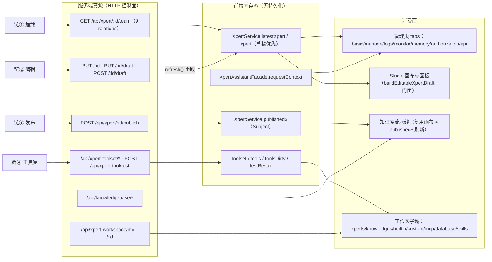

# C4 数据流向与消费：Xpert 工作台专家

> 模块根：`apps/cloud/src/app/features/xpert`（不含 `studio/`；实测 192 非 spec / 93 spec，commit `80f5676fd`）
> 口径：前端**无 DB / ORM / 本地持久化**；数据进入只有 HTTP 控制面（`/api/xpert*`、`/api/knowledgebase*`）一条路径，出向为 HTTP 写 + 一条内存事件（`published$`）。

**本文引用的文件**
- [xpert.service.ts（本域）](file://apps/cloud/src/app/features/xpert/xpert/xpert.service.ts)
- [xpert.component.ts](file://apps/cloud/src/app/features/xpert/xpert/xpert.component.ts)
- [basic.component.ts](file://apps/cloud/src/app/features/xpert/xpert/basic/basic.component.ts)
- [utils.ts](file://apps/cloud/src/app/features/xpert/utils.ts)
- [editable-draft.util.ts](file://apps/cloud/src/app/features/xpert/draft/editable-draft.util.ts)
- [xpert-draft-trigger.util.ts](file://apps/cloud/src/app/features/xpert/draft/xpert-draft-trigger.util.ts)
- [api-tool.component.ts](file://apps/cloud/src/app/features/xpert/tools/api-tool/api-tool.component.ts)
- [pipeline.component.ts](file://apps/cloud/src/app/features/xpert/knowledge/knowledgebase/pipeline/pipeline.component.ts)
- [xperts.component.ts（工作区）](file://apps/cloud/src/app/features/xpert/workspace/xperts/xperts.component.ts)
- [home.component.ts（工作区）](file://apps/cloud/src/app/features/xpert/workspace/home/home.component.ts)
- [xpert.model.ts](file://packages/contracts/src/ai/xpert.model.ts)
- [xpert-toolset.model.ts](file://packages/contracts/src/ai/xpert-toolset.model.ts)
- [xpert-tool.model.ts](file://packages/contracts/src/ai/xpert-tool.model.ts)
- [xpert-workspace.model.ts](file://packages/contracts/src/ai/xpert-workspace.model.ts)
- [xpert.service.ts（@core）](file://apps/cloud/src/app/@core/services/xpert.service.ts)
- [xpert-toolset.service.ts](file://apps/cloud/src/app/@core/services/xpert-toolset.service.ts)
- [xpert-workspace.service.ts](file://apps/cloud/src/app/@core/services/xpert-workspace.service.ts)
- [助手团队与配套资产.md](file://CodeWikiHub/xpert/memory/数据流/Xpert 工作台/助手团队与配套资产.md)
- [助手工具集知识库.md](file://CodeWikiHub/xpert/memory/接口信息/Xpert 工作台/助手工具集知识库.md)

## 目录
1. [数据总览（Mermaid）](#数据总览mermaid)
2. [实体 A：助手视图模型与 DTO 投影](#实体-a助手视图模型与-dto-投影)
3. [实体 B：草稿 TXpertTeamDraft 的装配面](#实体-b草稿-txpertteamdraft-的装配面)
4. [实体 C：工具集模型](#实体-c工具集模型)
5. [实体 D：工作区模型](#实体-d工作区模型)
6. [实体 E：知识库挂载面](#实体-e知识库挂载面)
7. [前端态 vs 服务端态对照表](#前端态-vs-服务端态对照表)
8. [结论与已知风险](#结论与已知风险)

## 数据总览（Mermaid）

图表来源：[xpert.service.ts（本域）](file://apps/cloud/src/app/features/xpert/xpert/xpert.service.ts)（关键符号：`XpertService.latestXpert`、`XpertService.xpert`、`XpertService.published$`）· [utils.ts](file://apps/cloud/src/app/features/xpert/utils.ts)（关键符号：`injectGetXpertTeam`）· [pipeline.component.ts](file://apps/cloud/src/app/features/xpert/knowledge/knowledgebase/pipeline/pipeline.component.ts)（关键符号：`KnowledgebasePipelineComponent.publishedSub`）· [api-tool.component.ts](file://apps/cloud/src/app/features/xpert/tools/api-tool/api-tool.component.ts)（关键符号：`XpertStudioAPIToolComponent.toolsDirty`）
章节来源：[xpert.service.ts（本域）](file://apps/cloud/src/app/features/xpert/xpert/xpert.service.ts)（关键符号：`XpertService.paramId$`、`XpertService.xpertSub`）、[助手团队与配套资产.md](file://CodeWikiHub/xpert/memory/数据流/Xpert 工作台/助手团队与配套资产.md)（关键符号：`关键约束`、`消费方`）

## 实体 A：助手视图模型与 DTO 投影
- **实体类型**：契约 DTO（`IXpert`，定义在 `packages/contracts/src/ai/xpert.model.ts`，经 `@core` 转出）+ 前端投影信号（内存态，非持久化）。
- **结构（关键字段）**：`IXpert` 身份面 `slug/name/type/title/description/active/avatar`；配置面 `options/agentConfig/features`；版本面 `version/latest/releaseNotes/publishAt`；编排面 `draft?: TXpertTeamDraft`、`graph?: TXpertGraph`；关系面 `agent/agents/executors/copilotModel/knowledgebase/knowledgebases/toolsets/userGroups/tags`；隔离面 `workspaceDataScope: 'shared' | 'user'`。前端侧：`latestXpert: Signal<IXpert>`（原始）、`xpert: Signal<Partial<IXpert>>`（草稿优先）、`#draft`（声明未用，[推测] 预留槽位）。
- **生产方**：`GET /api/xpert/:id/team`（`injectGetXpertTeam`，9 项 relations）；列表 `getAllByWorkspace`/`getMyAll`/`getBySlug`；`publish`/`importDSL`/`duplicate` 的返回值。
- **主要消费方**：`XpertComponent` 与全部管理页 tab；`XpertBasicComponent`（表单单初值）；Studio（`buildEditableXpertDraft` 的输入）；`XpertAssistantFacade`（只读 `id/workspaceId`）；知识库详情页 `xperts` 列表。
- **业务用途**：页面读侧的**单一投影源**——同一页面可同时看到「草稿形态」（`xpert`）与「已发布元数据」（`latestXpert` 的 `version`/`publishAt`/`graph`）。
- **详细流向**：`paramId$ → distinctUntilChanged → filter(nonBlank) → switchMap(#refresh$ → getXpertTeam(id))` → 回调 `latestXpert.set(value)` + `xpert.set(value.draft?.team ?? value)`；写操作后一律 `refresh()` 重取，无自动失效订阅；relations 不含 `toolsets/userGroups/knowledgebases`，这些由各页面自行补拉。
章节来源：[xpert.model.ts](file://packages/contracts/src/ai/xpert.model.ts)（关键符号：`IXpert`、`XpertTypeEnum`）、[xpert.service.ts（本域）](file://apps/cloud/src/app/features/xpert/xpert/xpert.service.ts)（关键符号：`XpertService.latestXpert`、`XpertService.xpert`、`XpertService.#draft`）、[utils.ts](file://apps/cloud/src/app/features/xpert/utils.ts)（关键符号：`injectGetXpertTeam`）、[04-模型.md](file://.module-experts/前端专题/Xpert 工作台专家/implementation/04-模型.md)（关键符号：`IXpert 与前端视图模型的投影关系`）

## 实体 B：草稿 TXpertTeamDraft 的装配面
- **实体类型**：契约 DTO（`TXpertTeamDraft`/`TXpertGraph`/`TXpertTeamNode`/`TXpertTeamConnection`）+ 前端**纯函数装配器**（无 DI、无状态）。
- **结构（关键字段）**：`team: Partial<IXpert>`（主 Agent 在 `team.agent`）、`nodes`、`connections`（`key: 'from/to'`，`type: 'edge' | 节点类型`）、`template?`、`savedAt?`、`checklist?`；节点 spec：`agent → IXpertAgent`、`knowledge → IKnowledgebase`、`toolset → IXpertToolset`、`xpert → IXpert`（可嵌套）、`workflow → IWorkflowNode`；节点基底 `key/position/size?/hash?/parentId?/readonly?`。
- **生产方（本域）**：`buildEditableXpertDraft`（Studio draft 唯一源头）、`applyChatTriggerInputParametersToDraft`（chat 触发器参数 ↔ `team.agentConfig.parameters`）、`upsertTriggerEditorItemsIntoDraft`、`blank-draft.util.ts` 三装配器、`BlankProjectManagement.apply`、`XpertAPIService.saveDraft/upadteDraft` 的回包。
- **主要消费方**：Studio `XpertStudioApiService`（画布真源）；知识库流水线页（复用画布）；`XpertNewBlankComponent`（`hasBlockingChecklist` 闸门）；`manage.importDsl`（覆盖写入）。
- **业务用途**：**编辑态的唯一真源**（管理页基础信息、Studio 画布、设置域触发器编辑、对话域触发器草稿都读写它）；发布是它的显式升级动作。
- **详细流向**：`baseTeam = { ...omit(xpert,'agents'), id: xpert.id }` → 草稿存在时覆盖 `team/nodes/connections`（nodes 三级回落、connections 二级回落）→ 必经 `normalizeMiddlewareNodes` → 末尾 `applyChatTriggerInputParametersToDraft`；触发器编辑新增节点缺主 Agent 时抛 `XPERT_DRAFT_PRIMARY_AGENT_NODE_MISSING`，新节点按 `TRIGGER_NODE_HORIZONTAL_OFFSET(280)`/`TRIGGER_NODE_VERTICAL_GAP(120)` 定位并以 `${node.key}/${agent.key}` 去重补边。
章节来源：[xpert.model.ts](file://packages/contracts/src/ai/xpert.model.ts)（关键符号：`TXpertTeamDraft`、`TXpertTeamNodeSpec`、`TXpertTeamConnection`）、[editable-draft.util.ts](file://apps/cloud/src/app/features/xpert/draft/editable-draft.util.ts)（关键符号：`buildEditableXpertDraft`）、[xpert-draft-trigger.util.ts](file://apps/cloud/src/app/features/xpert/draft/xpert-draft-trigger.util.ts)（关键符号：`upsertTriggerEditorItemsIntoDraft`、`XPERT_DRAFT_PRIMARY_AGENT_NODE_MISSING`）

## 实体 C：工具集模型
- **实体类型**：契约 DTO（`IXpertToolset`/`IXpertTool`/`TToolParameter`/`TToolCredentials`）+ 前端编辑态（`isDirty`/`toolsDirty`/`testResult`/`selectedToolIds`）。测试结果**不是契约类型**。
- **结构（关键字段）**：`IXpertToolset`：`name/type/category('command'|builtin|api|mcp)/options/credentials/schema/schemaType/tools/tags`；`TXpertToolsetOptions`：`provider/baseUrl/toolPositions/disableToolDefault/needSandbox/mcpRuntime` 等（带索引签名）；`IXpertTool`：`name/schema/parameters/disabled/deletedAt/toolsetId/provider`；凭据 schema：`ToolProviderCredentials`（`secret-input|text-input|select|copilot-model|boolean|…`）、`IToolProvider.masked_credentials/is_team_authorization`。
- **生产方**：`XpertToolsetService`（`create/update/getById/getProviders/getBuiltinTools/getCredentials`）、`XpertToolService.test`；路由 `/xpert/tool/:id` 与工作区工具页。
- **主要消费方**：`/xpert/tool/:id` 详情页与 builtin 配置弹窗；Studio 画布 `toolset` 节点；**后端运行时执行引擎**（工具调用）。
- **业务用途**：工具注册与凭据管理的统一面；启用语义跨前后端共享——`isToolEnabled`（`disabled → enabled → disableToolDefault` 三级）与 `getEnabledTools`（再按 `options.toolPositions` 排序）。
- **详细流向**：`getById(id, { relations: ['tools','createdBy'] })` → `tools` computed（过滤 `deletedAt`、`disabled` 靠后）→ 编辑（`onToolsChange` 按 `name` 合并、缺失者标 `deletedAt`）→ `saveToolset`（仅 `toolsDirty()` 才带 `tools`）→ `update` → `markAsPristine` + `refreshForm`；测试链：对话框（重写 `toolset.credentials`、`tools: null`）→ `testTool()` → `POST /api/xpert-tool/test`（`responseType:'text'`）→ `testResult`。
章节来源：[xpert-toolset.model.ts](file://packages/contracts/src/ai/xpert-toolset.model.ts)（关键符号：`IXpertToolset`、`TXpertToolsetOptions`、`ToolProviderCredentials`）、[xpert-tool.model.ts](file://packages/contracts/src/ai/xpert-tool.model.ts)（关键符号：`IXpertTool`、`isToolEnabled`、`getEnabledTools`）、[api-tool.component.ts](file://apps/cloud/src/app/features/xpert/tools/api-tool/api-tool.component.ts)（关键符号：`XpertStudioAPIToolComponent.saveToolset`、`XpertStudioAPIToolComponent.onToolsChange`）、[助手工具集知识库.md](file://CodeWikiHub/xpert/memory/接口信息/Xpert 工作台/助手工具集知识库.md)（关键符号：`工具集：/api/xpert-toolset`）

## 实体 D：工作区模型
- **实体类型**：契约 DTO（`IXpertWorkspace`/`WorkspacePublicDTO` 等）+ 前端请求缓存（`shareReplay`，按 user+org 分片）。
- **结构（关键字段）**：`name/ownerId/status`、`capabilities`（`canRead/canRun/canWrite/canManage`，判定默认 `true`）、`visibility`（缺省归一 `'private'`）；壳组件暴露 `paramId/selectedWorkspace` 与共享查询态（`type/tags/searchText/canWriteWorkspace`）。
- **生产方**：`/api/xpert-workspace/my`（`purpose: authoring | runtime`）、`/:workspaceId`、`/my/default`；`XpertWorkspaceService.getAllMy` 以 `user$ + organizationId` 分片缓存（`#myWorkspaceRequests` Map + `shareReplay({ bufferSize: 1, refCount: true })`，`refresh()` 清 Map）。
- **主要消费方**：`/xpert/w` 壳与 14 条子路由（xperts/knowledges/files/custom/connectors/builtin/mcp/database/skills/prompt-workflows）；`redirectToSelectedWorkspace`；`XpertAssistantFacade.workspaceId` 三级回退（路由 → 助手缓存 → 所选工作区）。
- **业务用途**：**作用域的承载**——`tenant → organization → workspace → xpert` 四级作用域中的第三级；跨级取数一律经 `@core` 服务。
- **详细流向**：`AppQuery.selectedWorkspace ?? PersistQuery.workspaceId` → `redirectToSelectedWorkspace` 改写 URL（`?section=` 映射 `clawxpert-*`）→ `w/:id` 壳 → 子域各自取数（xperts：`getAllByWorkspace({ where: { type: Agent, latest: true } })`；builtin：`getAllByWorkspace({ where: { category } }) + getProviders()`）。
章节来源：[xpert-workspace.model.ts](file://packages/contracts/src/ai/xpert-workspace.model.ts)（关键符号：`IBasePerWorkspaceEntityModel`、`getXpertWorkspaceVisibility`）、[xpert-workspace.service.ts](file://apps/cloud/src/app/@core/services/xpert-workspace.service.ts)（关键符号：`XpertWorkspaceService.getAllMy`、`XpertWorkspaceService.refresh`）、[home.component.ts（工作区）](file://apps/cloud/src/app/features/xpert/workspace/home/home.component.ts)（关键符号：`XpertWorkspaceHomeComponent.paramId`、`XpertWorkspaceHomeComponent.canWriteWorkspace`）

## 实体 E：知识库挂载面
- **实体类型**：契约 DTO（`IKnowledgebase`，**归知识库子专家**）+ 助手侧关系投影（`IXpert.knowledgebase`）。
- **结构（关键字段）**：`IXpert.knowledgebase`（9 项 relations 之一，单数；注意不含 `knowledgebases`）；画布 `knowledge` 节点（`TXpertTeamNodeSpec.knowledge`）；知识库详情页 `#knowledgebase` resource 暴露 `xperts/pipelineId/pipeline/documentNum`。
- **生产方**：`/api/knowledgebase/*`（`getDetail`、`by-workspace/:id` 等，`KnowledgebaseService`）；助手侧由 `GET /api/xpert/:id/team` 的 relation 带出。
- **主要消费方**：管理页挂载展示与 Studio 画布节点；知识库流水线页（`KnowledgebasePipelineComponent` 复用画布 + 订阅 `published$`）；**后端检索链**（RAG 运行期消费）。
- **业务用途**：把知识库「挂进」助手的装配面；运行期检索不在本域（本域只负责装配与刷新）。
- **详细流向**：助手挂载：`knowledgebase` relation 随 `getTeam` 投影进 `latestXpert`/画布；知识库侧：详情页 `openXpert(xpert)` 反向 `window.open('/xpert/x/:id/agents')`；刷新链：流水线内发布 → `published$` → `KnowledgebaseComponent.refresh()` = `#knowledgebase.reload()`（详见 C2 R2/R4）。
章节来源：[pipeline.component.ts](file://apps/cloud/src/app/features/xpert/knowledge/knowledgebase/pipeline/pipeline.component.ts)（关键符号：`KnowledgebasePipelineComponent.publishedSub`）、[utils.ts](file://apps/cloud/src/app/features/xpert/utils.ts)（关键符号：`injectGetXpertTeam` 的 `knowledgebase` relation）、[knowledgebase.model.ts](file://packages/contracts/src/ai/knowledgebase.model.ts)（关键符号：`IKnowledgebase`）、[03-数据流转.md](file://.module-experts/前端专题/Xpert 工作台专家/implementation/03-数据流转.md)（关键符号：`链⑥：知识库链与流水线复用 Studio 画布`）

## 前端态 vs 服务端态对照表
| 数据面 | 前端持有（位置 / 载体） | 服务端真源 | 关键差异 / 丢失时机 |
| --- | --- | --- | --- |
| 助手团队 | `XpertService.latestXpert`（`IXpert`）+ `xpert`（`draft?.team ?? value`） | `GET /api/xpert/:id/team`（9 relations） | 投影可能不是「已发布」形态；刷新即重拉 |
| 已发布图 | `latestXpert.graph` | publish 结果 / 版本列表 | 仅在无 `draft` 时被 `buildEditableXpertDraft` 回落使用 |
| 可编辑草稿 | `XpertBasicComponent.draft`、Studio store 的 draft；`XpertService.#draft` 为死槽位 | `POST/PUT /api/xpert/:id/draft`（回填 `savedAt`/`checklist`） | **双写点，前端无冲突检测**（依赖后端 `savedAt`） |
| 发布事件 | `XpertService.published$`（内存 `Subject`） | 无 | 不跨标签页、无重放；晚订阅者错过 |
| 工具集与工具 | `toolset` model + `tools`/`toolsDirty` | `PUT /api/xpert-toolset/:id`、`POST /api/xpert-toolset` | 仅 `toolsDirty` 时才回写 `tools`；删除以 `deletedAt` 表达 |
| 工具测试结果 | `testResult`（字符串化 signal） | 无（请求即用即弃） | 不落库；路由切换即丢 |
| 工作区 | `selectedWorkspace`/`paramId` + `getAllMy` 缓存 | `GET /api/xpert-workspace/my` | `shareReplay` 缓存 + 手动 `refresh()` |
| 知识库 | `#knowledgebase` resource | `GET /api/knowledgebase/detail/:id` | 靠 `published$`/写操作触发 `reload()` |
| 助手门面上下文 | `requestContext`（`env.workspaceId`/`env.xpertId`/`targetXpertId`/`unsaved`/`baseDraftHash`） | 随 ChatKit 请求下发 | 仅注入请求，不落库 |
| 子域列表 | `myRxResource`/`derivedAsync` + 组件 `refresh()` | `by-workspace` 各接口 | 不订阅 `published$`，发布后需手动刷新 |

结论：**本域没有一份本地持久化真源**——助手/草稿/工具集/工作区/知识库全部是「后端真源 + 前端投影或浅缓存」；只有表单脏态、`testResult`、`toolsDirty`、门面请求上下文等纯内存态，随页面销毁而消失。
章节来源：[xpert.service.ts（本域）](file://apps/cloud/src/app/features/xpert/xpert/xpert.service.ts)（关键符号：`latestXpert`、`xpert`、`published$`）、[api-tool.component.ts](file://apps/cloud/src/app/features/xpert/tools/api-tool/api-tool.component.ts)（关键符号：`toolsDirty`、`testResult`）、[助手团队与配套资产.md](file://CodeWikiHub/xpert/memory/数据流/Xpert 工作台/助手团队与配套资产.md)（关键符号：`前端无持久化`、`draft 并发编辑`）

## 结论与已知风险
- **写路径只有一处真源**：草稿（后端 `draft` + 前端 `buildEditableXpertDraft`）；管理页负责触发与重取（`refresh()`），Studio 负责保存与发布（`published$` 广播）。
- **草稿双写无冲突检测**：管理页与 Studio 写同一后端 draft，前端仅靠 `refresh()` 重取，无 `savedAt` 比对与提示（ki 数据流已登记）。
- **`published$` 覆盖面窄**：仅流水线页订阅；助手列表、工具集页、工作区首页不响应发布事件。
- **relations 固定带来缺口**：9 项不含 `toolsets/userGroups/knowledgebases`，补拉路径散落各页面、无统一入口。
- **无持久化前端态**：`testResult`、`toolsDirty`、`selectedToolIds` 等纯内存态在路由切换后丢失。
章节来源：[xpert.service.ts（本域）](file://apps/cloud/src/app/features/xpert/xpert/xpert.service.ts)（关键符号：`XpertService.published$`、`XpertService.refresh`）、[utils.ts](file://apps/cloud/src/app/features/xpert/utils.ts)（关键符号：`injectGetXpertTeam`）、[03-数据流转.md](file://.module-experts/前端专题/Xpert 工作台专家/implementation/03-数据流转.md)（关键符号：`已知风险`）
