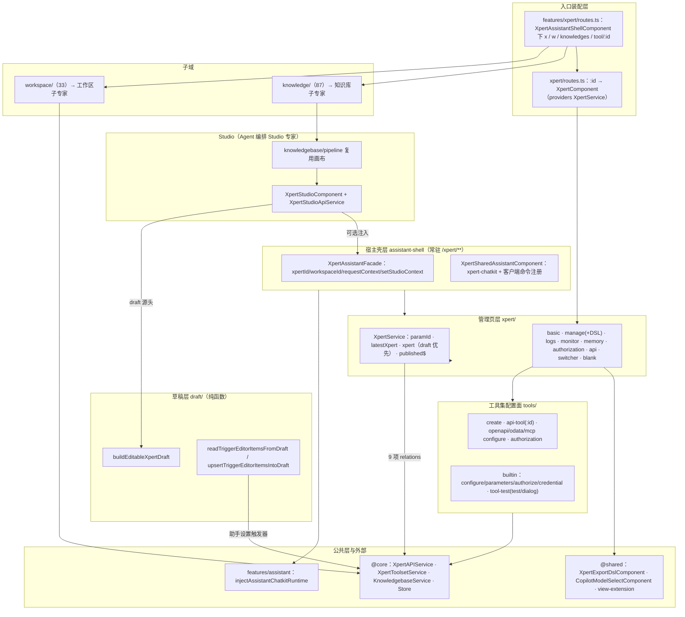

# 01 架构：Xpert 工作台专家（Xpert 前端 · 助手管理与配套资产域）

> 模块根：`apps/cloud/src/app/features/xpert`（**不含 `studio/`**，Studio 归「Agent 编排 Studio 专家」）
> 入口路由：`/xpert/x/:id/**`（管理页 + Studio 链）· `/xpert/tool/:id` · `/xpert/w/*`（工作区）· `/xpert/knowledges/*`（知识库）
> 规模（实测口径）：六个子目录合计 **192 非 spec / 93 spec**；ki 归档口径 194 非 spec / 92 spec（[推测] 差异来自 `index.ts` 与模块根文件是否计入）

**本文引用的文件**

- [routes.ts](file://apps/cloud/src/app/features/xpert/routes.ts)
- [utils.ts](file://apps/cloud/src/app/features/xpert/utils.ts)
- [workspace-home.service.ts](file://apps/cloud/src/app/features/xpert/workspace-home.service.ts)
- [templates.component.ts](file://apps/cloud/src/app/features/xpert/templates/templates.component.ts)
- [routes.ts](file://apps/cloud/src/app/features/xpert/xpert/routes.ts)
- [xpert.component.ts](file://apps/cloud/src/app/features/xpert/xpert/xpert.component.ts)
- [xpert.service.ts](file://apps/cloud/src/app/features/xpert/xpert/xpert.service.ts)
- [manage.component.ts](file://apps/cloud/src/app/features/xpert/xpert/manage/manage.component.ts)
- [import-dsl.util.ts](file://apps/cloud/src/app/features/xpert/xpert/manage/import-dsl.util.ts)
- [basic.component.ts](file://apps/cloud/src/app/features/xpert/xpert/basic/basic.component.ts)
- [logs.component.ts](file://apps/cloud/src/app/features/xpert/xpert/logs/logs.component.ts)
- [monitor.component.ts](file://apps/cloud/src/app/features/xpert/xpert/monitor/monitor.component.ts)
- [memory.component.ts](file://apps/cloud/src/app/features/xpert/xpert/memory/memory.component.ts)
- [authorization.component.ts](file://apps/cloud/src/app/features/xpert/xpert/authorization/authorization.component.ts)
- [api.component.ts](file://apps/cloud/src/app/features/xpert/xpert/api/api.component.ts)
- [switcher.component.ts](file://apps/cloud/src/app/features/xpert/xpert/switcher/switcher.component.ts)
- [blank.component.ts](file://apps/cloud/src/app/features/xpert/xpert/blank/blank.component.ts)
- [editable-draft.util.ts](file://apps/cloud/src/app/features/xpert/draft/editable-draft.util.ts)
- [xpert-draft-trigger.util.ts](file://apps/cloud/src/app/features/xpert/draft/xpert-draft-trigger.util.ts)
- [assistant.facade.ts](file://apps/cloud/src/app/features/xpert/assistant-shell/assistant.facade.ts)
- [shell.component.ts](file://apps/cloud/src/app/features/xpert/assistant-shell/shell.component.ts)
- [shared-assistant.component.ts](file://apps/cloud/src/app/features/xpert/assistant-shell/shared-assistant.component.ts)
- [index.ts](file://apps/cloud/src/app/features/xpert/tools/index.ts)
- [api-tool.component.ts](file://apps/cloud/src/app/features/xpert/tools/api-tool/api-tool.component.ts)
- [create.component.ts](file://apps/cloud/src/app/features/xpert/tools/create/create.component.ts)
- [configure.component.ts](file://apps/cloud/src/app/features/xpert/tools/builtin/configure/configure.component.ts)
- [authorize.component.ts](file://apps/cloud/src/app/features/xpert/tools/builtin/authorize/authorize.component.ts)
- [credential.component.ts](file://apps/cloud/src/app/features/xpert/tools/builtin/authorize/credential/credential.component.ts)
- [tool.component.ts](file://apps/cloud/src/app/features/xpert/tools/tool-test/dialog/tool.component.ts)
- [routing.ts](file://apps/cloud/src/app/features/xpert/knowledge/routing.ts)
- [home.component.ts](file://apps/cloud/src/app/features/xpert/knowledge/home.component.ts)
- [pipeline.component.ts](file://apps/cloud/src/app/features/xpert/knowledge/knowledgebase/pipeline/pipeline.component.ts)
- [routes.ts](file://apps/cloud/src/app/features/xpert/workspace/routes.ts)
- [home.component.ts](file://apps/cloud/src/app/features/xpert/workspace/home/home.component.ts)
- [xpert.service.ts](file://apps/cloud/src/app/@core/services/xpert.service.ts)
- [xpert-settings-context.service.ts](file://apps/cloud/src/app/@core/services/xpert-settings-context.service.ts)
- [studio.component.ts](file://apps/cloud/src/app/features/xpert/studio/studio.component.ts)
- [xpert-api.service.ts](file://apps/cloud/src/app/features/xpert/studio/domain/xpert-api.service.ts)
- [publish.component.ts](file://apps/cloud/src/app/features/xpert/studio/header/publish/publish.component.ts)
- [assistant-chatkit.runtime.ts](file://apps/cloud/src/app/features/assistant/assistant-chatkit.runtime.ts)
- [features-routing.module.ts](file://apps/cloud/src/app/features/features-routing.module.ts)

## 目录

- [模块职责与边界](#模块职责与边界)
- [目录结构与分层](#目录结构与分层)
- [依赖关系](#依赖关系)
- [关键不变量](#关键不变量)
- [跨域契约（与 Studio 的三条桥）](#跨域契约与-studio-的三条桥)
- [架构总览图](#架构总览图)
- [组件详细分析](#组件详细分析)
- [结论](#结论)

## 模块职责与边界

**做什么（七件事）**

1. **助手管理页族**：`/xpert/x/:id` 由 `XpertComponent` 作为详情宿主壳（`providers: [XpertService]`），承载 basic（基础信息编辑对话框）/ manage（管理菜单）/ logs（会话日志）/ monitor（监控与统计）/ memory（长期记忆 store + files + bulk-import）/ authorization（组织与用户组授权）/ api（API 与嵌入信息）/ switcher（助手切换器）。
2. **助手创建向导**：`xpert/blank/` 15 个非 spec 文件（`XpertNewBlankComponent` 与资源/模板/触发器选择、草稿生成 `blank-draft.util.ts`），由 switcher 以对话框打开。
3. **DSL 导入导出与派生动作**：manage 的导入 DSL（`uploadYamlFile` → `createOverwriteDraftFromDsl` → `saveDraft` → 记忆替换）、导出 DSL/模板、从模板同步、复制助手、删除助手。
4. **工具集配置面**：`tools/`（26 个非 spec）覆盖 create（openapi/odata 建工具集）、api-tool（`/xpert/tool/:id` 单工具集详情）、builtin（configure/parameters/authorize/credential/tool）、mcp、tool-test（test + dialog）、authorization（输入与对话框）。
5. **assistant-shell 宿主层**：`XpertAssistantShellComponent` 为整个 `/xpert/**` 挂 `xp-shared-assistant`（ChatKit pet），`XpertAssistantFacade` 提供路由态/请求上下文/Studio 刷新事件。
6. **`draft/` 层**：`buildEditableXpertDraft`（草稿装配，Studio draft 的唯一源头）+ 触发器编辑工具族（chat trigger 参数 ↔ draft 节点）。
7. **两个子域**：`knowledge/`（87 非 spec，含知识库列表、流水线、文档/切片/FAQ/Wiki/图谱）、`workspace/`（33 非 spec，含 `w/:id` 下的助手/知识库/连接器/技能/提示词工作流/数据库/设置）。

**不做什么（逐条给出「谁家」）**

| 不在范围内 | 谁家（交叉引用） |
| --- | --- |
| `studio/`（画布、面板、版本发布、执行可视化） | 同专题「Agent 编排 Studio 专家」：[features/xpert/studio](file://apps/cloud/src/app/features/xpert/studio) |
| 对话消息 UI、会话列表、ChatKit 运行时实现 | 同专题「对话前端专家」：[features/chat](file://apps/cloud/src/app/features/chat)、[features/assistant](file://apps/cloud/src/app/features/assistant)（本域只消费 `injectAssistantChatkitRuntime`） |
| 登录与鉴权 | 路由级 `authGuard`（外部）：[features-routing.module.ts](file://apps/cloud/src/app/features/features-routing.module.ts) |
| 后端编排读写、执行引擎、SSE 事件契约 | 后端「Assistant 定义与运行时专家」「Agent 执行链专家」：`packages/server-ai/src/xpert*` |
| HTTP 客户端、i18n、通用表单与 UI 原子件 | 公共层 `@core` / `@shared`（本文只列为出向依赖） |
| 知识库/工作区的页面细节 | 子专家：`xpert/knowledge`、`xpert/workspace`（本域只保留其路由与共享出口） |

章节来源：[routes.ts](file://apps/cloud/src/app/features/xpert/routes.ts)（关键符号：`routes`、`XpertAssistantShellComponent`）、[xpert.component.ts](file://apps/cloud/src/app/features/xpert/xpert/xpert.component.ts)（关键符号：`XpertComponent.providers`）、[assistant.facade.ts](file://apps/cloud/src/app/features/xpert/assistant-shell/assistant.facade.ts)（关键符号：`XpertAssistantFacade.assistantCode`）

## 目录结构与分层

| 目录 / 文件 | 层 | 非 spec / spec | 职责 |
| --- | --- | --- | --- |
| `routes.ts` | 入口装配层 | 1 / 0 | `XpertAssistantShellComponent` 下挂 `w`（工作区）、`knowledges`（知识库）、`tool/:id`、`x`（助手）四条惰性子路由 |
| `utils.ts` | 共享工具层 | 1 / 0 | 注入工厂（`injectGetXpertTeam` / `injectGetXpertsByWorkspace`）与 key 生成器族（`genAgentKey` 等）2 |
| `workspace-home.service.ts` | 空壳 | 1 / 0 | 空 `@Injectable` 占位（无成员） |
| `templates/templates.component.ts` | 空壳 | 1 / 0 | `XpertTemplatesComponent` 空组件（仅模板引用） |
| `xpert/` | 管理页层 | 39 / 13 | `:id` 宿主壳 + basic/manage/logs/monitor/memory/authorization/api/app/switcher/develop/template-installation + `blank/` 创建向导 15 |
| `tools/` | 工具集配置面 | 26 / 2 | create / api-tool / openapi / odata / mcp / builtin / tool-test / authorization |
| `draft/` | 草稿层 | 4 / 1 | `buildEditableXpertDraft`、触发器编辑工具、`index.ts` 出口 |
| `assistant-shell/` | 宿主壳层 | 3 / 1 | facade + shell + 共享助手（ChatKit pet） |
| `knowledge/` | 子域（子专家） | 87 / 62 | 知识库列表、`knowledgebase/`（文档/切片/FAQ/Wiki/图谱/流水线/配置/测试）、`new/`、`processing/`、`tags/` |
| `workspace/` | 子域（子专家） | 33 / 14 | `w/:id` 下的 all/xperts/knowledges/files/connectors/skills/prompt-workflows/database/tools/settings |

**分层与依赖方向（自上而下单向）**

1. 入口装配层（`routes.ts`）只做路由拆分与标题/作用域数据（`scopeContext: 'dual-scope'`），不持有业务状态。
2. 宿主壳层（`assistant-shell/`）常驻全 `/xpert/**`，负责助手身份与请求上下文；不参与助手数据读写。
3. 管理页层（`xpert/`）以「父组件即上下文」的方式共享状态：子页面 `inject(XpertComponent)` 读取 `latestXpert` / `xpert`，写操作走 `@core` 服务或 `XpertService.refresh()`。
4. 配置面层（`tools/`）与两个子域（`knowledge/`、`workspace/`）各自独立取数（`injectParams('id')` + `@core` 服务），彼此不直接引用。
5. 草稿层（`draft/`）是纯函数层（无 DI、无状态），同时被本域、Studio 与 `@core` 的助手设置上下文复用。
6. 所有出向依赖（`@core` / `@shared` / `features/assistant`）只向下，不反向；唯一已知的反向边见「技术债」。

章节来源：[routes.ts](file://apps/cloud/src/app/features/xpert/routes.ts)（关键符号：`scopeContext`、`loadChildren`）、[xpert/xpert/routes.ts](file://apps/cloud/src/app/features/xpert/xpert/routes.ts)（关键符号：`path: ':id'`、`path: 'agents'`）、[workspace/routes.ts](file://apps/cloud/src/app/features/xpert/workspace/routes.ts)（关键符号：`redirectToSelectedWorkspace`）

## 依赖关系

**出向依赖（本域 → 外部）**

| 依赖面 | 具体符号（file://） | 用途 |
| --- | --- | --- |
| `@core` 服务 | [xpert.service.ts](file://apps/cloud/src/app/@core/services/xpert.service.ts)（`XpertAPIService.getTeam/saveDraft/publish/duplicate/syncFromTemplate/clearMemory/bulkCreateMemories/getSandboxProviders`）、`XpertToolsetService`、`XpertToolService`、`KnowledgebaseService`、`ChatConversationService`、`Store`/`AppQuery`、`CopilotStoreService` | 助手读写、工具集 CRUD、知识库与日志取数、工作区作用域 |
| `@core` 类型与工具 | [types.ts](file://apps/cloud/src/app/@core/types.ts)（`letterStartSUID`）、`IXpert` / `TXpertTeamDraft` / `WorkflowNodeTypeEnum`（`@xpert-ai/contracts` 经 `@core` 转出） | key 生成、类型契约 |
| `@shared` 复用件 | `@shared/xpert`（`XpertExportDslComponent`、`XpertBasicDialogComponent`）、`@shared/copilot`（`CopilotModelSelectComponent`）、`@shared/tag`（`TagSelectComponent`、`TagFilterComponent`）、`@shared/avatar`（`EmojiAvatarComponent`）、`@shared/view-extension`（`ViewHostEventBus`、`ExtensionHostOutletComponent`） | 对话框、表单、宿主事件 |
| 对话域运行时 | [assistant-chatkit.runtime.ts](file://apps/cloud/src/app/features/assistant/assistant-chatkit.runtime.ts)（`injectAssistantChatkitRuntime`）、`features/assistant/knowledgebase-citation-effect.ts` | 共享助手的 ChatKit 运行时与引用跳转 |
| 第三方 | `ngxtension/inject-params`、`@angular/cdk`（dialog/menu/drag-drop/listbox/clipboard）、`@xpert-ai/headless-ui`（`uploadYamlFile`、`linkedModel`、`rxResource` 来自 Angular）、`ngx-permissions`、`lodash-es` | 参数注入、对话框与菜单、YAML 解析、权限守卫 |

**入向依赖（谁依赖本域）**

1. **Studio（三条桥）**：[xpert-api.service.ts](file://apps/cloud/src/app/features/xpert/studio/domain/xpert-api.service.ts) 引入 `genAgentKey`/`genWorkflowKey`/`injectGetXpertsByWorkspace`/`injectGetXpertTeam` 与 `buildEditableXpertDraft`/`deriveChatTriggerInputParametersFromDraft`；[studio.component.ts](file://apps/cloud/src/app/features/xpert/studio/studio.component.ts) `inject(XpertAssistantFacade, { optional: true })`；[pipeline.component.ts](file://apps/cloud/src/app/features/xpert/knowledge/knowledgebase/pipeline/pipeline.component.ts) 复用画布。
2. **助手设置（setting 模块）**：[xpert-settings-context.service.ts](file://apps/cloud/src/app/@core/services/xpert-settings-context.service.ts) 与 `features/setting/assistant/assistant-triggers.component.ts` 引入 `readTriggerEditorItemsFromDraft` / `upsertTriggerEditorItemsIntoDraft` / `buildEditableXpertDraft`；`@shared/xpert/assistant-settings/assistant-settings-context.ts` 只引类型。
3. **路由与知识库复用**：[features-routing.module.ts](file://apps/cloud/src/app/features/features-routing.module.ts)（`path: 'xpert'` + `authGuard` + `inWorkspace` 信号）、`features/setting/knowledgebase/routing.ts`（`loadChildren` 指向本域 `knowledge/knowledgebase/routing`）。
4. **注意**：第 2 条中 `@core` 反向 import `features/xpert/draft` 是**向上依赖**（本域是 draft 的属主，`@core` 不应依赖 features），存在循环风险，见 02 技术债。

章节来源：[utils.ts](file://apps/cloud/src/app/features/xpert/utils.ts)（关键符号：`injectGetXpertTeam`、`injectGetXpertsByWorkspace`）、[xpert-api.service.ts](file://apps/cloud/src/app/features/xpert/studio/domain/xpert-api.service.ts)（关键符号：`XpertStudioApiService.getXpertTeam`、`buildEditableXpertDraft`）、[xpert-settings-context.service.ts](file://apps/cloud/src/app/@core/services/xpert-settings-context.service.ts)（关键符号：`XpertSettingsContextService.triggerEditorItems`）

## 关键不变量

1. **草稿优先投影（本域第一契约）**：[xpert.service.ts](file://apps/cloud/src/app/features/xpert/xpert/xpert.service.ts) 的订阅回调是 `latestXpert.set(value)` + `xpert.set(value.draft?.team ?? value)`——`latestXpert` 恒为服务端原始返回（含 `draft`/`versions` 等运行态字段），`xpert` 在存在草稿时等于**草稿形态**。管理页各页面的取数口径并不统一（这是有意的既有事实）：manage / monitor / logs / api 读 `XpertComponent.latestXpert`，basic / switcher / authorization 读 `XpertService.xpert`（草稿优先），memory 只用 `paramId`。
2. **刷新链固定**：`paramId$ → distinctUntilChanged → filter(nonBlank) → switchMap(#refresh$ → getXpertTeam(id))`；`refresh()` 触发 `#refresh$`（`BehaviorSubject`）重取团队。改写这条链会同时破坏管理页与 Studio 的加载时序。
3. **`injectGetXpertTeam` 的 9 项 relations 是冻结契约**：`agent`、`agent.copilotModel`、`agents`、`agents.copilotModel`、`executors`、`executors.agent`、`executors.copilotModel`、`copilotModel`、`knowledgebase`。Studio 与本域共用同一 getter（`XpertService.getXpertTeam`），**增删任一项都会改变下游画布/面板拿到的聚合形态**。
4. **`published$` 是内存广播，不是持久事件**：`Subject<IXpert>`，由 Studio 发布组件 `published$.next(result)` 触发，订阅方（知识库流水线）据此刷新；不跨标签页、不重放（晚订阅者收不到历史发布）。且 `XpertService` 是**组件级 provider**（`XpertComponent` / Studio / pipeline 各自提供），广播只在同一实例内可见。
5. **key 生成规则**：`genAgentKey()` = `letterStartSUID('Agent_')` = `'Agent_' + uuid()`；同族 20 个生成器（`Router_`/`Iterating_`/`Answer_`/`Classifier_`/`Knowledge_`/`Code_`/`Template_`/`Assigner_`/`Http_`/`Subflow_`/`Tool_`/`AgentWorkflow_`/`Task_`/`Note_` 等），`genWorkflowKey(type)` 中 `IF_ELSE` 特判为 `Router_`，其余为 `upperFirst(type) + '_'`；`genXpertAgentToolKey` 已 `@deprecated`。去重由调用方负责（前端不查重，仅保证前缀可读）。
6. **draft 装配回退序固定**：节点取 `draft.nodes → graph.nodes → ToNodeViewModelHandler`，连线取 `draft.connections → graph.connections → ToConnectionViewModelHandler`，团队体取 `{...omit(xpert,'agents'), ...(draft.team ?? {})}`，且**必经** `normalizeMiddlewareNodes` 与 `applyChatTriggerInputParametersToDraft`。

章节来源：[xpert.service.ts](file://apps/cloud/src/app/features/xpert/xpert/xpert.service.ts)（关键符号：`XpertService.latestXpert`、`XpertService.xpert`、`XpertService.published$`、`XpertService.refresh`）、[utils.ts](file://apps/cloud/src/app/features/xpert/utils.ts)（关键符号：`injectGetXpertTeam`、`genAgentKey`、`genWorkflowKey`）、[editable-draft.util.ts](file://apps/cloud/src/app/features/xpert/draft/editable-draft.util.ts)（关键符号：`buildEditableXpertDraft`）

## 跨域契约（与 Studio 的三条桥）

| # | 桥 | 契约点 | 方向 | 改动风险 |
| --- | --- | --- | --- | --- |
| 1 | **draft 源头** | `buildEditableXpertDraft`（`draft/editable-draft.util.ts`）被 `XpertStudioApiService` 调用构造可编辑草稿 | 本域 → Studio | 改输出结构（`team`/`nodes`/`connections` 形态）会同时破坏画布初始化与管理页投影 |
| 2 | **门面可选注入** | `XpertAssistantFacade` 由 Studio `inject(..., { optional: true })`；Studio 消费 `xpertId()`、`setStudioContext()`、`studioRefresh()` | Studio → 本域（可选） | 删除/改签名会让 Studio 静默降级（可选注入不报错），并断开助手上下文 |
| 3 | **画布复用** | [pipeline.component.ts](file://apps/cloud/src/app/features/xpert/knowledge/knowledgebase/pipeline/pipeline.component.ts) `imports: [XpertStudioComponent]` + `providers: [XpertService]`，并订阅 `published$` | 本域 → 复用 Studio | 改画布构造契约（新增必填 provider、改 `paramId` 语义）会连带影响知识库流水线；该页出现 Studio 工具栏属设计预期 |

**共享层**：`XpertService`（`paramId` / `latestXpert` / `xpert` / `published$`）与 `utils.ts` 注入工厂由本域与 Studio 双方共用；`draft/` 的三个导出同时服务本域、Studio、`@core` 助手设置上下文三处消费方。

章节来源：[editable-draft.util.ts](file://apps/cloud/src/app/features/xpert/draft/editable-draft.util.ts)（关键符号：`buildEditableXpertDraft`）、[studio.component.ts](file://apps/cloud/src/app/features/xpert/studio/studio.component.ts)（关键符号：`#assistantFacade`、`setStudioContext`、`studioRefresh`）、[pipeline.component.ts](file://apps/cloud/src/app/features/xpert/knowledge/knowledgebase/pipeline/pipeline.component.ts)（关键符号：`KnowledgebasePipelineComponent.publishedSub`）

## 架构总览图

图表来源：[routes.ts](file://apps/cloud/src/app/features/xpert/routes.ts)（关键符号：`routes`）· [xpert.service.ts](file://apps/cloud/src/app/features/xpert/xpert/xpert.service.ts)（关键符号：`paramId`、`xpert`、`published$`）· [assistant.facade.ts](file://apps/cloud/src/app/features/xpert/assistant-shell/assistant.facade.ts)（关键符号：`XpertAssistantFacade.setStudioContext`）· [studio.component.ts](file://apps/cloud/src/app/features/xpert/studio/studio.component.ts)（关键符号：`XpertStudioComponent`）

## 组件详细分析

### 助手管理页族

`XpertComponent` 是 `:id` 的唯一宿主（无 `@Input`）：它提供 `XpertService`、把 `paramId`/`latestXpert`/`xpert` 暴露给模板与子页面，并用 `routeAnimations` + `XpertBasicManageComponent` + `XpertHeaderSwitcherComponent` 组成页头。`XpertBasicManageComponent` 是**动作总线**：`openBasic()`（打开 `XpertBasicComponent` 编辑基础信息）、`delete()`、`export(isDraft)`、`deleteExportedTemplate()`、`importDsl()`、`syncFromTemplate()`、`duplicate()`，每个动作都以「对话框 `closed` + `switchMap` 调接口 + toast + `xpertService.refresh()`」的同一节奏收尾。`XpertBasicComponent` 是草稿态表单（`implements IsDirty`，读 `xpertService.xpert`）。`XpertLogsComponent` 走 `ChatConversationService` 做过滤/分页；`XpertMonitorComponent` 聚合 `XpertStatisticsComponent` + API/app 面板；`XpertMemoryComponent` 是记忆壳（`store` / `files` / `bulk-import` 子路由）；`XpertAuthorizationComponent` 处理组织/用户组授权（`isTenantXpert` 派生）；`XpertHeaderSwitcherComponent` 用 `rxResource` 懒加载同工作区助手并按 `type` 分流（Knowledge → 知识库流水线、Copilot → `copilot`、其它 → `agents`），并作为创建向导入口。

章节来源：[xpert.component.ts](file://apps/cloud/src/app/features/xpert/xpert/xpert.component.ts)（关键符号：`XpertComponent.providers`、`XpertComponent.latestXpert`）、[manage.component.ts](file://apps/cloud/src/app/features/xpert/xpert/manage/manage.component.ts)（关键符号：`XpertBasicManageComponent.importDsl`、`syncFromTemplate`、`duplicate`）、[switcher.component.ts](file://apps/cloud/src/app/features/xpert/xpert/switcher/switcher.component.ts)（关键符号：`XpertHeaderSwitcherComponent.switchableXperts`、`openXpert`）

### 工具集配置面

`tools/` 分成四条纵线：① **创建**：`XpertStudioCreateToolComponent` 以对话框收集 `openapi`/`odata` 配置并 `XpertToolsetService.create`；② **单工具集详情**：`XpertStudioAPIToolComponent`（路由 `/xpert/tool/:id`）用 `injectParams('id')` + `getById({ relations: ['tools', 'createdBy'] })` 加载，派生 `tools`（过滤 `deletedAt`、按 `disabled` 排序）、`mcpServer`（解析 `schema`）、`isDirty`，并提供 `disableToolDefault`、测试结果等；③ **内置工具与凭据**：`builtin/` 把「参数（`XpertToolBuiltinParametersComponent`）— 开关（`XpertToolBuiltinToolComponent`）— 配置（`XpertToolConfigureBuiltinComponent`）— 授权（`XpertToolBuiltinAuthorizeComponent` + `XpertToolBuiltinCredentialComponent`）」拆成四个独立面；④ **测试**：`XpertToolTestDialogComponent` 携带 `credentials` 与 `enableAuthorization`，把工具（`toolset.tools = null`）交给 `XpertToolsetToolTestComponent` 执行；`XpertToolTestComponent`（`xp-xpert-tool-test`）是内联测试块，按 `tool.id` 重新 `getOneById`。`openapi/odata/mcp` 三族各自 `extends XpertConfigureToolComponent`，共享 `configure` 的 `isValid()/isDirty()` 契约。

章节来源：[api-tool.component.ts](file://apps/cloud/src/app/features/xpert/tools/api-tool/api-tool.component.ts)（关键符号：`XpertStudioAPIToolComponent.tools`、`mcpServer`、`isDirty`）、[create.component.ts](file://apps/cloud/src/app/features/xpert/tools/create/create.component.ts)（关键符号：`XpertStudioCreateToolComponent.createTool`）、[authorize.component.ts](file://apps/cloud/src/app/features/xpert/tools/builtin/authorize/authorize.component.ts)（关键符号：`XpertToolBuiltinAuthorizeComponent`）、[credential.component.ts](file://apps/cloud/src/app/features/xpert/tools/builtin/authorize/credential/credential.component.ts)（关键符号：`XpertToolBuiltinCredentialComponent`）

### draft 与投影层

`draft/` 只有 4 个文件却承担跨域职责：`buildEditableXpertDraft(xpert)` 产出 `TXpertTeamDraft`（`team` 用 `omit(xpert,'agents')` 打底并叠加 `draft.team`；`nodes`/`connections` 三级回退；末尾统一 `normalizeMiddlewareNodes` + `applyChatTriggerInputParametersToDraft`）；`xpert-draft-trigger.util.ts` 提供触发器节点的读/写/参数派生（`readTriggerEditorItemsFromDraft`、`upsertTriggerEditorItemsIntoDraft`、`createChatTriggerInputParameters`、`deriveChatTriggerInputParametersFromDraft`、`getPrimaryAgentNodeFromDraft`），并以 `XPERT_DRAFT_PRIMARY_AGENT_NODE_MISSING` 作为**错误协议常量**在缺少主 Agent 节点时抛出；`workflow-trigger-provider-option.ts` 定义 provider 选项形态。投影层则是 `XpertService` 的三信号：`latestXpert`（原始）/`xpert`（草稿优先）/`paramId`（路由参数）。

章节来源：[editable-draft.util.ts](file://apps/cloud/src/app/features/xpert/draft/editable-draft.util.ts)（关键符号：`buildEditableXpertDraft`）、[xpert-draft-trigger.util.ts](file://apps/cloud/src/app/features/xpert/draft/xpert-draft-trigger.util.ts)（关键符号：`upsertTriggerEditorItemsIntoDraft`、`XPERT_DRAFT_PRIMARY_AGENT_NODE_MISSING`）、[xpert.service.ts](file://apps/cloud/src/app/features/xpert/xpert/xpert.service.ts)（关键符号：`XpertService.paramId`、`latestXpert`、`xpert`）

### assistant-shell 宿主层

`XpertAssistantShellComponent` 只有三件事：`<router-outlet />` + `<xp-shared-assistant />` + `providers: [XpertAssistantFacade]`（即**每个 `/xpert/**` 页面树共享一个门面实例**）。`XpertSharedAssistantComponent` 在 `status() === 'ready'` 时渲染 `xpert-chatkit`（`pointer-events-none fixed inset-0 z-70`），并在构造期注册五类客户端命令（追加引用、发送消息、打开文件预览、设置助手上下文、宿主导航），销毁时逐一注销。`XpertAssistantFacade` 是**唯一的状态汇聚点**：用正则从 `router.url` 解析 `xpertRouteId`/`workspaceRouteId`，缓存助手 → 工作区映射（`getTeam(xpertId)` 只取 `workspaceId`），把 `context`（workspaceId + xpertId）、`studioRuntimeContext`（targetXpertId/baseDraftHash/unsaved）、各 workbench 上下文合成 `requestContext`（`env.workspaceId`/`env.xpertId`/`targetXpertId`/`unsaved`），并处理 ChatKit effect（`navigate_to_studio`、`refresh_studio`、`refresh_prompt_workflows`、`refresh_workspace_skills`、知识库引用跳转）。

章节来源：[shell.component.ts](file://apps/cloud/src/app/features/xpert/assistant-shell/shell.component.ts)（关键符号：`XpertAssistantShellComponent.providers`）、[shared-assistant.component.ts](file://apps/cloud/src/app/features/xpert/assistant-shell/shared-assistant.component.ts)（关键符号：`XpertSharedAssistantComponent.control`、`status`）、[assistant.facade.ts](file://apps/cloud/src/app/features/xpert/assistant-shell/assistant.facade.ts)（关键符号：`XpertAssistantFacade.handleEffect`、`buildRequestContext`、`readRouteState`）

### 两个子域入口

**知识库子域**：`/xpert/knowledges` 由 [routing.ts](file://apps/cloud/src/app/features/xpert/knowledge/routing.ts) 挂载（`KnowledgebaseHomeComponent` 受 `NgxPermissionsGuard` + `AIPermissionsEnum.KNOWLEDGEBASE_EDIT` 保护，`redirectTo: '/settings'`），`:id` 再惰性加载 `knowledgebase/routing.ts`（documents/faq/configuration/test/graph/wiki/`xpert/:id` 流水线/`xpert` 列表）；该 routing 同时被 `features/setting/knowledgebase/routing.ts` 复用。**工作区子域**：`/xpert/w/:id` 由 [routes.ts](file://apps/cloud/src/app/features/xpert/workspace/routes.ts) 挂载（根路径 `redirectToSelectedWorkspace` 按 `AppQuery.selectedWorkspace`/`PersistQuery.workspaceId` 与 `section` 查询参数分流到 `clawxpert-skills`/`clawxpert-knowledges`/`clawxpert-connectors`/`files`/`settings`），子路由含 all/xperts/knowledges/files/custom(api-tools)/connectors/builtin/mcp/database/skills/prompt-workflows（`canDeactivate` 要求离开前确认）。两个子域的职责细节归各自子专家，本域只保证路由与共享出口不断裂。

章节来源：[routing.ts](file://apps/cloud/src/app/features/xpert/knowledge/routing.ts)（关键符号：`KnowledgebaseHomeComponent`、`KnowledgePipelinesComponent`）、[routes.ts](file://apps/cloud/src/app/features/xpert/workspace/routes.ts)（关键符号：`redirectToSelectedWorkspace`、`XpertWorkspaceHomeComponent`）、[home.component.ts](file://apps/cloud/src/app/features/xpert/workspace/home/home.component.ts)（关键符号：`XpertWorkspaceHomeComponent`）

## 结论

- **职责可一句话收口**：本域 = 助手管理页族 + 创建向导 + 工具集配置面 + 共享助手壳 + 草稿装配层 + 两个子域入口；画布归 Studio，对话 UI 归对话域，鉴权归路由守卫。
- **契约最脆的是三处**：`injectGetXpertTeam` 的 9 项 relations、`XpertService` 的三信号投影（`latestXpert` vs `xpert`）、`buildEditableXpertDraft` 的输出结构——它们同时被本域与 Studio 消费，改动等于跨域回归。
- **广播是内存态**：`published$` 只在同一 `XpertService` 实例内生效（组件级 provider），因此「发布后刷新」是页面内行为，跨页/跨标签页需重新取数。
- **依赖方向基本单向**，唯一逆向边是 `@core` 助手设置上下文 import `features/xpert/draft`（见 02 技术债）。
- 实现细节、热点路径、关键类清单与技术债见同目录 `implementation/02-实现.md`。

章节来源：[utils.ts](file://apps/cloud/src/app/features/xpert/utils.ts)（关键符号：`injectGetXpertTeam`）、[xpert.service.ts](file://apps/cloud/src/app/features/xpert/xpert/xpert.service.ts)（关键符号：`XpertService.published$`）、[editable-draft.util.ts](file://apps/cloud/src/app/features/xpert/draft/editable-draft.util.ts)（关键符号：`buildEditableXpertDraft`）
