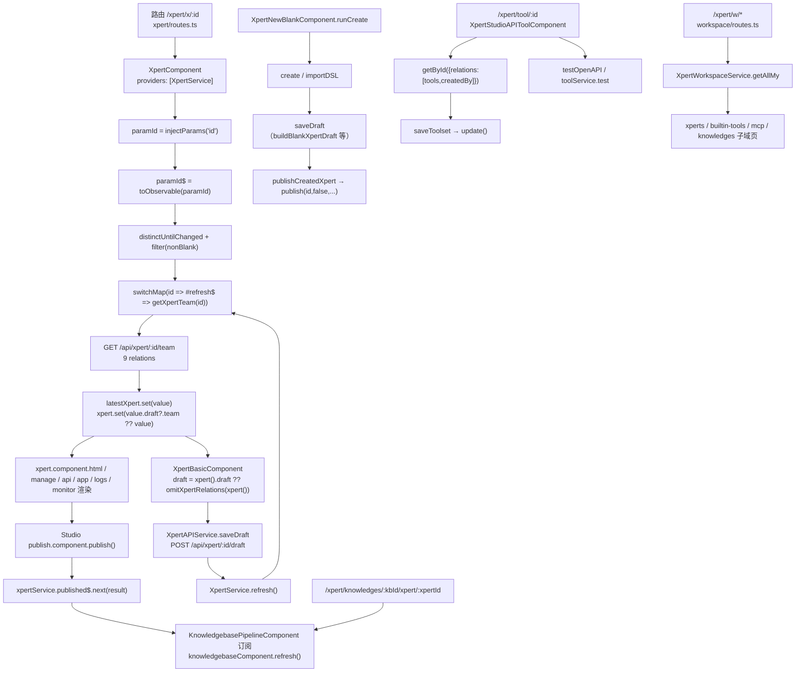
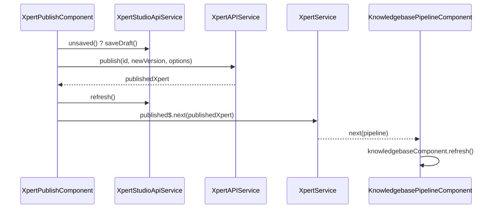
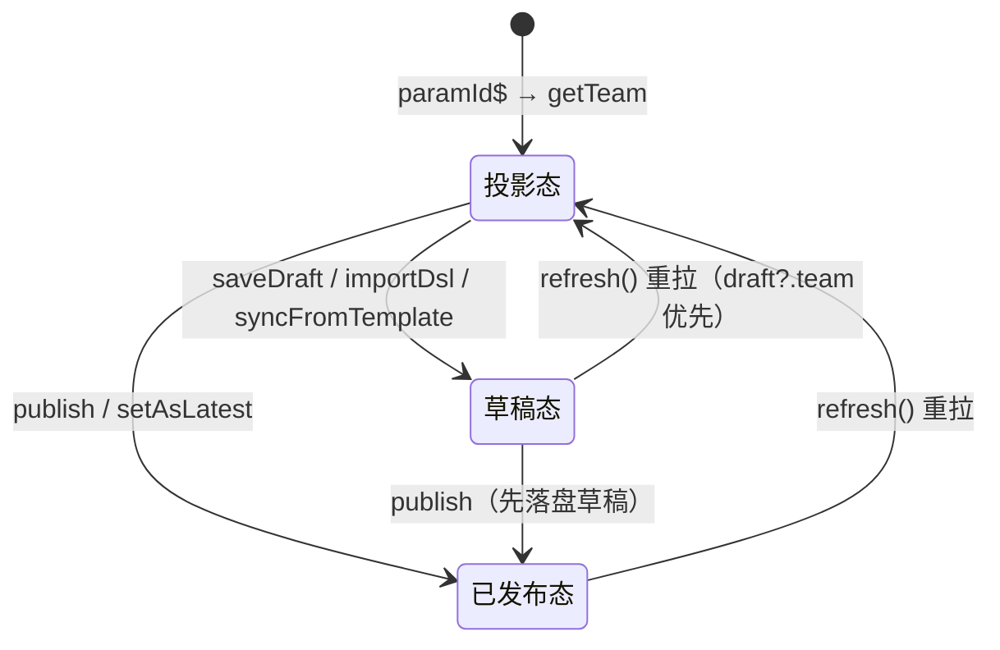

# 03 数据流转：Xpert 工作台专家

**本文引用的文件**

- [routes.ts](file://apps/cloud/src/app/features/xpert/routes.ts)
- [routes.ts](file://apps/cloud/src/app/features/xpert/xpert/routes.ts)
- [xpert.component.ts](file://apps/cloud/src/app/features/xpert/xpert/xpert.component.ts)
- [xpert.service.ts](file://apps/cloud/src/app/features/xpert/xpert/xpert.service.ts)
- [utils.ts](file://apps/cloud/src/app/features/xpert/utils.ts)
- [editable-draft.util.ts](file://apps/cloud/src/app/features/xpert/draft/editable-draft.util.ts)
- [xpert-draft-trigger.util.ts](file://apps/cloud/src/app/features/xpert/draft/xpert-draft-trigger.util.ts)
- [manage.component.ts](file://apps/cloud/src/app/features/xpert/xpert/manage/manage.component.ts)
- [basic.component.ts](file://apps/cloud/src/app/features/xpert/xpert/basic/basic.component.ts)
- [blank.component.ts](file://apps/cloud/src/app/features/xpert/xpert/blank/blank.component.ts)
- [blank-project-management.ts](file://apps/cloud/src/app/features/xpert/xpert/blank/blank-project-management.ts)
- [publish.component.ts](file://apps/cloud/src/app/features/xpert/studio/header/publish/publish.component.ts)
- [pipeline.component.ts](file://apps/cloud/src/app/features/xpert/knowledge/knowledgebase/pipeline/pipeline.component.ts)
- [knowledgebase.component.ts](file://apps/cloud/src/app/features/xpert/knowledge/knowledgebase/knowledgebase.component.ts)
- [routing.ts](file://apps/cloud/src/app/features/xpert/knowledge/routing.ts)
- [routing.ts](file://apps/cloud/src/app/features/xpert/knowledge/knowledgebase/routing.ts)
- [pipelines.component.ts](file://apps/cloud/src/app/@shared/knowledge/pipelines/pipelines.component.ts)
- [api-tool.component.ts](file://apps/cloud/src/app/features/xpert/tools/api-tool/api-tool.component.ts)
- [types.ts](file://apps/cloud/src/app/features/xpert/tools/api-tool/types.ts)
- [configure.component.ts](file://apps/cloud/src/app/features/xpert/tools/builtin/configure/configure.component.ts)
- [tool.component.ts](file://apps/cloud/src/app/features/xpert/tools/tool-test/test/tool.component.ts)
- [create.component.ts](file://apps/cloud/src/app/features/xpert/tools/create/create.component.ts)
- [routes.ts](file://apps/cloud/src/app/features/xpert/workspace/routes.ts)
- [home.component.ts](file://apps/cloud/src/app/features/xpert/workspace/home/home.component.ts)
- [assistant.facade.ts](file://apps/cloud/src/app/features/xpert/assistant-shell/assistant.facade.ts)
- [xpert.service.ts](file://apps/cloud/src/app/@core/services/xpert.service.ts)
- [xpert-toolset.service.ts](file://apps/cloud/src/app/@core/services/xpert-toolset.service.ts)
- [xpert-tool.service.ts](file://apps/cloud/src/app/@core/services/xpert-tool.service.ts)
- [xpert-workspace.service.ts](file://apps/cloud/src/app/@core/services/xpert-workspace.service.ts)
- [xpert.model.ts](file://packages/contracts/src/ai/xpert.model.ts)
- [xpert.utils.ts](file://packages/contracts/src/ai/xpert.utils.ts)
- [草稿优先投影与发布广播.md](file://CodeWikiHub/xpert/memory/决策记录/Xpert 工作台/草稿优先投影与发布广播.md)
- [studio-被复用-知识库流水线.md](file://CodeWikiHub/xpert/memory/关联关系/前端专题/studio-被复用-知识库流水线.md)

## 目录

1. 六条主链总览
2. 链①：助手加载与草稿优先投影
3. 链②：编辑与保存
4. 链③：发布广播
5. 链④：工具集配置与工具测试回流
6. 链⑤：工作区入口与子域消费
7. 链⑥：知识库链与流水线复用 Studio 画布
8. 前端态 vs 服务端态对照
9. 状态流转：草稿态 / 已发布态 / 投影态
10. 数据变换关键节点
11. 已知风险

## 1. 六条主链总览

本域的数据主干是「**路由参数 → XpertService 拉取 `/{id}/team` → 草稿优先投影到信号 → 组件渲染**」，围绕它分出编辑保存、发布广播、工具集、工作区、知识库五条支链。全部落点均已核对源码：`XpertComponent` 以组件级 `providers: [XpertService]` 提供投影服务（`xpert.component.ts`），`XpertService` 用 `injectParams('id')` 拿路由参数并订阅 `#refresh$`（`xpert.service.ts`），`utils.ts` 的注入工厂固化 9 项 relations（`utils.ts`）。

图表来源：[XpertService](file://apps/cloud/src/app/features/xpert/xpert/xpert.service.ts)（关键符号：`paramId`、`#refresh$`、`latestXpert`、`xpert`、`published$`）、[utils.ts](file://apps/cloud/src/app/features/xpert/utils.ts)（关键符号：`injectGetXpertTeam`）、[KnowledgebasePipelineComponent](file://apps/cloud/src/app/features/xpert/knowledge/knowledgebase/pipeline/pipeline.component.ts)（关键符号：`publishedSub`）

章节来源：[XpertService](file://apps/cloud/src/app/features/xpert/xpert/xpert.service.ts)（关键符号：`XpertService.paramId`、`XpertService.published$`）、[XpertComponent](file://apps/cloud/src/app/features/xpert/xpert/xpert.component.ts)（关键符号：`XpertComponent.paramId`、`XpertComponent.latestXpert`）

## 2. 链①：助手加载与草稿优先投影

- **入口**：`xpert/routes.ts` 的 `{ path: ':id', component: XpertComponent }`，子路由 `agents`（Studio 宿主，属 Studio 域）、`auth`、`logs`、`monitor`、`memory`；空路径重定向到 `agents`。
- **参数**：`XpertService.#paramId = injectParams('id')`；公开 `paramId` 用 `linkedModel({ initialValue: null, compute: () => this.#paramId(), update: (value) => value })` 包装，`paramId$ = toObservable(this.paramId)`。
- **拉取**：`paramId$ → distinctUntilChanged → filter(nonBlank) → switchMap(id => #refresh$.pipe(switchMap(() => this.getXpertTeam(id))))`；`getXpertTeam = injectGetXpertTeam()`，最终调用 `XpertAPIService.getTeam(id, { relations: [...9 项] })`（`GET /api/xpert/:id/team`）。
- **投影（关键分支）**：订阅回调 `this.latestXpert.set(value)` 与 `this.xpert.set(value.draft?.team ?? value)` —— **存在草稿时 `xpert` 是 `value.draft.team`，否则是服务端返回的 `IXpert` 本体**；`latestXpert` 始终保存完整响应（含 `draft` / `graph`）。
- **渲染**：`XpertComponent` 侧栏标题取 `latestXpert()?.title || latestXpert()?.name`，头像/类型 computed 取 `xpert()`；管理页签（`manage`、`api`、`app`、`monitor`、`logs`、`statistics`）统一读 `xpertComponent.latestXpert`；`memory/files` 读 `xpert() ?? latestXpert()`。
- **刷新入口**：`refresh()` 只 `#refresh$.next()`，`onRefresh()` 暴露 `#refresh$` 供其它组合；`switchMap` 保证新 id 到达时取消上一次在途请求。

章节来源：[XpertService](file://apps/cloud/src/app/features/xpert/xpert/xpert.service.ts)（关键符号：`XpertService.paramId`、`XpertService.#refresh$`、`XpertService.latestXpert`、`XpertService.xpert`、`XpertService.refresh`）、[utils.ts](file://apps/cloud/src/app/features/xpert/utils.ts)（关键符号：`injectGetXpertTeam`）

## 3. 链②：编辑与保存

- **管理页编辑**：`XpertBasicManageComponent` 注入 `XpertComponent` 并取 `latestXpert`，弹窗打开 `XpertBasicComponent`；后者定义 `draft = computed(() => xpert().draft ?? { team: omitXpertRelations(xpert()) })` 与 `team = computed(() => type === Agent ? draft()?.team : xpert())`，即 **Agent 类型编辑草稿层、其它类型编辑已发布层**；表单含 `name/title/description/avatar/tags/copilotModel/allowedModels`，其中 `copilotModel` 带 `Validators.required`。
- **DSL 覆盖草稿**：`XpertBasicManageComponent.importDsl()` 走 `uploadYamlFile` → `createOverwriteDraftFromDsl` → `XpertAPIService.saveDraft` → `XpertService.refresh()`；提示语明确「写入当前草稿、发布态不变，生效仍需发布」；`syncFromTemplate()` 与 `duplicate({ isDraft: true })` 同理。
- **Studio 侧草稿装配**：`buildEditableXpertDraft(xpert)`（2 篇桥之一）先用 `omit(xpert, 'agents')` 得 `baseTeam`，草稿存在时逐层覆盖 `draft.team`、`nodes`、`connections`，最后统一过 `applyChatTriggerInputParametersToDraft`。
- **创建链（向导）**：`XpertNewBlankComponent.runCreate()` → `createBlankXpert()`（`XpertAPIService.create`，主 agent key 由 `genAgentKey()` 生成）或 `createFromTemplate()`（`XpertAPIService.importDSL`）→ `initializeDraftIfNeeded()`（按类型 `buildBlankXpertDraft` / `buildBlankKnowledgeDraft` / `buildBlankWorkflowDraft` → `saveDraft`）→ `prepareProjectManagement()`（`BlankProjectManagement.apply` 合成 capability 并再次 `saveDraft`）→ `completeCreation()`。
- **保存 vs 发布**：`completeCreation` 在 `completionMode !== 'publish'` 时返回 `status: 'created'`；否则在无 `checklist` 阻塞（`hasBlockingChecklist`）时调用 `publishCreatedXpert()` → `XpertAPIService.publish(id, false, { environmentId, releaseNotes })`，回传 `status: 'published'`；失败降级为 created 并提示。
- **写后回读**：所有写操作后统一 `xpertComponent.xpertService.refresh()`，即重新触发链①的 `#refresh$`。

章节来源：[XpertBasicComponent](file://apps/cloud/src/app/features/xpert/xpert/basic/basic.component.ts)（关键符号：`XpertBasicComponent.draft`、`XpertBasicComponent.team`）、[XpertNewBlankComponent](file://apps/cloud/src/app/features/xpert/xpert/blank/blank.component.ts)（关键符号：`XpertNewBlankComponent.runCreate`、`XpertNewBlankComponent.initializeDraftIfNeeded`、`XpertNewBlankComponent.publishCreatedXpert`）、[editable-draft.util.ts](file://apps/cloud/src/app/features/xpert/draft/editable-draft.util.ts)（关键符号：`buildEditableXpertDraft`）

## 4. 链③：发布广播

- **发布点**：`XpertPublishComponent.publish()` 先判 `studioService.unsaved() ? studioService.saveDraft() : of(true)` 落盘，再 `xpertAPI.publish(id, newVersion, { environmentId, releaseNotes, businessAreaId, marketplace })`；成功后 `studioService.refresh()` 并 **`this.xpertService.published$.next(result)`**。
- **订阅点**：`KnowledgebasePipelineComponent` 在构造期 `xpertService.published$.subscribe({ next: () => this.knowledgebaseComponent.refresh() })`，即知识库详情页在流水线发布后立即重拉（`KnowledgebaseComponent.refresh()` → `#knowledgebase.reload()`）。
- **覆盖面事实**：全仓 `published$` 仅此一处 emit、一处 subscribe；工作区列表页（`XpertWorkspaceXpertsComponent`）与工具/知识库列表走 `myRxResource` / `derivedAsync`，**不订阅 `published$`**，需要重新进入或手动触发刷新。
- **与 `refresh()` 的分工**：`refresh()` 是「HTTP 重拉」（回源服务端），`published$` 是「内存事件」（零请求通知）；两者并列存在，不互相触发。
- **跨域边界**：emit 在 Studio 域的发布组件内，subscribe 在本域知识库流水线；这是「Xpert 工作台 ↔ Studio 三条桥」的第 3 条（画布复用 + 发布感知）。

图表来源：[XpertPublishComponent](file://apps/cloud/src/app/features/xpert/studio/header/publish/publish.component.ts)（关键符号：`publish`）、[KnowledgebasePipelineComponent](file://apps/cloud/src/app/features/xpert/knowledge/knowledgebase/pipeline/pipeline.component.ts)（关键符号：`publishedSub`）

章节来源：[XpertPublishComponent](file://apps/cloud/src/app/features/xpert/studio/header/publish/publish.component.ts)（关键符号：`XpertPublishComponent.publish`）、[KnowledgebasePipelineComponent](file://apps/cloud/src/app/features/xpert/knowledge/knowledgebase/pipeline/pipeline.component.ts)（关键符号：`KnowledgebasePipelineComponent.publishedSub`）

## 5. 链④：工具集配置与工具测试回流

- **入口**：`tools/api-tool/api-tool.component.ts` 由 `routes.ts` 的 `{ path: 'tool/:id', component: XpertStudioAPIToolComponent }` 挂载；工作区 builtin 工具页对 `category === API` 的工具集显式跳转 `/xpert/tool/:id`，对 builtin 工具集改为弹窗配置。
- **加载**：`paramId = injectParams('id')` → `toolsetService.getById(id, { relations: ['tools', 'createdBy'] })` → `toolset` model；`tools` computed 过滤 `deletedAt` 并把 `disabled` 靠后排序。
- **编辑**：`configure = viewChild('configure', { read: XpertConfigureToolComponent })` 走抽象基类（`formGroup` / `isValid()` / `isDirty()` / `refreshForm()`），实现为 openapi / odata / mcp 三个 configure 组件；工具级改写走 `onToolsChange`（按 `name` 合并、缺失者标 `deletedAt`）、`updateTool`、`updateParameter`（写 `tool.schema.parameters`）、`saveParametersAsDefault(tool, parameters)`（写 `tool.parameters`），统一 `toolsDirty.set(true)`。
- **保存**：`saveToolset()` 组装 `configure().formGroup.value`（`schema` 回落到已加载值），仅在 `toolsDirty()` 时带上 `tools`（否则 `omit(value, 'tools')`），调用 `toolsetService.update(id, value)`，成功后 `markAsPristine()` + `refreshForm()`。
- **创建**：`tools/create/create.component.ts` 的 `createTool()` → `xpertToolsetService.create({ ...omitBy(toolset(), isNil), workspaceId })`，workspaceId 来自 `DIALOG_DATA.workspace`。
- **凭据面（独立）**：`tools/builtin/configure` 拉 `getBuiltinTools(provider)`、`getToolsetTools(toolsetId)`、`provider`（`derivedToolProvider`），`credentials` model + `XpertToolBuiltinAuthorizeComponent` 承载授权，服务端接口为 `/providers`、`/builtin-provider/:provider/credentials-schema`、`/:id/credentials`。
- **测试回流**：`XpertToolsetToolTestComponent.testTool()` 优先用外部传入的 `testToolRequest`，否则 `toolService.test({ ...tool, toolset, parameters })`（`POST /api/xpert-tool/test`，`responseType: 'text'`）；API 类工具走 `toolsetService.testOpenAPI({ ...tool, parameters, toolset })`（`POST /provider/openapi/test`），结果统一写 `testResult` 并原样回显。

章节来源：[XpertStudioAPIToolComponent](file://apps/cloud/src/app/features/xpert/tools/api-tool/api-tool.component.ts)（关键符号：`XpertStudioAPIToolComponent.saveToolset`、`XpertStudioAPIToolComponent.testTool`、`XpertStudioAPIToolComponent.onToolsChange`）、[XpertToolsetToolTestComponent](file://apps/cloud/src/app/features/xpert/tools/tool-test/test/tool.component.ts)（关键符号：`XpertToolsetToolTestComponent.testTool`）、[XpertToolsetService](file://apps/cloud/src/app/@core/services/xpert-toolset.service.ts)（关键符号：`XpertToolsetService.testOpenAPI`、`XpertToolsetService.getCredentials`）

## 6. 链⑤：工作区入口与子域消费

- **入口**：`features/xpert/routes.ts` 的 `{ path: 'w', loadChildren: () => import('./workspace/routes') }`（`data.title = 'Expert Workspace'`、`data.scopeContext = 'dual-scope'`）；根路径 `''` 重定向到 `w`。
- **默认落点**：`workspace/routes.ts` 的 `canActivate: [redirectToSelectedWorkspace]` 读 `AppQuery.getValue().selectedWorkspace?.id ?? PersistQuery.getValue().workspaceId`，并把 `?section=` 映射为 `clawxpert-skills | clawxpert-knowledges | clawxpert-connectors | files | settings`，拼出 `/xpert/w/:workspaceId/<segment>`；`:id` 段的子路由承载 all / xperts / knowledges / files / custom / connectors / builtin / mcp / database / skills / prompt-workflows。
- **壳组件**：`XpertWorkspaceHomeComponent` 持有 `paramId = injectParams('id')`、`selectedWorkspace = injectWorkspace()`、`workspaceService = inject(XpertWorkspaceService)`，子域页（如 builtin 工具页、列表页）以 `inject(XpertWorkspaceHomeComponent)` 反向读取 `workspace/type/tags/toolTags/searchText/canWriteWorkspace` 等共享状态。
- **服务与缓存**：`XpertWorkspaceService.getAllMy()` 按 `user$ + organizationId` 作用域分片，`#myWorkspaceRequests` Map + `shareReplay({ bufferSize: 1, refCount: true })` 共享同一请求，`refresh()` 清 Map 并 `#refresh$.next()`；权限判定 `canRead/canRun/canWrite/canManage` 基于 `capabilities`。
- **子域消费**：助手列表 `getAllByWorkspace(workspaceId, { where: { type: Agent, latest: true }, relations: ['createdBy','tags','knowledgebase'] })`；builtin 工具 `getAllByWorkspace(workspaceId, { where: { category }, relations: ['createdBy','tags'] })` + `getProviders()`；工具集详情 `getOneById(id, { relations: ['tools'] })`。
- **边界**：`features/xpert/workspace-home.service.ts` 是空 `@Injectable()`（占位），工作区真正的共享状态来自 `workspace/home` 组件；本链的领域细节（连接器、技能、数据库、prompt-workflows）指向**工作区子专家**（`features/xpert/workspace/**`，32 个非 spec 文件）。

章节来源：[workspace/routes.ts](file://apps/cloud/src/app/features/xpert/workspace/routes.ts)（关键符号：`redirectToSelectedWorkspace`）、[XpertWorkspaceHomeComponent](file://apps/cloud/src/app/features/xpert/workspace/home/home.component.ts)（关键符号：`XpertWorkspaceHomeComponent.paramId`、`XpertWorkspaceHomeComponent.selectedWorkspace`）、[XpertWorkspaceService](file://apps/cloud/src/app/@core/services/xpert-workspace.service.ts)（关键符号：`XpertWorkspaceService.getAllMy`、`XpertWorkspaceBaseCrudService.getAllByWorkspace`）

## 7. 链⑥：知识库链与流水线复用 Studio 画布

- **入口**：`knowledge/routing.ts` 提供 `/xpert/knowledges`（列表，权限 `AIPermissionsEnum.KNOWLEDGEBASE_EDIT`）、`connect`、`create-from-pipeline`，以及 `{ path: ':id', loadChildren: './knowledgebase/routing' }`。
- **知识库详情**：`KnowledgebaseComponent` 以 `injectParams('id')` + `knowledgebaseAPI.getDetail(id)` 拉详情，暴露 `xperts`、`pipelineId`、`pipeline`、`documentNum` 等 computed，并定义 `refresh()` = `#knowledgebase.reload()`；`openXpert(xpert)` 以 `window.open('/xpert/x/:id/agents')` 跳到助手管理页（跨链回到链①）。
- **流水线页复用画布**：`knowledgebase/routing.ts` 的 `{ path: 'xpert/:id', component: KnowledgebasePipelineComponent }`，该组件**直接 `imports: [XpertStudioComponent]` 并 `providers: [XpertService]`**，订阅 `published$` 触发知识库刷新 —— Studio 是被复用方，本域只提供宿主与刷新钩子。
- **创建流水线**：`XpertPipelinesComponent.createPipeline()` → `knowledgebaseAPI.createPipeline(kbId)`；模板/DSL 路径走 `installPipeline(draft)` → `xpertAPI.importDSL({ ...draft, team: { ...draft.team, type: XpertTypeEnum.Knowledge, latest: true, knowledgebase: { id } } })`，页壳 `KnowledgePipelinesComponent.onPipelineCreated` 相对跳转到 `../:knowledgebaseId`。
- **助手挂载知识库**：`IXpert.knowledgebase` / `knowledgebases` 由 `injectGetXpertTeam` 的 `knowledgebase` relation 投影进管理页与 Studio 画布节点（`TXpertTeamNodeSpec.knowledge`），运行时由检索链消费（本域只负责装配）。
- **边界**：知识库的文档/切片/FAQ/Wiki/图谱与摄取进度属**知识库子专家**（`features/xpert/knowledge/**`，87 个非 spec 文件）。

章节来源：[KnowledgebasePipelineComponent](file://apps/cloud/src/app/features/xpert/knowledge/knowledgebase/pipeline/pipeline.component.ts)（关键符号：`KnowledgebasePipelineComponent.xpertService`、`KnowledgebasePipelineComponent.publishedSub`）、[KnowledgebaseComponent](file://apps/cloud/src/app/features/xpert/knowledge/knowledgebase/knowledgebase.component.ts)（关键符号：`KnowledgebaseComponent.refresh`、`KnowledgebaseComponent.openXpert`）、[XpertPipelinesComponent](file://apps/cloud/src/app/@shared/knowledge/pipelines/pipelines.component.ts)（关键符号：`XpertPipelinesComponent.createPipeline`、`XpertPipelinesComponent.installPipeline`）

## 8. 前端态 vs 服务端态对照

| 数据面 | 前端持有（本域） | 服务端真源 | 关键差异 / 口径 |
| --- | --- | --- | --- |
| 助手团队 | `XpertService.latestXpert`（`IXpert`）、`xpert`（`draft?.team ?? value`） | `GET /api/xpert/:id/team`（9 relations） | 前端投影可能不是服务端「已发布」形态 |
| 已发布图 | `latestXpert.graph` | publish 结果 / 版本列表 | 仅在无 `draft` 时被 `buildEditableXpertDraft` 回落使用 |
| 可编辑草稿 | `XpertBasicComponent.draft`、Studio store 的 draft | `POST /api/xpert/:id/draft`（返回 `TXpertTeamDraft`，含 `savedAt`/`checklist`） | 双写点，前端不做冲突检测 |
| 发布事件 | `XpertService.published$`（内存 `Subject`） | 无 | 不跨标签页、无重放 |
| 工具集与工具 | `toolset` model（含 `tools`、`toolsDirty`） | `PUT /api/xpert-toolset/:id`、`POST /api/xpert-toolset` | 仅 `toolsDirty` 时才回写 `tools` |
| 工具测试结果 | `testResult`（字符串化） | 无（请求即用即弃） | 不落库 |
| 工作区 | `injectWorkspace()` / `paramId` | `GET /api/xpert-workspace/my` | `shareReplay` 缓存 + 手动 `refresh()` |
| 知识库 | `#knowledgebase` resource | `GET /api/knowledgebase/detail/:id` | 靠 `published$`/写操作触发 `reload()` |
| 助手门面上下文 | `requestContext` computed（`env.workspaceId`、`env.xpertId`、`targetXpertId`、`unsaved`、`baseDraftHash`） | 随 ChatKit 请求下发 | 仅注入请求，不落库 |

章节来源：[XpertService](file://apps/cloud/src/app/features/xpert/xpert/xpert.service.ts)（关键符号：`XpertService.xpert`、`XpertService.published$`）、[XpertAssistantFacade](file://apps/cloud/src/app/features/xpert/assistant-shell/assistant.facade.ts)（关键符号：`XpertAssistantFacade.requestContext`）、[XpertStudioAPIToolComponent](file://apps/cloud/src/app/features/xpert/tools/api-tool/api-tool.component.ts)（关键符号：`XpertStudioAPIToolComponent.toolsDirty`）

## 9. 状态流转：草稿态 / 已发布态 / 投影态

- **投影态（读）**：`hasDraft ? xpert = draft.team : xpert = IXpert`；`latestXpert` 恒为完整响应，故同一页面可同时看到「草稿形态」与「已发布元数据（`version`/`latest`/`publishAt`/`graph`）」。
- **草稿态（写）**：由 `saveDraft` 建/改，服务端回写 `savedAt` 与 `checklist`；`hasBlockingChecklist(draft.checklist)` 是自动发布的闸门；草稿 `team.id` 缺省回落到 `xpert.id`。
- **已发布态**：`publish(id, newVersion, options)` 产出带 `version` 的记录；`setAsLatest(id)` 切换默认版本；`delete(id)` 删除版本（删除当前版本时 `gotoWorkspace()`）。
- **过渡与降级**：向导路径为 `create → saveDraft(可选) → publish(可选)`，publish 失败或存在阻塞 checklist 时降级为 `created`（`BlankXpertWizardResult.status`）。
- **无状态的地方**：本域不持有持久化 draft（无 localStorage/IndexedDB），刷新即重拉；`published$` 不缓存，晚订阅者会错过事件。

图表来源：[XpertService](file://apps/cloud/src/app/features/xpert/xpert/xpert.service.ts)（关键符号：`xpertSub`）、[XpertNewBlankComponent](file://apps/cloud/src/app/features/xpert/xpert/blank/blank.component.ts)（关键符号：`completeCreation`、`completeImportedCreation`）

章节来源：[XpertService](file://apps/cloud/src/app/features/xpert/xpert/xpert.service.ts)（关键符号：`XpertService.xpert`、`XpertService.latestXpert`）、[XpertNewBlankComponent](file://apps/cloud/src/app/features/xpert/xpert/blank/blank.component.ts)（关键符号：`XpertNewBlankComponent.completeCreation`）

## 10. 数据变换关键节点

1. **draft 装配（`buildEditableXpertDraft`）**：`baseTeam = { ...omit(xpert, 'agents'), id: xpert.id }`；有草稿时 `team = { ...baseTeam, ...draft.team, id: draft.team?.id ?? xpert.id }`，`nodes` 三级回落（`draft.nodes → xpert.graph?.nodes → ToNodeViewModelHandler`），`connections` 二级回落（`draft.connections → xpert.graph?.connections → ToConnectionViewModelHandler`）；无草稿时回落链路少一层 `draft`。
2. **chat trigger 入参注入（`applyChatTriggerInputParametersToDraft`）**：从 `nodes` 找到 `workflow/trigger` 且 `from === 'chat'` 的节点，用 `createChatTriggerInputParameters(triggerKey, parameters)` 生成 `{ type: object, name: channelName(triggerKey), optional: true, item }` 并写入 `team.agentConfig.parameters`；无参数时用 `removeChatTriggerInputParameters` 清理同名 object 参数，避免残留。
3. **9 项 relations 解析**：`['agent','agent.copilotModel','agents','agents.copilotModel','executors','executors.agent','executors.copilotModel','copilotModel','knowledgebase']` —— 固定数组、无入参可调；注意是单数 `knowledgebase`，且不含 `toolsets`/`userGroups`/`knowledgebases`。
4. **agentKey 生成**：主 agent 用 `genAgentKey() = letterStartSUID('Agent_')`；同族生成器覆盖 router/iterating/answer/classifier/knowledge/code/template/assigner/http/subflow/tool/agentWorkflow（`genXpertAgentToolKey` 已废弃）/task/note；`genWorkflowKey(type)` 对 `IF_ELSE` 特判映射到 `genXpertRouterKey()`，其余按 `upperFirst(type) + '_'` 生成。
5. **节点/连接视图模型**：`contracts` 侧 `createXpertNodes`（agent、executor→xpert、knowledge、toolset 四类节点，position/size 取自 `xpert.options`）与 `createAgentConnections`（`leaderKey/key` → `agent` 边、`collaboratorNames` → `xpert` 边、`knowledgebaseIds` → `knowledge` 边、`toolsetIds` → `toolset` 边），连接 `key` 恒为 `from/to`。
6. **触发器编辑态装配**：`upsertTriggerEditorItemsIntoDraft` 在需要新增节点而草稿中找不到主 agent 节点时抛 `XPERT_DRAFT_PRIMARY_AGENT_NODE_MISSING`；新节点位置按既有触发器列（`TRIGGER_NODE_VERTICAL_GAP`）或主 agent 左侧（`TRIGGER_NODE_HORIZONTAL_OFFSET`）计算。
7. **工具集读写归一**：`getEnabledTools` 依 `disabled → enabled → disableToolDefault` 三级归一并按 `options.toolPositions` 排序；`isToolEnabled` 为契约侧同名工具函数；写入侧 `onToolsChange` 用「按名合并 + 缺失标 `deletedAt`」表达删除。
8. **工作区查询归一**：`getAllByWorkspace(id, options, published?)` 在两参数或三参数下统一拼 `/by-workspace/:id`，`published=true` 时只取已发布（`injectGetXpertsByWorkspace` 即用此口径 + `where: { latest: true }` + `updatedAt DESC`）。

章节来源：[editable-draft.util.ts](file://apps/cloud/src/app/features/xpert/draft/editable-draft.util.ts)（关键符号：`buildEditableXpertDraft`）、[xpert-draft-trigger.util.ts](file://apps/cloud/src/app/features/xpert/draft/xpert-draft-trigger.util.ts)（关键符号：`applyChatTriggerInputParametersToDraft`、`upsertTriggerEditorItemsIntoDraft`）、[utils.ts](file://apps/cloud/src/app/features/xpert/utils.ts)（关键符号：`injectGetXpertTeam`、`genAgentKey`、`genWorkflowKey`）、[xpert.utils.ts](file://packages/contracts/src/ai/xpert.utils.ts)（关键符号：`createXpertNodes`、`createAgentConnections`）

## 11. 已知风险

- **草稿双写无冲突检测**：Studio 自动保存与向导/管理页的显式 `saveDraft` 写同一后端 draft，前端未见 `savedAt` 比对或并发提示（`savedAt` 只在类型上存在）。
- **`published$` 覆盖面窄**：仅知识库流水线订阅；助手列表页、工具集页、工作区首页不响应发布事件，也没有跨标签页机制；`Subject` 无重放，订阅晚于发布即丢失信号。
- **`XpertService.#draft` 是死状态**：声明了 `signal<TXpertTeamDraft>` 但全文件无写入/读取点；若后续按它做草稿缓存需先补齐写入链。
- **relations 固定带来的缺口**：9 项 relations 不含 `toolsets` / `userGroups` / `knowledgebases`，助手编辑页需要的工具集、授权组数据由其它接口/页面各自拉取；改这 9 项需同时回归 Studio 画布与预览（见 ki 关联登记）。
- **路由参数名耦合**：`injectParams('id')` 与 `filter(nonBlank)` 组合意味着参数缺失时**静默不加载**；知识库流水线复用 `XpertService` 时 `paramId` 的语义变为 xpertId（路由 `/xpert/knowledges/:kbId/xpert/:xpertId`），改名或调整层级会静默失效。
- **无持久化前端态**：无 localStorage/Store 落库，刷新即重拉；`testResult`、`toolsDirty`、`selectedToolIds` 等纯内存态在路由切换后丢失。
- **测试缺口**：工具授权/凭据配置面在前端测试覆盖为 0（ki 决策记录标注的已知缺口），发布广播链的断言也仅依赖流水线订阅这一条路径。

章节来源：[XpertService](file://apps/cloud/src/app/features/xpert/xpert/xpert.service.ts)（关键符号：`XpertService.#draft`、`XpertService.published$`）、[utils.ts](file://apps/cloud/src/app/features/xpert/utils.ts)（关键符号：`injectGetXpertTeam`）、[草稿优先投影与发布广播.md](file://CodeWikiHub/xpert/memory/决策记录/Xpert 工作台/草稿优先投影与发布广播.md)
