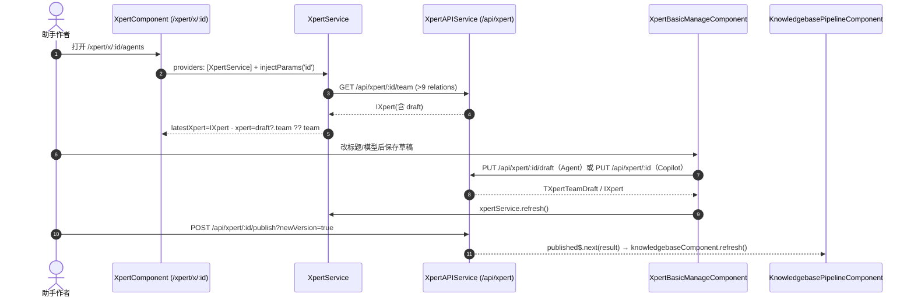

# 05 接口

> 模块：Xpert 工作台专家（助手管理与配套资产域：助手管理页 + 工具集面 + 工作区/知识库子专家）｜模块根：`apps/cloud/src/app/features/xpert`（除 `studio/`）
> 路由：`/xpert/x/:id/**`（助手详情 shell + 管理页）、`/xpert/tool/:id`（API 工具配置页）、`/xpert/w/*`（工作区）
> API 口径：`API_PREFIX = '/api'`（`apps/cloud/src/app/@core/state/constants/app.constants.ts`）；`XpertAPIService = super(API_XPERT_ROLE) = '/api/xpert'`、`XpertToolsetService = '/api/xpert-toolset'`、`XpertToolService = '/api/xpert-tool'`、`XpertWorkspaceService = '/api/xpert-workspace'`（`apps/cloud/src/app/@core/constants/app.constants.ts`）。文中路径均为**实际请求路径**；服务端行为明细以「Assistant 定义与运行时专家/implementation/05-接口」为准并逐条注明归属。

**本文引用的文件**

- [xpert.service.ts](file://apps/cloud/src/app/@core/services/xpert.service.ts)（`XpertAPIService`，助手管理面接口集中地）
- [xpert-toolset.service.ts](file://apps/cloud/src/app/@core/services/xpert-toolset.service.ts)（`XpertToolsetService`）
- [xpert-tool.service.ts](file://apps/cloud/src/app/@core/services/xpert-tool.service.ts)（`XpertToolService`）
- [xpert-workspace.service.ts](file://apps/cloud/src/app/@core/services/xpert-workspace.service.ts)（`XpertWorkspaceService`）
- [knowledgebase.service.ts](file://apps/cloud/src/app/@core/services/knowledgebase.service.ts)（`KnowledgebaseService`）
- [file-memory-api.service.ts](file://apps/cloud/src/app/@core/services/file-memory-api.service.ts)（`FileMemoryAPIService`）
- [app.constants.ts](file://apps/cloud/src/app/@core/constants/app.constants.ts)（`API_XPERT_ROLE`、`API_XPERT_TOOLSET`、`API_XPERT_WORKSPACE`）
- [xpert.service.ts（本域）](file://apps/cloud/src/app/features/xpert/xpert/xpert.service.ts)（`XpertService`：`paramId`/`latestXpert`/`published$`）
- [utils.ts](file://apps/cloud/src/app/features/xpert/utils.ts)（`injectGetXpertTeam`、`injectGetXpertsByWorkspace`、`genAgentKey`）
- [editable-draft.util.ts](file://apps/cloud/src/app/features/xpert/draft/editable-draft.util.ts)（`buildEditableXpertDraft`）
- [xpert-draft-trigger.util.ts](file://apps/cloud/src/app/features/xpert/draft/xpert-draft-trigger.util.ts)（触发编辑与 chat 参数投影）
- [assistant.facade.ts](file://apps/cloud/src/app/features/xpert/assistant-shell/assistant.facade.ts)（`XpertAssistantFacade`）
- [shell.component.ts](file://apps/cloud/src/app/features/xpert/assistant-shell/shell.component.ts)（`XpertAssistantShellComponent`）
- [xpert.component.ts](file://apps/cloud/src/app/features/xpert/xpert/xpert.component.ts)（`XpertComponent`，`providers: [XpertService]`）
- [basic.component.ts](file://apps/cloud/src/app/features/xpert/xpert/basic/basic.component.ts)（`XpertBasicComponent.saveDraft`）
- [manage.component.ts](file://apps/cloud/src/app/features/xpert/xpert/manage/manage.component.ts)（`XpertBasicManageComponent`）
- [blank.component.ts](file://apps/cloud/src/app/features/xpert/xpert/blank/blank.component.ts)（`XpertNewBlankComponent`）
- [logs.component.ts](file://apps/cloud/src/app/features/xpert/xpert/logs/logs.component.ts)、[statistics.component.ts](file://apps/cloud/src/app/features/xpert/xpert/monitor/statistics/statistics.component.ts)（会话日志与统计）
- [store.component.ts](file://apps/cloud/src/app/features/xpert/xpert/memory/store/store.component.ts)、[files.component.ts](file://apps/cloud/src/app/features/xpert/xpert/memory/files/files.component.ts)（记忆）
- [api-tool.component.ts](file://apps/cloud/src/app/features/xpert/tools/api-tool/api-tool.component.ts)、[tool.component.ts（工具测试）](file://apps/cloud/src/app/features/xpert/tools/tool-test/test/tool.component.ts)、[authorize.component.ts](file://apps/cloud/src/app/features/xpert/tools/builtin/authorize/authorize.component.ts)（工具集面）
- [routes.ts（本域）](file://apps/cloud/src/app/features/xpert/routes.ts)、[routes.ts（x 链）](file://apps/cloud/src/app/features/xpert/xpert/routes.ts)、[routes.ts（工作区）](file://apps/cloud/src/app/features/xpert/workspace/routes.ts)、[knowledgebase-wiki.guard.ts](file://apps/cloud/src/app/features/xpert/knowledge/knowledgebase/knowledgebase-wiki.guard.ts)
- [features-routing.module.ts](file://apps/cloud/src/app/features/features-routing.module.ts)、[routes.ts（authGuard）](file://apps/cloud/src/app/xpert/routes.ts)、[url.ts](file://apps/cloud/src/app/@core/providers/url.ts)（`injectApiBaseUrl`）
- [pipeline.component.ts](file://apps/cloud/src/app/features/xpert/knowledge/knowledgebase/pipeline/pipeline.component.ts)（`published$` 订阅方）

## 目录

1. 接口口径与总览
2. 助手管理面（`/api/xpert/*`）
3. 工具集面（`/api/xpert-toolset/*` · `/api/xpert-tool/*`）
4. 工作区面（`/api/xpert-workspace/*`）
5. 知识库面（`/api/knowledgebase/*`）
6. 前端组件对外契约
7. 鉴权与守卫
8. 错误语义
9. 接口调用时序图

---

## 1. 接口口径与总览

- 所有请求同源走 `/api`；`XpertAPIService` 在构造时 `super(API_XPERT_ROLE)`，SSE 场景额外拼接 `injectApiBaseUrl()`（同源部署时 `normalizeApiBaseUrl` 返回空串）——`apps/cloud/src/app/@core/services/xpert.service.ts`、`apps/cloud/src/app/@core/providers/url.ts`。
- 查询串统一用 `toHttpParams(...)` / `createOptionalQueryParams(...)` 序列化为 `?data={...}`（关系、where、order 都塞进 `data`）。
- 本域接口面分五组：**助手管理（team/draft/publish 读取与草稿写入、记忆、会话与统计）**、**工具集（工具定义/参数/凭据/provider 探测/工具测试）**、**工作区（`/api/xpert-workspace/*`）**、**知识库（`/api/knowledgebase/*`）**、**跨域引用（`/api/environment/*`、`/api/xpert-project/*`、`/api/connector` 等，归对应专家）**。
- 归属约定：`/api/xpert/*` 的服务端签名、守卫与错误码归 **Assistant 定义与运行时专家**；`/api/xpert-workspace/*` 归其**工作区与文件授权子专家**；`/api/knowledgebase/*` 归**知识库专家**的前端子域与后端「知识库专家」；本文件只记录**前端调用点 + 参数形态 + 消费组件**。

章节来源：[xpert.service.ts](file://apps/cloud/src/app/@core/services/xpert.service.ts)（关键符号：`XpertAPIService.constructor`、`XpertAPIService.getTeam`）、[url.ts](file://apps/cloud/src/app/@core/providers/url.ts)（关键符号：`injectApiBaseUrl`、`normalizeApiBaseUrl`）

---

## 2. 助手管理面（`/api/xpert/*`）

### 2.1 读取：列表 / 详情 / 本工作区

| 方法 | 路径 | 用途与关键参数 | 主要错误 | 消费方 |
|---|---|---|---|---|
| GET | `/api/xpert/:id/team?data={"relations":[9 项]}` | 读取助手本体（含 `draft`）。relations 固定 9 项：`agent`、`agent.copilotModel`、`agents`、`agents.copilotModel`、`executors`、`executors.agent`、`executors.copilotModel`、`copilotModel`、`knowledgebase` | 401/403（后端 `XpertGuard`：`createdById` 或 `workspaceService.canAccess`）；404 | `XpertService`（`features/xpert/xpert/xpert.service.ts`）→ `XpertComponent`、`basic`、`memory`、`studio` |
| GET | `/api/xpert/by-workspace/:workspaceId?data={"where":{"latest":true},"order":{"updatedAt":"DESC"}}` | 工作区内助手分页（可加 `published=true`） | 401/403 | `injectGetXpertsByWorkspace`（`utils.ts`）、`XpertHeaderSwitcherComponent`（额外 `relations:['knowledgebase']`） |
| GET | `/api/xpert/my?data={…}` | 我的助手分页（`getMyAll`；可选 `includeOrganizationWorkspacesInTenantScope=true`） | 401/403 | `injectXperts()`（侧栏/选择器） |
| GET | `/api/xpert/slug/:slug`、`GET /api/xpert/validate?name=` | 按 slug 取详情、重名校验 | 404；`validate` 返回 `boolean` | `XpertNewBlankComponent`（`validateName`） |
| GET | `/api/xpert/:id/profile`、`GET /api/xpert/accessible/:id` | 白名单档案 / 可访问信息（嵌出与分享） | 401/403 | 后端面（归 Assistant 定义与运行时专家） |

`XpertService` 订阅回调把 `team.draft?.team ?? team` 投影为 `xpert()`（草稿优先），`latestXpert()` 保留完整返回。

章节来源：[xpert.service.ts](file://apps/cloud/src/app/features/xpert/xpert/xpert.service.ts)（关键符号：`XpertService.latestXpert`、`XpertService.xpert`）、[utils.ts](file://apps/cloud/src/app/features/xpert/utils.ts)（关键符号：`injectGetXpertTeam`、`injectGetXpertsByWorkspace`）

### 2.2 更新 / 删除 / 复制 / 导出导入

| 方法 | 路径 | 用途与关键参数 | 主要错误 | 消费方 |
|---|---|---|---|---|
| PUT | `/api/xpert/:id` | 更新助手（`update`）；`{draft:null}` 语义为丢弃草稿（Studio `resume()`） | 400/403 | `XpertBasicComponent.saveDraft`（非 Agent 类型分支） |
| PUT | `/api/xpert/:id/draft` | 草稿局部更新（`upadteDraft`，方法名拼写为源码原样） | 400（校验）/409 | `XpertBasicComponent.saveDraft`（Agent 分支） |
| POST | `/api/xpert/:id/draft` | 整草稿保存（`saveDraft`，服务端回填 `savedAt`） | 400/409 | `manage.component`（DSL 覆盖后保存）、Studio |
| POST | `/api/xpert/import?templateId&workspaceDataScope` | DSL 导入（`workspaceDataScope` 非法 → 400） | 400 | `XpertNewBlankComponent.importDSL` |
| GET | `/api/xpert/:id/export?isDraft&includeMemory`、`POST/DELETE :id/export/template` | YAML 导出、导出为模板、删除已导出模板 | 500（服务端统一包装） | `manage.component`（导出面板、删除模板） |
| POST | `/api/xpert/:id/sync-template` | 按模板刷新草稿图（`syncFromTemplate`） | 400/404 | `manage.component`（同步模板） |
| POST | `/api/xpert/:id/duplicate` | 复制（export→import DSL） | 400 | `manage.component.duplicate` |
| DELETE | `/api/xpert/:id`（202） | 删除助手/版本记录（`XpertDeleteCommand`） | 403/404 | `manage.component`（删除确认）、发布对话框 |
| GET | `/api/xpert/:id/version`、`POST /api/xpert/:id/latest` | 版本列表、置为 latest | 403/404 | **Studio 域**（`XpertPublishVersionComponent`）；本域仅经 `latestXpert().version` 展示版本号 |
| POST | `/api/xpert/:id/publish?newVersion=` | 发布（body `{environmentId,releaseNotes,businessAreaId,marketplace}`；成功后 `refresh()` + `publications.changes$` 广播） | 400（`XpertBusinessAreaInvalid`）/403 | `XpertNewBlankComponent`（创建即发布）、Studio 发布对话框 |

章节来源：[basic.component.ts](file://apps/cloud/src/app/features/xpert/xpert/basic/basic.component.ts)（关键符号：`XpertBasicComponent.saveDraft`）、[manage.component.ts](file://apps/cloud/src/app/features/xpert/xpert/manage/manage.component.ts)（关键符号：`XpertBasicManageComponent.importDsl`、`XpertBasicManageComponent.syncFromTemplate`）

### 2.3 记忆 / 会话 / 统计 / 试用与账号

| 方法 | 路径 | 用途与关键参数 | 主要错误 | 消费方 |
|---|---|---|---|---|
| GET / POST / DELETE | `/api/xpert/:id/memory` | 长期记忆读（`types=a:b` 冒号拼接）/增/清空 | 401/403 | `XpertMemoryStoreComponent` |
| POST | `/api/xpert/:id/memory/bulk`、`…/bulk/upload`、`…/search` | 批量写入、CSV 上传解析（仅 `text/csv`/`.csv`，异常 400）、语义搜索（body `{type,text,isDraft}`） | 400 | `XpertMemoryBulkImportComponent`、`XpertMemoryStoreComponent.searchMemory` |
| GET / PUT / POST / DELETE | `/api/xpert/:id/memory/files`、`…/memory/file`、`…/file/upload` | 记忆文件浏览/保存/上传/删除（拼接方式见 `FileMemoryAPIService`，基址 `${API_PREFIX}/xpert`） | 401/403/413 | `XpertMemoryFilesComponent`（经 `FileMemoryAPIService`） |
| GET | `/api/xpert/:id/conversations?data&start&end&search` | 会话日志分页（出参 `ChatConversationPublicDTO`） | 400（关系白名单）/403 | `XpertLogsComponent` |
| POST | `/api/chat-conversation/:id/cancel` | 停止会话（跨域：对话与会话专家） | 403/404 | `XpertLogsComponent`（经 `ChatConversationService`） |
| GET | `/api/xpert/:id/statistics/{usage-overview,daily-conversations,daily-end-users,average-session-interactions,daily-messages,tokens-per-second,token-costs,user-satisfaction-rate}` | 监控页指标（`start`/`end` 必传，可选 `model`/`userId`；`daily-messages` 支持 `currentUserOnly`） | 403 | `XpertMonitorStatisticsComponent`（实测调用 usage-overview / daily-messages / tokens-per-second / user-satisfaction-rate） |
| GET / PUT | `/api/xpert/:id/user-groups`、`/api/xpert/user-groups/authorizations`、`/api/xpert/user-groups/:groupId/authorizations` | 助手↔用户组授权矩阵读写 | 403（`ORG_USERS_*`） | `XpertAuthorizationComponent` |
| PUT | `/api/xpert/:id/api`、`/api/xpert/:id/app` | 对外 API / 应用配置（启用且无 `userId` 时服务端隐式建账号） | 400/403 | `XpertApiComponent`、`XpertAppComponent` |
| POST | `/api/xpert/:id/principal-user`、`GET /api/xpert/principal-users/:userId` | 确保/反查助手外部账号 | 403 | `XpertDevelopApiKeyComponent`（`ensurePrincipalUser`） |
| GET | `/api/xpert/triggers/providers`、`/api/xpert/sandbox/providers` | 触发器 provider 目录、沙箱 provider 目录 | 401/403 | `blank-wizard-state`（`getTriggerProviders`）、`XpertNewBlankComponent`/`manage.component`（`getSandboxProviders`） |
| GET / POST | `/api/xpert/:id/configuration/capabilities`、`…/capabilities/preview` | 能力清单与草稿预览（`previewAssistantCapabilities` 返回 `TXpertTeamDraft`） | 403（`AssistantConfigurationForbidden`）、409（`AssistantConfigurationStale`） | `blank-project-management.ts`（建项目时装配能力） |

**本域未调用但契约已存在**：`/api/xpert/:id/configuration`（读写配置）、`/api/xpert/:id/appearance`（名称/头像）、`/api/xpert/:id/trigger-settings[/validate]`、`/api/xpert/:id/trigger-connections`、`/api/xpert/:id/command` 系命令档案。`trigger-connections` 的消费点在**设置域** `features/setting/assistant/assistant-trigger-connection.service.ts`（拼接 `${API_PREFIX}/xpert/:id/trigger-connections`），`trigger-settings` 目前仅见于 `@shared/xpert/assistant-settings/README.md`；`/configuration`、`/appearance` 在 `apps/cloud/src` 内无调用点（服务端契约归 Assistant 定义与运行时专家）。

章节来源：[statistics.component.ts](file://apps/cloud/src/app/features/xpert/xpert/monitor/statistics/statistics.component.ts)（关键符号：`XpertMonitorStatisticsComponent`、`XpertAPIService.getUsageOverview`）、[store.component.ts](file://apps/cloud/src/app/features/xpert/xpert/memory/store/store.component.ts)（关键符号：`XpertAPIService.getAllMemory`、`XpertAPIService.searchMemory`）、[file-memory-api.service.ts](file://apps/cloud/src/app/@core/services/file-memory-api.service.ts)（关键符号：`FileMemoryAPIService.getFiles`）

---

## 3. 工具集面（`/api/xpert-toolset/*` · `/api/xpert-tool/*`）

| 方法 | 路径 | 用途与关键参数 | 消费方 |
|---|---|---|---|
| GET | `/api/xpert-toolset/:id?data={"relations":["tools","createdBy"]}` | 工具集详情（含工具） | `XpertStudioAPIToolComponent`（`/xpert/tool/:id`） |
| PUT / DELETE | `/api/xpert-toolset/:id` | 保存/删除工具集 | `api-tool.component`、`builtin/authorize` |
| GET | `/api/xpert-toolset/providers`、`/provider/:name`、`/tags` | provider 目录与标签 | `configure.component`、`builtin/configure` |
| GET | `/api/xpert-toolset/builtin-provider/:provider/tools`、`…/credentials-schema` | 内置工具清单与凭据 schema | `builtin/configure`、`builtin/authorize` |
| POST | `/api/xpert-toolset/builtin-provider/:provider/instance` | 创建内置工具实例 | `builtin/configure` |
| GET | `/api/xpert-toolset/by-workspace/:workspaceId` | 工作区工具集分页（`getBuiltinToolInstances` 亦走此路径，`where.type=provider`） | 工具列表页、内置工具页 |
| POST | `/api/xpert-toolset/provider/openapi/schema`、`…/openapi/remote` | 本地/远端 OpenAPI schema 解析 | `openapi/configure` |
| POST | `/api/xpert-toolset/provider/odata/remote` | OData 远端元数据 | `odata/configure` |
| GET | `/api/xpert-toolset/:id/credentials` | 读取工具集凭据 | `builtin/authorize` |
| POST | `/api/xpert-tool/test`（`responseType: 'text'`） | 工具调用测试；失败时把 JSON 字符串 body 归一化为 `HttpErrorResponse` | `XpertToolsetToolTestComponent`、`XpertToolTestComponent` |
| GET | `/api/xpert-tool/:id/faker` | 参数假数据（表单预填） | 参数面板 |
| GET | `/api/xpert-tool/:id?data={"relations":[…]}` | 单个工具详情 | `XpertToolTestComponent` |

章节来源：[xpert-toolset.service.ts](file://apps/cloud/src/app/@core/services/xpert-toolset.service.ts)（关键符号：`XpertToolsetService.parserOpenAPISchema`、`XpertToolsetService.getBuiltinCredentialsSchema`）、[xpert-tool.service.ts](file://apps/cloud/src/app/@core/services/xpert-tool.service.ts)（关键符号：`XpertToolService.test`、`normalizeToolTestError`）

---

## 4. 工作区面（`/api/xpert-workspace/*`）

| 方法 | 路径 | 用途与关键行为 | 消费方 |
|---|---|---|---|
| GET | `/api/xpert-workspace/my?purpose=`（`purpose` 仅接受 `authoring`，其余回落 `runtime`） | 我的工作区集合（结果按 user+org 缓存并 `shareReplay`） | 工作区壳、侧栏 |
| GET | `/api/xpert-workspace/my/default`、`POST /:workspaceId/default` | 默认工作区读/设 | `workspace/routes.ts` 的 `redirectToSelectedWorkspace` 回落链 |
| GET | `/api/xpert-workspace/:workspaceId`、`/:workspaceId/members` | 详情（`WorkspacePublicDTO`）与成员 | 工作区首页、设置页 |
| PUT | `/:workspaceId`、`/:workspaceId/members`、`/:workspaceId/visibility` | 更新、成员覆盖、可见性 | `workspace/settings/*` |
| DELETE / PUT / POST | `/:workspaceId/soft`、`/:workspaceId/recover`、`/:workspaceId/archive`、`/:workspaceId` | 软删/恢复/归档/硬删 | 设置页（归**工作区子专家**） |

准入：`WorkspaceAuthoringGuard`（读写作者态）与 `WorkspaceOwnerGuard`（管理态），非 UUID 先抛 `WorkspaceIdInvalid`。契约细节指向**工作区子专家**与后端「工作区与文件授权子专家」。

章节来源：[xpert-workspace.service.ts](file://apps/cloud/src/app/@core/services/xpert-workspace.service.ts)（关键符号：`XpertWorkspaceService.getAllMy`、`XpertWorkspaceService.getMembers`、`XpertWorkspaceService.setMyDefault`）

---

## 5. 知识库面（`/api/knowledgebase/*`）

- **管理页挂载**：`/xpert/knowledges/*`（`knowledge/routing.ts`）与 `/xpert/w/:id/knowledges`、`/xpert/w/:id/clawxpert-knowledges`（`workspace/routes.ts`）两侧入口共用 `KnowledgebaseService`。
- **列表/详情**：`GET /api/knowledgebase/my`、`/public`、`/by-workspace/:id`（可选 `published`）、`GET /api/knowledgebase/detail/:id`（设置面板以详情为唯一数据源：先 `getDetail` 成功再开对话框，失败 `toastr.error`）。
- **新建向导依赖的元数据**：`/keyword-analyzers`、`/vector-stores`、`/text-splitter/strategies`、`/transformer/strategies`、`/understanding/strategies`、`POST /by-workspace/:id/preview-chunks`。
- **wiki**：`PUT /api/knowledgebase/:id/wiki/config`（wiki 配置与模型）；`/xpert/knowledges/:id/wiki` 由 `knowledgebaseWikiGuard` 前置校验（`getDetail` 失败 → `toastr.danger` + 回 `/xpert/w`）。
- **pipeline（复用 Studio 画布）**：`/xpert/knowledges/:id/xpert[/:xpertId]` 挂载 `KnowledgebasePipelineComponent`，订阅 `XpertService.published$` 触发 `knowledgebaseComponent.refresh()`。
- **归属**：本域只列前端消费点与参数；资源模型、摄取流水线与检索接口归**知识库子专家**与后端「**知识库专家**」（`/api/knowledge-document/*`、faq/tags/wiki/graph 各服务在 `@core/services`）。

章节来源：[knowledgebase.service.ts](file://apps/cloud/src/app/@core/services/knowledgebase.service.ts)（关键符号：`KnowledgebaseService.getDetail`、`KnowledgebaseService.updateWikiConfiguration`）、[pipeline.component.ts](file://apps/cloud/src/app/features/xpert/knowledge/knowledgebase/pipeline/pipeline.component.ts)（关键符号：`KnowledgebasePipelineComponent`、`XpertService.published$`）

---

## 6. 前端组件对外契约

### 6.1 `XpertService`（`features/xpert/xpert/xpert.service.ts`）

- **必须是路由级 provider**：`XpertComponent` 在 `providers: [XpertService]` 提供，子页面（basic/manage/agents/memory）与 Studio 通过注入共享同一实例；脱离该链使用时须自行提供。
- `paramId` 来源 `injectParams('id')`，经 `linkedModel` 变成可写模型（Studio 会把路由 `id` 写回以复用画布）；`paramId$` 去抖后 `filter(nonBlank)` → `switchMap(#refresh$ → getXpertTeam(id))`。
- 消费约定：`latestXpert()`＝服务端完整返回（含 `draft`）；`xpert()`＝`value.draft?.team ?? value`（**草稿优先投影**）；`refresh()` / `onRefresh()` 驱动重取；`published$` 是**内存事件**（不跨标签页），订阅方即时刷新。

章节来源：[xpert.service.ts](file://apps/cloud/src/app/features/xpert/xpert/xpert.service.ts)（关键符号：`XpertService.paramId`、`XpertService.published$`、`XpertService.refresh`）

### 6.2 注入工厂（`features/xpert/utils.ts`）

- `injectGetXpertTeam()`：固定 9 项 relations（见 2.1），是**全域唯一**的团队聚合读取口径——管理页、Studio、`XpertAssistantFacade` 都走它。
- `injectGetXpertsByWorkspace(workspace)`：`where:{latest:true}` + `order:{updatedAt:DESC}` + `published=true`（第三个实参），用于协作者/切换器候选。
- `genAgentKey()` 与 `genXpertRouterKey`/`genXpertKnowledgeKey`/`genXpertToolKey` 等一族键生成器（`letterStartSUID` 前缀），`genWorkflowKey(type)` 按节点类型分派（`IF_ELSE` → Router）。

章节来源：[utils.ts](file://apps/cloud/src/app/features/xpert/utils.ts)（关键符号：`injectGetXpertTeam`、`genAgentKey`、`genWorkflowKey`）

### 6.3 `buildEditableXpertDraft`（`features/xpert/draft/editable-draft.util.ts`）

`buildEditableXpertDraft(xpert)` 是 **Studio draft 的唯一源头**：`omit(xpert,'agents')` 为基底，`xpert.draft` 存在则合并 `draft.team/nodes/connections`（节点经 `normalizeMiddlewareNodes`，缺失时回落 `ToNodeViewModelHandler`/`ToConnectionViewModelHandler` 从 `graph` 重建），最后套 `applyChatTriggerInputParametersToDraft` 把 chat 触发器参数投影进 `team.agentConfig.parameters`。消费方：Studio（`XpertStudioApiService`）、`@core/services/xpert-settings.service.ts`、设置域 `assistant-triggers.component.ts`、对话域 `clawxpert.facade.ts`。

章节来源：[editable-draft.util.ts](file://apps/cloud/src/app/features/xpert/draft/editable-draft.util.ts)（关键符号：`buildEditableXpertDraft`）、[xpert-draft-trigger.util.ts](file://apps/cloud/src/app/features/xpert/draft/xpert-draft-trigger.util.ts)（关键符号：`applyChatTriggerInputParametersToDraft`、`upsertTriggerEditorItemsIntoDraft`）

### 6.4 `XpertAssistantFacade`（`features/xpert/assistant-shell/assistant.facade.ts`）

- 由 `XpertAssistantShellComponent` 在 `providers` 提供，作为 `/xpert/*` 全链的助手侧信道：路由态解析（`/xpert/w/:id` 与 `/xpert/x/:id/agents`）、`workspaceId` 回填（`getTeam` 一次并缓存）、`requestContext` 组装（`env.workspaceId`/`env.xpertId`，Studio 上下文追加 `targetXpertId`/`unsaved`/`baseDraftHash`）。
- `handleEffect` 处理 ChatKit effect：知识库引用跳转（`/xpert/knowledges/:id/faq|wiki`）、`navigate_to_studio`、`refresh_studio`、`refresh_prompt_workflows`、`refresh_workspace_skills`；对外暴露 `studioRefresh`/`promptWorkflowRefresh`/`workspaceSkillRefresh`（带 `nonce`）。Studio 侧以 `@optional` 注入，缺省时 Studio 独立可用。

章节来源：[assistant.facade.ts](file://apps/cloud/src/app/features/xpert/assistant-shell/assistant.facade.ts)（关键符号：`XpertAssistantFacade.handleEffect`、`XpertAssistantFacade.buildRequestContext`、`XpertAssistantFacade.setStudioContext`）

---

## 7. 鉴权与守卫

| 段 | 守卫链（源码） | 行为 |
|---|---|---|
| `/xpert/**` 挂载 | `canActivate: [authGuard, () => appService.inWorkspace.set(true)]`，`canDeactivate: [() => appService.inWorkspace.set(false)]` | `authGuard` 调 `XpertAPIService.getChatApp(name)` 成功即放行并写 `route.data.xpert`，失败跳 `/auth/login?returnUrl=`；`inWorkspace` 控制布局态 |
| `/xpert/x/:id/**` | `xpert/routes.ts` 内**无 canActivate** | 路由层不做助手准入，准入由服务端 `XpertGuard`（`createdById` 或 `workspaceService.canAccess`，结果缓存 5 分钟）承担；越权表现为接口 403 |
| `/xpert/w/*` | 入口 `canActivate: [redirectToSelectedWorkspace]` | 无 `:id` 段时按 `selectedWorkspace.id ?? persist.workspaceId` 回落 `/xpert/w/:id`（`section` 查询参数映射 `clawxpert-*` 子路由），两者都无则放行由组件空态处理；子页无守卫，工作区写权限由 `WorkspaceAuthoringGuard`/`WorkspaceOwnerGuard` 兜底 |
| `/xpert/knowledges/*` | `canActivate: [NgxPermissionsGuard]`，`permissions.only: [AIPermissionsEnum.KNOWLEDGEBASE_EDIT]`，`redirectTo: '/settings'` | 权限不足整段重定向 |
| `/xpert/knowledges/:id/wiki` | `canActivate: [knowledgebaseWikiGuard]` | `getDetail` 非文档库或 wiki 未启用 → 重定向默认页；异常 → `toastr.danger` + `/xpert/w` |
| 创建向导 | `AIPermissionsEnum.COPILOT_EDIT` | `blank-wizard-state` 据此禁用创建入口 |
| `/xpert/tool/:id` | 无守卫 | 服务端工具集接口鉴权 |

章节来源：[features-routing.module.ts](file://apps/cloud/src/app/features/features-routing.module.ts)（关键符号：`authGuard`、`AppService.inWorkspace`）、[routes.ts（工作区）](file://apps/cloud/src/app/features/xpert/workspace/routes.ts)（关键符号：`redirectToSelectedWorkspace`）、[knowledgebase-wiki.guard.ts](file://apps/cloud/src/app/features/xpert/knowledge/knowledgebase/knowledgebase-wiki.guard.ts)（关键符号：`knowledgebaseWikiGuard`）

---

## 8. 错误语义

- **加载失败（管理页空白/骨架）**：`XpertService` 的 `paramId$` 订阅**没有 error 回调**，`getTeam` 的 4xx/5xx 只会让 `latestXpert()/xpert()` 保持 `null` 并以 RxJS 未处理错误形式上抛（控制台）。排障先看 `GET /api/xpert/:id/team` 的状态码与 `data=` 序列化。
- **更新/草稿失败**：`basic`、`manage` 一律 `catchError → toastr.error(getErrorMessage(err))` 并恢复 `loading` 态（`XP.Messages.SavedDraft` 成功提示）。
- **发布失败**：Studio 发布对话框 `toastr.error(getErrorMessage(error))`；成功后 `xpertService.refresh()` + `published$.next(result)`（本域 `knowledge` pipeline 据此刷新）。
- **工具测试失败**：`XpertToolService.test` 以 `responseType:'text'` 取回，`normalizeToolTestError` 把 JSON 字符串 body 还原为结构化错误；UI 同时 `toastr.error(getErrorMessage(error))` 并把消息写入 `testResult`（结果区可见），`stopTestTool()` 可中断订阅。
- **依赖缺失（前端构建/测试侧）**：`@milkdown/crepe`、`@xterm/xterm`、`mermaid` 等在 workspace 未落盘时，凡 `jest.mock(...)` 未带 `{virtual:true}` 的 spec 会在收集阶段报 `Cannot find module`（详见 06/07）。

章节来源：[xpert-tool.service.ts](file://apps/cloud/src/app/@core/services/xpert-tool.service.ts)（关键符号：`normalizeToolTestError`）、[tool.component.ts（工具测试）](file://apps/cloud/src/app/features/xpert/tools/tool-test/test/tool.component.ts)（关键符号：`XpertToolsetToolTestComponent.testTool`）、[xpert.service.ts](file://apps/cloud/src/app/features/xpert/xpert/xpert.service.ts)（关键符号：`XpertService.xpertSub`）

---

## 9. 接口调用时序图

图表来源：[xpert.service.ts](file://apps/cloud/src/app/features/xpert/xpert/xpert.service.ts)（关键符号：`XpertService.paramId$`、`XpertService.published$`）、[basic.component.ts](file://apps/cloud/src/app/features/xpert/xpert/basic/basic.component.ts)（关键符号：`XpertBasicComponent.saveDraft`）、[pipeline.component.ts](file://apps/cloud/src/app/features/xpert/knowledge/knowledgebase/pipeline/pipeline.component.ts)（关键符号：`KnowledgebasePipelineComponent`）
