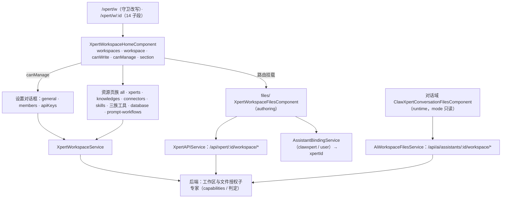

# C0 使用总览：工作区子专家（Xpert 前端 · `/xpert/w/**`）

> 一句话定位：工作区（**创作容器** `xpert_workspace`）的**视图面与设置面**——工作区壳与列表、设置三页签、成员与可见性呈现、资源页族、authoring 文件面；**能力判定以后端 `getCapabilities` 为准，前端只做呈现与门控；前端不得自行推断文件权限**。
> 范围：`apps/cloud/src/app/features/xpert/workspace` ＝ **33 非 spec .ts / 14 spec**（实测；ki 与父级归档记 32，差异 [推测] 来自 `database/database-default-value.ts`、`connectors/workspace-connector-dialog.ts` 类辅助文件是否计入）；入口路由 `/xpert/w/*`（父级 `features/xpert/routes.ts` 的 `path: 'w'` → `loadChildren('./workspace/routes')`）。

**本文引用的文件**
- [routes.ts（工作区）](file://apps/cloud/src/app/features/xpert/workspace/routes.ts)
- [routes.ts（父级）](file://apps/cloud/src/app/features/xpert/routes.ts)
- [home.component.ts](file://apps/cloud/src/app/features/xpert/workspace/home/home.component.ts)
- [all.component.ts](file://apps/cloud/src/app/features/xpert/workspace/all/all.component.ts)
- [welcome.component.ts](file://apps/cloud/src/app/features/xpert/workspace/welcome/welcome.component.ts)
- [settings.component.ts](file://apps/cloud/src/app/features/xpert/workspace/settings/settings.component.ts)
- [general.component.ts](file://apps/cloud/src/app/features/xpert/workspace/settings/general/general.component.ts)
- [members.component.ts](file://apps/cloud/src/app/features/xpert/workspace/settings/members/members.component.ts)
- [settings-page.component.ts](file://apps/cloud/src/app/features/xpert/workspace/settings/settings-page.component.ts)
- [files.component.ts](file://apps/cloud/src/app/features/xpert/workspace/files/files.component.ts)
- [xpert-workspace.service.ts](file://apps/cloud/src/app/@core/services/xpert-workspace.service.ts)（`XpertWorkspaceService`）
- [xpert.service.ts](file://apps/cloud/src/app/@core/services/xpert.service.ts)（`XpertAPIService` authoring 文件族）
- [ai-workspace-files.service.ts](file://apps/cloud/src/app/@core/services/ai-workspace-files.service.ts)（`AiWorkspaceFilesService` runtime 文件族）
- [xpert-workspace.model.ts](file://packages/contracts/src/ai/xpert-workspace.model.ts)
- [workbench.types.ts](file://apps/cloud/src/app/@shared/files/workbench/workbench.types.ts)
- [clawxpert-conversation-files.component.ts](file://apps/cloud/src/app/features/chat/clawxpert/clawxpert-conversation-files.component.ts)（runtime 面对照）
- [AGENTS.md](file://AGENTS.md)（三元权限面硬约束）
- [C1-能力契约.md（后端工作区与文件授权子专家）](file://.module-experts/后端专题/Assistant 定义与运行时专家/sub-experts/工作区与文件授权子专家/C1-能力契约.md)
- [06-测试.md（本子专家）](file://.module-experts/前端专题/Xpert 工作台专家/sub-experts/工作区子专家/implementation/06-测试.md)
- [C1-能力契约.md（本子专家）](file://.module-experts/前端专题/Xpert 工作台专家/sub-experts/工作区子专家/C1-能力契约.md)

## 目录
1. [定位与何时找](#定位与何时找)
2. [资产基线与契约自足](#资产基线与契约自足)
3. [能力清单](#能力清单)
4. [边界](#边界)
5. [已知问题与常见坑](#已知问题与常见坑)

## 1. 定位与何时找

本子域是「**一个宿主壳 + 一族资源页 + 一个设置对话框 + 一个文件 façade**」：`XpertWorkspaceHomeComponent` 常驻 `:id` 子树并集中持有工作区实体与门控信号，子页面只 `inject` 读；设置面与文件面是对话框 / 独立组件；所有出向依赖只到 `@core`、`@shared` 与 `@xpert-ai/headless-ui`。

图表来源：[routes.ts（工作区）](file://apps/cloud/src/app/features/xpert/workspace/routes.ts)（关键符号：`redirectToSelectedWorkspace`、`path: ':id'`）· [home.component.ts](file://apps/cloud/src/app/features/xpert/workspace/home/home.component.ts)（关键符号：`canWriteWorkspace`、`canManageWorkspace`、`section`）· [files.component.ts](file://apps/cloud/src/app/features/xpert/workspace/files/files.component.ts)（关键符号：`XpertWorkspaceFilesComponent.xpertId`）· [clawxpert-conversation-files.component.ts](file://apps/cloud/src/app/features/chat/clawxpert/clawxpert-conversation-files.component.ts)（关键符号：`mode`、`AiWorkspaceFilesService`）

**何时找（10 条）**
1. **改工作区列表 / 切换 / 默认工作区**（搜索、owner 标记、设为默认但不切换选中）→ `home/home.component.ts`。
2. **改工作区详情取数**（列表项即详情、`equal: a?.id === b?.id`、设置对话框才单独 `getOneById`）→ `home/home.component.ts`、`settings/settings.component.ts`。
3. **改设置面**（对话框三页签 general / members / apiKeys、`workspaceRevision` 重取）→ `settings/settings.component.ts`。
4. **改可见性三态与改名**（`shared` 开关、`isTenantWorkspace` 推导、失败保留 `savedVisibility`）→ `settings/general/general.component.ts`。
5. **改成员呈现**（整体覆盖写、owner 展示与排除、`UserRoleSelect` 排除已有成员）→ `settings/members/members.component.ts`。
6. **改路由入口 / 守卫 / `section` 映射**（`redirectToSelectedWorkspace`、`settings` 段重定向）→ `workspace/routes.ts`。
7. **改 URL ↔ 选中工作区同步**（`paramId`、`store.setWorkspace`、`syncWorkspaceRoute`、前进后退高亮）→ `home/home.component.ts`。
8. **改文件面**（浏览 / 上传 / 保存 / 删除 / 下载、空态、`hasChildren → .zip`）→ `files/files.component.ts`、`files.component.html`。
9. **改资源页**（助手 / 知识库 / 连接器 / 技能 / 内置/MCP/自定义工具 / 数据库 / 提示词工作流）→ 对应子目录，统一 `inject(XpertWorkspaceHomeComponent)` 读门控。
10. **改错误态与排障 / 跑测试**（toast、局部 `loadError`、概览 `—` 降级）→ 见 `implementation/06-测试.md` 的缺口清单。

章节来源：[home.component.ts](file://apps/cloud/src/app/features/xpert/workspace/home/home.component.ts)（关键符号：`workspaces`、`selectWorkspace`、`syncWorkspaceRoute`、`setDefaultWorkspace`）· [general.component.ts](file://apps/cloud/src/app/features/xpert/workspace/settings/general/general.component.ts)（关键符号：`canEditVisibility`、`savedVisibility`）· [files.component.ts](file://apps/cloud/src/app/features/xpert/workspace/files/files.component.ts)（关键符号：`loadFiles`、`downloadFile`、`requireXpertId`）

## 2. 资产基线与契约自足

`C0-使用总览.md` 与 [C1-能力契约.md（本子专家）](file://.module-experts/前端专题/Xpert 工作台专家/sub-experts/工作区子专家/C1-能力契约.md) 自足可用；能力与文件权限的**权威判定**不在本子域，遇到「前端该不该放行」的疑问一律回到后端子专家的 C0/C1。

| 项 | 值 |
|---|---|
| 源码范围 | `apps/cloud/src/app/features/xpert/workspace`（33 非 spec / 14 spec） |
| 入口路由 | `/xpert/w`（守卫改写为 `/xpert/w/:id[/section]`）· `/xpert/w/:id/{'',xperts,knowledges,clawxpert-knowledges,files,custom,connectors,clawxpert-connectors,builtin,mcp,database,skills,clawxpert-skills,settings,prompt-workflows}` |
| 技术底座 | Angular standalone + signal（`computed` / `toSignal` / `derivedAsync` / `model`）+ `@angular/cdk` 对话框 + `@shared/files` 工作台 |
| 核心契约 | `XpertWorkspaceService`（`getAllMy`/`canRead|canRun|canWrite|canManage`/`updateVisibility`/`updateMembers`/`refresh`）、`XpertWorkspaceHomeComponent` 门控信号、`XpertAPIService./:id/workspace/*`、`redirectToSelectedWorkspace` |
| 测试状态 | 14 spec（离线化；父级归档 92 = 36 PASS / 55 FAIL 含本子域 `prompt-workflows` 2 个 `@milkdown/crepe` 环境级缺依赖） |
| 后端引用面 | `/api/xpert-workspace/*`（工作区与文件授权子专家）、`/api/xpert/:id/workspace/*`（authoring 文件）、`/api/ai/assistants/:id/workspace/*`（runtime 文件，对话域消费） |

章节来源：[xpert-workspace.service.ts](file://apps/cloud/src/app/@core/services/xpert-workspace.service.ts)（关键符号：`XpertWorkspaceService.getAllMy`、`canRead`、`canWrite`、`canManage`、`updateMembers`、`updateVisibility`）· [xpert.service.ts](file://apps/cloud/src/app/@core/services/xpert.service.ts)（关键符号：`getWorkspaceFiles`、`uploadWorkspaceFileToFolder`、`downloadWorkspaceFile`）· [06-测试.md（本子专家）](file://.module-experts/前端专题/Xpert 工作台专家/sub-experts/工作区子专家/implementation/06-测试.md)（关键符号：`14 个 spec`、`@milkdown/crepe`）

## 3. 能力清单

| 能力 | 入口（组件 / 服务 / 路由） | 一句话 |
|---|---|---|
| 工作区壳与列表 | `XpertWorkspaceHomeComponent`（`/xpert/w`、`/xpert/w/:id`） | `getAllMy(purpose:'authoring')` + 菜单/搜索 + 选中态与 URL 双向同步 |
| 默认工作区 | `loadDefaultWorkspace` / `setDefaultWorkspace` | 版本号丢弃过期响应；**设默认不切换选中**（只 `stopPropagation` + 打接口） |
| 工作区设置对话框 | `XpertWorkspaceSettingsComponent` | 三页签 general / members / apiKeys；`workspaceRevision` 驱动重取，`canRead === false` 自关闭 |
| 可见性三态 | `XpertWorkspaceSettingsGeneralComponent` | `shared` 开关 + `isTenantWorkspace`（`!organizationId`）推导 `tenant-shared` / `organization-shared` / `private` |
| 归档与硬删 | 同上（`archive` / `delete`） | 需输入工作区名确认；成功后 `archived` / `deleted` 冒泡到壳层回 `/xpert/w` |
| 成员覆盖 | `XpertWorkspaceMembersComponent` | `getMembers` → `uniqBy` 本地合并 → `updateMembers(id, string[])` 整体覆盖；owner 只展示与排除 |
| 资源页族 | `all` · `xperts` · `knowledges`(+`knowledges-page`) · `connectors`(+dialog) · `skills` · `builtin`/`mcp`/`custom` · `database` · `prompt-workflows` | 各自取数，统一从宿主读 `workspace` / `canWriteWorkspace` / `section` / 标签源 |
| 概览计数页（未挂载） | `XpertWorkspaceSettingsPageComponent` | `forkJoin` 5 项计数（assistants/skills/environments/mcpTools/knowledgebases），单点失败降级为 `—` |
| 文件面（authoring） | `XpertWorkspaceFilesComponent` → `FileWorkbenchComponent`（`layout="library"`） | 7 个回调映射到 `/api/xpert/:id/workspace/*`；`xpertId` 来自 ClawXpert 用户绑定 |
| 入口守卫 | `redirectToSelectedWorkspace`（`routes.ts`） | 取 `AppQuery.selectedWorkspace ?? PersistQuery.workspaceId`，`section` 映射子段；无 id 放行交宿主空态 |
| 工作区服务 | `XpertWorkspaceService`（`@core`） | CRUD + 默认工作区 + 成员 + 可见性 + 归档 + 能力呈现（`canX ?? true`）+ `refresh()` |
| 欢迎 / 空态 | `XpertWorkspaceWelcomeComponent` | 取前 10 个工作区做欢迎面 |

章节来源：[settings.component.ts](file://apps/cloud/src/app/features/xpert/workspace/settings/settings.component.ts)（关键符号：`selectedMenus`、`workspaceRevision`、`onUpdated`）· [members.component.ts](file://apps/cloud/src/app/features/xpert/workspace/settings/members/members.component.ts)（关键符号：`allMembers`、`updateMembers`、`openAddUser`）· [routes.ts（工作区）](file://apps/cloud/src/app/features/xpert/workspace/routes.ts)（关键符号：`redirectToSelectedWorkspace`、`canDeactivate`）

## 4. 边界

1. **能力四动作的判定本身归后端「工作区与文件授权子专家」**：`canRead/canRun/canWrite/canManage`、`assertCan*`、UserGroup→`canRun` 桥接；前端只消费 `workspace.capabilities`。
2. **前端不得自行推断文件权限**：文件 ACL 与「authoring / runtime」入口由服务端代码选定（`AssistantFilesService.forAuthoring|forRuntime`）；前端只能按接口分工调用，**没有回退路径**。
3. **文件物理读写与卷作用域归后端**：`xperts` / `user-xperts` 目录归属与 `resolveXpertDataVolumeScope` 不在本子域；运行时会话文件面在**对话域** `ClawXpertConversationFilesComponent`。
4. **文件工作台渲染内核归共享层**：树 / 编辑器 / 预览与 `FileWorkbench*` 回调类型在 `@shared/files`；本子域只做 façade 接线。
5. **助手管理页、工具集配置面、知识库主体、提示词工作流契约**归各自范围（父级专题与对应子域）；本子域只提供工作区维度的接线点。
6. **侧栏工作区切换器与对话页**归 `features/sidebar`、`features/chat`；它们以 `/xpert/w/:id` 导航**消费**本子域，不属本子域实现。
7. **登录与全站鉴权**归 `features-routing.module.ts` 的 `authGuard`；本子域只声明 `redirectToSelectedWorkspace` 是重定向函数而非权限守卫。
8. **门控是呈现、不是安全边界**：能力位用于隐藏/禁用按钮与自动收尾，真正的拒绝由后端守卫返回码产生。

章节来源：[AGENTS.md](file://AGENTS.md)（关键符号：硬约束「三元权限面不可互换」「UserGroup 只桥接 canRun」「不得用 `XpertService.findOne()` 当文件 ACL」）· [C1-能力契约.md（后端工作区与文件授权子专家）](file://.module-experts/后端专题/Assistant 定义与运行时专家/sub-experts/工作区与文件授权子专家/C1-能力契约.md)（关键符号：`getCapabilities`、`forRuntime` / `forAuthoring`、`hasPublishedXpertRunAccess`）· [workbench.types.ts](file://apps/cloud/src/app/@shared/files/workbench/workbench.types.ts)（关键符号：`FileWorkbenchFileDownloader`、`FileWorkbenchLayout`）

## 5. 已知问题与常见坑

1. **① 三元权限面不可互换，落点在「页面只用能力位、入口由服务端选定」**：创作（`WorkspaceAuthoringGuard`）/ 运行（`PublishedXpertAccessService`）/ 文件（`forRuntime|forAuthoring`）三面各自成立；frontend 既不能用 worksapce `canRun` 当文件 ACL，也不得在 runtime 被拒时改走 authoring 入口（代码中无此分支）。
2. **② UserGroup 只补 `canRun`**：`workspace/**` 对 `UserGroup` **零引用**，成员列表是用户数组且无角色；通过用户组获得运行权的用户**不会**出现在成员里——成员页只能表达成员资格，不得把「非成员」呈现为「无权限」，也不得用成员列表反推 `canRun`。
3. **③ 可见性 `shared`/`user` 对呈现的影响**：可见性是**三态**（`private` / `tenant-shared` / `organization-shared`）而非布尔；`getXpertWorkspaceVisibility` 把未知值统一降级为 `private`；UI 只有一个 `shared` 开关，落库口径由 `workspace.organizationId` 是否存在决定（存在 → `organization-shared`，否则 `tenant-shared`）。注意 `XpertWorkspaceDataScope`（`'shared' | 'user'`）是**助手数据卷**语义，与本可见性不是同一件事。
4. **④ 403 / 404 的呈现差异缺失**：本子域**没有状态码分支与面级错误页**，错误只走 toast、局部 `loadError` 与空态；因此「能力不足 / 归档态」（403）与「工作区不存在 / 已删」（404）在 UI 上几乎不可区分——[推测] 属呈现层缺口，不是鉴权缺口。
5. **⑤ `/xpert/w/*` 与 `/w/*` 入口差异**：仓库唯一注册点是 `features/xpert/routes.ts`（`path: '' → redirectTo: 'w'`，`path: 'w'` → `loadChildren`）；ki 与父级文档把入口写作 `/w/*`，实为 **`/xpert/w/*` 的简写**，全仓无顶层 `/w` 路由注册。
6. **⑥ 成员变更后的刷新是「局部 + 手动」**：`updateMembers` 是整体覆盖（本地 `uniqBy` 乐观合并 → `PUT` id 数组）；设置面靠 `workspaceRevision` / `onUpdated` 重取详情，工作区列表与资源页**不因成员变更自动刷新**。
7. **⑦ 文件操作期间的 loading 与失败回滚**：workspace 文件面**不做本地能力判定**，写能力由服务端返回码约束；`downloadFile` 先 `firstValueFrom` 取 blob，`item.hasChildren` 时文件名加 `.zip`；失败只 toast——代码中未见乐观回滚实现 [推测]。
8. **⑧ 能力位缺省放行（`?? true`）与后端收紧默认相反**：`canX(workspace)` 在拿不到实体（或缺能力位）时**放行**，而后端「不满足即四项全 false」；因此门控只应在前端能引用「已加载的工作区实体」处生效，把它当安全边界即错位。
9. **⑨ `files` 页与 `:id` 解耦**：`/xpert/w/:id/files` 不消费路由 `:id`，只认 `AssistantBindingService.get(CLAWXPERT, USER).assistantId`（缺失时模板空态 + 回调 `throw new Error('Claw Xpert is not configured')`）；多工作区用户看到的是同一份 ClawXpert 卷 [推测] 是否为设计意图待确认。
10. **⑩ 孤儿页与双实现**：`settings` 段是 `redirectTo: '/chat/clawxpert'`，`XpertWorkspaceSettingsPageComponent` / `XpertWorkspaceModelsComponent` 全仓仅被自身（或 spec）引用；`section → routeSegment` 映射在 `routes.ts` 与 `home.component.ts`（`syncWorkspaceRoute`）**各写一份**，改一处漏一处即出现「首跳对、改写不对」的静默偏差；14 个 spec 中**文件面、成员、路由守卫均无覆盖**。

章节来源：[AGENTS.md](file://AGENTS.md)（关键符号：三元权限面、`canRun` 只桥接）· [members.component.ts](file://apps/cloud/src/app/features/xpert/workspace/settings/members/members.component.ts)（关键符号：`updateMembers`、`openAddUser`）· [xpert-workspace.model.ts](file://packages/contracts/src/ai/xpert-workspace.model.ts)（关键符号：`getXpertWorkspaceVisibility`、`TXpertWorkspaceVisibility`）· [files.component.ts](file://apps/cloud/src/app/features/xpert/workspace/files/files.component.ts)（关键符号：`xpertId`、`requireXpertId`、`downloadFile`）· [06-测试.md（本子专家）](file://.module-experts/前端专题/Xpert 工作台专家/sub-experts/工作区子专家/implementation/06-测试.md)（关键符号：`缺口`、`文件授权回归无前端覆盖`）
