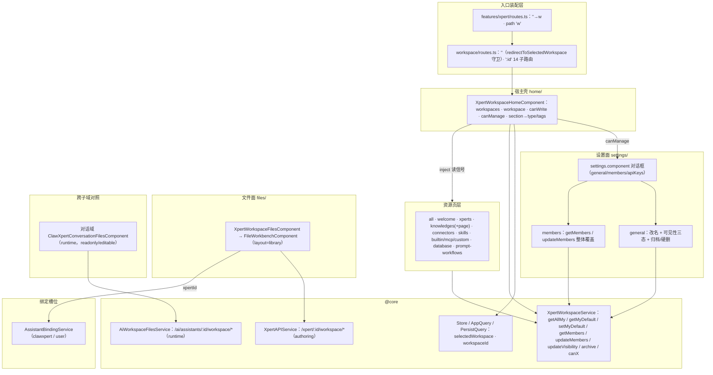

# 01 架构：工作区子专家（Xpert 前端 · 工作区面 `/xpert/w/**`）

> 父级专题：**Xpert 工作台专家**（模块根 `apps/cloud/src/app/features/xpert`，不含 `studio/`）
> 本子域根：`apps/cloud/src/app/features/xpert/workspace`（实测 **33 非 spec .ts / 14 spec**；ki 与父级归档记 **32**，差异 `[推测]` 来自 `database/database-default-value.ts`、`connectors/workspace-connector-dialog.ts` 这类辅助文件是否计入）
> 一句话：工作区是**创作容器**（`xpert_workspace`）的视图面与设置面。
> **权力边界（本子域第一原则）**：能力判定以后端 `XpertWorkspaceAccessService.getCapabilities` 为准，**前端只做呈现与门控**；**前端不得自行推断文件权限**——文件 ACL 与「authoring / runtime」入口由服务端代码选定，前端只能按接口分工调用。

**本文引用的文件**

- [routes.ts](file://apps/cloud/src/app/features/xpert/workspace/routes.ts)
- [home.component.ts](file://apps/cloud/src/app/features/xpert/workspace/home/home.component.ts)
- [home.component.html](file://apps/cloud/src/app/features/xpert/workspace/home/home.component.html)
- [all.component.ts](file://apps/cloud/src/app/features/xpert/workspace/all/all.component.ts)
- [welcome.component.ts](file://apps/cloud/src/app/features/xpert/workspace/welcome/welcome.component.ts)
- [xperts.component.ts](file://apps/cloud/src/app/features/xpert/workspace/xperts/xperts.component.ts)
- [knowledges.component.ts](file://apps/cloud/src/app/features/xpert/workspace/knowledges/knowledges.component.ts)
- [knowledges-page.component.ts](file://apps/cloud/src/app/features/xpert/workspace/knowledges/knowledges-page.component.ts)
- [files.component.ts](file://apps/cloud/src/app/features/xpert/workspace/files/files.component.ts)
- [files.component.html](file://apps/cloud/src/app/features/xpert/workspace/files/files.component.html)
- [settings.component.ts](file://apps/cloud/src/app/features/xpert/workspace/settings/settings.component.ts)
- [settings-page.component.ts](file://apps/cloud/src/app/features/xpert/workspace/settings/settings-page.component.ts)
- [general.component.ts](file://apps/cloud/src/app/features/xpert/workspace/settings/general/general.component.ts)
- [members.component.ts](file://apps/cloud/src/app/features/xpert/workspace/settings/members/members.component.ts)
- [models.component.ts](file://apps/cloud/src/app/features/xpert/workspace/settings/models/models.component.ts)
- [xpert-workspace.service.ts](file://apps/cloud/src/app/@core/services/xpert-workspace.service.ts)
- [xpert.service.ts](file://apps/cloud/src/app/@core/services/xpert.service.ts)
- [ai-workspace-files.service.ts](file://apps/cloud/src/app/@core/services/ai-workspace-files.service.ts)
- [xpert-workspace.model.ts](file://packages/contracts/src/ai/xpert-workspace.model.ts)
- [xpert.model.ts](file://packages/contracts/src/ai/xpert.model.ts)
- [clawxpert-conversation-files.component.ts](file://apps/cloud/src/app/features/chat/clawxpert/clawxpert-conversation-files.component.ts)
- [AGENTS.md](file://AGENTS.md)
- [C0-使用总览.md](file://.module-experts/后端专题/Assistant 定义与运行时专家/sub-experts/工作区与文件授权子专家/C0-使用总览.md)
- [C1-能力契约.md](file://.module-experts/后端专题/Assistant 定义与运行时专家/sub-experts/工作区与文件授权子专家/C1-能力契约.md)
- [01-架构.md](file://.module-experts/前端专题/Xpert 工作台专家/implementation/01-架构.md)
- [05-接口.md](file://.module-experts/前端专题/Xpert 工作台专家/implementation/05-接口.md)

## 目录

- [职责与边界](#职责与边界)
- [目录结构与分层](#目录结构与分层)
- [依赖关系](#依赖关系)
- [关键不变量](#关键不变量)
- [架构总览](#架构总览)
- [结论](#结论)

## 职责与边界

**做什么（六件事）**

1. **工作区壳与列表**：`XpertWorkspaceHomeComponent` 是 `/xpert/w` 与 `/xpert/w/:id` 的唯一宿主，拉「我的工作区」(`getAllMy`，`purpose: 'authoring'`)、渲染工作区切换菜单、默认工作区、按 `section` 派生筛选类型与标签源。
2. **默认工作区**：`getMyDefault` / `setMyDefault` 与「设为默认但不切换选中工作区」的交互（`setDefaultWorkspace` 只 `stopPropagation` + 打接口，不写 `Store.setWorkspace`）。
3. **工作区设置面**：`XpertWorkspaceSettingsComponent` 对话框（general / members / apiKeys 三页签）承载改名、可见性、归档、硬删、成员覆盖与工作区级 API Key 绑定。
4. **成员与可见性呈现**：`XpertWorkspaceMembersComponent` 做成员整体覆盖；`XpertWorkspaceSettingsGeneralComponent` 做 `private` / `tenant-shared` / `organization-shared` 三态开关。
5. **工作区资源页**：`all`（聚合壳）、`xperts`、`knowledges` / `clawxpert-knowledges`、`connectors` / `clawxpert-connectors`、`skills` / `clawxpert-skills`、`builtin` / `mcp` / `custom`（工具）、`database`、`prompt-workflows`、`files`。
6. **文件与卷**：`/xpert/w/:id/files` 用 `XpertAPIService` 的 `/api/xpert/:id/workspace/*`（Studio 创作文件面，后端 `forAuthoring`）驱动共享 `FileWorkbenchComponent`（`layout="library"`）。

**不做什么（逐条给出「谁家」）**

| 不在范围内 | 谁家（交叉引用） |
| --- | --- |
| 能力四动作的**判定本身**（`canRead/canRun/canWrite/canManage`、`assertCan*`、UserGroup 只补 `canRun`） | 后端「工作区与文件授权子专家」：[C1-能力契约.md](file://.module-experts/后端专题/Assistant 定义与运行时专家/sub-experts/工作区与文件授权子专家/C1-能力契约.md) |
| 文件卷的 runtime 入口与物理读写、`xperts`/`user-xperts` 目录归属 | 后端 `AssistantFilesService.forRuntime/forAuthoring` 与 `resolveXpertDataVolumeScope`；前端 runtime 侧的呈现件在**对话域** [clawxpert-conversation-files.component.ts](file://apps/cloud/src/app/features/chat/clawxpert/clawxpert-conversation-files.component.ts) |
| 工作区文件的 `TFile` / `TFileDirectory` 渲染内核（树、编辑器、预览） | 共享层 `@shared/files`：[workbench.types.ts](file://apps/cloud/src/app/@shared/files/workbench/workbench.types.ts) |
| 助手管理页、工具集配置、知识库主体、提示词工作流契约 | 父级专题与 `prompt-workflows/*` 自身；本文只列工作区面的接线点 |
| 侧栏工作区切换器、对话页 | `features/sidebar`、`features/chat`（跨子域消费 `/xpert/w/:id` 导航） |
| 登录与全站鉴权、路由级权限注解 | `features-routing.module.ts` 的 `authGuard`（父级专题口径） |

**ACL 口径（务必原样继承）**：`AGENTS.md` 的硬约束段写明「三元权限面不可互换」（创作 `WorkspaceAuthoringGuard` / 运行 `PublishedXpertAccessService` / 文件 `AssistantFilesService.forRuntime|forAuthoring`），且「**不得用 `XpertService.findOne()` / workspace `canRun` 当文件 ACL**」、UserGroup 只桥接 `canRun`。本子域因此**不做任何权限推断**：页面只消费 `workspace.capabilities` 与后端返回码。

章节来源：[home.component.ts](file://apps/cloud/src/app/features/xpert/workspace/home/home.component.ts)（关键符号：`XpertWorkspaceHomeComponent.workspaces`、`setDefaultWorkspace`、`openSettings`）、[settings.component.ts](file://apps/cloud/src/app/features/xpert/workspace/settings/settings.component.ts)（关键符号：`XpertWorkspaceSettingsComponent`、`onUpdated`）、[AGENTS.md](file://AGENTS.md)（关键符号：硬约束「三元权限面不可互换」「UserGroup 只桥接 canRun」）、[C0-使用总览.md](file://.module-experts/后端专题/Assistant 定义与运行时专家/sub-experts/工作区与文件授权子专家/C0-使用总览.md)（关键符号：三元权限面、UserGroup 只补 canRun）

## 目录结构与分层

| 目录 / 文件 | 层 | 职责 |
| --- | --- | --- |
| `routes.ts` | 入口装配层 | `''`（`redirectToSelectedWorkspace` 守卫改写 URL）与 `:id`（14 子路由）两段；只做路由与 `title`/`scopeContext`，不持业务状态 |
| `home/` | 宿主壳层 | 工作区集合取数、选中态同步、工作区菜单、默认工作区、设置/环境变量/自定义连接器对话框入口、`section` → 筛选取数与标签源 |
| `all/` `welcome/` | 聚合 / 空态层 | `XpertWorkspaceAllComponent` 复用 `xperts`+`knowledges`+三族工具；`XpertWorkspaceWelcomeComponent` 取前 10 个工作区做欢迎页 |
| `settings/` | 设置面 | `settings.component`（对话框壳 + 同名化取数）、`general/`（改名/可见性/归档/删）、`members/`（成员覆盖）、`models/`（空壳）、`settings-page.component`（工作区概览页） |
| `files/` | 文件面（authoring） | `XpertWorkspaceFilesComponent` 把 7 个 `FileWorkbench*` 回调绑到 `XpertAPIService./:id/workspace/*` |
| `xperts/` `knowledges/` `connectors/` `skills/` `builtin-tools/` `mcp-tools/` `api-tools/` `database/` `prompt-workflows/` | 资源页层 | 各自独立取数，统一从 `homeComponent` 读 `workspace` / `canWriteWorkspace` / 搜索与标签信号 |

**分层与依赖方向（自上而下单向）**

1. 入口装配层（`routes.ts`）只做分流：`redirectToSelectedWorkspace` 用 `AppQuery.selectedWorkspace?.id ?? PersistQuery.workspaceId` 决定跳 `/xpert/w/:id`，并按 `section` 映射到 `clawxpert-skills` / `clawxpert-knowledges` / `clawxpert-connectors` / `files` / `settings`。
2. 宿主壳层常驻 `:id` 子树；**子页面不自己取工作区**，而是 `inject(XpertWorkspaceHomeComponent)` 读其信号（`workspace`、`canWriteWorkspace`、`canManageWorkspace`、`type`、`searchText`、`toolTags`）。
3. 设置面与文件面是**对话框/独立组件**，前者由宿主菜单按 `canManage` 打开，后者由路由直接挂载。
4. 所有出向依赖只到 `@core`（服务与类型）、`@shared`（文件工作台、用户选择器、标签）、`@xpert-ai/headless-ui`；不反向 import 业务域。
5. 唯一跨子域**入向**依赖是共享层与 workspace 页面的双向共享：`ClawXpertConversationFilesComponent`（对话域）与 `files.component` 用同一套 `FileWorkbench*` 回调类型，但分别对接 runtime / authoring 两个接口族。

章节来源：[routes.ts](file://apps/cloud/src/app/features/xpert/workspace/routes.ts)（关键符号：`redirectToSelectedWorkspace`、`path: ':id'`）、[all.component.ts](file://apps/cloud/src/app/features/xpert/workspace/all/all.component.ts)（关键符号：`XpertWorkspaceAllComponent.homeComponent`）、[welcome.component.ts](file://apps/cloud/src/app/features/xpert/workspace/welcome/welcome.component.ts)（关键符号：`XpertWorkspaceWelcomeComponent.workspaces`）、[01-架构.md](file://.module-experts/前端专题/Xpert 工作台专家/implementation/01-架构.md)（关键符号：`workspace/` 子域分层表）

## 依赖关系

**出向依赖（本子域 → 外部）**

| 依赖面 | 具体符号（file://） | 用途 |
| --- | --- | --- |
| 工作区 CRUD 与能力呈现 | [xpert-workspace.service.ts](file://apps/cloud/src/app/@core/services/xpert-workspace.service.ts)（`getAllMy`、`getMyDefault`、`setMyDefault`、`getMembers`、`updateMembers`、`updateVisibility`、`archive`、`refresh`、`canRead/canRun/canWrite/canManage`、`isTenantShared`） | 列表、默认工作区、成员、可见性、归档、门控 |
| 创作文件面 | [xpert.service.ts](file://apps/cloud/src/app/@core/services/xpert.service.ts)（`getWorkspaceFiles`、`getWorkspaceFile`、`downloadWorkspaceFile`、`saveWorkspaceFile`、`saveWorkspaceBinaryFile`、`uploadWorkspaceFileToFolder`、`deleteWorkspaceFile`） | `/xpert/w/:id/files` 的 7 个回调 |
| 运行时文件面（对照，跨子域） | [ai-workspace-files.service.ts](file://apps/cloud/src/app/@core/services/ai-workspace-files.service.ts)（同名 7 方法，前缀 `/ai/assistants`） | 对话域 `ClawXpertConversationFilesComponent` 的 `forRuntime` 侧 |
| 契约类型与归一函数 | [xpert-workspace.model.ts](file://packages/contracts/src/ai/xpert-workspace.model.ts)（`IXpertWorkspace`、`TXpertWorkspaceVisibility`、`TXpertWorkspaceCapabilities`、`getXpertWorkspaceVisibility`）、[xpert.model.ts](file://packages/contracts/src/ai/xpert.model.ts)（`XpertWorkspaceDataScope`）、`TFile`/`TFileDirectory`（`contracts/storage-file.model.ts`） | 类型契约 |
| 列表取数与缓存 | `Store`（`user$`）、`selectOrganizationId`、`injectWorkspace`、`AppQuery`/`PersistQuery` | 作用域键与选中工作区 |
| 共享 UI | `@shared/files`（`FileWorkbenchComponent` 及 7 个 Loader/Saver 类型）、`@shared/user`（`UserRoleSelectComponent`、`UserProfileInlineComponent`）、`@shared/tag`、`@xpert-ai/headless-ui`、`@angular/cdk/{dialog,drag-drop,listbox,menu,overlay}` | 文件工作台、成员选择、标签筛选、对话框 |
| 绑定槽位 | `AssistantBindingService` + `AssistantCode.CLAWXPERT` + `AssistantBindingScope.USER` | `files` 页解析 `xpertId` |

**入向依赖（谁依赖本子域）**

1. **父级专题路由**：[features/xpert/routes.ts](file://apps/cloud/src/app/features/xpert/routes.ts) 里 `path: ''` → `redirectTo: 'w'`、`path: 'w'` → `loadChildren(() => import('./workspace/routes'))`；工作区是 `/xpert/**` 下唯一的 `w` 段。
2. **全站导航写入方**：助手管理页 `manage.component`、工具详情 `api-tool.component`、Studio `xpert-api.service.gotoWorkspace`、助手切换器 `switcher.component.backToWorkspace`、explore 的 agents/skills 入口、侧栏菜单，均以 `router.navigate(['/xpert/w', workspaceId, ...])` 回跳本子域。
3. **绑定刷新链**：`AssistantBindingService.changes$`（`code=clawxpert`、`scope=user`）触发 `files` 页重解析 `xpertId`。
4. **共享层**：`@shared/files` 的 `FileWorkbench*` 类型同时被本子域与对话域消费，是本子域与外部唯一「窄接口」型耦合点。

章节来源：[xpert-workspace.service.ts](file://apps/cloud/src/app/@core/services/xpert-workspace.service.ts)（关键符号：`getAllMy`、`canWrite`、`updateVisibility`、`getMembers`）、[xpert.service.ts](file://apps/cloud/src/app/@core/services/xpert.service.ts)（关键符号：`getWorkspaceFiles`、`uploadWorkspaceFileToFolder`）、[files.component.ts](file://apps/cloud/src/app/features/xpert/workspace/files/files.component.ts)（关键符号：`AssistantBindingService.changes$`、`loadFiles`）、[05-接口.md](file://.module-experts/前端专题/Xpert 工作台专家/implementation/05-接口.md)（关键符号：`/api/xpert-workspace/*`、`/api/xpert/:id/workspace/*`）

## 关键不变量

1. **能力只读消费，不做推断**：组件只读 `workspace.capabilities`（经 `XpertWorkspaceService.canWrite/canManage` 与 `capabilities?.canRead === false`），从不自行计算权限；`openSettings` 需 `canManage`、`openEnvs` 与资源页新建/删除需 `canWrite`。
2. **能力缺省是「宽松」的**：`canRead/canRun/canWrite/canManage(workspace)` 实现为 `workspace?.capabilities?.canX ?? true`——**未拿到工作区实体（或后端未回能力位）时门控会放行**，与后端「不满足即四项全 false」的收紧默认相反。因此门控只应在前端能引用「已加载的工作区实体」处生效；把能力位当安全边界即错位。
3. **可见性是三态而非布尔**：`private` / `tenant-shared` / `organization-shared`，由 `getXpertWorkspaceVisibility` 把未知值统一降级为 `private`；UI 用一个 `shared` 开关映射，落库口径由 `workspace.organizationId` 是否存在决定（有 → `organization-shared`，无 → `tenant-shared`）。
4. **`/xpert/w` 与 `/xpert/w/:id` 必须与「当前选中工作区」双向同步**：宿主 effect 的优先级是「路由 id 命中列表 → `Store.setWorkspace`」「选中态命中 → `syncWorkspaceRoute` 改写 URL（保留子段、剔除 `section` 查询参数）」「都不命中 → 回落到 `workspaces[0]`」。
5. **文件页与工作区 `:id` 解耦**：`/xpert/w/:id/files` 不消费 `paramId`，只认 `AssistantBindingService.get(CLAWXPERT, USER).assistantId`；缺失时模板退化到空态，回调侧则 `throw new Error('Claw Xpert is not configured')`。
6. **两条文件入口在呈现层就分离**：workspace 页只接 authoring 端点（`/api/xpert/:id/workspace/*`），runtime 端点（`/api/ai/assistants/:id/workspace/*`）只出现在对话域组件里；前端**没有**「运行被拒就换入口」的回退路径。
7. **`section` 查询参数是「一次性的入口参数」**：只在 `redirectToSelectedWorkspace` 与 `syncWorkspaceRoute` 两处被消费，重写 URL 时会被剔除，避免刷新后反复改写路由。

章节来源：[xpert-workspace.service.ts](file://apps/cloud/src/app/@core/services/xpert-workspace.service.ts)（关键符号：`canRead`、`canWrite`、`canManage`、`isTenantShared`）、[home.component.ts](file://apps/cloud/src/app/features/xpert/workspace/home/home.component.ts)（关键符号：`canWriteWorkspace`、`canManageWorkspace`、`syncWorkspaceRoute`、`openSettings`）、[general.component.ts](file://apps/cloud/src/app/features/xpert/workspace/settings/general/general.component.ts)（关键符号：`isTenantWorkspace`、`currentVisibility`）、[xpert-workspace.model.ts](file://packages/contracts/src/ai/xpert-workspace.model.ts)（关键符号：`getXpertWorkspaceVisibility`、`TXpertWorkspaceVisibility`）

## 架构总览

图表来源：[routes.ts](file://apps/cloud/src/app/features/xpert/workspace/routes.ts)（关键符号：`redirectToSelectedWorkspace`）· [home.component.ts](file://apps/cloud/src/app/features/xpert/workspace/home/home.component.ts)（关键符号：`canWriteWorkspace`、`canManageWorkspace`、`section`）· [xpert-workspace.service.ts](file://apps/cloud/src/app/@core/services/xpert-workspace.service.ts)（关键符号：`XpertWorkspaceService`）· [files.component.ts](file://apps/cloud/src/app/features/xpert/workspace/files/files.component.ts)（关键符号：`XpertWorkspaceFilesComponent.xpertId`）· [clawxpert-conversation-files.component.ts](file://apps/cloud/src/app/features/chat/clawxpert/clawxpert-conversation-files.component.ts)（关键符号：`AiWorkspaceFilesService`、`mode`）

## 结论

- **职责可一句话收口**：本子域 = 工作区壳 + 工作区设置三页签 + 成员/可见性呈现 + 资源页族 + authoring 文件面；判定权全在后端，本子域只消费 `capabilities` 并做 UI 门控。
- **最脆的三处**：① 能力位「缺省放行」（`?? true`）与后端「缺省拒绝」语义相反，任何把 `canX()` 当安全边界的写法都错位；② `files` 页与 `:id` 解耦、依赖 `AssistantBindingService`，是「工作区文件」与「助手数据卷」两个概念的接缝处；③ 路由 id ↔ 选中工作区 ↔ URL 的三方同步（`syncWorkspaceRoute`）是刷新、书签、返回键一致性的唯一保障。
- **入口有两条但不在本子域合流**：authoring（本子域 `/xpert/w/:id/files`）与 runtime（对话域）各自对接独立服务与端点，符合「入口由服务端选定、运行被拒不得回退」的硬约束。
- **门控覆盖不均**：`canWrite` / `canManage` 在资源页与设置面广泛使用，`canRun` 与 `canRead` 在子域内几乎只有 `settings.onUpdated` 一处显式使用。
- 实现细节、热点路径、关键类清单与技术债见同目录 [02-实现.md](file://.module-experts/前端专题/Xpert 工作台专家/sub-experts/工作区子专家/implementation/02-实现.md)；类型与校验见 [04-模型.md](file://.module-experts/前端专题/Xpert 工作台专家/sub-experts/工作区子专家/implementation/04-模型.md)。

章节来源：[home.component.ts](file://apps/cloud/src/app/features/xpert/workspace/home/home.component.ts)（关键符号：`syncWorkspaceRoute`、`canWriteWorkspace`）、[settings.component.ts](file://apps/cloud/src/app/features/xpert/workspace/settings/settings.component.ts)（关键符号：`onUpdated`、`capabilities?.canRead`）、[xpert-workspace.service.ts](file://apps/cloud/src/app/@core/services/xpert-workspace.service.ts)（关键符号：`canRead`、`canRun`、`canWrite`、`canManage`）
