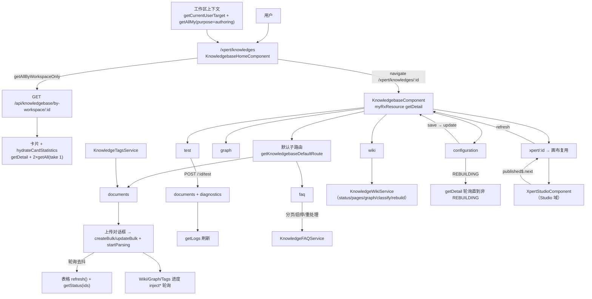
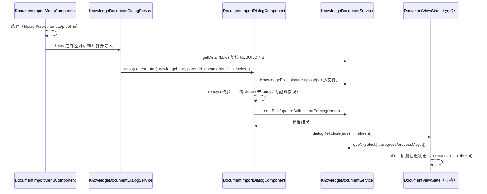
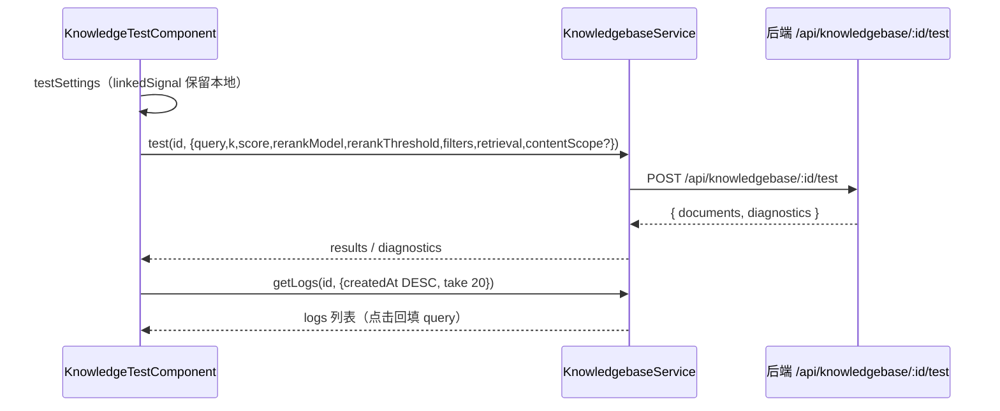

# 03 数据流转：知识库子专家（Xpert 前端 · `/xpert/knowledges/**`）

> 口径：本文件只描述**前端侧**的数据链与状态归属；实体、可见性、摄取语义、检索语义的权威定义归后端「知识库专家」，两端出现分歧时以后端为准（[C0-使用总览.md](file://.module-experts/后端专题/知识库专家/C0-使用总览.md)、[C1-能力契约.md](file://.module-experts/后端专题/知识库专家/C1-能力契约.md)）

**本文引用的文件**

- [routing.ts](file://apps/cloud/src/app/features/xpert/knowledge/routing.ts)
- [home.component.ts](file://apps/cloud/src/app/features/xpert/knowledge/home.component.ts)
- [home.utils.ts](file://apps/cloud/src/app/features/xpert/knowledge/home.utils.ts)
- [knowledgebase.component.ts](file://apps/cloud/src/app/features/xpert/knowledge/knowledgebase/knowledgebase.component.ts)
- [knowledgebase-route.ts](file://apps/cloud/src/app/features/xpert/knowledge/knowledgebase/knowledgebase-route.ts)
- [document-view-state.ts](file://apps/cloud/src/app/features/xpert/knowledge/knowledgebase/documents/document-view-state.ts)
- [documents.component.ts](file://apps/cloud/src/app/features/xpert/knowledge/knowledgebase/documents/documents.component.ts)
- [import-dialog.component.ts](file://apps/cloud/src/app/features/xpert/knowledge/knowledgebase/documents/import/import-dialog.component.ts)
- [import-menu.component.ts](file://apps/cloud/src/app/features/xpert/knowledge/knowledgebase/documents/import/import-menu.component.ts)
- [step.component.ts](file://apps/cloud/src/app/features/xpert/knowledge/knowledgebase/documents/step-3/step.component.ts)
- [document-wiki-status.ts](file://apps/cloud/src/app/features/xpert/knowledge/knowledgebase/documents/document-wiki-status.ts)
- [document-graph-status.ts](file://apps/cloud/src/app/features/xpert/knowledge/knowledgebase/documents/document-graph-status.ts)
- [document-tags-refresh.ts](file://apps/cloud/src/app/features/xpert/knowledge/tags/document-tags-refresh.ts)
- [test.component.ts](file://apps/cloud/src/app/features/xpert/knowledge/knowledgebase/test/test.component.ts)
- [faq.component.ts](file://apps/cloud/src/app/features/xpert/knowledge/knowledgebase/faq/faq.component.ts)
- [knowledge-tags.component.ts](file://apps/cloud/src/app/features/xpert/knowledge/tags/knowledge-tags.component.ts)
- [wiki.component.ts](file://apps/cloud/src/app/features/xpert/knowledge/knowledgebase/wiki/wiki.component.ts)
- [configuration.component.ts](file://apps/cloud/src/app/features/xpert/knowledge/knowledgebase/configuration/configuration.component.ts)
- [pipeline.component.ts](file://apps/cloud/src/app/features/xpert/knowledge/knowledgebase/pipeline/pipeline.component.ts)
- [pipelines.component.ts](file://apps/cloud/src/app/features/xpert/knowledge/knowledgebase/pipelines/pipelines.component.ts)
- [knowledgebase.service.ts](file://apps/cloud/src/app/@core/services/knowledgebase.service.ts)
- [knowledge-document.service.ts](file://apps/cloud/src/app/@core/services/knowledge-document.service.ts)
- [knowledge-tags.service.ts](file://apps/cloud/src/app/@core/services/knowledge-tags.service.ts)
- [knowledge-wiki.service.ts](file://apps/cloud/src/app/@core/services/knowledge-wiki.service.ts)
- [studio.component.ts](file://apps/cloud/src/app/features/xpert/studio/studio.component.ts)
- [publish.component.ts](file://apps/cloud/src/app/features/xpert/studio/header/publish/publish.component.ts)
- [studio-被复用-知识库流水线.md](file://CodeWikiHub/xpert/memory/关联关系/前端专题/studio-被复用-知识库流水线.md)

## 目录

- [五条链总览](#五条链总览)
- [链①：列表加载与可见性](#链列表加载与可见性)
- [链②：上传 → 摄取 → 进度](#链上传--摄取--进度)
- [链③：检索测试](#链检索测试)
- [链④：标签与 FAQ](#链标签与-faq)
- [链⑤：pipeline 画布装配](#链pipeline-画布装配)
- [前端态 vs 服务端态](#前端态-vs-服务端态)
- [已知风险](#已知风险)

## 五条链总览



图表来源：[home.component.ts](file://apps/cloud/src/app/features/xpert/knowledge/home.component.ts)（关键符号：`loadKnowledgebases`）· [knowledgebase.component.ts](file://apps/cloud/src/app/features/xpert/knowledge/knowledgebase/knowledgebase.component.ts)（关键符号：`#knowledgebase`、`refresh`）· [pipeline.component.ts](file://apps/cloud/src/app/features/xpert/knowledge/knowledgebase/pipeline/pipeline.component.ts)（关键符号：`publishedSub`）

章节来源：[routing.ts](file://apps/cloud/src/app/features/xpert/knowledge/routing.ts)（关键符号：`routes`）、[knowledgebase-route.ts](file://apps/cloud/src/app/features/xpert/knowledge/knowledgebase/knowledgebase-route.ts)（关键符号：`getKnowledgebaseDefaultRoute`）

## 链①：列表加载与可见性

- **上下文先行**：`#clawXpertContext` 合成链 = `Store.selectOrganizationId()` → `ClawXpertBindingTargetService.getCurrentUserTarget()` → 若有 target 则 `XpertWorkspaceService.getAllMy(undefined, { purpose: 'authoring' })` 并挑出 `items.find(w => w.id === target.workspaceId)`；任一步失败回落到 `{ target: null, workspace: null }`。派生 `workspaceId`、`canWriteWorkspace`。
- **取数**：`effect` 在上下文首次就绪后 `loadPreferences(workspaceId)` + `loadKnowledgebases()`；请求为 `getAllByWorkspaceOnly(workspaceId, { relations: ['createdBy'], order: { updatedAt: DESC } })`（`getAllByWorkspaceOnly` 内部再按 `item.workspaceId === id` 过滤一遍）。**`workspaceId` 为空时直接置空列表、不发请求**。
- **统计补全**：`hydrateCardStatistics` 对每张卡片 `forkJoin` 三路（`getDetail`、`getAll({select:['id'], where:{sourceType: FOLDER}, take:1})`、`getAll({select:['id'], where:{sourceType: {$ne: FOLDER}}, take:1})`），合成 `documentNum / chunkNum / folderNum`；每路 `catchError(() => of(null))`，缺数据时回落到列表值或 `null`。
- **可见性对列表的影响**：`personalKnowledgebases = permission 缺失或 Private`；`teamKnowledgebases = permission 为 Organization 或 Public`；`activeScope` 只做**视图切换**（all / favorites / recents / personal / team），`scope='all'` 用原始列表；收藏 / 置顶 / 最近 / 分组展开 / 侧栏宽度写 `localStorage`（key = `xpert:knowledge:${userId}:${workspaceId}:${kind}`），`removeUnavailablePreferences()` 在每次取到列表后剔除已消失 id。`canManage(item) = canWriteWorkspace() && item.workspaceId === workspaceId`（决定编辑/删除图标可用性）；`permissionLabel/permissionIcon` 只做标签与图标映射。
- **写后回流**：新建 / 编辑对话框 `closed` 返回真值 → `loadKnowledgebases()`；删除成功后本地清 favorites/pinned/recents → `persistPreferences()` → `loadKnowledgebases()`。`#requestVersion` 保证「切工作区期间旧响应不覆盖新列表」。

章节来源：[home.component.ts](file://apps/cloud/src/app/features/xpert/knowledge/home.component.ts)（关键符号：`#clawXpertContext`、`visibleKnowledgebases`、`removeUnavailablePreferences`）、[home.utils.ts](file://apps/cloud/src/app/features/xpert/knowledge/home.utils.ts)（关键符号：`splitKnowledgebases`）

## 链②：上传 → 摄取 → 进度



图表来源：[import-menu.component.ts](file://apps/cloud/src/app/features/xpert/knowledge/knowledgebase/documents/import/import-menu.component.ts)（关键符号：`open`、`DOCUMENT_IMPORT_SOURCES`）· [import-dialog.component.ts](file://apps/cloud/src/app/features/xpert/knowledge/knowledgebase/documents/import/import-dialog.component.ts)（关键符号：`saveAndProcess`、`ready`）· [document-view-state.ts](file://apps/cloud/src/app/features/xpert/knowledge/knowledgebase/documents/document-view-state.ts)（关键符号：`documentDelayRefresh$`）

- **源分流**：`files` 直传 `FileList`；`url|crawl|remote` 先由 `DocumentImportSourceDialogComponent` 产出 `Partial<IKnowledgeDocument>[]`；`pipeline` 打开 `KnowledgeDocumentPipelineComponent`，返回 `{ taskId }` 后用 `pollTaskStatus(kbId, taskId)` 跟随任务并持续 `imported.emit()`（**提交先于建档**）。
- **建档形态**：`buildImportDocuments(...)` 与 `documentsWithParserConfig` 把解析/切片/表格覆盖写进每个文档的 `parserConfig`；`parentId` 决定落点目录（`IMPORT_ROOT_FOLDER` ↔ 空串 ↔ `''`）。
- **摄取启动与进度**：启动经 `POST /api/knowledge-document/process`（`startParsing`，`mode: 'full' | 'rechunk'`）；进度有两条通道——① 表格面靠列表重取（`select` 里带 `progress / processMsg / processBeginAt / processDuation / processDuration`）并由 `effect` 去抖触发；② 向导第三步用 `GET /api/knowledge-document/status?ids=` 只补在途文档（`debounceTime(5000)`，首次任务文档为空时 `setTimeout(2000)` 重载任务）。
- **派生态进度并行**：文档表在开启相应配置时同时订阅三路进度——Wiki（`timer(0,5000)`、按批、缓存 key 含 `version/updatedAt/status/disabled`）、GraphRAG（活跃 5s / 落定 30s、`mergeMap(..., 2)` 限流、错误回落 `null`）、标签（5s + 可见性门）。
- **失败与停止**：停止任务 `DELETE /api/knowledge-document/:id/job`（前端先本地把同 `jobId` 置 `CANCEL`、`progress=0`）；重跑 `startParsing(id)`；重处理先 `GET /:id/reprocess-capabilities` 取 `rechunk.available` 再决定 `mode`；派生态各自独立的 `retryGraphDocument` / `retryJob`（Wiki 重试可能要求 `confirmAdditionalModelCharge`）。
- **写操作门**：所有入口在 `status === REBUILDING`（`vectorMutationLocked`）时早退，`DocumentImportDialogService` 在**打开对话框之前**再 `getDetail` 复核一次。

章节来源：[document-view-state.ts](file://apps/cloud/src/app/features/xpert/knowledge/knowledgebase/documents/document-view-state.ts)（关键符号：`refresh$`、`knowledgebaseDelayRefresh$`）、[step.component.ts](file://apps/cloud/src/app/features/xpert/knowledge/knowledgebase/documents/step-3/step.component.ts)（关键符号：`KnowledgeDocumentCreateStep3Component.refresh`、`stopJob`）、[knowledge-document.service.ts](file://apps/cloud/src/app/@core/services/knowledge-document.service.ts)（关键符号：`startParsing`、`stopParsing`、`getStatus`、`getReprocessCapabilities`）

## 链③：检索测试

- **入参组装**（`KnowledgeTestComponent.test`）：`query`（`model('')`）、`k = topK() ?? 10`、`score = score() ?? null`、`rerankThreshold = recall()?.rerankThreshold ?? null`、`rerankModel` 三段回退（显式选中模型 → `undefined`（沿用知识库已保存模型）→ `null`（本次不重排））、`filters = requestFilter() ? { request } : undefined`、`retrieval = { mode, entityTopK, neighborHops, graphWeight, communityTopK, fusion }`、`contentScope` 仅在文档库且 `wikiConfig.enabled` 时下发。
- **出参消费**：`{ documents, diagnostics }` → `results`（切片列表）与 `diagnostics`（`diagnosticsText = JSON.stringify(diagnostics, null, 2)`）；失败写 `error` 并清空 `results`；`complete` 后 `#logs.reload()`。
- **日志回填**：`#logs = myRxResource(getLogs(id, { order: { createdAt: DESC }, skip: 0, take: 20 }))`；点击一条日志只做 `query.set(log.query)` 与清空结果（**不自动重跑**，由用户再点测试）。
- **参数本地化**：`testSettings` 用 `linkedSignal` 在父级 `knowledgebase` 刷新时保留用户改动，只跟随 `graphRag.enabled` / `wikiConfig` / `contentScope`；FAQ 类型走 `normalizeKnowledgebaseFAQRecall`。
- **后端对照**：同一端点的权威签名与错误码（`Error.KnowledgeRerankModelUnavailable`、`Error.KnowledgeFAQGraphUnsupported`）见 [C1-能力契约.md](file://.module-experts/后端专题/知识库专家/C1-能力契约.md)。



图表来源：[test.component.ts](file://apps/cloud/src/app/features/xpert/knowledge/knowledgebase/test/test.component.ts)（关键符号：`test`、`retrievalSettings`、`#logs`）· [knowledgebase.service.ts](file://apps/cloud/src/app/@core/services/knowledgebase.service.ts)（关键符号：`KnowledgebaseService.test`）

章节来源：[test.component.ts](file://apps/cloud/src/app/features/xpert/knowledge/knowledgebase/test/test.component.ts)（关键符号：`KnowledgeTestComponent.test`、`selectLog`）、[C1-能力契约.md](file://.module-experts/后端专题/知识库专家/C1-能力契约.md)（关键符号：`POST /api/knowledgebase/:id/test`）

## 链④：标签与 FAQ

**标签（两态）**

- 目录态：`list(kbId)` → `KnowledgeTagCatalog{tags, available, canEdit}`；勾选/取消走 `PUT|DELETE /api/knowledgebase/:kbId/tags/:tagId`，`options` 过滤条件为「在 `available` 内 + 未被选中 + `isActive !== false` + `getTagTargets(tag)` 含 `knowledgebase`」。
- 文档态：`documentTags(kbId, docId)` 读关联，`addManual` / `removeManual` 写关联；`source === 'automatic'` 的关联额外提供「确认手工」动作（把自动打标转成手工确认）。
- 表格内刷新：`injectDocumentTags` 只轮询**当前页、非文件夹**的文档 id（排序后 100 个一批、5s、页面可见才发、`exhaustMap` 串行、失败保留上一快照）；缓存键为 `[kbId, ids]`，请求集合变化即重建流。
- 打标与导入同源：导入对话框也会读同一目录（`tagsAPI.list`）并允许在建档时带 `selectedTagIds`。

**FAQ**

- 列表：`findAll(kbId, { search, enabled, skip, take: 20 })`，`statusFilter` 与 `page` 变化即重取；`#loadRequestId` 丢弃过期响应并在刷新后同步 `selectionModel` 与当前选中项。
- 详情/编辑：`inspectorMode`（create / detail / edit）+ `KnowledgeFAQEditorComponent`（表单在 `faq-form.ts`），保存走 `update`，删除带 `version`（`delete(kbId, faqId, version)`）。
- 批量：选择集支持批量删除 / 启停 / 重处理（`reprocessingEntryIds` 逐行标记）；导入走 `KnowledgeFAQImportDialogComponent`（含模板与预检），导出另走一步。
- 重建锁：`busy` 含 `vectorMutationLocked`，锁定时 `effect` 起 `timer(0, 3000)` 刷新详情，解锁后按钮恢复。

章节来源：[knowledge-tags.component.ts](file://apps/cloud/src/app/features/xpert/knowledge/tags/knowledge-tags.component.ts)（关键符号：`KnowledgeTagsComponent.refresh`、`mutate`）、[knowledge-tags.service.ts](file://apps/cloud/src/app/@core/services/knowledge-tags.service.ts)（关键符号：`list`、`addManual`）、[faq.component.ts](file://apps/cloud/src/app/features/xpert/knowledge/knowledgebase/faq/faq.component.ts)（关键符号：`KnowledgeFAQComponent.load`、`setStatusFilter`）

## 链⑤：pipeline 画布装配

```mermaid
flowchart LR
  R["路由 /xpert/knowledges/:kbId/xpert/:xpertId"] --> H["KnowledgebasePipelineComponent"]
  H -->|providers| XS["XpertService（组件级实例）"]
  H -->|imports| C["XpertStudioComponent（Studio 域）"]
  C -->|injectParams('id') = xpertId| XS
  XS -->|getTeam 9 relations| API["GET /api/xpert/:id/team"]
  H -->|inject| KC["KnowledgebaseComponent（详情壳）"]
  KC -->|getDetail| KBAPI["GET /api/knowledgebase/detail/:kbId"]
  P["XpertPublishVersionComponent（Studio）"] -->|published$.next| XS
  XS -->|next| H
  H -->|knowledgebaseComponent.refresh()| KC
  KC -->|reload| KBAPI
```

图表来源：[pipeline.component.ts](file://apps/cloud/src/app/features/xpert/knowledge/knowledgebase/pipeline/pipeline.component.ts)（关键符号：`imports`、`providers`、`publishedSub`）· [publish.component.ts](file://apps/cloud/src/app/features/xpert/studio/header/publish/publish.component.ts)（关键符号：`xpertService.published$`）· [studio-被复用-知识库流水线.md](file://CodeWikiHub/xpert/memory/关联关系/前端专题/studio-被复用-知识库流水线.md)（关键符号：Studio 被复用方）

- **装配方式**：宿主只做 `imports: [RouterModule, XpertStudioComponent]` + `providers: [XpertService]`；画布无 `@Input/@Output`，自己 `injectParams('id')` 并把 id 写入 `XpertService.paramId`（因此该页 `paramId` 语义 = **xpertId**，而知识库 id 来自路由父段 `kbId`）。
- **两侧数据源不同**：画布侧（团队、节点、连线、草稿）由 Studio + `XpertService` 取；知识库侧（`pipeline` / `pipelineId` / `documentNum`）来自 `KnowledgebaseComponent` 的 `getDetail`。
- **事件回流**：发布成功 → `published$.next(result)` → 本页订阅 → `knowledgebaseComponent.refresh()` → `reload()`；广播是内存态、不跨标签页、不重放，且实例作用域由 provider 决定（宿主自己提供 `XpertService`）。
- **相邻两链**：`KnowledgebasePipelinesComponent` 只在 `pipelineId` 存在时相对跳转 `./:pipelineId`（否则用 `onPipelineCreated` 跳新流水线）；`KnowledgeDocumentPipelineComponent` 是三步「源 → 处理 → 提交」，读 `knowledgebase().pipeline.graph.nodes` 里的 `WorkflowNodeTypeEnum.SOURCE` 节点，第二步 `processTask(kbId, taskId, { sources, stage: 'prod' })`。

章节来源：[pipeline.component.ts](file://apps/cloud/src/app/features/xpert/knowledge/knowledgebase/pipeline/pipeline.component.ts)（关键符号：`KnowledgebasePipelineComponent.router`、`xpertService`）、[pipelines.component.ts](file://apps/cloud/src/app/features/xpert/knowledge/knowledgebase/pipelines/pipelines.component.ts)（关键符号：`KnowledgebasePipelinesComponent.onPipelineCreated`）、[studio.component.ts](file://apps/cloud/src/app/features/xpert/studio/studio.component.ts)（关键符号：`XpertStudioComponent`）

## 前端态 vs 服务端态

| 数据面 | 前端持有 | 服务端真源 | 关键差异 / 口径 |
| --- | --- | --- | --- |
| 知识库列表 | `knowledgebases` signal + 卡片统计（`documentNum/chunkNum/folderNum`） | `GET /api/knowledgebase/by-workspace/:id` | 统计是**逐卡补拉**的叠加值，可缺失（`null`） |
| 本地偏好 | `favoriteIds / pinnedIds / recentKnowledgebases / sectionVisibility / scopeRailWidth`（`localStorage`） | 无 | 纯客户端，不跨设备、不参与权限；换用户/换工作区各自一份 |
| 知识库详情 | `KnowledgebaseComponent.#knowledgebase` 资源 | `GET /api/knowledgebase/detail/:id` | 唯一真源；`apiEnabled` 是直写式 `linkedModel`（写入即发请求） |
| 文档列表与进度 | `_data` + `progress/processMsg/...` 镜像 | `GET /api/knowledge-document`（`select` 字段受限于前端声明）+ `GET /status?ids=` | 前端只读镜像；在途态由本地 `effect` 去抖触发重取 |
| 派生态进度（Wiki / Graph / Tags） | `Map<docId, progress>`（`inject*` 注入，含缓存 key） | `wiki/documents/status`、`graph/documents/status`、带 `tagAssignments` 的文档查询 | 可滞后；Wiki/Graph 的缓存 key 含 `version/updatedAt/status/disabled`，变了才视为新快照 |
| 检索测试 | `results` / `diagnostics` / `error` / `logs` | `POST /:id/test`（即用即弃）+ `GET /:id/logs` | 试跑不落库；日志是唯一留痕 |
| 测试参数 | `testSettings`（`linkedSignal` 保留本地改动） | 知识库 `recall / graphRag / rerankModel` | 页面参数**不等于**已保存配置，这是刻意的 |
| FAQ / 标签 | `entries / total / page`；`tags / catalog / assigned` | FAQ / 标签控制器（`canEdit` 由服务端给） | 写操作后立即 `reload()`，无本地乐观合并 |
| 流水线画布 | 画布状态归 Studio；宿主只有 `XpertService` 与刷新钩子 | `GET /api/xpert/:id/team`（9 relations） | `published$` 是内存广播：不跨标签页、无重放 |
| 重建态 | `status === REBUILDING` 派生 `vectorMutationLocked` | `GET /detail/:id` 的 `status` | 前端只用它做**门控 + 轮询**，不自行推算结束 |

章节来源：[home.component.ts](file://apps/cloud/src/app/features/xpert/knowledge/home.component.ts)（关键符号：`storageKey`、`knowledgebases`）、[knowledgebase.component.ts](file://apps/cloud/src/app/features/xpert/knowledge/knowledgebase/knowledgebase.component.ts)（关键符号：`apiEnabled`、`documentNum`）、[document-view-state.ts](file://apps/cloud/src/app/features/xpert/knowledge/knowledgebase/documents/document-view-state.ts)（关键符号：`_data`、`vectorMutationLocked`）

## 已知风险

- **轮询叠加**：单页最多可同时存在 6 组定时器（表格去抖、标签 5s、Wiki 5s、Graph 2.5s/5–30s、FAQ 3s、配置 2s）；[推测] 大列表 + 多开关场景下请求放大，且只有标签轮询带 `visibilityState` 门。
- **`status?ids=` 的边界**：向导第三步只对在途状态集合请求状态，若后端在两次轮询之间直接结束（无中间态），UI 需靠下一次列表刷新才收敛；[推测] 极端情况下出现「进度停在中途」的观感。
- **本地偏好与真实数据的错位**：收藏/置顶/最近在删除后靠 `removeUnavailablePreferences()` 自愈，但「无权限而不可见」的库同样会被清理——这是设计选择，不是丢失。
- **统计值与详情值可能不同步**：`hydrateCardStatistics` 在列表时刻取一次，之后详情页的 `documentNum` 变化不会回写卡片，直到列表重新加载。
- **画布复用的隐式契约**：`providers: [XpertService]` + `paramId` 语义（xpertId）+ 无输入输出，任一项被改都会连带破坏本页且**不会编译报错**（可选注入与运行时参数解析）。
- **广播不重放**：晚订阅者收不到发布事件；离开流水线页再回来只会走 `getDetail`，因此「发布后立刻看到新流水线」只在同一次驻留内成立。
- **测试缺口**：轮询节奏、可见性门、去抖常量、`published$` 订阅均无直接断言（父级 06-测试 §7 已登记「摄取流水线/检索参数无集成级覆盖」）。
- 后端侧的一致性窗口（派生索引最终一致、`indeterminate` 中间态、重建期写阻断）见 [C0-使用总览.md](file://.module-experts/后端专题/知识库专家/C0-使用总览.md) 的「已知问题与常见坑」。

章节来源：[document-graph-status.ts](file://apps/cloud/src/app/features/xpert/knowledge/knowledgebase/documents/document-graph-status.ts)（关键符号：`ACTIVE_POLL_MS`、`SETTLED_POLL_MS`）、[document-tags-refresh.ts](file://apps/cloud/src/app/features/xpert/knowledge/tags/document-tags-refresh.ts)（关键符号：`document.visibilityState`）、[pipeline.component.ts](file://apps/cloud/src/app/features/xpert/knowledge/knowledgebase/pipeline/pipeline.component.ts)（关键符号：`publishedSub`）
