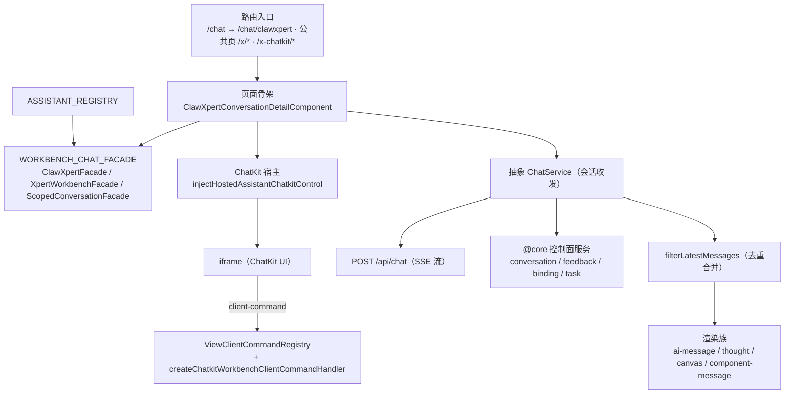

# C0 使用总览：对话前端专家

> 一句话定位：Xpert 前端的**对话域**——平台内 `/chat`（收敛至 `/chat/clawxpert`）的会话与工作台、公共页 `/x/*` 与 `/x-chatkit/*` 的 ChatKit 宿主、以及 `features/assistant` 的助手注册表与 iframe 运行时。
> 范围：`features/chat`（99 非 spec）＋ `apps/cloud/src/app/xpert`（42）＋ `features/assistant`（22）＝ **163 非 spec / 66 spec**；不含 Studio、`features/xpert` 管理页、auth 与后端会话/投递实现。

**本文引用的文件**
- [routes.ts](file://apps/cloud/src/app/features/chat/routes.ts)
- [workbench-chat.facade.ts](file://apps/cloud/src/app/features/chat/workbench-chat/workbench-chat.facade.ts)
- [clawxpert-conversation-detail.component.ts](file://apps/cloud/src/app/features/chat/clawxpert/clawxpert-conversation-detail.component.ts)
- [clawxpert-conversation-pane.component.ts](file://apps/cloud/src/app/features/chat/clawxpert/clawxpert-conversation-pane.component.ts)
- [clawxpert.facade.ts](file://apps/cloud/src/app/features/chat/clawxpert/clawxpert.facade.ts)
- [clawxpert-scoped-conversation.facade.ts](file://apps/cloud/src/app/features/chat/clawxpert/clawxpert-scoped-conversation.facade.ts)
- [xpert-workbench.facade.ts](file://apps/cloud/src/app/features/chat/xpert-workbench/xpert-workbench.facade.ts)
- [xpert-workbench.component.ts](file://apps/cloud/src/app/features/chat/xpert-workbench/xpert-workbench.component.ts)
- [group-workbench-scope.ts](file://apps/cloud/src/app/features/chat/clawxpert/group-workbench-scope.ts)
- [assistant.registry.ts](file://apps/cloud/src/app/features/assistant/assistant.registry.ts)
- [assistant-chatkit.runtime.ts](file://apps/cloud/src/app/features/assistant/assistant-chatkit.runtime.ts)
- [assistant-chat-client-command.ts](file://apps/cloud/src/app/features/assistant/assistant-chat-client-command.ts)
- [chatkit-workbench-client-command.ts](file://apps/cloud/src/app/features/assistant/chatkit-workbench-client-command.ts)
- [chat.service.ts](file://apps/cloud/src/app/xpert/chat.service.ts)
- [chat.service.ts](file://apps/cloud/src/app/@core/services/chat.service.ts)
- [chat.service.socket.ts](file://apps/cloud/src/app/@core/services/chat.service.socket.ts)
- [chat.service.socket.ts](file://apps/cloud/src/app/features/chat/chat.service.socket.ts)
- [filter-latest-messages.ts](file://apps/cloud/src/app/@shared/chat/filter-latest-messages.ts)
- [tasks.component.ts](file://apps/cloud/src/app/features/chat/tasks/tasks.component.ts)
- [file-change-review.component.ts](file://apps/cloud/src/app/features/chat/clawxpert/file-change-review.component.ts)
- [clawxpert-tool-preferences.component.ts](file://apps/cloud/src/app/features/chat/clawxpert/clawxpert-tool-preferences.component.ts)
- file://.module-experts/前端专题/对话前端专家/implementation/05-接口.md
- file://.module-experts/前端专题/对话前端专家/implementation/06-测试.md
- file://.module-experts/前端专题/对话前端专家/C1-能力契约.md

## 目录
1. [定位与何时找](#定位与何时找)
2. [契约自足声明与资产基线](#契约自足声明与资产基线)
3. [能力清单](#能力清单)
4. [边界](#边界)
5. [已知问题与常见坑](#已知问题与常见坑)

## 1. 定位与何时找

### 1.1 定位

本域是「**契约化骨架 + 注册式宿主**」的双层结构：页面骨架 `ClawXpertConversationDetailComponent` 只依赖 `WorkbenchChatFacade` 类型与 `WORKBENCH_CHAT_FACADE` token，三种路由形态（`/chat/clawxpert/c[/:threadId]`、`/chat/clawxpert/assistant[/:threadId]`、`/chat/x/:slug[/p/:projectId]/c[/:threadId]`）各自提供一个门面实现；会话 UI 本体由 ChatKit iframe 承载，宿主只负责绑定解析、会话/项目作用域与 client-command 白名单裁决。对话侧共享层（`src/app/xpert`）提供抽象 `ChatService` 与四族消息渲染组件，被平台版与公共页版共同继承。

图表来源：[workbench-chat.facade.ts](file://apps/cloud/src/app/features/chat/workbench-chat/workbench-chat.facade.ts)（关键符号：`WorkbenchChatFacade`、`WORKBENCH_CHAT_FACADE`）· [clawxpert-conversation-detail.component.ts](file://apps/cloud/src/app/features/chat/clawxpert/clawxpert-conversation-detail.component.ts)（关键符号：`facade`、`control`、`chatkitAssistantId`）· [assistant-chatkit.runtime.ts](file://apps/cloud/src/app/features/assistant/assistant-chatkit.runtime.ts)（关键符号：`injectHostedAssistantChatkitControl`）· [chat.service.ts](file://apps/cloud/src/app/xpert/chat.service.ts)（关键符号：`ChatService.executeChatRequest`）

### 1.2 何时找

1. **改会话与消息**（会话列表/详情、标题内联编辑、归档与置顶）→ `XpertHomeService.conversations`、`ChatConversationsComponent`、`ChatConversationService`。
2. **改流式渲染**（增量正文、Markdown 冻结块、推理折叠、执行树）→ `executeChatRequest` 的分支与 `ai-message` / `thought` / `streaming-markdown`。
3. **新增一种对话形态**（第四种宿主路由）→ 实现一个 `WorkbenchChatFacade` + 一个 `providers` 块，复用 `ClawXpertConversationDetailComponent`。
4. **嵌入助手（ChatKit 宿主）** → `injectHostedAssistantChatkitControl`；需要绑定态组合时用 `injectAssistantChatkitRuntime`。
5. **注册或调整助手** → `ASSISTANT_REGISTRY` 表项 + `getAssistantRegistryItem`；漏注册的直接表现是「入口/标题不出现」。
6. **排查 socket 断线与消息合并** → `ChatWebsocketServer`（401 刷新、2s 重发、ACK）与 `filterLatestMessages`。
7. **消息反馈**（点赞/点踩/撤回）→ `ChatAiMessageComponent.feedback` / `cancelFeedback` 与 `ChatMessageFeedbackService`。
8. **群组会话** → `redirectLegacyGroup`、`ChatGroupService`、`createGroupWorkbenchScope`。
9. **任务**（列表/调度/归档/批量/执行记录）→ `ChatTasksComponent` 与门面的 `taskSummary` / `taskRefreshTick`。
10. **文件审查**（工作区文件读写与 diff）→ `FileChangeReviewComponent`、`ClawXpertConversationFilesComponent`、`FileChangeReviewService`。
11. **工具偏好与触发器** → `ClawXpertToolPreferencesComponent`、`ClawXpertTriggerConfigEditorComponent`、`saveTriggerDraft`。
12. **跑对话域测试** → 三目录全量 Jest（`features/chat` + `xpert` + `features/assistant`），口径见 `implementation/06-测试.md`。

章节来源：[routes.ts](file://apps/cloud/src/app/features/chat/routes.ts)（关键符号：`redirectToDefaultChatEntry`、`clawxpertConversationMatcher`、`redirectLegacyGroup`）· [clawxpert.facade.ts](file://apps/cloud/src/app/features/chat/clawxpert/clawxpert.facade.ts)（关键符号：`ClawXpertFacade.viewState`、`saveTriggerDraft`、`taskRefreshTick`）· [tasks.component.ts](file://apps/cloud/src/app/features/chat/tasks/tasks.component.ts)（关键符号：`ChatTasksComponent.runTask`、`deleteSelectedTasks`）

## 2. 契约自足声明与资产基线

### 2.1 契约自足声明

`C0-使用总览.md` 与 [C1-能力契约.md](file://.module-experts/前端专题/对话前端专家/C1-能力契约.md) 两篇**自足可用**：读完即可完成「找到入口、判断边界、按契约调用门面/token/接口、识别已知坑」。所有口径与同目录 `implementation/{01..07}` 对齐；与 ki 归档的差异只在一处并已显式标注——**实测口径为 163 非 spec / 66 spec**（ki 记 159 / 63）。文中每个符号均已在源码核实存在；后端 `packages/server-ai` 的 chat / assistant 面只作跨端引用，不展开。

章节来源：[workbench-chat.facade.ts](file://apps/cloud/src/app/features/chat/workbench-chat/workbench-chat.facade.ts)（关键符号：`WorkbenchChatFacade`、`WORKBENCH_CHAT_FACADE`）· [assistant.registry.ts](file://apps/cloud/src/app/features/assistant/assistant.registry.ts)（关键符号：`ASSISTANT_REGISTRY`、`getAssistantRegistryItem`）

### 2.2 资产基线

| 项 | 值 |
|---|---|
| 资产版本 | **2026-10-16 重建**（ki 基线 `c07bb83d` / 2026-10-15；实测口径 **163 非 spec / 66 spec @ commit `80f5676fd`**） |
| 源码核对 | 仓库 `/root/xpert`；`features/chat`（99）＋ `apps/cloud/src/app/xpert`（42）＋ `features/assistant`（22） |
| 入口路由 | `/chat`（收敛至 `/chat/clawxpert`）；公共页 `/x/*`（纯重定向层）与 `/x-chatkit/*` |
| 技术底座 | Angular standalone + signal + `@ngneat/elf`（经 `@core/state`）+ `@xpert-ai/chatkit-angular`（iframe 宿主） |
| 核心契约 | `WorkbenchChatFacade` + `WORKBENCH_CHAT_FACADE`、`injectAssistantChatkitRuntime` / `injectHostedAssistantChatkitControl`、`ASSISTANT_REGISTRY` |
| 测试状态 | 66 spec（≈590 用例）；基线失败 **10 例** = 4 环境级 + 1 contracts 产物 + 5 真实断言，需复跑重新标定 |
| 后端引用面 | `packages/server-ai` 的 chat / assistant / assistant-binding 模块（仅接口与语义） |

章节来源：[implementation/06-测试.md](file://.module-experts/前端专题/对话前端专家/implementation/06-测试.md)（关键符号：`moduleNameMapper`、`transformIgnorePatterns`、10 例失败归因表）· [implementation/05-接口.md](file://.module-experts/前端专题/对话前端专家/implementation/05-接口.md)（关键符号：`API_PREFIX`、`buildAssistantApiUrl`）

## 3. 能力清单

| 能力 | 入口（组件 / 服务 / token / 路由） | 一句话 |
|---|---|---|
| 页面骨架（契约化） | `ClawXpertConversationDetailComponent` + `WorkbenchChatFacade` / `WORKBENCH_CHAT_FACADE` | 三类路由形态复用同一骨架，仅替换门面实现 |
| ClawXpert 工作台 | `ClawXpertFacade` / `/chat/clawxpert[/c[/:threadId]]` | 绑定、偏好、触发器、任务摘要与 `viewState` 状态机 |
| 多形态会话页 | `XpertWorkbenchFacade` + `ChatXpertWorkbenchComponent` / `/chat/x/:slug[/p/:projectId]/c[/:threadId]` | 带项目隔离语义的工作台形态 |
| 作用域会话面板 | `ClawXpertScopedConversationFacade` + `ClawXpertConversationPaneComponent` | task / assistant 双 scope 常驻挂载，保留 composer 状态 |
| 绑定向导与首次创建 | `ClawXpertBindingWizardComponent`、`ClawXpertSetupWizardComponent`、`ClawXpertBootstrapService` | 选 xpert 或新建并发布后绑定 |
| 会话收发（活跃链） | 抽象 `ChatService`（`sendMessage` / `executeChatRequest`）→ `ChatService@core.chat` → `POST /api/chat`（SSE） | 乐观落库 + 单流事件归约 |
| 消息渲染族 | `ChatAiMessageComponent` / `ChatComponentMessageComponent` / `ChatCanvasComponent` / `ChatThoughtComponent` | 按内容类型分流；Computer 块升格到右侧画布 |
| 消息去重合并 | `filterLatestMessages`（`@shared/chat`） | 按 `parentId` 链每层只留最新孩子，跨域共享 |
| 消息反馈 | `ChatAiMessageComponent.feedback` / `cancelFeedback`、`ChatMessageFeedbackService` | 终态后才允许评价，读写都走后端 |
| 实时通道（socket.io） | `ChatWebsocketServer`（namespace `chat`）、`ChatWebsocketService` | 断开重连、401 刷新、2s 无 ACK 重发 |
| ChatKit 宿主 | `injectHostedAssistantChatkitControl`、`injectAssistantChatkitRuntime` | 绑定 → 就绪 → 新建/原地刷新 iframe |
| client-command 桥 | `ViewClientCommandRegistry` + `createChatkitWorkbenchClientCommandHandler` | iframe 命令回服务器重解析 manifest 后才执行 |
| 助手注册表 | `ASSISTANT_REGISTRY` / `getAssistantRegistryItem` | 三个助手的唯一描述源（含特性位与 i18n key） |
| 群组会话 | `ChatGroupService`、`redirectLegacyGroup`、`createGroupWorkbenchScope` | 按会话 id 绑定，不加载私有 Assistant thread |
| 任务 | `ChatTasksComponent` / `/chat/tasks[/:id]`、`XpertTaskService` | 四集合视图 + 执行记录投影 + 批量动作 |
| 文件审查 | `FileChangeReviewComponent`、`ClawXpertConversationFilesComponent` | selected / conversation 双范围，批次并发 4 |
| 工具偏好与触发器 | `ClawXpertToolPreferencesComponent`、`ClawXpertTriggerConfigEditorComponent` | 乐观开关 + 草稿副本 + `dirty` 判定 |
| 公共页与企业 H5 | `PublicChatkitComponent` / `/x-chatkit/{x,h5}/:…`、`/x/:name` | 有守卫分支 + 无守卫 H5 分支共用宿主控制 |

章节来源：[clawxpert-conversation-detail.component.ts](file://apps/cloud/src/app/features/chat/clawxpert/clawxpert-conversation-detail.component.ts)（关键符号：`facade`、`chatkitAssistantId`、`chatkitGroup`）· [xpert-workbench.component.ts](file://apps/cloud/src/app/features/chat/xpert-workbench/xpert-workbench.component.ts)（关键符号：`ChatXpertWorkbenchComponent.providers`）· [clawxpert-conversation-pane.component.ts](file://apps/cloud/src/app/features/chat/clawxpert/clawxpert-conversation-pane.component.ts)（关键符号：`ScopedConversationCommands`、`useExisting: ClawXpertScopedConversationFacade`）

## 4. 边界

1. **不含 Studio**：编排画布、草稿编辑与发布归 **Agent 编排 Studio 专家**；本域只把会话消息/执行记录/反馈作为被复用契约提供，Studio 侧经 `XpertExecutionService` 注入 `ChatConversationService` / `ChatMessageFeedbackService`。
2. **不含 Xpert 工作台管理页**：`features/xpert` 的详情 shell、助手 shell 与管理页归 **Xpert 工作台专家**；本域只消费其 `XpertAPIService` 与 draft 工具，不展开管理页内部。
3. **不含 auth**：登录、令牌刷新与引导链归 **认证与引导专家**；本域只声明 `authGuard` 的挂载点与「公共页无守卫」这一事实，不实现准入判定。
4. **不含后端会话/投递与 `/api/ai/*` 契约实现**：会话存储、消息投递、群组运行时归「**对话与会话专家**」；`/api/ai/v1/chatkit/sessions`、`/api/ai/threads/*`、`/api/assistant-binding/*` 的服务端契约归「**Assistant 定义与运行时专家**」。本域只记录自身实际调用的路径与参数。
5. **公共页无路由守卫的边界说明**：`/x-chatkit/h5/:platform/:name[/c/:id]` 与 `/x/:name[/c/:id]` **均无 `canActivate`**，前端不做准入兜底——安全依赖 frame URL 白名单、绑定完整性判定、会话 secret 短时换取与服务端 manifest 重解析；新增公共页入口必须显式评估（协同认证与引导专家的准入白名单）。
6. **不含 `@shared/chat` 组件层实现**：`composer` / `preview` / `references` / `filter-latest-messages` 等按「被消费面」引用（本域是最大消费方，39 个文件直接 import），其内部实现不属本域。

章节来源：[routes.ts](file://apps/cloud/src/app/features/chat/routes.ts)（关键符号：`featureGate`、`redirectLegacyGroup`）· [chatkit-workbench-client-command.ts](file://apps/cloud/src/app/features/assistant/chatkit-workbench-client-command.ts)（关键符号：`createChatkitWorkbenchClientCommandHandler`、`stale_context`、`forbidden`）· [filter-latest-messages.ts](file://apps/cloud/src/app/@shared/chat/filter-latest-messages.ts)（关键符号：`filterLatestMessages`）

## 5. 已知问题与常见坑

1. **① `WORKBENCH_CHAT_FACADE` 是页面骨架的唯一依赖**：骨架用 `inject(WORKBENCH_CHAT_FACADE, { optional: true })` 取门面、缺失时回退 `inject(ClawXpertFacade)`——**替换宿主不改骨架**；绕过 token 自行注入门面实现会破坏该契约（三个装配点都是 `useExisting`，保证同路由内实例唯一）。（来源：[workbench-chat.facade.ts](file://apps/cloud/src/app/features/chat/workbench-chat/workbench-chat.facade.ts)（关键符号：`WORKBENCH_CHAT_FACADE`））
2. **② socket.io 实时 + HTTP 控制面是双通道分工**：约定的分工是「socket 走实时、HTTP 走控制面」，但**实测当前活跃链是 HTTP + SSE**（`ChatServerService.chat` → `injectFetchEventSource(baseUrl + API_CHAT)`）；在 socket 上发起的回合不会自动获得 HTTP 侧幂等，两条链的落点方法也不同。（来源：[chat.service.ts](file://apps/cloud/src/app/@core/services/chat.service.ts)（关键符号：`ChatService.chat`、`API_CHAT`））
3. **③ 消息去重/合并是正确性关键**：`filterLatestMessages` 的存在原因正是重连/重放/重试分支导致的**重复消息**——按 `parentId` 建链、每层只留 `createdAt` 最新（平局取数组后位），并保持原顺序；父不存在的项一律当 root 保留，`keep` 为空时原样返回（宁可重复不可丢）。（来源：[filter-latest-messages.ts](file://apps/cloud/src/app/@shared/chat/filter-latest-messages.ts)（关键符号：`filterLatestMessages`））
4. **④ 断线重连与消息补拉**：`connect()` 仅在未连接时建连；服务端 `exception{status:401}` 触发 `refreshToken()`（`refreshTokening` 去重）后重连；`message()` 发出后挂 2s 定时器，收不到 `ack` 就**原样重发**（无上限、无退避）——前端无持久化，断线后以历史补拉为准。（来源：[chat.service.socket.ts](file://apps/cloud/src/app/@core/services/chat.service.socket.ts)（关键符号：`ChatWebsocketServer.connect`、`message`、`refreshToken`、`clearRetryMessage`））
5. **⑤ ChatKit 宿主的 postMessage origin/协议校验**：`sanitizeAssistantFrameUrl` 只做前缀哨兵（空或 `DOCKER_` → `null` → 不挂载），`normalizeAssistantFrameUrl` 规范本地 `/chatkit`；跨域时**源校验责任在 iframe 侧协议与宿主 CSP**。iframe 命令必须回服务器重解析 manifest 后才 `execute`，未授权返 `stale_context` / `forbidden`。（来源：[assistant-chatkit.runtime.ts](file://apps/cloud/src/app/features/assistant/assistant-chatkit.runtime.ts)（关键符号：`sanitizeAssistantFrameUrl`、`hasCompleteAssistantBinding`））
6. **⑤+ 六类 client-command 的实测口径**：ClawXpert 宿主内实测注册 **7 个 key**（`assistant.chat.send_message`、`assistant.context.set`、`assistant.composer.append_references`、`workbench.file.open`、`workbench.navigation.open`、`workspace.connector.connect`、`workbench.browser.open`）＋ 1 个桥 `workbench.onClientCommand`；ki 记「6 类」，差异属版本漂移，**待复跑确认**。（来源：[assistant-chat-client-command.ts](file://apps/cloud/src/app/features/assistant/assistant-chat-client-command.ts)（关键符号：`registerAssistantChatSendMessageCommand`、`toSendUserMessageParams`））
7. **⑥ `/x/*`、`/x-chatkit/*` 无路由守卫**：`h5/:platform/:name[/c/:id]` 与 `/x/:name[/c/:id]` 均无 `canActivate`，仅 `/x-chatkit/x/:name[/c/:id]` 挂 `authGuard`；安全靠后端准入，前端不兜底。（来源：[routes.ts](file://apps/cloud/src/app/features/chat/routes.ts)（关键符号：`routes`）· [implementation/05-接口.md](file://.module-experts/前端专题/对话前端专家/implementation/05-接口.md)（关键符号：`PublicChatkitComponent`、`authGuard`））
8. **⑦ `canActivateChild` 缺特性开关时回落 `/explore`**：`clawxpert` 子树挂 `featureGate([FEATURE_XPERT, FEATURE_XPERT_CLAWXPERT], ['/explore'])`，`hydrateFeatureContext` 有 3s 超时（超时按未水合处理 → 回落）；壳层还有第二层兜底（`ChatHomeComponent` 在开关缺失时 `navigateByUrl('/explore')`）。（来源：[routes.ts](file://apps/cloud/src/app/features/chat/routes.ts)（关键符号：`featureGate`、`redirectToDefaultChatEntry`））
9. **⑧ `ASSISTANT_REGISTRY` 是注册式扩展**：新增助手 = 加一条表项（`code` / `featureKeys` / `management` / 三对 i18n key+默认文案），门面经 `getAssistantRegistryItem(AssistantCode.CLAWXPERT)` 取 `definition`；**漏注册表现为入口不出现、标题回退默认值**。（来源：[assistant.registry.ts](file://apps/cloud/src/app/features/assistant/assistant.registry.ts)（关键符号：`ASSISTANT_REGISTRY`、`getAssistantRegistryItem`））
10. **⑨ 流式增量与 `thought` / `canvas` 的渲染合并顺序**：正文走 `appendStreamMessage`（尾消息 `content +=`）与 `appendMessageComponent`（结构化块），二者最终都在**同一条 ai 消息上就地合并**；`thought` 按 `status() === 'reasoning'` 自动平滑滚动，`canvas` 在 effect 中发现 `canvasOpened.messageId` 已不在消息列表时**自动关闭**——三条链的顺序错位会出现「思考不跟随 / 画布闪关」。（来源：[chat.service.ts](file://apps/cloud/src/app/xpert/chat.service.ts)（关键符号：`appendStreamMessage`、`appendMessageComponent`、`upsertAgentExecution`））
11. **⑩ 项目选择门面与对话上下文的时序**：`chatkitMountProjectId` / `chatkitProjectSelection` 是**初始绑定与草稿意图**，运行中项目由 ChatKit 从已保存会话解析，`syncConversationProject(threadId)` 在运行开始/结束后刷新持久项目且**不新开会话**；`onChatProjectChange` 是可选成员，错位会导致会话切换串项目。（来源：[xpert-workbench.facade.ts](file://apps/cloud/src/app/features/chat/xpert-workbench/xpert-workbench.facade.ts)（关键符号：`chatkitMountProjectId`、`chatkitProjectSelection`、`syncConversationProject`、`onChatProjectChange`））
12. **⑪ 测试环境缺依赖会造成「整文件加载失败」**：基线 10 例 FAIL 中 **4 个环境级**（`jest.mock('@xpert-ai/chatkit-angular', …)` 未带 `{virtual:true}`、真实 `import { createChatKit }`）＋ **1 个 contracts 产物**（`packages/contracts` 未构建），其余 5 例待复跑标定；跑测前先 `corepack pnpm install`。（来源：[implementation/06-测试.md](file://.module-experts/前端专题/对话前端专家/implementation/06-测试.md)（关键符号：`moduleNameMapper`、失败清单））
13. **socket 通道当前无本域路由级消费者**：`ChatWebsocketService` 在全仓库无其他引用（含被注释的 `pairwise/off/on` 订阅），排障时先确认是「通道挂了」还是「根本没人用这条通道」；这与 ki 口径「socket.io 为唯一实时主通道」不符。（来源：[chat.service.socket.ts](file://apps/cloud/src/app/features/chat/chat.service.socket.ts)（关键符号：`ChatWebsocketService.chatListener`、`onMessageSub`））
14. **`filterLatestMessages` 是跨域共享契约**：对话页与 Studio 预览共用同一份去重逻辑，改其去重语义会**双向**制造「消息重复/丢失」，且它依赖 `createdAt`（缺失时退化为按原序后位）。（来源：[filter-latest-messages.ts](file://apps/cloud/src/app/@shared/chat/filter-latest-messages.ts)（关键符号：`filterLatestMessages`））
15. **群组按会话 id 绑定，不加载私有 Assistant thread**：门面 `group` 字段注释明示；群组路由必须等 `GroupWorkbenchApiService.getContext` 返回且 `assistantId` 与 `conversationId` 校验一致后才可渲染个人 View，否则会「用共享运行时渲染私有视图」。（来源：[group-workbench-scope.ts](file://apps/cloud/src/app/features/chat/clawxpert/group-workbench-scope.ts)（关键符号：`createGroupWorkbenchScope`））
16. **前端闸门与凭据边界**：附件上限 `CHATKIT_ATTACHMENT_MAX_BYTES = 50 MiB`、最多 5 个由 composer 直接拦截（需与后端 parser 对齐）；`runtimeKey` 含 token 与组织 id 但**从不出网**，下发给 iframe 的只有不透明的 `hosted-session-${revision}`——改这一带代码不可把它写进日志/DOM/存储。（来源：[assistant-chatkit.runtime.ts](file://apps/cloud/src/app/features/assistant/assistant-chatkit.runtime.ts)（关键符号：`CHATKIT_ATTACHMENT_MAX_BYTES`、`runtimeKey`、`sessionRevision`））

章节来源：[workbench-chat.facade.ts](file://apps/cloud/src/app/features/chat/workbench-chat/workbench-chat.facade.ts)（关键符号：`WorkbenchChatFacade`、`syncConversationProject`、`group`）· [clawxpert-conversation-pane.component.ts](file://apps/cloud/src/app/features/chat/clawxpert/clawxpert-conversation-pane.component.ts)（关键符号：`ClawXpertConversationPaneComponent.providers`、`useExisting`）· [file-change-review.component.ts](file://apps/cloud/src/app/features/chat/clawxpert/file-change-review.component.ts)（关键符号：`FileChangeReviewComponent.load`、`request`）· [clawxpert-tool-preferences.component.ts](file://apps/cloud/src/app/features/chat/clawxpert/clawxpert-tool-preferences.component.ts)（关键符号：`toggleTool`、`toggleSkill`）
