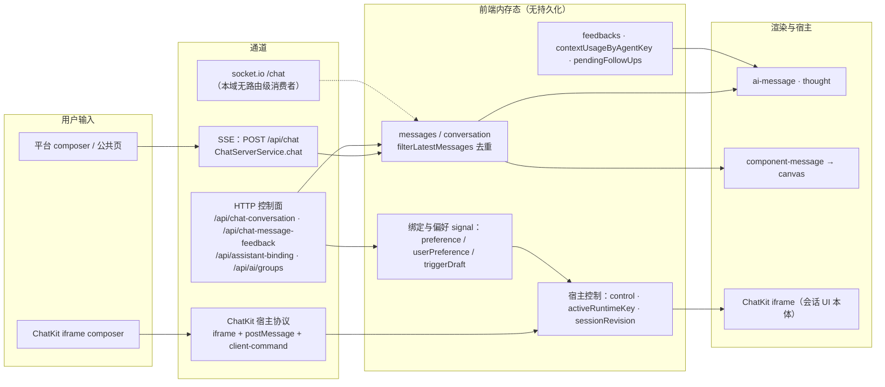

# C4 数据流向与消费：对话前端专家

> 模块根：`apps/cloud/src/app/features/chat` ＋ `apps/cloud/src/app/xpert` ＋ `apps/cloud/src/app/features/assistant`（163 非 spec / 66 spec，commit `80f5676fd` 实测）
> 口径：前端**无 DB / ORM / 本地持久化**；数据只有「HTTP 控制面 + SSE 流 + socket.io（本域无路由级消费者）+ ChatKit iframe postMessage」四条进入路径，出向只有 HTTP 写与 iframe 命令。

**本文引用的文件**
- [chat.service.ts（xpert）](file://apps/cloud/src/app/xpert/chat.service.ts)
- [chat.service.ts（@core）](file://apps/cloud/src/app/@core/services/chat.service.ts)
- [chat.service.socket.ts（@core）](file://apps/cloud/src/app/@core/services/chat.service.socket.ts)
- [chat-message-feedback.service.ts](file://apps/cloud/src/app/@core/services/chat-message-feedback.service.ts)
- [chat-conversation.service.ts](file://apps/cloud/src/app/@core/services/chat-conversation.service.ts)
- [assistant-binding.service.ts](file://apps/cloud/src/app/@core/services/assistant-binding.service.ts)
- [file-change-review.service.ts](file://apps/cloud/src/app/@core/services/file-change-review.service.ts)
- [ai-thread.service.ts](file://apps/cloud/src/app/@core/services/ai-thread.service.ts)
- [filter-latest-messages.ts](file://apps/cloud/src/app/@shared/chat/filter-latest-messages.ts)
- [types.ts（对话域）](file://apps/cloud/src/app/features/chat/types.ts)
- [home.service.ts（xpert）](file://apps/cloud/src/app/xpert/home.service.ts)
- [ai-message.component.ts](file://apps/cloud/src/app/xpert/ai-message/ai-message.component.ts)
- [agent-run-tree.ts](file://apps/cloud/src/app/xpert/ai-message/agent-run-tree.ts)
- [component-message.component.ts](file://apps/cloud/src/app/xpert/component-message/component-message.component.ts)
- [canvas.component.ts](file://apps/cloud/src/app/xpert/canvas/canvas.component.ts)
- [thought.component.ts](file://apps/cloud/src/app/xpert/thought/thought.component.ts)
- [assistant.registry.ts](file://apps/cloud/src/app/features/assistant/assistant.registry.ts)
- [assistant-chatkit.runtime.ts](file://apps/cloud/src/app/features/assistant/assistant-chatkit.runtime.ts)
- [assistant-chatkit-frame-url.ts](file://apps/cloud/src/app/features/assistant/assistant-chatkit-frame-url.ts)
- [clawxpert.facade.ts](file://apps/cloud/src/app/features/chat/clawxpert/clawxpert.facade.ts)
- [clawxpert-binding-state.ts](file://apps/cloud/src/app/features/chat/clawxpert/clawxpert-binding-state.ts)
- [clawxpert-configuration-cache.service.ts](file://apps/cloud/src/app/features/chat/clawxpert/clawxpert-configuration-cache.service.ts)
- [clawxpert-conversation-scope.ts](file://apps/cloud/src/app/features/chat/clawxpert/clawxpert-conversation-scope.ts)
- [file-change-review.types.ts](file://apps/cloud/src/app/features/chat/clawxpert/file-change-review.types.ts)
- [group-workbench-scope.ts](file://apps/cloud/src/app/features/chat/clawxpert/group-workbench-scope.ts)
- [tasks.component.ts](file://apps/cloud/src/app/features/chat/tasks/tasks.component.ts)
- [workbench-chat.facade.ts](file://apps/cloud/src/app/features/chat/workbench-chat/workbench-chat.facade.ts)
- [ai.model.ts](file://packages/contracts/src/ai/ai.model.ts)
- [chat.model.ts](file://packages/contracts/src/ai/chat.model.ts)
- [assistant-binding.model.ts](file://packages/contracts/src/ai/assistant-binding.model.ts)
- [view-extension/model.ts](file://packages/contracts/src/view-extension/model.ts)
- [消息与会话.md](file://CodeWikiHub/xpert/memory/数据流/对话域/消息与会话.md)
- [执行记录与反馈.md](file://CodeWikiHub/xpert/memory/数据流/对话域/执行记录与反馈.md)
- [群组绑定与项目双阶段（注释证据）.md](file://CodeWikiHub/xpert/memory/决策记录/对话域/群组绑定与项目双阶段（注释证据）.md)

## 目录
1. [数据总览（Mermaid）](#数据总览mermaid)
2. [实体 A：会话与消息（`IChatConversation` / `TCopilotChatMessage`）](#实体-a会话与消息ichatconversation--tcopilotchatmessage)
3. [实体 B：消息渲染模型（ai-message / component-message / canvas / thought）](#实体-b消息渲染模型ai-message--component-message--canvas--thought)
4. [实体 C：助手注册表与 ChatKit 宿主状态机](#实体-c助手注册表与-chatkit-宿主状态机)
5. [实体 D：ClawXpert 绑定与偏好（工具偏好 / 触发器）](#实体-dclawxpert-绑定与偏好工具偏好--触发器)
6. [实体 E：文件变更审查](#实体-e文件变更审查)
7. [实体 F：群组会话与任务](#实体-f群组会话与任务)
8. [本地态 vs 服务端态：对照表](#本地态-vs-服务端态对照表)

## 数据总览（Mermaid）

图表来源：[chat.service.ts（xpert）](file://apps/cloud/src/app/xpert/chat.service.ts)（关键符号：`ChatService.messages`、`sendMessage`、`executeChatRequest`、`getFeedbacks`、`contextUsageByAgentKey`）、[chat.service.ts（@core）](file://apps/cloud/src/app/@core/services/chat.service.ts)（关键符号：`ChatService.chat`、`API_CHAT`）、[chat.service.socket.ts（@core）](file://apps/cloud/src/app/@core/services/chat.service.socket.ts)（关键符号：`ChatWebsocketServer.connect`、`message`）、[assistant-chatkit.runtime.ts](file://apps/cloud/src/app/features/assistant/assistant-chatkit.runtime.ts)（关键符号：`injectHostedAssistantChatkitControl`、`runtimeKey`、`sessionRevision`）、[filter-latest-messages.ts](file://apps/cloud/src/app/@shared/chat/filter-latest-messages.ts)（关键符号：`filterLatestMessages`）
章节来源：[消息与会话.md](file://CodeWikiHub/xpert/memory/数据流/对话域/消息与会话.md)（关键符号：`来源`、`去向`、`关键约束`）、[执行记录与反馈.md](file://CodeWikiHub/xpert/memory/数据流/对话域/执行记录与反馈.md)（关键符号：`纯投影`、`避免与后端双源漂移`）

## 实体 A：会话与消息（`IChatConversation` / `TCopilotChatMessage`）
- **实体类型**：契约 DTO 投影 + 前端内存态（`signal`/`linkedModel`）；**本地态与服务端投影同形但不同源**。
- **结构（关键字段）**：`IChatConversation`——`id`、`xpertId`、`threadId`、`status: 'busy' | 'idle'`、`messages`、`executions`、`task`、`options.parameters`、`options.features`；`TCopilotChatMessage = IChatMessage & { event?; error?; expanded?; executions?; references? }`（[types.ts（对话域）](file://apps/cloud/src/app/features/chat/types.ts)）；消息块级 `TMessageContentComplex` / `TMessageContentReasoning` / `TMessageComponent`（含 `category`、`tasks`、`step`）；`PendingFollowUp{ id?, content, files?, references?, mode: 'queue' | 'steer', planMode?, runtimeCapabilities?, commandSource? }` 为**前端独有**；线协议 `ChatMessageTypeEnum`（`message`/`event`）、`ChatMessageEventTypeEnum`（17 个成员）、`ChatMessageStepCategory`。
- **生产方**：`GET /api/chat-conversation/:id`（可带 `relations=['messages','executions','task',…]`，`ChatConversationService.getOneById`）、`GET /api/ai/conversations/:id/messages`、`POST /api/chat` 的 SSE 流（`executeChatRequest` 归约）、socket.io 的 `ChatGatewayMessage`（遗留）；前端乐观生产 `role: 'user'` 消息与 ai 占位消息。
- **主要消费方**：`ChatService.messages()` → 四个渲染族组件；`XpertHomeService.conversationId`/`canvasOpened`；Studio 执行可视化（`ChatConversationService` / `XpertExecutionService`，跨域消费同族结构）。
- **业务用途**：对话内容本体——流式呈现回答、思考、执行过程与产物；会话状态驱动 busy 文案与自动恢复。
- **详细流向（同文件，见本节链）**：用户输入 → `appendMessage(humanMessage)`（含 `clientMessageId = options.id`）→ `chatRequest` → SSE 分片（先丢 `':'` 心跳，再 `JSON.parse`）→ `ChatMessageTypeEnum.MESSAGE` 按 `typeof event.data === 'string'` 分流到 `appendStreamMessage` / `appendMessageComponent` → 二者最终 `appendMessageContent(lastM, content, context)` **就地合并进最后一条 ai 消息**；`EVENT` 分支：`on_conversation_start/end` → `updateConversation(omit(data,'messages'))`、`on_message_start/end` → 占位/收口、`on_agent_start/end` → `upsertAgentExecution`、`on_chat_event` → 上下文用量 / follow-up 消费 / `step.id` upsert 进 `message.events`；历史侧读路径固定过 `filterLatestMessages`。
章节来源：[chat.service.ts（xpert）](file://apps/cloud/src/app/xpert/chat.service.ts)（关键符号：`sendMessage`、`executeChatRequest`、`appendStreamMessage`、`appendMessageComponent`、`appendMessageContent`、`upsertAgentExecution`、`updateConversation`）、[types.ts（对话域）](file://apps/cloud/src/app/features/chat/types.ts)（关键符号：`TCopilotChatMessage`、`COMMON_COPILOT_ROLE`）、[ai.model.ts](file://packages/contracts/src/ai/ai.model.ts)（关键符号：`ChatMessageTypeEnum`、`ChatMessageEventTypeEnum`、`ChatMessageStepCategory`）

## 实体 B：消息渲染模型（ai-message / component-message / canvas / thought）
- **实体类型**：纯前端渲染态 + 由消息模型派生的视图模型（**无服务端对应物**）。
- **结构（关键字段）**：`ChatAiMessageComponent`（`message`、`showExecution`、`busy`、`feedback`、`feedbacks`、`feedbackReady`）；执行树纯函数产物 `buildAgentRunRenderTree` / `getAgentNodeUnits` / `getAgentRunCounts` / `getAgentRunDuration` / `normalizeRunStatus`；`ChatComponentMessageComponent`（`messageId`、`message: TMessageContentComponent`、`category`、`tasks`、`step`）；`ChatCanvasComponent` 读 `XpertHomeService.canvasOpened`（`opened`、`type`、`componentId`、`messageId`）；`ChatThoughtComponent`（`reasoningText`、`expandReason`、`status`）。
- **生产方**：`filterLatestMessages` 的结果 + 流式增量（`appendMessageContent`）；`splitStreamingMarkdown(text)` 把正文切成 `frozenBlocks`/`frozenText`/`streaming`（`getFencedCodeRanges` 保证不切开代码围栏内部）；`agent-run-tree.ts` 的纯函数。
- **主要消费方**：对话页与公共页的消息列表；Studio 预览（`ChatConversationPreviewComponent`）与检查器复用同族组件；`@shared/chat` 的 composer / preview / tool-call-chunk 等。
- **业务用途**：把「一条 ai 消息 + 若干结构化块」渲染成可读的回答、思考、工具调用、执行树与产物卡片，并控制流式重渲染范围。
- **详细流向（同文件，见本节链）**：选择规则——文本/推理/执行树走 `ChatAiMessageComponent`（内含 `ChatThoughtComponent`）；`content[].type === 'component'` 走 `ChatComponentMessageComponent`（`data.category || 'Tool'`）；`category === 'Computer'` 时 `homeService.canvasOpened.set({ opened: true, type: 'Computer', componentId })` 升格到右侧 `ChatCanvasComponent`，后者按 `canvasType` 分发 Computer / Dashboard / FileViewer 并在 `messageId` 已不在消息列表时关闭画布。
章节来源：[ai-message.component.ts](file://apps/cloud/src/app/xpert/ai-message/ai-message.component.ts)（关键符号：`ChatAiMessageComponent.feedback`、`showExecution`、`feedbackReady`）、[component-message.component.ts](file://apps/cloud/src/app/xpert/component-message/component-message.component.ts)（关键符号：`ChatComponentMessageComponent.category`、`openComponentMessage`、`openInCanvas`）、[canvas.component.ts](file://apps/cloud/src/app/xpert/canvas/canvas.component.ts)（关键符号：`ChatCanvasComponent.canvasType`、`opened`）、[thought.component.ts](file://apps/cloud/src/app/xpert/thought/thought.component.ts)（关键符号：`ChatThoughtComponent.reasoningText`、`expandReason`）、[agent-run-tree.ts](file://apps/cloud/src/app/xpert/ai-message/agent-run-tree.ts)（关键符号：`buildAgentRunRenderTree`、`getAgentRunCounts`）

## 实体 C：助手注册表与 ChatKit 宿主状态机
- **实体类型**：前端常量注册表 + **纯前端状态机**（宿主控制态不进后端）。
- **结构（关键字段）**：`AssistantRegistryItem{ code, featureKeys, management: 'system' | 'user', labelKey/defaultLabel, titleKey/defaultTitle, descriptionKey/defaultDescription }`；`ASSISTANT_REGISTRY` 三项（`CHAT_COMMON`、`XPERT_SHARED` 为 `system`；`CLAWXPERT` 为 `user` + `[FEATURE_XPERT, FEATURE_XPERT_CLAWXPERT]`）；`AssistantRuntimeStatus = 'idle' | 'loading' | 'ready' | 'missing' | 'disabled' | 'error'`；宿主内部态 `control: signal<ChatKitControl | null>`、`activeRuntimeKey`、`activeSecurityScope`、`sessionRevision`；`sessionKey: 'hosted-session-${revision}'`（不透明序号）；`CHATKIT_ATTACHMENT_MAX_BYTES = 50 * 1024 * 1024`。
- **生产方**：注册表由前端常量表生产，`getAssistantRegistryItem(code)` 供门面取 `definition`；状态机由 `injectAssistantBindingRuntimeState`（`assistantBindingService.getEffective(code)` → `config`/`status`/`hasSource`/`refresh`）与 `injectHostedAssistantChatkitControl`（`runtimeKey`/`securityScope` 比较 → `createChatKit` 或 `setOptions`）共同生产；`sanitizeAssistantFrameUrl` / `normalizeAssistantFrameUrl` / `hasCompleteAssistantBinding` 做装配前置判定。
- **主要消费方**：`ClawXpertConversationDetailComponent`、`PublicChatkitComponent`、项目会话面板（三个宿主）；路由层 `featureGate` 与助手可用性判定。
- **业务用途**：以声明式表项扩展助手（加表项而非改分支），并以状态机保证「绑定 → 就绪 → 会话创建 / 原地刷新」的 iframe 生命周期可控。
- **详细流向（同文件，见本节链）**：`GET /api/assistant-binding/effective/:code` → `config`；`sanitizeAssistantFrameUrl(environment.CHATKIT_FRAME_URL)`（空或 `DOCKER_` → `null` → `status='error'`）→ `status`；`status === 'ready'` 时 `identity` 才有值 → `runtimeKey` 变化则 `sessionRevision++` + `createChatKit`，否则 `currentControl.setOptions`；`loading` 期间只在同一 `securityScope` 内保留 iframe，跨域立刻 `control.set(null)`；发布事件 `XpertPublicationService.changes$` → `publicationRevision` 只触发原地刷新。
章节来源：[assistant.registry.ts](file://apps/cloud/src/app/features/assistant/assistant.registry.ts)（关键符号：`ASSISTANT_REGISTRY`、`AssistantRegistryItem`、`AssistantManagement`、`getAssistantRegistryItem`）、[assistant-chatkit.runtime.ts](file://apps/cloud/src/app/features/assistant/assistant-chatkit.runtime.ts)（关键符号：`AssistantRuntimeStatus`、`injectAssistantBindingRuntimeState`、`injectHostedAssistantChatkitControl`、`runtimeKey`、`securityScope`、`sessionRevision`、`CHATKIT_ATTACHMENT_MAX_BYTES`）、[assistant-chatkit-frame-url.ts](file://apps/cloud/src/app/features/assistant/assistant-chatkit-frame-url.ts)（关键符号：`normalizeAssistantFrameUrl`）

## 实体 D：ClawXpert 绑定与偏好（工具偏好 / 触发器）
- **实体类型**：服务端 DTO 投影 + 前端乐观态（写路径「先改本地再落盘，失败回滚」）。
- **结构（关键字段）**：`IAssistantBinding{ code, scope, assistantId?, enabled?, userId?, preferences? }`、`IResolvedAssistantBinding = IAssistantBinding & { sourceScope }`、`IAssistantBindingUserPreference{ assistantBindingId, userId?, soul?, profile?, toolPreferences?, conversationPreferences? }`；`IAssistantBindingToolPreferences{ version, toolsets?, middlewares?, skills? }`（**黑名单语义**，记 `disabledTools` / `disabledSkillIds`）；`IAssistantBindingConversationPreferences{ version: 2, defaultThreadId?, lastThreadId?, defaultFollowUpBehavior?: 'queue' | 'steer' }`；触发器侧 `triggerProviders: WorkflowTriggerProviderOption[]`、`triggerDraft: TXpertTeamDraft`（`XpertDraftTriggerEditorItem` 由 `readTriggerEditorItemsFromDraft(draft)` 读出）；`ClawXpertViewState = 'organization-required' | 'wizard' | 'ready' | 'error'`。
- **生产方**：`GET /api/assistant-binding/:code`、`/effective/:code`、`/:code/preference`、`/assistant-binding/xperts`；触发器提供方 `XpertAPIService.getTriggerProviders()`（失败降级 `[]`）；触发器草稿来自 `buildEditableXpertDraft` + `readTriggerEditorItemsFromDraft`，写回走 `upsertTriggerEditorItemsIntoDraft` → `POST /xpert/{id}/draft`。
- **主要消费方**：`ClawXpertFacade`（`preference` / `userPreference` / `toolPreferences` / `triggerEditorItems` / `viewState` / 任务摘要）、`ClawXpertBindingState`（`availableXperts` / `showWizard`）、`ClawXpertToolPreferencesComponent`、`ClawXpertTriggerConfigEditorComponent`。
- **业务用途**：决定用户用哪个 Xpert 对话、开哪些工具与 skill、在什么触发器下运行；`viewState` 决定页面在向导 / 就绪 / 错误之间切换。
- **详细流向（同文件，见本节链）**：`ClawXpertBindingState.refresh(scope)` 并行 `get(CLAWXPERT, USER)` + `getAvailableXperts(...)`，用 `#requestId` 保证「旧读不覆盖新写」，`commit()`/`persistCurrent()` 写 `ClawXpertConfigurationCache`（缓存键 `{ userId, organizationId }`），401/403/404 视为拒绝 → `isAccessRejected` 清缓存进 error；工具偏好开关先改 `userPreference()` 再 `saveUserPreference`，失败回滚到 `previousPreference` 并 toastr；触发器编辑器用草稿副本 `workingItems` + `dirty = !isEqual(...)`，`save()` 才写回门面。
章节来源：[clawxpert.facade.ts](file://apps/cloud/src/app/features/chat/clawxpert/clawxpert.facade.ts)（关键符号：`ClawXpertFacade.viewState`、`toolPreferences`、`setToolEnabled`、`setSkillEnabled`、`saveUserPreference`、`saveTriggerDraft`、`triggerEditorItems`）、[clawxpert-binding-state.ts](file://apps/cloud/src/app/features/chat/clawxpert/clawxpert-binding-state.ts)（关键符号：`ClawXpertBindingState.refresh`、`normalizeClawXpertXperts`、`isAccessRejected`）、[assistant-binding.model.ts](file://packages/contracts/src/ai/assistant-binding.model.ts)（关键符号：`IAssistantBindingToolPreferences`、`IAssistantBindingConversationPreferences`、`IAssistantBindingUserPreference`、`IResolvedAssistantBinding`、`getAssistantManagement`）、[clawxpert-configuration-cache.service.ts](file://apps/cloud/src/app/features/chat/clawxpert/clawxpert-configuration-cache.service.ts)（关键符号：`ClawXpertConfigurationCache.load/save/remove`、`ClawXpertConfigurationScope`）

## 实体 E：文件变更审查
- **实体类型**：纯前端标签页态 + 服务端报告投影（diff 报告由后端产出）。
- **结构（关键字段）**：`FileChangeReviewTab{ id, kind: 'file-review', conversationId, resource: FileChangeResource | FileChangeSetResource, revision }`；`FileReviewEntry{ key, path, report?, unavailable? }`；`FileDiffStats{ added, removed }`；工具函数 `createFileChangeReviewTab`（`id = 'file-review:' + (threadId ?? conversationId ?? 'current')`）、`upsertFileChangeReviewTab`（同 id **只 `revision + 1`**）、`hasReviewText`、`fileReviewKey`（四个 artifact/version id 拼 JSON 作去重键）。
- **生产方**：`FileChangeReviewService.listChanges(conversationId)`（`GET /api/ai/conversations/:id/task-summary/fileChanges`，100 一页循环）与 `FileChangeReviewService.loadReport(resource)`；会话工作区文件另走 `/api/chat-conversation/:id/files|file|file/download|file/upload`。
- **主要消费方**：`FileChangeReviewComponent`（selected / conversation 两范围、`sideBySide`/`wordWrap`/`showWhitespace`/`showMetadata`/`showFiles`/折叠集）、`ClawXpertConversationFilesComponent`（7 个读写函数适配 `@shared/files` 工作区桥）、`workbench.file.open` 命令。
- **业务用途**：把 agent 产出的文件改动做成可审查的 diff 视图（含增删行统计与证据缺失占位），是「人类在环」复核的入口。
- **详细流向（同文件，见本节链）**：`upsertFileChangeReviewTab`（新开只递增 revision，端点不变）→ `load()` 解析 `targets`（conversation 范围先 `listChanges`）→ 批 4 并发 `loadReport` 并校验 `path === report.workspacePath` → 失败置 `unavailable: true` → `countFileChangeLines` 汇总 `totals`；`request` 自增作废过期批次（`if (request !== this.request) return`）。
章节来源：[file-change-review.types.ts](file://apps/cloud/src/app/features/chat/clawxpert/file-change-review.types.ts)（关键符号：`FileChangeReviewTab`、`createFileChangeReviewTab`、`upsertFileChangeReviewTab`、`fileReviewKey`、`FileReviewEntry`）、[file-change-review.component.ts](file://apps/cloud/src/app/features/chat/clawxpert/file-change-review.component.ts)（关键符号：`FileChangeReviewComponent.load`、`selectScope`、`request`、`totals`）、[file-change-review.service.ts](file://apps/cloud/src/app/@core/services/file-change-review.service.ts)（关键符号：`listChanges`、`loadReport`）

## 实体 F：群组会话与任务
- **实体类型**：群组为「服务端快照 + 会话 id 绑定」，任务为服务端集合投影（四集合 + 两条派生）。
- **结构（关键字段）**：群组——`ChatGroupSummary[]`（`GET /api/ai/groups`）、`ChatGroupSnapshot`（`GET /api/ai/groups/:id`，可带 relations）、群组偏好 `{ pinned?, archived? }`；门面仅暴露 `group?: Signal<{ id: string } | null>`；作用域 key 为 `JSON.stringify([identity, groupId, assistantId])`，上下文为 `XpertViewRuntimeScopeInput`（含 `assistantId`、`conversationId`）。任务——`IXpertTask` / `ScheduleTaskStatus`，视图态 `currentTasks` / `scheduledTasks` / `pausedTasks` / `archivedTasks` + `executionRecords = buildTaskExecutionRecords(tasks)` + `#taskDetail`；摘要 `ClawXpertTaskSummary{ items, total }`（未导出）。
- **生产方**：`ChatGroupService.list/snapshot/preferences`、`GroupWorkbenchApiService.getContext(groupId)`；任务 `XpertTaskService`（`order: updatedAt`、`where: { xpertId, status }`）配 `taskRefreshTick`；任务卡片另来自消息流（`ChatMessageStepCategory.Tasks` / `ScheduleTasks`）。
- **主要消费方**：`ChatTasksComponent`（`/chat/tasks[/:id]` 与内嵌形态）、`ClawXpertScheduledTasksComponent`、门面 `taskSummary` / `scheduledTaskSummary`、群组路由与 `ClawXpertConversationDetailComponent` 的 `chatkitGroup`。
- **业务用途**：共享会话按会话 id 隔离（不加载私有 Assistant thread），任务作为「定时/可复用执行」的入口与状态监视面；任务状态既从任务面板回流，也从消息组件卡片渲染。
- **详细流向（同文件，见本节链）**：`/chat/groups[/:groupId]` → `redirectLegacyGroup` → `groups.conversationRoute(id)`（无 id 取首个未归档）→ 群组载体 → `createGroupWorkbenchScope` 校验 `context.assistantId === assistantId` 且 `conversationId` 存在，否则抛 `Invalid group Workbench context` → `chatkitGroup()` 传入宿主 → 会话 secret 走 `POST /api/ai/v1/chatkit/sessions`（`scope: { kind: 'conversation', conversationId }`）、`messagePresentation.mode` 强制 `'bubbles'`；任务侧 `refresh$` 经 `debounceTime(5000)` → 重取四集合。
章节来源：[group-workbench-scope.ts](file://apps/cloud/src/app/features/chat/clawxpert/group-workbench-scope.ts)（关键符号：`createGroupWorkbenchScope`、`getContext`）、[workbench-chat.facade.ts](file://apps/cloud/src/app/features/chat/workbench-chat/workbench-chat.facade.ts)（关键符号：`group`）、[tasks.component.ts](file://apps/cloud/src/app/features/chat/tasks/tasks.component.ts)（关键符号：`ChatTasksComponent.refresh$`、`currentTasks`、`executionRecords`、`runTask`）、[clawxpert.facade.ts](file://apps/cloud/src/app/features/chat/clawxpert/clawxpert.facade.ts)（关键符号：`taskSummary`、`scheduledTaskSummary`、`taskRefreshTick`）、[群组绑定与项目双阶段（注释证据）.md](file://CodeWikiHub/xpert/memory/决策记录/对话域/群组绑定与项目双阶段（注释证据）.md)

## 本地态 vs 服务端态：对照表
| 数据实体 | 本地态（位置 / 载体） | 服务端态（端点 / 真源） | 丢失时机与含义 |
| --- | --- | --- | --- |
| 会话骨架 + 消息历史 | `signal<IChatConversation>` + `#messages`（内存，无持久化） | ✅ `GET /api/chat-conversation/:id`（`relations` 含 messages/executions/task）、`GET /api/ai/conversations/:id/messages` | 关页即丢，重进靠 HTTP 补拉；**历史为准** |
| 乐观用户消息 / ai 占位 | 内存 signal（`uuid()` 生成 `id`，即 `clientMessageId`） | 后端回执以 `clientMessageId` 对齐 | 刷新即丢并以后端为准；不做本地重发队列 |
| 流式正文 / 结构化块 | `appendMessageContent` 就地合并进最后一条 ai 消息 | ✅ 落盘由后端负责（SSE 只是增量视图） | 中断后需重连流或回查；本地无缓冲重放能力 |
| 消息去重合并结果 | ✅ 纯计算派生（`filterLatestMessages`，读路径执行） | ❌ 服务端不感知 | 每次读会话重算；`keep` 空集时原样返回（宁可重复不可丢） |
| 执行记录与上下文用量 | `message.executions` / `agentExecutions` / `contextUsageByAgentKey`（**纯投影**） | ✅ 实时事件 + `GET /api/xpert-agent-execution/:id/log|checkpoints|state` | 切会话即清空；前端**零新增数据**，避免与后端双源漂移 |
| 消息反馈 | `feedbacks: Record<messageId, IChatMessageFeedback>`（浅缓存） | ✅ `/api/chat-message-feedback`（`/my` 按用户过滤） | 读写都走后端；失败不回滚本地（下次读为准） |
| 助手绑定 | `preference` / `hasLoadedXperts` / `showWizard` signal | ✅ `/api/assistant-binding/:code`、`/effective/:code` | `ClawXpertConfigurationCache` 仅加速首屏；**缓存永不替代服务端授权** |
| 用户偏好（工具 / 会话） | `userPreference`、`toolPreferences`、`conversationPreferences` computed（乐观态） | ✅ `/:code/preference`（GET + POST） | 乐观改 → 失败回滚到 `previousPreference`；版本兼容由读取时 `normalize*` 收敛 |
| 触发器草稿 | `triggerDraft: TXpertTeamDraft` / `workingItems` + `dirty` | ✅ `GET /xpert/:id/team` + `POST /xpert/{id}/draft` | 未 `save()` 的编辑随组件销毁丢失 |
| ChatKit 宿主状态 | ✅ `control` / `activeRuntimeKey` / `activeSecurityScope` / `sessionRevision` / `sessionKey` | ❌ **不进后端** | 刷新即重建；`runtimeKey` 含 token 与组织 id，注释明示禁止序列化 |
| ChatKit 会话密钥 | `ChatKitClientSecretResult`（含 `organizationId`） | ✅ `POST /api/ai/v1/chatkit/sessions` | 短时凭据，仅注入 iframe；不落前端存储 |
| 文件审查标签页 | ✅ `FileChangeReviewTab` + `revision`（纯前端工作台标签） | ✅ 报告来自 `listChanges` / `loadReport` | 标签页随工作台销毁；每线程唯一、重开只递增 revision |
| 群组会话 | `group?: Signal<{ id } | null>`（会话 id 绑定） | ✅ `/api/ai/groups`、`/api/ai/groups/:id`、`/:id/preferences` | 按会话 id 绑定、不加载私有 Assistant thread |
| 项目作用域 | `chatkitMountProjectId` / `chatkitProjectSelection`（初始绑定与草稿意图） | ✅ 持久项目由 `syncConversationProject(threadId)` 在运行开始/结束后刷新 | 宿主未实现该可选方法时**静默跳过**（契约缺口） |
| 任务列表 / 摘要 | `taskSummary` / `scheduledTaskSummary` / 四集合派生 | ✅ `/api/xpert-task*`、`/api/ai/conversations/:id/task-summary/fileChanges` | 由 `taskRefreshTick` + 5s 去抖驱动重取 |

结论：**本域没有一份本地持久化真源**——消息与会话、执行记录与反馈、绑定与偏好、群组与任务全部是「后端真源 + 前端投影/浅缓存」；只有请求上下文、宿主状态、文件审查标签页、布局记忆与 `PendingFollowUp` 队列是前端独有态，随页面销毁而消失。
章节来源：[chat.service.ts（xpert）](file://apps/cloud/src/app/xpert/chat.service.ts)（关键符号：`messages`、`#conversation`、`feedbacks`、`contextUsageByAgentKey`、`PendingFollowUp`）、[assistant-chatkit.runtime.ts](file://apps/cloud/src/app/features/assistant/assistant-chatkit.runtime.ts)（关键符号：`sessionKey`、`activeSecurityScope`、`sessionRevision`）、[workbench-chat.facade.ts](file://apps/cloud/src/app/features/chat/workbench-chat/workbench-chat.facade.ts)（关键符号：`group`、`chatkitMountProjectId`、`chatkitProjectSelection`、`syncConversationProject`）、[消息与会话.md](file://CodeWikiHub/xpert/memory/数据流/对话域/消息与会话.md)（关键符号：`前端无持久化`、`断线重连后以历史补拉为准`）、[执行记录与反馈.md](file://CodeWikiHub/xpert/memory/数据流/对话域/执行记录与反馈.md)（关键符号：`纯投影`、`避免与后端双源漂移`）
