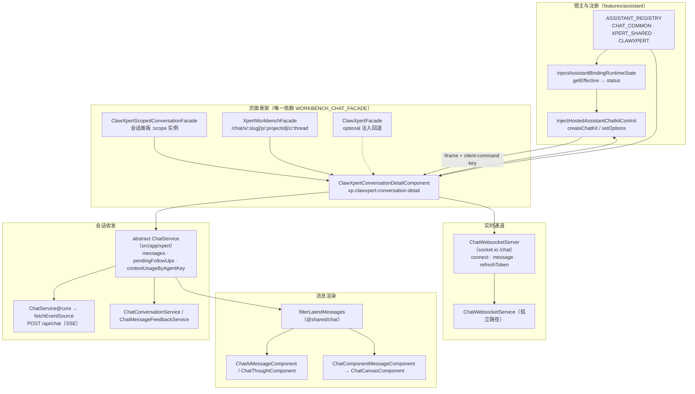

# 01 架构：对话前端专家（Xpert 前端 · 对话域）

> 模块根：`apps/cloud/src/app/features/chat`（99 非 spec `.ts` / 42 spec）＋ `apps/cloud/src/app/xpert`（42 / 7）＋ `apps/cloud/src/app/features/assistant`（22 / 17）＝ **163 非 spec / 66 spec**（commit `80f5676fd` 实测；ki 归档口径 159 / 63 系 2026-10-15 基线，差额 4 / 3 为基线后新增，下文一律用实测值）
> 入口路由：平台内 `/chat`（多形态入口统一收敛至 `/chat/clawxpert`）｜公共页 `/x/*`（重定向层）与 `/x-chatkit/*`
> 技术底座：Angular 17 standalone + signal + `@ngneat/elf`（经 `@core/state`）+ `@xpert-ai/chatkit-angular`（iframe 宿主）
> 覆盖范围：仅前端对话域三块代码；后端会话/投递、Socket 网关与 `/api/ai/*` 契约实现只作为「依赖关系」的引用面（归「对话与会话专家」与「Assistant 定义与运行时专家」）

**本文引用的文件**

- [app-routing.module.ts](file://apps/cloud/src/app/app-routing.module.ts)
- [routes.ts](file://apps/cloud/src/app/features/chat/routes.ts)
- [workbench-chat.facade.ts](file://apps/cloud/src/app/features/chat/workbench-chat/workbench-chat.facade.ts)
- [clawxpert-conversation-detail.component.ts](file://apps/cloud/src/app/features/chat/clawxpert/clawxpert-conversation-detail.component.ts)
- [clawxpert-conversation-pane.component.ts](file://apps/cloud/src/app/features/chat/clawxpert/clawxpert-conversation-pane.component.ts)
- [clawxpert-scoped-conversation.facade.ts](file://apps/cloud/src/app/features/chat/clawxpert/clawxpert-scoped-conversation.facade.ts)
- [xpert-workbench.component.ts](file://apps/cloud/src/app/features/chat/xpert-workbench/xpert-workbench.component.ts)
- [xpert-workbench.facade.ts](file://apps/cloud/src/app/features/chat/xpert-workbench/xpert-workbench.facade.ts)
- [clawxpert.facade.ts](file://apps/cloud/src/app/features/chat/clawxpert/clawxpert.facade.ts)
- [clawxpert.component.ts](file://apps/cloud/src/app/features/chat/clawxpert/clawxpert.component.ts)
- [home.component.ts](file://apps/cloud/src/app/features/chat/home/home.component.ts)
- [group-workbench-scope.ts](file://apps/cloud/src/app/features/chat/clawxpert/group-workbench-scope.ts)
- [assistant.registry.ts](file://apps/cloud/src/app/features/assistant/assistant.registry.ts)
- [assistant-chatkit.runtime.ts](file://apps/cloud/src/app/features/assistant/assistant-chatkit.runtime.ts)
- [assistant-chatkit-frame-url.ts](file://apps/cloud/src/app/features/assistant/assistant-chatkit-frame-url.ts)
- [assistant-chat-client-command.ts](file://apps/cloud/src/app/features/assistant/assistant-chat-client-command.ts)
- [chatkit-workbench-client-command.ts](file://apps/cloud/src/app/features/assistant/chatkit-workbench-client-command.ts)
- [view-client-command-registry.service.ts](file://apps/cloud/src/app/@shared/view-extension/view-client-command-registry.service.ts)
- [chat.service.socket.ts](file://apps/cloud/src/app/@core/services/chat.service.socket.ts)
- [chat.service.ts](file://apps/cloud/src/app/@core/services/chat.service.ts)
- [chat.service.ts](file://apps/cloud/src/app/xpert/chat.service.ts)
- [ai-message.component.ts](file://apps/cloud/src/app/xpert/ai-message/ai-message.component.ts)
- [component-message.component.ts](file://apps/cloud/src/app/xpert/component-message/component-message.component.ts)
- [canvas.component.ts](file://apps/cloud/src/app/xpert/canvas/canvas.component.ts)
- [thought.component.ts](file://apps/cloud/src/app/xpert/thought/thought.component.ts)
- [filter-latest-messages.ts](file://apps/cloud/src/app/@shared/chat/filter-latest-messages.ts)
- [chat-message-feedback.service.ts](file://apps/cloud/src/app/@core/services/chat-message-feedback.service.ts)
- [routes.ts](file://apps/cloud/src/app/xpert/chatkit/routes.ts)

## 目录

- [职责与边界](#职责与边界)
- [目录结构与分层](#目录结构与分层)
- [依赖关系](#依赖关系)
- [关键设计约束与不变量](#关键设计约束与不变量)
- [架构总览图](#架构总览图)
- [组件详细分析](#组件详细分析)
- [结论](#结论)

## 职责与边界

**做什么（三块职责）**

1. **会话与消息交互（`features/chat`）**：`/chat` 路由树与收敛规则、ClawXpert 工作台（绑定/偏好/触发器/文件审查）、会话列表与消息列表、输入框与附件、消息反馈入口、群组会话、任务页、对话内项目路由壳。
2. **对话侧共享层（`src/app/xpert`）**：抽象 `ChatService`（单会话上下文 + 流式归约）、消息渲染族（`ai-message` / `component-message` / `canvas` / `thought`）、`chat-input`、公共页 ChatKit 宿主与 H5/钉钉渠道适配。
3. **助手壳与注册（`features/assistant`）**：`ASSISTANT_REGISTRY` 注册表、ChatKit 运行时状态机、宿主控制（`createChatKit` / `setOptions`）、iframe↔宿主 client-command 桥、workspace 连接器 / PDF 证据 / 知识库引用等宿主副作用。

**不做什么（逐条给出「谁家」）**

| 不在范围内 | 谁家（交叉引用） |
| --- | --- |
| 编排画布与草稿编辑 | Agent 编排 Studio 专家：[studio.component.ts](file://apps/cloud/src/app/features/xpert/studio/studio.component.ts) |
| Xpert 详情 shell 与管理页 | Xpert 工作台专家：[routes.ts](file://apps/cloud/src/app/features/xpert/xpert/routes.ts)、[assistant.facade.ts](file://apps/cloud/src/app/features/xpert/assistant-shell/assistant.facade.ts) |
| 登录/令牌/引导链 | 认证与引导专家：[auth.guard.ts](file://apps/cloud/src/app/@core/auth/auth.guard.ts) |
| 项目域本体（配置、成员、VCS 规则） | 项目协作专家：[project-config.component.ts](file://apps/cloud/src/app/features/project/project-config.component.ts)（本域 `features/chat/project/*` 只是对话内路由壳与视图） |
| 后端会话存储、投递、`/api/ai/*` 契约实现 | 「对话与会话专家」（C0/C1）与「Assistant 定义与运行时专家」（`/api/ai/*` 前缀） |
| `@shared/chat/*` 组件层实现 | 共享层（本域为最大消费方）：[composer.ts](file://apps/cloud/src/app/@shared/chat/composer/composer.ts)、[filter-latest-messages.ts](file://apps/cloud/src/app/@shared/chat/filter-latest-messages.ts) |

章节来源：[routes.ts](file://apps/cloud/src/app/features/chat/routes.ts)（关键符号：`routes`、`redirectLegacyGroup`、`redirectToDefaultChatEntry`、`clawxpertConversationMatcher`、`xpertWorkbenchConversationMatcher`）、[assistant.registry.ts](file://apps/cloud/src/app/features/assistant/assistant.registry.ts)（关键符号：`ASSISTANT_REGISTRY`、`getAssistantRegistryItem`）

## 目录结构与分层

| 目录 / 文件 | 层 | 职责 |
| --- | --- | --- |
| `features/chat/{routes.ts, chat.service.ts, home.service.ts, types.ts}` | **路由与壳（模块根）** | 路由表与四种 matcher、`ChatPlatformService`（平台态 `ChatService` 子类）、`ChatHomeService`（会话列表与 xpert 排序）、`COMMON_COPILOT_ROLE` |
| `features/chat/home/`、`xpert/`、`xperts/`、`sidebar-xperts/`、`icons/` | **会话壳视图层** | `ChatHomeComponent`（壳 + 菜单与历史抽屉）、`ChatXpertComponent`（单 xpert 会话页）、`ChatXpertsComponent`、侧栏与图标 |
| `features/chat/clawxpert/`（39 非 spec） | **ClawXpert 工作台层** | `ClawXpertFacade`（55 KB 门面）、绑定向导、初始化向导、工具偏好、触发器编辑、文件审查、概览、沙箱预览、布局与 URL 状态、`conversation-detail/` 子目录 |
| `features/chat/clawxpert/conversation-detail/{chatkit,composer,citations,workspace}/` | **工作台域内工具层** | ChatKit 尺寸/浮层/对话作用域（`chatkit/`）、composer 请求上下文与引用（`composer/`）、知识库引用目标（`citations/`）、工作区标签页与浏览器（`workspace/`） |
| `features/chat/xpert-workbench/`、`workbench-chat/` | **门面契约与骨架共享层** | `XpertWorkbenchFacade`（`/chat/x/:slug` 形态）、`conversation-entry.resolver`；`workbench-chat/` 放契约本身（`WorkbenchChatFacade` + token）与骨架零件（助手菜单、账号、加载指示、常见问题启动屏） |
| `features/chat/{groups,tasks,project,projects}/` | **横向功能层** | 群组创建对话框与群组会话、任务页（`ChatTasksComponent`）、对话内项目壳与 13 个项目管理子页 |
| `src/app/xpert/{chat.service.ts, chat-app.service.ts, home.service.ts, types.ts, index.ts}` | **共享状态层** | 抽象 `ChatService`（37 KB：消息流归约/跟进队列/上下文用量）、`ChatAppService`（公共页实现）、`XpertHomeService`、`TCopilotChatMessage` |
| `src/app/xpert/{ai-message,component-message,canvas,thought,chat-input,conversation,conversations,home,xpert,chatkit}/` | **消息渲染与输入层** | 四个渲染族组件 + 输入框 + 人类消息 + 会话列表对话框 + 公共页 ChatKit 宿主 |
| `features/assistant/`（22 非 spec） | **助手运行时与宿主桥层** | 注册表、ChatKit 运行时状态机与宿主控制、6 类 client-command、workspace 连接器、PDF 证据预览、知识库引用副作用、`xpert-start-screen` |

**分层与依赖方向（单向）**：视图层（`clawxpert/`、`home/`、`xpert/`、`tasks/`、`project/`）→ 门面（`ClawXpertFacade` / `XpertWorkbenchFacade` / `ChatPlatformService`）→ 共享层（`src/app/xpert/chat.service.ts`）→ `@core` 服务与 `@shared/chat`；`features/assistant` 只依赖 `@core` 与 `@shared`，**不反向依赖** `features/chat`，被对话域以「注入函数 + 注册表」方式调用。

章节来源：[clawxpert.facade.ts](file://apps/cloud/src/app/features/chat/clawxpert/clawxpert.facade.ts)（关键符号：`ClawXpertFacade`）、[chat.service.ts](file://apps/cloud/src/app/xpert/chat.service.ts)（关键符号：`ChatService`）、[assistant-chatkit.runtime.ts](file://apps/cloud/src/app/features/assistant/assistant-chatkit.runtime.ts)（关键符号：`injectAssistantChatkitRuntime`、`injectHostedAssistantChatkitControl`）

## 依赖关系

**出向依赖（对话域 → 外部）**

| 依赖面 | 具体符号（file://） | 用途 |
| --- | --- | --- |
| `@core` 服务 | [chat.service.ts](file://apps/cloud/src/app/@core/services/chat.service.ts)（`ChatService.chat/speechToText/synthesize`，被 `src/app/xpert/chat.service.ts` 以 `ChatService as ChatServerService` 别名注入）、[chat-message-feedback.service.ts](file://apps/cloud/src/app/@core/services/chat-message-feedback.service.ts)（`ChatMessageFeedbackService.getMyAll`，基址 `API_PREFIX + '/chat-message-feedback'`）、`ChatConversationService` / `ChatMessageService` / `AiThreadService` / `ChatGroupService` / `ArtifactService` / `AssistantBindingService` | 控制面 HTTP、历史与反馈、群组与产物 |
| 传输库 | [chat.service.socket.ts](file://apps/cloud/src/app/@core/services/chat.service.socket.ts)（`ChatWebsocketServer`，`socket.io-client` 的 `io()`、命名空间 `chat`）、`@core/services/fetch-event-source.ts`（`injectFetchEventSource`） | socket.io 通道与 SSE 流 |
| `@shared` 复用件 | `@shared/chat`（composer / preview / references / attachments / follow-ups / task-dialog / context / terminal / tool-call-chunk）、`@shared/files`（`FileDocumentStore`、工作区文件桥）、`@shared/view-extension`（`ViewClientCommandRegistry`、`ViewHostEventBus`）、`@shared/avatar`、`@shared/xpert`、`@shared/agent` | 39 个文件直接 import `@shared/chat` |
| `features/xpert` 共享件（跨模块） | `features/xpert/utils.ts`、`features/xpert/xpert/xpert.service.ts` | 仅在对话内项目/工作台视图与 Studio 桥接处复用 |
| 第三方库 | `@xpert-ai/chatkit-angular`（`ChatKit`、`ChatKitControl`、`createChatKit`）、`@xpert-ai/chatkit-types`、`@xpert-ai/contracts`（`ChatGatewayEvent`、`ChatConversationEntry`、`ProjectSelection`、client-command 常量）、`@xpert-ai/headless-ui`、`@ngneat/elf`、`socket.io-client`、`ngx-markdown`、`lodash-es` | 宿主 iframe、事件契约、状态与渲染 |

**入向依赖（谁复用对话域）**——实测 `@shared/chat` 与对话域服务的域外消费点：

1. **Studio 执行可视化**：[execution.service.ts](file://apps/cloud/src/app/features/xpert/studio/services/execution.service.ts) 注入 `ChatConversationService` / `ChatMessageFeedbackService` 并 import `@shared/chat/context/thread-context-usage`；[execution.component.ts](file://apps/cloud/src/app/features/xpert/studio/panel/agent-execution/execution.component.ts) 复用 `isThreadContextUsageEvent`、`buildResumeDecision`、`extractInterruptPatch`；[preview.component.ts](file://apps/cloud/src/app/features/xpert/studio/panel/preview/preview.component.ts) 与 `panel/workflow/trigger-test/trigger.component.ts` 复用 `ChatConversationPreviewComponent`。
2. **其他域复用共享组件层**：[logs.component.ts](file://apps/cloud/src/app/features/xpert/xpert/logs/logs.component.ts)、[agents.component.ts](file://apps/cloud/src/app/features/explore/agents/agents.component.ts)、[project-config.component.ts](file://apps/cloud/src/app/features/project/project-config.component.ts)、`app.module.ts`。
3. **路由挂载**：[app-routing.module.ts](file://apps/cloud/src/app/app-routing.module.ts) 顶层挂 `x-chatkit` 与 `x` 两个懒加载子树（公共页），平台内 `/chat` 由 `features/features-routing.module.ts` 承载。
4. **核实修正**：ki 关联记录称「Studio 复用 `injectHostedAssistantChatkitControl`」——实测 `features/xpert/studio` 目录内**无**该引用（仅 `features/assistant/*` 与 `clawxpert-conversation-detail.component.ts` 使用），当前 commit 该桥未成立。

章节来源：[execution.service.ts](file://apps/cloud/src/app/features/xpert/studio/services/execution.service.ts)（关键符号：`XpertExecutionService`、`ChatConversationService`）、[app-routing.module.ts](file://apps/cloud/src/app/app-routing.module.ts)（关键符号：`routes`、`path: 'x-chatkit'`、`path: 'x'`）

## 关键设计约束与不变量

1. **`WORKBENCH_CHAT_FACADE` 是页面骨架的唯一依赖**：骨架组件 `ClawXpertConversationDetailComponent` 用 `inject(WORKBENCH_CHAT_FACADE, { optional: true })` 取门面，缺失时回退 `inject(ClawXpertFacade)`——**替换宿主不改骨架**。两份装配互不引用：`{ provide: WORKBENCH_CHAT_FACADE, useExisting: ClawXpertScopedConversationFacade }`（会话面板实例）与 `{ provide: WORKBENCH_CHAT_FACADE, useExisting: XpertWorkbenchFacade }`（`/chat/x/...` 形态）。
2. **契约字段语义即不变量**：`WorkbenchChatFacade` 逐字段声明 ViewState 状态机（`'organization-required' | 'wizard' | 'ready' | 'error'`）、`viewState` / `loading` / `loadingUserPreference` 三态分离，以及 `beginPendingConversation` / `ensureConversationEntry` / `setActiveConversation` / `patchActiveConversationStatus` 四个宿主回调；**可选方法 > 5 个**是拆子契约的触发条件。
3. **助手注册表驱动扩展**：`ASSISTANT_REGISTRY` 以 `{ code, featureKeys, management, labelKey/defaultLabel, titleKey/defaultTitle, descriptionKey/defaultDescription }` 描述三个助手（`CHAT_COMMON` / `XPERT_SHARED` 为 `system`，`CLAWXPERT` 为 `user`），门面经 `getAssistantRegistryItem(AssistantCode.CLAWXPERT)` 取 `definition`——新增助手是**加表项**而非改分支。
4. **实时/控制面职责边界**：约定的分工是「socket.io 走实时、HTTP 走控制面」。实测当前 commit 的**活跃链路是 HTTP + SSE**：`src/app/xpert/chat.service.ts` 经别名 `ChatServerService.chat(request, options)` → `injectFetchEventSource(baseUrl + API_CHAT)`；socket.io 侧 `ChatWebsocketServer` 仅被 `features/chat/chat.service.socket.ts` 的 `ChatWebsocketService` 引用，而后者在全仓库无其他引用（**孤立路径**，保留含 401 刷新与 2s 重发逻辑）。
5. **公共页无守卫，安全由后端准入兜底**：`/x-chatkit` 与 `/x` 两棵子树在 [app-routing.module.ts](file://apps/cloud/src/app/app-routing.module.ts) 顶层声明时**不带 `canActivate`**；`xpert/routes.ts` 只做重定向到 `/x-chatkit/...`；`xpert/chatkit/routes.ts` 中 `h5/:platform/:name[/c/:id]` 亦无守卫，仅 `x/:name[/c/:id]` 挂 `authGuard`。
6. **ChatKit 安全边界前置**：`sanitizeAssistantFrameUrl` / `normalizeAssistantFrameUrl` 把 frame URL 白名单在装配前收敛（`DOCKER_` 前缀视为未配置）；`hasCompleteAssistantBinding` 判定绑定完整性；附件上限 `CHATKIT_ATTACHMENT_MAX_BYTES = 50 MiB`；`runtimeKey` 含 token 与组织 id 但**从不出网**（注释明示只发不透明的 `hosted-session-${revision}`）；iframe 命令必须回服务器**重新解析 manifest** 才可执行。
7. **群组按会话 id 绑定；项目作用域双阶段**：门面注释明示「Group sessions are bound by conversation ID; they do not load a private Assistant thread.」；`chatkitMountProjectId`（初始挂载）与 `chatkitProjectSelection`（草稿意图）之外，持久项目由 `syncConversationProject(threadId)` 在运行开始/结束后刷新（不新开会话）。

章节来源：[workbench-chat.facade.ts](file://apps/cloud/src/app/features/chat/workbench-chat/workbench-chat.facade.ts)（关键符号：`WorkbenchChatFacade`、`WORKBENCH_CHAT_FACADE`、`group`、`syncConversationProject`）、[clawxpert-conversation-pane.component.ts](file://apps/cloud/src/app/features/chat/clawxpert/clawxpert-conversation-pane.component.ts)（关键符号：`ClawXpertConversationPaneComponent.providers`）、[assistant-chatkit.runtime.ts](file://apps/cloud/src/app/features/assistant/assistant-chatkit.runtime.ts)（关键符号：`runtimeKey`、`CHATKIT_ATTACHMENT_MAX_BYTES`、`sanitizeAssistantFrameUrl`）

## 架构总览图

图表来源：[workbench-chat.facade.ts](file://apps/cloud/src/app/features/chat/workbench-chat/workbench-chat.facade.ts)（关键符号：`WorkbenchChatFacade`、`WORKBENCH_CHAT_FACADE`）· [assistant-chatkit.runtime.ts](file://apps/cloud/src/app/features/assistant/assistant-chatkit.runtime.ts)（关键符号：`injectAssistantChatkitRuntime`、`injectHostedAssistantChatkitControl`、`runtimeKey`）· [chat.service.ts](file://apps/cloud/src/app/xpert/chat.service.ts)（关键符号：`ChatService.chatRequest`、`executeChatRequest`、`messages`）· [chat.service.socket.ts](file://apps/cloud/src/app/@core/services/chat.service.socket.ts)（关键符号：`ChatWebsocketServer.connect`、`message`、`refreshToken`）· [filter-latest-messages.ts](file://apps/cloud/src/app/@shared/chat/filter-latest-messages.ts)（关键符号：`filterLatestMessages`）

章节来源：[clawxpert-conversation-detail.component.ts](file://apps/cloud/src/app/features/chat/clawxpert/clawxpert-conversation-detail.component.ts)（关键符号：`ClawXpertConversationDetailComponent.facade`、`chatkitAssistantId`、`chatkitGroup`）、[xpert-workbench.component.ts](file://apps/cloud/src/app/features/chat/xpert-workbench/xpert-workbench.component.ts)（关键符号：`ChatXpertWorkbenchComponent.providers`)

## 组件详细分析

### 会话面板与消息列表

`ClawXpertComponent` 是工作台外壳：按 `facade.viewState()` 在 loading / `wizard`（挂绑定向导）/ error 之间切换，并用 `@for (scope of mountedScopes())` 为每个作用域挂一个 `ClawXpertConversationPaneComponent`（非活动面板用 `display:none` + `inert` 隐藏），**只为保留 composer 状态**（注释：The parent shell owns the mounted chat panes so route switches retain composer state）。面板自身零逻辑，只通过 `providers` 做四件事：把 `scope` 注入 `CLAWXPERT_CONVERSATION_SCOPE`、提供 `ClawXpertScopedConversationFacade` 并绑定到 `WORKBENCH_CHAT_FACADE`、用 `ScopedConversationCommands` / `ScopedSkillTrialIntent` 做「按当前路由活性」的命令与意图隔离、提供 `CLAWXPERT_WORKBENCH_ROUTE_ACTIVE` 与 `ClawXpertWorkbenchViewUrlState`。会话列表在共享层：`ChatConversationsComponent`（分页 20、滚动加载、标题内联编辑、按 xpert 过滤）与 `XpertHomeService.conversations` 缓存。

章节来源：[clawxpert.component.ts](file://apps/cloud/src/app/features/chat/clawxpert/clawxpert.component.ts)（关键符号：`ClawXpertComponent.mountedScopes`、`conversationOwnerKeys`、`handleEntryOnboardingRoute`）、[clawxpert-scoped-conversation.facade.ts](file://apps/cloud/src/app/features/chat/clawxpert/clawxpert-scoped-conversation.facade.ts)（关键符号：`ClawXpertScopedConversationFacade.scope`、`active`、`isCurrentRoute`）

### 消息渲染族

四个渲染族共享同一 `/api/chat` 流与 `filterLatestMessages` 去重结果：`ChatAiMessageComponent`（`xp-ai-message`，AI 消息主体 + 执行树 + 反馈 + 语音合成）、`ChatComponentMessageComponent`（`chat-component-message`，按 `data.category` 分发到 tasks / schedule-tasks / memories / files / iframe 与共享的上下文压缩、工具调用块）、`ChatCanvasComponent`（右侧画布，消费 `XpertHomeService.canvasOpened` 分发 Computer / Dashboard / FileViewer）、`ChatThoughtComponent`（`chat-thought`，reasoning 折叠与自动滚动）。公共页与 Studio 预览共用 `@shared/chat` 的 `ChatConversationPreviewComponent`。

章节来源：[ai-message.component.ts](file://apps/cloud/src/app/xpert/ai-message/ai-message.component.ts)（关键符号：`ChatAiMessageComponent.feedback`、`feedbacks`、`showExecution`）、[component-message.component.ts](file://apps/cloud/src/app/xpert/component-message/component-message.component.ts)（关键符号：`ChatComponentMessageComponent.category`、`openInCanvas`）、[canvas.component.ts](file://apps/cloud/src/app/xpert/canvas/canvas.component.ts)（关键符号：`ChatCanvasComponent.canvasType`）、[thought.component.ts](file://apps/cloud/src/app/xpert/thought/thought.component.ts)（关键符号：`ChatThoughtComponent.reasoningText`、`expandReason`）

### ChatKit 宿主

宿主是「一个状态机 + 一个控制对象」：`injectAssistantChatkitRuntime` 先把绑定运行时（`getEffective` → `config` / `status`，含 `missing` / `disabled` 分支）与宿主控制拼在一起；`injectHostedAssistantChatkitControl` 用 `effect` 比较 `runtimeKey`（identity:assistantId:groupId:delegatedConversation:frameUrl:apiUrl:token:orgId）与 `securityScope` 决定**新建会话还是原地 `setOptions`**，并在 `loading` 期间仅在同认证域内保留 iframe。iframe 内的 client-command 由 `ViewClientCommandRegistry` 承载：`register(key, handler, active)` 返回反注册函数，`execute` 取「最后一个 active 的处理器」；iframe 侧命令必须先经 `createChatkitWorkbenchClientCommandHandler` 回服务器重解析 manifest（`stale_context` / `forbidden` 兜底）。

章节来源：[assistant-chatkit.runtime.ts](file://apps/cloud/src/app/features/assistant/assistant-chatkit.runtime.ts)（关键符号：`injectAssistantChatkitRuntime`、`injectHostedAssistantChatkitControl`、`createAssistantChatkitSession`、`buildAssistantApiUrl`）、[view-client-command-registry.service.ts](file://apps/cloud/src/app/@shared/view-extension/view-client-command-registry.service.ts)（关键符号：`ViewClientCommandRegistry.register`、`execute`）、[chatkit-workbench-client-command.ts](file://apps/cloud/src/app/features/assistant/chatkit-workbench-client-command.ts)（关键符号：`createChatkitWorkbenchClientCommandHandler`）

### 助手壳与注册表

`ASSISTANT_REGISTRY` 是三个助手的唯一描述源，`management: 'system' | 'user'` 区分「平台内置」与「用户自配置」；ClawXpert 是唯一 `user` 项，其门面 `ClawXpertFacade` 通过 `#bindingState = new ClawXpertBindingState(this)` 承载绑定状态（向导可见性、可用 xpert、错误），把绑定写入 `AssistantBindingService`（`USER` scope），并派生 `viewState`（`organization-required` / `wizard` / `ready` / `error`）。工作台子功能全部挂在同一门面上：`clawxpert-binding-wizard`（选择 xpert 或新建）、`clawxpert-setup-wizard`（首次运行对话框）、`clawxpert-tool-preferences`（skills/工具偏好）、`clawxpert-trigger-config-editor`（触发器草稿编辑）。

章节来源：[assistant.registry.ts](file://apps/cloud/src/app/features/assistant/assistant.registry.ts)（关键符号：`ASSISTANT_REGISTRY`、`AssistantManagement`、`getAssistantRegistryItem`）、[clawxpert.facade.ts](file://apps/cloud/src/app/features/chat/clawxpert/clawxpert.facade.ts)（关键符号：`ClawXpertFacade.definition`、`#bindingState`、`savePreference`、`saveTriggerDraft`）

### 实时通道

`ChatWebsocketServer`（`@core`，`providedIn: 'root'`）是 socket.io 封装的唯一点：`connect()` 用 `io(url + '/chat', { auth })` 回传 `store.token`；`exception` 事件里 401 触发 `refreshToken()`（经 `AuthStrategy`）并重连；`message()` 会挂一个 2s 定时器重发，直到收到 `ACK` 事件才 `clearRetryMessage()`；`onMessage()` 用 `Subject` 暴露过滤后的消息流。其消费方 `ChatWebsocketService` 用 `switch` 把 `ChatGatewayEvent`（ChainStart / ConversationCreated / Message / MessageStream / StepStart / StepEnd / ToolEnd / ChainEnd / ChainAborted / Error / Agent）归约进 `messages` signal，并提供 `message()`（发 MessageStream）与 `cancelMessage()`（发 CancelChain）。**实测该服务在当前 commit 无其他引用**（`ask` 时代已被 HTTP + SSE 取代），仅作为通道实现保留。

章节来源：[chat.service.socket.ts](file://apps/cloud/src/app/@core/services/chat.service.socket.ts)（关键符号：`ChatWebsocketServer.connect`、`message`、`clearRetryMessage`、`refreshToken`、`namespace`）、[chat.service.socket.ts](file://apps/cloud/src/app/features/chat/chat.service.socket.ts)（关键符号：`ChatWebsocketService.chatListener`、`cancelMessage`）、[chat.service.ts](file://apps/cloud/src/app/@core/services/chat.service.ts)（关键符号：`ChatService.chat`、`API_CHAT`）

## 结论

- **边界清晰**：对话域 = 会话与消息交互 + 对话侧共享层 + 助手运行时；编排画布、Xpert 管理页、认证与引导、项目域三处明确外置，跨域只有「服务注入 + 共享组件 + 注册表」三种接触面。
- **契约化骨架是本域最大特征**：`WorkbenchChatFacade` + `WORKBENCH_CHAT_FACADE` 让 `/chat/clawxpert/c/*`、`/chat/clawxpert/assistant/*`、`/chat/x/:slug[/p/:projectId]/c/*` 三种路由形态复用同一个 `ClawXpertConversationDetailComponent`，仅替换门面实现——新形态对话页的接入成本 = 实现一个门面 + 一个 `providers` 块。
- **宿主与骨架解耦在 `features/assistant`**：注册表（描述）、运行时状态机（绑定 → 就绪）、宿主控制（iframe 生命周期）三层分开，`features/assistant` 不引用 `features/chat`，可被任意宿主复用。
- **两条收发口径必须分开记**：活跃链是「HTTP 控制面 + SSE 流」（`ChatServerService.chat` → `fetchEventSource`），socket.io 路径（`ChatWebsocketServer` + `ChatWebsocketService`）当前为孤立实现——两点与 ki 归档口径「socket.io 为唯一实时主通道」存在偏差，改这条链路前应以源码复核。
- **守卫与安全是「前置 + 后端兜底」的组合**：公共页 `/x/*`、`/x-chatkit/*` 路由层无守卫，安全靠 frame URL 白名单、绑定完整性、附件上限、runtimeKey 不外泄与服务端 manifest 重解析；任何新增公共页必须显式评估（与认证与引导专家的准入白名单协同）。
- 深入实现细节（会话收发链、消息渲染契约、工作台子功能、client-command 处理、关键类清单与技术债）见同目录 `implementation/02-实现.md`。

章节来源：[workbench-chat.facade.ts](file://apps/cloud/src/app/features/chat/workbench-chat/workbench-chat.facade.ts)（关键符号：`WorkbenchChatFacade`、`WORKBENCH_CHAT_FACADE`）、[clawxpert-conversation-detail.component.ts](file://apps/cloud/src/app/features/chat/clawxpert/clawxpert-conversation-detail.component.ts)（关键符号：`ClawXpertConversationDetailComponent.facade`）、[assistant-chatkit.runtime.ts](file://apps/cloud/src/app/features/assistant/assistant-chatkit.runtime.ts)（关键符号：`injectHostedAssistantChatkitControl`）
