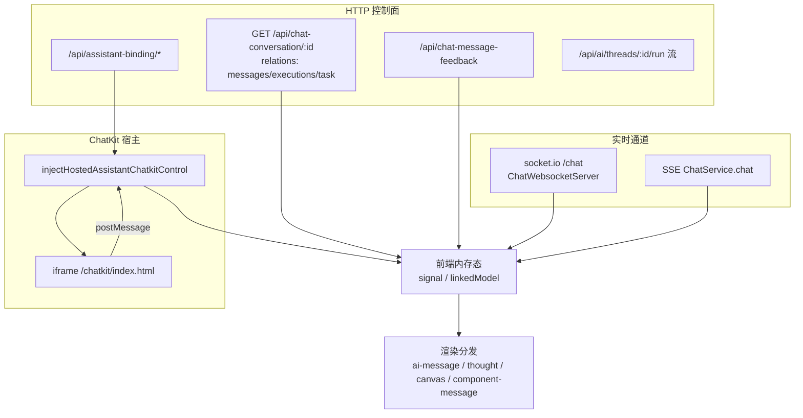
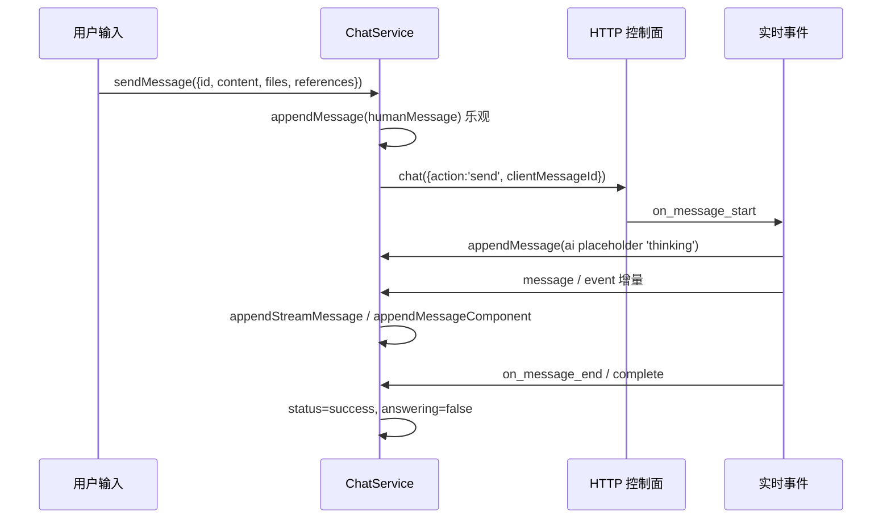
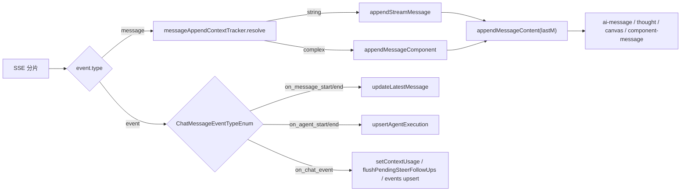
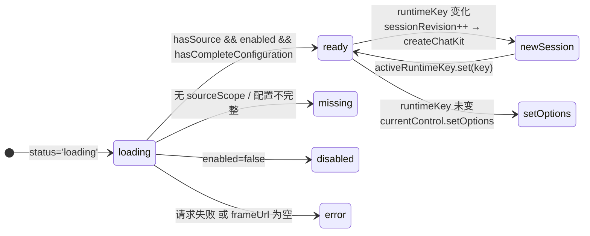
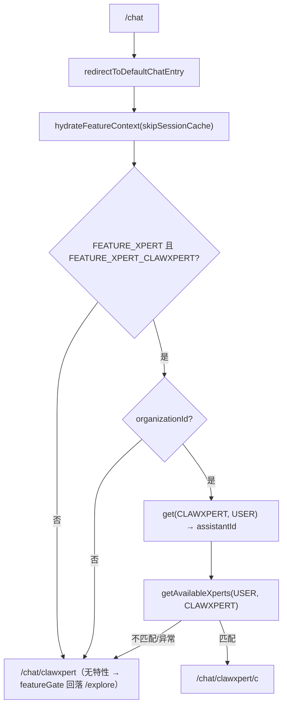
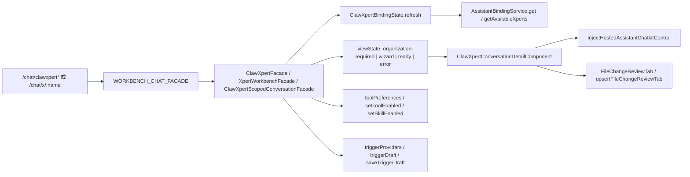
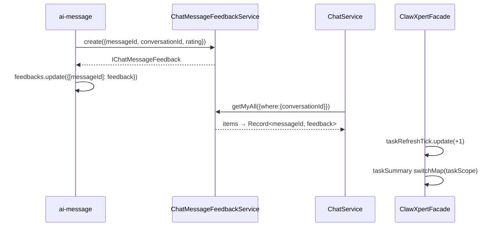
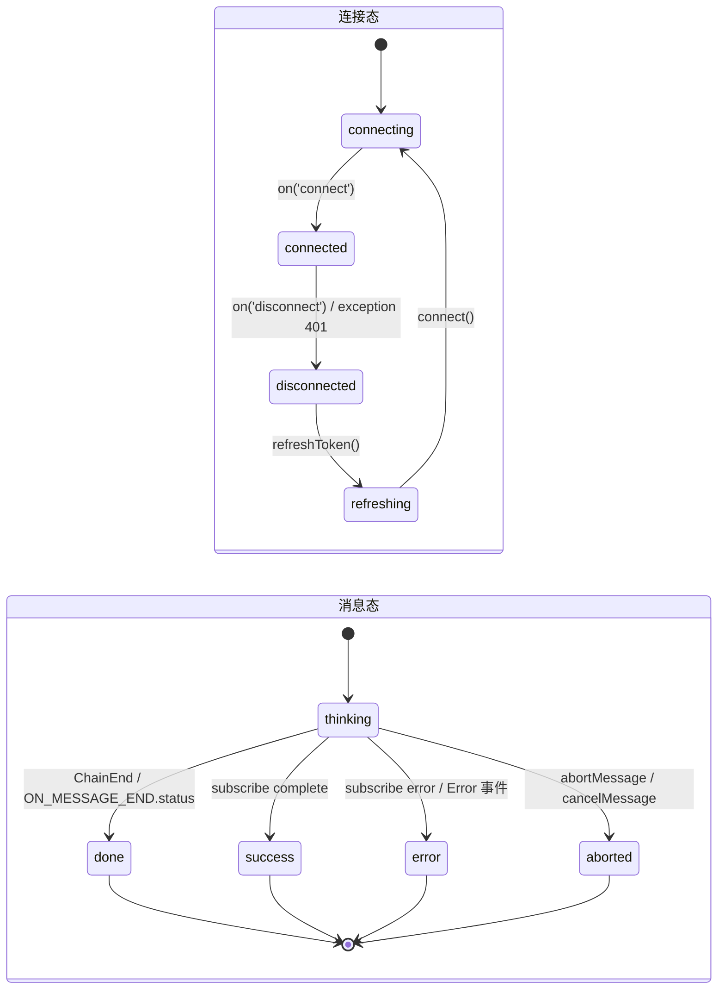

# 03 数据流转：对话前端专家

**本文引用的文件**

- [workbench-chat.facade.ts](file://apps/cloud/src/app/features/chat/workbench-chat/workbench-chat.facade.ts)
- [routes.ts](file://apps/cloud/src/app/features/chat/routes.ts)
- [chat.service.ts](file://apps/cloud/src/app/features/chat/chat.service.ts)
- [chat.service.socket.ts](file://apps/cloud/src/app/features/chat/chat.service.socket.ts)
- [types.ts](file://apps/cloud/src/app/features/chat/types.ts)
- [chat.service.ts](file://apps/cloud/src/app/xpert/chat.service.ts)
- [chat.service.socket.ts](file://apps/cloud/src/app/@core/services/chat.service.socket.ts)
- [filter-latest-messages.ts](file://apps/cloud/src/app/@shared/chat/filter-latest-messages.ts)
- [assistant.registry.ts](file://apps/cloud/src/app/features/assistant/assistant.registry.ts)
- [assistant-chatkit.runtime.ts](file://apps/cloud/src/app/features/assistant/assistant-chatkit.runtime.ts)
- [assistant-chatkit-frame-url.ts](file://apps/cloud/src/app/features/assistant/assistant-chatkit-frame-url.ts)
- [assistant-chat-client-command.ts](file://apps/cloud/src/app/features/assistant/assistant-chat-client-command.ts)
- [assistant-composer-client-command.ts](file://apps/cloud/src/app/features/assistant/assistant-composer-client-command.ts)
- [workbench-file-open-client-command.ts](file://apps/cloud/src/app/features/assistant/workbench-file-open-client-command.ts)
- [workbench-navigation-open-client-command.ts](file://apps/cloud/src/app/features/assistant/workbench-navigation-open-client-command.ts)
- [data-source-create-client-command.ts](file://apps/cloud/src/app/features/assistant/data-source-create-client-command.ts)
- [chatkit-workbench-client-command.ts](file://apps/cloud/src/app/features/assistant/chatkit-workbench-client-command.ts)
- [clawxpert.facade.ts](file://apps/cloud/src/app/features/chat/clawxpert/clawxpert.facade.ts)
- [clawxpert-binding-state.ts](file://apps/cloud/src/app/features/chat/clawxpert/clawxpert-binding-state.ts)
- [clawxpert-conversation-pane.component.ts](file://apps/cloud/src/app/features/chat/clawxpert/clawxpert-conversation-pane.component.ts)
- [clawxpert-conversation-detail.component.ts](file://apps/cloud/src/app/features/chat/clawxpert/clawxpert-conversation-detail.component.ts)
- [clawxpert-conversation-scope.ts](file://apps/cloud/src/app/features/chat/clawxpert/clawxpert-conversation-scope.ts)
- [xpert-workbench.component.ts](file://apps/cloud/src/app/features/chat/xpert-workbench/xpert-workbench.component.ts)
- [file-change-review.types.ts](file://apps/cloud/src/app/features/chat/clawxpert/file-change-review.types.ts)
- [ai-message.component.ts](file://apps/cloud/src/app/xpert/ai-message/ai-message.component.ts)
- [thought.component.ts](file://apps/cloud/src/app/xpert/thought/thought.component.ts)
- [canvas.component.ts](file://apps/cloud/src/app/xpert/canvas/canvas.component.ts)
- [component-message.component.ts](file://apps/cloud/src/app/xpert/component-message/component-message.component.ts)
- [chat-message-feedback.service.ts](file://apps/cloud/src/app/@core/services/chat-message-feedback.service.ts)
- [chat.model.ts](file://packages/contracts/src/ai/chat.model.ts)
- [ai.model.ts](file://packages/contracts/src/ai/ai.model.ts)
- [assistant-binding.model.ts](file://packages/contracts/src/ai/assistant-binding.model.ts)
- [消息与会话.md](file://CodeWikiHub/xpert/memory/数据流/对话域/消息与会话.md)
- [执行记录与反馈.md](file://CodeWikiHub/xpert/memory/数据流/对话域/执行记录与反馈.md)
- [会话与消息.md](file://CodeWikiHub/xpert/memory/接口信息/对话域/会话与消息.md)
- [群组线程与绑定.md](file://CodeWikiHub/xpert/memory/接口信息/对话域/群组线程与绑定.md)

## 目录

1. 总览：HTTP 控制面 + 实时通道 + iframe 宿主
2. 链① 会话收发链
3. 链② 流式增量渲染链
4. 链③ ChatKit 宿主链
5. 链④ 助手注册与准入链
6. 链⑤ ClawXpert 工作台链
7. 链⑥ 反馈与任务链
8. 前端态 vs 后端态边界表
9. 状态流转：连接态 / 消息态 / 宿主状态机
10. 异步流与外部依赖
11. 数据变换关键节点
12. 已知风险

## 1. 总览：HTTP 控制面 + 实时通道 + iframe 宿主

对话域前端**没有任何持久化层**：所有数据在页面关闭后消失，重进页面靠 HTTP 补拉（ki 记忆明确「前端无持久化；socket 断线重连后以历史补拉为准」）。数据流只有三条主干：

1. **HTTP 控制面**：会话/消息历史、反馈、绑定与偏好、任务、执行记录回查（`ChatConversationService`、`ChatMessageFeedbackService`、`AssistantBindingService`、`XpertTaskService`）。
2. **实时通道**：历史遗留的 socket.io 网关（`ChatWebsocketServer`，namespace `chat`），以及现行主链路的消息事件流（`ChatService.chat` 返回的 SSE 事件 + `AiThreadService.joinRunStream` 的后台运行流）。
3. **ChatKit iframe 宿主**：`/chat/clawxpert*` 的实际会话 UI 由 ChatKit iframe 承载，宿主只做绑定解析、会话作用域与 client-command 授权。

图表来源：[chat.service.ts](file://apps/cloud/src/app/xpert/chat.service.ts)（关键符号：`ChatService.fetchConversation`、`ChatService.executeChatRequest`）、[chat.service.socket.ts](file://apps/cloud/src/app/@core/services/chat.service.socket.ts)（关键符号：`ChatWebsocketServer.connect`）、[assistant-chatkit.runtime.ts](file://apps/cloud/src/app/features/assistant/assistant-chatkit.runtime.ts)（关键符号：`injectHostedAssistantChatkitControl`）

章节来源：[chat.service.ts](file://apps/cloud/src/app/features/chat/chat.service.ts)（关键符号：`ChatPlatformService`）、[workbench-chat.facade.ts](file://apps/cloud/src/app/features/chat/workbench-chat/workbench-chat.facade.ts)（关键符号：`WorkbenchChatFacade`）

## 2. 链① 会话收发链

用户输入 → HTTP 控制面创建/发送 → 乐观落库 → 事件回流。

- **乐观更新**：`ChatService.sendMessage(...)` 先构造 `humanMessage`（`role: 'user'`，`id = options.id ?? uuid()`），带 `references` / `attachments` / `thirdPartyMessage`（`planMode`、`runtimeCapabilities`、`commandSource`），立即 `appendMessage(humanMessage)` 写入内存；随后才发请求。
- **控制面请求**：组装 `TChatRequest { action: 'send', conversationId, projectId, message: { clientMessageId: options.id, input } }`，交给 `chatRequest(...)` → `ChatServerService.chat(request, options)`；`clientMessageId` 就是本地 uuid，服务端用它回执去重。
- **AI 占位**：`ON_MESSAGE_START` 到达时（仅 `mode === 'send'` 或 steer 后续）`appendMessage({ id: uuid(), role: 'ai', content: '', status: 'thinking' })`，再由同一个事件把 `event.data` 合并进最后一条 ai 消息。
- **busy 态**：`answering.set(true)`、`conversation.status = 'busy'`、`localChatRequestActive = true`；`complete`/`error`/`cancelMessage` 三处统一回落。
- **去重/合并（历史侧）**：`fetchConversation` 拉回后立即 `filterLatestMessages(conversation.messages)`，按 `parentId` 链「每个父节点只保留 `createdAt` 最新的子节点，平局按原数组后序」，避免重试分支的旧消息重复渲染。
- **socket.io 分支（历史遗留）**：`ChatWebsocketService.messages` 走 `ChatGatewayEvent` 协议（`ConversationCreated` / `StepStart` / `StepEnd` / `ToolEnd` / `ChainEnd` / `ChainAborted` / `Error` / `Agent`），落点方法与主链路不同（`appendStreamMessage`、`appendMessageStep`、`updateMessageStep`）。

图表来源：[chat.service.ts](file://apps/cloud/src/app/xpert/chat.service.ts)（关键符号：`ChatService.sendMessage`、`ChatService.executeChatRequest`、`ChatService.upsertAgentExecution`、`ChatService.retryMessage`）

章节来源：[chat.service.ts](file://apps/cloud/src/app/xpert/chat.service.ts)（关键符号：`sendMessage`、`executeChatRequest`、`appendMessage`、`filterLatestMessages` 调用点）、[chat.service.socket.ts](file://apps/cloud/src/app/features/chat/chat.service.socket.ts)（关键符号：`ChatWebsocketService.chatListener`）、[filter-latest-messages.ts](file://apps/cloud/src/app/@shared/chat/filter-latest-messages.ts)（关键符号：`filterLatestMessages`）

## 3. 链② 流式增量渲染链

服务端事件 → 增量合并 → 渲染分发与滚动。

- **入口**：`executeChatRequest` 的 `subscribe.next(msg)`：`msg.event === 'error'` 只弹 toastr；`msg.data.startsWith(':')` 视为 SSE 心跳直接丢弃；其余 `JSON.parse(msg.data)`。
- **两大类**：`ChаtMessageTypeEnum.MESSAGE`（正文）与 `ChаtMessageTypeEnum.EVENT`（生命周期）。
  - `MESSAGE`：先经 `messageAppendContextTracker.resolve({ incoming, fallbackSource, fallbackStreamId })` 得出 `messageContext`；`typeof event.data === 'string'` → `appendStreamMessage`，否则 → `appendMessageComponent`。二者最终都调用 `appendMessageContent(lastM, content, context)` 做**同一条 ai 消息上的就地合并**。
  - `EVENT`：`ON_CONVERSATION_START/END` → `updateConversation(omit(data,'messages'))`；`ON_MESSAGE_START/END` → 合并/收口 ai 消息；`ON_AGENT_START/END` → `upsertAgentExecution`（按 `execution.id` 过滤后 concat）；`ON_CHAT_EVENT` → 依次判定上下文用量（`isThreadContextUsageEvent` → `setContextUsage`）、follow-up 消费（`parseFollowUpConsumedEvent` → `flushPendingSteerFollowUps`）、`type === 'sandbox'`（给 `conversation.options.features` 追加 `'sandbox'`），否则按 `step.id` upsert 进 `message.events`；`default` → `updateEvent`。
- **渲染分发**：`ai-message`（含 `agent-run-tree` 执行树）、`thought`（`ChatThoughtComponent.reasoning` 取 `TMessageContentReasoning`，`status() === 'reasoning'` 时 effect 内 `scrollTo({ behavior: 'smooth' })` 自动跟随）、`canvas`（`ChatCanvasComponent` 读 `homeService.canvasOpened`，effect 检测到 `messageId` 已不在消息列表中时关闭画布）、`component-message`（`category === 'Computer'` → 开 canvas；`ChatMessageStepCategory` 分发 `Files`/`Iframe`/`Memory`/`Tasks`/`Knowledges` 等子组件）。
- **断流兜底/后台流**：会话 `status === 'busy'` 且非本地请求时，`resolveJoinedRunTarget` 选出顶层 `running`/`pending` 执行，`startJoinedRunStream(threadId, runId, lastEventId)` 用 `lastEventId` 续传，失败后 1s 定时重连。

图表来源：[chat.service.ts](file://apps/cloud/src/app/xpert/chat.service.ts)（关键符号：`executeChatRequest`、`appendStreamMessage`、`appendMessageComponent`、`handleJoinedRunMessage`）、[ai.model.ts](file://packages/contracts/src/ai/ai.model.ts)（关键符号：`ChatMessageTypeEnum`、`ChatMessageEventTypeEnum`、`ChatMessageStepCategory`）

章节来源：[chat.service.ts](file://apps/cloud/src/app/xpert/chat.service.ts)（关键符号：`executeChatRequest`、`upsertAgentExecution`、`updateEvent`、`startJoinedRunStream`）、[thought.component.ts](file://apps/cloud/src/app/xpert/thought/thought.component.ts)（关键符号：`ChatThoughtComponent.reasoning`）、[canvas.component.ts](file://apps/cloud/src/app/xpert/canvas/canvas.component.ts)（关键符号：`ChatCanvasComponent.canvasType`）、[component-message.component.ts](file://apps/cloud/src/app/xpert/component-message/component-message.component.ts)（关键符号：`ChatComponentMessageComponent.openInCanvas`）

## 4. 链③ ChatKit 宿主链

iframe 加载 → postMessage/client-command → 宿主状态机 `injectHostedAssistantChatkitControl`。

- **入口二选一**：`injectAssistantChatkitRuntime`（= 绑定态 + 宿主控制的组合封装）或直接 `injectHostedAssistantChatkitControl`（ClawXpert 会话详情、公共 ChatKit 页、项目会话面板都直接用它）。
- **frame URL 双闸**：`sanitizeAssistantFrameUrl(environment.CHATKIT_FRAME_URL)`（`DOCKER_` 前缀或空 → `null` → `status = 'error'`）；`normalizeAssistantFrameUrl` 把本地 `/chatkit` 规范化为 `/chatkit/index.html`，并保留 query/hash。
- **两次 Key**：`runtimeKey`（identity + assistantId + group.id + delegatedConversation + frameUrl + apiUrl + token + organizationId）决定是否重建会话；`securityScope`（frameUrl + apiUrl + token + organizationId）在 `loading` 期间决定能否保留已挂载 iframe。
- **重建 vs 原地更新**：`newSession = !currentControl || activeRuntimeKey !== key` → `sessionRevision++`、`createChatKit(options)`、`activeRuntimeKey.set(key)`；否则 `currentControl.setOptions(options)`。`sessionKey: 'hosted-session-${revision}'` 是**不透明序号**（源码注释明确「never serialize the runtime key, which contains login credentials」）。
- **6 类 client-command**：`assistant.chat.send_message`（`registerAssistantChatSendMessageCommand`，`newThread` 时先 `control.setThreadId(null)`）、`assistant.context.set`（`registerAssistantContextSetCommand`，`clear` 语义）、`assistant.composer.append_references`（`registerAssistantComposerAppendReferencesCommand`，只追加引用不发送）、`workbench.file.open`（`registerWorkbenchFileOpenCommand`）、`workbench.navigation.open`（`registerWorkbenchNavigationOpenCommand`）、`platform.data-source.create`（`registerDataSourceCreateCommand`）。另有宿主桥 `createChatkitWorkbenchClientCommandHandler` 把 iframe 请求转发给平台命令注册表，并额外提供 `resources.onConnect`（`injectWorkspaceConnectorConnect`）与 `toolOutputAttachments.onRequestPreview`。
- **授权模型**：桥接器要求 `hostType === 'agent' && hostId === assistantId`，卡片点击必须回查服务端消息内容（`conversations.getMessages`）解析 `resourceCard`，再 `views.getSlotViews('agent', assistantId, AGENT_WORKBENCH_SLOT, { runtimeScope })` 重新解析 manifest；返回 `stale_context` / `forbidden` 而非放行。
- **回灌宿主**：`onThreadChange` → `facade.onChatThreadChange(threadId)`、`onProjectChange` → `facade.onChatProjectChange?.(...)`、`onThreadLoadEnd` → `facade.syncConversationProject?.(threadId)`（开始/结束后刷新持久项目，不新开会话）。

图表来源：[assistant-chatkit.runtime.ts](file://apps/cloud/src/app/features/assistant/assistant-chatkit.runtime.ts)（关键符号：`injectHostedAssistantChatkitControl`、`runtimeKey`、`sessionRevision`、`createChatKit`）、[assistant-chatkit-frame-url.ts](file://apps/cloud/src/app/features/assistant/assistant-chatkit-frame-url.ts)（关键符号：`normalizeAssistantFrameUrl`）

章节来源：[assistant-chatkit.runtime.ts](file://apps/cloud/src/app/features/assistant/assistant-chatkit.runtime.ts)（关键符号：`injectAssistantChatkitRuntime`、`injectAssistantBindingRuntimeState`、`injectHostedAssistantChatkitControl`、`sanitizeAssistantFrameUrl`）、[assistant-chat-client-command.ts](file://apps/cloud/src/app/features/assistant/assistant-chat-client-command.ts)（关键符号：`registerAssistantChatSendMessageCommand`、`toSendUserMessageParams`）、[chatkit-workbench-client-command.ts](file://apps/cloud/src/app/features/assistant/chatkit-workbench-client-command.ts)（关键符号：`createChatkitWorkbenchClientCommandHandler`）

## 5. 链④ 助手注册与准入链

`ASSISTANT_REGISTRY` → 路由 → 助手壳 → 守卫/回落。

- **注册表**：`ASSISTANT_REGISTRY` 三项 —— `chat_common`（`management: 'system'`）、`xpert_shared`（system）、`clawxpert`（**user**，`featureKeys: [FEATURE_XPERT, FEATURE_XPERT_CLAWXPERT]`）；`getAssistantRegistryItem(code)` 供门面取 `titleKey` / `defaultTitle`。
- **默认入口判定**：`/chat` 空路径由 `redirectToDefaultChatEntry()` 守卫决定，顺序为 `hydrateFeatureContext({ skipSessionCache: true })` → 两个特性开关 → `organizationId` → `assistantBindingService.get(CLAWXPERT, USER)` 取 `assistantId` → `getAvailableXperts(USER, CLAWXPERT)` 校验该 assistant 是否可用 → 可用则 `/chat/clawxpert/c`，否则 `/chat/clawxpert`。任一环节失败（含 catchError）统一回落 `/chat/clawxpert`。
- **守卫与回落**：`clawxpert` 路由用 `canActivateChild: [featureGate([FEATURE_XPERT, FEATURE_XPERT_CLAWXPERT], ['/explore'])]`，特性未开时跳 `/explore`。
- **遗留入口收敛**：`x/welcome`、`x/common`、`x/common/c`、`x/common/c/:id` 全部 `redirectTo: '/chat/clawxpert'`；`groups` / `groups/:groupId` 由 `redirectLegacyGroup` 解析到 `groups.conversationRoute(groupId)`；`**` → `clawxpert`；`x/:name` 重定向到 `/chat/x/:name/c`。
- **公共页**：`/x/*` 与 `/x-chatkit/*`（`xpert/chatkit/routes.ts`：`h5/:platform/:name` 等 H5 渠道**无守卫**，`x/:name` 带 `authGuard`）复用同一 `PublicChatkitComponent` 与同一宿主控制函数。

图表来源：[routes.ts](file://apps/cloud/src/app/features/chat/routes.ts)（关键符号：`redirectToDefaultChatEntry`、`redirectLegacyGroup`、`clawxpertConversationMatcher`、`xpertWorkbenchConversationMatcher`）

章节来源：[assistant.registry.ts](file://apps/cloud/src/app/features/assistant/assistant.registry.ts)（关键符号：`ASSISTANT_REGISTRY`、`getAssistantRegistryItem`、`AssistantRegistryItem`）、[routes.ts](file://apps/cloud/src/app/features/chat/routes.ts)（关键符号：`redirectToDefaultChatEntry`）、[clawxpert.facade.ts](file://apps/cloud/src/app/features/chat/clawxpert/clawxpert.facade.ts)（关键符号：`ClawXpertFacade.definition`）

## 6. 链⑤ ClawXpert 工作台链

绑定 → 会话面板 → 工具偏好/触发器 → 文件审查。

- **门面装配**：`ClawXpertFacade implements WorkbenchChatFacade`；`xpert-workbench.component.ts` 以 `{ provide: WORKBENCH_CHAT_FACADE, useExisting: XpertWorkbenchFacade }` 提供给 `/chat/x/:name[/p/:projectId]/c[/:threadId]`；`clawxpert-conversation-pane.component.ts` 以 `useExisting: ClawXpertScopedConversationFacade` 提供给 `/chat/clawxpert/assistant[/:threadId]` 与 `/chat/clawxpert/c[/:threadId]`（`clawXpertConversationScope(url)` 把路径映射为 `'task' | 'assistant' | null`）。三种形态共用 `ClawXpertConversationDetailComponent` 与同一宿主控制函数。
- **绑定态**：`ClawXpertBindingState.refresh(scope)` 并行 `get(CLAWXPERT, USER)` + `getAvailableXperts(...)`，用 `#requestId` 做「旧读不得覆盖新写」；`commit()` / `persistCurrent()` 写 `ClawXpertConfigurationCache`；401/403/404 视为拒绝 → 清缓存并进入 error；`viewState` 由 `organizationId → frameUrl → errorMessage → showWizard/resolvedPreference` 逐级判定为 `organization-required | error | wizard | ready`。
- **会话面板**：`ClawXpertConversationDetailComponent` 把门面字段映射进 `injectHostedAssistantChatkitControl`（`chatkitAssistantId` / `chatkitGroup` / `chatkitProjectId` / `chatkitInitialThread` / `chatkitDelegatedConversation`），并注入 `startScreen`（`injectFrequentQuestionsStartScreen`）与 `workbench.onClientCommand`；`onThreadLoadEnd` 触发 `syncConversationProject` 刷新项目作用域。
- **工具偏好**：`toolPreferences = computed(() => normalizeAssistantBindingToolPreferences(userPreference()?.toolPreferences) ?? { version: 1 })`；`setToolEnabled` / `setSkillEnabled` 先乐观改 `userPreference`，再落 `saveUserPreference`，失败回滚并 toastr。
- **触发器**：`triggerProviders` ← `XpertAPIService.getTriggerProviders()`（失败降级空数组）；`triggerDraft` 来自 `buildEditableXpertDraft` + `readTriggerEditorItemsFromDraft`；`saveTriggerDraft` 走 `upsertTriggerEditorItemsIntoDraft`。提供方常量 `CHAT_WORKFLOW_TRIGGER_PROVIDER`。
- **文件审查**：`FileChangeReviewTab`（`kind: 'file-review'`，按 `file-review:${threadId ?? conversationId ?? 'current'}` 唯一）+ `upsertFileChangeReviewTab`（重开只递增 `revision`，不改端点）；`workbench.file.open` 由 `registerWorkbenchFileOpenCommand` 承接（附件预览上限 `WORKBENCH_FILE_PREVIEW_MAX_BYTES = 1MB`）。

图表来源：[clawxpert.facade.ts](file://apps/cloud/src/app/features/chat/clawxpert/clawxpert.facade.ts)（关键符号：`ClawXpertFacade.viewState`、`toolPreferences`、`saveTriggerDraft`）、[clawxpert-conversation-detail.component.ts](file://apps/cloud/src/app/features/chat/clawxpert/clawxpert-conversation-detail.component.ts)（关键符号：`control`、`chatkitProjectId`、`chatkitDelegatedConversation`）

章节来源：[clawxpert.facade.ts](file://apps/cloud/src/app/features/chat/clawxpert/clawxpert.facade.ts)（关键符号：`ClawXpertFacade`、`ClawXpertViewState`、`setToolEnabled`、`saveTriggerDraft`）、[clawxpert-binding-state.ts](file://apps/cloud/src/app/features/chat/clawxpert/clawxpert-binding-state.ts)（关键符号：`ClawXpertBindingState.refresh`）、[clawxpert-conversation-scope.ts](file://apps/cloud/src/app/features/chat/clawxpert/clawxpert-conversation-scope.ts)（关键符号：`clawXpertConversationScope`）、[file-change-review.types.ts](file://apps/cloud/src/app/features/chat/clawxpert/file-change-review.types.ts)（关键符号：`FileChangeReviewTab`、`upsertFileChangeReviewTab`）

## 7. 链⑥ 反馈与任务链

- **反馈读取**：`ChatService.#conversation` 是 `derivedAsync`，用 `combineLatest([fetchConversation(id), getFeedbacks(id)])` 把反馈列表归约成 `Record<messageId, IChatMessageFeedback>`，再经 effect 写入 `feedbacks` signal。`getFeedbacks` 调 `feedbackService.getMyAll({ where: { conversationId: id } })`（后端 `ChatMessageFeedbackService` 基址 `/api/chat-message-feedback`，`/my` 为按用户过滤）。
- **反馈提交**：`ai-message.component.ts` 的 `feedback(message, rating)` → `messageFeedbackService.create({ messageId, conversationId, rating })`，成功后本地 `feedbacks.update(...)`；`cancelFeedback(message, id)` → `delete(id)` 并把该条置 `null`。同一模式在 `@shared/chat/preview` 与 Studio 预览复用（跨域共享，见关联记忆）。
- **任务回流**：`ClawXpertFacade` 的 `taskSummary` / `scheduledTaskSummary` 用 `switchMap` 订阅 `taskScope`（`xpertId` + `taskRefreshTick`）→ `XpertTaskService` 查询（`order: updatedAt`、`where: { xpertId, status }`），`refreshTaskSummaries()` 只 `taskRefreshTick.update(v => v + 1)` 触发重取；`recentTasks` / `scheduledTasks` / `taskCount` 由同一份快照派生。
- **任务与消息耦合点**：`component-message` 支持 `ChatMessageStepCategory.Tasks` 与 `ScheduleTasks` 两类卡片，即任务状态既可从任务面板（HTTP）回流，也可从消息组件卡片（事件流）渲染。

图表来源：[chat.service.ts](file://apps/cloud/src/app/xpert/chat.service.ts)（关键符号：`ChatService.getFeedbacks`、`ChatService.#conversation`）、[ai-message.component.ts](file://apps/cloud/src/app/xpert/ai-message/ai-message.component.ts)（关键符号：`feedback`、`cancelFeedback`）

章节来源：[ai-message.component.ts](file://apps/cloud/src/app/xpert/ai-message/ai-message.component.ts)（关键符号：`feedback`、`cancelFeedback`、`getFeedback`）、[chat-message-feedback.service.ts](file://apps/cloud/src/app/@core/services/chat-message-feedback.service.ts)（关键符号：`ChatMessageFeedbackService.getMyAll`）、[clawxpert.facade.ts](file://apps/cloud/src/app/features/chat/clawxpert/clawxpert.facade.ts)（关键符号：`taskSummary`、`taskRefreshTick`、`refreshTaskSummaries`）、[执行记录与反馈.md](file://CodeWikiHub/xpert/memory/数据流/对话域/执行记录与反馈.md)

## 8. 前端态 vs 后端态边界表

| 数据 | 前端持有形态 | 来源（口径） | 边界说明 |
| --- | --- | --- | --- |
| 会话骨架 + 消息历史 | `signal<IChatConversation>` / `#messages` linkedModel | `GET /api/chat-conversation/:id?relations=messages,...` | 前端无持久化，重进即丢；历史为准 |
| 消息去重结果 | 计算派生（`filterLatestMessages`） | 同上 | 纯前端变换，服务端不感知 |
| 乐观用户消息 / ai 占位 | 内存 signal（uuid） | 前端生成 | `clientMessageId` 是前后端唯一对齐键 |
| 流式正文/组件 | `appendMessageContent` 就地合并 | SSE / socket 事件 | 增量只存在内存，落盘由后端负责 |
| 执行记录 `IXpertAgentExecution` | `message.executions` / `agentExecutions` | 实时事件 + `GET /api/xpert-agent-execution/:id/log` 回查 | 双源，纯投影「前端零新增数据」 |
| 上下文用量 `TThreadContextUsageEvent` | `contextUsageByAgentKey` signal | `ON_CHAT_EVENT` | 切会话即 `set({})` |
| 消息反馈 | `feedbacks: Record<messageId, IChatMessageFeedback>` | `/api/chat-message-feedback`（含 `/my`） | 读写都走后端，前端只缓存 |
| 助手绑定 / 用户偏好 | `preference` / `userPreference` signal | `/api/assistant-binding/:code`、`/effective/:code`、`/:code/preference` | 前端另有 `ClawXpertConfigurationCache` 加速启动，但不替代服务端授权 |
| 工具偏好 / 会话偏好 | `toolPreferences`、`conversationPreferences` computed | 同上 | 乐观改 → 失败回滚 |
| 触发器草稿 | `triggerDraft: TXpertTeamDraft` | `GET /xpert/:id/team` + draft | 前端可编辑副本，落 `POST /xpert/{id}/draft` |
| ChatKit 宿主状态 | `control` / `activeRuntimeKey` / `sessionRevision` / `activeSecurityScope` | 纯前端 | **不进后端**；`sessionKey` 为不透明序号 |
| ChatKit 会话密钥 | `ChatKitClientSecretResult`（含 `organizationId`） | `POST /api/ai/v1/chatkit/sessions` | 短时凭据，仅注入 iframe |
| 文件审查标签页 | `ClawXpertWorkspaceTab[]`（`FileChangeReviewTab`） | 纯前端 | 每线程一个标签，`revision` 本地递增 |
| 任务列表/摘要 | `taskSummary`、`scheduledTasks` | `XpertTaskService` | 由 `taskRefreshTick` 驱动重取 |
| 群组会话 | `group?: Signal<{ id: string } \| null>` | 会话 id 绑定 | 「Group sessions are bound by conversation ID; they do not load a private Assistant thread.」 |

章节来源：[chat.service.ts](file://apps/cloud/src/app/xpert/chat.service.ts)（关键符号：`#conversation`、`feedbacks`、`contextUsageByAgentKey`）、[workbench-chat.facade.ts](file://apps/cloud/src/app/features/chat/workbench-chat/workbench-chat.facade.ts)（关键符号：`group`、`chatkitMountProjectId`、`chatkitProjectSelection`）、[会话与消息.md](file://CodeWikiHub/xpert/memory/接口信息/对话域/会话与消息.md)、[群组线程与绑定.md](file://CodeWikiHub/xpert/memory/接口信息/对话域/群组线程与绑定.md)

## 9. 状态流转：连接态 / 消息态 / 宿主状态机

- **连接态（socket.io）**：`ChatWebsocketServer` 持有 `#connected$` / `#disconnected$` / `refreshTokening`；`connect()` 用 `io(url + '/chat', { auth: cb => cb({ token: store.token }) })`；收到 `exception` 且 `status === 401` 时 `setStatus(false)` 并 `refreshToken()`（由 `refreshTokening` 去重）；`disconnect` → `setStatus(false)`。`message()` 每次发送都挂 2s 定时器，未在窗口内收到 `ACK` 就**原样重发**（对应「断线以历史补拉为准」的对冲策略）。
- **消息态**：`status` 取值链路为 `'thinking'`（占位）→ `'done'`（socket `ChainEnd`，legacy）/ `event.data.status`（SSE `ON_MESSAGE_END`）→ `XpertAgentExecutionStatusEnum.SUCCESS|ERROR`（`complete` / `error` 回调强制收口）；中止为 `'aborted'`（`abortMessage`、`cancelMessage`）。会话级 `conversation.status` 在 `'busy'` / `'idle'` 之间切换，`answering` signal 与 `localChatRequestActive` 决定是否需要补挂后台流。
- **steer / queue 双模**：`pendingFollowUps` 的 `mode` 在 `'queue' | 'steer'` 间流转 —— 发送失败 `downgradePendingSteerFollowUpsToQueue`，收到消费事件 `flushPendingSteerFollowUps`，发送前 `drainQueuedFollowUps`。
- **宿主状态机**：见第 4 节图；`loading` 期间只在**同一 `securityScope`** 内保留 iframe，跨安全域立刻 `control.set(null)`。
- **销毁语义**：`ChatService` 在 `DestroyRef.onDestroy` 中 `stopJoinedRunStream()`，若仍在 `answering` 且已有会话则 `cancelMessage()`。

图表来源：[chat.service.socket.ts](file://apps/cloud/src/app/@core/services/chat.service.socket.ts)（关键符号：`ChatWebsocketServer.connect`、`refreshToken`、`message`、`clearRetryMessage`）、[chat.service.ts](file://apps/cloud/src/app/xpert/chat.service.ts)（关键符号：`cancelMessage`、`abortMessage`、`resolveJoinedRunTarget`）

章节来源：[chat.service.socket.ts](file://apps/cloud/src/app/@core/services/chat.service.socket.ts)（关键符号：`ChatWebsocketServer`、`setStatus`、`onMessage`）、[chat.service.socket.ts](file://apps/cloud/src/app/features/chat/chat.service.socket.ts)（关键符号：`ChatWebsocketService.cancelMessage`、`chatListener`）

## 10. 异步流与外部依赖

| 依赖 | 形态 | 前端落点 | 失败/缺省行为 |
| --- | --- | --- | --- |
| socket.io | `socket.io-client`，namespace `chat` | `ChatWebsocketServer.connect` / `onMessage` | 401 → 刷新 token 重连；ACK 超时 2s 重发 |
| HTTP SSE（当前请求） | `ChatServerService.chat(request, options)` | `executeChatRequest` 的 subscribe | error → `status = ERROR` + toastr + 队列降级 |
| 后台运行流 | `AiThreadService.joinRunStream(threadId, runId, lastEventId)` | `startJoinedRunStream` | 1s 后按 `lastEventId` 重连 |
| ChatKit iframe | `createChatKit(options)` / `ChatKitControl.setOptions` | `injectHostedAssistantChatkitControl` | 重新建会话或清空 control |
| ChatKit 会话密钥 | `POST {apiUrl}/v1/chatkit/sessions` | `createAssistantChatkitSession` / `createGroupChatkitSession` | 无 secret → 抛错；无 HttpClient 时回退平台 token |
| 发布广播 | `XpertPublicationService.changes$` | `publicationRevision`（`scan` 计数） | 仅触发 options 原地刷新，不重建会话 |
| Artifact 预览 | `ArtifactService.createSignedVersionPreviewLink` | `toolOutputAttachments.onRequestPreview` | 缺服务抛错；校验 `artifactId`/`sha256` 不一致即抛 |

章节来源：[chat.service.ts](file://apps/cloud/src/app/xpert/chat.service.ts)（关键符号：`startJoinedRunStream`、`executeChatRequest`）、[assistant-chatkit.runtime.ts](file://apps/cloud/src/app/features/assistant/assistant-chatkit.runtime.ts)（关键符号：`createAssistantChatkitSession`、`createGroupChatkitSession`、`publicationRevision`、`toolOutputAttachments`）、[chat.service.socket.ts](file://apps/cloud/src/app/@core/services/chat.service.socket.ts)（关键符号：`ChatWebsocketServer.message`）

## 11. 数据变换关键节点

1. **消息去重合并**：`filterLatestMessages(messages)` —— 建 `byId` / `indexById` / `childrenByParent` 三张表，先找 root（`parentId` 缺失或父不存在），再沿链 `pickLatest`（`createdAt` 大者胜，平局按原序后位），最终按原顺序过滤保留集。语义是「每个父链只留一条最新子节点」，**返回原数组顺序不变**。
2. **增量正文合并**：`appendMessageContent(lastM, content, context)` + `createMessageAppendContextTracker().resolve({ incoming, fallbackSource, fallbackStreamId })` —— 把字符串分片与复杂块合并进**最后一条 ai 消息**；落点方法 `appendStreamMessage` / `appendMessageComponent` 只差 content 类型。
3. **执行记录 upsert**：`upsertAgentExecution(execution)` 按 `execution.id` 过滤旧值再 `concat`；无 ai 消息时自动新建占位消息承载 `executions`。
4. **事件 upsert**：`ON_CHAT_EVENT` 分支按 `step.id` 在 `message.events` 内 upsert，未命中则追加；`updateEvent` 是兜底分支（写 `event.name` / `message` / `error`）。
5. **iframe 消息序列化**：`toSendUserMessageParams(payload)` 把自由结构归一为 `SendUserMessageParams` —— `attachments` 由 `attachments` + `files` 合并（`toAttachments` / `toFileAttachments`），`references` 仅保留 `type` 为字符串的项，`newThread === true` 才带上 `newThread`，`text` 取 `text ?? input ?? ''`。
6. **client-secret 包装**：`buildAssistantClientSecret(secret, organizationId)` —— 无 `organizationId` 时返回裸字符串，有则返回 `{ secret, organizationId }`。
7. **路由参数校验**：`readAssistantBindingAssistantId`（`trim()` 后非空才算有效）与 `hasMatchingXpertId`（数组内逐项判 `id`）在进入路由前过滤脏数据。

章节来源：[filter-latest-messages.ts](file://apps/cloud/src/app/@shared/chat/filter-latest-messages.ts)（关键符号：`filterLatestMessages`）、[chat.service.ts](file://apps/cloud/src/app/xpert/chat.service.ts)（关键符号：`appendStreamMessage`、`appendMessageComponent`、`upsertAgentExecution`）、[assistant-chat-client-command.ts](file://apps/cloud/src/app/features/assistant/assistant-chat-client-command.ts)（关键符号：`toSendUserMessageParams`、`toAttachments`、`toFileAttachments`）、[routes.ts](file://apps/cloud/src/app/features/chat/routes.ts)（关键符号：`readAssistantBindingAssistantId`、`hasMatchingXpertId`）

## 12. 已知风险

1. **双实时通道并存**：socket.io（`ChatGatewayEvent`，注释已标 `@deprecated use ChatMessageEventTypeEnum`）与 SSE（`ChatMessageEventTypeEnum`）语义重叠但落点方法不同（`appendMessageStep`/`updateMessageStep` vs `appendMessageContent`）。改动任一侧需同时回归两条路径。
2. **消息合并语义是共享契约**：`@shared/chat/filter-latest-messages.ts` 同时被对话页与 Studio 预览使用，改去重规则会双向制造「消息重复/丢失」（见关联记忆「改 filter-latest-messages 的去重语义会造成两域消息重复/丢失」）。
3. **ACK 重发不等于端到端幂等**：`ChatWebsocketServer.message()` 的 2s 重发只保证「发出去」，服务端幂等依赖 `clientMessageId`；重发可能造成重复回合。[推测]
4. **`runtimeKey` 内含凭据**：源码注释明确禁止序列化 runtime key，改这一带代码时不可把它写进日志/DOM/会话存储。
5. **安全边界前置依赖多个条件**：`sanitizeAssistantFrameUrl` + `hasAssistantBindingSource` + `hasCompleteAssistantBinding` + `enabled` 四者同时成立才 `ready`；放宽任一条都会扩大 iframe 执行面。
6. **客户端与后端的附件上限需同步**：`CHATKIT_ATTACHMENT_MAX_BYTES = 50MiB`、`maxCount: 5` 是前端闸门，源码注释要求与「server parser」对齐（对应 BID 准入）。
7. **群组与私有会话不共用 thread**：群组按会话 id 绑定、不加载私有 Assistant thread；若产品要求「群组内个人视角历史」需重新评估该决策。
8. **项目作用域双阶段易错位**：`chatkitMountProjectId` / `chatkitProjectSelection`（初始绑定与草稿意图）与 `syncConversationProject(threadId)`（运行后刷新持久项目）是两条不同时序；错位会导致会话切换串项目。
9. **`filterLatestMessages` 依赖 `createdAt`**：缺失或时区异常时退化为「按原序后位」——无法识别真正的分支覆盖关系。
10. **未确认**：`AiThreadService.joinRunStream` 的 `lastEventId` 续传是否严格无重复事件，本专家只核到前端消费侧（`if (message.id) this.joinedRunLastEventId = message.id`），服务端去重策略未在本仓库前端范围内核实。

章节来源：[chat.model.ts](file://packages/contracts/src/ai/chat.model.ts)（关键符号：`ChatGatewayMessage`、`ChatGatewayEvent`）、[ai.model.ts](file://packages/contracts/src/ai/ai.model.ts)（关键符号：`ChatMessageEventTypeEnum`）、[assistant-chatkit.runtime.ts](file://apps/cloud/src/app/features/assistant/assistant-chatkit.runtime.ts)（关键符号：`CHATKIT_ATTACHMENT_MAX_BYTES`、`runtimeKey`、`hasCompleteAssistantBinding`）、[workbench-chat.facade.ts](file://apps/cloud/src/app/features/chat/workbench-chat/workbench-chat.facade.ts)（关键符号：`syncConversationProject`、`chatkitMountProjectId`）
