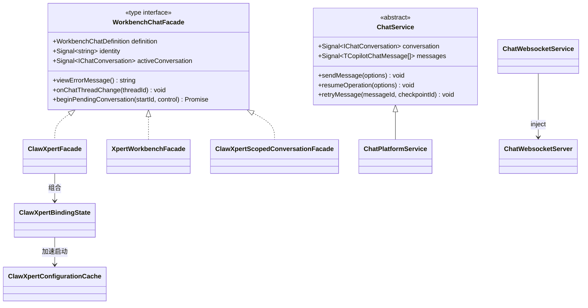

# 04 模型：对话前端专家

**本文引用的文件**

- [workbench-chat.facade.ts](file://apps/cloud/src/app/features/chat/workbench-chat/workbench-chat.facade.ts)
- [types.ts](file://apps/cloud/src/app/features/chat/types.ts)
- [routes.ts](file://apps/cloud/src/app/features/chat/routes.ts)
- [chat.service.ts](file://apps/cloud/src/app/features/chat/chat.service.ts)
- [chat.service.socket.ts](file://apps/cloud/src/app/features/chat/chat.service.socket.ts)
- [home.service.ts](file://apps/cloud/src/app/features/chat/home.service.ts)
- [chat.service.ts](file://apps/cloud/src/app/xpert/chat.service.ts)
- [home.service.ts](file://apps/cloud/src/app/xpert/home.service.ts)
- [chat.service.socket.ts](file://apps/cloud/src/app/@core/services/chat.service.socket.ts)
- [filter-latest-messages.ts](file://apps/cloud/src/app/@shared/chat/filter-latest-messages.ts)
- [assistant.registry.ts](file://apps/cloud/src/app/features/assistant/assistant.registry.ts)
- [assistant-chatkit.runtime.ts](file://apps/cloud/src/app/features/assistant/assistant-chatkit.runtime.ts)
- [assistant-chatkit-frame-url.ts](file://apps/cloud/src/app/features/assistant/assistant-chatkit-frame-url.ts)
- [assistant-chat-client-command.ts](file://apps/cloud/src/app/features/assistant/assistant-chat-client-command.ts)
- [assistant-composer-client-command.ts](file://apps/cloud/src/app/features/assistant/assistant-composer-client-command.ts)
- [chatkit-workbench-client-command.ts](file://apps/cloud/src/app/features/assistant/chatkit-workbench-client-command.ts)
- [xpert-start-screen.ts](file://apps/cloud/src/app/features/assistant/xpert-start-screen.ts)
- [clawxpert.facade.ts](file://apps/cloud/src/app/features/chat/clawxpert/clawxpert.facade.ts)
- [clawxpert-binding-state.ts](file://apps/cloud/src/app/features/chat/clawxpert/clawxpert-binding-state.ts)
- [clawxpert-configuration-cache.service.ts](file://apps/cloud/src/app/features/chat/clawxpert/clawxpert-configuration-cache.service.ts)
- [clawxpert-conversation-scope.ts](file://apps/cloud/src/app/features/chat/clawxpert/clawxpert-conversation-scope.ts)
- [clawxpert-scoped-conversation.facade.ts](file://apps/cloud/src/app/features/chat/clawxpert/clawxpert-scoped-conversation.facade.ts)
- [clawxpert-bootstrap.service.ts](file://apps/cloud/src/app/features/chat/clawxpert/clawxpert-bootstrap.service.ts)
- [clawxpert-conversation-start-intent.service.ts](file://apps/cloud/src/app/features/chat/clawxpert/clawxpert-conversation-start-intent.service.ts)
- [clawxpert-workbench-layout-storage.service.ts](file://apps/cloud/src/app/features/chat/clawxpert/clawxpert-workbench-layout-storage.service.ts)
- [file-change-review.types.ts](file://apps/cloud/src/app/features/chat/clawxpert/file-change-review.types.ts)
- [frequent-questions-start-screen.ts](file://apps/cloud/src/app/features/chat/workbench-chat/frequent-questions-start-screen.ts)
- [xpert-workbench.facade.ts](file://apps/cloud/src/app/features/chat/xpert-workbench/xpert-workbench.facade.ts)
- [xpert-workbench.component.ts](file://apps/cloud/src/app/features/chat/xpert-workbench/xpert-workbench.component.ts)
- [component-message.component.ts](file://apps/cloud/src/app/xpert/component-message/component-message.component.ts)
- [assistant-binding.model.ts](file://packages/contracts/src/ai/assistant-binding.model.ts)
- [chat.model.ts](file://packages/contracts/src/ai/chat.model.ts)
- [ai.model.ts](file://packages/contracts/src/ai/ai.model.ts)
- [model.ts](file://packages/contracts/src/view-extension/model.ts)
- [结构暗示的决策集（推测）.md](file://CodeWikiHub/xpert/memory/决策记录/对话域/结构暗示的决策集（推测）.md)
- [群组绑定与项目双阶段（注释证据）.md](file://CodeWikiHub/xpert/memory/决策记录/对话域/群组绑定与项目双阶段（注释证据）.md)

## 目录

1. 前端模型层总览：无 DB / ORM
2. `WorkbenchChatFacade`：页面骨架契约
3. `WORKBENCH_CHAT_FACADE` InjectionToken
4. 消息与会话模型
5. 助手与注册表模型
6. ChatKit 宿主状态模型
7. ClawXpert 工作台模型
8. 工具偏好与触发器模型
9. 文件审查、任务与项目作用域模型
10. 建模边界：前端独有字段 vs 后端 DTO 投影
11. 校验规则
12. 未确认项

## 1. 前端模型层总览：无 DB / ORM

**数据库实体 / ORM 映射 / Repository / 迁移脚本：该模块无此项。** 对话域前端全部模型都是「内存态 + 契约 DTO 投影」，落库只发生在服务端，前端通过 HTTP / SSE / postMessage 三个通道收发 JSON。建模手段只有四种：TypeScript `type`（含判别联合与可选成员）、Angular `signal`/`computed`（响应式内存模型）、`InjectionToken`（契约注入）、以及 `packages/contracts` 的接口（DTO 投影）。

- **契约层**：`packages/contracts/src` —— `ai/chat.model.ts`（网关消息）、`ai/ai.model.ts`（流事件枚举）、`ai/assistant-binding.model.ts`（绑定与偏好）、`view-extension/model.ts`（client-command 常量）。
- **端口契约层**：`features/chat/workbench-chat/workbench-chat.facade.ts` —— 页面骨架唯一依赖。
- **页面状态层**：`features/chat/**`、`features/assistant/**`、`xpert/**` 的 signal / computed / `linkedModel`。
- **无 ORM 的直接后果**：没有表结构校验、没有实体身份映射（identity map）、没有级联删除；一切「关系」都是 HTTP `relations` 查询参数或前端 `Map` 索引。



图表来源：[workbench-chat.facade.ts](file://apps/cloud/src/app/features/chat/workbench-chat/workbench-chat.facade.ts)（关键符号：`WorkbenchChatFacade`、`WORKBENCH_CHAT_FACADE`）、[clawxpert.facade.ts](file://apps/cloud/src/app/features/chat/clawxpert/clawxpert.facade.ts)（关键符号：`ClawXpertFacade`）、[xpert-workbench.facade.ts](file://apps/cloud/src/app/features/chat/xpert-workbench/xpert-workbench.facade.ts)（关键符号：`XpertWorkbenchFacade`）

章节来源：[workbench-chat.facade.ts](file://apps/cloud/src/app/features/chat/workbench-chat/workbench-chat.facade.ts)（关键符号：`WorkbenchChatFacade`、`WorkbenchChatViewState`）、[xpert-workbench.component.ts](file://apps/cloud/src/app/features/chat/xpert-workbench/xpert-workbench.component.ts)（关键符号：`ChatXpertWorkbenchComponent.providers`）

## 2. `WorkbenchChatFacade`：页面骨架契约

定义位置：[workbench-chat.facade.ts](file://apps/cloud/src/app/features/chat/workbench-chat/workbench-chat.facade.ts)。三个对话页面形态（ClawXpert 页面、`/chat/x/:name` 工作台、scoped conversation pane）共用同一骨架，页面组件只依赖该 type + token，不依赖任何具体实现。

| 成员 | 类型 | 语义 | 生产方 | 消费方 / 约束 |
| --- | --- | --- | --- | --- |
| `definition` | `WorkbenchChatDefinition` | 助手注册表条目 | `getAssistantRegistryItem(AssistantCode.CLAWXPERT)` | 取 `titleKey` / `defaultTitle` 作 iframe 标题 |
| `identity` | `Signal<string \| null>` | 逻辑身份（非用户身份） | `computed(() => AssistantCode.CLAWXPERT)` | `runtimeKey` 组成部分，变则换会话 |
| `userId` | `Signal<string \| null>` | 登录用户 id | `store.user$` / `store.userId` | 绑定态 scope 的一部分 |
| `assistantId` | `Signal<string \| null>` | 绑定的 Xpert id | `resolvedPreference()?.assistantId` | 必须来自**可用** xpert 列表，否则为 null |
| `xpertId` | `Signal<string \| null>` | 当前 xpert id | `currentXpert()?.id ?? resolvedPreference()?.assistantId` | 触发器/任务查询 scope |
| `currentXpert?` | `Signal<IXpert \| null>` | 完整 xpert 实体 | `availableXperts().find(...)` | 可选方法用 `getOptionalSignalValue` 读取 |
| `assistantTitle?` | `Signal<string \| null>` | 展示标题 | `currentXpertLabel` | 可选 |
| `assistantAvatar?` | `Signal<TAvatar \| null>` | 头像 | `currentXpert()?.avatar` | 可选 |
| `initialLayout` | `Signal<XpertWorkbenchInitialLayoutEnum \| null>` | 初始工作台布局 | `currentXpert()?.options?.workbench?.initialLayout` | 决定 ChatKit 面板初始布局 |
| `defaultViewKey` | `Signal<string \| null>` | 默认视图 key | `options.workbench.defaultViewKey?.trim() \|\| null` | 空串归一为 null |
| `chatkitFrameUrl` | `Signal<string \| null>` | iframe 地址 | `sanitizeAssistantFrameUrl(environment.CHATKIT_FRAME_URL)` | `null` ⇒ `viewState = 'error'` |
| `threadId` | `Signal<string \| null>` | 路由解析出的线程 id | `parseClawXpertThreadId(currentUrl())` | 路由为真源，非本地状态 |
| `group?` | `Signal<{ id: string } \| null>` | 群组会话 | 群组路由 | **注释契约**：按会话 id 绑定，不加载私有 Assistant thread |
| `projectId?` | `Signal<string \| null>` | 当前 Project 路由作用域 | 路由 `p` 段 | 仅支持 Project 隔离的工作台提供 |
| `chatkitMountProjectId?` | `Signal<string \| null>` | **初始**会话绑定的项目 | 路由 / facade | 仅初始绑定；运行时由 ChatKit 从已保存会话解析 |
| `chatkitProjectSelection?` | `Signal<ProjectSelection>` | 初始草稿意图 | 门面 | 与运行中会话的持久项目不同 |
| `syncConversationProject?` | `(threadId: string) => Promise<void>` | 运行开始/结束后刷新持久项目 | 门面实现 | **不新开会话** |
| `projectAccess?` | `Signal<TXpertProjectAccessSummary \| null>` | 项目访问权 | 服务端 | `null` 表示 pending、不可用或被拒 |
| `loading` | `Signal<boolean>` | 绑定加载中 | `ClawXpertBindingState.loading` | 宿主据此保留/清空 iframe |
| `loadingUserPreference` | `Signal<boolean>` | 用户偏好加载中 | 门面 | UI 骨架态 |
| `viewState` | `Signal<WorkbenchChatViewState>` | 页面状态 | 门面 computed | `'organization-required' \| 'wizard' \| 'ready' \| 'error'` |
| `suppressAutoResume` | `Signal<boolean>` | 抑制自动恢复会话 | 门面 | 避免向导期间抢跑 |
| `pendingConversationStartId` | `Signal<number>` | 待启动会话序号 | 门面 | 自增，驱动 `beginPendingConversation` |
| `activeConversation` | `Signal<IChatConversation \| null>` | 当前活跃会话 | 门面 / 会话详情回写 | 与 iframe 内状态同步 |
| `viewErrorMessage()` | `() => string` | 视图错误文案 | 门面 | 函数而非 signal（按需取值） |
| `onChatThreadChange` | `(threadId: string \| null) => void` | 线程切换回调 | ChatKit `onThreadChange` | 写路由/持久偏好 |
| `onChatProjectChange?` | `(projectId, view?, selection?) => Promise<boolean> \| void` | 项目切换回调 | ChatKit `onProjectChange` | 可选，支持异步确认 |
| `beginPendingConversation` | `(startId: number, control: ChatKitControl) => Promise<void>` | 消费一次启动意图 | 页面 | 需传入 ChatKitControl 才能动 iframe |
| `ensureConversationEntry` | `(control: ChatKitControl) => Promise<void>` | 幂等保证会话入口 | 页面 | 内部用 `entryKey` 去重 |
| `setActiveConversation` | `(conversation: IChatConversation \| null) => void` | 写入活跃会话 | 页面 | — |
| `patchActiveConversationStatus` | `(status: 'busy' \| 'idle') => void` | 局部改会话状态 | 页面 | 只 patch status，避免整对象替换 |

```ts
// 形状摘录（真实定义见 workbench-chat.facade.ts）
export type WorkbenchChatViewState = 'organization-required' | 'wizard' | 'ready' | 'error'
export type WorkbenchChatDefinition = { titleKey: string; defaultTitle: string }
export type WorkbenchChatFacade = { /* 上表 30 个成员 */ }
```

章节来源：[workbench-chat.facade.ts](file://apps/cloud/src/app/features/chat/workbench-chat/workbench-chat.facade.ts)（关键符号：`WorkbenchChatFacade`、`WorkbenchChatViewState`、`WorkbenchChatDefinition`、`syncConversationProject`、`chatkitMountProjectId`、`patchActiveConversationStatus`）

## 3. `WORKBENCH_CHAT_FACADE` InjectionToken

定义位置：[workbench-chat.facade.ts](file://apps/cloud/src/app/features/chat/workbench-chat/workbench-chat.facade.ts) —— `new InjectionToken<WorkbenchChatFacade>('WORKBENCH_CHAT_FACADE')`。

- **生产方（三处 `provide`，均 `useExisting`）**：
  - `xpert-workbench.component.ts`：`{ provide: WORKBENCH_CHAT_FACADE, useExisting: XpertWorkbenchFacade }`（`/chat/x/:name[/p/:projectId]/c[/:threadId]`）。
  - `clawxpert-conversation-pane.component.ts`：`{ provide: WORKBENCH_CHAT_FACADE, useExisting: ClawXpertScopedConversationFacade }`（`/chat/clawxpert/assistant[/:threadId]`、`/chat/clawxpert/c[/:threadId]`）。
  - `ClawXpertFacade` 本身 `implements WorkbenchChatFacade`，是完整页面形态的实现体。
- **消费方**：`ClawXpertConversationDetailComponent`（`inject(WORKBENCH_CHAT_FACADE)`），是页面骨架里**唯一**的门面依赖点。
- **业务约束**：`useExisting` 而非 `useClass` ⇒ 同一路由内门面实例唯一（单例共享），避免页面组件与详情组件各持一份状态；可选成员用「存在性探测 + `getOptionalSignalValue`」读取，而非在 token 上再拆子契约 —— 对应 [结构暗示的决策集（推测）.md](file://CodeWikiHub/xpert/memory/决策记录/对话域/结构暗示的决策集（推测）.md) 中「可选方法 > 5 个导致特性探测泛滥时拆子契约」的触发条件。

章节来源：[workbench-chat.facade.ts](file://apps/cloud/src/app/features/chat/workbench-chat/workbench-chat.facade.ts)（关键符号：`WORKBENCH_CHAT_FACADE`）、[xpert-workbench.component.ts](file://apps/cloud/src/app/features/chat/xpert-workbench/xpert-workbench.component.ts)（关键符号：`ChatXpertWorkbenchComponent`）、[clawxpert-conversation-pane.component.ts](file://apps/cloud/src/app/features/chat/clawxpert/clawxpert-conversation-pane.component.ts)（关键符号：`ClawXpertConversationPaneComponent`）

## 4. 消息与会话模型

| 类型名 | 定义位置 | 字段与语义 | 生产方 | 消费方 / 约束 |
| --- | --- | --- | --- | --- |
| `IChatConversation` | `@core` 再导出（契约在 `packages/contracts`） | `id`、`xpertId`、`threadId`、`status: 'busy' \| 'idle'`、`messages`、`executions`、`task`、`options.parameters`、`options.features` | `GET /api/chat-conversation/:id`、事件 `ON_CONVERSATION_START/END` | 会话状态驱动 `relativeTimes` 与 busy 文案 |
| `TCopilotChatMessage` | [types.ts](file://apps/cloud/src/app/features/chat/types.ts) | `IChatMessage & { event?: string; error?: string; expanded?: boolean }` | 前端各 append 方法 | `ChatService.messages()` 的元素类型 |
| `COMMON_COPILOT_ROLE` | [types.ts](file://apps/cloud/src/app/features/chat/types.ts) | `slug: null, id: null, name: 'common', title, titleCN, description, type: Agent` | 前端常量 | 无角色时的兜底角色（`ChatWebsocketService.role`） |
| `PendingFollowUp` | [chat.service.ts](file://apps/cloud/src/app/xpert/chat.service.ts) | `id?`、`content`、`files?`、`references?`、`mode: 'queue' \| 'steer'`、`planMode?`、`runtimeCapabilities?`、`commandSource?` | `sendMessage` 在 `answering()` 时入队 | `pendingFollowUps` signal 元素 |
| `ChatMessageTypeEnum` | [ai.model.ts](file://packages/contracts/src/ai/ai.model.ts) | `MESSAGE = 'message'`、`EVENT = 'event'` | 服务端流 | 决定走正文合并还是事件分派 |
| `ChatMessageEventTypeEnum` | [ai.model.ts](file://packages/contracts/src/ai/ai.model.ts) | 17 个成员：`on_conversation_start/end`、`on_message_start/end`、`on_tool_start/end/error/message`、`on_agent_start/end`、`on_retriever_start/end/error`、`on_interrupt`、`on_error`、`on_chat_event`、`on_client_effect` | 服务端流 | `executeChatRequest` 的 switch 分支 |
| `ChatMessageStepCategory` | [ai.model.ts](file://packages/contracts/src/ai/ai.model.ts) | `List`、`WebSearch`、`Files`、`File`、`Program`、`Iframe`、`Memory`、`Tasks`、`Knowledges` | 服务端组件消息 | `component-message` 的模板分发键 |
| `ChatGatewayEvent` | [chat.model.ts](file://packages/contracts/src/ai/chat.model.ts) | `ack`、`conversation_created`、`message`、`message_stream`、`step_start/end`、`tool_start/end`、`chain_start/end`、`cancel_chain`、`chain_aborted`、`error`、`agent` | socket.io 网关 | `ChatWebsocketService.chatListener` |
| `ChatGatewayMessage` | [chat.model.ts](file://packages/contracts/src/ai/chat.model.ts) | `{ organizationId?, xpert? } & (按 event 判别的联合)`；**已标 `@deprecated use ChatMessageEventTypeEnum`** | socket.io 网关 | 仅遗留 socket 分支消费 |
| `ChatThoughtComponent` | [thought.component.ts](file://apps/cloud/src/app/xpert/thought/thought.component.ts) | `message: input<TCopilotChatMessage>`、`content: input<TMessageContentComplex>`；`reasoning`、`reasoningText`、`status`、`expandReason` | 渲染层 | 有独占输入契约，非数据模型 |
| `ChatCanvasComponent` | [canvas.component.ts](file://apps/cloud/src/app/xpert/canvas/canvas.component.ts) | 读 `XpertHomeService.canvasOpened`（`opened` / `type` / `componentId` / `messageId`） | 渲染层 | 画布态放在 **home service**，不在消息里 |
| `ChatComponentMessageComponent` | [component-message.component.ts](file://apps/cloud/src/app/xpert/component-message/component-message.component.ts) | `messageId: input<string>`、`message: input<TMessageContentComponent>`、`category`、`tasks`、`step` | 渲染层 | `category === 'Computer'` → canvas，`'Tool'` → 占位 |

**消息合并/去重语义**：`filterLatestMessages(messages)` 是纯函数（[filter-latest-messages.ts](file://apps/cloud/src/app/@shared/chat/filter-latest-messages.ts)），输入 `T extends { id?, parentId?: string \| null, createdAt?: Date }`，输出保持原顺序的「每父链最新子节点」子集；它对 `parentId` 缺失的项一律当 root 保留。

章节来源：[types.ts](file://apps/cloud/src/app/features/chat/types.ts)（关键符号：`TCopilotChatMessage`、`COMMON_COPILOT_ROLE`）、[chat.service.ts](file://apps/cloud/src/app/xpert/chat.service.ts)（关键符号：`PendingFollowUp`、`ChatService.messages`）、[ai.model.ts](file://packages/contracts/src/ai/ai.model.ts)（关键符号：`ChatMessageTypeEnum`、`ChatMessageEventTypeEnum`、`ChatMessageStepCategory`）、[filter-latest-messages.ts](file://apps/cloud/src/app/@shared/chat/filter-latest-messages.ts)（关键符号：`filterLatestMessages`）

## 5. 助手与注册表模型

| 类型名 | 定义位置 | 字段与语义 | 生产方 | 消费方 / 约束 |
| --- | --- | --- | --- | --- |
| `AssistantManagement` | [assistant.registry.ts](file://apps/cloud/src/app/features/assistant/assistant.registry.ts) | `'system' \| 'user'` | 前端字面量联合 | 决定该助手配置由谁维护 |
| `AssistantRegistryItem` | [assistant.registry.ts](file://apps/cloud/src/app/features/assistant/assistant.registry.ts) | `code: AssistantCode`、`featureKeys: AiFeatureEnum[]`、`management`、`labelKey`、`defaultLabel`、`titleKey`、`defaultTitle`、`descriptionKey`、`defaultDescription` | 前端常量表 | i18n 双写（key + 默认值）避免缺译文 |
| `ASSISTANT_REGISTRY` | [assistant.registry.ts](file://apps/cloud/src/app/features/assistant/assistant.registry.ts) | 三项：`CHAT_COMMON`(system)、`XPERT_SHARED`(system)、`CLAWXPERT`(user, `[FEATURE_XPERT, FEATURE_XPERT_CLAWXPERT]`) | 前端常量 | 路由准入与门面 `definition` 的唯一来源 |
| `getAssistantRegistryItem(code)` | [assistant.registry.ts](file://apps/cloud/src/app/features/assistant/assistant.registry.ts) | `find(...) ?? null` | 前端函数 | `ClawXpertFacade.definition` 用非空断言取值 |
| `AssistantCode` / `AiFeatureEnum` | `@core` 再导出 | 助手 code 与特性开关枚举 | 服务端契约 | 与注册表 `featureKeys` 对应 |

**准入链模型**：`routes.ts` 的 `redirectToDefaultChatEntry()` 是唯一的默认落点判定器，依赖 `hydrateFeatureContext({ skipSessionCache: true })` 的返回真值 + `store.hasFeatureEnabled(...)` + `store.organizationId` + `AssistantBindingService.get(code, scope)` + `getAvailableXperts(scope, code)`。两个本地守卫函数 `readAssistantBindingAssistantId` / `hasMatchingXpertId` 是**运行时类型收敛**（见第 11 节）。

章节来源：[assistant.registry.ts](file://apps/cloud/src/app/features/assistant/assistant.registry.ts)（关键符号：`AssistantRegistryItem`、`ASSISTANT_REGISTRY`、`getAssistantRegistryItem`）、[routes.ts](file://apps/cloud/src/app/features/chat/routes.ts)（关键符号：`redirectToDefaultChatEntry`、`redirectLegacyGroup`）

## 6. ChatKit 宿主状态模型

| 类型名 | 定义位置 | 字段与语义 | 生产方 | 消费方 / 约束 |
| --- | --- | --- | --- | --- |
| `AssistantRuntimeStatus` | [assistant-chatkit.runtime.ts](file://apps/cloud/src/app/features/assistant/assistant-chatkit.runtime.ts) | `'idle' \| 'loading' \| 'ready' \| 'missing' \| 'disabled' \| 'error'` | `injectAssistantBindingRuntimeState` | 页面骨架/iframe 挂载决策 |
| `AssistantRuntimeInput` | 同上（未导出，模块内 type） | `assistantCode`、`requestContext?`、`displayMode?`、`history?`、`initialThread?`、`layout?`、`composer?`、`pet?`、`titleKey/titleDefault`、9 个 `onXxx` 回调 | 调用方 | `injectAssistantChatkitRuntime` 的输入 |
| `AssistantHostedRuntimeInput` | 同上（未导出） | `identity`、`assistantId`、`loading?`、`group?`、`projectId?`、`delegatedConversation?`、`frameUrl`、`getClientSecret?`、`taskSummary?`、`messagePresentation?`、`workbench?`、`startScreen?`、`title?`、9 个 `onXxx` | 调用方 | `injectHostedAssistantChatkitControl` 的输入 |
| `ReactiveChatKitOption<T>` | 同上 | `T \| Signal<T>` | 前端 type | 允许静态值与响应式值混用 |
| `CHATKIT_ATTACHMENT_MAX_BYTES` | 同上 | `50 * 1024 * 1024` | 前端常量 | **注释约束**：与 server parser 对齐 |
| `ChatKitControl` | `@xpert-ai/chatkit-angular` | 宿主句柄：`setOptions`、`setThreadId`、`sendUserMessage` | 库 | 门面方法签名直接暴露它（`beginPendingConversation`、`ensureConversationEntry`） |
| 宿主内部状态 | [assistant-chatkit.runtime.ts](file://apps/cloud/src/app/features/assistant/assistant-chatkit.runtime.ts) | `control: signal<ChatKitControl \| null>`、`activeRuntimeKey`、`activeSecurityScope`、`sessionRevision`（含 `runtimeKey` computed） | 宿主 | **纯前端**；`sessionKey` 只用 `hosted-session-${revision}` 不透明序号 |
| `AssistantContextSetPayload` | [assistant-chat-client-command.ts](file://apps/cloud/src/app/features/assistant/assistant-chat-client-command.ts) | `key`、`clear?`、`env?: Record<string,string>`、`context?: Record<string,unknown>` | client-command payload | `assistant.context.set` 的归一化目标 |
| `HostSendUserMessageParams` | 同上 | `SendUserMessageParams & { files?: unknown[]; clientMessageId?: string }` | client-command payload | `assistant.chat.send_message` 的归一化目标 |
| `ChatKitWorkbenchScope` / `ChatKitWorkbenchClientCommandRequest` | [chatkit-workbench-client-command.ts](file://apps/cloud/src/app/features/assistant/chatkit-workbench-client-command.ts)、`@xpert-ai/chatkit-types` | `assistantId`、`runtimeScope`（`projectId` / `conversationId`）；请求含 `hostType`、`hostId`、`commandKey`、`viewKey`、`payload`、`resourceCard?` | iframe | 返回值固定为 `{ success, code }`，`code ∈ {stale_context, forbidden}` |
| `buildXpertStartScreen(xpert, automaticQuestions, fallbackGreeting)` | [xpert-start-screen.ts](file://apps/cloud/src/app/features/assistant/xpert-start-screen.ts) | 返回 `{ greeting?, prompts: {label, prompt}[] } \| null`；greeting 取 `opener.message → description → title → titleCN → name → slug → fallback`；问题最多 5 条并按小写去重 | 前端函数 | **注释约束**：手工配置优先，生成问题只填空位 |

章节来源：[assistant-chatkit.runtime.ts](file://apps/cloud/src/app/features/assistant/assistant-chatkit.runtime.ts)（关键符号：`AssistantRuntimeStatus`、`CHATKIT_ATTACHMENT_MAX_BYTES`、`injectHostedAssistantChatkitControl`、`hasCompleteAssistantBinding`）、[assistant-chat-client-command.ts](file://apps/cloud/src/app/features/assistant/assistant-chat-client-command.ts)（关键符号：`AssistantContextSetPayload`、`HostSendUserMessageParams`）、[xpert-start-screen.ts](file://apps/cloud/src/app/features/assistant/xpert-start-screen.ts)（关键符号：`buildXpertStartScreen`）

## 7. ClawXpert 工作台模型

| 类型名 | 定义位置 | 字段与语义 | 生产方 | 消费方 / 约束 |
| --- | --- | --- | --- | --- |
| `ClawXpertViewState` | [clawxpert.facade.ts](file://apps/cloud/src/app/features/chat/clawxpert/clawxpert.facade.ts) | `'organization-required' \| 'wizard' \| 'ready' \| 'error'` | 门面 computed | 与 `WorkbenchChatViewState` 同形 |
| `ClawXpertDailyConversation` | 同上 | `{ date: string; count: number }` | 门面（热力图数据） | 统计展示 |
| `ClawXpertSidebarStatus` | 同上 | `'setup' \| 'idle' \| 'busy'` | 门面 computed（`viewState !== 'ready'` → `setup`；会话路由 + `activeConversation.status === 'busy'` → `busy`） | 侧栏状态灯 |
| `ClawXpertTaskSummary` | 同上（**未导出**） | `{ items: IXpertTask[]; total: number }` | `XpertTaskService` 查询结果 | `taskSummary` / `scheduledTaskSummary` 的形状 |
| `ClawXpertTriggerEditorItem` | 同上（别名） | `= XpertDraftTriggerEditorItem` | 复用 xpert draft 模型 | 触发器编辑器条目 |
| `ClawXpertToolPreferenceSourceType` | 同上（别名） | `= AssistantBindingToolPreferenceSourceType` | 契约再导出 | 工具偏好来源判别 |
| `ClawXpertToolPreferenceSourceMetadata` | 同上（别名） | `= AssistantBindingToolPreferenceSourceMetadata` | 契约再导出 | 工具偏好来源元数据 |
| `ClawXpertBindPublishedXpertOptions` | 同上（未导出） | `navigateToChat?`、`bindNextConversationToXpert?`、`notifySuccess?`、`notifyError?`、`rethrowOnError?` | 调用方 | `bindPublishedXpert` 的行为开关（以选项对象替代布尔长参数） |
| `ClawXpertBindingState` | [clawxpert-binding-state.ts](file://apps/cloud/src/app/features/chat/clawxpert/clawxpert-binding-state.ts) | `preference: signal<IAssistantBinding \| null>`、`availableXperts: signal<IXpert[]>`、`loading`、`hasLoadedXperts`、`errorMessage`、`showWizard`；方法 `scope()`、`isCurrentScope()`、`commit()`、`persistCurrent()`、`restore()`、`apply()`、`refresh()` | 组合进门面 | **注释约束**：缓存永不替代服务端授权（`A cached binding never replaces server authorization.`） |
| `normalizeClawXpertXperts(items)` | 同上 | 接受数组或 `{ items }`，过滤 `!xpert?.id \|\| xpert.latest === false \|\| 重复 id` | 前端函数 | 绑定候选列表的上游清洗 |
| `ClawXpertConfigurationScope` | [clawxpert-configuration-cache.service.ts](file://apps/cloud/src/app/features/chat/clawxpert/clawxpert-configuration-cache.service.ts) | `{ userId, organizationId }` | 门面 `scope()` | 缓存键；scope 变化即失效 |
| `ClawXpertConversationScope` | `@xpert-ai/contracts` | 字面量联合 `'task' \| 'assistant'`（由 `clawXpertConversationScope(url)` 判定：`/chat/clawxpert/c*` → `task`，`/chat/clawxpert/assistant*` 与 `/settings` → `assistant`，否则 `null`） | 路由工具函数 | `CLAWXPERT_CONVERSATION_SCOPE` token 的值 |
| `CLAWXPERT_CONVERSATION_SCOPE` | [clawxpert-conversation-scope.ts](file://apps/cloud/src/app/features/chat/clawxpert/clawxpert-conversation-scope.ts) | `InjectionToken<Signal<ClawXpertConversationScope>>` | pane 组件 `useFactory` | 让详情组件感知 task/assistant 两种形态 |
| `ClawXpertScopedConversationFacade` | [clawxpert-scoped-conversation.facade.ts](file://apps/cloud/src/app/features/chat/clawxpert/clawxpert-scoped-conversation.facade.ts) | 装饰/包装门面：`scope`、`active()`、`isCurrentRoute()` | pane 组件 | 作为 `WORKBENCH_CHAT_FACADE` 的第二实现 |
| `ClawXpertConfigurationCache` | [clawxpert-configuration-cache.service.ts](file://apps/cloud/src/app/features/chat/clawxpert/clawxpert-configuration-cache.service.ts) | `load(scope)` / `save(scope, preference, xperts)` / `remove(scope)` | 门面 | 仅加速首屏，401/403/404 时 `remove` |
| `ClawXpertBootstrapService` | [clawxpert-bootstrap.service.ts](file://apps/cloud/src/app/features/chat/clawxpert/clawxpert-bootstrap.service.ts) | `pendingCreatedClawXpert()`、`clearPendingCreatedClawXpert(id)` 等 | 创建向导 | 让「向导刚创建的 xpert」在绑定态可见 |
| `ClawXpertWorkbenchLayoutStorage` | [clawxpert-workbench-layout-storage.service.ts](file://apps/cloud/src/app/features/chat/clawxpert/clawxpert-workbench-layout-storage.service.ts) | 工作台布局本地存储 | 前端 | 纯 UI 记忆，非业务数据 |
| `injectFrequentQuestionsStartScreen` | [frequent-questions-start-screen.ts](file://apps/cloud/src/app/features/chat/workbench-chat/frequent-questions-start-screen.ts) | 常见问题启动屏（来源 `/api/xpert/:id/frequent-questions`） | 前端 | 与 `buildXpertStartScreen` 汇合 |

章节来源：[clawxpert.facade.ts](file://apps/cloud/src/app/features/chat/clawxpert/clawxpert.facade.ts)（关键符号：`ClawXpertViewState`、`ClawXpertSidebarStatus`、`ClawXpertTaskSummary`、`ClawXpertTriggerEditorItem`）、[clawxpert-binding-state.ts](file://apps/cloud/src/app/features/chat/clawxpert/clawxpert-binding-state.ts)（关键符号：`ClawXpertBindingState`、`normalizeClawXpertXperts`）、[clawxpert-conversation-scope.ts](file://apps/cloud/src/app/features/chat/clawxpert/clawxpert-conversation-scope.ts)（关键符号：`CLAWXPERT_CONVERSATION_SCOPE`、`clawXpertConversationScope`）

## 8. 工具偏好与触发器模型

| 类型名 | 定义位置 | 字段与语义 | 生产方 | 消费方 / 约束 |
| --- | --- | --- | --- | --- |
| `IAssistantBindingToolsetPreference` | [assistant-binding.model.ts](file://packages/contracts/src/ai/assistant-binding.model.ts) | `toolsetId?: string \| null`、`toolsetName: string`、`disabledTools: string[]` | 服务端/前端写回 | **黑名单语义**（记 disabled，不记 enabled） |
| `IAssistantBindingMiddlewarePreference` | 同上 | `provider: string`、`disabledTools: string[]` | 同上 | 组件级中间件工具开关 |
| `IAssistantBindingSkillPreference` | 同上 | `workspaceId: string`、`disabledSkillIds: string[]` | 同上 | 技能按 workspace 分组 |
| `AssistantBindingToolPreferenceSourceType` | 同上 | `'toolset' \| 'middleware'` | 前端判别式 | 区分两类来源 |
| `AssistantBindingToolPreferenceSourceMetadata` | 同上 | 判别联合：`{ toolsetId?, toolsetName } \| { provider }` | 同上 | UI 展示来源 |
| `IAssistantBindingConversationPreferences` | 同上 | `version: 2`、`defaultThreadId?: string \| null`、`lastThreadId?: string \| null`、`defaultFollowUpBehavior?: 'queue' \| 'steer'` | 服务端/前端写回 | 版本号固定为字面量 `2`，规范化函数按 version 判定 |
| `IAssistantBindingToolPreferences` | 同上 | `version: number`、`toolsets?`、`middlewares?`、`skills?`（三者均为 `Record<key, XxxPreference>`） | 同上 | 门面默认 `{ version: 1 }` |
| `IAssistantBinding` | 同上 | 继承 `IBasePerTenantAndOrganizationEntityModel`；`desktopOnboarding?`、`code`、`scope`、`assistantId?`、`enabled?`、`userId?`、`user?`、`preferences?` | `/api/assistant-binding/:code`、`/effective/:code` | 门面 `preference` |
| `IAssistantBindingUserPreference` | 同上 | `assistantBindingId`、`userId?`、`soul?`、`profile?`、`toolPreferences?`、`conversationPreferences?` | `/:code/preference` | 门面 `userPreference` |
| `IResolvedAssistantBinding` | 同上 | `IAssistantBinding & { sourceScope: AssistantBindingSourceScope }` | `/effective/:code` | `hasAssistantBindingSource` 依据 `sourceScope !== NONE` |
| `IAssistantBindingUserPreferenceUpsertInput` | 同上 | `scope`、`soul?`、`profile?`、`toolPreferences?`、`conversationPreferences?` | 门面 | `saveUserPreference` 的载荷 |
| `getAssistantManagement` / `isUserManagedAssistant` / `isSystemManagedAssistant` | 同上 | 基于 `USER_MANAGED_ASSISTANTS = new Set([AssistantCode.CLAWXPERT])` | 契约函数 | 与前端 `ASSISTANT_REGISTRY.management` 必须一致 |
| `TWorkflowTriggerMeta` / `WorkflowTriggerProviderOption` | `@core` / [draft/index.ts](file://apps/cloud/src/app/features/xpert/draft/index.ts) | 触发器提供方元数据 | `XpertAPIService.getTriggerProviders()` | 失败降级为 `[]`（`catchError(() => of([]))`） |
| `XpertDraftTriggerEditorItem` | [draft/index.ts](file://apps/cloud/src/app/features/xpert/draft/index.ts) | 触发器编辑器条目（draft 投影） | `readTriggerEditorItemsFromDraft(draft)` | 经 `upsertTriggerEditorItemsIntoDraft` 写回 draft |
| `CHAT_WORKFLOW_TRIGGER_PROVIDER` | 同上 | 聊天工作流触发器提供方常量 | 前端常量 | 标识 chat 触发器来源 |
| `TXpertTeamDraft` | `@xpert-ai/contracts` | `nodes`、`connections`、`team: Partial<IXpert>`、`savedAt?`、`checklist?` | `buildEditableXpertDraft(xpert)` | 触发器草稿载体 |
| `XPERT_DRAFT_PRIMARY_AGENT_NODE_MISSING` | [draft/index.ts](file://apps/cloud/src/app/features/xpert/draft/index.ts) | 主 agent 节点缺失的哨兵/错误标识 | 前端常量 | 触发器编辑前置校验 |

**门面写路径语义**：`setToolEnabled` / `setSkillEnabled` / `saveUserPreference` 统一采用「**先乐观更新 → 调服务 → `error` 里回滚到 `previousPreference` 并 toastr**」的模式；`persistPreference` 额外提供 `notifySuccess` / `notifyError` / `rollbackOnError` 开关，避免内部调用到处弹提示。

章节来源：[assistant-binding.model.ts](file://packages/contracts/src/ai/assistant-binding.model.ts)（关键符号：`IAssistantBindingToolPreferences`、`IAssistantBindingConversationPreferences`、`IAssistantBindingUserPreference`、`IResolvedAssistantBinding`）、[clawxpert.facade.ts](file://apps/cloud/src/app/features/chat/clawxpert/clawxpert.facade.ts)（关键符号：`toolPreferences`、`setToolEnabled`、`setSkillEnabled`、`saveTriggerDraft`、`persistPreference`）

## 9. 文件审查、任务与项目作用域模型

| 类型名 | 定义位置 | 字段与语义 | 生产方 | 消费方 / 约束 |
| --- | --- | --- | --- | --- |
| `FileChangeReviewTab` | [file-change-review.types.ts](file://apps/cloud/src/app/features/chat/clawxpert/file-change-review.types.ts) | `id`、`kind: 'file-review'`、`conversationId: string \| null`、`resource: FileChangeResource \| FileChangeSetResource`、`revision: number` | `createFileChangeReviewTab` | 工作台标签页联合的一支 |
| `FileReviewEntry` | 同上 | `{ key: string; path: string; report?: FileChangeReport; unavailable?: boolean }` | 前端 | `unavailable` 表示证据缺失 |
| `FileDiffStats` | 同上 | `{ added: number; removed: number }` | 前端 | 差异统计 |
| `createFileChangeReviewTab` | 同上 | `id = 'file-review:' + (threadId ?? conversationId ?? 'current')` | 前端函数 | 每线程唯一 |
| `upsertFileChangeReviewTab` | 同上 | 已存在同 `id` 时**只把 `revision + 1`**，端点不重设 | 前端函数 | **注释约束**：One review tab per thread; opening another saved range never changes its endpoints. |
| `hasReviewText` / `fileReviewKey` | 同上 | 判断 before/after 是否含文本；用四个 artifact/version id 拼 JSON 作去重键 | 前端函数 | 键空间含 `artifactId + artifactVersionId`，避免跨版本串档 |
| `IXpertTask` / `ScheduleTaskStatus` | `@core` 再契约 | 任务与调度状态 | `XpertTaskService` | 任务面板与消息卡片共用 |
| `TXpertProjectAccessSummary` / `ProjectSelection` / `WorkbenchExtensionViewOpenRequest` / `XpertWorkbenchInitialLayoutEnum` | `@xpert-ai/contracts` | 项目访问摘要、项目选择、视图打开请求、初始布局枚举 | 契约层 | 门面可选成员的入参/返回类型（具体定义文件未逐行核对，见未确认项） |
| `AGENT_WORKBENCH_SLOT` | `@xpert-ai/contracts` | `getSlotViews('agent', assistantId, AGENT_WORKBENCH_SLOT, { runtimeScope })` 的槽位键 | 契约常量 | 宿主二次解析 manifest 的依据 |
| client-command 常量 | [model.ts](file://packages/contracts/src/view-extension/model.ts) | `assistant.chat.send_message`、`assistant.context.set`、`workbench.file.open`、`workbench.navigation.open`、`assistant.composer.append_references`、`agent-evolution.target`、`agent-evolution.change` | 契约常量 | 另加平台命令 `platform.data-source.create`（在客户端注册处硬编码） |

**项目作用域双阶段（注释证据）**：`chatkitMountProjectId` / `chatkitProjectSelection` 是**初始绑定与草稿意图**；运行时项目作用域由 ChatKit 从**已保存会话**解析；`syncConversationProject(threadId)` 在运行开始/结束后刷新持久项目且**不新开会话**。

章节来源：[file-change-review.types.ts](file://apps/cloud/src/app/features/chat/clawxpert/file-change-review.types.ts)（关键符号：`FileChangeReviewTab`、`upsertFileChangeReviewTab`、`fileReviewKey`）、[workbench-chat.facade.ts](file://apps/cloud/src/app/features/chat/workbench-chat/workbench-chat.facade.ts)（关键符号：`chatkitMountProjectId`、`chatkitProjectSelection`、`syncConversationProject`、`projectAccess`）、[群组绑定与项目双阶段（注释证据）.md](file://CodeWikiHub/xpert/memory/决策记录/对话域/群组绑定与项目双阶段（注释证据）.md)

## 10. 建模边界：前端独有字段 vs 后端 DTO 投影

**只在前端存在的字段（后端无对应物）**

- `PendingFollowUp`：`mode: 'queue' | 'steer'` 是客户端排队语义，后端只收到 `action: 'follow_up'` + `mode: 'steer'` 或普通 send。
- `TCopilotChatMessage` 的 `expanded`（UI 折叠态）、`event`（临时事件展示缓存）、`status: 'thinking' | 'aborted'`（本地占位/中止态）。
- 宿主状态：`control`、`activeRuntimeKey`、`activeSecurityScope`、`sessionRevision`、`sessionKey`（注释明确禁止序列化 runtime key，其中含登录凭据）、`ClawXpertBindingState` 的 `#requestId`、门面的各 `#xxxRequestId` / `#lastConversationEntryKey` / `#nullThreadChangeGuard`。
- `FileChangeReviewTab` / `revision`、`ClawXpertWorkbenchLayoutStorage` 的布局记忆、`ChatCanvasComponent` 的 `homeService.canvasOpened`。
- `messageAppendContextTracker` 的合并上下文（`TMessageAppendContext`）。

**是后端 DTO 投影的字段（前端只读复制）**

- `IAssistantBinding` / `IAssistantBindingUserPreference` / `IResolvedAssistantBinding` / `IAssistantBindingToolPreferences` / `IAssistantBindingConversationPreferences`：全部来自 `/api/assistant-binding/*`，前端只在写路径做乐观更新与回滚。
- `IXpertAgentExecution` / `XpertAgentExecutionStatusEnum` / `TThreadContextUsageEvent`：实时事件 + 回查接口双源，前端**零新增数据（纯投影）**。
- `IXpert` / `IXpertTask` / `IChatConversation` / `IChatMessage` / `IChatMessageFeedback`：契约 DTO。
- `ChatGatewayMessage` / `ChatGatewayEvent` / `ChatMessageEventTypeEnum` / `ChatMessageStepCategory`：线协议枚举，服务端定义、前端消费。
- 字段子集投影：`IChatConversation.options.parameters` 与 `.features` 只在 `parametersValue`、`sandbox` 两处被局部改写后回写。

**建模手法上的边界**

- 前端**没有**任何 Zod/AJV 全量 schema 校验；契约接口是编译期约束，运行时只做**字段级收敛**。
- 前端**没有**实体 id 生成规则的权威：`uuid()` 产出的 `clientMessageId` 只用于对齐服务端回执。
- 前端**没有**版本迁移器：`IAssistantBindingToolPreferences.version` / `IAssistantBindingConversationPreferences.version` 的兼容由 `normalizeAssistantBindingToolPreferences` / `normalizeConversationPreferences` 一族函数在**读取时**收敛，而非迁移数据。

章节来源：[chat.service.ts](file://apps/cloud/src/app/xpert/chat.service.ts)（关键符号：`PendingFollowUp`、`messageAppendContextTracker`）、[assistant-chatkit.runtime.ts](file://apps/cloud/src/app/features/assistant/assistant-chatkit.runtime.ts)（关键符号：`sessionKey`、`activeSecurityScope`、`sessionRevision`）、[执行记录与反馈.md](file://CodeWikiHub/xpert/memory/数据流/对话域/执行记录与反馈.md)

## 11. 校验规则

对话前端没有集中式 validator，校验由四层构成：

1. **编译期类型约束**
   - `WorkbenchChatFacade` 用「必选 + 可选（`?`）」区分骨架必需能力与形态特性，`viewState` 用字面量联合限定四态。
   - `AssistantRuntimeStatus`、`ClawXpertViewState`、`ClawXpertSidebarStatus` 均为闭合字面量联合，新增态必须同步所有 switch。
   - `IAssistantBindingToolPreferences` / `IAssistantBindingConversationPreferences` 的 `version` 参与类型判别。

2. **类型守卫与运行时收敛（真实函数）**

   | 守卫 | 位置 | 行为 |
   | --- | --- | --- |
   | `readAssistantBindingAssistantId(value: unknown)` | [routes.ts](file://apps/cloud/src/app/features/chat/routes.ts) | 非对象 / 无 `assistantId` 键 → `null`；非字符串 → `null`；`trim()` 后为空 → `null` |
   | `hasMatchingXpertId(value: unknown, assistantId)` | 同上 | 非数组 → `false`；逐项要求对象且 `id` 严格等于 `assistantId` |
   | `normalizeAssistantFrameUrl(frameUrl?)` | [assistant-chatkit-frame-url.ts](file://apps/cloud/src/app/features/assistant/assistant-chatkit-frame-url.ts) | 绝对 URL（`^[a-zA-Z][a-zA-Z\d+.-]*:`）或 `//` 开头的白名单外地址原样返回；仅当 pathname 恰为 `/chatkit` 或 `/chatkit/` 时才补 `index.html` |
   | `sanitizeAssistantFrameUrl(frameUrl?)` | [assistant-chatkit.runtime.ts](file://apps/cloud/src/app/features/assistant/assistant-chatkit.runtime.ts) | 空 或 `DOCKER_` 前缀 → `null`（未配置占位被显式拒绝） |
   | `hasAssistantBindingSource(config?)` / `hasCompleteAssistantBinding(config?, frameUrl?)` | 同上 | `sourceScope` 存在且 ≠ `NONE`；`assistantId` 存在 **且** `normalizeAssistantFrameUrl(frameUrl)` 为真 |
   | `toSendUserMessageParams(payload: unknown)` | [assistant-chat-client-command.ts](file://apps/cloud/src/app/features/assistant/assistant-chat-client-command.ts) | 非对象退化为 `{}`；`text` 取 `text ?? input ?? ''`；`newThread` 仅严格 `=== true` 才带上；`attachments` 逐项要求 `id + name + mimeType` 三者齐备，缺一丢弃 |
   | `registerAssistantChatSendMessageCommand` 前置校验 | 同上 | control 不存在或 `isReady()` 为假 → `{ success: false, code: 'unsupported' }`；`text` 与 `content` 双空 → `code: 'bad_request'` |
   | `registerAssistantContextSetCommand` 前置校验 | 同上 | 无 `key` → `code: 'bad_request'` |
   | `createChatkitWorkbenchClientCommandHandler` 授权门 | [chatkit-workbench-client-command.ts](file://apps/cloud/src/app/features/assistant/chatkit-workbench-client-command.ts) | `hostType !== 'agent'` 或 `hostId !== scope.assistantId` → `stale_context`；卡片点击时命令非 `workbench.navigation.open` / 无会话 / 无 `conversations` → `forbidden`；卡片 id 未命中服务端历史 → `forbidden`；manifest 未命中或 `clientCommands` 未授权该 key → `forbidden`；执行前后 `runtimeScope` 变化 → `stale_context` |
   | `normalizeClawXpertXperts(items)` | [clawxpert-binding-state.ts](file://apps/cloud/src/app/features/chat/clawxpert/clawxpert-binding-state.ts) | 兼容数组或 `{ items }`；剔除无 `id`、`latest === false`、重复 id |
   | `isAccessRejected(error)` | 同上 | `status ∈ {401, 403, 404}` → 视为拒绝，清缓存 |
   | `filterLatestMessages(messages)` | [filter-latest-messages.ts](file://apps/cloud/src/app/@shared/chat/filter-latest-messages.ts) | 无 `id` 的项不建索引但**仍保留**；父不存在视为 root；`keep` 为空集时**原样返回输入**（宁可重复不可丢） |

3. **业务前置校验（发送/提交前）**
   - `sendMessage`：`content.trim()` 与 `references.length` 同时为空则**直接 return**，不发请求。
   - `resumeOperation` / `retryMessage`：无 `conversationId` 或找不到目标 `aiMessageId` → toastr 报错并 `return`；`retryMessage` 还会先 `this.#messages.set(messages.slice(0, targetIndex))` 裁掉目标之后的消息。
   - `beginPendingConversation` 前置条件依赖 `resolvedPreference`（绑定可用）与 `chatkitFrameUrl`（非 null）。

4. **未知字段处理策略**
   - **丢弃**：`toAttachments` / `toFileAttachments` 对缺失 `id`/`name`/`mimeType` 的附件项返回 `null` 后 `filter(Boolean)`。
   - **保底默认**：`toFileAttachments` 的 `name` 默认 `'source-document'`、`mimeType` 默认 `'application/octet-stream'`。
   - **白名单枚举**：`toReferences` 只保留 `type` 为字符串的项。
   - **整包透传（不校验）**：`request.context`、`requestContext`、`AssistantContextSetPayload.context` 与 `env` 以 `Record<string, unknown>` / `Record<string, string>` 原样进入 ChatKit；`env` 会过滤掉空字符串值。

章节来源：[routes.ts](file://apps/cloud/src/app/features/chat/routes.ts)（关键符号：`readAssistantBindingAssistantId`、`hasMatchingXpertId`）、[assistant-chatkit-frame-url.ts](file://apps/cloud/src/app/features/assistant/assistant-chatkit-frame-url.ts)（关键符号：`normalizeAssistantFrameUrl`）、[assistant-chatkit.runtime.ts](file://apps/cloud/src/app/features/assistant/assistant-chatkit.runtime.ts)（关键符号：`sanitizeAssistantFrameUrl`、`hasAssistantBindingSource`、`hasCompleteAssistantBinding`）、[chatkit-workbench-client-command.ts](file://apps/cloud/src/app/features/assistant/chatkit-workbench-client-command.ts)（关键符号：`createChatkitWorkbenchClientCommandHandler`）、[clawxpert-binding-state.ts](file://apps/cloud/src/app/features/chat/clawxpert/clawxpert-binding-state.ts)（关键符号：`normalizeClawXpertXperts`、`isAccessRejected`）

## 12. 未确认项

1. **未确认**：`XpertWorkbenchInitialLayoutEnum`、`ProjectSelection`、`TXpertProjectAccessSummary`、`WorkbenchExtensionViewOpenRequest` 在 `@xpert-ai/contracts` 内的**具体定义文件与字段列表** —— 本专家只在本域源码中核到其导入与用法，未逐个打开契约定义文件逐行核对。
2. **未确认**：`XpertDraftTriggerEditorItem`、`WorkflowTriggerProviderOption`、`TWorkflowTriggerMeta` 的完整字段列表（仅核到导入路径与调用点 `readTriggerEditorItemsFromDraft` / `upsertTriggerEditorItemsIntoDraft` / `getTriggerProviders`）。
3. **未确认**：`ClawXpertConfigurationCache` 的持久化介质（localStorage / sessionStorage / 内存）与过期策略 —— 只核到 `load` / `save` / `remove` 三个方法与「缓存不替代服务端授权」的注释。
4. **未确认**：`ClawXpertScopedConversationFacade` 与 `ClawXpertFacade` 的完整成员差异（前者被 `useExisting` 挂到 `WORKBENCH_CHAT_FACADE`，其 `scope` / `active` / `isCurrentRoute` 语义已核到，其余成员未逐个展开）。
5. **未确认**：服务端侧的 `IChatConversation` / `IChatMessage` / `IXpertTask` 实体与表结构 —— 本任务只覆盖前端模型层，故不作推断。
6. **范围内但未逐行核对**：`xpert/chat-input/chat-input.component.ts`（28.7 KB，输入组件与 `sendMessage` 的装配细节）、`clawxpert-conversation-detail.component.ts` 全文（88.3 KB，仅核到门面映射与宿主控制段落）、`xpert-workbench.facade.ts` 全文（19.9 KB）。
7. **标注为 [推测] 的三条结构暗示**（来自 ki 决策集，非源码注释直接证据）：入口收敛到 ClawXpert、socket.io 为唯一实时主通道而 HTTP 仅控制面、ChatKit 宿主安全边界前置（frame URL 白名单 + 绑定完整性判定 + 附件上限 50MB）。
