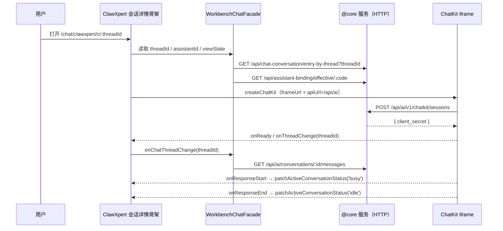

# 05 接口

> 模块：Xpert 前端 · 对话域（`apps/cloud/src/app/features/chat` + `apps/cloud/src/app/xpert` + `apps/cloud/src/app/features/assistant`）
> 入口：`/chat`（收敛至 `/chat/clawxpert`）；公共页 `/x/*`、`/x-chatkit/*`
> 口径：`API_PREFIX = '/api'`；`XpertAPIService.apiBaseUrl = '/api/xpert'`；ChatKit 宿主 API 基址 = `resolveAbsoluteApiBaseUrl(API_BASE_URL) + '/api/ai'`。下表路径均为**实际请求路径**。

**本文引用的文件**
- [chat-conversation.service.ts](file://apps/cloud/src/app/@core/services/chat-conversation.service.ts)
- [chat-message.service.ts](file://apps/cloud/src/app/@core/services/chat-message.service.ts)
- [chat-message-feedback.service.ts](file://apps/cloud/src/app/@core/services/chat-message-feedback.service.ts)
- [chat-group.service.ts](file://apps/cloud/src/app/@core/services/chat-group.service.ts)
- [ai-thread.service.ts](file://apps/cloud/src/app/@core/services/ai-thread.service.ts)
- [assistant-binding.service.ts](file://apps/cloud/src/app/@core/services/assistant-binding.service.ts)
- [xpert-task.service.ts](file://apps/cloud/src/app/@core/services/xpert-task.service.ts)
- [file-change-review.service.ts](file://apps/cloud/src/app/@core/services/file-change-review.service.ts)
- [xpert-frequent-questions.service.ts](file://apps/cloud/src/app/@core/services/xpert-frequent-questions.service.ts)
- [chat.service.socket.ts](file://apps/cloud/src/app/@core/services/chat.service.socket.ts)
- [chat.service.socket.ts（对话域）](file://apps/cloud/src/app/features/chat/chat.service.socket.ts)
- [workbench-chat.facade.ts](file://apps/cloud/src/app/features/chat/workbench-chat/workbench-chat.facade.ts)
- [assistant-chatkit.runtime.ts](file://apps/cloud/src/app/features/assistant/assistant-chatkit.runtime.ts)
- [assistant.registry.ts](file://apps/cloud/src/app/features/assistant/assistant.registry.ts)
- [view-client-command-registry.service.ts](file://apps/cloud/src/app/@shared/view-extension/view-client-command-registry.service.ts)
- [clawxpert-conversation-detail.component.ts](file://apps/cloud/src/app/features/chat/clawxpert/clawxpert-conversation-detail.component.ts)
- [clawxpert-conversation-pane.component.ts](file://apps/cloud/src/app/features/chat/clawxpert/clawxpert-conversation-pane.component.ts)
- [clawxpert.facade.ts](file://apps/cloud/src/app/features/chat/clawxpert/clawxpert.facade.ts)
- [xpert-workbench.component.ts](file://apps/cloud/src/app/features/chat/xpert-workbench/xpert-workbench.component.ts)
- [routes.ts（对话域）](file://apps/cloud/src/app/features/chat/routes.ts)
- [routes.ts（公共页）](file://apps/cloud/src/app/xpert/routes.ts)
- [chatkit/routes.ts](file://apps/cloud/src/app/xpert/chatkit/routes.ts)
- [feature-gate.ts](file://apps/cloud/src/app/features/feature-gate.ts)
- [url.ts](file://apps/cloud/src/app/@core/providers/url.ts)

## 目录

1. 接口口径与总览
2. 会话与消息控制面（HTTP）
3. 实时通道（socket.io）
4. ChatKit 宿主协议（iframe 双向消息）
5. 助手运行时面与绑定面（跨域引用）
6. 前端组件对外契约
7. 鉴权与守卫
8. 错误语义
9. 接口调用时序图
10. 未能确认

---

## 1. 接口口径与总览

本域同时存在**三条互不重叠的通道**，改接口前必须先判断改的是哪一条：

| 通道 | 载体 | 谁在跑 | 现状 |
|---|---|---|---|
| HTTP 控制面 | `/api/chat-conversation`、`/api/chat-message`、`/api/chat-message-feedback`、`/api/xpert-task`、`/api/ai/*` | `@core/services/*` 的 CRUD 服务 | **活跃**：会话列表/详情、消息读取、反馈、任务、文件 |
| 实时通道 | socket.io 命名空间 `chat`，事件 `message` | `ChatWebsocketServer` + `ChatWebsocketService` | **代码在、本域无路由级消费者**（消费者是 `@shared/chat/preview` 侧） |
| ChatKit 宿主协议 | `iframe` + `@xpert-ai/chatkit-angular`（`createChatKit` / `ChatKitControl`） | `injectHostedAssistantChatkitControl` | **活跃**：ClawXpert 工作台、Xpert Workbench、`/x-chatkit/*` 公共页 |

- HTTP 基址统一是同源 `/api`；ChatKit 宿主额外算出一个**绝对** API 基址（`resolveAbsoluteApiBaseUrl(environment.API_BASE_URL) + '/api/ai'`），因为 iframe 内的请求需要绝对 URL。
- 归属声明：`/api/ai/threads/*`、`/api/ai/v1/chatkit/sessions`、`/api/assistant-binding/*` 的**服务端契约归属「Assistant 定义与运行时专家」**；`/api/ai/groups/*`、`/api/ai/conversations/*` 归属「对话与会话专家」。本文只描述前端实际调用的部分。

章节来源：[assistant-chatkit.runtime.ts](file://apps/cloud/src/app/features/assistant/assistant-chatkit.runtime.ts)（关键符号：`buildAssistantApiUrl`、`injectHostedAssistantChatkitControl`）、[url.ts](file://apps/cloud/src/app/@core/providers/url.ts)（关键符号：`resolveAbsoluteApiBaseUrl`）

---

## 2. 会话与消息控制面（HTTP）

### 2.1 会话（`/api/chat-conversation`，含 CRUD 推导路径）

| 方法 | 路径 | 用途 | 关键参数与行为 | 主要错误 | 消费方 |
|---|---|---|---|---|---|
| GET | `/api/chat-conversation` | 会话分页列表 | `$where/$relations/$order/$take/$skip` + `data` 复合参数 | 401/403 | `getAll` 调用点 |
| GET | `/api/chat-conversation/:id` | 会话详情 | `relations=['xpert','xpert.knowledgebases','xpert.toolsets']` | 404 | `ChatConversationService.getOneById` |
| POST | `/api/chat-conversation` | 新建会话 | body 为 `Partial<IChatConversation>`（`xpertId`/`options`） | 400 | `ClawXpertFacade`、`XpertWorkbenchFacade` |
| PUT | `/api/chat-conversation/:id` | 更新会话 | body 为局部字段 | 400/403 | 同上 |
| DELETE | `/api/chat-conversation/:id` | 删除会话 | 无 body | 403 | `ClawXpertFacade` 侧边栏删除 |
| DELETE / PUT | `/api/chat-conversation/:id/soft`、`/:id/recover` | 软删 / 恢复 | 由 `CrudService.softDelete` 统一推导 | 403 | 归档流 |
| GET | `/api/chat-conversation/my` | 我的会话（可 `search`） | `search` 与分页参数并列 | 401 | 侧边栏检索 |
| GET | `/api/chat-conversation/my/sidebar` | 侧边栏分页 | `xpertId`、`take`、`skip`、`archived` | 401 | `getSidebarConversations` |
| PATCH | `/api/chat-conversation/:id/sidebar` | 侧边栏偏好（置顶/归档） | body 为 `TChatConversationSidebarState` 片段；成功即 `refreshSidebar()` + `refreshUnread()` | 400 | `updateSidebarState` |
| GET | `/api/chat-conversation/xpert/:xpertId` | 某助手全部会话 | 分页参数 | 404 | `findAllByXpert` |
| GET | `/api/chat-conversation/:id/state` | 线程执行态 | 可带 `organizationId` | 404 | `getThreadState` |
| GET | `/api/chat-conversation/by-thread` | 按 threadId 反查会话 | `threadId` + `organizationId` | 404 | `getByThreadId` |
| GET | `/api/chat-conversation/entry-by-thread` | **授权后**的入口元数据（决定私有/群组适配器） | `threadId` + `organizationId` | 403 | `getEntryByThreadId`、`resolveConversationEntry` |
| GET | `/api/chat-conversation/:id/workbench-navigation` | 工作台跳转解析 | `requesterXpertId`、`threadId`、`messageId` | 403 | `resolveWorkbenchNavigation` |
| POST | `/api/chat-conversation/:id/cancel` | 取消在跑的会话 | 返回 `{ canceledExecutionIds: string[] }` | 404 | `cancelConversation` |
| POST | `/api/chat-conversation/unread/xperts` | 多助手未读汇总 | body `{ xpertIds }` | 400 | `getUnreadByXperts` |
| POST | `/api/chat-conversation/:id/read-state` | 标记已读 | body 可选 `{ lastReadMessageId }` | 404 | `markRead` |
| GET | `/api/chat-conversation/:id/attachments` | 会话附件清单 | 可带 `organizationId` | 404 | `getAttachments` |
| GET/PUT/POST/DELETE | `/api/chat-conversation/:id/files`、`/:id/file`、`/:id/file/download`、`/:id/file/upload` | 会话工作区文件读写 | `path`、`fileAssetId`、`metadataOnly`；上传用 `FormData` | 404/413 | `workbench-artifact-panel`、`clawxpert-conversation-files` |

### 2.2 消息与反馈

| 方法 | 路径 | 用途 | 关键参数与行为 | 主要错误 | 消费方 |
|---|---|---|---|---|---|
| GET | `/api/ai/conversations/:id/messages` | 会话消息（**非** `/api/chat-conversation` 前缀） | 返回 `{ items, total }`；可选 `organizationId` | 404 | `ChatConversationService.getMessages` |
| POST | `/api/ai/conversations/:id/messages/search` | 消息搜索 | body `{ where:{threadId}, order:{createdAt:'ASC'}, limit, offset }` | 400 | `searchMessages` |
| GET | `/api/chat-message` | 消息 CRUD 基址 | 标准分页 | 401 | `ChatMessageService` |
| GET | `/api/chat-message/:id/suggested-questions` | 追问建议 | 返回 `string[]` | 404 | `suggestedQuestions` |
| GET | `/api/chat-message-feedback` | 反馈 CRUD 基址 | 标准分页；对话页与 Studio 共用 | 401 | `ChatMessageFeedbackService` |
| GET | `/api/chat-message-feedback/my` | 我的反馈 | 分页参数 + `organizationId` | 401 | `getMyAll` |

### 2.3 任务、任务摘要与群组

| 方法 | 路径 | 用途 | 关键参数与行为 | 主要错误 | 消费方 |
|---|---|---|---|---|---|
| GET/POST/PUT/DELETE | `/api/xpert-task` | 任务 CRUD 基址 | 标准分页 | 401 | `XpertTaskService`、`ChatTasksComponent` |
| GET | `/api/xpert-task/by-ids`、`/api/xpert-task/total` | 批量取任务 / 计数 | `ids=逗号分隔` | 400 | 任务摘要、侧边栏计数 |
| GET | `/api/xpert-task/schedule/capabilities/:xpertId` | 调度能力 | 可选 `agentKey` | 404 | 触发器/调度配置 |
| PUT / POST | `/api/xpert-task/:id/schedule`、`/:id/pause`、`/:id/archive`、`/:id/unarchive`、`/:id/test`、`/:id/run-as/proposal`、`/:id/run-as/accept` | 任务生命周期与代跑 | 多为空 body；`run-as/proposal` 带 `runAsUserId` | 400/403 | `ClawXpertScheduledTasksComponent` |
| GET | `/api/ai/conversations/:id/task-summary/fileChanges` | 任务产出的文件变更分页 | `offset`、`limit`（100 一页，循环拉全量） | 404 | `FileChangeReviewService.listChanges` |
| GET | `/api/ai/groups` | 群组概要列表 | 返回 `ChatGroupSummary[]` | 401 | `ChatGroupService.list`、`redirectLegacyGroup` |
| GET | `/api/ai/groups/:id` | 群组快照 | `limit=1`（只取入口元数据，正文由 ChatKit 拉） | 404 | `ChatGroupService.snapshot` |
| PATCH | `/api/ai/groups/:id/preferences` | 群组偏好 | body `{ pinned?, archived? }` | 403 | `ChatGroupService.preferences` |
| GET | `/api/xpert/:id/frequent-questions` | 启动屏常见问题 | `locale` | 404 | `XpertFrequentQuestionsService.get` |
| GET | `/api/xpert/:slug/app` | 公共 ChatKit 准入探测（`withCredentials`） | 失败即跳登录 | 401/404 | `xpert/routes.ts` 的 `authGuard` |
| GET | `/api/xpert/:id/enterprise-h5/:platform/bootstrap` | 企业 H5 启动数据 | 平台枚举 | 404 | `PublicChatkitComponent` |
| GET | `/api/auth/sso/providers` | SSO provider 发现 | 返回 `{ fallbackApplied, providers }` | 401 | 企业 H5 账号绑定 |
| 重定向 | `/api/dingtalk-identity/login/start?returnTo=` | 钉钉 SSO 跳转 | 浏览器整页跳转 | — | `PublicChatkitComponent` |
| 重定向 | `/api/xpert-project/:id/github-installation` | GitHub App 安装 | `window.location.href` | — | `features/chat/project/vcs` |

章节来源：[chat-conversation.service.ts](file://apps/cloud/src/app/@core/services/chat-conversation.service.ts)（关键符号：`getMessages`、`searchMessages`、`cancelConversation`、`getEntryByThreadId`、`resolveWorkbenchNavigation`）、[xpert-task.service.ts](file://apps/cloud/src/app/@core/services/xpert-task.service.ts)（关键符号：`getScheduleCapabilities`、`schedule`、`pause`、`archive`）

---

## 3. 实时通道（socket.io）

- **命名空间**：`chat`。客户端 `ChatWebsocketServer.namespace = 'chat'`，连接串 `${getWebSocketUrl(environment.API_BASE_URL)}/${ChatWebsocketServer.namespace}`；服务端 `@WebSocketGateway({ namespace: 'chat', cors: { origin: '*' } })`。同源部署时 `getWebSocketUrl` 返回 `ws(s)://<当前 host>`。
- **鉴权**：握手 `auth: (cb) => cb({ token: store.token })`；服务端 `@UseGuards(WsJWTGuard)` + `@WsUser()`。
- **事件名只有两个方向上的 `message`**：客户端 `emit('message', payload)`；服务端 `client.emit('message', …)`（含 ACK 与业务事件）。另有服务端 `exception`（错误）与 socket.io 内建 `connect`/`disconnect`。

**载荷形态**（`ChatGatewayMessage`）：`{ event, organizationId?, xpert?{ id, knowledgebases, toolsets }, data }`；`organizationId` 由客户端自动补当前租户。

| 事件（`ChatGatewayEvent`） | 方向 | 语义 |
|---|---|---|
| `ack` | 服务端 → 客户端 | 收到消息的确认（客户端据此 `clearRetryMessage()`） |
| `message_stream` | 服务端 → 客户端 | 增量正文片段（客户端拼接） |
| `message` | 服务端 → 客户端 | 完整消息负载 |
| `conversation_created` | 服务端 → 客户端 | 新会话落库，客户端写回 `conversation` 与列表 |
| `chain_start` / `chain_end` / `chain_aborted` | 服务端 → 客户端 | 回合起止；`chain_aborted` 携带 `conversationId`/`id` |
| `step_start` / `step_end` | 服务端 → 客户端 | 步骤（工具/节点）起止 |
| `tool_start` / `tool_end` | 服务端 → 客户端 | 工具调用起止（`tool_end` 可带 `messages`） |
| `agent` | 服务端 → 客户端 | Agent 级消息 |
| `error` | 服务端 → 客户端 | 回合失败，客户端把最后一条消息置 `status:'error'` |
| `cancel_chain` | 客户端 → 服务端 | 取消在跑回合并回执 ACK |

- **重连语义**：`connect()` 仅在断开（`socket.disconnected` 或未连接）时重建；`exception` 报 `401` 时置为未连接并走 `refreshToken()`（刷新后重新 `connect()`），并发刷新用 `refreshTokening` 信号去重。
- **心跳**：客户端**未显式配置** `transports`/`pingInterval`，即沿用 socket.io 默认（HTTP long-polling 起步 + 升级 WebSocket、默认心跳与自动重连）。
- **发送可靠性**：`message()` 发送后启动 2s 定时器；若期间未收到 `ack`，则**原样重发**（`resetRetryMessage` / `clearRetryMessage`）——这是"token 过期/未连上"时的兜底。
- **哪些能力只能走 socket**：增量正文（`message_stream`）、回合级取消（`cancel_chain`）与 `chain_*`/`step_*`/`tool_*`/`agent` 生命周期事件在 HTTP 面**没有等价端点**——HTTP 侧只有控制面性质的 `POST /api/chat-conversation/:id/cancel`。注意：该 socket 通道目前由 `@shared/chat/preview` 等外部消费者使用，对话域自身的 ChatKit 路径不经它。

章节来源：[chat.service.socket.ts](file://apps/cloud/src/app/@core/services/chat.service.socket.ts)（关键符号：`ChatWebsocketServer.connect`、`ChatWebsocketServer.message`、`ChatWebsocketServer.namespace`、`ChatWebsocketServer.refreshToken`）、[chat.service.socket.ts（对话域）](file://apps/cloud/src/app/features/chat/chat.service.socket.ts)（关键符号：`ChatWebsocketService.chatListener`、`ChatWebsocketService.cancelMessage`）

---

## 4. ChatKit 宿主协议（iframe 双向消息）

宿主用 `injectHostedAssistantChatkitControl(...)` 得到 `ChatKitControl`，再由 `createChatKit` 挂载 iframe；iframe 地址来自 `environment.CHATKIT_FRAME_URL`，经 `sanitizeAssistantFrameUrl`（`DOCKER_` 前缀视为未配置 → `null`，此时**不挂载**）与 `normalizeAssistantFrameUrl`（本地 `/chatkit` 补 `index.html`）处理。所有跨域命令都经 `ViewClientCommandRegistry` 校验后再分发。

### 4.1 宿主 → 子：已注册的 client-command

| 命令 key | 常量/定义处 | 载荷要点 | 返回 |
|---|---|---|---|
| `assistant.chat.send_message` | `ASSISTANT_CHAT_SEND_MESSAGE_COMMAND` | `SendUserMessageParams` + `files?` + `clientMessageId?`；`newThread:true` 时先 `setThreadId(null)` | `{success,status:'sent',clientMessageId?}` |
| `assistant.context.set` | `ASSISTANT_CONTEXT_SET_COMMAND` | `{ key, clear?, env?, context? }` | `{success}` |
| `assistant.composer.append_references` | `ASSISTANT_COMPOSER_APPEND_REFERENCES_COMMAND` | `{ references:[{text,id?,label?}] }`（≤20 条，文本总量上限 200000） | `{success,status:'appended',focused}` |
| `workbench.browser.open` | `WORKBENCH_BROWSER_OPEN_COMMAND`（定义在 `conversation-detail/workspace/browser.ts`） | 预览目标 URL | `{success,tabId,url}` |
| `workbench.file.open` | `WORKBENCH_FILE_OPEN_COMMAND` | `previewUrl`/`url`/`fileUrl` 之一 + 可选 `evidence` | `{success,status:'opened',file}` |
| `workbench.navigation.open` | `WORKBENCH_NAVIGATION_OPEN_COMMAND` | `{ target, … }`（会话/执行/知识库文档/演进/扩展视图等 target） | `{success}` / `{success:false,code}` |
| `workspace.connector.connect` | 字面量注册（`workspace-connector-client-command.ts`） | `{ provider }`（`^[a-z][a-z0-9_-]{0,63}$`）；先校验 workspace 管理权与已安装 provider | `{success,data}` |

> 计数口径：ki 记忆记为「6 类 client-command」；当前 commit 在 ClawXpert 宿主内实测注册 **7** 个 key（多出 `workspace.connector.connect`）。另有 `platform.data-source.create`（`registerDataSourceCreateCommand`，由 `injectHostedAssistantChatkitControl` 内 `injectDataSourceCreateCommand()` 注册），供远程视图 iframe 复用宿主对话框。差异属版本漂移，**待复跑确认**。

### 4.2 子 → 宿主：上报事件与回调

| 回调 | 语义 |
|---|---|
| `onReady` | iframe 就绪，宿主可下发命令 |
| `onThreadChange({threadId})` | 会话切换；宿主据此同步 URL 与 `activeConversation` |
| `onProjectChange` | Project 作用域变化 |
| `onThreadLoadStart` / `onThreadLoadEnd` | 线程载入起止（宿主显示 loading） |
| `onResponseStart` / `onResponseEnd` | 回合起止（宿主 `patchActiveConversationStatus('busy'\|'idle')`） |
| `onEffect` | 消息内嵌副作用（宿主事件解析、工具宿主事件） |
| `onLog` | iframe 侧日志转发 |
| `api.getClientSecret(currentSecret)` | iframe 侧换取/刷新短时 client secret（宿主 POST `/api/ai/v1/chatkit/sessions`） |
| `toolOutputAttachments.onRequestPreview({attachment})` | 请求产物预览签名链接；校验 `artifactId`/`artifactVersionId`/`sha256` 一致，否则抛错 |
| `composer.resources.onConnect` | 资源连接器握手（转 `injectWorkspaceConnectorConnect`） |
| `workbench.onClientCommand(request)` | iframe 内嵌视图发起的命令；`createChatkitWorkbenchClientCommandHandler` 校验 `hostType==='agent'` 且 `hostId===assistantId`，失败回 `stale_context`/`forbidden` |

命令执行入口是 `ViewClientCommandRegistry.execute(commandKey, payload, context)`：无处理器时返回 `{success:false, code:'unsupported', message:"Client command '<key>' is not available in this host."}`；同一 key 多个处理器时**取最后注册且 `active()` 为真**的那个（作用域路由靠这个机制做优先级）。

章节来源：[clawxpert-conversation-detail.component.ts](file://apps/cloud/src/app/features/chat/clawxpert/clawxpert-conversation-detail.component.ts)（关键符号：`registerAssistantChatSendMessageCommand`、`registerWorkbenchNavigationOpenCommand`、`injectWorkspaceConnectorClientCommand`）、[view-client-command-registry.service.ts](file://apps/cloud/src/app/@shared/view-extension/view-client-command-registry.service.ts)（关键符号：`ViewClientCommandRegistry.register`、`ViewClientCommandRegistry.execute`）

---

## 5. 助手运行时面与绑定面（跨域引用）

以下路径的前端调用点在本域，**服务端契约归属「Assistant 定义与运行时专家」**（`/api/assistant-binding/*` 同属该专家）：

| 方法 | 路径 | 用途 | 关键参数与行为 | 消费方 |
|---|---|---|---|---|
| POST | `/api/ai/v1/chatkit/sessions` | 创建 ChatKit 会话并取短时 secret | 私有：`{ assistant:{id}, project?{id}, conversation?{id} }`；群组：`{ scope:{ kind:'conversation', conversationId } }`；返回 `client_secret` | `createAssistantChatkitSession`、`createGroupChatkitSession` |
| GET | `/api/ai/threads/:threadId` | 线程元数据 | 返回 `thread_id`/`status`/`metadata.assistant_id` | `AiThreadService.getThread` |
| GET | `/api/ai/threads/:threadId/runs/:runId/stream` | 重连运行流（SSE） | 头 `Last-Event-Id` 续传 | `AiThreadService.joinRunStream` |
| GET | `/api/assistant-binding/:code` | 读取绑定 | `scope` 查询参数 | `AssistantBindingService.get` |
| GET | `/api/assistant-binding/effective/:code` | 生效解析 | 无参 | `getEffective` |
| GET | `/api/assistant-binding/:code/preference`、POST 同路径 | 用户偏好读写 | `scope` | `getPreference`、`upsertPreference` |
| GET | `/api/assistant-binding/xperts?scope=&code=` | 可绑助手列表 | 返回数组或分页，前端统一 `unwrapAssistantBindingItems` | `getAvailableXperts` |
| POST / DELETE | `/api/assistant-binding`、`/api/assistant-binding/:code` | 建立 / 删除绑定 | body 为 `IAssistantBindingUpsertInput`；成功发 `changes$` | `upsert`、`delete` |

- **公告/发布联动**：`XpertPublicationService.changes$` 命中当前 `organizationId + assistantId` 时，宿主只做 `setOptions` **原地刷新**（保留会话与输入框），不重建 iframe。
- **凭据边界**：`runtimeKey` 里含 token/organization，但下发给 iframe 的只有 `sessionKey: 'hosted-session-<revision>'` 这种不透明序号；secret 由 iframe 通过 `getClientSecret` 主动换。

章节来源：[assistant-chatkit.runtime.ts](file://apps/cloud/src/app/features/assistant/assistant-chatkit.runtime.ts)（关键符号：`createAssistantChatkitSession`、`createGroupChatkitSession`、`AssistantHostedRuntimeInput`）、[ai-thread.service.ts](file://apps/cloud/src/app/@core/services/ai-thread.service.ts)（关键符号：`AiThreadService.getThread`、`AiThreadService.joinRunStream`）、[assistant-binding.service.ts](file://apps/cloud/src/app/@core/services/assistant-binding.service.ts)（关键符号：`getEffective`、`getAvailableXperts`）

---

## 6. 前端组件对外契约

| 契约 | 定义处 | 语义与注入方式 |
|---|---|---|
| `WorkbenchChatFacade`（type） | `workbench-chat/workbench-chat.facade.ts` | 页面骨架 `ClawXpertConversationDetailComponent` 的**唯一依赖**：`definition`、`identity/userId/assistantId/xpertId`、`initialLayout`、`chatkitFrameUrl`、`threadId`、`group?`、`projectId?/chatkitMountProjectId?/projectAccess?`、`loading/loadingUserPreference/viewState/suppressAutoResume/pendingConversationStartId/activeConversation`，方法 `onChatThreadChange`、`beginPendingConversation`、`ensureConversationEntry`、`setActiveConversation`、`patchActiveConversationStatus` |
| `WORKBENCH_CHAT_FACADE`（InjectionToken） | 同上 | 骨架组件 `inject(WORKBENCH_CHAT_FACADE, { optional: true })`，为空时回落到 `ClawXpertFacade`。三个提供点：`ClawXpertConversationPaneComponent`（`{provide: WORKBENCH_CHAT_FACADE, useExisting: ClawXpertScopedConversationFacade}`）、`ChatXpertWorkbenchComponent`（`useExisting: XpertWorkbenchFacade`）、无（走默认 `ClawXpertFacade`） |
| `injectAssistantChatkitRuntime(input)` | `features/assistant/assistant-chatkit.runtime.ts` | 助手 shell（`features/xpert/assistant-shell/assistant.facade.ts`）用：返回 `{config, control, hasSource, isConfigured, loading, refresh, status}` |
| `injectHostedAssistantChatkitControl(input)` | 同上 | 三个宿主：ClawXpert 会话详情、`PublicChatkitComponent`、`project-chat-panel` / `project-conversation-dialog`；返回 `Signal<ChatKitControl \| null>` |
| `injectAssistantBindingRuntimeState(input)` | 同上 | 绑定态解析（`loading/hasSource/isConfigured/refresh/status`），错误经 `ToastrService` 提示 |
| `ASSISTANT_REGISTRY` / `getAssistantRegistryItem(code)` | `features/assistant/assistant.registry.ts` | 三助手注册表：`CHAT_COMMON`（system）、`XPERT_SHARED`（system）、`CLAWXPERT`（user，需要 `FEATURE_XPERT + FEATURE_XPERT_CLAWXPERT`）；每项含 `featureKeys/management/labelKey/titleKey/descriptionKey` 等 i18n key |
| `ChatKitControl` 用法 | `@xpert-ai/chatkit-angular`（外部包） | 宿主只调用 `setOptions`、`setThreadId`、`sendUserMessage`、`setComposerValue`、`focusComposer`、`element` |

章节来源：[workbench-chat.facade.ts](file://apps/cloud/src/app/features/chat/workbench-chat/workbench-chat.facade.ts)（关键符号：`WorkbenchChatFacade`、`WORKBENCH_CHAT_FACADE`）、[clawxpert-conversation-pane.component.ts](file://apps/cloud/src/app/features/chat/clawxpert/clawxpert-conversation-pane.component.ts)（关键符号：`ClawXpertScopedConversationFacade`、`ScopedConversationCommands`）、[assistant.registry.ts](file://apps/cloud/src/app/features/assistant/assistant.registry.ts)（关键符号：`ASSISTANT_REGISTRY`、`getAssistantRegistryItem`）

---

## 7. 鉴权与守卫

**`/chat` 守卫链（自上而下）**

| 层级 | 声明 | 说明 |
|---|---|---|
| 特性域 | `features-routing.module.ts`：`path:'chat'` + `canActivate:[authGuard]`，`data:{title:'Chat', scopeContext:'dual-scope'}` | 双域（组织/工作区）上下文 |
| 父级 | `features/chat/routes.ts`：`path:''` → `ChatHomeComponent` | 无自身 guard，子路由各自声明 |
| 入口 | `path:''`（`pathMatch:'full'`）→ `canActivate:[redirectToDefaultChatEntry()]` | 先 `hydrateFeatureContext({skipSessionCache:true})`，再查 USER 作用域的 ClawXpert 绑定；命中已绑定且有可用助手 → `/chat/clawxpert/c`，否则 `/chat/clawxpert`；**任何异常/超时都回落 `/chat/clawxpert`** |
| 工作台 | `matcher: xpertWorkbenchConversationMatcher` → `ChatXpertWorkbenchComponent`，`canActivate:[featureGate([FEATURE_XPERT])]`，`resolve:{conversationEntry: resolveConversationEntry}` | 匹配 `/chat/x/:name/c/:threadId?` 与 `/chat/x/:name/p/:projectId/c/:threadId?` |
| ClawXpert | `path:'clawxpert'` → `ClawXpertComponent`，`canActivateChild:[featureGate([FEATURE_XPERT, FEATURE_XPERT_CLAWXPERT], ['/explore'])]` | **特性门未过时回落 `/explore`**；子路由 `''→c`、`settings→c`、`assistant`、`assistant/:threadId`、`matcher: clawxpertConversationMatcher`（`c` / `c/:threadId`） |
| 兼容 | `path:'groups'`、`groups/:groupId` → `featureGate([FEATURE_XPERT]) + redirectLegacyGroup`；`x/welcome`、`x/common[/c[/:id]]` → `/chat/clawxpert`；`**` → `clawxpert`（prefix） | 移动端/旧链接收敛 |
| 遗留 | `path:'c/:id'` → `ChatXpertComponent`、`path:'tasks'`、`tasks/:id` | 无独立 guard（父级 `authGuard` 仍生效） |

**公共页（无路由守卫）**

| 路径 | 守卫 | 后果 |
|---|---|---|
| `/x-chatkit/h5/:platform/:name[/c/:id]` | **无 `canActivate`**（`chatkit/routes.ts`） | 面向企业 IM 内嵌 H5：SSO/一次性 code 换 secret 在组件内完成，未绑定账号时整页跳 `/api/dingtalk-identity/login/start?returnTo=…` |
| `/x-chatkit/x/:name[/c/:id]` | `canActivate:[authGuard]` | 有守卫；`authGuard` 用 `XpertAPIService.getChatApp(name)` 探测，失败跳 `/auth/login?returnUrl=` |
| `/x/:name[/c/:id]` | **无自身守卫**，纯 `redirectTo` → `/x-chatkit/x/...` | 是兼容重定向层，真正的准入由 `/x-chatkit` 分支决定 |

- `featureGate(featureKeys, redirectCommands = ['/chat'])` 内部 `hydrateFeatureContext` 有 **3s 超时**（超时按未水合处理 → 回落）。
- 请求侧身份由 `Store` 统一携带：socket 走握手 `auth.token`；HTTP 走平台登录会话（`getChatApp` 显式 `withCredentials:true`）；ChatKit 由 `getClientSecret` 换短时 secret。

章节来源：[routes.ts（对话域）](file://apps/cloud/src/app/features/chat/routes.ts)（关键符号：`redirectToDefaultChatEntry`、`redirectLegacyGroup`、`clawxpertConversationMatcher`）、[chatkit/routes.ts](file://apps/cloud/src/app/xpert/chatkit/routes.ts)（关键符号：`PublicChatkitComponent`）、[feature-gate.ts](file://apps/cloud/src/app/features/feature-gate.ts)（关键符号：`featureGate`、`hydrateFeatureContext`）

---

## 8. 错误语义

| 场景 | 表现 | 处理与兜底 |
|---|---|---|
| socket 断线 | `disconnect` → `connected$` 置 false | 仅在下一次 `connect()` 时重建；UI 侧无自动提示 |
| token 过期（socket） | 服务端 `exception {status:401}` | `refreshToken()` 成功后重连；`refreshTokening` 去重并发刷新 |
| 消息未落地/未收到 ACK | 2s 内无 `ack` | `ChatWebsocketServer.message` **原样重发**（无次数上限、无退避） |
| 取消回合 | 本地立即置 `conversation.status='idle'`，子步骤 `thinking/running`→`aborted` | 再发 `cancel_chain`；服务端无响应时本地已经是终止态（乐观） |
| HTTP 读取失败 | `getErrorMessage(error)` + `ToastrService.error` | 会话详情失败回落空会话对象；入口解析失败回落固定 URL |
| ChatKit 未配置 | `CHATKIT_FRAME_URL` 为空或 `DOCKER_*` | `sanitizeAssistantFrameUrl` 返回 `null` → 不挂载 iframe（页面停在 loading/回退态） |
| 宿主命令不可达 | iframe 命令落到无处理器 | `{success:false, code:'unsupported'}`；宿主上下文不匹配回 `stale_context`/`forbidden`/`invalid_payload` |
| 命令执行时的权限不足 | `workspace.connector.connect` → `workspace_management_required`；`platform.data-source.create` → `forbidden` | 命令自身返回失败码，宿主不抛异常 |
| 产物预览签名不一致 | `artifactId`/`artifactVersionId`/`sha256` 任一不符 | `onRequestPreview` 抛错，拒绝回传链接 |
| 附件超限 | `CHATKIT_ATTACHMENT_MAX_BYTES = 50 MiB`、`maxCount = 5` | composer 侧直接拦截（不发请求） |

章节来源：[chat.service.socket.ts](file://apps/cloud/src/app/@core/services/chat.service.socket.ts)（关键符号：`clearRetryMessage`、`setStatus`）、[assistant-chatkit.runtime.ts](file://apps/cloud/src/app/features/assistant/assistant-chatkit.runtime.ts)（关键符号：`CHATKIT_ATTACHMENT_MAX_BYTES`、`sanitizeAssistantFrameUrl`）

---

## 9. 接口调用时序图

图表来源：[clawxpert-conversation-detail.component.ts](file://apps/cloud/src/app/features/chat/clawxpert/clawxpert-conversation-detail.component.ts)（关键符号：`facade`、`control`）与 [assistant-chatkit.runtime.ts](file://apps/cloud/src/app/features/assistant/assistant-chatkit.runtime.ts)（关键符号：`injectHostedAssistantChatkitControl`）

---

## 10. 未能确认

- 本环境 `node_modules` 缺失，`@xpert-ai/chatkit-angular` 与 `@xpert-ai/chatkit-types` 的**包内协议细节**（iframe 侧 `invokeClientCommand` 报文结构、`ChatKitEventHandlers` 完整签名、secret 刷新状态码约定）无法展开核对；本文列出的回调名均取自本仓库宿主代码的**使用面**。待复跑确认。
- `/chat/x/:name` 旧页（`ChatXpertComponent`）是否仍走 socket 通道：本域内检索 `ChatWebsocketService` 无组件消费者，判定为**未被路由级挂载**，其历史行为未逐条核对。
- "6 类 client-command" 与实测 7 个注册 key 的差异口径（见 §4.1）需以 ki 基线 commit `c07bb83d` 复跑比对。
- `/api/xpert/:id/enterprise-h5/:platform/*` 与 `/api/ai/groups/*` 的字段级契约以后端专家文档为准，本文只记录前端实际发出的参数。

章节来源：[assistant-chatkit.runtime.ts](file://apps/cloud/src/app/features/assistant/assistant-chatkit.runtime.ts)（关键符号：`resolveAssistantMcpAppsOptions`、`injectAssistantChatkitRuntime`）
