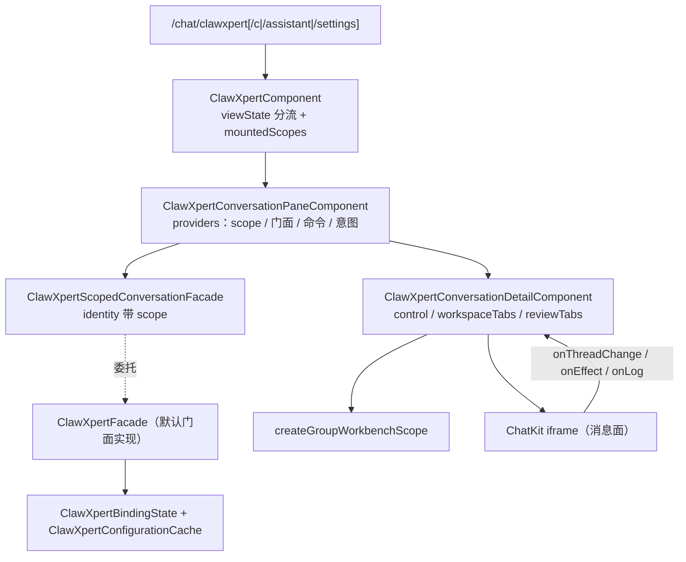

# C0 使用总览：ClawXpert 子专家（Xpert 前端 · 对话域）

> 一句话定位：`features/chat/clawxpert/**` 是对话域的**工作台子域**——绑定状态机与绑定向导、作用域会话面板与详情骨架、工作台子面板（工具/skill 偏好、触发器草稿、任务摘要、文件变更审查、受管服务预览）。
> 范围：**54 非 spec `.ts` / 32 spec `.ts`**（同目录实测，共 86 个 `.ts`；任务简报记 53，差异见 [implementation/06-测试.md](file://.module-experts/前端专题/对话前端专家/sub-experts/ClawXpert子专家/implementation/06-测试.md)）。不含 `workbench-chat/**` 与 `xpert-workbench/**`（门面契约定义处 →「会话工作台子专家」）、`features/assistant/**`（ChatKit 宿主与助手注册表 → 父级）。
> 入口路由：`/chat/clawxpert`、`/chat/clawxpert/c[/:threadId]`、`/chat/clawxpert/assistant[/:threadId]`、`/chat/clawxpert/settings`；路由表由父级 [routes.ts](file://apps/cloud/src/app/features/chat/routes.ts) 声明（`settings` 实测 `redirectTo: 'c'`）。

**本文引用的文件**
- [routes.ts](file://apps/cloud/src/app/features/chat/routes.ts)
- [clawxpert.component.ts](file://apps/cloud/src/app/features/chat/clawxpert/clawxpert.component.ts)
- [clawxpert-conversation-pane.component.ts](file://apps/cloud/src/app/features/chat/clawxpert/clawxpert-conversation-pane.component.ts)
- [clawxpert-conversation-detail.component.ts](file://apps/cloud/src/app/features/chat/clawxpert/clawxpert-conversation-detail.component.ts)
- [clawxpert-conversation-scope.ts](file://apps/cloud/src/app/features/chat/clawxpert/clawxpert-conversation-scope.ts)
- [clawxpert.facade.ts](file://apps/cloud/src/app/features/chat/clawxpert/clawxpert.facade.ts)
- [clawxpert-binding-state.ts](file://apps/cloud/src/app/features/chat/clawxpert/clawxpert-binding-state.ts)
- [clawxpert-scoped-conversation.facade.ts](file://apps/cloud/src/app/features/chat/clawxpert/clawxpert-scoped-conversation.facade.ts)
- [clawxpert-binding-wizard.component.ts](file://apps/cloud/src/app/features/chat/clawxpert/clawxpert-binding-wizard.component.ts)
- [clawxpert-setup-wizard.component.ts](file://apps/cloud/src/app/features/chat/clawxpert/clawxpert-setup-wizard.component.ts)
- [clawxpert-bootstrap.service.ts](file://apps/cloud/src/app/features/chat/clawxpert/clawxpert-bootstrap.service.ts)
- [clawxpert-tool-preferences.component.ts](file://apps/cloud/src/app/features/chat/clawxpert/clawxpert-tool-preferences.component.ts)
- [clawxpert-trigger-config-editor.component.ts](file://apps/cloud/src/app/features/chat/clawxpert/clawxpert-trigger-config-editor.component.ts)
- [file-change-review.component.ts](file://apps/cloud/src/app/features/chat/clawxpert/file-change-review.component.ts)
- [group-workbench-scope.ts](file://apps/cloud/src/app/features/chat/clawxpert/group-workbench-scope.ts)
- [workbench-chat.facade.ts](file://apps/cloud/src/app/features/chat/workbench-chat/workbench-chat.facade.ts)
- [implementation/06-测试.md](file://.module-experts/前端专题/对话前端专家/sub-experts/ClawXpert子专家/implementation/06-测试.md)

## 目录
1. [定位与何时找](#1-定位与何时找)
2. [能力清单](#2-能力清单)
3. [边界](#3-边界)
4. [已知问题与常见坑](#4-已知问题与常见坑)

## 1. 定位与何时找

本子域是「**外壳 + 作用域面板 + 详情骨架**」三层：外壳按 `viewState()` 分流，面板为每个作用域装配门面与命令，详情骨架把门面字段映射进 `injectHostedAssistantChatkitControl`；消息面（列表 / 流式 / 滚动 / composer）在 ChatKit iframe 内，**本子域不渲染消息**。

图表来源：[clawxpert.component.ts](file://apps/cloud/src/app/features/chat/clawxpert/clawxpert.component.ts)（关键符号：`ClawXpertComponent.mountedScopes`）· [clawxpert-conversation-pane.component.ts](file://apps/cloud/src/app/features/chat/clawxpert/clawxpert-conversation-pane.component.ts)（关键符号：`ClawXpertConversationPaneComponent.providers`）· [clawxpert-scoped-conversation.facade.ts](file://apps/cloud/src/app/features/chat/clawxpert/clawxpert-scoped-conversation.facade.ts)（关键符号：`ClawXpertScopedConversationFacade.identity`）· [clawxpert-conversation-detail.component.ts](file://apps/cloud/src/app/features/chat/clawxpert/clawxpert-conversation-detail.component.ts)（关键符号：`ClawXpertConversationDetailComponent.control`）

1. **绑定向导与首次创建** → `ClawXpertBindingWizardComponent.selectXpert` / `savePreference`、`ClawXpertSetupWizardComponent`、`ClawXpertBootstrapService.createClawXpert` / `bindAndOpenCreatedClawXpert`。
2. **会话面板与详情骨架**（ChatKit 装配、工作区标签、固定视图栈、命令注册） → `ClawXpertConversationPaneComponent.providers`、`ClawXpertConversationDetailComponent.control` / `workspaceTabs` / `reviewTabs`。
3. **作用域会话**（`task` / `assistant` 两 scope 的线程隔离与恢复） → `clawXpertConversationScope` / `clawXpertConversationPath`、`ClawXpertScopedConversationFacade.active` / `onChatThreadChange`。
4. **群组工作台 scope**（共享运行时解析前不出个人视图） → `createGroupWorkbenchScope`、`ClawXpertConversationDetailComponent.groupWorkbenchScope` / `viewRuntimeScope`。
5. **工具与 skill 偏好**（乐观开关、串行写队列、批量启停、安装卸载） → `ClawXpertToolPreferencesComponent.toggleTool` / `toggleSkill` / `setSelectedSkillsEnabled`。
6. **触发器草稿**（副本 + `dirty` / `invalid` 门控，保存只写 draft） → `ClawXpertTriggerConfigEditorComponent.workingItems` / `save`、`ClawXpertFacade.saveTriggerDraft`。
7. **文件变更审查**（selected / conversation 双范围、分批加载、Monaco diff） → `FileChangeReviewComponent.selectScope` / `load`、`FileChangeDiffComponent.init`、`ClawXpertConversationFilesComponent`。
8. **绑定状态排障**（缓存 vs 权威、401/403/404 分级、向导卡住） → `ClawXpertBindingState.refresh` / `isAccessRejected` / `restore`、`ClawXpertConfigurationCache.load`。
9. **任务摘要与工作台概览** → `ClawXpertFacade.taskSummary` / `scheduledTaskSummary` / `refreshTaskSummaries`、`ClawXpertOverviewComponent`。
10. **跑本子域测试**（32 spec，约 394 行 `describe|it`） → 运行命令与缺口见 [implementation/06-测试.md](file://.module-experts/前端专题/对话前端专家/sub-experts/ClawXpert子专家/implementation/06-测试.md)。

章节来源：[clawxpert.facade.ts](file://apps/cloud/src/app/features/chat/clawxpert/clawxpert.facade.ts)（关键符号：`ClawXpertFacade.viewState`、`saveTriggerDraft`、`refreshTaskSummaries`）· [clawxpert-binding-state.ts](file://apps/cloud/src/app/features/chat/clawxpert/clawxpert-binding-state.ts)（关键符号：`ClawXpertBindingState.refresh`、`isAccessRejected`）· [workbench-chat.facade.ts](file://apps/cloud/src/app/features/chat/workbench-chat/workbench-chat.facade.ts)（关键符号：`WORKBENCH_CHAT_FACADE`）

## 2. 能力清单

| 能力 | 入口（组件 / 服务 / 函数） | 一句话 |
|---|---|---|
| 工作台外壳与视图分流 | `ClawXpertComponent` | `loading` / `wizard` / `error + !organizationId` 三分支 + `mountedScopes` 常驻挂载 |
| 绑定状态机 | `ClawXpertBindingState` | 读服务端绑定 + 可绑列表 → 六信号 + `#requestId` 竞态防护 |
| 绑定向导 | `ClawXpertBindingWizardComponent` | `searchText` 过滤 + `selectXpert` 只写表单 + `savePreference` 落库 |
| 首次运行对话框 | `ClawXpertSetupWizardComponent` | 模型提供方 + 推荐模板勾选 + `isolateWorkspaceData` |
| 创建 / 发布 / 绑定链 | `ClawXpertBootstrapService` | 插件补齐 → 默认工作区 → 安装 → 发布兜底 → `upsert` 绑定 → 跳 `/chat/clawxpert/c` |
| 作用域会话面板 | `ClawXpertConversationPaneComponent` | `providers` 装配：scope token / 作用域门面 / 命令注册表 / 意图服务 / URL 状态 |
| 作用域门面 | `ClawXpertScopedConversationFacade` | `identity` 追加 `:${scope}`，自持 `threadId` / `activeConversation` / `suppressAutoResume` |
| 会话详情骨架 | `ClawXpertConversationDetailComponent` | ChatKit 装配 + 工作区标签 + 固定视图 + 命令注册 + 事件副作用 |
| 群组 scope 解析 | `createGroupWorkbenchScope` | `[identity, groupId, assistantId]` 为 key，变化即置空；拒绝后不回退 |
| 工具 / skill 偏好 | `ClawXpertToolPreferencesComponent` | 乐观开关 + `#skillPreferenceSaveQueue` 串行 + 批量启停 + 安装卸载 |
| 触发器草稿 | `ClawXpertTriggerConfigEditorComponent` | 草稿副本 + `dirty`（`isEqual`）+ `invalid`（JSON Schema 必填） |
| 文件变更审查 | `FileChangeReviewComponent` / `FileChangeDiffComponent` | 双范围 + 每批 4 并发 + 序号作废 + Monaco diff 行数统计 |
| 任务摘要与概览 | `ClawXpertFacade.taskSummary` / `ClawXpertOverviewComponent` | `taskRefreshTick` 驱动重取；概览四态 + 指标 + 热力图 |
| 受管服务与沙箱预览 | `ClawXpertManagedServicesBrowserController` | 预览会话键复用 + 5s 自动刷新 + 日志 / 重启 / 停止 |

章节来源：[clawxpert-conversation-detail.component.ts](file://apps/cloud/src/app/features/chat/clawxpert/clawxpert-conversation-detail.component.ts)（关键符号：`ClawXpertConversationDetailComponent.chatkitAssistantId`、`fileListReloadKey`）· [clawxpert-tool-preferences.component.ts](file://apps/cloud/src/app/features/chat/clawxpert/clawxpert-tool-preferences.component.ts)（关键符号：`toggleTool`、`enqueueSkillPreferenceUpdate`）· [file-change-review.component.ts](file://apps/cloud/src/app/features/chat/clawxpert/file-change-review.component.ts)（关键符号：`selectScope`、`totals`）

## 3. 边界

1. **不含 `WorkbenchChatFacade` 契约与 `WORKBENCH_CHAT_FACADE` token 定义** → 「**会话工作台子专家**」[workbench-chat.facade.ts](file://apps/cloud/src/app/features/chat/workbench-chat/workbench-chat.facade.ts)；本子域是门面的**实现方与消费方**之一。
2. **不含 `/chat/x/:slug[/p/:projectId]/c[/:threadId]` 形态门面** → 「会话工作台子专家」[xpert-workbench.facade.ts](file://apps/cloud/src/app/features/chat/xpert-workbench/xpert-workbench.facade.ts)（本子域只复用其 token 与骨架一行）。
3. **不含 ChatKit 运行时状态机、iframe 生命周期与 client-command 实现、助手注册表** → 父级 `features/assistant/**`（`assistant-chatkit.runtime.ts`、`assistant.registry.ts`）。
4. **不含消息渲染族与会话列表** → 父级 `src/app/xpert/**`：本子域不渲染消息、不管理滚动，宿主侧只做「装配 / 同步 / 翻译 / 授权」四件事。
5. **不含 `/chat` 路由表与入口收敛**（`redirectToDefaultChatEntry`、`clawxpertConversationMatcher`、`featureGate`） → 父级 [routes.ts](file://apps/cloud/src/app/features/chat/routes.ts)；本子域只被其挂载与消费绑定语义。
6. **不含 `@shared/*` 复用件实现**（files / view-extension / chat / workflow / headless-ui） → 共享层：本子域是消费方，只做适配不重写。

章节来源：[routes.ts](file://apps/cloud/src/app/features/chat/routes.ts)（关键符号：`clawxpertConversationMatcher`、`redirectToDefaultChatEntry`、`featureGate`）· [clawxpert-conversation-detail.component.ts](file://apps/cloud/src/app/features/chat/clawxpert/clawxpert-conversation-detail.component.ts)（关键符号：`ClawXpertConversationDetailComponent.#providedFacade`、`groupWorkbenchScope`）

## 4. 已知问题与常见坑

1. **绑定状态机与 scope 归属（第一坑）**：`viewState` 判定顺序固定为「无 `organizationId → 'organization-required'`；无 `chatkitFrameUrl` / 有 `errorMessage` → `'error'`；`showWizard()` 或无 `resolvedPreference()` → `'wizard'`；否则 `'ready'`」；缓存（[clawxpert-configuration-cache.service.ts](file://apps/cloud/src/app/features/chat/clawxpert/clawxpert-configuration-cache.service.ts)（关键符号：`ClawXpertConfigurationCache.load`、`getClawXpertConfigurationCacheKey`））**只加速启动、不替代服务端授权**，命中期后若服务端拒绝会出现「先 ready 后 error」跳变。
2. **作用域会话门面的 `threadId` 与项目维度**：`active()` 由「URL 解析出的作用域 === 本面板作用域」派生，绑定用 `ownerKey = [userId, organizationId, xpertId]` 冻结，变更即让位（不一致时不再写 `threadId`）；`nullGuardUntil`（1000ms）只压 iframe 首帧的瞬时 `null`，慢环境仍可能误清线程或误拦 URL 修正。（来源：[clawxpert-scoped-conversation.facade.ts](file://apps/cloud/src/app/features/chat/clawxpert/clawxpert-scoped-conversation.facade.ts)（关键符号：`ClawXpertScopedConversationFacade.ownsCurrentBinding`、`onChatThreadChange`））
3. **群组 scope 生命周期**：key 变化**立刻**让 scope 归 `null`，旧响应因 `cancelled` 丢弃；`assistantId` 或 `conversationId` 不符即抛错并回调 `onError`（**拒绝后绝不回退**个人视图）；但已打开的固定视图标签（`projectScope` 绑定旧 projectId）不会被回收。（来源：[group-workbench-scope.ts](file://apps/cloud/src/app/features/chat/clawxpert/group-workbench-scope.ts)（关键符号：`createGroupWorkbenchScope`））
4. **工具偏好与触发器的读写时机不同**：偏好走共享门面**乐观更新 + 失败回滚 + toastr**（skill 写操作由 `#skillPreferenceSaveQueue` 串行）；触发器在组件做**草稿副本 + `dirty` / `invalid` 门控**，`saveTriggerDraft` 只写 draft，**运行时需另行发布**——误以为「保存即生效」是最常见的误判。
5. **文件审查的中断与恢复**：每线程一个标签（`file-review:${threadId ?? conversationId ?? 'current'}`），重开只递增 `revision`；批大小硬编码 4，`request` 序号在批间与销毁时作废；行数统计有两条独立实现（`countFileChangeLines` 与 Monaco `getLineChanges()`），折叠 / 空白字符设置下口径会分叉。
6. **`/c` 与 `/assistant` 两条形态差异**：`clawXpertConversationScope` 把 `/chat/clawxpert/c*` 判 `task`、`/chat/clawxpert/assistant*` 与 `/chat/clawxpert/settings` 判 `assistant`；线程持久化只对 `assistant` 生效（localStorage `xpert:assistant-conversation:v1:*`），切到 assistant 无线程时 `replaceUrl` 补全 URL；**`settings` 是死口径**——路由重定向到 `c`，而 `clawxpert-assistant-settings.component.ts` 未被任何路由挂载。
7. **空态与错误态**：外壳的 `loading` / `wizard` / `error + !organizationId` 三分支只渲染说明节点（`ClawXpertOverviewComponent` 另有更完整的四态并用同一个向导）；工具偏好用 `isBlocked = viewState() !== 'ready' || !xpertId()` 门控，`blockedState()` 按组织 / 绑定分文案。
8. **事件翻译层静默失败**：`onEffect` / `onLog` 的资源目标解析（`getTaskSummaryResourceTarget`、`shouldRefreshWorkspaceFilesFromLogEvent`）完全依赖键名白名单与递归扫描，iframe 侧字段漂移只表现为「不刷新 / 不弹预览」，**无日志无告警**；排查先看事件名再怀疑键名。
9. **多面板常驻与前缀请求**：非活动面板以 `display:none` + `inert` + `aria-hidden` 保留 composer 状态，代价是多份 ChatKit 实例与 `effect` 常驻（未发送输入仍不持久化，刷新即失）；绑定解析存在双源（`ClawXpertBindingTargetService.getCurrentUserTarget()` 再次 `forkJoin(get, getAvailableXperts)`），与 `ClawXpertBindingState.refresh` 同形，存在重复请求窗口。

章节来源：[clawxpert-binding-state.ts](file://apps/cloud/src/app/features/chat/clawxpert/clawxpert-binding-state.ts)（关键符号：`ClawXpertBindingState.isCurrentScope`、`commit`）· [clawxpert.facade.ts](file://apps/cloud/src/app/features/chat/clawxpert/clawxpert.facade.ts)（关键符号：`ClawXpertFacade.viewState`、`resolvedPreference`）· [clawxpert-conversation-scope.ts](file://apps/cloud/src/app/features/chat/clawxpert/clawxpert-conversation-scope.ts)（关键符号：`clawXpertConversationScope`、`clawXpertScopedThreadId`）
