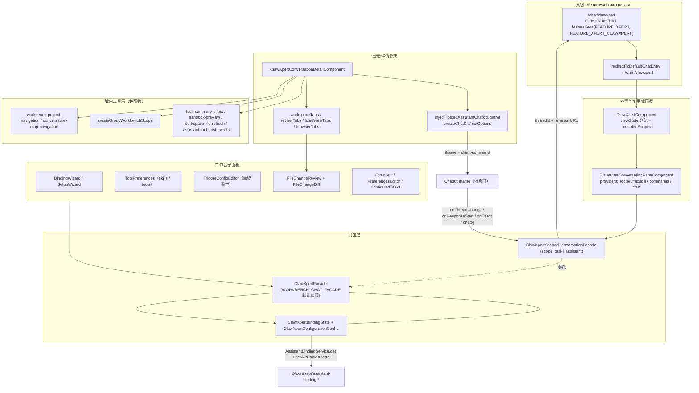

# 01 架构：对话前端专家 / ClawXpert 子专家

> 子域根：`apps/cloud/src/app/features/chat/clawxpert/**`（**54 非 spec `.ts` / 32 spec `.ts`**，共 86 个 `.ts`，按文件清单实测）
> 计数口径差异：任务简报记「53 非 spec」；父级 [06-测试.md](file://.module-experts/前端专题/对话前端专家/implementation/06-测试.md) 按「`clawxpert/` 34 + `conversation-detail/{chatkit,workspace}` 6」两段分别统计，未含 `conversation-detail/{composer,citations}` 与 `conversation-detail` 根文件，故与本文的 54 不同源。
> 入口路由：`/chat/clawxpert`、`/chat/clawxpert/c[/:threadId]`、`/chat/clawxpert/assistant[/:threadId]`、`/chat/clawxpert/settings`（路由表声明在**父级** [routes.ts](file://apps/cloud/src/app/features/chat/routes.ts)）
> 不含：`workbench-chat/`（门面契约定义 → 会话工作台子专家）、`xpert-workbench/`（同）、`features/assistant`（宿主与注册表 → 父级）
> 父级口径：[01-架构.md](file://.module-experts/前端专题/对话前端专家/implementation/01-架构.md)、[02-实现.md](file://.module-experts/前端专题/对话前端专家/implementation/02-实现.md)、[03-数据流转.md](file://.module-experts/前端专题/对话前端专家/implementation/03-数据流转.md)

**本文引用的文件**

- [routes.ts](file://apps/cloud/src/app/features/chat/routes.ts)
- [clawxpert.component.ts](file://apps/cloud/src/app/features/chat/clawxpert/clawxpert.component.ts)
- [clawxpert-conversation-pane.component.ts](file://apps/cloud/src/app/features/chat/clawxpert/clawxpert-conversation-pane.component.ts)
- [clawxpert-conversation-scope.ts](file://apps/cloud/src/app/features/chat/clawxpert/clawxpert-conversation-scope.ts)
- [clawxpert.facade.ts](file://apps/cloud/src/app/features/chat/clawxpert/clawxpert.facade.ts)
- [clawxpert-binding-state.ts](file://apps/cloud/src/app/features/chat/clawxpert/clawxpert-binding-state.ts)
- [clawxpert-scoped-conversation.facade.ts](file://apps/cloud/src/app/features/chat/clawxpert/clawxpert-scoped-conversation.facade.ts)
- [clawxpert-bootstrap.service.ts](file://apps/cloud/src/app/features/chat/clawxpert/clawxpert-bootstrap.service.ts)
- [clawxpert-configuration-cache.service.ts](file://apps/cloud/src/app/features/chat/clawxpert/clawxpert-configuration-cache.service.ts)
- [clawxpert-conversation-entry.store.ts](file://apps/cloud/src/app/features/chat/clawxpert/clawxpert-conversation-entry.store.ts)
- [clawxpert-conversation-detail.component.ts](file://apps/cloud/src/app/features/chat/clawxpert/clawxpert-conversation-detail.component.ts)
- [clawxpert-conversation-files.component.ts](file://apps/cloud/src/app/features/chat/clawxpert/clawxpert-conversation-files.component.ts)
- [clawxpert-binding-target.service.ts](file://apps/cloud/src/app/features/chat/clawxpert/clawxpert-binding-target.service.ts)
- [clawxpert-setup-wizard.component.ts](file://apps/cloud/src/app/features/chat/clawxpert/clawxpert-setup-wizard.component.ts)
- [clawxpert-tool-preferences.component.ts](file://apps/cloud/src/app/features/chat/clawxpert/clawxpert-tool-preferences.component.ts)
- [clawxpert-trigger-config-editor.component.ts](file://apps/cloud/src/app/features/chat/clawxpert/clawxpert-trigger-config-editor.component.ts)
- [group-workbench-scope.ts](file://apps/cloud/src/app/features/chat/clawxpert/group-workbench-scope.ts)
- [file-change-review.component.ts](file://apps/cloud/src/app/features/chat/clawxpert/file-change-review.component.ts)
- [file-change-review.types.ts](file://apps/cloud/src/app/features/chat/clawxpert/file-change-review.types.ts)
- [workbench-chat.facade.ts](file://apps/cloud/src/app/features/chat/workbench-chat/workbench-chat.facade.ts)
- [clawxpert-workbench-view-url-state.service.ts](file://apps/cloud/src/app/features/chat/clawxpert/clawxpert-workbench-view-url-state.service.ts)
- [clawxpert-managed-services-browser.ts](file://apps/cloud/src/app/features/chat/clawxpert/clawxpert-managed-services-browser.ts)

## 目录

- [职责与边界](#职责与边界)
- [内部分层](#内部分层)
- [依赖关系](#依赖关系)
- [关键不变量](#关键不变量)
- [架构总览图](#架构总览图)
- [结论](#结论)

## 职责与边界

**做什么（子域四项职责）**

1. **绑定向导与绑定状态**：`ClawXpertBindingState` 负责「读服务端绑定 + 可绑助手 → 归一化 → 缓存加速启动」的状态机；`ClawXpertBindingWizardComponent` 负责选择/搜索并落 `savePreference`，`ClawXpertSetupWizardComponent` 负责首次运行对话框（模型提供方、推荐模板、隔离选项、初始化链）。
2. **工作台外壳与作用域会话面板**：`ClawXpertComponent` 按 `viewState()` 切换 loading / 向导 / 错误 / 面板；`ClawXpertConversationPaneComponent` 为每个作用域装配作用域门面、命令注册表、意图服务与 URL 状态。
3. **工作台子面板**：概览（指标 + 热力图 + 会话数）、偏好编辑器（SOUL.md / USER.md）、工具与 skill 偏好、触发器草稿编辑、任务摘要、文件变更审查与 diff、工作区文件、产物面板、固定视图栈、沙箱/受管服务浏览器、浏览器预览。
4. **会话详情骨架**：`ClawXpertConversationDetailComponent` 把门面字段映射进 `injectHostedAssistantChatkitControl`，并承载工作区标签页、固定视图、文件审查入口、命令注册与事件副作用。

**不做什么（逐条给出「谁家」）**

| 不在子域内 | 谁家（交叉引用） |
| --- | --- |
| `WorkbenchChatFacade` 契约与 `WORKBENCH_CHAT_FACADE` token 定义 | 会话工作台子专家：[workbench-chat.facade.ts](file://apps/cloud/src/app/features/chat/workbench-chat/workbench-chat.facade.ts) |
| `/chat/x/:slug[/p/:projectId]/c/:threadId` 形态门面 | 同：[xpert-workbench.facade.ts](file://apps/cloud/src/app/features/chat/xpert-workbench/xpert-workbench.facade.ts)（**本子域只复用其 token 与骨架**） |
| 助手注册表、ChatKit 运行时状态机与宿主控制、client-command 实现 | 父级：[assistant-chatkit.runtime.ts](file://apps/cloud/src/app/features/assistant/assistant-chatkit.runtime.ts)、[assistant.registry.ts](file://apps/cloud/src/app/features/assistant/assistant.registry.ts) |
| 消息渲染族（`ai-message` / `component-message` / `canvas` / `thought`）与会话列表 | 父级：`apps/cloud/src/app/xpert/**`（本子域**不渲染消息**，消息面在 ChatKit iframe 内） |
| `/chat` 路由表、`redirectToDefaultChatEntry`、`clawxpertConversationMatcher` | 父级：[routes.ts](file://apps/cloud/src/app/features/chat/routes.ts) |
| `@shared/*` 复用件（files / files.document / view-extension / chat / workflow / headless-ui） | 共享层：本子域是消费方，只做适配不重写 |

章节来源：[clawxpert-binding-state.ts](file://apps/cloud/src/app/features/chat/clawxpert/clawxpert-binding-state.ts)（关键符号：`ClawXpertBindingState.refresh`、`ClawXpertBindingState.commit`、`normalizeClawXpertXperts`）、[clawxpert.component.ts](file://apps/cloud/src/app/features/chat/clawxpert/clawxpert.component.ts)（关键符号：`ClawXpertComponent.mountedScopes`）、[clawxpert-conversation-pane.component.ts](file://apps/cloud/src/app/features/chat/clawxpert/clawxpert-conversation-pane.component.ts)（关键符号：`ClawXpertConversationPaneComponent.scope`）

## 内部分层

| 层 | 文件 | 职责（关键符号） |
| --- | --- | --- |
| **路由与外壳** | `clawxpert.component.ts` | `viewState()` 分流、多作用域面板常驻挂载（`mountedScopes` + `conversationOwnerKeys`）、`?onboarding=clawxpert` 处理（`handleEntryOnboardingRoute`、`loadEntryOnboardingXpertCount`）、首次运行对话框（`openSetupDialog` / `closeSetupDialog`） |
| | `clawxpert-conversation-pane.component.ts` | `providers` 装配块：`CLAWXPERT_CONVERSATION_SCOPE`、`ClawXpertScopedConversationFacade` → `WORKBENCH_CHAT_FACADE`、`ScopedConversationCommands`、`ScopedSkillTrialIntent`、`CLAWXPERT_WORKBENCH_ROUTE_ACTIVE`、`ClawXpertWorkbenchViewUrlState`；`ClawXpertConversationRouteComponent` 为无模板路由占位 |
| **门面层** | `clawxpert.facade.ts` | `ClawXpertFacade implements WorkbenchChatFacade`：绑定态、偏好、触发器草稿、任务摘要、`viewState` / `suppressAutoResume` / `pendingConversationStartId`、四个宿主回调 |
| | `clawxpert-binding-state.ts` | 绑定子状态：`refresh` / `commit` / `persistCurrent` / `isCurrentScope` + 五个信号 |
| | `clawxpert-scoped-conversation.facade.ts` | 作用域门面：委托共享门面，覆盖 `scope` / `identity` / `threadId` / `active` / `activeConversation` / `suppressAutoResume` |
| | `clawxpert-conversation-scope.ts` | URL ↔ 作用域纯函数：`clawXpertConversationScope` / `clawXpertConversationPath` / `clawXpertScopedThreadId` / `CLAWXPERT_CONVERSATION_SCOPE` |
| **服务与本地状态** | `clawxpert-bootstrap.service.ts`、`clawxpert-configuration-cache.service.ts`、`clawxpert-binding-target.service.ts`、`clawxpert-conversation-entry.store.ts`、`clawxpert-skill-trial-intent.service.ts`、`clawxpert-conversation-start-intent.service.ts`、`clawxpert-workbench-layout-storage.service.ts`、`clawxpert-workbench-view-url-state.service.ts` | 创建/发布链、启动快照缓存（zod 校验）、绑定目标解析、助手入口线程持久化、skill 试用意图（TTL 5 分钟）、新会话意图计数、布局与「宠物态」持久化、URL 视图状态 |
| **面板与脚手架组件** | 概览 / 偏好编辑器 / 工具偏好 / 触发器编辑 / 定时任务 / 设置对话框 / 文件审查 + diff / 工作区文件 / 产物面板 / 固定视图栈 / 受管服务浏览器 / 会话预览 | 各自持有局部 signal 状态，读写集中在门面 |
| **会话详情骨架** | `clawxpert-conversation-detail.component.ts` | ChatKit 装配（`control`）、工作区标签（`workspaceTabs` / `activePanel` / `activateWorkspaceTab` / `closeWorkspaceTab`）、固定视图（`availableWorkbenchViews` / `loadFixedViews`）、文件审查入口（`reviewTabs`）、命令注册、Thread 与 Project 同步、事件副作用 |
| **域内工具层** | `conversation-detail/{chatkit,composer,citations,workspace}/`、`assistant-tool-host-events.utils.ts`、`clawxpert-task-summary-effect.utils.ts`、`clawxpert-workspace-file-refresh.utils.ts`、`clawxpert-sandbox-preview.utils.ts`、`clawxpert-heatmap.utils.ts`、`group-workbench-scope.ts` | 尺寸/浮层/面板 class 工厂、请求上下文与引用拼装、元素引用→引用载荷、标签页与浏览器模型、ChatKit 事件→宿主事件转换、群组作用域解析 |

**分层方向（单向）**：外壳/面板组件 → 门面（`ClawXpertFacade` / `ClawXpertScopedConversationFacade`）→ 子服务与本地存储 → `@core` 服务与 `@shared` 复用件；工具层为**无状态纯函数**，只被组件与门面调用。该子域**无独立路由文件**（路由与 matcher 均由父级 `features/chat/routes.ts` 声明），也无自己的 NgModule。

章节来源：[clawxpert-conversation-pane.component.ts](file://apps/cloud/src/app/features/chat/clawxpert/clawxpert-conversation-pane.component.ts)（关键符号：`ScopedConversationCommands.register`、`ScopedSkillTrialIntent.peek`）、[clawxpert.facade.ts](file://apps/cloud/src/app/features/chat/clawxpert/clawxpert.facade.ts)（关键符号：`ClawXpertFacade.viewState`、`ClawXpertFacade.triggerEditorItems`）

## 依赖关系

**出向依赖（子域 → 外部）**

| 依赖面 | 关键符号 | 用途 |
| --- | --- | --- |
| 父级契约 | [workbench-chat.facade.ts](file://apps/cloud/src/app/features/chat/workbench-chat/workbench-chat.facade.ts) 的 `WorkbenchChatFacade`、`WORKBENCH_CHAT_FACADE` | 骨架唯一依赖；`ClawXpertFacade` 直接实现该契约 |
| `@core` 绑定与助手 | `AssistantBindingService`（`get` / `getAvailableXperts` / `upsert`）、`XpertAPIService`（`getTeam` / `saveDraft` / `publish` / `getTriggerProviders` / `getConversations` / `getMyAll`）、`XpertAgentService`、`XpertToolsetService`、`SkillPackageService` | 绑定读写、草稿与触发器、工具与 skill 偏好数据源 |
| `@core` 会话与文件 | `ChatConversationService`、`AiThreadService`、`ArtifactService`、`AiWorkspaceFilesService`、`FileChangeReviewService`、`GroupWorkbenchApiService`、`XpertProjectApiService`、`SandboxService` | 线程读取、产物签名预览、工作区文件读写、变更报告、群组上下文、项目创建、受管服务预览 |
| `@shared` 复用件 | `ViewClientCommandRegistry` / `ViewHostEventBus` / `ExtensionHostOutletComponent`、`FileWorkbenchComponent` / `FileDocumentComponent` / `FileDocumentState`、`ChatScheduledTaskSummaryCardComponent`、`WorkflowTriggerConfigCardComponent` / `buildJsonSchemaDefaults` / `hasJsonSchemaRequiredErrors`、`XpertSkillInstallDialogComponent`、`CopilotConfigFormComponent`、`CodeEditorComponent`、`EmojiAvatarComponent` | 命令注册、工作区/文件渲染、任务卡片、触发器表单、skill 安装与上传对话框、编辑器 |
| `features/xpert` 与 `features/setting` 复用件 | `XpertNewBlankComponent` + `BLANK_XPERT_DIALOG_CATEGORY`（来自 `../../xpert/xpert`）、`XpertSkillUploadDialogComponent`（`../../xpert/workspace/skills/...`）、`AssistantSettingsComponent`（`../../setting/assistant/...`） | 绑定向导内的「新建 ClawXpert」对话框、skill 上传、设置对话框 |
| 第三方与契约包 | `@xpert-ai/contracts`（`ClawXpertConversationScope`、`XpertViewRuntimeScopeInput`、`XpertWorkbenchInitialLayoutEnum`、`TChatFileElementReference`）、`@xpert-ai/chatkit-types`（`countFileChangeLines`、`CHATKIT_TASK_SUMMARY_OPEN_RESOURCE_EFFECT`、`RuntimeCapabilitiesSelection`、`ChatKitQuoteReference`）、`@xpert-ai/chatkit-angular`（`ChatKitControl`、`ChatKitEventHandlers`）、`@angular/cdk`（dialog / menu / clipboard）、`zod`、`lodash-es`（`isEqual`）、`monaco-editor` + `ngx-monaco-editor` | 类型契约、ChatKit 宿主控制、对话框与剪贴板、缓存快照校验、dirty 判定、diff 渲染 |

**入向依赖（谁复用本子域）**

1. **父级路由挂载**：[routes.ts](file://apps/cloud/src/app/features/chat/routes.ts) 的 `path: 'clawxpert'` → `ClawXpertComponent`，子路由含 `''→c`、`settings→c`、`assistant`、`assistant/:threadId` 与 `clawxpertConversationMatcher`；`canActivateChild: featureGate([FEATURE_XPERT, FEATURE_XPERT_CLAWXPERT], ['/explore'])`。
2. **入口收敛**：父级 `redirectToDefaultChatEntry()` 读 `AssistantBindingService.get(CLAWXPERT, USER)` + `getAvailableXperts` 决定落到 `/chat/clawxpert/c` 还是 `/chat/clawxpert` —— 即**父级路由消费本子域的绑定语义**（本子域不自持该守卫）。
3. **跨形态复用**：`ClawXpertConversationDetailComponent` 同时服务 `ClawXpertConversationPaneComponent`（本子域）与 `ChatXpertWorkbenchComponent`（会话工作台子专家），差异只在 `providers` 一行。
4. **设置对话框**：`clawxpert-assistant-settings.component.ts` 打开父级 `AssistantSettingsComponent`，对话框关闭后按 URL 回落（实测其**未出现在路由表**，见 `03-数据流转.md` 风险）。

章节来源：[routes.ts](file://apps/cloud/src/app/features/chat/routes.ts)（关键符号：`clawxpertConversationMatcher`、`redirectToDefaultChatEntry`、`featureGate`）、[clawxpert-conversation-detail.component.ts](file://apps/cloud/src/app/features/chat/clawxpert/clawxpert-conversation-detail.component.ts)（关键符号：`ClawXpertConversationDetailComponent.#providedFacade`、`ClawXpertConversationDetailComponent.control`）

## 关键不变量

1. **绑定状态机（四态）**：`viewState` 判定顺序固定为「无 `organizationId` → `'organization-required'`；无 `chatkitFrameUrl` → `'error'`；有 `errorMessage` → `'error'`；`showWizard()` 或无 `resolvedPreference()` → `'wizard'`；否则 `'ready'`」。缓存只加速启动，**不替代服务端授权**（`ClawXpertBindingState` 文件注释明示）。
2. **绑定写入可被旧读覆盖的死锁防护**：`#requestId` 单调递增 + `isCurrentScope(scope)` 双判，`commit()` 主动 `#requestId++` 让「用户完成的选择优先于更早的后台读」。
3. **作用域会话门面的 scope 归属**：`scope` 由 `CLAWXPERT_CONVERSATION_SCOPE` 注入（面板 `input.required` → `useFactory`），`active()` 由「当前 URL 解析出的作用域 === 本面板作用域」派生；`ownsCurrentBinding()` 用 `ownerKey = [userId, organizationId, xpertId]` 冻结绑定，变更即让位（`ownerKey` 不一致时不再写 `threadId`）。
4. **线程持久化只对 assistant 作用域**：`ClawXpertConversationEntryStore.setAssistantThread` 的 localStorage key 为 `xpert:assistant-conversation:v1:[userId, organizationId, xpertId]`；task 作用域线程只走 URL。切换入口时「后台响应只记录、不抢路由」（`onChatThreadChange` 注释），并用 `nullGuardUntil`（1000ms）抑制立即清空。
5. **群组 scope 生命周期**：`createGroupWorkbenchScope` 以 `[identity, groupId, assistantId]` 为 key，key 变化**立刻**让 scope 归 `null`，旧响应因 `cancelled` 被丢弃；返回的 `assistantId` 与 `conversationId` 任一不符即抛错并回调 `onError`（**拒绝后不回退**到个人视图）。
6. **多作用域面板常驻**：非活动面板以 `display:none` + `inert` + `aria-hidden` 三件套隐藏，**只为保留 composer 状态**（源码注释：The parent shell owns the mounted chat panes so route switches retain composer state）；代价是多份 ChatKit 实例常驻。
7. **命令与意图按「当前路由活性」隔离**：`ScopedConversationCommands.register` 把 `active` 固定为 `facade.isCurrentRoute()`；`ScopedSkillTrialIntent.peek` 仅在「面板 active 且 scope === 'task'」时透出父级意图。
8. **意图有 TTL、受管服务有轮询常量**：skill 试用意图 `INTENT_TTL_MS = 5 * 60 * 1000`（sessionStorage）；受管服务自动刷新 `CLAWXPERT_MANAGED_SERVICES_REFRESH_INTERVAL_MS = 5000`；工作区文件列表刷新 `WORKSPACE_FILE_REFRESH_DEBOUNCE_MS = 300`。

章节来源：[clawxpert-binding-state.ts](file://apps/cloud/src/app/features/chat/clawxpert/clawxpert-binding-state.ts)（关键符号：`ClawXpertBindingState.isCurrentScope`）、[clawxpert.facade.ts](file://apps/cloud/src/app/features/chat/clawxpert/clawxpert.facade.ts)（关键符号：`ClawXpertFacade.viewState`、`ClawXpertFacade.resolvedPreference`）、[clawxpert-scoped-conversation.facade.ts](file://apps/cloud/src/app/features/chat/clawxpert/clawxpert-scoped-conversation.facade.ts)（关键符号：`ClawXpertScopedConversationFacade.ownsCurrentBinding`、`ClawXpertScopedConversationFacade.onChatThreadChange`）

## 架构总览图

图表来源：[clawxpert.component.ts](file://apps/cloud/src/app/features/chat/clawxpert/clawxpert.component.ts)（关键符号：`ClawXpertComponent.activeScope`、`ClawXpertComponent.conversationOwnerKeys`）· [clawxpert-conversation-pane.component.ts](file://apps/cloud/src/app/features/chat/clawxpert/clawxpert-conversation-pane.component.ts)（关键符号：`ClawXpertConversationPaneComponent.providers`）· [clawxpert-conversation-detail.component.ts](file://apps/cloud/src/app/features/chat/clawxpert/clawxpert-conversation-detail.component.ts)（关键符号：`ClawXpertConversationDetailComponent.control`、`ClawXpertConversationDetailComponent.workspaceTabs`）· [group-workbench-scope.ts](file://apps/cloud/src/app/features/chat/clawxpert/group-workbench-scope.ts)（关键符号：`createGroupWorkbenchScope`）

章节来源：[clawxpert.facade.ts](file://apps/cloud/src/app/features/chat/clawxpert/clawxpert.facade.ts)（关键符号：`ClawXpertFacade.identity`、`ClawXpertFacade.chatkitFrameUrl`）、[clawxpert-conversation-scope.ts](file://apps/cloud/src/app/features/chat/clawxpert/clawxpert-conversation-scope.ts)（关键符号：`clawXpertConversationScope`、`clawXpertConversationPath`）

## 结论

- **子域身份是「ClawXpert 工作台 + 作用域会话外壳」**：契约（`WorkbenchChatFacade`）、助手注册表、ChatKit 运行时、消息渲染都不在这里；本子域提供的是**一个绑定状态机、一个作用域门面族、一组工作台面板**，以及把 iframe 事件翻译成宿主行为的纯函数层。
- **架构重心在「作用域」二字**：`clawXpertConversationScope` 把 URL 收敛成 `task` / `assistant` 两个作用域，`ClawXpertConversationPaneComponent.providers` 把作用域所需的一切（scope token、门面、命令注册表、意图服务、URL 状态）一次性注入，因此同一份 88 KB 骨架可以多实例共存而互不串状态。
- **绑定数据有两级可信度**：`ClawXpertConfigurationCache`（localStorage + zod 快照）只服务启动呈现，`AssistantBindingService` 的结果才是权威；401/403/404 被显式归类为「拒绝」并清缓存，这是本子域唯一的鉴权语义落点。
- **群组与私有会话共用同一骨架但走不同 scope 源**：私有会话用门面 `assistantId`/`threadId`，群组用 `createGroupWorkbenchScope` 解析出的 `{groupId, projectId, conversationId}` 覆盖 `chatkitAssistantId`/`chatkitInitialThread`（`chatkitGroup` 在群组态返回 `null`）。
- **优先治理项**：`clawxpert-conversation-detail.component.ts`（88 KB、十余个 `effect`）按「ChatKit 装配 / 工作区标签 / 固定视图 / 命令注册 / 事件副作用」拆分；`clawxpert-assistant-settings.component.ts` 与 `settings` 作用域口径二选一（详见 `03-数据流转.md` 风险）；把四处魔数（300ms / 1000ms / 5000ms / 5min）集中成具名常量表。
- 实现细节（六条主链、设计模式落点、热点路径、关键类清单与技术债）见同目录 `02-实现.md`；数据面与状态流转见 `03-数据流转.md`；spec 清单与缺口见 `06-测试.md`。

章节来源：[workbench-chat.facade.ts](file://apps/cloud/src/app/features/chat/workbench-chat/workbench-chat.facade.ts)（关键符号：`WorkbenchChatFacade`、`WORKBENCH_CHAT_FACADE`）、[clawxpert-conversation-detail.component.ts](file://apps/cloud/src/app/features/chat/clawxpert/clawxpert-conversation-detail.component.ts)（关键符号：`ClawXpertConversationDetailComponent.chatkitGroup`、`ClawXpertConversationDetailComponent.groupWorkbenchScope`）、[clawxpert-configuration-cache.service.ts](file://apps/cloud/src/app/features/chat/clawxpert/clawxpert-configuration-cache.service.ts)（关键符号：`ClawXpertConfigurationCache.load`、`getClawXpertConfigurationCacheKey`）
