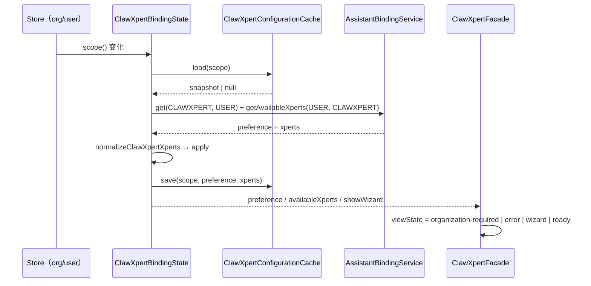
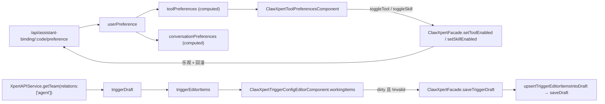
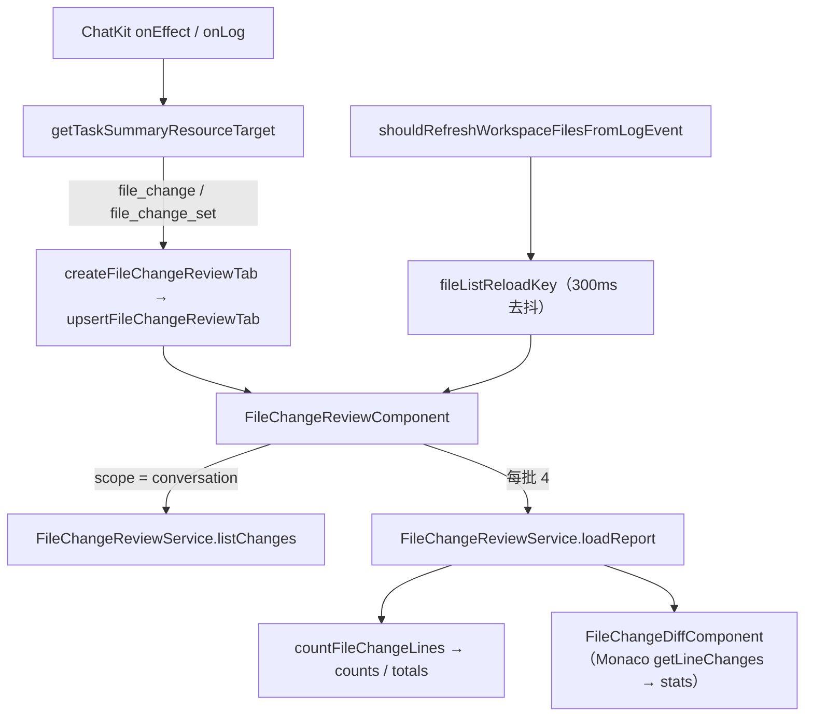
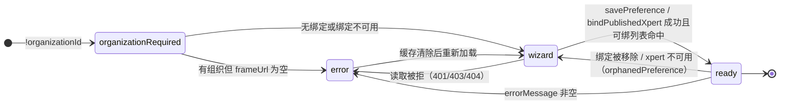

# 03 数据流转：对话前端专家 / ClawXpert 子专家

> 子域根：`apps/cloud/src/app/features/chat/clawxpert/**`（54 非 spec / 32 spec）
> 前端**无持久化层**：除 localStorage / sessionStorage 的四个键外，所有状态随页面销毁；服务端为准
> 口径与父级一致：[03-数据流转.md](file://.module-experts/前端专题/对话前端专家/implementation/03-数据流转.md)

**本文引用的文件**

- [clawxpert-binding-state.ts](file://apps/cloud/src/app/features/chat/clawxpert/clawxpert-binding-state.ts)
- [clawxpert-configuration-cache.service.ts](file://apps/cloud/src/app/features/chat/clawxpert/clawxpert-configuration-cache.service.ts)
- [clawxpert.facade.ts](file://apps/cloud/src/app/features/chat/clawxpert/clawxpert.facade.ts)
- [clawxpert.component.ts](file://apps/cloud/src/app/features/chat/clawxpert/clawxpert.component.ts)
- [clawxpert-scoped-conversation.facade.ts](file://apps/cloud/src/app/features/chat/clawxpert/clawxpert-scoped-conversation.facade.ts)
- [clawxpert-conversation-entry.store.ts](file://apps/cloud/src/app/features/chat/clawxpert/clawxpert-conversation-entry.store.ts)
- [clawxpert-conversation-detail.component.ts](file://apps/cloud/src/app/features/chat/clawxpert/clawxpert-conversation-detail.component.ts)
- [group-workbench-scope.ts](file://apps/cloud/src/app/features/chat/clawxpert/group-workbench-scope.ts)
- [clawxpert-tool-preferences.component.ts](file://apps/cloud/src/app/features/chat/clawxpert/clawxpert-tool-preferences.component.ts)
- [clawxpert-trigger-config-editor.component.ts](file://apps/cloud/src/app/features/chat/clawxpert/clawxpert-trigger-config-editor.component.ts)
- [file-change-review.component.ts](file://apps/cloud/src/app/features/chat/clawxpert/file-change-review.component.ts)
- [file-change-review.types.ts](file://apps/cloud/src/app/features/chat/clawxpert/file-change-review.types.ts)
- [clawxpert-managed-services-browser.ts](file://apps/cloud/src/app/features/chat/clawxpert/clawxpert-managed-services-browser.ts)
- [clawxpert-workspace-file-refresh.utils.ts](file://apps/cloud/src/app/features/chat/clawxpert/clawxpert-workspace-file-refresh.utils.ts)
- [clawxpert-task-summary-effect.utils.ts](file://apps/cloud/src/app/features/chat/clawxpert/clawxpert-task-summary-effect.utils.ts)
- [workbench-chat.facade.ts](file://apps/cloud/src/app/features/chat/workbench-chat/workbench-chat.facade.ts)
- [clawxpert-bootstrap.service.ts](file://apps/cloud/src/app/features/chat/clawxpert/clawxpert-bootstrap.service.ts)

## 目录

- [链① 绑定状态流](#链①-绑定状态流)
- [链② 会话收发与渲染](#链②-会话收发与渲染)
- [链③ 工具偏好与触发器读写](#链③-工具偏好与触发器读写)
- [链④ 群组 scope 解析](#链④-群组-scope-解析)
- [链⑤ 文件审查](#链⑤-文件审查)
- [本地态 vs 服务端态](#本地态-vs-服务端态)
- [状态流转（绑定态 / 作用域切换）](#状态流转绑定态--作用域切换)
- [已知风险](#已知风险)

## 链① 绑定状态流

**触发源 → 状态机 → 缓存 → 视图**

- **触发源**：`Store.selectOrganizationId()` 与 `Store.user$` 经 `toSignal` 进 `ClawXpertFacade.organizationId` / `userId`；`ClawXpertBindingState` 的 `context`（`scope()` = `{userId, organizationId}`）被 `effect` 监听，**scope 变化即** `#requestId++` + `restore(newScope)`。
- **冷启动恢复**：`restore(scope)` → `ClawXpertConfigurationCache.load(scope)`（key = `xpert.clawxpert.configuration.v1:<userId>:<organizationId>`，zod `snapshotSchema` 校验，`version: 1`）→ 命中则填 `preference` / `availableXperts`（单条）/ `hasLoadedXperts`，`loading` 仅在「有组织且无缓存」时为真。
- **服务端读取**：`refresh(scope)` 并行 `AssistantBindingService.get(CLAWXPERT, USER)` 与 `getAvailableXperts(USER, CLAWXPERT)`；`normalizeClawXpertXperts` 过滤「无 id / `latest === false` / 重复 id」。
- **写回与竞态**：`apply()` 写五个信号，随后 `persistCurrent()` → `cache.save(scope, preference, xperts)`（zod 校验失败即 `remove`）；`commit()`（用户完成选择）显式 `#requestId++`，让更早的后台读失效。
- **跨路由抬升**：URL 为 `/chat/clawxpert/c` 且 `bootstrap.pendingCreatedClawXpert()` 有值时，把新 xpert 并进 `availableXperts` 并覆盖 `preference.assistantId`；若该 xpert 已在服务端列表中出现则 `clearPendingCreatedClawXpert` 收尾。
- **失败面**：`isAccessRejected`（401/403/404）→ `cache.remove` + 清信号 + `errorMessage`；其它错误仅在首次加载时给文案。

图表来源：[clawxpert-binding-state.ts](file://apps/cloud/src/app/features/chat/clawxpert/clawxpert-binding-state.ts)（关键符号：`ClawXpertBindingState.refresh`、`ClawXpertBindingState.commit`、`normalizeClawXpertXperts`）· [clawxpert-configuration-cache.service.ts](file://apps/cloud/src/app/features/chat/clawxpert/clawxpert-configuration-cache.service.ts)（关键符号：`ClawXpertConfigurationCache.load`、`snapshotSchema`）

章节来源：[clawxpert-binding-state.ts](file://apps/cloud/src/app/features/chat/clawxpert/clawxpert-binding-state.ts)（关键符号：`ClawXpertBindingState.restore`、`ClawXpertBindingState.persistCurrent`、`isAccessRejected`）、[clawxpert.facade.ts](file://apps/cloud/src/app/features/chat/clawxpert/clawxpert.facade.ts)（关键符号：`ClawXpertFacade.viewState`、`ClawXpertFacade.resolvedPreference`、`ClawXpertFacade.orphanedPreference`）

## 链② 会话收发与渲染

**输入交给 iframe、事件回流宿主、宿主只改 URL 与标签**（本子域不参与 HTTP/SSE 消息归约——那条链归父级与 `xpert/**`）

- **上行（宿主 → iframe）**：`ClawXpertConversationDetailComponent.control` = `injectHostedAssistantChatkitControl({ identity, assistantId: chatkitAssistantId(), group: chatkitGroup(), projectId, requestContext: assistantRequestContext(), initialThread: chatkitInitialThread(), delegatedConversation: chatkitDelegatedConversation(), composer, workbench, startScreen, ... })`；`assistantRequestContext` 由 `buildAssistantRequestContext({ workspaceId, xpertId, contexts, executionFocus })` 汇总。
- **线程回流**：iframe `onThreadChange(threadId)` → `facade.onChatThreadChange`（作用域门面）→ 写 `threadId`、写 `ClawXpertConversationEntryStore`（仅 assistant）、`router.navigateByUrl(clawXpertConversationPath(scope, threadId) + 原 query/hash)`；非当前路由只记不跳。
- **状态回流**：`onResponseStart/End` → `patchActiveConversationStatus('busy' | 'idle')`，进而驱动 `facade.sidebarStatus`（`setup` / `busy` / `idle`）与侧栏指示；`onThreadLoadStart/End` → 骨架 loading 与 `syncConversationProject?.(threadId)`（**可选**方法，未实现时静默跳过）。
- **副作用回流（消息内事件）**：`onEffect` → 任务摘要资源目标（`getTaskSummaryResourceTarget`）→ 打开文件审查/产物/浏览器标签；`onLog` → 工作区文件刷新（去抖 300ms，写 `fileListReloadKey`）与 `assistant.tool.completed` 宿主事件；沙箱启动 → `openBrowserTabFromSandboxEvent`。
- **渲染与滚动归属**：消息列表、流式增量与滚动跟随在 iframe 内；宿主可影响的只有 `focusMessage`（`focusConversationMapMessage`，`not_ready` 时 5s 内 100ms 重试）与标签页/面板 class（`createWorkspacePanelClasses`）。
- **已读与上下文**：`markChatkitThreadRead` / `resolveConversationContext`（`CONVERSATION_DETAIL_RELATIONS = ['messages']`）在骨架内做「线程 → 会话」解析，并校验 hint 与授权会话一致（`assertWorkbenchConversationHint`）。

章节来源：[clawxpert-conversation-detail.component.ts](file://apps/cloud/src/app/features/chat/clawxpert/clawxpert-conversation-detail.component.ts)（关键符号：`ClawXpertConversationDetailComponent.assistantRequestContext`、`markChatkitThreadRead`、`resolveConversationContext`）、[clawxpert-scoped-conversation.facade.ts](file://apps/cloud/src/app/features/chat/clawxpert/clawxpert-scoped-conversation.facade.ts)（关键符号：`ClawXpertScopedConversationFacade.onChatThreadChange`、`ClawXpertScopedConversationFacade.beginPendingConversation`）

## 链③ 工具偏好与触发器读写

**偏好：服务端偏好对象 → 计算派生 → 乐观写回；触发器：草稿 → 副本 → 落盘**

- **读**：`userPreference`（`AssistantBindingService` 的 `/preference`）→ `toolPreferences`（`normalizeAssistantBindingToolPreferences`）与 `conversationPreferences`（`normalizeConversationPreferences`）→ 派生 `defaultThreadId` / `defaultFollowUpBehavior`。
- **工具偏好读**：`ClawXpertToolPreferencesComponent.toolState` 以 `{draft: facade.triggerDraft(), middlewareProviders, ready}` 为源 `switchMap` → `forkJoin(toolset.getOneById(...), agent.getAgentMiddleware(...))` → `{loading, tools, errors}`。
- **写（工具/skill）**：`toggleTool` → `facade.setToolEnabled(...)`；`toggleSkill` → 队列化的 `facade.setSkillEnabled(workspaceId, packageId, enabled)`；两者在组件侧只维护 `pendingPreferenceItems[id]` 与 `downloadingSkillIds` / `uninstallingSkillIds`；失败由门面回滚并 toastr（父级口径：乐观改 → 失败回滚）。
- **触发器读**：`triggerProviders` ← `XpertAPIService.getTriggerProviders()`（`catchError` 降级空数组）；`loadTriggerDraft` ← `xpertService.getTeam(id, { relations: ['agent'] })` → `triggerDraftSource` / `triggerDraft` → `triggerEditorItems`。
- **触发器写**：`saveTriggerDraft(items)` → `upsertTriggerEditorItemsIntoDraft` → `saveDraft` → 更新 `triggerDraftSource` / `triggerDraft`；`updateCurrentXpertCopilotModel` 在成功后同步刷新 `triggerDraftSource` 与 `availableXperts` 中的 `copilotModel`。
- **会话偏好**：`persistConversationPreferences` / `setDefaultFollowUpBehavior` 与 `conversationPreferences` 同源，失败回滚。

图表来源：[clawxpert.facade.ts](file://apps/cloud/src/app/features/chat/clawxpert/clawxpert.facade.ts)（关键符号：`ClawXpertFacade.toolPreferences`、`ClawXpertFacade.loadTriggerDraft`、`ClawXpertFacade.saveTriggerDraft`、`ClawXpertFacade.triggerEditorItems`）· [clawxpert-trigger-config-editor.component.ts](file://apps/cloud/src/app/features/chat/clawxpert/clawxpert-trigger-config-editor.component.ts)（关键符号：`ClawXpertTriggerConfigEditorComponent.dirty`、`save`）

章节来源：[clawxpert-tool-preferences.component.ts](file://apps/cloud/src/app/features/chat/clawxpert/clawxpert-tool-preferences.component.ts)（关键符号：`ClawXpertToolPreferencesComponent.toolState`、`toggleTool`、`toggleSkill`）、[clawxpert.facade.ts](file://apps/cloud/src/app/features/chat/clawxpert/clawxpert.facade.ts)（关键符号：`ClawXpertFacade.setToolEnabled`、`ClawXpertFacade.updateCurrentXpertCopilotModel`）

## 链④ 群组 scope 解析

**key 变化 → 立刻置空 → 授权上下文 → 覆盖 ChatKit 作用域**

- **输入**：`groupId`（路由/门面）、`identity`、`assistantId`、`ready`；key = `JSON.stringify([identity, groupId, assistantId])`。
- **解析**：`GroupWorkbenchApiService.getContext(groupId)` → 校验 `assistantId` 一致且有 `conversationId` → 产出 `{groupId, projectId, conversationId}`；不符即 `onError`，**不回退**个人会话。
- **消费**：骨架 `groupWorkbenchScope` → `#workbenchConversationScope` → `chatkitAssistantId`（优先 `xpertId`）、`chatkitGroup`（群组态为 `null`）、`chatkitInitialThread`、`viewRuntimeScope`（`groupId` / `projectId` / `conversationId`）；`chatkitDelegatedConversation` 也由该 scope 决定。
- **失效**：切组或身份变化 → key 变 → `computed` 返回 `null` → 骨架重新解析；旧请求因 `cleanup` 的 `cancelled` 被丢弃。

章节来源：[group-workbench-scope.ts](file://apps/cloud/src/app/features/chat/clawxpert/group-workbench-scope.ts)（关键符号：`createGroupWorkbenchScope`）、[clawxpert-conversation-detail.component.ts](file://apps/cloud/src/app/features/chat/clawxpert/clawxpert-conversation-detail.component.ts)（关键符号：`ClawXpertConversationDetailComponent.groupWorkbenchScope`、`ClawXpertConversationDetailComponent.viewRuntimeScope`、`ClawXpertConversationDetailComponent.chatkitDelegatedConversation`）

## 链⑤ 文件审查

**事件/标签 → 资源清单 → 分批报告 → 计数 → diff 视图**

- **入口**：`createFileChangeReviewTab(threadId, conversationId, resource)`（`kind: 'file-review'`）→ `upsertFileChangeReviewTab`（同 id 只 `revision + 1`）；骨架 `reviewTabs` 过滤 `kind === 'file-review'` 的标签渲染 `xp-file-change-review`。
- **范围切换**：`selectScope('conversation')` 时先 `FileChangeReviewService.listChanges(conversationId)`（分页循环拉全量，父级口径 100/页）映射成 `{path, resource}`；`selected` 直接用 `tab.resource`（`file_change_set` 展开 `changes`，`file_change` 单端点）。
- **加载**：每批 4 个 `loadReport(resource)`；`request` 序号在批间与结尾校验，`ngOnDestroy` 再自增；路径不一致或异常 → 该条目 `unavailable`。
- **计数**：`countFileChangeLines(report)` → `counts`（`FileDiffStats`）→ `totals`（`added` / `removed`）；`hasReviewText` 决定哪些条目参与合计。
- **渲染**：`FileChangeDiffComponent` 以 Monaco diff 呈现（`sideBySide` / `wordWrap` / `showWhitespace` 由父组件传入），并在 `init` 时按 `getLineChanges()` emit `stats`（与 `counts` 是**两条独立统计**）。
- **刷新触点**：iframe 日志命中写文件白名单 → `fileListReloadKey`（`fileListReloadKey` 由骨架持有），工作区文件树按 `workspaceReloadKey` 重新加载。

图表来源：[file-change-review.types.ts](file://apps/cloud/src/app/features/chat/clawxpert/file-change-review.types.ts)（关键符号：`createFileChangeReviewTab`、`upsertFileChangeReviewTab`、`hasReviewText`）· [file-change-review.component.ts](file://apps/cloud/src/app/features/chat/clawxpert/file-change-review.component.ts)（关键符号：`FileChangeReviewComponent.load`、`selectScope`）· [clawxpert-task-summary-effect.utils.ts](file://apps/cloud/src/app/features/chat/clawxpert/clawxpert-task-summary-effect.utils.ts)（关键符号：`getTaskSummaryResourceTarget`）

章节来源：[file-change-review.component.ts](file://apps/cloud/src/app/features/chat/clawxpert/file-change-review.component.ts)（关键符号：`FileChangeReviewComponent.totals`、`toggleAll`）、[clawxpert-conversation-detail.component.ts](file://apps/cloud/src/app/features/chat/clawxpert/clawxpert-conversation-detail.component.ts)（关键符号：`ClawXpertConversationDetailComponent.reviewTabs`、`ClawXpertConversationDetailComponent.fileListReloadKey`）

## 本地态 vs 服务端态

| 数据 | 前端持有形态 | 来源（实际契约） | 边界说明 |
| --- | --- | --- | --- |
| 助手绑定（CLAWXPERT / USER） | `preference` signal | `AssistantBindingService.get(CLAWXPERT, USER)`、`upsert` | 权威在服务端；缓存快照 `version: 1` 只加速启动 |
| 可绑助手列表 | `availableXperts` signal | `getAvailableXperts(USER, CLAWXPERT)` | `normalizeClawXpertXperts` 去重 + 过滤 `latest === false` |
| 启动快照 | `ClawXpertConfigurationSnapshot`（localStorage） | 同上前两者派生 | zod 校验失败即删除；**不含草稿/图/凭据/会话** |
| 用户偏好（soul / profile / toolPreferences / conversationPreferences） | `userPreference` signal | `/api/assistant-binding/:code/preference` | 乐观写 + 失败回滚 |
| 触发器草稿 | `triggerDraft` / `triggerDraftSource` | `XpertAPIService.getTeam(id, { relations: ['agent'] })`、`saveDraft` | 编辑只改**草稿**，运行时需另行发布 |
| 触发器提供方 | `triggerProviders` signal | `XpertAPIService.getTriggerProviders()` | 失败降级空数组 |
| 会话线程 id（task scope） | 门面 / 作用域门面 `threadId` signal | URL 段解析 | 不落本地存储 |
| 会话线程 id（assistant scope） | 同 + `ClawXpertConversationEntryStore` | localStorage `xpert:assistant-conversation:v1:[userId, orgId, xpertId]` | 只存线程 id，未发送输入留在面板 |
| 布局态 / 宠物态 | `ClawXpertWorkbenchLayoutStorage` | localStorage `xpert.clawxpert.workbench.layout.v2:*`、`xpert.clawxpert.chatkit.pet.v1:*` | 取值域 `minimized \| normal \| maximized \| overlay` |
| skill 试用意图 | `ClawXpertSkillTrialIntentService` signal | sessionStorage `xpert.clawxpert.skillTrialIntent` | TTL 5 分钟；`peek` 过期即清 |
| 视图 URL 状态 | `view` / `viewSelection` / `viewParameters` / `viewProject` | Router query params | `setViewState` 原子写入；空态折叠为删除参数 |
| 工作区标签页 | `ClawXpertWorkspaceTab[]`（signal） | 纯前端 | 每线程一个 `file-review` 标签 |
| 变更报告与计数 | `entries` / `counts` / `totals` | `FileChangeReviewService` | 报告来自服务端，计数是前端派生 |
| 受管服务与预览会话 | `ClawXpertManagedServicesBrowserController` 私有字段 | `SandboxService.listManagedServices / createManagedServicePreviewSession` | `previewSessionKey = conversationId:serviceId:previewUrl` 复用会话 |
| 群组运行作用域 | `resolved` signal（`createGroupWorkbenchScope`） | `GroupWorkbenchApiService.getContext(groupId)` | 未解析前**不出**个人视图 |
| 任务摘要 | `taskSummary` / `scheduledTaskSummary` | `XpertTaskService` | 由 `taskRefreshTick` 驱动重取 |

章节来源：[clawxpert-configuration-cache.service.ts](file://apps/cloud/src/app/features/chat/clawxpert/clawxpert-configuration-cache.service.ts)（关键符号：`ClawXpertConfigurationSnapshot`、`ClawXpertConfigurationCache.loadChatkitPet` 同族方法）、[clawxpert-conversation-entry.store.ts](file://apps/cloud/src/app/features/chat/clawxpert/clawxpert-conversation-entry.store.ts)（关键符号：`ClawXpertConversationEntryStore.assistantThread`、`setAssistantThread`）、[clawxpert-managed-services-browser.ts](file://apps/cloud/src/app/features/chat/clawxpert/clawxpert-managed-services-browser.ts)（关键符号：`buildManagedServicePreviewSessionKey`、`ClawXpertManagedServicesBrowserController.ensurePreviewSession`）

## 状态流转（绑定态 / 作用域切换）

**绑定态（`ClawXpertViewState`）**

图表来源：[clawxpert.facade.ts](file://apps/cloud/src/app/features/chat/clawxpert/clawxpert.facade.ts)（关键符号：`ClawXpertViewState`、`ClawXpertFacade.viewState`、`ClawXpertFacade.sidebarStatus`）· [clawxpert-binding-state.ts](file://apps/cloud/src/app/features/chat/clawxpert/clawxpert-binding-state.ts)（关键符号：`ClawXpertBindingState.showWizard`、`ClawXpertBindingState.errorMessage`）

**作用域切换（`task` ↔ `assistant`）**

- **判据**：`clawXpertConversationScope(url)` —— `/chat/clawxpert/c[/:threadId]` → `'task'`；`/chat/clawxpert/assistant[/:threadId]` 与 `/chat/clawxpert/settings` → `'assistant'`；其余 `null`。
- **切换时序**：URL 变（`ClawXpertFacade.currentUrl` 来自 `Router.events` 的 `NavigationEnd`，经 `normalizeClawXpertPath` 归一）→ 每个面板的 `active()` 重算 → 外壳 `activeScope` 变化把新作用域并入 `mountedScopes`（只增不减）→ 非活动面板 `display:none` + `inert`。
- **线程隔离**：切到 assistant 且 URL 无线程时，从 `entries.assistantThread(owner)` 恢复并 `replaceUrl` 补全；切回 task 时用 URL 段恢复；`onChatThreadChange` 在非当前路由只记不跳（后台响应不劫持路由）。
- **重置保护**：`resetInProgress`（新会话重置中）与 `nullGuardUntil`（线程刚写入后 1000ms 内忽略 null）两道闸门，避免 iframe 的瞬时 `null` 把路由打回无线程态。

章节来源：[clawxpert-conversation-scope.ts](file://apps/cloud/src/app/features/chat/clawxpert/clawxpert-conversation-scope.ts)（关键符号：`clawXpertConversationScope`、`clawXpertScopedThreadId`）、[clawxpert-scoped-conversation.facade.ts](file://apps/cloud/src/app/features/chat/clawxpert/clawxpert-scoped-conversation.facade.ts)（关键符号：`ClawXpertScopedConversationFacade.active`、`ClawXpertScopedConversationFacade.owner`）、[clawxpert.component.ts](file://apps/cloud/src/app/features/chat/clawxpert/clawxpert.component.ts)（关键符号：`ClawXpertComponent.activeScope`、`ClawXpertComponent.mountedScopes`）

## 已知风险

1. **`settings` 作用域是死口径**：路由把 `/chat/clawxpert/settings` 重定向到 `c`，但 `clawXpertConversationScope` 仍把它判为 `'assistant'`（且 `ClawXpertScopedConversationFacade` 的 URL 同步对该路径有专门分支），`clawxpert-assistant-settings.component.ts` 未被任何路由挂载。[实测：路由表 + scope 函数 + 组件文件对照]
2. **缓存与权威的时序**：`ClawXpertConfigurationCache` 命中期内 `loading` 为假、`viewState` 可能已是 `ready`，若服务端随后拒绝（401/403/404），UI 会经历「先 ready 后 error」的一次跳变。属设计取舍（注释明示缓存不替代授权），但会放大首屏闪烁。[推测]
3. **群组作用域不清空旧面板状态**：群组作用域变化只让 `computed` 返回 `null` 并重解析，已在 `workspaceTabs` 中打开的固定视图标签（`projectScope` 绑定旧 projectId）不会被回收。[推测：由 `removeFixedViewTabs` 仅在 View 清单变化时触发推断]
4. **文件变更计数双实现**：`countFileChangeLines` 与 Monaco `getLineChanges()` 分别产出「列表合计」与「单文件 emit」，两者口径差异在折叠/空白字符设置下会显现。[实测：两处实现]
5. **事件翻译层静默失败**：`shouldRefreshWorkspaceFilesFromLogEvent` / `getSandboxPreviewTargetFromLogEvent` 的判定完全依赖键名白名单，payload 键名漂移只表现为「不刷新/不弹预览」，无日志与告警。[实测：纯函数实现]
6. **未发送输入不持久化**：`ClawXpertConversationEntryStore` 注释明确「unsent input stays inside each mounted chat」，刷新页面即失；面板 `inert` 方案只保路由内切换。[实测：源码注释]
7. **受管服务轮询无条件启动**：`startAutoRefresh` 默认 5000ms，标签页隐藏时仍会打接口（未见 `visibilitychange` 判断）。[推测]
8. **`nullGuardUntil` 1000ms 是启发式**：iframe 在新线程首帧回 `null` 的时长不可控，慢环境下仍可能误清线程或误拦 URL 修正。[推测]
9. **未确认项**：`{virtual:true}` 缺失导致的 `@xpert-ai/chatkit-angular` 解析问题会让 `clawxpert-conversation-detail.component.spec.ts` 在加载阶段失败（父级口径 99 例全废），本子域的会话链**当前无可用回归**。[实测（静态）/待复跑确认]

章节来源：[clawxpert-conversation-scope.ts](file://apps/cloud/src/app/features/chat/clawxpert/clawxpert-conversation-scope.ts)（关键符号：`clawXpertConversationScope`）、[clawxpert-assistant-settings.component.ts](file://apps/cloud/src/app/features/chat/clawxpert/clawxpert-assistant-settings.component.ts)（关键符号：`ClawXpertAssistantSettingsComponent.ngOnInit`）、[clawxpert-workspace-file-refresh.utils.ts](file://apps/cloud/src/app/features/chat/clawxpert/clawxpert-workspace-file-refresh.utils.ts)（关键符号：`shouldRefreshWorkspaceFilesFromLogEvent`）
