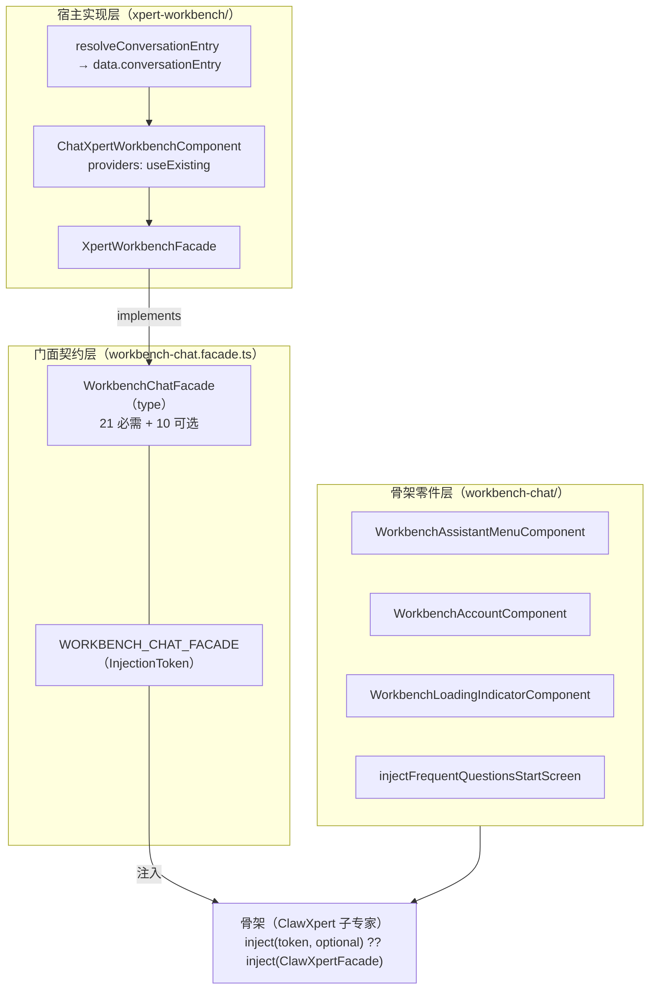

# C0 使用总览：会话工作台子专家（Xpert 前端 · 对话域）

> 一句话定位：本子域是**门面契约定义处 + 骨架零件 + `/chat/x/:name` 宿主实现**——`WorkbenchChatFacade`（type）与 `WORKBENCH_CHAT_FACADE`（InjectionToken）是整个对话域「骨架 ↔ 宿主」的唯一接触面。
> 范围：`features/chat/workbench-chat`（**5 非 spec / 3 spec**）＋ `features/chat/xpert-workbench`（**3 / 2**）＝ **8 非 spec / 5 spec**（本会话按目录实测）。差异口径：ki 记「约 26」（含 `clawxpert/conversation-detail/**` 消费侧），父级 06-测试记 `workbench-chat` 为 3 非 spec，本文以实测为准。
> 入口路由：`/chat/x/:name/c`、`/chat/x/:name/c/:threadId`、`/chat/x/:name/p/:projectId/c[/:threadId]`（由 `xpertWorkbenchConversationMatcher` 唯一匹配）。

**本文引用的文件**
- [workbench-chat.facade.ts](file://apps/cloud/src/app/features/chat/workbench-chat/workbench-chat.facade.ts)
- [xpert-workbench.component.ts](file://apps/cloud/src/app/features/chat/xpert-workbench/xpert-workbench.component.ts)
- [xpert-workbench.facade.ts](file://apps/cloud/src/app/features/chat/xpert-workbench/xpert-workbench.facade.ts)
- [conversation-entry.resolver.ts](file://apps/cloud/src/app/features/chat/xpert-workbench/conversation-entry.resolver.ts)
- [xpert-workbench.facade.spec.ts](file://apps/cloud/src/app/features/chat/xpert-workbench/xpert-workbench.facade.spec.ts)
- [conversation-entry.resolver.spec.ts](file://apps/cloud/src/app/features/chat/xpert-workbench/conversation-entry.resolver.spec.ts)
- [workbench-assistant-menu.component.ts](file://apps/cloud/src/app/features/chat/workbench-chat/workbench-assistant-menu.component.ts)
- [workbench-account.component.ts](file://apps/cloud/src/app/features/chat/workbench-chat/workbench-account.component.ts)
- [workbench-loading-indicator.component.ts](file://apps/cloud/src/app/features/chat/workbench-chat/workbench-loading-indicator.component.ts)
- [frequent-questions-start-screen.ts](file://apps/cloud/src/app/features/chat/workbench-chat/frequent-questions-start-screen.ts)
- [clawxpert-conversation-detail.component.ts](file://apps/cloud/src/app/features/chat/clawxpert/clawxpert-conversation-detail.component.ts)
- [clawxpert-conversation-pane.component.ts](file://apps/cloud/src/app/features/chat/clawxpert/clawxpert-conversation-pane.component.ts)
- [clawxpert-scoped-conversation.facade.ts](file://apps/cloud/src/app/features/chat/clawxpert/clawxpert-scoped-conversation.facade.ts)
- [conversation.ts](file://apps/cloud/src/app/features/chat/clawxpert/conversation-detail/chatkit/conversation.ts)
- [routes.ts](file://apps/cloud/src/app/features/chat/routes.ts)
- [assistant-chatkit.runtime.ts](file://apps/cloud/src/app/features/assistant/assistant-chatkit.runtime.ts)
- [implementation/05-接口.md](file://.module-experts/前端专题/对话前端专家/sub-experts/会话工作台子专家/implementation/05-接口.md)
- [implementation/06-测试.md](file://.module-experts/前端专题/对话前端专家/sub-experts/会话工作台子专家/implementation/06-测试.md)

## 目录
1. [定位与何时找](#1-定位与何时找)
2. [能力清单](#2-能力清单)
3. [边界](#3-边界)
4. [已知问题与常见坑](#4-已知问题与常见坑)

## 1. 定位与何时找

子域存在的理由是**解耦「会话工作台骨架」与「宿主实现」**：同一份骨架 `ClawXpertConversationDetailComponent` 同时服务 `/chat/clawxpert/c/*`、`/chat/clawxpert/assistant/*`、`/chat/x/:slug[/p/:projectId]/c/*` 三种形态；若骨架直接 `inject(ClawXpertFacade)`，第三种形态就必须污染 ClawXpert 门面。契约层零出向耦合——`workbench-chat/` 不 import 任何宿主。

图表来源：[workbench-chat.facade.ts](file://apps/cloud/src/app/features/chat/workbench-chat/workbench-chat.facade.ts)（关键符号：`WorkbenchChatFacade`、`WORKBENCH_CHAT_FACADE`）· [xpert-workbench.component.ts](file://apps/cloud/src/app/features/chat/xpert-workbench/xpert-workbench.component.ts)（关键符号：`ChatXpertWorkbenchComponent.providers`）· [clawxpert-conversation-detail.component.ts](file://apps/cloud/src/app/features/chat/clawxpert/clawxpert-conversation-detail.component.ts)（关键符号：`ClawXpertConversationDetailComponent.facade`）

1. **复用骨架 / 新增一种会话形态** → 实现 `WorkbenchChatFacade`（21 个必需成员）＋ `providers: [{ provide: WORKBENCH_CHAT_FACADE, useExisting: YourFacade }]` ＋ 模板一行；参考 `ChatXpertWorkbenchComponent`。
2. **接入新宿主（第三种入口）** → 先定「状态是否由 URL 表达」：URL 驱动型照抄 `/chat/x`（facade + 装配组件 + resolver + 路由项）；内存驱动型（如 per-scope pane）需自持 `threadId` 与 `nullGuardUntil` 类保护。
3. **门面契约变更评估** → 改 [workbench-chat.facade.ts](file://apps/cloud/src/app/features/chat/workbench-chat/workbench-chat.facade.ts)；新增**必需**成员会同时打断三个实现（`XpertWorkbenchFacade`、`ClawXpertFacade`、`ClawXpertScopedConversationFacade`），**新增可选成员是唯一向后兼容方式**；同时核对契约外隐式成员。
4. **入口 resolver 行为**（私聊门控 / 群组放行 / 错误阻断） → `resolveConversationEntry` 与 `ConversationEntryResolution`；错误态行为见 [implementation/05-接口.md](file://.module-experts/前端专题/对话前端专家/sub-experts/会话工作台子专家/implementation/05-接口.md)。
5. **加载与空态零件**（助手/群组菜单、账号入口、400ms 加载条、常见问题起始页） → `WorkbenchAssistantMenuComponent`、`WorkbenchAccountComponent`、`WorkbenchLoadingIndicatorComponent`、`injectFrequentQuestionsStartScreen`。
6. **查 Project 双阶段语义**（初始挂载 / 草稿意图 / 运行后持久刷新） → `chatkitMountProjectId`、`chatkitProjectSelection`、`syncConversationProject`、`projectAccess`、`onChatProjectChange`。
7. **跑本子域测试**（5 spec ≈54 例，`xpert-workbench.facade.spec.ts` 占 28 例） → 命令与缺口见 [implementation/06-测试.md](file://.module-experts/前端专题/对话前端专家/sub-experts/会话工作台子专家/implementation/06-测试.md)。
8. **排障「会话不挂载 / 首屏空白」** → 先看 `viewState` 与 `viewErrorMessage()`，再看 `chatkitFrameUrl` 与 `chatkitMountProjectId`，最后才怀疑 iframe 内部。

章节来源：[workbench-chat.facade.ts](file://apps/cloud/src/app/features/chat/workbench-chat/workbench-chat.facade.ts)（关键符号：`WorkbenchChatFacade`、`WorkbenchChatViewState`、`WORKBENCH_CHAT_FACADE`）· [xpert-workbench.facade.ts](file://apps/cloud/src/app/features/chat/xpert-workbench/xpert-workbench.facade.ts)（关键符号：`XpertWorkbenchFacade.viewState`、`syncConversationProject`）

## 2. 能力清单

| 能力 | 入口（type / 组件 / 函数） | 一句话 |
|---|---|---|
| 门面契约本体 | `WorkbenchChatFacade` + `WORKBENCH_CHAT_FACADE` | 31 成员（21 必需 + 10 可选）结构性类型，零实现零宿主引用 |
| 契约配套类型 | `WorkbenchChatDefinition`、`WorkbenchChatViewState` | 标题兜底（`titleKey` / `defaultTitle`）与四态机 |
| `/chat/x` 宿主门面 | `XpertWorkbenchFacade` | URL 派生 + xpert 可得性 + Project 采纳/切换 + 三序竞态防护 |
| 宿主装配点 | `ChatXpertWorkbenchComponent`（`xp-chat-xpert-workbench`） | `providers: useExisting` + 模板一行，**类体为空** |
| 入口 resolver | `resolveConversationEntry` / `ConversationEntryResolution` | 群组放行 + 私聊特性门控 + 错误阻断（不降级私聊） |
| 骨架零件·菜单 | `WorkbenchAssistantMenuComponent`（`xp-workbench-assistant-menu`） | `activeId`（input）/ `selected`（output）；租户→`CHAT_COMMON`、组织→`CLAWXPERT` |
| 骨架零件·账号 | `WorkbenchAccountComponent`（`xp-workbench-account`） | `Store.user$` → `HeaderUserComponent`（compact） |
| 骨架零件·加载条 | `WorkbenchLoadingIndicatorComponent`（`xp-workbench-loading-indicator`） | `role="status"`，**400ms 才显形**，随加载分支卸载取消 |
| 骨架零件·起始页 | `injectFrequentQuestionsStartScreen({ xpert, active })` | 常见问题 + 已配置启动屏，失败不阻塞会话 |
| 入口重定向 | `x/:name` → `/chat/x/:name/c` | `pathMatch: 'full'`，保留 query / fragment |
| 契约外能力探测 | `getOptionalSignalValue` / `hasTaskSummaryRefresh` | 鸭子类型读取 `currentWorkspaceId` / `refreshTaskSummaries` |

章节来源：[workbench-chat.facade.ts](file://apps/cloud/src/app/features/chat/workbench-chat/workbench-chat.facade.ts)（关键符号：`WorkbenchChatDefinition`、`WorkbenchChatViewState`）· [workbench-loading-indicator.component.ts](file://apps/cloud/src/app/features/chat/workbench-chat/workbench-loading-indicator.component.ts)（关键符号：`WorkbenchLoadingIndicatorComponent.visible`）· [frequent-questions-start-screen.ts](file://apps/cloud/src/app/features/chat/workbench-chat/frequent-questions-start-screen.ts)（关键符号：`injectFrequentQuestionsStartScreen`）

## 3. 边界

1. **门面契约定义处是本子域最重要的资产**：`WorkbenchChatFacade` / `WorkbenchChatDefinition` / `WorkbenchChatViewState` / `WORKBENCH_CHAT_FACADE` 只在这里定义，**不被任何宿主反向 import**（`workbench-chat/` 内 5 个文件全部不 import `xpert-workbench/` 或 `clawxpert/`）。
2. **消费侧不在本子域**：骨架 `ClawXpertConversationDetailComponent` 与 per-scope 适配器 `ClawXpertScopedConversationFacade` 归「**ClawXpert 子专家**」；本子域只声明契约与零件，消费行为（就绪门控、`?.` 兜底）以对方文档为准。
3. **ChatKit 运行时状态机、iframe 生命周期与 client-command 桥不在本子域** → 父级 [assistant-chatkit.runtime.ts](file://apps/cloud/src/app/features/assistant/assistant-chatkit.runtime.ts)（`injectHostedAssistantChatkitControl`、`sanitizeAssistantFrameUrl`）；本子域只把 `chatkitFrameUrl` 作为契约字段传递。
4. **`/chat` 首页壳、历史抽屉、xpert 列表页与项目域本体不在本子域** → 父级 `home/**` 与「项目协作专家」；本子域只经 `XpertProjectApiService.access/get` 读权限摘要与项目名。
5. **后端 HTTP 契约不在本子域** → 逐端点明细见父级 [implementation/05-接口.md](file://.module-experts/前端专题/对话前端专家/implementation/05-接口.md)；本子域文档中的路径只作「宿主实现要求」的实现细节。

章节来源：[workbench-chat.facade.ts](file://apps/cloud/src/app/features/chat/workbench-chat/workbench-chat.facade.ts)（关键符号：`WorkbenchChatFacade.chatkitFrameUrl`）、[conversation-entry.resolver.ts](file://apps/cloud/src/app/features/chat/xpert-workbench/conversation-entry.resolver.ts)（关键符号：`ConversationEntryResolution`）

## 4. 已知问题与常见坑

1. **骨架只依赖 `WORKBENCH_CHAT_FACADE` token**：骨架用 `inject(WORKBENCH_CHAT_FACADE, { optional: true })` 取门面、缺失时回落 `inject(ClawXpertFacade)`；三个提供点必须 **`useExisting`（不能 `useClass`）**，否则 token 与具名类解析成两个实例——signal 状态分叉、`#lastConversationEntryKey` 等去重键失效。（来源：[clawxpert-conversation-detail.component.ts](file://apps/cloud/src/app/features/chat/clawxpert/clawxpert-conversation-detail.component.ts)（关键符号：`ClawXpertConversationDetailComponent.facade`、`#providedFacade`））
2. **门面可选成员与默认兜底**：契约层**不提供任何默认值**——可选信号缺失读作 `null`（`getOptionalSignalValue`）、可选方法缺失整段能力跳过（`facade.syncConversationProject?.(threadId)`、`facade.onChatProjectChange?.(...)`）；因此「宿主不实现即能力缺席」，`syncConversationProject` 缺席时首条消息后路由不补 Project 段（已知契约缺口）。
3. **宿主替换不得改骨架**：新增宿主的成本只有「1 facade + 1 providers 块 + 模板一行」；**不要绕过契约读宿主**（禁止骨架内 `inject(YourFacade)`），需要新能力时走「加可选成员 + 骨架 `?.` 兜底」。
4. **`conversation-entry.resolver` 的解析顺序**：① 读 `route.paramMap.get('threadId')`；② 有线程时用 `store.organizationId` 调 `getEntryByThreadId`；③ `entry.purpose !== 'group' && !hasFeatureEnabled(FEATURE_XPERT_CLAWXPERT)` → `RedirectCommand(['/chat'])`（群组无条件放行）；④ `catchError` 把异常转成 `{ entry: null, error }`，**不抛也不降级为私聊**——降级会把无权会话渲染成私有会话。
5. **`/chat/x/:name` 与 `/chat/clawxpert` 两套入口的差异**：前者由 `xpertWorkbenchConversationMatcher` 匹配（三段/四段；Project 段在 URL）、按 `slug|id` 找 xpert、守卫仅 `featureGate([FEATURE_XPERT])`；后者是 `path: 'clawxpert'` 子树 + `canActivateChild: featureGate([FEATURE_XPERT, FEATURE_XPERT_CLAWXPERT], ['/explore'])`，per-scope 门面把 `identity` 追加 `:${scope}` 并用 `nullGuardUntil` 防瞬时 `null`。
6. **iframe 宿主的 origin 与生命周期**：`chatkitFrameUrl` 必须已过 `sanitizeAssistantFrameUrl`（只做**前缀哨兵**——空或 `DOCKER_` → `null` → `viewState='error'`，跨域源校验责任在 iframe 协议与宿主 CSP）；`identity` 是挂载身份、**非 `ready` 必须为 `null`**，变化即重建会话（`runtimeKey` → `sessionRevision++`），未变则 `setOptions` 原地刷新；`loading` 期间只在同一 `securityScope` 内保留 iframe。
7. **Project 双阶段与「identity 不变」**：`chatkitMountProjectId`（仅初始挂载）、`chatkitProjectSelection`（草稿意图）、`syncConversationProject(threadId)`（运行开始/结束后采纳服务端保存的作用域，`replaceUrl`，**不新开会话**）三者语义不同；采纳后必须**不改变挂载身份**（spec 从首发采纳、Receipt 打开、迟到响应三处保护）；`projectAccess === null` 表示 pending / 不可用 / 拒绝，消费方须 fail-closed。
8. **契约外隐式成员 + 契约零测试**：骨架还会读 `refreshTaskSummaries`（`hasTaskSummaryRefresh` 结构探测）与 `currentWorkspaceId`（`getOptionalSignalValue`），二者**不在类型里**——改契约不能只看类型文件；同时 `workbench-chat.facade.ts` 无 spec、装配点无直接 spec，`useExisting` 被改成 `useClass` 时本子域无一例会失败。
9. **`wizard` 分支与中英混用 i18n**：`/chat/x` 下 `viewState` 先判 `errorMessage` 再判 `!currentXpert`，而 `loadState` 未匹配时先写 `errorMessage`，稳态可能只剩瞬时 `wizard`；`viewErrorMessage()` 同时混用 `XP.Chat.XpertWorkbench.{MissingSlug,NotFound,LoadFailedDesc}` 与 `XP.Chat.ClawXpert.FrameMissing`，改文案需看两个命名空间。

章节来源：[workbench-chat.facade.ts](file://apps/cloud/src/app/features/chat/workbench-chat/workbench-chat.facade.ts)（关键符号：`WorkbenchChatFacade.identity`、`group`、`projectAccess`、`onChatProjectChange`）· [conversation-entry.resolver.ts](file://apps/cloud/src/app/features/chat/xpert-workbench/conversation-entry.resolver.ts)（关键符号：`resolveConversationEntry`）· [conversation.ts](file://apps/cloud/src/app/features/chat/clawxpert/conversation-detail/chatkit/conversation.ts)（关键符号：`getOptionalSignalValue`、`hasTaskSummaryRefresh`）
