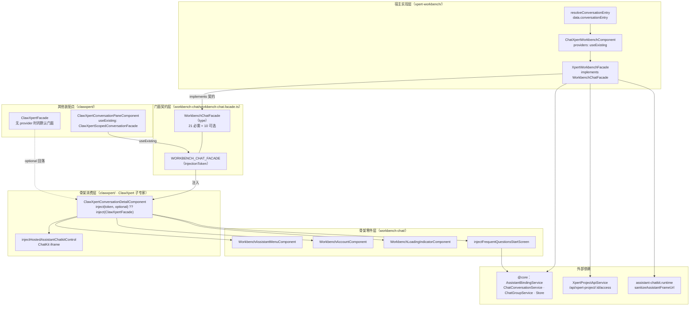

# 01 架构：会话工作台子专家（Xpert 前端 · 对话域）

> 子域根：`apps/cloud/src/app/features/chat/workbench-chat`（**5 非 spec `.ts` / 3 spec**）＋ `apps/cloud/src/app/features/chat/xpert-workbench`（**3 / 2**）＝ **8 非 spec / 5 spec**（本会话按目录实测）
> 计数口径差异：ki 记「会话工作台子专家（约 26，含门面契约定义处）」；26 应含骨架消费侧（`clawxpert/conversation-detail/**`）与门面实现的间接面。本子域按声明边界只计上述两个目录，**消费侧不重复计入**（归 ClawXpert 子专家）
> 入口路由：`/chat/x/:name/c`、`/chat/x/:name/c/:threadId`、`/chat/x/:name/p/:projectId/c[/:threadId]`（由 `xpertWorkbenchConversationMatcher` 唯一匹配）
> 技术底座：Angular 17 standalone + signal + `InjectionToken` 依赖倒置 + `@xpert-ai/chatkit-angular`（iframe 宿主）
> 覆盖范围：**门面契约定义处**（本子域最重要资产）、骨架零件、`/chat/x/...` 宿主实现与入口 resolver；`clawxpert/**`、`features/assistant/**`、`home/**` 只作为依赖引用面

**本文引用的文件**

- [workbench-chat.facade.ts](file://apps/cloud/src/app/features/chat/workbench-chat/workbench-chat.facade.ts)
- [xpert-workbench.component.ts](file://apps/cloud/src/app/features/chat/xpert-workbench/xpert-workbench.component.ts)
- [xpert-workbench.facade.ts](file://apps/cloud/src/app/features/chat/xpert-workbench/xpert-workbench.facade.ts)
- [conversation-entry.resolver.ts](file://apps/cloud/src/app/features/chat/xpert-workbench/conversation-entry.resolver.ts)
- [workbench-assistant-menu.component.ts](file://apps/cloud/src/app/features/chat/workbench-chat/workbench-assistant-menu.component.ts)
- [workbench-account.component.ts](file://apps/cloud/src/app/features/chat/workbench-chat/workbench-account.component.ts)
- [workbench-loading-indicator.component.ts](file://apps/cloud/src/app/features/chat/workbench-chat/workbench-loading-indicator.component.ts)
- [frequent-questions-start-screen.ts](file://apps/cloud/src/app/features/chat/workbench-chat/frequent-questions-start-screen.ts)
- [clawxpert-conversation-detail.component.ts](file://apps/cloud/src/app/features/chat/clawxpert/clawxpert-conversation-detail.component.ts)
- [clawxpert-conversation-pane.component.ts](file://apps/cloud/src/app/features/chat/clawxpert/clawxpert-conversation-pane.component.ts)
- [clawxpert-scoped-conversation.facade.ts](file://apps/cloud/src/app/features/chat/clawxpert/clawxpert-scoped-conversation.facade.ts)
- [clawxpert.facade.ts](file://apps/cloud/src/app/features/chat/clawxpert/clawxpert.facade.ts)
- [conversation.ts](file://apps/cloud/src/app/features/chat/clawxpert/conversation-detail/chatkit/conversation.ts)
- [routes.ts](file://apps/cloud/src/app/features/chat/routes.ts)
- [assistant-chatkit.runtime.ts](file://apps/cloud/src/app/features/assistant/assistant-chatkit.runtime.ts)
- [xpert-start-screen.ts](file://apps/cloud/src/app/features/assistant/xpert-start-screen.ts)
- [project-api.service.ts](file://apps/cloud/src/app/features/project/project-api.service.ts)
- [xpert-frequent-questions.service.ts](file://apps/cloud/src/app/@core/services/xpert-frequent-questions.service.ts)

## 目录

- [子域职责与边界](#子域职责与边界)
- [目录结构与内部分层](#目录结构与内部分层)
- [依赖关系](#依赖关系)
- [关键设计约束与不变量](#关键设计约束与不变量)
- [架构总览图](#架构总览图)
- [结论](#结论)

## 子域职责与边界

**子域存在的理由是解耦「会话工作台骨架」与「宿主实现」。** 同一个骨架组件 `ClawXpertConversationDetailComponent` 要同时服务于 `/chat/clawxpert/c/*`、`/chat/clawxpert/assistant/*`、`/chat/x/:slug[/p/:projectId]/c/*` 三种路由形态。若骨架直接 `inject(ClawXpertFacade)`，则 `/chat/x/:slug` 形态（不用 ClawXpert 绑定、按 slug 公开路由找 xpert）就必须污染 `ClawXpertFacade`；反之若把 slug 逻辑写进骨架，`clawxpert` 形态又会带上无关分支。因此把「骨架需要宿主回答什么」抽成一个结构性契约 `WorkbenchChatFacade`（type）＋ `WORKBENCH_CHAT_FACADE`（InjectionToken），骨架只依赖 token，宿主各自实现。

**做什么**

1. **契约定义（`workbench-chat/workbench-chat.facade.ts`）**：`WorkbenchChatFacade` 类型（21 个必需成员 + 10 个可选成员）、`WorkbenchChatDefinition`（`titleKey` / `defaultTitle`）、`WorkbenchChatViewState`（`'organization-required' | 'wizard' | 'ready' | 'error'`）、`WORKBENCH_CHAT_FACADE` token。
2. **骨架零件（`workbench-chat/` 其余 4 文件）**：助手/群组切换菜单、账号入口、加载指示器、常见问题启动屏注入函数——均为「骨架内部可复用但不依赖具体宿主」的件。
3. **宿主实现（`xpert-workbench/`）**：`XpertWorkbenchFacade implements WorkbenchChatFacade`（19.9 KB，URL 驱动的工作台门面）、`ChatXpertWorkbenchComponent`（**唯一装配点**：`providers` 把 facade 绑到 token）、`resolveConversationEntry`（进入骨架前解析服务器 `purpose`）。

**不做什么（逐条给出「谁家」）**

| 不在范围内 | 谁家（交叉引用） |
| --- | --- |
| 骨架组件本体与 ChatKit 挂载细节 | ClawXpert 子专家：[clawxpert-conversation-detail.component.ts](file://apps/cloud/src/app/features/chat/clawxpert/clawxpert-conversation-detail.component.ts) |
| 群组/任务作用域的 per-scope 门面适配 | ClawXpert 子专家：[clawxpert-scoped-conversation.facade.ts](file://apps/cloud/src/app/features/chat/clawxpert/clawxpert-scoped-conversation.facade.ts) |
| ChatKit 运行时状态机、iframe 生命周期、client-command 桥 | 父级（宿主与注册）：[assistant-chatkit.runtime.ts](file://apps/cloud/src/app/features/assistant/assistant-chatkit.runtime.ts) |
| `/chat` 首页壳、历史抽屉、xpert 列表页 | 父级：[home.component.ts](file://apps/cloud/src/app/features/chat/home/home.component.ts) |
| 项目域本体（成员、VCS、配置） | 项目协作专家（本子域只经 `XpertProjectApiService.access/get` 读权限摘要） |

章节来源：[workbench-chat.facade.ts](file://apps/cloud/src/app/features/chat/workbench-chat/workbench-chat.facade.ts)（关键符号：`WorkbenchChatFacade`、`WorkbenchChatViewState`、`WORKBENCH_CHAT_FACADE`）、[xpert-workbench.component.ts](file://apps/cloud/src/app/features/chat/xpert-workbench/xpert-workbench.component.ts)（关键符号：`ChatXpertWorkbenchComponent.providers`）

## 目录结构与内部分层

三层自外向内：**宿主实现层 → 门面契约层 → 骨架消费层**；依赖方向严格为「实现层 import 契约层」「消费层 import 契约层」，**契约层不 import 任何实现**（`workbench-chat.facade.ts` 的 import 只有 `@angular/core`、`@xpert-ai/chatkit-angular`、`@xpert-ai/contracts`、`../../../@core`）。

| 文件 | 层 | 职责 |
| --- | --- | --- |
| `workbench-chat/workbench-chat.facade.ts` | **门面契约层**（本子域核心资产） | 定义 `WorkbenchChatFacade` / `WorkbenchChatDefinition` / `WorkbenchChatViewState` / `WORKBENCH_CHAT_FACADE`；**零实现、零宿主引用** |
| `xpert-workbench/xpert-workbench.facade.ts` | 宿主实现层 | `XpertWorkbenchFacade implements WorkbenchChatFacade`：URL→状态派生、xpert 可得性加载、Project 采纳/切换、thread 同步 |
| `xpert-workbench/xpert-workbench.component.ts` | 宿主实现层（**装配点**） | `@Component({ selector: 'xp-chat-xpert-workbench', providers: [XpertWorkbenchFacade, { provide: WORKBENCH_CHAT_FACADE, useExisting: XpertWorkbenchFacade }] })`；模板只有一行 `<xp-clawxpert-conversation-detail class="min-h-0 flex-1" />` |
| `xpert-workbench/conversation-entry.resolver.ts` | 宿主实现层（路由前置） | `ResolveFn<ConversationEntryResolution>`：按 `threadId` 拉服务器 `purpose`，群组放行、私聊受 `FEATURE_XPERT_CLAWXPERT` 门控；错误不降级为私聊 |
| `workbench-chat/workbench-assistant-menu.component.ts` | 骨架零件层 | 助手/群组切换菜单（tenant→`CHAT_COMMON`、org→`CLAWXPERT`）、业务域过滤、群组置顶/归档、重试 |
| `workbench-chat/workbench-account.component.ts` | 骨架零件层 | `xp-workbench-account`：`Store.user$` → `xp-header-user`（compact） |
| `workbench-chat/workbench-loading-indicator.component.ts` | 骨架零件层 | `xp-workbench-loading-indicator`：`role="status"` 顶部 0.5px 细条，**400ms 才显形**（由加载分支 own/unmount 取消） |
| `workbench-chat/frequent-questions-start-screen.ts` | 骨架零件层 | `injectFrequentQuestionsStartScreen({ xpert, active })`：`@xpert-ai` 启动屏 × `/api/xpert/:id/frequent-questions` |

章节来源：[workbench-chat.facade.ts](file://apps/cloud/src/app/features/chat/workbench-chat/workbench-chat.facade.ts)（关键符号：`WorkbenchChatFacade.definition`、`WorkbenchChatFacade.viewState`）、[workbench-loading-indicator.component.ts](file://apps/cloud/src/app/features/chat/workbench-chat/workbench-loading-indicator.component.ts)（关键符号：`WorkbenchLoadingIndicatorComponent.visible`）

## 依赖关系

**出向依赖（本子域 → 外部）**

| 依赖面 | 具体符号（file://） | 用途 |
| --- | --- | --- |
| `@core` 状态与服务 | [store.service.ts](file://apps/cloud/src/app/@core/state/store.service.ts)（`Store.organizationId/userId/user$/selectOrganizationId`）、[assistant-binding.service.ts](file://apps/cloud/src/app/@core/services/assistant-binding.service.ts)（`getAvailableXperts(scope, code)` → `GET /api/assistant-binding/xperts`）、[chat-conversation.service.ts](file://apps/cloud/src/app/@core/services/chat-conversation.service.ts)（`getByThreadId`、`getEntryByThreadId`）、[chat-group.service.ts](file://apps/cloud/src/app/@core/services/chat-group.service.ts)（`list/preferences/conversationRoute`） | 组织/users、xpert 可得性、会话元数据、群组 |
| 项目只读面 | [project-api.service.ts](file://apps/cloud/src/app/features/project/project-api.service.ts)（`access(id)` → `/api/xpert-project/:id/access`、`get(id)`） | Project 权限摘要与项目名 |
| 助手运行时（父级） | [assistant-chatkit.runtime.ts](file://apps/cloud/src/app/features/assistant/assistant-chatkit.runtime.ts)（`sanitizeAssistantFrameUrl`）、[xpert-start-screen.ts](file://apps/cloud/src/app/features/assistant/xpert-start-screen.ts)（`buildXpertStartScreen`） | frame URL 白名单化；启动屏内容装配 |
| 共享 UI / 第三方 | `@shared/avatar/emoji-avatar/avatar.component.ts`（`EmojiAvatarComponent`）、`@theme/header/user/user.component.ts`（`HeaderUserComponent`）、`@xpert-ai/headless-ui`（`ZardMenuImports`）、`@angular/cdk/dialog`（`Dialog`）、`@ngx-translate/core`（`TranslateService`）、`@xpert-ai/contracts`（`IXpert`、`ProjectSelection`、`TXpertProjectAccessSummary`、`WorkbenchExtensionViewOpenRequest`、`XpertWorkbenchInitialLayoutEnum`、`ChatConversationEntry`）、`@xpert-ai/chatkit-angular`（`ChatKitControl`） | 菜单/账号/对话框/类型 |
| 同域跨包（实现层） | [clawxpert-conversation-detail.component.ts](file://apps/cloud/src/app/features/chat/clawxpert/clawxpert-conversation-detail.component.ts)（`ClawXpertConversationDetailComponent`）、`../groups/group-create-dialog.component`（动态 `import()`）、`../xpert/template-setup.component` | 装配骨架；菜单内的建群/模板对话框 |

**入向依赖（谁依赖本子域）**

1. **ClawXpert 装配点**：[clawxpert-conversation-pane.component.ts](file://apps/cloud/src/app/features/chat/clawxpert/clawxpert-conversation-pane.component.ts) 提供 `{ provide: WORKBENCH_CHAT_FACADE, useExisting: ClawXpertScopedConversationFacade }`。
2. **骨架消费方**：[clawxpert-conversation-detail.component.ts](file://apps/cloud/src/app/features/chat/clawxpert/clawxpert-conversation-detail.component.ts) 用 `inject(WORKBENCH_CHAT_FACADE, { optional: true })`，无 provider 时回落 `inject(ClawXpertFacade)`。
3. **两个实现类反向依赖契约**：[clawxpert.facade.ts](file://apps/cloud/src/app/features/chat/clawxpert/clawxpert.facade.ts)（`ClawXpertFacade implements WorkbenchChatFacade`）、[clawxpert-scoped-conversation.facade.ts](file://apps/cloud/src/app/features/chat/clawxpert/clawxpert-scoped-conversation.facade.ts)（`ClawXpertScopedConversationFacade implements WorkbenchChatFacade, OnDestroy`）。
4. **路由表**：[routes.ts](file://apps/cloud/src/app/features/chat/routes.ts) 挂 `ChatXpertWorkbenchComponent` + `resolveConversationEntry` + `featureGate([FEATURE_XPERT])`。

**关键点：契约层不被任何宿主反向 import**——`workbench-chat/` 内 5 个文件全部不 import `xpert-workbench/` 或 `clawxpert/`，因此「新增宿主」不会产生环。

章节来源：[routes.ts](file://apps/cloud/src/app/features/chat/routes.ts)（关键符号：`xpertWorkbenchConversationMatcher`、`resolveConversationEntry`）、[clawxpert.facade.ts](file://apps/cloud/src/app/features/chat/clawxpert/clawxpert.facade.ts)（关键符号：`ClawXpertFacade`）

## 关键设计约束与不变量

1. **骨架只依赖 token，不依赖具体宿主**：`#providedFacade = inject(WORKBENCH_CHAT_FACADE, { optional: true })`，`facade: WorkbenchChatFacade = this.#providedFacade ?? inject(ClawXpertFacade)`——这是「骨架 ↔ 宿主」唯一的接触面。
2. **`useExisting` 而非 `useClass`**：`ChatXpertWorkbenchComponent` 同时声明 `XpertWorkbenchFacade` 与 `{ provide: WORKBENCH_CHAT_FACADE, useExisting: XpertWorkbenchFacade }`，token 与具体类是**同一实例**（不能换 `useClass`，否则出现两份状态）。
3. **契约文档即状态机**：`viewState` 是骨架唯一的挂载开关；骨架另外把 `identity()` 在非 `ready` 时强制为 `null`，使宿主无需自己保证「未就绪不挂 iframe」。
4. **可选成员必须可缺省**：10 个可选成员分两类——可选信号（缺失读作 `null`）与可选方法（缺失则整段能力跳过）。骨架用 `facade.projectAccess?.() ?? null`、`facade.onChatProjectChange?.(...)`、`facade.syncConversationProject?.(...)` 等 `?.` 兜底。
5. **路由即状态**：`threadId` / `projectId` / `slug` 全部由 `Router.url` + `NavigationEnd` 派生（`parseWorkbenchSlug` / `parseWorkbenchProjectId` / `parseWorkbenchThreadId`），组件内不持有会话真源——同一骨架因此可被三种路由形态复用。
6. **Project 作用域双阶段**：`chatkitMountProjectId`（挂载期）与 `chatkitProjectSelection`（草稿意图）之外，持久化 Project 由 `syncConversationProject(threadId)` 在「开始/结束一次运行」后刷新，且**不新开会话**（`replaceUrl: true`）。
7. **群组按会话 id 绑定**：契约注释明示 `purpose === 'group'` 的会话不加载私有 Assistant thread；实现层据此把 `threadId()` 强制为 `null`。
8. **入口错误必须阻断，不许降级**：resolver 注释「an entry error must block chat initialization rather than fall back to private chat」；`viewState` 把 `entryResolution.error` 直接判为 `error`。

章节来源：[workbench-chat.facade.ts](file://apps/cloud/src/app/features/chat/workbench-chat/workbench-chat.facade.ts)（关键符号：`WorkbenchChatFacade.group`、`WorkbenchChatFacade.syncConversationProject`、`WorkbenchChatFacade.chatkitMountProjectId`）、[conversation-entry.resolver.ts](file://apps/cloud/src/app/features/chat/xpert-workbench/conversation-entry.resolver.ts)（关键符号：`ConversationEntryResolution`、`resolveConversationEntry`）

## 架构总览图

图表来源：[workbench-chat.facade.ts](file://apps/cloud/src/app/features/chat/workbench-chat/workbench-chat.facade.ts)（关键符号：`WorkbenchChatFacade`、`WORKBENCH_CHAT_FACADE`）· [xpert-workbench.component.ts](file://apps/cloud/src/app/features/chat/xpert-workbench/xpert-workbench.component.ts)（关键符号：`ChatXpertWorkbenchComponent.providers`）· [xpert-workbench.facade.ts](file://apps/cloud/src/app/features/chat/xpert-workbench/xpert-workbench.facade.ts)（关键符号：`XpertWorkbenchFacade.onChatProjectChange`、`syncConversationProject`）· [clawxpert-conversation-detail.component.ts](file://apps/cloud/src/app/features/chat/clawxpert/clawxpert-conversation-detail.component.ts)（关键符号：`ClawXpertConversationDetailComponent.facade`）· [frequent-questions-start-screen.ts](file://apps/cloud/src/app/features/chat/workbench-chat/frequent-questions-start-screen.ts)（关键符号：`injectFrequentQuestionsStartScreen`）

章节来源：[xpert-workbench.component.ts](file://apps/cloud/src/app/features/chat/xpert-workbench/xpert-workbench.component.ts)（关键符号：`ChatXpertWorkbenchComponent.providers`）、[clawxpert-conversation-pane.component.ts](file://apps/cloud/src/app/features/chat/clawxpert/clawxpert-conversation-pane.component.ts)（关键符号：`ClawXpertConversationPaneComponent.providers`）

## 结论

- **子域的价值就是那 65 行契约文件**：`workbench-chat.facade.ts` 定义了骨架与宿主之间全部语义，其他 7 个文件要么是实现（`xpert-workbench/*`），要么是可复用零件。
- **解耦是「类型倒置 + token 注入」两件事**：`WorkbenchChatFacade` 让三个宿主共享一个类型（编译期约束），`WORKBENCH_CHAT_FACADE` 让骨架在运行期不知道宿主的类名（含兜底 `ClawXpertFacade`）。
- **替换宿主的成本 = 一个 facade + 一个 providers 块 + 一个模板一行**：`/chat/x/:slug` 形态的宿主实现只用了 3 个文件（含路由 resolver）即接入同一骨架。
- **契约层零出向耦合**：`workbench-chat/` 不 import 任何宿主，反向被 `clawxpert/*` 与 `xpert-workbench/*` import，是目前仓库内最干净的依赖方向之一。
- **需要注意契约外的隐式成员**：骨架还通过结构探测读取 `refreshTaskSummaries` 与 `currentWorkspaceId`，它们**不在** `WorkbenchChatFacade` 类型里——改契约时不能只看类型文件（详见同目录 `02-实现.md` 技术债）。
- 实现细节（成员语义、装配、会话流程、关键类清单、设计维度与技术债）见同目录 `implementation/02-实现.md`；对外契约与复用指南见 `implementation/05-接口.md`。

章节来源：[workbench-chat.facade.ts](file://apps/cloud/src/app/features/chat/workbench-chat/workbench-chat.facade.ts)（关键符号：`WorkbenchChatFacade`、`WORKBENCH_CHAT_FACADE`）、[conversation.ts](file://apps/cloud/src/app/features/chat/clawxpert/conversation-detail/chatkit/conversation.ts)（关键符号：`hasTaskSummaryRefresh`、`getOptionalSignalValue`）
