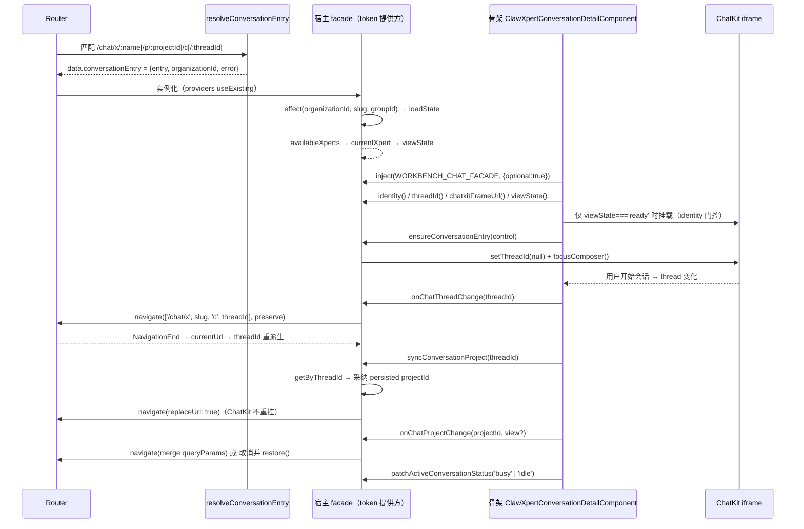

# 05 接口：会话工作台子专家（Xpert 前端 · 对话域）

> 本文口径：**以「前端组件对外契约」为主**——`WorkbenchChatFacade` 逐成员、`WORKBENCH_CHAT_FACADE` token 的注入与生命周期、`ChatXpertWorkbenchComponent` 的组件面与路由面、骨架↔宿主时序、复用指南、错误语义
> 后端 HTTP 路径只在「宿主实现要求」列中作为实现细节引用，契约归属见父级 `implementation/05-接口.md`
> 实测：本子域 **8 非 spec `.ts` / 5 spec**

**本文引用的文件**

- [workbench-chat.facade.ts](file://apps/cloud/src/app/features/chat/workbench-chat/workbench-chat.facade.ts)
- [xpert-workbench.component.ts](file://apps/cloud/src/app/features/chat/xpert-workbench/xpert-workbench.component.ts)
- [xpert-workbench.facade.ts](file://apps/cloud/src/app/features/chat/xpert-workbench/xpert-workbench.facade.ts)
- [conversation-entry.resolver.ts](file://apps/cloud/src/app/features/chat/xpert-workbench/conversation-entry.resolver.ts)
- [routes.ts](file://apps/cloud/src/app/features/chat/routes.ts)
- [clawxpert-conversation-detail.component.ts](file://apps/cloud/src/app/features/chat/clawxpert/clawxpert-conversation-detail.component.ts)
- [clawxpert-conversation-pane.component.ts](file://apps/cloud/src/app/features/chat/clawxpert/clawxpert-conversation-pane.component.ts)
- [clawxpert-scoped-conversation.facade.ts](file://apps/cloud/src/app/features/chat/clawxpert/clawxpert-scoped-conversation.facade.ts)
- [clawxpert.facade.ts](file://apps/cloud/src/app/features/chat/clawxpert/clawxpert.facade.ts)
- [conversation.ts](file://apps/cloud/src/app/features/chat/clawxpert/conversation-detail/chatkit/conversation.ts)
- [frequent-questions-start-screen.ts](file://apps/cloud/src/app/features/chat/workbench-chat/frequent-questions-start-screen.ts)
- [workbench-assistant-menu.component.ts](file://apps/cloud/src/app/features/chat/workbench-chat/workbench-assistant-menu.component.ts)
- [workbench-loading-indicator.component.ts](file://apps/cloud/src/app/features/chat/workbench-chat/workbench-loading-indicator.component.ts)
- [project-api.service.ts](file://apps/cloud/src/app/features/project/project-api.service.ts)
- [xpert-workbench.facade.spec.ts](file://apps/cloud/src/app/features/chat/xpert-workbench/xpert-workbench.facade.spec.ts)

## 目录

- [契约口径与总览](#契约口径与总览)
- [WorkbenchChatFacade 逐成员表](#workbenchchatfacade-逐成员表)
- [WORKBENCH_CHAT_FACADE 的注入方式与生命周期](#workbench_chat_facade-的注入方式与生命周期)
- [ChatXpertWorkbenchComponent 的组件面与路由参数](#chatxpertworkbenchcomponent-的组件面与路由参数)
- [骨架与宿主的调用时序图](#骨架与宿主的调用时序图)
- [复用指南：其他页面如何接入骨架](#复用指南其他页面如何接入骨架)
- [错误语义](#错误语义)
- [结论](#结论)

## 契约口径与总览

本子域对外只有**一个契约面**：`workbench-chat/workbench-chat.facade.ts` 导出的 4 个符号（`WorkbenchChatViewState` / `WorkbenchChatDefinition` / `WorkbenchChatFacade` / `WORKBENCH_CHAT_FACADE`）。使用它的三方是：

| 角色 | 文件 | 关系 |
| --- | --- | --- |
| **契约定义方** | `workbench-chat/workbench-chat.facade.ts` | 只定义、不实现；不 import 任何宿主 |
| **提供方（宿主）** | `xpert-workbench/xpert-workbench.component.ts`、`clawxpert/clawxpert-conversation-pane.component.ts`（另有隐式默认 `clawxpert/clawxpert.facade.ts`） | `providers` 里 `useExisting` |
| **消费方（骨架）** | `clawxpert/clawxpert-conversation-detail.component.ts` | `inject(WORKBENCH_CHAT_FACADE, { optional: true })` |

契约演进规则（从类型结构直接读出）：**新增可选成员是唯一向后兼容的扩展方式**；新增必需成员会同时打断三个实现（`ClawXpertFacade`、`ClawXpertScopedConversationFacade`、`XpertWorkbenchFacade`）——它们在同一个仓库，可被一次性修复，但外部/下游宿主必须同步。

章节来源：[workbench-chat.facade.ts](file://apps/cloud/src/app/features/chat/workbench-chat/workbench-chat.facade.ts)（关键符号：`WorkbenchChatFacade`、`WorkbenchChatDefinition`、`WorkbenchChatViewState`、`WORKBENCH_CHAT_FACADE`）

## WorkbenchChatFacade 逐成员表

| 成员 | 类型 | 语义 | 必需/可选 | 宿主实现要求 |
| --- | --- | --- | --- | --- |
| `definition` | `WorkbenchChatDefinition`（`{titleKey, defaultTitle}`） | 骨架标题与默认文案来源 | 必需 | 任意常量对象即可；`XpertWorkbenchFacade` 用 `XP.Chat.XpertWorkbench.Title` / `'Xpert'` |
| `identity` | `Signal<string \| null>` | ChatKit 挂载身份；**非 ready 必须为 null** | 必需 | 同会话内不得变化（否则 iframe 重挂）；群组 `chat-group:<id>`、私聊 `chat-xpert-workbench:<xpertId>` |
| `userId` | `Signal<string \| null>` | 请求上下文用户 | 必需 | 通常直取 `Store.userId` |
| `assistantId` | `Signal<string \| null>` | 助手标识（= `xpertId` 语义） | 必需 | 群组场景取 entry 的 `xpertId` |
| `xpertId` | `Signal<string \| null>` | xpert 标识 | 必需 | 可与 `assistantId` 同值（`XpertWorkbenchFacade.assistantId` 就是 `xpertId` 的别名） |
| `currentXpert?` | `Signal<IXpert \| null>` | 当前 xpert 完整对象 | 可选 | 缺席 → 启动屏 `xpert` 为 `null`（`injectFrequentQuestionsStartScreen` 收到 `null`） |
| `assistantTitle?` | `Signal<string \| null>` | 助手显示名 | 可选 | 缺席 → 骨架回落 `definition.defaultTitle` |
| `assistantAvatar?` | `Signal<TAvatar \| null>` | 助手头像 | 可选 | 缺席 → 无头像 |
| `initialLayout` | `Signal<XpertWorkbenchInitialLayoutEnum \| null>` | 首屏工作台布局（`two-columns` / `overlay-dialog` / `chatkit-maximized` / `workbench-maximized`） | 必需 | 来自 `xpert.options.workbench.initialLayout` |
| `defaultViewKey` | `Signal<string \| null>` | 首屏默认扩展视图 key | 必需 | 来自 `xpert.options.workbench.defaultViewKey`（实现里 `?.trim() \|\| null`） |
| `chatkitFrameUrl` | `Signal<string \| null>` | iframe 地址（**已白名单化**） | 必需 | 必须过 `sanitizeAssistantFrameUrl`；`null` → `viewState='error'` |
| `threadId` | `Signal<string \| null>` | 当前线程；群组与 entry 错误时为 `null` | 必需 | 建议由路由派生（`parseWorkbenchThreadId`） |
| `group?` | `Signal<{ id: string } \| null>` | 群组会话绑定（按 conversation id，不加载私有 thread） | 可选 | 缺席视为非群组；提供时必须同时保证 `threadId()` 为 `null` |
| `projectId?` | `Signal<string \| null>` | 当前路由 Project 作用域 | 可选 | 缺席 → 骨架用 `resolvedConversation().projectId` 兜底 |
| `chatkitMountProjectId?` | `Signal<string \| null>` | **仅初始挂载**的 Project | 可选 | 会话运行中变化不得改变挂载值（否则重挂） |
| `chatkitProjectSelection?` | `Signal<ProjectSelection>` | 草稿意图（`{mode:'auto-new'}` / `{mode:'none'}` / `{mode:'existing',projectId}`） | 可选 | 与「已持久化 Project」语义不同；实现里优先级：已采纳 > mount > `projectMode` query > `options.workspaceScope.onMissing` |
| `syncConversationProject?` | `(threadId: string) => Promise<void>` | 运行开始/结束后刷新持久 Project，**不新开会话** | 可选 | 缺席 → 首条消息后路由不补 Project 段 |
| `projectAccess?` | `Signal<TXpertProjectAccessSummary \| null>` | Project 权限摘要；`null` = pending/不可用/拒绝 | 可选 | 必须 fail-closed（不可在 pending 时给非 null） |
| `onChatProjectChange?` | `(projectId: string \| null, view?: WorkbenchExtensionViewOpenRequest, selection?: ProjectSelection) => Promise<boolean> \| void` | 切换 Project / 同项目开视图 | 可选 | 返回 `false` 表示导航被取消，宿主须回滚自身状态 |
| `loading` | `Signal<boolean>` | 主加载态（驱动 ChatKit 的 `loading`） | 必需 | 与 `viewState` 分离 |
| `loadingUserPreference` | `Signal<boolean>` | 用户偏好加载态 | 必需 | 与 `loading` 分离（骨架可分别呈现） |
| `viewState` | `Signal<WorkbenchChatViewState>` | 可挂载性四态机 | 必需 | 骨架据此挂载/不挂载；`'error'`/`'wizard'`/`'organization-required'` 均不挂 iframe |
| `suppressAutoResume` | `Signal<boolean>` | 禁止自动恢复上一线程 | 必需 | 由宿主在「清空会话 / 切 Project」时置位 |
| `pendingConversationStartId` | `Signal<number>` | 「请开新会话」的幂等请求号 | 必需 | `0` 表示无请求；`beginPendingConversation` 用 id 比对防重复 |
| `activeConversation` | `Signal<IChatConversation \| null>` | 当前会话实体 | 必需 | `setActiveConversation` 写入时应浅拷贝（实现用 `{...conversation}`） |
| `viewErrorMessage()` | `() => string` | 错误态文案（**必须已 i18n 化**） | 必需 | 不得返回空串；实现里含 frame 缺失分支 |
| `onChatThreadChange(threadId)` | `(string \| null) => void` | 骨架→宿主：会话换/清 | 必需 | 群组场景应直接 return（实现如此） |
| `beginPendingConversation(startId, control)` | `(number, ChatKitControl) => Promise<void>` | 消费 `pendingConversationStartId`，重置 ChatKit（`setThreadId(null)` + `focusComposer()`） | 必需 | `startId` 不匹配则 no-op；必须 `finally` 清 `pendingConversationStartId` |
| `ensureConversationEntry(control)` | `(ChatKitControl) => Promise<void>` | 首次进入空会话页时确保草稿态 | 必需 | 必须自身去重（实现按 `${xpertId}:${selection}` 键） |
| `setActiveConversation(conversation)` | `(IChatConversation \| null) => void` | 写入会话实体 | 必需 | 可空 |
| `patchActiveConversationStatus(status)` | `('busy' \| 'idle') => void` | 原地补状态（运行开始/结束） | 必需 | 无会话时应 no-op（不改 null） |

**契约外成员（骨架会读、但类型未声明）**：`refreshTaskSummaries?(): void`（经 `hasTaskSummaryRefresh` 结构探测）与 `currentWorkspaceId`（经 `getOptionalSignalValue`）。新宿主可不实现；需实现时按可选加法处理。

章节来源：[workbench-chat.facade.ts](file://apps/cloud/src/app/features/chat/workbench-chat/workbench-chat.facade.ts)（关键符号：`WorkbenchChatFacade.chatkitMountProjectId`、`WorkbenchChatFacade.onChatProjectChange`、`WorkbenchChatFacade.patchActiveConversationStatus`）、[conversation.ts](file://apps/cloud/src/app/features/chat/clawxpert/conversation-detail/chatkit/conversation.ts)（关键符号：`hasTaskSummaryRefresh`）

## WORKBENCH_CHAT_FACADE 的注入方式与生命周期

- **定义形式**：`new InjectionToken<WorkbenchChatFacade>('WORKBENCH_CHAT_FACADE')`——**无 `providedIn`、无 `factory`**。
- **可解析性**：只有在祖先注入器里显式提供该 token 才能 `inject`；否则 `inject(WORKBENCH_CHAT_FACADE)` 抛 `NullInjectorError`。骨架因此使用 `{ optional: true }` 并回落到 `inject(ClawXpertFacade)`。
- **提供方式必须是 `useExisting`**：`{ provide: WORKBENCH_CHAT_FACADE, useExisting: XpertWorkbenchFacade }`。若改用 `useClass`，token 与具名类会解析成**两个实例**，signal 状态分叉、`#lastConversationEntryKey` 等去重键失效。
- **生命周期**：token 的实例 = 提供它的组件所创建的注入器中的那份 facade；`ChatXpertWorkbenchComponent`（`/chat/x/...`）与 `ClawXpertConversationPaneComponent`（`/chat/clawxpert/...`）各自提供，**互不共享**。宿主组件销毁 → 注入器销毁 → facade 实例失效（`XpertWorkbenchFacade` 的 signal 随之释放；`ClawXpertScopedConversationFacade` 另有 `ngOnDestroy` 置 `destroyed=true` 以阻断迟到回写）。
- **可见性**：`useExisting` 提供的是**组件级**注入器，因此同页多个 `xp-workbench-assistant-menu` / `xp-clawxpert-conversation-detail` 会拿到同一份宿主 facade（这正是「一个页面一个会话上下文」的实现方式）。
- **三个解析结果**（实测）：`ChatXpertWorkbenchComponent` → `XpertWorkbenchFacade`；`ClawXpertConversationPaneComponent` → `ClawXpertScopedConversationFacade`；无 provider → `ClawXpertFacade`。

章节来源：[xpert-workbench.component.ts](file://apps/cloud/src/app/features/chat/xpert-workbench/xpert-workbench.component.ts)（关键符号：`ChatXpertWorkbenchComponent.providers`）、[clawxpert-conversation-pane.component.ts](file://apps/cloud/src/app/features/chat/clawxpert/clawxpert-conversation-pane.component.ts)（关键符号：`ClawXpertConversationPaneComponent.providers`）、[clawxpert-conversation-detail.component.ts](file://apps/cloud/src/app/features/chat/clawxpert/clawxpert-conversation-detail.component.ts)（关键符号：`ClawXpertConversationDetailComponent.facade`）

## ChatXpertWorkbenchComponent 的组件面与路由参数

**组件面（`xpert-workbench.component.ts`）**

| 项 | 值 |
| --- | --- |
| 类名 / 选择器 | `ChatXpertWorkbenchComponent` / `xp-chat-xpert-workbench` |
| standalone / 变更检测 | `standalone: true`、`ChangeDetectionStrategy.OnPush` |
| `inputs` / `outputs` | **该模块无此项**（类体为空，无 `input()` / `output()` / `@Input` / `@Output`） |
| imports | `CommonModule`、`ClawXpertConversationDetailComponent` |
| host | `{ class: 'flex h-full min-h-0 flex-col' }` |
| 模板 | `<xp-clawxpert-conversation-detail class="min-h-0 flex-1" />`（唯一子组件） |
| providers | `XpertWorkbenchFacade`、`{ provide: WORKBENCH_CHAT_FACADE, useExisting: XpertWorkbenchFacade }` |

**路由面（`features/chat/routes.ts`）**

| 项 | 值 |
| --- | --- |
| matcher | `xpertWorkbenchConversationMatcher`（非 `path` 声明） |
| 匹配形态 | `/chat/x/:name/c`、`/chat/x/:name/c/:threadId`、`/chat/x/:name/p/:projectId/c`、`/chat/x/:name/p/:projectId/c/:threadId` |
| `posParams` | `name`（必需）、`projectId`（带 `p/` 段时）、`threadId`（带尾段时） |
| `resolve` | `{ conversationEntry: resolveConversationEntry }` → `ConversationEntryResolution = { entry, organizationId, error }` |
| `canActivate` | `featureGate([AiFeatureEnum.FEATURE_XPERT])` |
| `data.title` | `'Chat Xpert Workbench Conversation'` |
| 兄弟路由 | `x/:name`（`pathMatch: 'full'` → 重定向到 `/chat/x/:name/c`，保留 query/fragment）；`**` → `/chat/clawxpert` |
| 入口守卫（resolver 内） | 私聊需 `hasFeatureEnabled(FEATURE_XPERT_CLAWXPERT)`，否则 `RedirectCommand(createUrlTree(['/chat']))`；`purpose === 'group'` 放行 |
| query 参数（由宿主 facade 读写的 UI 状态） | `view`（扩展视图 key）、`viewSelection`、`viewParameters`（JSON 串）、`projectMode`（`'none'` / `'auto-new'`）、`viewProject` |

内置零件组件面（同域复用）：`WorkbenchAssistantMenuComponent.activeId`（`input<string \| null>`）与 `selected`（`output<void>()`）；`WorkbenchLoadingIndicatorComponent.visible`（`signal<boolean>`，内部 400ms 定时）；`WorkbenchAccountComponent.user`（`toSignal(Store.user$)`）。

章节来源：[xpert-workbench.component.ts](file://apps/cloud/src/app/features/chat/xpert-workbench/xpert-workbench.component.ts)（关键符号：`ChatXpertWorkbenchComponent`）、[routes.ts](file://apps/cloud/src/app/features/chat/routes.ts)（关键符号：`xpertWorkbenchConversationMatcher`、`resolveConversationEntry`）、[workbench-assistant-menu.component.ts](file://apps/cloud/src/app/features/chat/workbench-chat/workbench-assistant-menu.component.ts)（关键符号：`WorkbenchAssistantMenuComponent.activeId`、`WorkbenchAssistantMenuComponent.selected`）

## 骨架与宿主的调用时序图



图表来源：[conversation-entry.resolver.ts](file://apps/cloud/src/app/features/chat/xpert-workbench/conversation-entry.resolver.ts)（关键符号：`resolveConversationEntry`）· [xpert-workbench.facade.ts](file://apps/cloud/src/app/features/chat/xpert-workbench/xpert-workbench.facade.ts)（关键符号：`XpertWorkbenchFacade.ensureConversationEntry`、`XpertWorkbenchFacade.onChatThreadChange`、`XpertWorkbenchFacade.syncConversationProject`、`XpertWorkbenchFacade.onChatProjectChange`）· [clawxpert-conversation-detail.component.ts](file://apps/cloud/src/app/features/chat/clawxpert/clawxpert-conversation-detail.component.ts)（关键符号：`ClawXpertConversationDetailComponent.control`、`ClawXpertConversationDetailComponent.facade`）

章节来源：[xpert-workbench.facade.ts](file://apps/cloud/src/app/features/chat/xpert-workbench/xpert-workbench.facade.ts)（关键符号：`XpertWorkbenchFacade.loadState`、`XpertWorkbenchFacade.onChatProjectChange`）、[xpert-workbench.facade.spec.ts](file://apps/cloud/src/app/features/chat/xpert-workbench/xpert-workbench.facade.spec.ts)（关键符号：`XpertWorkbenchFacade.ensureConversationEntry`、`XpertWorkbenchFacade.syncConversationProject`）

## 复用指南：其他页面如何接入骨架

1. **实现契约**：新建 `@Injectable()` 类 `implements WorkbenchChatFacade`，先补齐 21 个必需成员；建议直接照抄 `XpertWorkbenchFacade` 的职责划分（URL 派生 / 可得性加载 / 会话写回 / Project 采纳）。
2. **装配三行**：
   ```ts
   @Component({
     selector: 'xp-your-workbench',
     imports: [ClawXpertConversationDetailComponent],
     providers: [YourFacade, { provide: WORKBENCH_CHAT_FACADE, useExisting: YourFacade }],
     template: `<xp-clawxpert-conversation-detail class="min-h-0 flex-1" />`,
     changeDetection: ChangeDetectionStrategy.OnPush
   })
   export class YourWorkbenchComponent {}
   ```
3. **按需实现可选成员**：只有群组会话才需要 `group`；只有 Project 隔离才需要 `projectId` / `chatkitMountProjectId` / `chatkitProjectSelection` / `projectAccess` / `onChatProjectChange` / `syncConversationProject`；只做品牌展示才需要 `currentXpert` / `assistantTitle` / `assistantAvatar`。
4. **路由**：参考 `xpertWorkbenchConversationMatcher`——把 `threadId` / `projectId` 放进 `posParams`，这样 facade 可以只依赖 `Router.url` 而无需额外输入；入口若需要服务端判定，参考 `resolveConversationEntry` 用 `resolve` 注入 `data`。
5. **状态写回必须走路由**：任何「可被 URL 表达」的状态（thread、project、视图 key）都应 `navigate` 回写，否则刷新后状态丢失、且骨架无法跨形态复用（见本域 `02-实现.md` 设计维度二）。
6. **不要绕过契约读宿主**：骨架可用能力只有这 31 个成员；若发现需要新增能力，走「加可选成员 + 骨架 `?.` 兜底」的路径，不要直接 `inject(YourFacade)`。
7. **零件复用**：`xp-workbench-account`、`xp-workbench-loading-indicator`、`xp-workbench-assistant-menu` 不依赖 token，可直接放进宿主头部；菜单需要提供 `AssistantBindingService` / `ChatGroupService` / `ScopeService` / `Dialog` / `Router` / `Store`。

章节来源：[workbench-chat.facade.ts](file://apps/cloud/src/app/features/chat/workbench-chat/workbench-chat.facade.ts)（关键符号：`WorkbenchChatFacade.projectAccess`、`WorkbenchChatFacade.chatkitProjectSelection`）、[xpert-workbench.component.ts](file://apps/cloud/src/app/features/chat/xpert-workbench/xpert-workbench.component.ts)（关键符号：`ChatXpertWorkbenchComponent.providers`）

## 错误语义

| 场景 | 契约层的表现 | 兜底与消费侧动作 |
| --- | --- | --- |
| 无组织上下文 | `viewState = 'organization-required'` | 不挂 iframe；宿主清空 `availableXperts` / `activeConversation` |
| `chatkitFrameUrl` 为 `null` | `viewState = 'error'`，`viewErrorMessage()` 返回 `XP.Chat.ClawXpert.FrameMissing` | 不挂 iframe（防止空 iframe） |
| 会话元数据无权 | resolver 返回 `error`（非抛异常） | `viewState='error'`，`viewErrorMessage()` = 该错误；**不降级为私聊会话** |
| 会话元数据请求失败 | `catchError` → `getErrorMessage(error) \|\| XP.Chat.ClawXpert.LoadFailedDesc` | 同上 |
| 群组 entry 属别组织 | `viewState = 'error'` | 不挂载，避免跨组织串会话 |
| slug 缺失 | `errorMessage = XP.Chat.XpertWorkbench.MissingSlug` | 文案走 `viewErrorMessage()` |
| slug 不可得 | `errorMessage = XP.Chat.XpertWorkbench.NotFound` | `xpertId()` 为 `null`，`viewState='error'` |
| Project 无权限 / 403 | `projectAccess = null`（**与 pending 同形**） | 消费方必须 fail-closed；`null` 不得解释为「可编辑」 |
| 项目切换导航被取消 | `onChatProjectChange` 返回 `false` 或抛错 | 宿主 `restore()` 回滚 URL 相关状态；入口视图导航不得因上游带错而跳错页 |
| 常见问题生成失败 | `startScreen` 回落到已配置内容（不置 `null`），除非 `active=false` | 不阻塞会话开始 |
| 助手菜单加载失败 | `failed = true`、`groupsFailed = true` | `role="alert"` + Retry；群组与助手两个失败态分离 |
| 加载中的视觉反馈 | `loading = true` | `xp-workbench-loading-indicator` 400ms 后才显形；快速切换不闪 |
| 新增必需成员的编译失败 | `implements WorkbenchChatFacade` 报错 | 三个实现类同仓库可一次修；下游宿主需同步升级 |

章节来源：[xpert-workbench.facade.ts](file://apps/cloud/src/app/features/chat/xpert-workbench/xpert-workbench.facade.ts)（关键符号：`XpertWorkbenchFacade.viewErrorMessage`、`XpertWorkbenchFacade.loadProjectAccess`）、[conversation-entry.resolver.ts](file://apps/cloud/src/app/features/chat/xpert-workbench/conversation-entry.resolver.ts)（关键符号：`ConversationEntryResolution.error`）

## 结论

- **对外契约就是一个 type 加一个 token**：`WorkbenchChatFacade`（21 必需 / 10 可选）＋ `WORKBENCH_CHAT_FACADE`；其余都是实现或零件。
- **接入成本已量化**：新宿主的必需工作 = 实现 21 个必需成员 + `providers` 一行 + 模板一行；必需成员里真正有业务重量的只有 `viewState` / `identity` / `threadId` / `viewErrorMessage()` / 四个回调。
- **`useExisting` 与「非 ready 时 `identity=null`」是两条硬约束**：前者保证实例唯一，后者把「不挂 iframe」的责任放在骨架，宿主不必自查。
- **可选成员是形态开关**：群组靠 `group`、Project 隔离靠 6 个 Project 成员、品牌靠 3 个品牌成员——不做这些形态的宿主可以一个都不实现。
- **错误一律 fail-closed 且不降级**：入口错误阻断挂载，Project 权限 `null` 视为不可用，frame 缺失直接 `error`。
- 契约成员之外还有两个**未入类型**的隐式成员（`refreshTaskSummaries` / `currentWorkspaceId`），改契约前请以源码为准（详见 `02-实现.md` 技术债）。

章节来源：[workbench-chat.facade.ts](file://apps/cloud/src/app/features/chat/workbench-chat/workbench-chat.facade.ts)（关键符号：`WorkbenchChatFacade`、`WORKBENCH_CHAT_FACADE`）、[clawxpert-scoped-conversation.facade.ts](file://apps/cloud/src/app/features/chat/clawxpert/clawxpert-scoped-conversation.facade.ts)（关键符号：`ClawXpertScopedConversationFacade.implements`）
